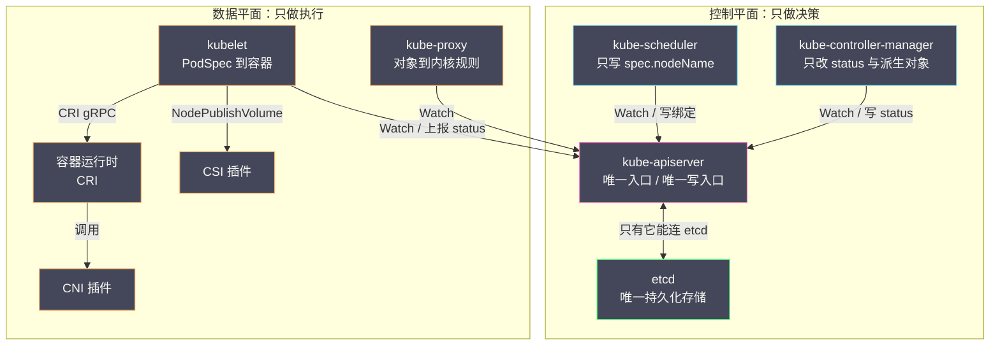
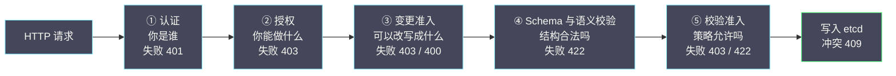
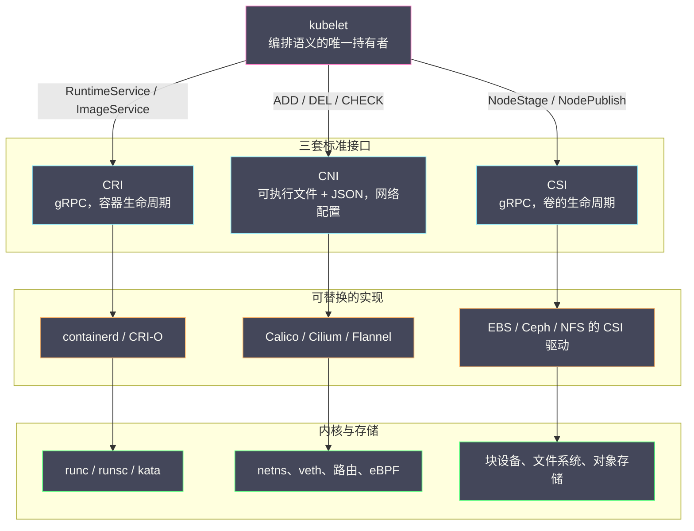
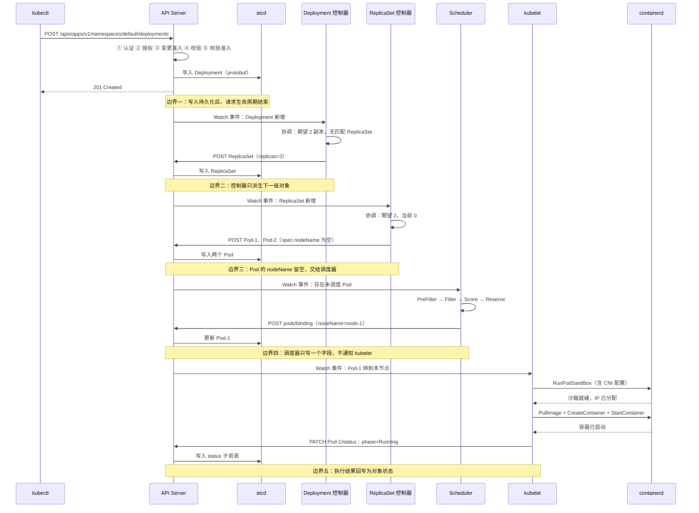
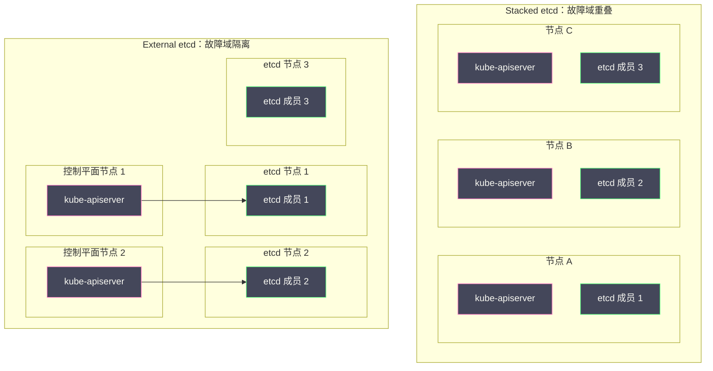

# 02 Kubernetes 整体架构

**摘要：**

[[01 Kubernetes 的诞生与设计哲学]] 把五条设计原则讲成了可执行的契约，但契约总要落在具体的边界上——哪段代码归谁管、哪份数据谁能写、哪个决策只允许一个人做。本文只回答一件事：K8s 把这些线画在了哪里，以及为什么画在那里。全篇沿着"分层 → 入口 → 存储 → 决策 → 执行"的顺序推进：先从 Borg 的 cell 讲起，说明控制平面与数据平面的分界其实是决策权与执行权的分界；再逐一审视 API Server 的五道关卡、etcd 的单一客户端约束、Scheduler 只写一个字段的最小契约、Leader Election 的排他性，以及 CRI/CNI/CSI 三套接口如何把"执行"从内核里剥离出来；最后用一个 Pod 的完整链路把跨边界的每一次通信串起来，并推演控制平面全挂时集群会退化成什么样。组件内部机制不在这里展开，那些内容属于 [[云原生/Kubernetes/Kubernetes架构深度剖析/00 专栏导览|Kubernetes 架构深度剖析]] 与 [[云原生/Kubernetes/kubernetes之API Server/00 专栏导览|API Server 专栏]]。读完这一篇，你应该能指着任意两个组件之间的那条连线，说出线上传的是什么、断了会怎样。

---

## 第 1 章 架构的分层：为什么是控制平面与数据平面

### 1.1 从 Borg 的 cell 到 K8s 的集群边界

2015 年，Google 在 EuroSys 上公开 Borg 的设计时给了一个让人印象深刻的数字：一个 cell 的中位规模大约是一万台机器，而这一整片机器只由一个逻辑上集中的 BorgMaster 统辖，用 Paxos 在五台机器上做副本，另有一个调度器负责把 task 绑到具体的机器上。对 Google 的工程师来说，这堆机器不是一万台服务器，而是**一台可以被整体编程的分布式计算机**——你告诉它要跑什么，它自己决定跑在哪、跑几个、挂了怎么办。

Kubernetes 继承了这个抽象，但把"一台计算机"的隐喻推得更彻底：它不再假装整片机器是一个不可分割的整体，而是明确地把它切成两个职责完全不同的半边。切法在调用关系里一眼就能看出来——`kube-apiserver`、`kube-scheduler`、`kube-controller-manager` 这一组只跟 API 对象打交道，从不直接碰容器；`kubelet`、`kube-proxy` 与容器运行时这一组只跟容器和内核打交道，从不做跨节点的全局决策。

这个切分与 Borg 的 cell 有一个容易被忽略的差别：**K8s 的边界不是按机器切的，而是按角色切的**。Borg 时代人们习惯说"主控跑在 master 机器上"，好像控制平面天然属于一组特定的物理机；K8s 里这条对应关系从一开始就是松的，kubeadm 的默认部署方式就把控制平面组件当作静态 Pod（Static Pod）跑在普通节点上，由该节点的 kubelet 负责拉起。也就是说，一台机器可以同时承载控制平面的一个副本与数据平面的执行器，边界在进程之间，不在机架之间。

一旦承认边界是逻辑的而不是物理的，第一个真问题就浮出来了：这条线凭什么画在这里。

### 1.2 控制平面：只做决策，不做执行

控制平面（Control Plane）由四个常驻组件构成，各自守着一个不可让渡的职责：API Server 是唯一入口与唯一的状态写入口，etcd 是唯一持久化存储，Scheduler 只负责"这个 Pod 该去哪"，Controller Manager 负责"现实离期望还差多少"。把它们放在一起看，会发现一个共同特征——**这四个组件全都不接触容器**：不知道 `runc` 是什么，不关心镜像存在哪个 registry，也没有任何一行代码能调用 `clone()` 创建进程。

这个"不接触"不是能力不足，而是被刻意维持的隔离。控制平面产出的唯一东西是对 API 对象的修改：Scheduler 把节点名写进 `spec.nodeName`，Deployment 控制器创建 ReplicaSet 对象，Node 控制器给节点打上 `NotReady` 的污点。这些修改落到 etcd 之后，控制平面的任务就结束了，剩下的全部由数据平面自行完成。

这么设计的直接收益是**决策可以被重放**。一个 Pod 从创建到 Running 的全过程，在 etcd 里留下了一串对象版本：ReplicaSet 被创建、Pod 被创建且 `nodeName` 为空、Pod 的 `nodeName` 被填上、Pod 的 `status.phase` 变成 Running。任何一刻的状态都能被完整读出来，任何一刻的决策都能被重新推导一遍。如果控制平面同时还要负责起容器，这个过程就会被切成"一半在 etcd 里、一半在某个进程的内存里"，可重放性立刻消失。

代价则体现在延迟上。控制平面做完决策之后只能"放手"，它无法知道数据平面什么时候执行完，只能靠反复读取 status 来猜。这就是为什么 `kubectl apply` 到 Pod 真正 Running 之间隔着秒级空窗，也是为什么 `kubectl wait` 这类工具必须存在——它们做的事情本质上就是替人轮询 status。

### 1.3 数据平面：只做执行，不做决策

数据平面（Data Plane）的组成更简单：每个节点上一个 kubelet、一个 kube-proxy（或者它的替代品）、一个实现了 CRI 的容器运行时，再加上 CNI 与 CSI 插件。这一侧的组件有一个共同的性格特征——它们只对"已经写进对象里的决定"作出反应，从不自行判断该不该做。

kubelet 是最典型的例子。它看到本节点上出现了一个 `spec.nodeName` 等于自己名字的 Pod，就去拉镜像、建沙箱、起容器；它不会问"这个 Pod 该不该跑在我这儿"，也不会问"集群是不是已经有足够副本了"。kube-proxy 同理，Service 与 EndpointSlice 变了就重写本机转发规则，不判断"这个 Service 该不该有五个后端"。

这个"不判断"带来一个很实用的性质：**数据平面的行为是局部的、可预测的**。给定同一份 PodSpec 与同一个节点状态，kubelet 的行为基本确定，不会因为集群别处出了问题就改变自己的动作。反过来，这也意味着数据平面无法自我纠偏——如果控制平面写错了 `nodeName`，kubelet 会忠实地在错误的节点上把容器跑起来，而且跑得好好的。

把两侧放在一起，K8s 的整体形状就出来了：控制平面负责"想"，数据平面负责"做"，两者之间只有一条通道——API Server 里的对象。



这张图里最值得琢磨的是几条不存在的连线：Scheduler 与 kubelet 之间没有连接，Controller Manager 与容器运行时之间没有连接，kube-proxy 与后端 Pod 之间也没有连接。所有信息都经由 API 对象中转，这是 [[01 Kubernetes 的诞生与设计哲学]] 里那条松耦合铁律的物理形态。

### 1.4 分层的判据：谁对最终状态拥有解释权

讲到这里，很容易把"分层"理解成"跑在不同机器上的两组进程"。这个理解是错的，而且错得很危险，因为它会导致一系列错误的问题，譬如"控制平面该不该和业务 Pod 混部"（这是个容量与故障域问题，不是架构问题）、"kube-proxy 算控制平面还是数据平面"（它两边都像）。

判断一个组件属于哪一侧，唯一有效的判据是：**它对最终状态拥有解释权吗**。

拥有解释权的组件，是那些"看到差异就有权决定怎么办"的组件。Controller Manager 看到 `spec.replicas=3` 而实际只有 2 个 Pod，就有权创建第 3 个；Scheduler 看到未调度的 Pod，就有权挑一个节点。它们做的是从期望状态推导下一步动作，这个推导依赖全局视野。

不拥有解释权的组件，只执行"别人已经推导完的结论"。kubelet 看到 `nodeName` 是自己，唯一合法的动作就是执行；它无权质疑这个 Pod 是否应该存在、是否该换个节点。它依赖的视野只有本节点。

用这个判据去量，几个模糊地带立刻清楚了。kube-proxy 属于数据平面，因为它对"哪些 Pod 应该是 Service 后端"没有解释权，Endpoints 里写了谁它就转给谁，翻译成内核规则不需要跨节点信息。反过来，cloud-controller-manager 属于控制平面，因为它要根据云平台的真实状态决定"这个 LoadBalancer 该不该创建"，这需要全局视野与外部系统交互。

判据的第二半句更重要：**解释权必须是单点的**。同一个最终状态，如果有两个组件都认为自己有权解释，它们就会互相覆盖，系统进入震荡。这就是为什么 ReplicaSet 控制器绝不直接创建 Pod 之外的任何东西、为什么 Scheduler 不碰 `status`、为什么 kubelet 只能写自己节点的 Pod status——每一条都是解释权的排他性声明。

这里可以借一个比喻：K8s 的架构像一家只出图纸、不碰砖头的设计院，加上一群只按图施工、不改图纸的施工队。设计院与施工队可以在一栋楼里办公，也可以隔着一千公里，物理位置完全不影响分工；真正决定谁是谁的，是**"图纸改了谁负责改"这件事只能有一方回答**。一旦施工队开始自作主张改图纸，或者设计院跑到工地上亲自砌墙，这套体系就散了。

> [!info] 分层与部署形态无关
> 判断组件归属看解释权，不看部署位置。同一个 `kube-apiserver` 进程，在 kubeadm 集群里以 static pod 形式跑在节点上，在托管 Kubernetes 服务里跑在用户看不见的机器上，在本地 kind 集群里跑在 Docker 容器里——三种形态下它的边界职责一字不变。反过来，同一个节点上混跑控制平面与业务负载也不会破坏分层，只会破坏故障隔离。

---

## 第 2 章 唯一入口：API Server 的边界职责

### 2.1 请求管线的五道关卡

API Server 承担的第一个边界职责是**收口**：集群里任何一次状态变更，无论来自 `kubectl`、控制器、kubelet 还是某个 Operator，都必须以 HTTP 请求的形式进入这个进程。这条约束把"谁改了集群"从一件无法回答的事变成了一件可以查审计日志的事。

一个请求进入之后要走完五道关卡，每一道失败时返回的语义都不同，而这些语义差异恰好标出了边界的层次：



**第一道是认证（Authentication）**，回答"你是谁"。失败返回 `401 Unauthorized`，语义是"我连你是谁都不知道，谈不上允不允许"。这一层只做身份认定，不做任何权限判断，客户端证书、ServiceAccount 的 Bearer Token、OIDC 令牌、webhook token 认证都在这一层收敛成同一个 `user.Info` 结构。

**第二道是授权（Authorization）**，回答"你能不能对这个资源做这个动作"。失败返回 `403 Forbidden`，语义与 401 有本质区别：401 是"请先证明身份"，403 是"我知道你是谁，但你不能"。K8s 的默认授权器是 RBAC，此外还有 Node 授权器（专供 kubelet，只允许它读写与本节点相关的对象）与 Webhook 授权器（把判断外包给外部服务）。

**第三道是变更准入（Mutating Admission）**，回答"这个请求可以被改写成什么"。这一层允许改写对象，典型动作是填默认值（`spec.strategy` 为空时补上 `RollingUpdate`）、注入 sidecar（Istio 的自动注入就在这里）、挂载默认 ServiceAccount 的 token。它是整条管线里唯一允许修改请求体的关卡，也因此是最危险的一道——一个写错的 mutating webhook 能悄悄改掉全集群的对象。

**第四道是 Schema 与语义校验**，回答"这个对象本身合法吗"。字段类型对不对、必填项在不在、`replicas` 是不是负数、`selector` 是否与 `template.labels` 匹配，都在这里判定。失败通常返回 `422 Unprocessable Entity`，语义是"我看懂你要什么了，但你给的这份东西不成立"。

**第五道是校验准入（Validating Admission）**，回答"策略允不允许"。它与第四道的分工是"语法"与"政策"的区别：第四道只关心对象自身是否自洽，第五道关心对象与集群里其他东西的关系，譬如"这个 namespace 的配额还剩多少""这个节点端口有没有被占用""这个镜像是不是来自白名单仓库"。失败返回 `403` 或 `422`，取决于 webhook 自己怎么定义。

五道关卡之后还有一道隐形的失败点：写入 etcd 时的 `409 Conflict`。它不属于任何关卡，而是乐观并发控制的产物——请求里带的 `resourceVersion` 与 etcd 中的当前版本不一致，说明有人在你看完之后改过了。这个 409 是 [[06 etcd 与 Kubernetes 的状态存储]] 那条主线在 API 层的投影。

这条管线的细节（每层实现、webhook 匹配规则、超时与失败策略）在 [[云原生/Kubernetes/kubernetes之API Server/00 专栏导览|API Server 专栏]] 里有完整展开，本文只关心它划出的边界：**认证与授权在边界之外，变更与校验在边界之内**。身份与权限是集群所有者定义的外部事实，对象合法性是 K8s 自己定义的内部事实，两类判断在同一条管线上但语义不能混——这也是为什么 mutating webhook 超时时允许你选择 `Fail` 或 `Ignore`，而认证失败永远没有"忽略"这个选项。

### 2.2 无状态设计与水平扩展

API Server 最关键的一个设计决定是**无状态（Stateless）**：它不在本地磁盘上保存集群状态，进程重启不丢失任何东西，任何一个实例都能处理任何一个请求。这个性质直接决定了它能以 Active-Active 方式水平扩展——三个实例挂在负载均衡器后面，每个实例都直连同一套 etcd，请求打到谁身上结果都一样。

不过"无状态"这个说法需要一点修正，否则会在排障时误导人。API Server 进程里确实缓存了大量数据：Watch 缓存（Watch Cache）保存每类资源的近期变更，APF（API Priority and Fairness）的排队队列保存在内存里。这些东西在重启后全部消失，但不影响正确性——缓存丢了，重新从 etcd 灌一遍就行。

正因为有这层缓存，"无状态"与"读到旧数据"可以同时成立。一个 `List` 请求带 `resourceVersion=""`（空字符串）时，API Server 会做一次 quorum read，直接问 etcd 要最新版本，代价是一次 Raft 往返；带 `resourceVersion="0"` 时则明确表示"任何版本都行"，直接从 watch cache 返回，可能比 etcd 落后几十毫秒。客户端要强一致还是低延迟，由这个字段自己选——**这是把一致性级别做成接口参数的一个典型例子**。

为什么 Scheduler 不能这么干，是一个更有意思的问题。Scheduler 的决策依赖"集群当前还剩多少可分配资源"这个全局快照，而两个 Scheduler 实例会各自持有一份略有差异的快照，同时给两个 Pod 选中同一个节点的最后一份余量。Omega 在 2013 年就验证过这条路：冲突率一高，多个调度器就是在互相踩脚，重试暴涨反而更慢。K8s 的选择是**承认这条边界，把需要全局串行的部分收窄到最小**——只让一个 Scheduler 活跃，其余实例待命，取舍的细节见 4.4 节。

### 2.3 聚合层与 API 扩展的边界

API Server 面对的一个现实矛盾是：如果所有 API 都必须内置在主仓库里，那么每加一个资源类型都要走一次 K8s 的发版流程，生态根本长不出来。K8s 给出的答案有两条，一条轻、一条重。

轻的那条是 **CRD（CustomResourceDefinition）**。它允许你在现有 API Server 里注册一个新的资源类型，注册之后立刻获得与内置资源完全一致的工具链待遇——`kubectl get`、RBAC、准入 webhook、Watch、`resourceVersion` 全部可用，因为它在存储层就是 etcd 里多了一个前缀。CRD 的边界很清楚：**它只扩展"数据的形状"，不扩展"数据的语义"**。声明一个 `kind: MyDatabase` 并不会让 K8s 突然会管数据库，语义要靠你自己写的控制器补上。

重的那条是**聚合层（Aggregated API Server）**，通过 `APIService` 对象把某一组 API 路径的请求反向代理到一个独立的进程。这个进程可以是任何实现了 K8s API 约定的服务，典型例子是 `metrics-server`——它把 `/apis/metrics.k8s.io` 挂进主 API Server，数据却完全存在自己的内存里，一个字节都不进 etcd。

CRD 的对象存在 etcd 里，因此享受 Raft 复制、MVCC 版本、备份恢复、审计的全部保障；聚合 API 的对象存在别处，它拿到的是"入口的转发权"，而不是"存储的托管权"。由此产生一个常见的误判：有人以为聚合 API 也能用 `resourceVersion` 做乐观并发，实际上那要看后端实现有没有提供等价语义，K8s 只保证转发，不保证语义。

聚合层还有一个更隐蔽的边界问题：它让"唯一入口"这句话在实现上出现了例外。请求确实从 API Server 进来，但处理它的是另一个进程，那个进程可能根本不连 etcd，也可能连的是完全不同的数据库。所以"所有状态变更都经过 API Server 的准入控制"这条铁律，对聚合 API 只成立到"转发之前"——一旦请求被代理出去，后面的准入、审计、限流都由那个进程自己负责。这是扩展性的必然代价，也解释了为什么核心资源（Pod、Service、Node）从来不通过聚合层实现。

### 2.4 边界之外：什么不该由 API Server 做

API Server 明确不做以下四类事情，每一类被排除都有具体理由。

**它不做业务逻辑**。API Server 不知道 Deployment 与 ReplicaSet 的关系意味着什么，也不知道 Service 的后端该怎么算——这些知识全部在控制器里。它对 Deployment 的唯一理解是"一个符合 apps/v1 schema 的对象"。这条排除让 API Server 对所有资源一视同仁，也让新增资源类型不必改它的代码。

**它不做长期状态机**。API Server 处理请求是短事务：进来、校验、写 etcd、返回。它不维护"这个 Pod 正在被删除，等 finalizer 清完再删"这类跨请求状态，那类状态被外化成了对象字段（`metadata.deletionTimestamp`、`metadata.finalizers`），由控制器去推进——这是 K8s 能在组件频繁重启的环境里保持正确的根本原因之一。

**它不做跨资源的原子事务**。K8s 的 API 没有事务语义，一个控制器创建 ReplicaSet 和 Pod 不可能"要么都成功要么都失败"。这个限制看起来是缺陷，实际是刻意保留的：一旦引入跨对象事务，API Server 就必须持锁、处理死锁、为长事务设计超时与回滚，整个系统会立刻退化成一个分布式数据库。K8s 用另一套机制替代事务——OwnerReference 加垃圾回收，它保证的不是"原子"，而是"最终不会有孤儿"。

**它不做数据的二次加工**。API Server 不聚合、不排序、不计算指标，`List` 返回的就是 etcd 里的对象（可能经过版本转换），要排序请客户端自己做，要聚合请写聚合 API 或用 metrics 体系。这条排除让它的每条代码路径都保持可预测的复杂度——一旦开始做聚合，请求代价就与数据量挂钩，而数据量由集群规模决定，API Server 承受不起这种耦合。

用一句话定位这个入口：API Server 像一座只认场内撮合的交易所，任何委托必须报进场内，场外成交一律不算数；而它自己不持有账本，账本在 etcd 手里。

---

## 第 3 章 状态存储：etcd 的契约

### 3.1 唯一真相源与"唯一客户端"约束

整个 K8s 架构里最硬的一条约束是：**只有 API Server 直接与 etcd 通信**。Scheduler 不连 etcd，kubelet 不连 etcd，你的 Operator 也不该连。这条约束有三层收益，每层都对应一个具体的工程痛点。

第一层是封装。etcd 是一个键值存储，它只认字节串，不认 Pod 与 Deployment 的区别。API Server 把"资源类型 + 命名空间 + 名字"翻译成 key、把对象序列化成 value、把 etcd 的 revision 翻译成 `resourceVersion`，对外只暴露结构化的 REST 语义。没有这层封装，每个组件都要自己实现一遍 key 的拼装规则，而这个规则一旦变化（譬如 Node 的前缀至今仍是 `minions`），所有组件都要跟着改。

第二层是权限。所有写入都必须穿过第 2 章那五道关卡，没有组件能绕过权限检查直接改集群状态。这不只是安全考虑，更是**审计的前提**——"这个 Pod 是谁删的"之所以有唯一答案，是因为删 Pod 这个动作只可能发生在 API Server 的某个请求处理路径上。

第三层是连接数控制。两千节点的集群里，如果每个 kubelet 都直连 etcd 做 Watch，etcd 要维护两千条长连接与两千份增量推送；经由 API Server 中转，它只需要面对几个实例的连接。Raft 日志复制对连接数与写入放大都很敏感，这条约束实际上是在保护它。

这条约束有一个正当的例外，值得单独点出来：**备份与运维工具可以直连 etcd**。`etcdctl snapshot save`、`etcdctl defrag`、集群成员变更这些操作必须绕过 API Server，因为它们操作的是存储本身，不是集群状态。这条例外的边界很清晰——只读或只改存储层，不产生 API 语义上的对象变更。

### 3.2 key 布局与序列化

K8s 在 etcd 里用一套前缀式布局组织数据，格式是 `/registry/<资源复数名>/<namespace>/<name>`，集群级资源省略 namespace 一段：

```text
/registry/pods/default/nginx-7d8f9c-abcde
/registry/pods/kube-system/coredns-5d78c9-xyz12
/registry/deployments/default/web
/registry/services/default/my-service
/registry/secrets/default/db-password
/registry/minions/node-1                    # 集群级资源，无 namespace 段
/registry/leases/kube-node-lease/node-1     # 节点心跳走的也是 Lease
```

这套布局有两个细节会影响排障。其一是资源名用的是复数（`pods` 而不是 `pod`），与 REST 路径里的复数形式一致，可以直接从 URL 推出 key。其二是少数历史遗留的不一致：Node 资源的 key 前缀至今仍是 `/registry/minions`，改它会破坏所有已有集群的升级路径。

value 的格式默认是 protobuf，前面带一个 4 字节的 `k8s\0` 魔数前缀，用来区分"这是 K8s 存的 protobuf"和"这是别人存的 JSON"。可以通过 `--storage-media-type` 切换为 `application/json`，但生产环境几乎没人这么做——protobuf 的体积通常只有 JSON 的三分之一到一半，而 etcd 的写入量与磁盘 IO 直接挂钩。这里有一个容易混淆的点：**存储格式与对外格式是两件事**。etcd 里只存一份（以"存储版本"序列化），客户端通过 `Accept` 头声明自己能理解的 API 版本，API Server 在返回时把对象转换成对应版本。这套版本转换机制让 `apps/v1` 与 `apps/v1beta2` 可以同时对外服务，而存储层不需要维护多份副本。

序列化格式的选择直接决定了一个运维数字：**etcd 的数据库大小与对象数量、对象体积成正比**。一个两千节点、三万 Pod 的集群，etcd 数据库常见在几 GB 量级，其中相当一部分是历史版本——MVCC 保留每个 key 的多个 revision，靠 compaction（压缩）回收。kube-apiserver 默认每 5 分钟发起一次 compaction（`--etcd-compaction-interval`）；如果这个值被调得过大，或者有大量低频写入的 key 长期不更新，`db total size` 会持续膨胀，最终触发 `NOSPACE` 告警，集群转为只读。这也是"为什么不能把大对象塞进 ConfigMap"的技术出处。

> [!warning] etcd 是全集群唯一的持久化状态
> 如果 etcd 数据丢失，丢掉的不只是 Pod 定义，而是整个集群的"期望状态"——所有 Deployment、Service、Secret、RBAC 规则、CRD 定义。恢复手段只有两个：从 `etcdctl snapshot save` 的快照恢复，或者重新 apply 一遍所有 YAML。前者要求你有快照，后者要求你的 YAML 全部在 Git 里。**这两件事都不是 K8s 能替你保证的**，它们是集群所有者的责任。

### 3.3 etcd 不可用时的降级行为

理解 K8s 的故障域，最好的切入点不是"etcd 挂了会怎样"这种笼统问法，而是逐条追问"哪些操作还能活"。答案可以按 API Server 的处理路径分成五类，这五类的差异恰好把 etcd 在架构里的位置标定得很清楚。

**读请求：大部分能活。** `List` 与 `Watch` 请求如果走 watch cache（`resourceVersion` 为空或 `"0"` 的语义差异见 2.2 节），在 etcd 不可用时仍能返回数据，代价是数据可能是更旧的快照。真正会失败的是 quorum read——客户端明确要求强一致时，API Server 必须问 etcd，问不到就只能返回 `500` 或 `503`。这解释了一个常被误解的现象：etcd 挂掉之后 `kubectl get pods` 有时候还能用，那不是缓存没失效，而是这条路径本来就不需要 etcd。

**写请求：全部失败。** 没有任何写入能绕过 etcd，因此创建、更新、删除、Patch 全部返回错误，集群进入一种很特殊的状态——**对象还都在，但谁也不能改**。API Server 的 `/readyz` 探针会因 etcd 健康检查失败而返回不健康，负载均衡器会把这个实例摘掉；所有实例都不通时，整个入口就消失了。

**Watch：断流。** 已经建立的 Watch 连接不会立刻断开，因为 API Server 是从自己的 watch cache 往外推的；但 cache 无法再从 etcd 拿到增量，一旦客户端请求的 `resourceVersion` 落在 cache 能提供的历史窗口之外，就会收到 `410 Gone` 与 "too old resource version" 错误。客户端的 Reflector 看到这个错误会重新做一次全量 `List`，于是所有 Informer 进入"重新同步—失败—退避—重试"的循环。

**决策组件：停摆。** 这一条最容易被忽略，影响却最大。Scheduler 与 Controller Manager 的 Leader Election 靠定期续约 `kube-system` 下的 Lease 对象，续约本身就是一次写请求。写不进去，Lease 就过期，Leader 会主动放弃领导权（`ReleaseOnCancel` 为真时尝试释放，释放失败就靠租约自然过期）。于是控制器停摆、调度停止、自愈停止——集群不再"想"任何事情。

**执行组件：继续跑。** kubelet 不依赖 etcd，它依赖本地容器运行时与磁盘上的 Pod 定义（static pod 的 manifest 与 API 对象的本地 checkpoint）。已运行的容器继续运行，探针继续探测，日志继续写；上报 Pod status 会失败重试，但不影响容器本身。kube-proxy 的内核规则已经写在节点上，Endpoints 不变就无需更新。

把这五类放在一张表里，etcd 在架构里的分量就很直观了：

| 能力 | etcd 正常 | etcd 不可用 | 谁在依赖它 |
| --- | --- | --- | --- |
| 已有容器继续运行 | 是 | 是 | 容器运行时（完全无关） |
| Service 流量转发 | 是 | 是（Endpoints 不变时） | 内核里的转发规则 |
| 读对象（走 watch cache） | 是 | 是（可能是旧快照） | API Server 本地缓存 |
| 强一致读 | 是 | 否 | etcd 的 Raft 读 |
| 任何写操作 | 是 | 否 | etcd 的 Raft 写 |
| 调度新 Pod | 是 | 否 | Leader Election 的 Lease |
| 控制器自愈 | 是 | 否 | 同上 |
| 节点心跳上报 | 是 | 否（重试中） | Lease 续约 |

这张表就是 K8s 故障域的完整地图：**etcd 挂了，集群不会崩，但会冻结**。已经决定的事情继续执行，新的决定一个也做不出来。这个性质不是巧合，而是第 1 章那条"决策与执行分离"的直接后果——决策需要共享状态，执行只需要本地状态，把两者分开，就自动获得了"共享状态失效时局部能力仍在"的韧性。

用一个比喻收束这一节：etcd 像一座图书馆的孤本书库，只有一位管理员（API Server）有钥匙。书库着火时，馆内所有读者手上已经借出的书还能读，但谁也没法再借新书，也没法把书还回去登记。K8s 的降级行为与此完全同构——**执行权在读者手上，登记权在管理员手上**。

---

## 第 4 章 决策组件：Scheduler 与 Controller Manager

### 4.1 Scheduler 只写一个字段

Scheduler 的全部输出，是给一个 Pod 的 `spec.nodeName` 填上一个节点名。没有第二个字段，没有"顺便把 status 也改一下"，没有"顺手通知 kubelet 去拉镜像"。

这个极小的契约是整个架构里最漂亮的一处设计，它带来三个连锁收益。其一，Scheduler 可以被整体替换——只要你的自定义调度器能读 Pod、写 `nodeName`，其余组件完全感知不到它的存在。其二，故障半径极小——它挂了，已调度的 Pod 不受影响，只是新 Pod 停在 `Pending`，等它恢复后自动被处理，因为"未调度"这个状态持久化在对象里，不需要重放事件。其三，调度决策可审计——每个 Pod 的 `nodeName` 是谁写的、什么时候写的，在对象历史里一目了然；如果调度器还负责起容器，这条链就断了。

写入动作走的是 `pods/binding` 子资源，请求体里只有三样东西：目标节点名、目标 Pod 名、以及一个可选的 `metav1.ObjectMeta`。用子资源而不是直接 `PATCH` 主资源，是为了让这次写入拥有独立的 RBAC 权限——kube-scheduler 的 ServiceAccount 只有 `pods/binding` 的 `create` 权限，它连改 Pod 其他字段的能力都没有。**权限的最小化是契约最小化的镜像**。

不过这个契约有一个不那么显然的副作用：**Scheduler 无法撤回自己的决定**。Pod 一旦被绑定，除非删掉重建，否则 `spec.nodeName` 不可变。这意味着调度器必须在写下去之前把所有能算的都算完——资源、亲和性、污点、拓扑、卷的可用区，任何一个算漏了，代价都是一次"Pod 起来了但跑不动"或一次驱逐重排。这也是为什么调度框架要把流程切成那么多扩展点，而不是让插件在一个大函数里各显神通。

### 4.2 调度框架的扩展点

从 K8s 1.15 引入 Alpha、1.19 转为 GA 的**调度框架（Scheduling Framework）**，把一次调度拆成一组有明确顺序的扩展点（Extension Point）。理解它的关键不是记住名字，而是理解**每个扩展点对应一份"此时能看到什么、此时能改什么"的契约**。

| 扩展点 | 时机 | 插件能看到什么 | 插件能做什么 |
| --- | --- | --- | --- |
| `PreEnqueue` | 进入调度队列前 | Pod 本身 | 决定这个 Pod 是否允许入队 |
| `QueueSort` | 出队排序 | 队列中所有待调度 Pod | 决定下一个调度谁 |
| `PreFilter` | 过滤前 | Pod、集群快照 | 预计算，或声明"这个 Pod 无论如何都排不上" |
| `Filter` | 过滤 | Pod、单个节点 | 判定节点是否可行（返回不可行原因） |
| `PostFilter` | 过滤后无可行节点 | Pod、所有节点 | 触发抢占，驱逐低优先级 Pod |
| `PreScore` | 打分前 | Pod、可行节点集合 | 预计算打分所需的共享数据 |
| `Score` | 打分 | Pod、单个节点 | 返回 0-100 的分数 |
| `NormalizeScore` | 打分后 | 全部节点的分数 | 归一化，避免不同插件量纲不一致 |
| `Reserve` | 绑定前预留 | Pod、目标节点 | 在调度器缓存里占住资源（乐观假设绑定成功） |
| `Permit` | 准入闸门 | Pod、目标节点 | 批准、拒绝或延迟（等待外部条件） |
| `PreBind` | 绑定前 | Pod、目标节点 | 做绑定前的准备工作（如挂载卷） |
| `Bind` | 绑定 | Pod、目标节点 | 写 `spec.nodeName`（默认实现走 `pods/binding`） |
| `PostBind` | 绑定后 | Pod、目标节点 | 清理与通知 |

这张表里有两处最能体现"扩展点即契约"的设计。

第一处是 `Reserve` 与 `Bind` 的分离。`Reserve` 在调度器的内存缓存里占住资源，`Bind` 才真正写对象。两者之间隔着一次可能失败的网络请求，所以框架要求插件在 `Unreserve` 里实现回滚——如果绑定失败，占住的资源必须还回去。这个设计承认了一个现实：**跨进程的两阶段操作必然有中间态**，与其假装没有，不如把回滚点显式定义出来。

第二处是 `Permit` 的"延迟"语义。插件可以返回 `Wait` 并给出超时，此时 Pod 停在"已预留但未绑定"状态，等另一个组件（通常是 gang 调度的协调者）来批准。这是 K8s 里少见的同步等待，说明扩展点不只是"加个判断"，也可以"改变控制流"——代价是等待会占用调度器的一个 goroutine 槽位（`--parallelism` 控制），等待过多会拖慢整体吞吐。

`PostFilter` 的独占性也值得注意。它是唯一允许"反向操作"的扩展点——过滤阶段发现没有任何节点可行时，抢占逻辑在这里把低优先级 Pod 标记为待驱逐。这个设计把"抢占"从调度主路径里摘了出来，主路径保持纯函数式的"只看不写"，写操作被推到失败分支里。**只在失败路径上做破坏性动作，是一条很值得学的工程纪律**。

### 4.3 Controller Manager 里的控制器集合

kube-controller-manager 是一个进程跑着几十个控制器。这个"打包"决定主要是运维便利——管一个进程比管几十个简单，日志、指标、Leader Election 都只做一遍——但逻辑上每个控制器彼此完全独立：各自持有 Informer 缓存，各自跑协调循环，任何一个卡住只影响它负责的那类资源。

下面这张表按"Watch 什么、改什么"来组织，因为这才是控制器之间真正的边界：每个控制器只对一类最终状态拥有解释权，而且它改的对象通常不是它 Watch 的对象。

| 控制器 | Watch 的资源 | 写什么 | 解释权归属 |
| --- | --- | --- | --- |
| Deployment Controller | Deployment、ReplicaSet | 创建/删除 ReplicaSet | "一个 Deployment 该有几个 ReplicaSet" |
| ReplicaSet Controller | ReplicaSet、Pod | 创建/删除 Pod | "一个 ReplicaSet 该有几个 Pod" |
| StatefulSet Controller | StatefulSet、Pod、PVC | 按序号创建 Pod 与 PVC | "有状态副本的顺序与身份" |
| DaemonSet Controller | DaemonSet、Node、Pod | 每个合格节点一个 Pod | "哪些节点该跑这个守护进程" |
| Job Controller | Job、Pod | 创建 Pod 直到完成数达标 | "批处理任务完成了没有" |
| CronJob Controller | CronJob、Job | 按时间表创建 Job | "什么时候该起一个新 Job" |
| Node Controller | Node、Lease | 节点的 `status.conditions`、污点 | "这个节点还活着吗" |
| EndpointSlice Controller | Service、Pod、EndpointSlice | 创建/更新 EndpointSlice | "这个 Service 的后端是谁" |
| ServiceAccount Controller | Namespace、ServiceAccount | 为新 Namespace 建默认 SA | "命名空间的默认身份" |
| Namespace Controller | Namespace | 删除 Namespace 内的所有资源 | "命名空间删干净了没有" |
| Garbage Collector | 所有带 ownerReference 的资源 | 删除孤儿对象 | "这个对象的属主还在吗" |
| PersistentVolume Controller | PV、PVC、StorageClass | 绑定 PV 与 PVC、触发动态供给 | "这块卷归谁用" |

从这张表能读出一条贯穿性规律：**控制器链是一条单向的"派生"关系**。Deployment 派生 ReplicaSet，ReplicaSet 派生 Pod，Pod 派生它的 EndpointSlice 成员资格。每一级只认上一级的输入，绝不越级——Deployment 控制器从不直接创建 Pod，因为它没有"一个 Deployment 该有几个 Pod"的解释权，那个权力属于 ReplicaSet。这条纪律让每级逻辑都保持简单，也让"哪一级出了问题"在排障时可以逐层定位。

`Garbage Collector` 是这张表里的异类：它 Watch 几乎所有资源，因为处理的对象不是某一类资源，而是"对象之间的关系"。它替代了数据库的外键与级联删除——K8s 没有外键，只有 `ownerReference`，而"属主没了之后附属对象怎么办"必须有人回答。答案是两条策略：`Background`（先删属主，GC 异步清孤儿）与 `Foreground`（先给属主挂 finalizer，清完孤儿再删属主）。`Orphan` 策略在 1.20 之后已废弃，因为它会导致孤儿永久残留。

### 4.4 Leader Election：为什么决策组件只能有一个活跃实例

Scheduler 与 Controller Manager 都以多副本部署，但同一时刻只有一个实例真正干活。这套机制叫 **Leader Election（领导者选举）**，实现方式是在 `kube-system` 命名空间里维护一个 Lease 对象，靠定期续约来证明"我还活着"。

参数很能说明它的性格：`--leader-elect-lease-duration` 默认 15 秒，`--leader-elect-renew-deadline` 默认 10 秒，`--leader-elect-retry-period` 默认 2 秒。翻译成行为就是——Leader 每 2 秒尝试续约一次，如果连续 10 秒没能续上，它就认为自己的领导权已经不保，主动停止工作；其他实例发现 Lease 的持有者超过 15 秒没更新，就尝试抢注成为新 Leader。

把它与 API Server 的 Active-Active 放在一起对比，边界背后的理由就清楚了：

| 维度 | API Server | Scheduler / Controller Manager |
| --- | --- | --- |
| 部署模式 | Active-Active，全部实例同时服务 | Active-Standby，只有一个实例工作 |
| 前提 | 每个请求彼此独立，不依赖全局快照 | 每个决策依赖全局状态，重复执行会互相覆盖 |
| 扩展方式 | 加实例即加吞吐 | 加实例只增加待命冗余 |
| 故障切换 | 负载均衡器摘掉不健康实例，无感 | Lease 过期后重新选举，秒级空窗 |
| 一致性来源 | etcd 的线性一致读写 | 单点串行 + 乐观并发 |
| 典型故障 | 所有实例共享 etcd 瓶颈 | 脑裂窗口内的重复协调 |

API Server 能 Active-Active，是因为它的每个请求都可以独立完成，两个实例同时处理两个 Pod 创建请求不会互相干扰——它们各自走一遍校验、各自写 etcd，etcd 的 Raft 会保证这两个写入串行化。Scheduler 不能这么干，因为它的决策不是"处理单个请求"，而是"基于一份全局快照做最优选择"，两个实例拿着两份略有差异的快照各选一次，结果就是资源超卖或重复调度。

Leader Election 最需要被讲清楚的边界是：**它不是一把强一致锁**。Lease 本质上是一个"心跳声明"，从旧 Leader 最后一次成功续约到新 Leader 完成抢注之间，存在一段两个实例都以为自己该干活的窗口（默认最长约 15 秒，网络分区时可能更长）。这段窗口在架构上是无法消除的——分布式系统里"判断对方已死"永远只能靠超时，而超时必然有误判。

K8s 对这个窗口的应对不是消灭它，而是**让重复执行变得无害**。控制器必须幂等：同一个 ReplicaSet 被协调两次，第二次看到的已经是"期望 3、当前 3"，于是什么都不做。如果协调逻辑里有非幂等的副作用（譬如每轮都往外部系统发一条告警），脑裂窗口就会变成真实的故障源。这与 [[01 Kubernetes 的诞生与设计哲学]] 里那条 Level-triggered 原则是同一件事的两个侧面——**电平触发保证协调可重入，Leader Election 的单点保证协调不并发，两者一起才让"多副本部署 + 单实例决策"成立**。

可以用一个比喻收束：Leader Election 像一块挂在大厅里的值班印章，谁手上握着它谁才有权批公文，印章每 15 秒必须被重新挂回墙上一次以证明持有人还在；一旦印章在墙上超时没人取，下一个人就可以取走。麻烦在于"挂回墙上"这个动作本身需要时间，如果持章人刚好在走廊里被堵住了，另一个人可能已经把印章取走开始批公文，而原来那位回来之后还会接着批——两个人同时批出来的公文，只能靠"每份公文重复批一次也没关系"这条纪律来兜底。

---

## 第 5 章 执行组件：kubelet、kube-proxy 与容器运行时

### 5.1 kubelet 的职责边界：从 PodSpec 到容器

kubelet 是控制平面与节点之间的唯一桥梁，但它的职责边界比"节点代理"这个说法要精确得多。它接收的输入只有两种：来自 API Server 的 PodSpec，以及来自本地目录的 static pod manifest。它产出的东西也只有两种：节点上运行的容器，以及写回 API Server 的 status。

"从 PodSpec 到容器"这句话中间藏着一整套翻译工作。第一步是**沙箱（Sandbox）**——kubelet 先让容器运行时创建一个 Pod 级沙箱，它持有独立的网络命名空间、IPC 命名空间与 cgroup 父节点，这是"同一个 Pod 里的容器共享网络栈"的技术实现。第二步是网络——沙箱创建时，运行时通过 CNI 插件给这个网络命名空间配上 IP、路由与策略。第三步是卷——kubelet 准备好 ConfigMap、Secret、emptyDir、PVC 对应的挂载点，CSI 卷还要调用 `NodeStageVolume` 与 `NodePublishVolume`。第四步才是容器——按 `initContainers` 的顺序跑完，再并发拉起 `containers`。

这个顺序不是实现细节，而是**失败语义的定义**。Pod 卡在 `ContainerCreating` 与卡在 `Pending` 是两件完全不同的事：`Pending` 意味着还没被调度或镜像还没拉下来，`ContainerCreating` 意味着已经绑定了节点、但沙箱/网络/卷某一环失败了。`kubectl describe pod` 里那些 `FailedMount`、`FailedCreatePodSandBox` 事件，正是这条流水线各环节的失败信号。

kubelet 的边界里还有两处容易被忽略的细节。

**第一处是它有自己的持久化状态。** kubelet 在本地磁盘上保存 Pod 的 checkpoint 与 static pod 的 manifest，使它在 API Server 完全不可达时依然能"记住"该跑什么。这个能力在 kubeadm 集群里被用到极致——控制平面本身就是由 kubelet 拉起的 static pod，包括 `kube-apiserver` 自己。于是出现一个有趣的循环依赖：**API Server 由 kubelet 启动，而 kubelet 又需要 API Server 才能正常工作**。打破循环的正是 static pod——它绕开 API Server，从本地文件读 PodSpec，只把结果通过 mirror pod（镜像 Pod）事后汇报回去。

**第二处是它的权限被刻意收窄。** kubelet 用的凭证是 `system:node:<nodeName>` 这个身份，配套的是 Node 授权器与 NodeRestriction 准入插件，两者合起来的效果是：kubelet 只能读写自己节点上的 Node 对象、绑到自己节点的 Pod、与自己 Pod 相关的 Secret/ConfigMap/PVC，而且不能修改自己 Node 对象的 labels 与 taints（防止它给自己打标签骗调度）。这套限制不是形式主义——如果 kubelet 能改自己的 taints，一个被攻破的节点就能摘掉所有污点，把不该来的负载吸过来。

kubelet 的角色像工地上的班组长：手上有图纸，自己不砌砖，砌墙、布线、运料分别交给运行时、CNI、CSI 三家分包，它只保证三家的活儿按顺序接上。

### 5.2 CRI、CNI、CSI 三套接口的分工

kubelet 不直接操作容器、网络、存储，而是通过三套标准接口全部外包出去，理由是同一条：把"与内核打交道"从 K8s 的代码里剥离出去，让每一层都能独立演进。



三者的分工差异，用一张对比表看得最清楚：

| 维度 | CRI | CNI | CSI |
| --- | --- | --- | --- |
| 接口形态 | gRPC 服务（protobuf 定义） | 可执行文件 + stdin/stdout 上的 JSON | gRPC 服务 |
| 调用方 | kubelet 直接调用 | 容器运行时调用，不是 kubelet | kubelet（Node 侧）+ 外部控制器（Controller 侧） |
| 管辖范围 | 沙箱与容器的生命周期、镜像 | Pod 网络命名空间内的接口、IP、路由 | 卷的挂载、扩容、快照、供给 |
| 是否 K8s 专属 | 是，定义在 `k8s.io/cri-api` | 否，CNCF 独立规范 | 否，CNCF 独立规范 |
| 典型实现 | containerd、CRI-O | Calico、Cilium、Flannel | EBS CSI、Ceph CSI、NFS CSI |
| 失效表现 | Pod 停在 `ContainerCreating` | Pod 卡在沙箱创建、跨节点不通 | `FailedMount`、`FailedAttachVolume` |

这张表里最容易被看错的是 CNI 那一行。**kubelet 从不直接调用 CNI 插件**——它把网络配置需求通过 CRI 传给容器运行时（`RunPodSandbox` 请求里带 `pod_network_config`），由运行时去调用 CNI。这个间接层经常在排障时误导人：`kubectl describe pod` 说 `FailedCreatePodSandBox`，你去查 kubelet 日志只看到 CRI 调用失败，真正的错误在容器运行时的日志里，或者在 CNI 插件自己的日志里。

CSI 的分工更复杂，因为它天然分成两半。Node 侧（`NodeStageVolume`、`NodePublishVolume`）由 kubelet 调用，运行在每个节点上，负责"把已经挂到本机的设备挂进容器目录"；Controller 侧（`CreateVolume`、`ControllerPublishVolume`）由一组 sidecar 容器调用（`external-provisioner`、`external-attacher`），跑在控制平面附近，负责"让云平台真的创建一块盘"。这个"一半在数据平面、一半在控制平面"的形态不是冗余，而是因为**创建块设备需要云 API 的全局视野，挂载块设备只需要本机视野**——接口的切分再次与解释权的切分重合了。kubelet → containerd → containerd-shim → runc 这条调用链的分层细节，见 [[01 容器的本质——从进程隔离到 OCI 标准]]。

### 5.3 kube-proxy 与 Service 数据面

kube-proxy 有一个很有意思的定位：它名义上跑在数据平面，实际干的却是"决策"的活——它从 API Server 读出 Service 与 EndpointSlice，算出"发往 ClusterIP 的包该转到哪个 Pod IP"，然后把结论写进内核的转发规则。真正搬包的是内核，kube-proxy 自己一个包都不碰。

这个分工让 kube-proxy 成了整个架构里"最容易被误解"的组件。常见的误解是"kube-proxy 负责负载均衡"——严格说，它负责**把负载均衡的规则装进内核**，负载均衡本身由 netfilter 或 IPVS 完成。理解这一点，很多现象就顺了：为什么 kube-proxy 挂了已建立的连接不受影响（规则还在内核里）、为什么改 Service 之后有几秒延迟（要等 kube-proxy 收到 Watch 事件并重写规则）、为什么节点上的 iptables 规则数会随 Service 数量线性增长。

三种代理模式的取舍，本质上是在"规则匹配的数据结构"上做选择：

| 模式 | 匹配结构 | 复杂度 | 规模表现 | 主要代价 |
| --- | --- | --- | --- | --- |
| `iptables` | 线性链表，逐条匹配 | O(n)，n 为规则数 | 数千 Service 后明显变慢 | 规则重写是全量替换，变更抖动大 |
| `IPVS` | 内核哈希表 | O(1) | 万级 Service 仍稳定 | 需要 `ip_vs` 内核模块与 ipset，排障要看 `ipvsadm` |
| `nftables` | 原生集合（set）与映射（map） | 近似 O(1) | 大规模表现接近 IPVS | 1.29 引入 Alpha、1.31 转 Beta，生态与工具链仍在补齐 |

`iptables` 模式的性能问题不在"匹配慢"这个层面，而在**规则重写的成本**。kube-proxy 每次同步都把整条 `KUBE-SERVICES` 链重新生成一遍，两千个 Service 的集群一次要写几万条规则，而写入必须持 `xtables` 锁——期间任何新的 iptables 操作都要排队。这个抖动在 Service 频繁变更的场景（譬如大规模滚动发布）里会被放大成明显的延迟毛刺。DNAT 的思路与 [[05 容器网络原理]] 里 Docker 端口映射相同，区别只在于后端从单个容器变成多个。

`IPVS` 用哈希表换来了 O(1) 匹配，但它引入了新的复杂度：它需要一套自己的规则模型（virtual server + real server），需要 `ipset` 来存放后端地址集合，需要额外的内核模块；而且它仍然要维护一部分 iptables 规则（用于 SNAT、masquerade、NodePort 的入口）。所以"用了 IPVS 就没有 iptables 问题了"是个错误的预期——只是把大头搬走了。

`nftables` 的动机是回到"单一规则引擎"，用原生的 set/map 数据结构替代 iptables 的链表加 ipset 的组合，理论上能同时拿到规模与可维护性。但它的落地速度受制于一个现实约束：节点操作系统的内核版本。企业集群里常见的内核版本分布很不均匀，一个新数据面模式要被默认启用，前提是绝大多数节点都能跑。

顺着这条线再往前看一步，会发现"Service 的数据面"这条边界正在被重新画。eBPF 方案（Cilium 的 kube-proxy replacement、Calico 的 eBPF dataplane）把负载均衡逻辑直接编进内核的 socket 层，完全绕开 netfilter。取舍也很清楚：性能与可观测性更好，但对内核版本要求更高，排障时要面对一整套新工具（`bpftool`、`cilium monitor`）。这条演进线的细节属于 [[云原生/Kubernetes/Kubernetes架构深度剖析/00 专栏导览|Kubernetes 架构深度剖析]]，本文只需记住一件事：**无论数据面怎么换，"kube-proxy 只写规则、不搬包"这条边界都没变**。

### 5.4 PLEG 与节点健康上报

kubelet 需要知道节点上容器的真实状态——运行中、已退出、被 OOM 杀掉——但它没有"容器退出事件"这种推送机制（CRI 的 `GetContainerEvents` 直到较新版本才提供）。传统做法是轮询，这个轮询组件叫 **PLEG（Pod Lifecycle Event Generator）**，默认每秒调一次容器运行时的 `ListPodSandbox` 与 `ListContainers`，与上一次的快照做 diff，生成"容器 X 从 Running 变为 Exited"这样的事件，再驱动 kubelet 的同步逻辑。

PLEG 是 kubelet 里最脆弱的环节，原因很直白：**它的成本随节点上的容器数线性增长**。一个跑了两百个容器的节点，每秒要遍历两百个沙箱与两百个容器的完整状态，容器运行时一旦因为磁盘 IO 或 CRI 请求排队而变慢，轮询就会超时。超时累积到阈值（`relistThreshold`，默认 3 分钟）后，kubelet 报告 `PLEG is not healthy`，停止正常工作，节点在控制平面眼里逐渐变成不可用。

节点健康的另一个方向是上报，也就是 kubelet 怎么让控制平面知道自己还活着。这件事的演进很能说明边界的演化：早期 kubelet 靠定期 `PATCH` 自己 Node 对象的 `status` 来报活，这个对象体积不小，两千个节点就是两千次每秒级的写入。从 1.13 前后引入 Node Lease 之后，心跳被拆成两条通道——**轻量的 Lease 每 10 秒续一次**（`nodeLeaseDurationSeconds` 默认 40 秒），**沉重的 Node status 只在真正变化时才写**。

这个拆分是"用不同强度的机制承载不同频率的需求"的典型案例：Node Lease 对象只有几十字节，续约是一次极小的写入，而 Node status 动辄几 KB——把每秒级的心跳从后者挪到前者，etcd 的写入量能降一个数量级。

两条通道也带来了新的故障语义。Node 控制器看的是 Lease 的续约时间，超过 `--node-monitor-grace-period`（默认 40 秒）没续上就标记 `NotReady`；再经过一段容忍期（默认 5 分钟，通过 `node.kubernetes.io/unreachable` 污点的 `tolerationSeconds` 表达），才开始驱逐该节点上的 Pod。这四十秒到五分钟的窗口是刻意的：**太短会把网络抖动当成节点死亡，太长会让故障 Pod 迟迟不被替换**。

> [!info] PLEG 与节点心跳是两件事
> PLEG 关心的是"节点上的容器状态对不对"，出问题的表现是 kubelet 停止同步、Pod 状态不再更新；节点心跳关心的是"控制平面还信不信这个节点"，出问题的表现是 Node 变成 `NotReady` 并触发驱逐。两者的排障路径完全不同——前者查容器运行时与磁盘 IO，后者查 kubelet 到 API Server 的网络与证书。把它们混在一起查，是最常见的误诊来源之一。

---

## 第 6 章 端到端：一个 Pod 的完整链路

前面五章讲的是边界，这一章把边界串起来看一遍。用户执行 `kubectl apply -f web.yaml`，提交一个 `replicas: 2` 的 Deployment，下面是这条链路上每一次跨边界的通信。



这张图上每一次箭头都值得单独读一遍，因为**每一次跨越边界的方式都不一样**。

第一次跨越是客户端到 API Server，这是一次**同步的请求—响应**。用户必须等到 `201 Created` 才能确定对象已经落盘，在这之前任何"我看到对象了"的判断都不成立。

第二次跨越是 etcd 写入完成到控制器收到 Watch 事件，这是**异步的推送**。两者之间的延迟是不确定的——取决于 API Server 的 watch cache 是否已经收到 etcd 的通知、控制器的 Informer 是否健康、WorkQueue 是否积压。这个不确定性是"声明式系统的收敛延迟"最原始的来源。

第三次跨越是控制器到 API Server 的写入，这是一次**由状态差异驱动的写**。Deployment 控制器写 ReplicaSet 时并不知道谁在监听，它只是把"应该存在的东西"造出来。如果此刻 ReplicaSet 控制器正好挂了，这个对象会安静地躺在 etcd 里，等它恢复后自然被发现——没有任何事件需要重发。

第四次跨越是 Scheduler 到 API Server 的绑定，这是整个链路里语义最窄的一次写。它只写一个字段，只用一个专属子资源，只持有一项 RBAC 权限。写完之后 Scheduler 立刻忘掉这件事，它不关心 Pod 有没有起来。

第五次跨越是 kubelet 收到 Watch 事件之后的动作，这是唯一一次真正触碰操作系统。前面四次改的都是 etcd 里的字节，这一次才产生进程、网络命名空间、挂载点。这也是唯一一次"可能做不完"的动作——镜像拉取可能超时、CNI 可能分配不到 IP、CSI 可能挂不上卷，而这些失败都不会回滚前面的结果，只体现在 Pod 的 status 与事件里。

把这条链路与 [[01 Kubernetes 的诞生与设计哲学]] 第 5 章那条"从 apply 到 Running"对照，会发现同一个过程被讲了两次，但视角不同：那一篇讲**原则如何拼起来**（声明式、控制器模式、电平触发），这一篇讲**边界如何接力**（谁能写、写什么、写完谁接手）。整条链路像一次跨部门的公文流转：每个部门只在自己这一环盖一个章、把公文放进同一个文件柜，下一个部门自己去取，没人打电话催谁，也没有哪个环节需要知道公文最后会走到哪。

**这条链路里没有一次同步调用。** 没有任何组件在等另一个组件的直接回包，整条链路的正确性靠的是"每个环节的结果都被持久化成对象，且都能被重放"。这带来一个很实际的排障方法：当 Pod 卡在某个状态时，不要问"哪个组件出错了"，而要问"**哪个边界没有被跨过去**"。卡在 `Pending` 且没有 `nodeName`，说明第三次到第四次跨越之间出了问题（调度器）；有 `nodeName` 却一直 `ContainerCreating`，说明第五次跨越没走完（kubelet、CNI、CSI）。

**链路中断的容错方式也各不相同**。Scheduler 崩了，Pod 停在 `Pending`，重启后自动续上；Deployment 控制器崩了，重启后继续对账；kubelet 崩了，节点上的容器继续跑，它重启后通过 PLEG 重新发现并接管。这三种容错的共同点是：**中断只影响"推进"，不影响"已推进的结果"**，因为结果都在 etcd 里。

---

## 第 7 章 高可用：Stacked vs External etcd、故障域与"控制平面全挂会怎样"

### 7.1 四类组件的四种高可用策略

控制平面里四个组件的可用性策略各不相同，因为它们的"可重复性"不同：

| 组件 | 部署形态 | 高可用机制 | 故障切换窗口 | 单点风险 |
| --- | --- | --- | --- | --- |
| `kube-apiserver` | 3 个实例 + 负载均衡 | 无状态，全部实例同时服务 | 秒级（健康检查摘除） | etcd 成为共同依赖 |
| `etcd` | 3 或 5 节点集群 | Raft 多数派 | 秒级（Leader 重选） | 失去多数派即只读 |
| `kube-scheduler` | 3 个实例 | Leader Election | 约 15 秒 | 切换期新 Pod 排队 |
| `kube-controller-manager` | 3 个实例 | Leader Election | 约 15 秒 | 切换期自愈暂停 |

这张表里有一处结构性差异值得点出：**API Server 的扩展是"加吞吐"，另外三个的扩展是"加冗余"**。给 Scheduler 加实例，调度吞吐一点不涨，只是故障切换时更快——这是第 1 章那条判据的直接后果，决策组件必须单点，单点就意味着多副本只能待命。

etcd 的高可用逻辑完全不同，它靠 **Raft 多数派（Quorum）**：3 节点容忍 1 个故障，5 节点容忍 2 个，节点数必须是奇数（偶数不增加容错能力，只增加通信开销）。这里有一个常被误解的点——**etcd 失去多数派之后不是"拒绝服务"，而是"转为只读"**：少数派一侧仍能响应读请求（可能返回旧数据），但任何写入都无法提交，因为拿不到多数派确认。反映到 K8s 上就是第 3.3 节那幅图景：读勉强维持，写全面失败。

### 7.2 Stacked 与 External：两种把故障域画开的方式

kubeadm 支持两种 etcd 部署拓扑，它们的差别不在性能，而在**故障域的边界画在哪里**。



**Stacked（堆叠式）** 把 etcd 成员与控制平面组件放在同一批机器上，这是 kubeadm 的默认形态，两者都以 static pod 跑在同一个节点。优点是机器少、部署简单、证书与网络配置都由 kubeadm 统一管；缺点是**故障域重叠**——一台机器宕机，同时失去一个 API Server 实例与一个 etcd 成员。三节点 Stacked 集群挂两台，API Server 还剩一个能服务，etcd 只剩一个没有多数派，集群实际上已经冻结。

**External（外部式）** 把 etcd 放到独立的机器上，与 API Server 不共享机器。它的优点是故障域完全隔离——控制平面节点全挂，etcd 里的数据依然完整，重建控制平面只需重新指向 etcd；etcd 节点故障也不影响 API Server。缺点是需要更多机器、需要自己维护 etcd 的证书、成员变更与备份。

两者的取舍可以用一句话概括：**Stacked 优化的是"部署成本"，External 优化的是"故障隔离"**。这个取舍没有普适答案——三节点测试集群用 External 是浪费，承载关键业务的五节点集群用 Stacked 是在赌"不会同时挂两台"；规模越大，External 的相对成本越低，收益越明显。

还有一条常被忽略的运维边界：**etcd 的磁盘延迟直接决定 API Server 的写入延迟**。Raft 提交需要 `fsync`，一次写入的延迟取决于最慢那个成员的磁盘。把 etcd 与高 IO 业务混部，或用网络存储承载 etcd 的 WAL，都是典型的性能陷阱——这也是 External 部署的隐性收益：etcd 的机器可以专门为磁盘 IO 优化。

### 7.3 控制平面全挂会怎样

最后一个问题最能检验"分层"这个理解是否到位：如果所有控制平面节点同时失联（机房断电、网络割接失误、一次错误的防火墙变更），集群会怎样？

答案可以分成三层来看。

**第一层：已经在跑的东西继续跑。** 容器不会停，因为 kubelet 手上有本地 checkpoint，知道该跑什么；探针继续执行，失败的容器继续被重启。Service 的流量继续转发，因为规则已经在内核里，只要 EndpointSlice 不变就无需更新——这一层的完整度取决于上次同步之后集群拓扑有没有变化。

**第二层：所有"变更"停止。** 不能创建 Pod、不能扩容、不能滚动更新、不能删对象（`kubectl delete` 会一直卡在"等待 API Server"）。节点故障不会自愈——Node 控制器不工作，`NotReady` 不会被标记，Pod 不会被驱逐重建，已经挂掉的 Pod 也补不上，副本数会慢慢偏离期望值。这一层的表现是"集群看起来还在，但完全不能改"。

**第三层：长时间失联会引发二阶故障。** kubelet 的客户端证书有有效期（kubeadm 默认一年），轮换要经过 API Server 的 CSR 流程；投射到 Pod 里的 ServiceAccount token 需要定期刷新；控制平面自身的证书也都有有效期。失联时间超过这些期限之后，恢复会变成麻烦事——节点可能因为证书过期而无法重新加入，需要手工干预。

用一个比喻收束这一章：控制平面像一台计算机里负责思考的半脑，数据平面像负责运动的半脑。把思考的半脑摘掉，运动半脑还能维持既有的动作——走路、呼吸、心跳，因为这些都是"已经学会的"，由小脑和脊髓的局部回路维持；但它学不会新动作，也无法对新的环境作出反应。**K8s 的韧性正是建立在这种"分工越清晰，局部失效时保留的能力越多"的结构上**，而它的脆弱性也同样来自这里：所有"学习"都必须经过那个唯一的半脑。

---

## 第 8 章 结语

回到开头那个问题：这条线凭什么画在这里。

走完全篇，答案已经比较清楚了。K8s 把边界画在"解释权"上，而不画在物理位置上；它让控制平面只产出对对象的修改，让数据平面只消费这些修改；它用 API Server 收口所有写入，用 etcd 承载唯一真相，用 Leader Election 保证决策的单点，用三套标准接口把执行外包给可替换的实现。这些选择串起来，构成了一个**每一层都能独立失效、且失效时上层仍保留部分能力**的结构。

但每一条边界都有它的账单。收口写入让 API Server 成为全集群的性能与可用性瓶颈，APF、watch cache、protobuf 编码本质上都是在给这个中心减负；单一 etcd 让存储层成为唯一的强一致依赖，失去多数派就从"能改"退化为"能看"；决策单点让控制器与调度器天然带一个十几秒的切换窗口，只能靠幂等兜底；执行外包让排障路径被切成三段，一个 `ContainerCreating` 要跨 kubelet、运行时、CNI 三个日志源才能定位。

K8s 没有消除分布式系统的复杂性，它只是**把复杂性从应用侧搬到了平台侧，再从平台侧搬到了接口约定上**。开发者不用再关心"哪个进程在哪台机器上"，但平台团队必须关心 etcd 的磁盘延迟、Leader Election 的超时参数、CNI 的 MTU 配置。**复杂性不会消失，只会转移**——每一条看起来"多此一举"的约束，背后都是一次把复杂性从某个不该承担它的地方挪走的选择。

所以评价一个 K8s 组件设计好不好，用"简单不简单"去问通常得不到有用的答案。更有效的问法是：**它把复杂性挪到了哪里，那个地方承担得起吗**。API Server 承担得起"所有写入都经过我"，因为它是无状态的、可以水平扩展的；etcd 承担得起"唯一真相"，因为它的写入量被 watch cache 与批量机制削过了；kubelet 承担不起"全局决策"，所以这个权力被明确剥夺了。

下一篇 [[03 API 对象模型与 GVR 体系]] 会走进这些边界之内，看它们传的到底是什么东西——`TypeMeta + ObjectMeta + Spec + Status` 这个四段式结构，以及 GVR/GVK 这套坐标系如何让"任意资源类型"都能被同一套工具链处理。

---

## 参考资料

1. Kubernetes Documentation. *Kubernetes Components*. https://kubernetes.io/docs/concepts/overview/components/
2. Kubernetes Documentation. *kube-apiserver* 命令行参考. https://kubernetes.io/docs/reference/command-line-tools-reference/kube-apiserver/
3. Kubernetes Documentation. *kube-scheduler* 与 *Scheduling Framework*. https://kubernetes.io/docs/concepts/scheduling-eviction/kube-scheduler/
4. Kubernetes Enhancement Proposal #624. *Scheduling Framework*. https://github.com/kubernetes/enhancements/tree/master/keps/sig-scheduling/624-scheduling-framework
5. etcd Documentation. *Operations Guide*（含成员配置、快照备份、压缩与碎片整理）. https://etcd.io/docs/
6. Kubernetes Documentation. *Container Runtime Interface (CRI)* 与 `k8s.io/cri-api`. https://github.com/kubernetes/cri-api
7. Kubernetes Documentation. *Cluster Networking* 与 *Network Plugins*（CNI 规范说明）. https://kubernetes.io/docs/concepts/cluster-administration/networking/
8. Kubernetes Documentation. *Node Lease* 与 *Node Status*（节点心跳与健康判定）. https://kubernetes.io/docs/concepts/architecture/nodes/

---

> [!note] 思考题
> 1. 本文把"解释权"作为判断组件属于控制平面还是数据平面的唯一判据，但 CSI 的 Controller 侧（创建云盘）跑在控制平面附近、Node 侧（挂载云盘）跑在数据平面，同一个插件被切成两半。请用解释权这个判据解释这种切分的必然性，并说明如果强行把两侧合并到节点上，会破坏什么。
> 2. API Server 是无状态的、可以 Active-Active 扩展，Scheduler 与 Controller Manager 却必须 Leader Election。假设有人提出"用 Omega 的共享状态调度，让三个调度器并行工作"，请从冲突概率、重试代价、`spec.nodeName` 不可回滚这三个角度论证这条路在 K8s 的对象模型下为什么走不通。
> 3. etcd 失去多数派之后，集群进入"能看不能改"的冻结状态：已有容器继续运行，Service 流量继续转发，但调度、自愈、滚动更新全部停止。请列出在这个状态下，一个运行中的 Deployment 在接下来 30 分钟内可能发生的所有状态漂移，并说明每一种漂移在 etcd 恢复后能否自动收敛。
> 4. Leader Election 的 Lease 机制存在一个最长约 15 秒的脑裂窗口，两个实例可能同时认为自己该干活。请指出在这个窗口内，Deployment 控制器、ReplicaSet 控制器、Node 控制器各自可能出现什么重复动作，以及每一类动作是否已经被幂等设计覆盖。
