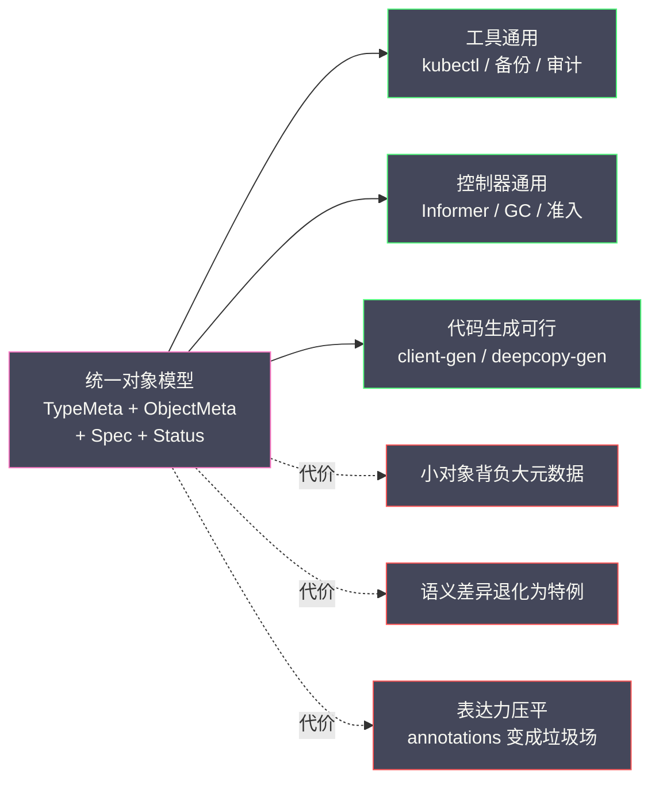
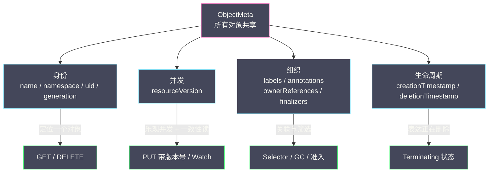
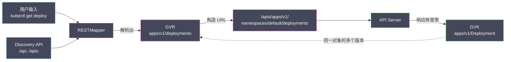
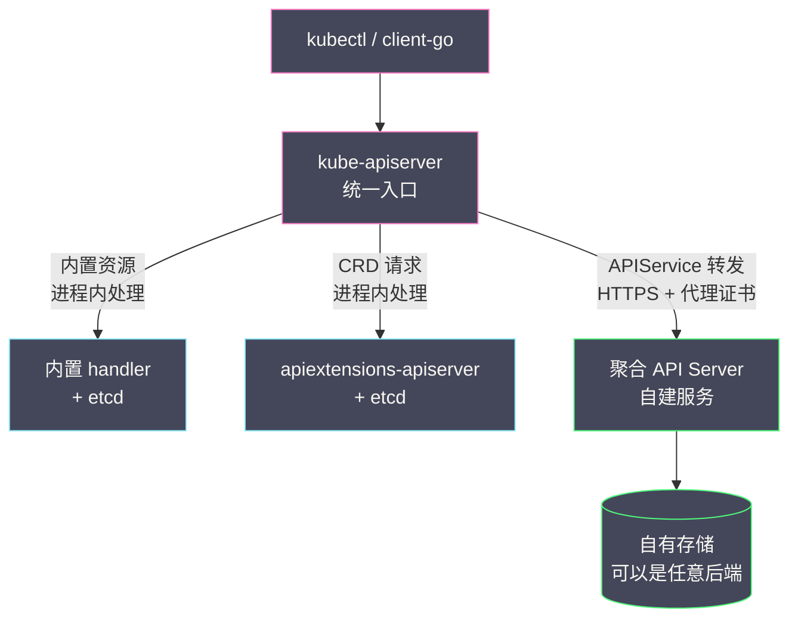
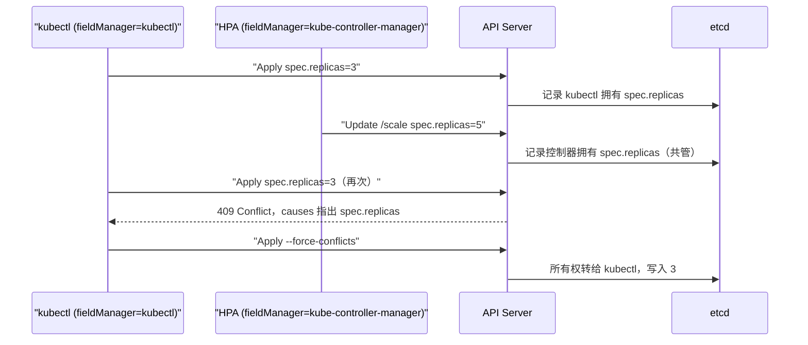

# 03 API 对象模型与 GVR 体系

**摘要：**

Kubernetes 的 API 常被当成一堆需要背诵的 YAML 字段，但换个角度看，它更接近一套强类型的、面向资源的分布式数据契约：所有对象共用同一副骨架，所有读写都经过同一组坐标，所有版本变更都遵循同一套兼容承诺。本文沿着这条"契约"主线走一遍。先用一个反事实说明没有统一对象模型时工具链会退化成什么样，再把 TypeMeta、ObjectMeta、Spec、Status 四段拆开，讲清 name 与 uid 为什么必须分开、generation 与 resourceVersion 各自在管什么、`/status` 子资源到底分离了什么；随后进入 GVR 与 GVK 两套坐标系，解释 URL 为什么长成 `/api` 与 `/apis` 两个前缀、两套坐标为什么不是一一对应、Discovery API 与 RESTMapper 在中间扮演什么角色。版本演进一章回答"etcd 只存一份，却要对多种版本同时服务"这个矛盾，把 Scheme、Codec、Conversion 的分工和 conversion webhook 的代价摊开。扩展机制一章区分 CRD 与 Aggregated API Server 的能力边界，字段所有权一章拆解 Server-Side Apply 的冲突语义与 managedFields 的存储账单。最后用四类反例说明对象模型不适合表达什么。读完应该能回答一个问题：K8s 为什么宁可让每个对象都背上同一套元数据，也不肯让它们各写各的。

---

## 第 1 章 为什么需要统一对象模型

### 1.1 一个反事实：如果每种资源各写各的字段

不妨先做一个反事实推演。假设 2014 年那批设计者做了一个相反的决定：不定义统一的元数据结构，让每个 SIG 按自己的领域习惯自由设计字段，只要 REST 语义说得通就行。这个决定在当时看起来相当合理——网络组最懂 Service 需要什么，存储组最懂 PersistentVolume 需要什么，凭什么让一个抽象的 `metadata` 结构来约束所有人。

推演几步之后，画面会变得很难看。Pod 用 `name` 表示名字，Deployment 的维护者觉得 `deploymentName` 更能表达意图，Service 的作者偏爱 `svcId`；Pod 的创建时间叫 `createdAt`，Deployment 的叫 `creationTimestamp`，Service 的叫 `createTime`；Pod 的标签是 JSON 对象，Deployment 的标签是一段逗号分隔的 `"app=nginx,env=prod"` 字符串，理由是"这样写 YAML 更短"。

这些差异单独看都不致命，叠在一起就是一场灾难。

**工具链会先崩溃**。`kubectl get` 的每一行输出都由一个 printer 生成，printer 需要知道"从哪个字段取名字、从哪个字段取创建时间、按哪一列排序"。如果每种资源的取法都不同，printer 就无法通用，`kubectl get pods` 与 `kubectl get deployments` 会变成两套完全独立的代码路径，而每新增一种资源，kubectl 就必须跟着发一个版本——这意味着 kubectl 的发布节奏被所有资源的发布节奏绑死。

**控制器框架会跟着崩溃**。垃圾回收器要做的事只有一件：读一个对象的 ownerReferences，判断它的所有者是否还活着。这份代码之所以能通用，前提是所有资源的 ownerReferences 长得一模一样；一旦每种资源用自己的字段表达所有权，GC 就得为每种资源写一个解析器，而且这个解析器还必须理解那种资源的语义——它从一个两百行的通用组件，退化成一个跟随所有资源演进的巨型适配层。

**代码生成会彻底不可行**。client-go 里那套 `client-gen`、`informer-gen`、`lister-gen`、`deepcopy-gen`、`openapi-gen` 之所以能跑，靠的是"所有类型都嵌入同一个 TypeMeta 与 ObjectMeta 结构体"这一条约定。生成器只需要知道结构体的形状，不需要知道它的语义；形状一散，生成器就变成了"每个类型手写一遍"。

**还有一处更隐蔽的崩塌：查询能力**。"列出这个 Namespace 里的所有对象"在统一模型下是一个平凡的请求，在分散模型下根本无法表达——你没有任何公共字段可以做过滤，也没有任何公共前缀可以做遍历。备份工具（Velero 这类）之所以能通用地备份任意资源，靠的正是这一点。

把这条推演线拉到尽头，会得到一个有点反直觉的结论：**统一对象模型最大的受益者不是用户，而是工具链的作者**。用户只是省下了学习成本，工具链省下的是"存在可能性"。

### 1.2 统一模型的三个收益

K8s 给出的方案是把所有资源的公共部分抽成三个嵌入结构体（`TypeMeta`、`ObjectMeta`、`ListMeta`），再加上两条约定：spec 与 status 的语义分工，以及"所有资源都必须能被 REST 语义描述"。收益可以归成三类。

**第一类是工具通用**。`kubectl get`、`describe`、`delete`、`-o jsonpath`、`-o custom-columns`、`--sort-by`、label selector、field selector（`metadata.name`、`metadata.namespace` 这两个在所有资源上都可用），全部只依赖 ObjectMeta 的字段名，不依赖任何资源的内部结构。`kubectl get all` 更是这条收益的极端体现——它靠 categories 把不同组的资源聚到一起，而这个聚合之所以成立，是因为"名字、状态、年龄"这三列在任何资源上都有意义。

**第二类是控制器通用**。client-go 的 Informer、Reflector、WorkQueue、Lister 全部面向 `metav1.Object` 这个接口编程，也就是只要求"能取到 name、namespace、labels、ownerReferences、resourceVersion"。于是你写一个自定义控制器时，不需要关心它 Watch 的是 Pod 还是自己定义的 CRD，两者的缓存、去重、限速、重试逻辑完全一致——这套机制的完整实现见 [[云原生/Kubernetes/kubernetes控制器和调度器/00 专栏导览|控制器和调度器专栏]]。GC、Namespace 控制器、审计、准入 webhook 也都建立在这个接口之上。

这里有一处容易被误解的地方：**审计日志能做得如此通用，靠的其实不是对象结构，而是 URL 结构**。审计记录里的 `verb`、`resource`、`subresource`、`namespace`、`name` 全部是从请求路径解析出来的（K8s 内部把这组信息叫 RequestInfo），并不需要反序列化 body。这条线索会在第 3 章接上：对象结构与坐标结构是两套独立的统一，前者管"长什么样"，后者管"在哪"。

**第三类是代码生成可行**。`deepcopy-gen` 给每个类型生成深拷贝，`conversion-gen` 给每个版本对生成转换函数，`openapi-gen` 给每个类型生成 OpenAPI schema，`client-gen` 给每个资源生成 typed client。这四个生成器的共同前提是结构体的形状可预测，而形状可预测又来自"公共部分被抽走了"。可以这么说：**K8s 的 SDK 生态不是设计出来的，是生成出来的；而生成的前提是结构统一**。

### 1.3 统一模型的代价

不过统一从来不是免费的。把上面三个收益翻过来看，每一项背后都对应一笔账单。

**第一笔账单是每个对象都被迫接受同一套元数据约束**。一个只有两行配置的 ConfigMap，其 `metadata` 里的 name、namespace、uid、resourceVersion、creationTimestamp、managedFields 加起来，常常比 data 本身还大。在十万级对象的集群里，这些"每个对象都要背"的固定开销会实打实地转化成 etcd 的存储、watch 缓存的常驻内存、每次 List 的传输量。统一模型的效率，是用"小对象也要付大对象的成本"换来的。

**第二笔账单是语义不匹配只能靠特例处理**。有些资源天生没有"当前状态"（ConfigMap、Secret），于是 status 字段在它们身上缺席；有些资源天生不属于任何 Namespace（Node、ClusterRole），于是 namespace 字段在它们身上被禁止；有些资源的身份需要复合键，而 name 只能是一个字符串，于是这些信息被塞进 label 或 annotation。这些特例不是设计缺陷，而是"统一骨架 + 领域差异"这个组合必然产生的接缝。

**第三笔账单是表达力被压平**。对象之间的关系只有两种合法写法：label（软关联）和 ownerReference（硬归属）。有序的子结构只能用 list，而 list 在并发写下的行为要么是整体替换、要么需要额外的 key 语义（后者直到 Server-Side Apply 时代才被认真对待）。需要 join、需要聚合、需要跨对象事务的场景，在这套模型里没有位置——这不是疏漏，是刻意把这类需求推到模型之外。

**第四笔账单是逃生舱最后变成了垃圾场**。`annotations` 的初衷是"放一些辅助信息"，但它同时具备三个诱人属性：任意字符串、不需要 schema、不需要重新编译，于是它成了所有"模型表达不了"的东西的收容所——构建信息、证书指纹、上一版配置的完整副本、控制器私有的状态机快照，全堆在这里。很多集群里最大的 annotation 已经不是辅助信息，而是第二份对象。

用一句比喻收束这一章：统一对象模型像一张**全民通用的户籍登记表**，不管是刚出生的婴儿还是九十岁的老人，办任何手续都得填同一张表，姓名、证件号、住址、登记时间这几栏的位置固定不变，所以任何一个窗口的工作人员都能在三十秒内找到他需要的那一行。但代价同样明显——这张表要求每个人都有一个"住址"，于是刚出生的人被迫挂靠；要求每个人都有一个"职业"，于是退休的人只能填"无"。

技术上的限定在这里：**K8s 统一的只是索引字段，不是业务字段**。ObjectMeta 是那张表，spec 则是每个人自己带的附件——附件的内容格式五花八门，但装订方式、编号规则、归档位置必须一致。理解了这一点，后面关于"为什么这个字段不能改""为什么这个字段在别的资源上没有"的疑问，大多能自己回答。



---

## 第 2 章 四段式结构：TypeMeta / ObjectMeta / Spec / Status

### 2.1 TypeMeta 与 `apiVersion` 的历史包袱

先把四段式的完整形状摆出来。下面这份 Deployment 的 YAML 里，四段各自负责一件事，注释标出了边界：

```yaml
apiVersion: apps/v1            # ┐
kind: Deployment               # ┘ TypeMeta：我是谁
metadata:                      # ─ ObjectMeta：我的身份与组织关系
  name: web
  namespace: default
  labels:
    app: nginx
  resourceVersion: "12345"     # 乐观并发用的版本号
  generation: 3                # spec 被改过几次
  uid: "6f0c2b1e-..."          # 全局唯一，重建不变的是 name，变的是它
  creationTimestamp: "2026-03-04T10:00:00Z"
  ownerReferences: []
spec:                          # ─ Spec：用户期望什么
  replicas: 3
  selector:
    matchLabels:
      app: nginx
  template:
    spec:
      containers:
        - name: nginx
          image: nginx:1.25
status:                        # ─ Status：系统观测到什么
  replicas: 3
  readyReplicas: 3
  availableReplicas: 3
  observedGeneration: 3        # 这份 status 对应的是第 3 代 spec
```

TypeMeta 只有两个字段：`apiVersion`（组与版本，譬如 `apps/v1`、`v1`、`batch/v1`）和 `kind`（类型的单数 CamelCase 名，譬如 `Deployment`）。两者合起来唯一确定"这是什么类型"，API Server 据此把请求路由到对应的 handler。

这里有一处机制细节值得单独讲，因为它解释了控制器开发中一个高频困惑：**在 Go 代码里拿到的对象，`TypeMeta` 往往是空的**。`metav1.TypeMeta` 在结构体上标的是 `json:",inline"`，序列化时会被摊平到顶层，但 client-go 的解码器在反序列化时已经知道目标类型（类型信息来自请求路径或者 scheme 注册表），于是它根本不需要从字节流里读 `apiVersion` 与 `kind`，读出来也不会填进去。所以你在 Reconcile 里 `fmt.Printf("%+v", pod.APIVersion)`，很可能打印出空字符串——这不是 bug，而是"类型信息在传输层已经确定，无需在载荷里重复"这一设计的副作用。只有当对象被序列化输出（写 YAML、打日志、发给别的服务）时，codec 才会把 TypeMeta 补齐。

`apiVersion` 里那个"核心组没有组名"的例外，是这套体系里最典型的历史包袱。2014 年的 K8s 只有一个版本前缀 `/api/v1`，所有资源都挂在下面；2015 年前后引入 API 组机制时，新组统一走 `/apis/<group>/<version>`，但核心组已经被全世界的 kubectl、curl 脚本、CI 流水线、监控探针硬编码了。把 `/api/v1/pods` 改成 `/api/core/v1/pods`，等于让所有这些客户端在同一天失效。于是核心组被留成了"空组名"，成为整套规则里唯一一个 `apiVersion` 只有版本号、没有组名的特例。

这个例外留下的痕迹至今可见：`kubectl get pods.v1.` 里那个结尾的点，就是在显式指定"组名为空"；`kubectl api-resources` 里核心资源的 APIVERSION 列只有 `v1`；而某些工具把核心组写成 `core/v1` 时，另一批工具会拒绝解析。**一个为了兼容性保留的例外，会在往后十年里持续产生解释成本**。

顺带说清一个格式约定：`kind` 是单数 CamelCase，资源名是小写复数，两者不是简单的字符串变换，第 3 章会展开。

### 2.2 ObjectMeta 的四类字段

ObjectMeta 字段很多，但按用途可以干净地分成四类。分清楚这四类，比记住每个字段名有用得多。

| 类别 | 字段 | 谁写入 | 用途 |
| --- | --- | --- | --- |
| 身份 | `name`、`generateName`、`namespace`、`uid`、`generation` | 用户写 name/generateName/namespace，其余由系统写 | 定位一个对象 |
| 并发 | `resourceVersion` | 系统写 | 乐观并发控制与一致性读 |
| 组织 | `labels`、`annotations`、`ownerReferences`、`finalizers` | 用户与控制器 | 关联、筛选、级联、删除保护 |
| 生命周期 | `creationTimestamp`、`deletionTimestamp`、`deletionGracePeriodSeconds` | 系统写 | 表达"正在创建"与"正在删除" |

这四类字段的写入者完全不同，这一点决定了它们的可信度：身份类由用户与服务端共同写入，并发类只能由服务端写，组织类由用户与控制器共同维护，生命周期类则完全是系统的领地。把这张图放在脑子里，后面遇到"为什么这个字段改不动"时就不必查文档：



**身份类**里最容易被忽略的是 `generateName`。当 `name` 留空而 `generateName` 有值时，API Server 会生成一个 `<prefix><随机后缀>` 的名字。ReplicaSet 创建 Pod、Job 创建 Pod 都走这条路——这也是为什么你看到的 Pod 名字总是一串 `web-7d9f8b6c5-x2k4p` 的形状。这条设计把"命名权"从客户端手里收回到服务端，避免了并发创建时的名字碰撞。

`namespace` 在集群级资源上不存在，写上去会被拒绝或忽略；这条规则的判据不是"重要不重要"，而是"是否需要一个作用域来做名字隔离与授权边界"。Node 名字本身已经是全局唯一的，再套一层 Namespace 毫无意义。

**并发类**里，`resourceVersion` 与 `generation` 经常被混为一谈，其实它们回答的是两个完全不同的问题。

`resourceVersion` 是**对象在存储层的版本**，本质上是 [[06 etcd 与 Kubernetes 的状态存储]] 里要展开的 etcd 全局 revision，因此它有三个必须记住的性质：它是**不透明的字符串**（客户端不能假设它是数字，更不能假设它连续加一，etcd 内部的编码在版本演进中变过）；它是**全局单调**的，同一时刻写入的不同对象拿到的是相邻但不同的值；它可以被用作**一致性读的锚点**——List 与 Watch 都接受 `resourceVersion` 参数，`resourceVersion=0` 表示"从缓存里读，允许陈旧但快"，`resourceVersionMatch=NotOlderThan` 表示"至少不比这个版本旧"，而一个太老的版本会让 API Server 返回 `410 Gone`，逼客户端重新 List。

`generation` 是**业务语义的计数器**：只有 spec 被修改时才加一，status 被修改时不动。它存在的唯一理由是让控制器能自证清白——控制器写完 status 之后，把 `status.observedGeneration` 设成当时读到的 `metadata.generation`；外部观察者看到两者相等，就知道"这份 status 反映的是最新的 spec"，不相等就说明控制器还没跟上。这个模式在自定义资源里几乎是必备的，但很多人写 Operator 时会忘记设置它，结果是用户改了 spec、status 里还是旧数据，却没有任何字段能表达"我还没处理"。

`resourceVersion` 的并发控制语义可以用一个五步时间线说清：

```text
时刻1  Client A 读 Pod，拿到 resourceVersion=100
时刻2  Client B 读 Pod，也拿到 resourceVersion=100
时刻3  Client A 提交更新并携带 100 → 成功，对象的 resourceVersion 变成 101
时刻4  Client B 提交更新并携带 100 → 失败，API Server 返回 409 Conflict
时刻5  Client B 重新读取（101），合并自己的变更，再次提交 → 成功
```

这套机制叫**乐观并发控制（Optimistic Concurrency Control）**，它的哲学是"假设冲突很少，所以先做再检查"，与"先加锁再做"的悲观路线相反。选它的原因在第 01 篇讲过——Omega 用共享状态调度换来的教训是，冲突率低的时候乐观路线吞吐远高于悲观路线。代价是冲突率一高就会退化成大量重试，所以 K8s 的客户端库（`retry.RetryOnConflict`）把这个"读-改-写"循环封装成了标准动作。

**组织类**里，`labels` 与 `annotations` 的区别值得用一句话钉死：**需要被查询的用 label，只需要被读取的用 annotation**。label 的 key 与 value 都有长度与字符集限制（value 最长 63 字符，key 可以带 DNS 前缀），因为它要被索引、要出现在 selector 里、要参与 etcd 的查询；annotation 的 value 是任意字符串（总量受对象 1.5MB 上限约束），因为它只被整体读出来。

> [!note] 一条可执行的判据
> 需要被 selector 选中、需要出现在 `kubectl get -l` 里的，放 label；只需要被读出来、不参与任何筛选的，放 annotation。把大段 JSON 塞进 label 属于性能事故——索引膨胀、selector 变慢、List 返回体变大，三笔账一起付。

`ownerReferences` 与 `finalizers` 在 [[04 Label Selector 与松耦合设计]] 里有完整展开，这里只留一句：前者用 uid 建立硬归属，后者用字符串列表实现"删除前必须完成的动作"。这两个字段是对象模型里唯二能表达"跨对象的生命周期约束"的地方，也正因为只有这两处，K8s 无法表达"A 和 B 必须同时创建"这类原子约束。

**生命周期类**里最关键的是 `deletionTimestamp`。`kubectl delete` 并不会立刻从 etcd 里抹掉对象，它做的是"设置 deletionTimestamp + 进入终止流程"。这个设计把删除从"一个动作"变成了"一个状态"，于是删除也可以被协调、被观察、被阻塞。`deletionGracePeriodSeconds` 是删除宽限期，它和 Pod 上的 `terminationGracePeriodSeconds` 是两个不同层级的字段，前者管"对象还要在 API 里停留多久"，后者管"容器收到 SIGTERM 后等多久"。

### 2.3 name 与 uid：为什么必须分开

对象有两套标识：`name` 在人的命名空间里唯一（同一 Namespace、同一资源类型下），`uid` 在系统的命名空间里全局唯一且永不复用。

很多人会觉得 uid 是冗余的——既然 name 已经能定位对象，为什么还要多一个字段？答案藏在"删除后重建"这个动作里。假设有一个 ReplicaSet 叫 `web-abc`，它管理着三个 Pod；运维同学因为某个原因把它删了，五分钟后又用同一份 YAML 建了一个同名 ReplicaSet。此时集群里出现了两个"名字叫 web-abc"的对象，但它们是两个完全不同的东西：前者已经死亡，后者是一个新生儿。

如果 ownerReference 只记 name，那么新 ReplicaSet 会莫名其妙地"继承"三个旧 Pod 的所有权，而这既不是用户的意图，也不是安全的默认行为——那三个 Pod 可能是旧版本、旧配置、旧证书。所以 ownerReference 里必须同时记 name 与 uid，GC 判活时比对的是 uid：uid 不匹配，就认为"我的所有者已经不在了"，于是把子对象回收或孤儿化。

这条机制解释了 K8s 里一个非常常见的现象：**控制器永远把"同名但 uid 不同"的对象当作陌生人**。这也解释了为什么"删掉再重建"在 K8s 里不是一个幂等操作——它在系统内部产生了新的身份。做 GitOps 的人经常踩这个坑：以为"回滚到上一版 YAML"等于回到上一版状态，实际上中间经历了一次身份更替。

还有两条相关约束值得记住。其一，**跨 Namespace 的 ownerReference 是无效的**，API Server 会把它当成不存在——因为 Namespace 本身是一个授权与生命周期的边界，允许跨边界的所有权会让级联删除变成跨租户的破坏性操作。其二，ownerReference 上的 `blockOwnerDeletion` 布尔值控制"是否阻塞所有者的删除"，而设置它需要调用方对**所有者对象的 `finalizers` 子资源**有 update 权限，否则 API Server 会拒绝——这是一条很细但很实用的权限规则，自定义控制器经常在这里被 RBAC 拦住。

### 2.4 spec/status 分离与 `/status` 子资源

spec 与 status 的哲学在第 01 篇讲过，这里补 API 机制层的三个细节，因为正是这三个细节让"分离"从口号变成了可执行的约束。

**第一个细节是写入通道分离。** 两者走的是不同的 URL：

```text
PUT /apis/apps/v1/namespaces/default/deployments/web          # 用户改 spec
PUT /apis/apps/v1/namespaces/default/deployments/web/status   # 控制器改 status
```

带 `/status` 的路径只允许改 status，主路径的 PUT 会**忽略** status 字段的变更。这条规则是双向的：用户 `kubectl apply` 一份带 status 的 YAML，status 部分不会生效；控制器往主路径写 status，写入也会被丢弃。很多人第一次遇到"我明明改了 status，为什么没变化"时，原因就在这里。

**第二个细节是创建时的清零。** 对于启用了 status 子资源的资源，POST 创建时携带的 status 会被丢弃。这条规则比看上去重要：它防止了客户端伪造初始状态——一个 Pod 不能自己声明"我已经 Running 了"。

**第三个细节是准入链路的分离。** 主资源的写入要经过完整的变更准入（mutating）与校验准入（validating）链路，而 status 子资源的写入只走一部分校验。理由很实际：status 的写入频率远高于 spec，如果每次状态汇报都要穿过一串 webhook，那么任何一个 webhook 的抖动都会让整个集群的状态汇报卡住。把"用户意图"和"系统汇报"拆成两条带宽不同的通道，是 K8s 对象模型里最实用的一处设计。

顺带说清"子资源"这个机制的全貌——它不是为 status 专门造的，而是一套通用的"给对象开侧门"的手段。K8s 里常见的子资源至少有这些：

| 子资源 | 作用 | 典型使用者 |
| --- | --- | --- |
| `/status` | 分离状态写入 | 所有控制器 |
| `/scale` | 只读写副本数，不碰其余 spec | HPA、`kubectl scale` |
| `/eviction` | 以"驱逐"语义删除 Pod，尊重 PDB | kubelet、descheduler |
| `/binding` | 只写 `spec.nodeName` | kube-scheduler |
| `/token` | 签发短期令牌 | ServiceAccount 令牌投影 |
| `/approval` | 批准或拒绝 CSR | 集群管理员、签名控制器 |
| `/finalize` | 清空 Namespace 的 finalizers | Namespace 控制器 |
| `/proxy`、`/log`、`/exec`、`/attach`、`/portforward` | 穿透到 Pod 或 Service 内部 | 运维与调试 |

这张表的共同逻辑是：**把"高频且窄"的写操作从"低频且宽"的主资源里拆出来**。`/scale` 最典型——HPA 每分钟可能改好几次副本数，若它必须读整个 Deployment、改一个字段、再整体写回，与 `kubectl apply` 的冲突概率会高得离谱；有了 `/scale`，它只碰一个字段。

### 2.5 没有 status 的对象说明了什么

ConfigMap、Secret、ServiceAccount、Endpoints、NetworkPolicy、LimitRange 这些资源都没有 status 字段。这件事常被当作"数据类资源不需要状态"来解释，但这个解释并不准确——更准确的判据是：**有没有一个外部协调者需要向系统汇报"现实长什么样"**。

按这个判据去看，几个反例会更有意思。Namespace 有 status（`phase`），因为有一批控制器要负责它的终止流程；Node 有 status（容量、条件、地址），因为 kubelet 要持续汇报机器实况；Pod 有 status，因为容器运行时的事实必须被翻译成 API 对象；Endpoints 却没有，因为它的 data 本身就是"现实"——后端地址直接写在那里，不必再汇报一次。

代价也随之出现：**没有 status 就没有 `observedGeneration`，也就没有"系统处理到第几版"的表达能力**。想在 ConfigMap 上表达"某个控制器已经处理过这一版"，只能靠 annotation 打补丁，而这个补丁既没有类型、也没有并发保护、也不会被任何工具理解。这是统一骨架遇到语义缺口时的典型退化——**模型没给你的东西，你只能用 annotation 伪造，而伪造品不享受模型提供的任何保障**。

---

## 第 3 章 GVR 与 GVK：两套坐标系统

### 3.1 URL 即资源

第 1 章说过，K8s 的统一有两条独立的线：对象结构统一（四段式）与坐标结构统一（GVR）。这一章讲后者。

先看 URL 的形状，它是整套坐标系统最直白的体现：

```text
# 核心组（组名为空）
GET /api/v1/namespaces/default/pods
     ├── /api              核心组专用前缀
     ├── /v1               版本
     ├── /namespaces/default   作用域
     └── /pods             资源（小写复数）

# 命名组
GET /apis/apps/v1/namespaces/default/deployments/web
     ├── /apis             命名组前缀
     ├── /apps             组
     ├── /v1               版本
     ├── /namespaces/default
     ├── /deployments
     └── /web              对象名

# 集群级资源（少一层 namespaces）
GET /api/v1/nodes
GET /apis/rbac.authorization.k8s.io/v1/clusterroles

# 子资源在最后再加一段
PUT /apis/apps/v1/namespaces/default/deployments/web/status
```

把这套路径拆开看，能读出三个设计决定。

**第一个决定是把版本放进路径，而不是放进请求头。** 用 `Accept: application/vnd.kubernetes.v1+json` 这类内容协商来表达版本在 HTTP 语义上更"正确"，但 K8s 选了路径。理由是可调试性与可缓存性：URL 自解释，`curl` 一行就能试；反向代理、审计日志、限流规则都能按路径前缀做匹配，不需要解析 header。代价是同一个对象在不同版本下的 URL 不同，客户端必须显式知道自己在说哪个版本——这一点在 4.2 节会变成一个真实的复杂度。

**第二个决定是资源名用复数小写。** 这一条让 URL 有了"集合 + 元素"的自然读法：`/pods` 是集合，`/pods/web` 是元素，`/pods/web/status` 是元素的子资源。REST 语义在这里不是为了好看，而是为了让 GET/POST/PUT/PATCH/DELETE 这五个动词在每个资源上的含义完全一致——这正是通用客户端能存在的前提。

**第三个决定是把 Namespace 作为路径层级而不是查询参数。** 如果写成 `/api/v1/pods?namespace=default`，那么"Namespace 是授权边界"这件事就无法在路由层表达，RBAC 也无法按路径前缀做快速拒绝。放进路径之后，`/api/v1/namespaces/foo/...` 这一整棵子树就成了一个天然的权限作用域。

路径的统一带来的最直接收益是**所有横切能力都可以挂在 URL 上**：审计按 `verb + resource + subresource` 记录，APF 按用户与请求类型分配并发额度，webhook 用 `apiGroups`、`apiVersions`、`resources`、`scope` 四元组匹配，限流与熔断按前缀做。这些能力没有一个需要理解对象内部结构。

### 3.2 GVR 与 GVK 不是一一对应

GVR（Group-Version-Resource）是"资源集合"的坐标，用来构造 URL；GVK（Group-Version-Kind）是"对象类型"的坐标，写在 YAML 的 `apiVersion` + `kind` 里。直觉上两者应该一一对应，实际上有四种情况会让这个直觉失效。

**第一种是版本多重性。** 一个对象可以同时以多个版本对外服务，于是同一个 resource 对应多个 GVK。`HorizontalPodAutoscaler` 在 `autoscaling/v1` 与 `autoscaling/v2` 下都能读写，URL 分别是 `/apis/autoscaling/v1/...` 与 `/apis/autoscaling/v2/...`，但它们在 etcd 里是同一个对象。这是"坐标不唯一"的最主要来源。

**第二种是 Kind 同名跨组。** `Event` 在核心组 `v1` 与 `events.k8s.io/v1` 下各有一份定义，Kind 名字一样，语义相近，字段不同。这时候"Kind 叫 Event"不足以定位资源，必须带上组。

**第三种是 Kind 与资源名不同形。** 最经典的反例是 `Endpoints`：它的 Kind 本身就是复数形式（`Endpoints`），资源名也是 `endpoints`，所以"Kind 小写加 s"这条经验规则在这里直接失效。此外还有短名（`deploy`、`svc`、`po`）、单数形式（`deployment`）、类别（`all`）这三层别名，它们都能在 `kubectl` 里替代正式资源名，但都不是 GVR 的一部分。

**第四种是子资源不构成独立 GVK。** `/status`、`/scale` 在 URL 上多了一段，但它们共享父对象的 GVK。也就是说，URL 的段数与 GVK 的元数之间没有函数关系。



维护这层映射的组件叫 **RESTMapper**。它的输入是"用户写的那个词"，输出是 GVR；如果同一个 Kind 有多个版本，它取该组的 **preferred version**（发现结果里标了 `preferredVersion` 的那个）。这就解释了为什么 `kubectl get deployments` 默认走 `apps/v1`，而 `kubectl get deployments.v1beta1.apps` 能强制指定旧版本——后者是 `resource.version.group` 的完整写法。

这里有一处非常实用的机制细节：**RESTMapper 是 discovery 驱动的，而 discovery 是会被缓存的**。`kubectl` 把发现结果缓存在本地目录（默认 `~/.kube/cache/discovery`），有效期十分钟。所以刚 `kubectl apply` 完一个 CRD 就立刻 `kubectl get myresources`，有一定概率报 `the server doesn't have a resource type "myresources"`——不是 CRD 没建好，而是本地缓存还没过期。同样的现象在自研控制器里表现为 RESTMapper 需要重建，client-go 提供的 deferred discovery mapper 会在遇到未知资源时主动刷新一次，这也是它比静态 mapper 更常用的原因。

### 3.3 Discovery API 与 `kubectl api-resources`

发现接口是整套坐标系统的"目录页"，一共四个层级：

| 端点 | 返回 | 回答的问题 |
| --- | --- | --- |
| `/api` | `APIVersions` | 核心组有哪些版本 |
| `/apis` | `APIGroupList` | 有哪些命名组、每组有哪些版本、哪一个是 preferred |
| `/api/v1` | `APIResourceList` | 这个版本下有哪些资源 |
| `/apis/<group>/<version>` | `APIResourceList` | 同上，针对命名组 |

每个 `APIResource` 条目带的信息比想象中多：`name`（复数资源名）、`singularName`、`namespaced`（是否命名空间级）、`kind`、`verbs`（支持哪些动词）、`shortNames`、`categories`、`storageVersionHash`。其中 `verbs` 是很多人不知道的一项——它让客户端能提前知道某个资源不支持 `deletecollection`，而 `storageVersionHash` 是存储版本迁移工具判断"还有没有对象停留在旧版本"的依据。

```bash
kubectl api-resources
# NAME          SHORTNAMES   APIVERSION   NAMESPACED   KIND
# pods          po           v1           true         Pod
# deployments   deploy       apps/v1      true         Deployment
# services      svc          v1           true         Service
# nodes         no           v1           false        Node
```

`kubectl api-versions` 只列版本，`kubectl api-resources` 列资源，`kubectl explain` 则是另一条路径——它读的是 OpenAPI v3 文档（`/openapi/v3`），不是 discovery。这四者的分工恰好对应"有哪些版本""有哪些资源""资源长什么样"三个层次的问题。

发现机制有一笔性能账单，在小集群里看不出来，在大集群里很刺眼：**完整发现需要 `组数 × 版本数 + 2` 次往返**，装了几十个 CRD 的集群，`kubectl` 每次冷启动都要发上百个请求。K8s 后来引入的**聚合发现（Aggregated Discovery）** 把它压成一次请求，返回一份包含所有组、版本与资源的合并文档——目录页变化慢、查询频繁，本来就该缓存与合并。

### 3.4 API Group 的三个设计目的

组（Group）不是简单的命名空间，它在 K8s 的设计里承担三件事。

**第一件是模块化与所有权划分。** `apps` 组由 SIG-Apps 维护，`networking.k8s.io` 由 SIG-Network 维护，`rbac.authorization.k8s.io` 由 SIG-Auth 维护。组边界让不同团队可以独立决定字段、独立评审、独立发版，而不必在一个巨型 API 里互相等待。这一点与第 01 篇讲的"面向陌生人设计"是同一条逻辑的延伸——组是组织边界在 API 上的投影。

**第二件是独立版本演进。** 每个组内的资源可以各自走 alpha → beta → stable 的路。`batch/v1` 的 Job 早就 stable 的时候，`autoscaling/v2` 可能还在 beta；`apps/v1` 转正之后，`extensions/v1beta1` 里的 Deployment 还能继续服务一段时间。如果没有组这一层，这种"部分资源先行稳定"的演进方式根本无法表达。

**第三件是授权与策略的粒度。** RBAC 的 `apiGroups` 字段直接对应组名，于是"允许读 `apps` 组全部资源，但禁止访问 `rbac.authorization.k8s.io`"可以写成一条规则。准入 webhook 的 `rules` 也是同一个四元组，所以"只拦截 `apps` 组的 Deployment 变更"这种策略不需要解析对象内容。

组名本身也有规则：必须是 DNS 子域名格式，`*.k8s.io` 后缀保留给 K8s 自身，CRD 不允许使用——这条限制防止自定义资源冒充内置资源，从而绕过按组配置的授权策略。版本名同样有约束：`v<数字>`、`v<数字>alpha<数字>`、`v<数字>beta<数字>`，不允许 `v1.1` 这种形式，也不允许跳过主版本号。

| 组 | 主要资源 | 维护方 |
| --- | --- | --- |
| core（`""`） | Pod、Service、ConfigMap、Secret、Namespace、Node、PV | SIG-Node / SIG-Network 等 |
| `apps` | Deployment、StatefulSet、DaemonSet、ReplicaSet | SIG-Apps |
| `batch` | Job、CronJob | SIG-Apps |
| `networking.k8s.io` | Ingress、IngressClass、NetworkPolicy | SIG-Network |
| `rbac.authorization.k8s.io` | Role、ClusterRole、RoleBinding、ClusterRoleBinding | SIG-Auth |
| `storage.k8s.io` | StorageClass、CSIDriver、VolumeAttachment | SIG-Storage |
| `autoscaling` | HorizontalPodAutoscaler | SIG-Autoscaler |
| `apiextensions.k8s.io` | CustomResourceDefinition | SIG-API-Machinery |

用一句比喻收束这一章：GVR 与 GVK 像图书馆的**两套目录**——一套是架位号（三楼东侧第五排第二格），一套是书名（《数据密集型应用系统设计》）。借书要用架位号，因为书就摆在那里；读者嘴里说的是书名，因为他不知道架位。同一本书可能同时摆在"新书推荐"和"计算机"两个架位上（多版本共存），不同架位上也可能放着同名但内容不同的书（Kind 跨组同名），而"索书号"这套翻译规则（RESTMapper）必须能处理这些情况。

技术上的限定在这里：**架位号是物理位置，书名是逻辑身份，两者不能互相推导**。GVR 面向"资源集合与 URL"，GVK 面向"对象类型与载荷"，中间那层映射是 discovery 提供的运行时信息，不是编译期常量。这也解释了为什么 CRD 一注册就能被 `kubectl` 识别——映射表是动态的，不是写死的。

---

## 第 4 章 版本演进与转换

### 4.1 alpha / beta / stable 的稳定性承诺

K8s 的 API 版本号不是营销手段，而是一份**有具体条款的兼容承诺**。

| 级别 | 命名 | 默认状态 | 稳定性承诺 | 弃用窗口 |
| --- | --- | --- | --- | --- |
| Alpha | `v1alpha1`、`v2alpha1` | 通常默认关闭（靠 feature gate 打开） | 无。可随时改结构、随时删除，不保证任何兼容 | 可为 0 |
| Beta | `v1beta1`、`v2beta1` | 默认开启 | 有。跨版本提供迁移路径，但结构可能微调 | 至少 9 个月或 3 个次版本 |
| Stable | `v1`、`v2` | 默认开启 | 强。GA 之后不允许破坏性变更 | 至少 12 个月或 3 个次版本 |

注意这里的措辞是"或"，实际取的是**较长者**：如果一个 API 在 1.29 被宣布弃用，它至少要活到 1.30、1.31、1.32 三个次版本之后，或者活满十二个月，哪个更晚就按哪个算。这个"取长"的规则很关键，否则一个季度发三个版本的节奏会让"3 个次版本"只覆盖四个月。

稳定性的真实含义不是"不会变"，而是"**变了要走流程**"。GA 之后仍然可以加字段（加字段是兼容的），但不能删字段、不能改字段语义、不能改默认值的行为。Beta 的语义更微妙：它允许"结构微调"，这意味着一个 `v1beta1` 的字段可能在下一个次版本里被重命名——所以生产环境用 beta API 是一笔明确的风险，不是"差不多稳定了"。

弃用这件事在 API 层面有一套可见的信号机制：被弃用的版本仍然可用，但响应里会带一个 `Warning` 头（HTTP 299 码），`kubectl` 把它打到 stderr。所以升级集群前跑一遍 `kubectl get --raw /metrics | grep apiserver_requested_deprecated_apis` 是个好习惯——这条指标按 group/version/resource 统计了对已弃用 API 的调用，是判断"还有谁在用旧版本"最直接的证据。

### 4.2 多版本共存与存储版本

多版本共存带来一个尖锐的矛盾：**对外要同时服务多种版本，对内却只能存一份**。

存多份是不行的。同一个对象存成两份，立刻要面对"两份不一致怎么办""删除时删哪份""Watch 该推哪份"这三个无解的问题，本质上是把分布式一致性问题引到了存储层。所以 K8s 的选择是：etcd 里只存一份，用**存储版本（Storage Version）** 序列化，读写时按需转换。

```mermaid
%%{init: {'theme': 'dracula'}}%%
graph LR
    REQ["客户端请求<br/>apps/v1"] --> DEC["解码<br/>反序列化成 v1 结构"]
    DEC --> HUB["内部版本 internal<br/>（hub）"]
    HUB --> ENC["编码<br/>序列化成存储版本"]
    ENC --> ETCD[("etcd<br/>只存一份")]
    ETCD --> DEC2["解码<br/>存储版本结构"]
    DEC2 --> HUB2["内部版本 internal"]
    HUB2 --> ENC2["编码<br/>请求的版本"]
    ENC2 --> RESP["响应"]

    classDef ext fill:#44475a,stroke:#8be9fd,color:#f8f8f2
    classDef hub fill:#44475a,stroke:#ff79c6,color:#f8f8f2
    classDef store fill:#44475a,stroke:#50fa7b,color:#f8f8f2
    class REQ,DEC,ENC,ENC2,RESP ext
    class HUB,HUB2,DEC2 hub
    class ETCD store
```



这张图里有一个容易被忽略的中间环节：**内部版本（internal version）**。K8s 在内存里用一种"不带版本"的结构体表示对象（在代码里表现为 `__internal` 这个特殊版本），所有外部版本都先转到内部版本，再从内部版本转到目标版本。这样 N 个外部版本之间只需要 2N 条转换路径，而不是 N² 条。这个技巧在编译器领域叫"以中间表示为枢纽"，K8s 把它用在了 API 上。

对 CRD 来说，这套机制有两条硬约束。其一，**每个 CRD 必须恰好有一个版本标 `storage: true`**，否则 API Server 拒绝接受这个定义。其二，`status.storedVersions` 记录了历史上被写进 etcd 的所有版本。

> [!warning] 删版本之前先看 storedVersions
> 只要这个列表里还有某个版本，就不能把它从 `spec.versions` 里删掉——磁盘上还躺着用那个版本序列化的对象，删掉版本就再也解不出来。正确顺序是先跑存储版本迁移、把所有对象重写到新版本，确认 `storedVersions` 只剩一个，再删旧版本。这条流程每年仍会绊倒一批团队。

### 4.3 Scheme / Codec / Conversion 的分工

这三个词经常被混用，其实它们各自解决一个正交的问题。

**Scheme 是类型注册表**。它维护 GVK 与 Go 类型之间的双向映射，并提供"给定 GVK 造一个空对象"的能力。你写控制器时调用的 `AddToScheme`，本质上是把自己的类型登记进这张表，让解码器认识它。

**Codec 是序列化器**。它负责结构体与字节流之间的转换，支持 JSON、YAML、protobuf 三种格式。这里有一条实用限制：**protobuf 只对内置类型可用，CRD 不支持**。原因是 protobuf 需要预先生成的 `.proto` 描述，而 CRD 的 schema 是运行时提供的；这条限制直接决定了大规模集群里 CRD 的序列化开销比内置资源高。

**Conversion 是版本间的翻译**。内置类型的转换函数由 `conversion-gen` 生成，逻辑是纯字段搬运；CRD 的转换只有两种策略：`None` 与 `Webhook`。

`None` 的含义是"所有版本共享同一份 schema"，也就是多版本只是给同一个结构贴了不同的版本标签。这听起来像是偷懒，实际上在很多场景下是正确的——如果你只是想让新版 API 有个新名字，或者想按版本区分默认值，`None` 就够用，而且没有额外开销。

`Webhook` 则是把转换逻辑外置到你自己的服务里。它的配置长这样：

```yaml
spec:
  conversion:
    strategy: Webhook
    webhook:
      conversionReviewVersions: ["v1"]
      clientConfig:
        service:
          namespace: db-system
          name: db-converter
          path: /convert
          port: 443
        caBundle: "LS0tLS1CRUdJTi..."   # API Server 用它校验你的服务证书
```

Webhook 转换的代价有四项，每一项都是真实的运维负担。

**其一是网络往返**。每次跨版本读写都要多一次 HTTPS 调用。如果客户端用存储版本读写，不需要转换，也就不需要调用；一旦客户端指定了非存储版本，这个调用就必然发生。所以"用非存储版本"的客户端越多，转换服务的压力越大。

**其二是可用性耦合**。转换服务挂了，所有非存储版本的读写全部失败；存储版本的读写仍然可用（不需要转换）。这个细节值得记住——它是"为什么升级期间要先把所有客户端切到存储版本"这条建议的技术依据。

**其三是证书与配置**。`caBundle` 要手动维护，Service 要能被 API Server 解析（意味着它必须是一个集群内可达的 Service），TLS 证书要轮换。这些在小规模环境里是琐事，在大规模环境里是故障源。

**其四是转换逻辑的正确性责任**。内置类型的转换由生成器保证，CRD 的转换要你自己写，而且必须满足**往返可逆（round-trip）**：`v1 → v1alpha1 → v1` 之后，对象必须和原来等价。一旦某个字段在 v1 里被拆成两个、在 v1alpha1 里只能合并回一个，往返就会丢信息，而丢信息的表现往往是"某个客户端读到的对象莫名少了一个字段"，极难排查。

用一句比喻收束这一章：多版本 API 像**同一份条约的多语言正本**。档案库里只存一份正本（存储版本），对外按需出具各语言的译本（served versions），译本之间必须能互译（conversion）。如果两种语言对某个概念的表达能力不同，翻译过程就会丢失细节——而条约不会因为翻译丢了细节就自动修正。

技术上的限定在这里：**转换只保证"能表达的部分"不丢，不保证"表达不了的部分"能被感知**。这也是为什么 K8s 对内置资源的版本演进极其保守：一旦某个字段在某个版本里无法表达，那个版本就永远无法无损往返，只能等弃用窗口走完再删。

---

## 第 5 章 扩展机制：CRD 与 Aggregated API Server

### 5.1 CRD 的本质是"向 API Server 注册一种新类型"

**CRD（CustomResourceDefinition）** 常被描述成"自定义资源"，这个说法容易让人以为它是一套新的存储机制。更准确的理解是：**CRD 是一次运行时类型注册**——它告诉 API Server"从此刻起，存在这样一种类型，请为它开一套 REST 端点、一段 etcd 前缀、一个 discovery 条目、一条 RBAC 资源名、一份 OpenAPI schema"。

注册完成后，新资源在 API 层面的待遇与内置资源完全一致：能被 `kubectl get/create/delete`、能被 Watch、能被 label selector 过滤、能被 RBAC 授权、能被 GC 管理。这种一致性不是模仿出来的——处理 CR 请求的 apiextensions-apiserver 就运行在 kube-apiserver 进程内，与内置资源的 handler 共享同一套请求管线、准入链与存储抽象。

下面这份定义注册了一个 `Database` 类型：

```yaml
apiVersion: apiextensions.k8s.io/v1
kind: CustomResourceDefinition
metadata:
  name: databases.example.com        # 必须是 <复数>.<组> 的形式
spec:
  group: example.com
  scope: Namespaced
  names:
    plural: databases
    singular: database
    kind: Database
    shortNames: [db]
    categories: [all]                # 让 kubectl get all 带上它
  versions:
    - name: v1
      served: true                   # 对外提供
      storage: true                  # 落盘用这个版本
      schema:
        openAPIV3Schema:
          type: object
          properties:
            spec:
              type: object
              properties:
                engine:
                  type: string
                  enum: ["mysql", "postgresql", "redis"]
                version:
                  type: string
                replicas:
                  type: integer
                  minimum: 1
                  default: 1             # 由 API Server 在写入时填充
            status:
              type: object
              properties:
                phase:
                  type: string
                endpoint:
                  type: string
      subresources:
        status: {}                   # 启用 /status 子资源
        scale:                       # 启用 /scale，让 HPA 能扩它
          specReplicasPath: .spec.replicas
          statusReplicasPath: .status.replicas
      additionalPrinterColumns:
        - name: Engine
          type: string
          jsonPath: .spec.engine
        - name: Phase
          type: string
          jsonPath: .status.phase
```

注册之后，用户可以像操作内置资源一样操作它：

```yaml
apiVersion: example.com/v1
kind: Database
metadata:
  name: my-mysql
  namespace: default
spec:
  engine: mysql
  version: "8.0"
  replicas: 3
```

```bash
kubectl get databases          # 或 kubectl get db
kubectl get db -o wide         # additionalPrinterColumns 生效
kubectl describe db my-mysql
```

### 5.2 structural schema、校验与 subresources

`apiextensions.k8s.io/v1` 相比早期的 `v1beta1` 最大的变化，是把 **structural schema** 从"建议"变成了"强制"。结构化的含义可以概括成几条硬要求：每一层都要显式写 `type`；`properties`、`additionalProperties`、`items` 三者不能随意混用；顶层不允许 `$ref`；不允许出现"既声明了 properties 又允许任意键"这种半结构化形态。

这条约束换来四样能力，缺一不可：

**剪枝（pruning）**。客户端提交了 schema 里没有的字段，API Server 直接丢掉。没有结构化 schema 的 CRD 会把未知字段当成"用户自己的事"，结果是对象里堆满没人认识的键，既占空间又误导使用者。

**默认值填充**。schema 里的 `default` 会在写入时填充，且填充发生在版本化层，所以不同版本可以有不同默认值。

**Server-Side Apply 可用**。SSA 需要知道字段边界在哪才能算所有权，非结构化对象没有边界，也就谈不上归属。

**OpenAPI 文档可生成**。`kubectl explain` 与 IDE 补全都依赖它。

校验则有三层，能力从弱到强：

| 层次 | 表达手段 | 能表达什么 | 不能表达什么 |
| --- | --- | --- | --- |
| OpenAPI v3 schema | 类型、枚举、范围、正则、必填 | 单字段自身的合法性 | 字段之间的约束 |
| CEL 校验规则（`x-kubernetes-validations`） | 表达式、`oldSelf` 迁移规则 | 跨字段约束、状态迁移合法性 | 需要查询其他对象或外部系统的判断 |
| 准入 webhook | 任意代码 | 任何判断，包括查其他对象、调外部服务 | 低延迟（有网络往返） |

CEL 规则改变了 CRD 校验的成本结构。没有 CEL 之前，任何"跨字段"约束都只能靠 webhook，而 webhook 意味着一个必须高可用、必须有证书、必须跟得上 API Server 流量的额外服务。CEL 直接内嵌在 CRD 定义里，由 API Server 进程内求值，还能用 `oldSelf` 表达"字段一旦设置就不能再改"这类迁移约束；代价是它只能做纯函数计算，要查别的对象还是得回到 webhook。

### 5.3 CRD 的能力边界

CRD 常被误解成"定义了一种新的能力"，实际上它定义的是**数据结构与约束**。这个区别值得用一张对照表钉死：

| 能力 | CRD 是否提供 |
| --- | --- |
| 新的 REST 端点与 URL 前缀 | 提供 |
| 独立的 etcd 存储前缀 | 提供 |
| 字段校验（schema / CEL / 默认值） | 提供 |
| status / scale 子资源 | 提供 |
| discovery 注册与 OpenAPI 文档 | 提供 |
| RBAC 资源名 | 提供 |
| 任何业务逻辑 | **不提供** |
| 自定义动词（除标准五动词） | **不提供** |
| 自定义子资源（除 status / scale） | **不提供** |
| protobuf 编码 | **不提供** |
| 任意字段的 field selector | **不提供**（只支持 `metadata.name`、`metadata.namespace`） |
| 自定义存储后端 | **不提供** |

这张表下半部分决定了 CRD 的天花板。`Database` 对象注册成功后，`kubectl get db` 能看到它，但它不会自动变成一套 MySQL——没有进程去读它的 spec、创建 StatefulSet、配置主从、处理故障转移。要让它"做事"，必须写一个控制器 Watch 它并执行协调逻辑。**CRD + 自定义控制器 = Operator 模式**，这条组合是 K8s 生态里最重要的扩展路径，Prometheus Operator、cert-manager、各类数据库 Operator 都是这个模式的实践，细节在 [[06 Operator 模式与自定义控制器]] 展开。

这里还有一个更隐蔽的边界：**CRD 无法替代准入 webhook**。schema 只能表达"字段自身合法"，CEL 只能表达"字段之间自洽"，两者都表达不了"这个对象要和集群里另一个对象比对"。"同一个 Namespace 里不允许两个 Database 抢同一个端口"这类约束，schema 写不出来，CEL 也写不出来，只能靠 webhook 或者控制器在协调时发现冲突并写进 status。

### 5.4 Aggregated API Server：什么时候值得付这个代价

CRD 不是唯一的路。**Aggregated API Server（聚合 API 服务器）** 允许你把一个独立的服务注册进 K8s 的 API 空间：通过创建一个 `APIService` 对象（`apiregistration.k8s.io/v1`），告诉 kube-apiserver"`/apis/<group>/<version>` 这个前缀下的请求，请转发给这个 Service"。



这张图里最值得注意的一点是：CRD 与内置资源走同一条进程内路径，只有聚合层多了一跳 HTTPS 转发。这一跳不免费——你要自己解决高可用、证书、超时、限流，还要接受"聚合服务挂了，整个 `/apis/<group>` 前缀都返回 503"这个后果。

两条路的差异可以摊成一张表：

| 维度 | CRD | Aggregated API Server |
| --- | --- | --- |
| 部署复杂度 | 低，提交一个 YAML 即可 | 高，要部署一个实现 apiserver 契约的服务 |
| 存储 | 强制使用 K8s 的 etcd | 可用任意后端（自有数据库、外部系统） |
| API 行为 | 受限，只有标准五动词 + status/scale | 完全自定义，可有自定义动词与子资源 |
| 编码 | JSON / YAML | 可支持 protobuf |
| 升级负担 | 跟着 K8s 版本走，几乎无感 | 与 apiserver 库版本强耦合，每次大版本升级都要重新编译适配 |
| 认证授权 | 自动继承 | 需要配置代理客户端证书与 requestheader 认证 |
| 故障影响面 | 只影响自己的资源 | 聚合服务不可用会导致该组所有请求失败 |
| 典型场景 | 绝大多数 Operator | metrics-server、prometheus-adapter、历史项目 service-catalog |

判据可以说得更直接一点：**只有当"存储语义"或"API 语义"真的超出 CRD 能力时，聚合层才值得**。`metrics-server` 是典型例子——它的数据来自各节点的实时采样，本质上不该进 etcd（高频、短生命周期、无持久化价值），所以它必须自带存储，而自带存储就只能走聚合层。反过来，一个"我想给数据库加个新字段"的需求，用聚合层是明显的过度设计。

用一句比喻收束这一章：CRD 像**给车管所备案一种新车型**——你提交一份规格表（schema），车管所就给它建档、发牌、年检、录入系统，从此它在所有窗口都被当作合法车辆对待；但车管所不会替你造车，车得你自己造（控制器）。Aggregated API Server 则像**自己在隔壁开一家车管所分所**——你得自己盖楼、自己雇人、自己定流程，好处是规则随你定，代价是这栋楼的所有维护都归你。

技术上的限定在这里：**CRD 复用的是"登记能力"，聚合层复用的是"入口能力"**。前者把新类型接进既有的存储与校验体系，后者只是把请求转给另一个服务，其余一概不管。混淆这两者，就会在选型时把"我需要自定义存储"误判成"我需要自定义 API"，反之亦然。

---

## 第 6 章 字段所有权：Server-Side Apply 与 managedFields

### 6.1 客户端 apply 的老问题

在 SSA 出现之前，`kubectl apply` 走的是**客户端 apply（Client-Side Apply）**：kubectl 先把当前线上对象读下来，再读对象上那条 `kubectl.kubernetes.io/last-applied-configuration` annotation（上一次 apply 的原始内容），然后把"上次提交的""这次提交的""线上实际的"三份内容做三方合并，最后发一个 PATCH 出去。

这套机制能工作，但埋了三颗雷。

**第一颗雷是 last-write-wins**。三方合并只能算出"我要改什么"，算不出"这个字段该归谁"。两个客户端同时对同一个字段做 apply，后到的那个直接覆盖，没有任何提示。最典型的受害者是 `spec.replicas`：用户在 Git 里写了 `replicas: 3`，HPA 根据负载把它调到 5，下一次 CI 跑 apply 又把它按回 3，HPA 再调到 5——两边来回拉扯，日志里看不出谁对谁错。

**第二颗雷是 annotation 的体积**。`last-applied-configuration` 存的是整份原始 YAML，每个被 apply 过的对象都背着一份自己的副本，大对象很容易因此顶到体积上限。

**第三颗雷是字段删除的语义依赖客户端**。三方合并能正确处理"从 YAML 里删掉一个字段"，前提是客户端读得到 last-applied；一旦这条 annotation 被别的工具覆盖或删掉（`kubectl replace`、某些 Operator、`kubectl edit`），删除语义立刻失效，被删的字段会永远留在线上。

这三颗雷的根源是同一个：**合并逻辑在客户端，而客户端不知道别人在改什么**。API Server 是唯一掌握全局状态的角色，却把最需要全局信息的决策交给了每个客户端分别做。

### 6.2 SSA 的字段所有权模型

Server-Side Apply 做的事只有一件：**把合并逻辑搬到 API Server，并为每个字段记录"谁拥有它"**。

请求形态上，它是一次特殊的 PATCH：

```http
PATCH /apis/apps/v1/namespaces/default/deployments/web
Content-Type: application/apply-patch+yaml
```

请求里带一个 `fieldManager` 参数（`kubectl` 默认用 `kubectl`，也可以用 `--field-manager` 指定）。服务端解析这份 YAML，把里面出现的每个字段登记到"这个 manager 拥有它"名下，然后只对**自己有所有权的字段**做写入。

所有权规则有两条必须记住的差别：

- **Apply 型 manager 对同一字段是排他的**。两个 Apply manager 都想拥有 `spec.replicas`，后到的那个会收到 `409 Conflict`，响应体的 `causes` 里列出冲突字段与当前的 owner。
- **Update 型 manager（普通 PUT/PATCH）对字段是共管的**。老式控制器用 Update 写对象时，它会把整份 spec 覆盖一遍，所以它在语义上"拥有"自己写过的字段，但不会因此把 Apply manager 挤走。

冲突的解决方式有三种，对应三种真实场景：改自己的配置不再碰那个字段（最推荐）、用 `--force-conflicts` 明确抢占（等于宣布"这个字段归我"）、或者把那个字段从 Git 里删掉交给控制器管。第三种是 HPA 场景的标准答案——**如果 HPA 管副本数，Git 里就不该出现 `replicas`**。

SSA 能细到字段级，前提是 list 有"可合并的语义"。K8s 为此给 list 定义了三种类型：

| list 类型 | 合并行为 | 典型字段 |
| --- | --- | --- |
| `atomic` | 整体拥有，任何人改一个元素就拥有整个 list | 大多数简单 list |
| `set` | 按元素值合并 | finalizers、部分 tag 列表 |
| `map` | 按 key 合并，key 由 schema 指定 | 容器列表（key 是 `name`）、端口列表（key 是 `containerPort`） |

> [!warning] CRD 作者最容易漏的一步
> list 不标 `+listType=map` 与 `+listMapKey`，SSA 会把它当作原子字段整体接管：两个 manager 各往同一个容器列表里加一个 sidecar，后写的直接把先写的覆盖，而且不报冲突。症状是"我 apply 的容器总是被别人的 apply 删掉"。



### 6.3 managedFields 的存储代价与清理

所有权信息存在 `metadata.managedFields` 里，每个 manager 一条记录：

```yaml
metadata:
  managedFields:
    - manager: kubectl
      operation: Apply
      apiVersion: apps/v1
      time: "2026-03-04T10:00:00Z"
      fieldsType: FieldsV1
      fieldsV1:
        f:spec:
          f:replicas: {}
    - manager: kube-controller-manager
      operation: Update
      subresource: scale
      fieldsV1:
        f:spec:
          f:replicas: {}
```

`fieldsV1` 是一种为"字段路径集合"专门设计的编码：`f:` 表示字段名，`k:` 表示 map 的 key，`i:` 表示数组下标，`.` 表示集合本身。它比对象本身还要啰嗦——一个三层嵌套的结构，在 FieldsV1 里会展开成一条长长的路径树。

这笔存储开销在小对象上看不出来，在两种情况下会变成事故。第一种是**大对象**：一个带长列表的 CRD 对象，managedFields 可能占到对象体积的可观比例，甚至把对象顶到 1.5MB 上限，症状是"这个对象明明内容不多，却怎么也写不进去"。第二种是**manager 数量膨胀**：CI 每次跑用不同的 `--field-manager`（譬如带 pipeline id 的名字），就会不断新增 manager 条目，几个月后对象上挂着几十个 manager，其中大部分早就没人用了。

清理机制是有的，但需要理解它的触发条件：当某个 manager **不再拥有任何字段**时，条目会被整条移除，所以真正的清理动作是"让旧 manager 的字段被新 manager 接管"。`kubectl apply --server-side` 接管字段时会把旧 Apply manager 的条目删掉，Update 型 manager 的条目则保留得久一些，因为它共管字段。

顺带澄清一个常见误解：`kubectl get --show-managed-fields=false` 与 `-o yaml` 默认不显示 managedFields，都只是显示层的事，不减少存储。

最后必须纠正一处流传很广的说法：**`kubectl apply` 至今默认仍然是客户端 apply**。SSA 在 1.22 转 GA，但 `kubectl apply` 的默认行为没有跟着改，要启用必须显式加 `--server-side`；`kubectl diff` 同理需要 `--server-side` 才会按字段所有权算差异。这个默认值的选择本身也说明了迁移的难度——SSA 的语义更正确，但它要求用户理解"字段所有权"这个概念，而客户端 apply 至少在所有工具上都"能用"。

用一句比喻收束这一章：managedFields 像合租公寓里**储物柜格子上的名牌**。谁贴了名条，谁就有权往那个格子里放东西；两个人同时想占同一个格子，管理员会拦下并要求一方明确宣布"我就是要抢"。这套规则解决了"东西被谁悄悄换掉"的问题，但代价是名牌本身也要占地方——格子越细、换租客越频繁，光名牌就能把柜子塞满。

技术上的限定在这里：**所有权的粒度是字段路径，不是对象**。所以"谁拥有这个 Deployment"这个问题在 SSA 的世界里没有答案，只有"谁拥有 `spec.replicas`""谁拥有 `spec.template.spec.containers[name=app].image`"这样的答案。理解这一点，才能理解为什么冲突会精确到字段，也才能理解为什么 list 的 key 语义如此关键。

---

## 第 7 章 边界与反例

任何模型被讲成"通用"的时候，通常就意味着它快要被滥用了。这一章专门讲对象模型失效的地方。

### 7.1 对象模型不适合表达什么

**第一类是强顺序流程**。对象模型能表达"最终是什么样"，不能表达"先做什么、后做什么"。一个必须"备份 → 迁移 → 校验 → 切流量 → 清旧数据"五步走、每步都有前置条件的流程，用 YAML 的字段顺序去暗示执行顺序是徒劳的——字段顺序在 JSON 里没有语义，在 Go 结构体里也没有语义。正确的做法是用 Job 表达"一次性任务"，用 Operator 的状态机表达"多步流程"，把顺序写进代码而不是写进字段。笔者的经验是：凡是试图用 `phase` 字段加一堆 `if` 来驱动顺序的对象，最后都会长出一个藏在控制器里的状态机，与其藏，不如明写。

**第二类是外部副作用**。对象只能记录"意图"，不能执行"动作"。一个"给客户发一封邮件"的对象，无论 schema 写得多漂亮，邮件都不会自己发出去；而一旦由控制器去发，就必须面对"发了但没记上""记上了但发重了"这类经典问题。这时候需要的是幂等键 + 外部状态查询，而不是更复杂的对象结构。

**第三类是超大二进制**。1.5MB 是硬上限，任何"把镜像、把日志、把备份文件塞进对象"的想法都会撞墙。这一条在 7.2 节展开。

**第四类是高频时序数据**。对象的每一次写入都要经过 etcd 的 Raft 复制、watch 缓存的更新、审计日志的记录。一个每秒写十次的对象，等于每秒给整个控制面增加十次同步开销。度量、日志、事件明细这类数据属于时序库，不属于 API 对象。

**第五类是关系型查询**。对象模型没有 join、没有聚合、没有跨对象事务。"找出所有 spec.replicas 大于 status.replicas 的 Deployment"这种查询，只能靠 List 全量再在客户端过滤——这也是为什么 field selector 只支持 `metadata.name` 与 `metadata.namespace`：一旦允许任意字段做索引，etcd 就变成了数据库，而 etcd 不是数据库。

**第六类是多对象原子更新**。K8s 没有跨对象事务。控制器只能一个对象一个对象地写，中间状态必然暴露给外部观察者。应对方式不是"造一个事务机制"，而是让每个中间状态都是合法的、可恢复的——这是第 01 篇讲的 Level-triggered 原则在数据模型上的回声。

### 7.2 1.5MB 对象上限与 ConfigMap/Secret 的滥用

etcd 对单次请求有默认 1.5 MiB 的上限（`--max-request-bytes`），K8s 在这个基础上又对 ConfigMap 与 Secret 单独收紧到 1 MiB。这两个数字不是随口定的，它们背后是"单个对象应该多大"的判断。

把大块内容塞进 ConfigMap 的诱惑很真实：不想打镜像、不想搭配置中心、想"用 K8s 原生方式"。但后果是连锁的。

**watch 缓存会放大内存**。每个 API Server 都在内存里维护一份 watch 缓存，缓存里存的是对象的完整结构。一个 1MB 的 ConfigMap 在缓存里就占 1MB，乘以节点数量、乘以 API Server 副本数、乘以所有持有 Informer 的控制器，实际内存占用是对象体积的几十倍。

**List 会变成带宽杀手**。`kubectl get cm -A` 会把所有 ConfigMap 的完整内容传一遍。在一个有几百个大 ConfigMap 的集群里，这条命令能让 kubectl 卡上半分钟，也能让 API Server 的出口带宽飙起来。

**etcd 与审计会一起被拖累**。大对象写入放大 WAL 体积、加速 etcd 碎片化，让 defrag 更频繁；审计若配到 `RequestResponse` 级别，同一份内容还要再完整落一遍日志，量级直接翻倍。

正确的做法是把"大块内容"放到对象之外：配置走外部配置中心或 CSI volume，二进制走镜像或对象存储，证书链走专门的 Secret 管理方案。ConfigMap 与 Secret 的合理用途是"几百字节到几 KB 的小块配置"，超出这个量级就该重新设计。

### 7.3 status 被当成"业务数据库"的反模式

status 的语义是"**最近一次观测的快照**"，不是历史、不是事件流、不是业务实体存储。把 status 当数据库用，会出现三类问题。

**第一类是写放大**。status 的写入频率本来就是所有写入里最高的——每个控制器每轮协调都可能写一次。如果 status 里还塞了业务数据，那么每次业务变化都会触发一次对象写入，而每次写入都会 bump `resourceVersion`，进而唤醒所有 watcher，让其他控制器重新协调，形成正反馈。

**第二类是对象体积膨胀**。追加进 status 的每一条历史都永久留在对象里，对象单调增长直到撞上 1.5MB 上限，而那时连删都很难删——删 status 同样需要一次写入，而写入可能已经因为超限而失败。

**第三类是语义污染**。status 里的字段一旦被外部消费者依赖，它就成了事实上的 API，改不动了；而 status 本来是最容易演进的部分，它由控制器写，没有任何兼容性承诺。

正确姿势是把不同性质的信息分流：**离散事实用 Event**（"在 T1 时刻备份失败"），**数值指标用 metrics**（"当前连接数 42"），**历史明细用外部存储**（"过去 30 天的任务记录"），**status 只保留"当前判断"**。

status 里真正该有的是 conditions，而 conditions 的写法也有讲究。一个合格的 condition 至少包含 `type`、`status`、`reason`、`message`、`observedGeneration`、`lastTransitionTime` 六个字段。关键约束是：**`lastTransitionTime` 只在 `status` 真的变化时更新**，而不是每轮协调都刷一次时间戳。后者是一个极其常见的自激源——控制器每轮都写一个新的时间戳，写入触发下一轮协调，下一轮又写新的时间戳，循环不止，症状是 API Server 的 QPS 居高不下而业务上什么都没发生。

```yaml
status:
  observedGeneration: 7          # 这份 status 对应第 7 代 spec
  conditions:
    - type: Ready
      status: "True"
      reason: ReconcileSucceeded
      message: "all 3 replicas are healthy"
      observedGeneration: 7
      lastTransitionTime: "2026-03-04T10:00:00Z"   # 只在 True/False 翻转时更新
```

### 7.4 CRD 泛滥带来的 API 膨胀与 etcd 压力

CRD 的门槛低到"提交一个 YAML"，于是它很容易被当成"任何需要存点东西的地方"。一个中型平台跑出上百个 CRD 并不罕见，而每一个 CRD 都在几个维度上收租。

**discovery 体积**。每个 CRD 的每个版本都要出现在发现结果里，`kubectl` 冷启动时的握手成本随之上升。装了两百个 CRD 的集群，`kubectl get pods` 前的准备时间可以到秒级。

**watch 缓存内存**。只要有任何一个控制器 Watch 某类对象，API Server 就要为它维护缓存。CRD 越多、对象越多，缓存越大。

**etcd keyspace 与快照**。CRD 的对象都存在同一个 etcd 里，共享同一份快照与同一套压缩策略。一个高频写入的 CRD 会拖慢所有对象的写入——因为 Raft 是全局串行的。

**维护成本**。每个 CRD 的每个版本都要维护 schema、默认值、转换逻辑；弃用一个版本要走迁移流程；改一个字段要考虑已有对象的兼容。CRD 数量增长的真实成本不在创建那一刻，而在两年后的维护期。

判据可以问三个问题：是否必须被 `kubectl` 直接管理？变更是否需要走准入与审计？是否需要被多个控制器 Watch？三个都是"是"就用 CRD，有一个"否"就该考虑 ConfigMap、外部存储，或者干脆放进已有对象的 status。

用一句比喻收束这一章：把对象模型当成万能容器，像**用标准集装箱去运液体**。箱体规格统一、吊装设备通用、码头流程一致，这些都是真优势；但液体在箱子里会晃、会漏、会因为温度变化膨胀，硬装的后果不是箱子坏了，而是整条运输链都要为这一个箱子加特例。

技术上的限定在这里：集装箱能运液体，前提是先给它加一个罐体——对应到 K8s，就是用一个 Operator 的状态机、一个外部存储、一套幂等键把对象模型表达不了的部分补上。**对象模型提供的是"可被协调的意图"，不是"可被执行的过程"**；把过程塞进意图，两边都会变形。

---

## 第 8 章 结语

回看这一路：K8s 用四段式结构把所有资源压进同一副骨架，用 GVR 与 GVK 两套坐标把所有读写压进同一组路径，用版本与转换机制让"对外多版本、对内一份存储"成为可能，用 CRD 把"注册新类型"的门槛降到一份 YAML，最后用 SSA 把"谁改了这个字段"这件长期模糊的事变成了可查询的事实。这五件事没有一件是孤立的技术点，它们都在回答同一个问题：**一套接口要长成什么样，才能让互不相识的人在它上面持续建造**。

但同样要说清楚的是，通用性是有价格的。每个对象都要背同一套元数据，于是小对象付大对象的成本；每个类型都要能塞进同一副骨架，于是表达不了的东西退化成 annotation 与 label；每个版本都要能互相转换，于是转换逻辑成了永久的维护负担；每个字段都要有明确的归属，于是 managedFields 成了新的存储账单。**统一结构换来通用性，通用性以约束为代价**——这条交换不是 K8s 独有的，而是所有试图成为"平台"的接口都要做的同一笔交易。

这笔交易值不值，取决于你站在哪一侧。作为使用者，你付出的是"必须理解元数据语义"的学习成本，换到的是整个生态的工具与控制器；作为扩展者，你付出的是表达力损失，换到的是"注册即生效"的分发能力。两侧的账都算得清，只是没人能同时拿到两边的全部好处。

下一篇 [[04 Label Selector 与松耦合设计]] 会接着讲这套模型里最容易被低估的一块：对象之间既然拒绝外键式的硬引用，那它们靠什么建立关系、又靠什么在关系断裂时保持安全。答案是 label 与 selector——一个看起来平淡、实际上决定了整个系统能不能"随意替换副本"的机制。

---

## 参考资料

1. Kubernetes Community. *API Conventions*. https://github.com/kubernetes/community/blob/master/contributors/devel/sig-architecture/api-conventions.md
2. Kubernetes Documentation. *Kubernetes API Reference*. https://kubernetes.io/docs/reference/kubernetes-api/
3. Kubernetes Documentation. *API Concepts*（resourceVersion、Watch、List 语义）. https://kubernetes.io/docs/reference/using-api/api-concepts/
4. Kubernetes Documentation. *API Versioning*. https://kubernetes.io/docs/reference/using-api/#api-versioning
5. Kubernetes Documentation. *Deprecation Policy*. https://kubernetes.io/docs/reference/using-api/deprecation-policy/
6. Kubernetes Documentation. *Server-Side Apply*. https://kubernetes.io/docs/reference/using-api/server-side-apply/
7. Kubernetes Documentation. *Custom Resources* 与 *Extending Kubernetes: Aggregation Layer*. https://kubernetes.io/docs/concepts/extend-kubernetes/api-extension/custom-resources/
8. Michael Hausenblas, Stefan Schimanski. *Programming Kubernetes*. O'Reilly, 2019. 第 3-4 章。

---

> [!note] 思考题
> 1. GVR 与 GVK 不是一一对应，其中最难处理的是"同一对象多版本"这一条。假设你的 CRD 同时提供 `v1alpha1` 与 `v1`，而 `v1` 把两个字段合并成了一个，conversion webhook 必须保证往返可逆。哪些字段结构注定无法无损往返？你会选择在存储层做兼容，还是在文档里承认这种损失？
> 2. Server-Side Apply 的字段粒度依赖 list 的关联语义（`map` 类型需要显式声明 key）。如果你写的 CRD 没有标 `+listType=map`，两个 manager 各自往同一个容器列表里加 sidecar 时会发生什么？SSA 会报冲突，还是静默覆盖？
> 3. `status` 被当成业务数据库是一个高频反模式，它的代价体现在写入频率、对象体积与语义污染三处。如果让你设计一个"外部能判断是否已收敛、又不产生额外写入"的 status，你会怎么组合 `observedGeneration`、conditions 与 Event？
> 4. CRD 与 Aggregated API Server 的分界线，本质上是"登记能力"与"入口能力"的分界。什么条件下你会愿意承担聚合层的部署、证书与版本耦合代价？请举一个 CRD 确实做不到、而聚合层能做到的具体场景。
