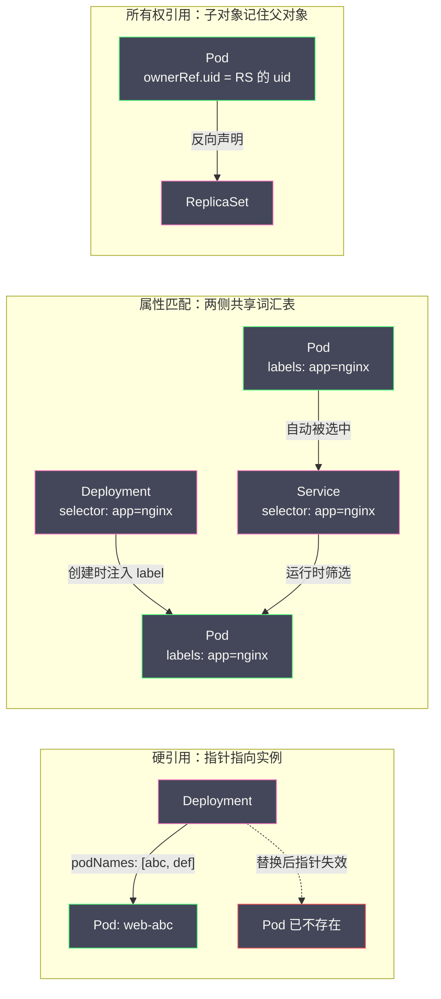
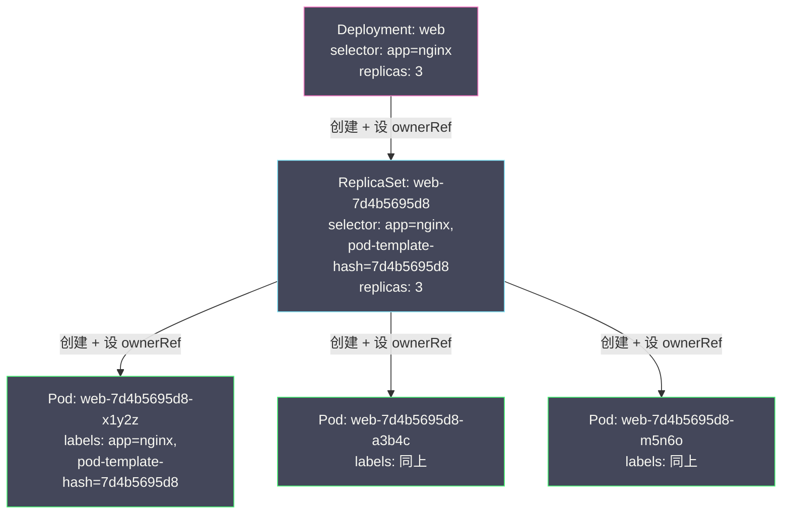
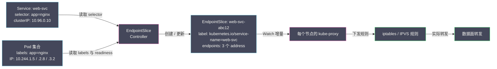
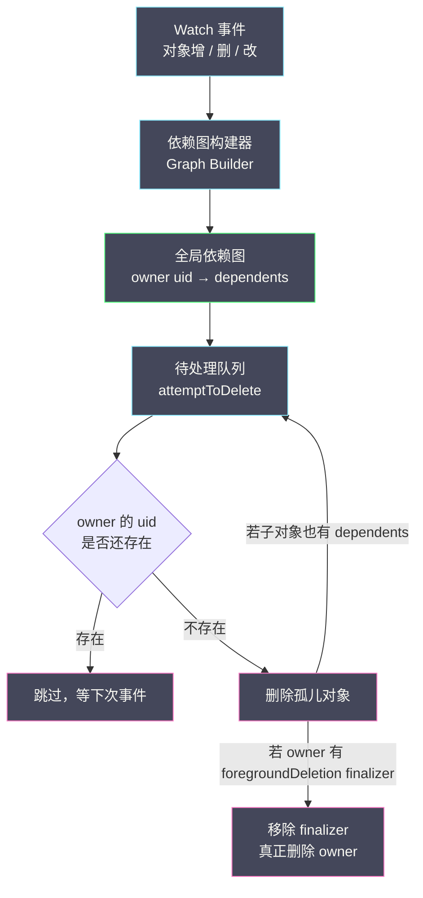
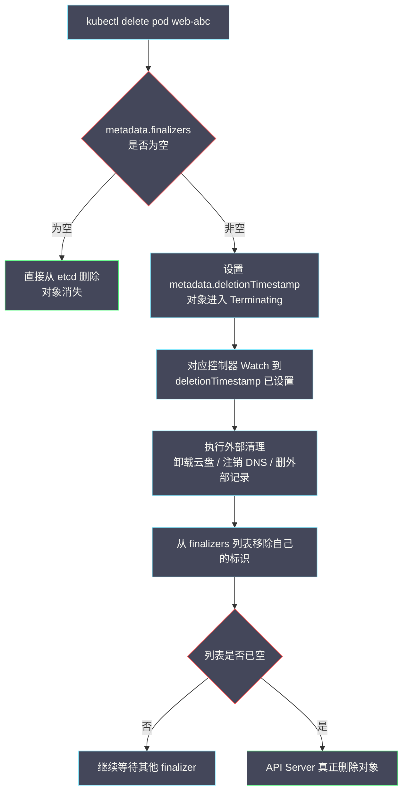

# 04 Label Selector 与松耦合设计

**摘要：**

一个系统如何表达"这两个对象有关系"，决定了它能承受多大的变动。本文从一个反事实开始：假设 Deployment 用一份硬编码的 Pod 名字列表来管理副本，扩缩容、节点故障、滚动更新会各自撞上什么墙。顺着这个假设，K8s 的选择被还原成三条路的取舍——硬引用、属性匹配、以及属性匹配必须付出的代价。接下来逐层拆开四组机制：标签（Label）的格式规范与前缀治理、选择器（Selector）的两种语法及其"只有 AND 没有 OR"的表达力边界、Deployment → ReplicaSet → Pod 与 Service → EndpointSlice 两条级联链路、以及所有者引用（OwnerReference）与终结器（Finalizer）构成的另一条与标签正交的关系线。每一层都走完"为什么这么设计、不这么设计会怎样、代价落在谁身上"三步，最后两章讨论边界与反例：标签漂移、跨命名空间失效、高基数标签、把标签当状态字段用的反模式。读完这一篇，你应该能回答两个问题：为什么 K8s 宁可牺牲"精确指向某一个实例"也要坚持属性匹配，以及为什么"关系不依赖身份"是"替换足够廉价"的前提。

---

## 第 1 章 关系表达的三条路

### 1.1 一个反事实：如果 Deployment 记的是 Pod 名字

假设 2014 年设计 K8s 的那批人换了一条更符合直觉的路：Deployment 不去看标签，而是在自己的 `spec` 里老老实实记下它管的每一个 Pod 的名字。

```yaml
# 一个假想的、K8s 从未采用的 API 形态
apiVersion: apps/v1
kind: Deployment
metadata:
  name: web
spec:
  replicas: 3
  podNames:            # 硬编码引用
    - web-pod-abc
    - web-pod-def
    - web-pod-ghi
```

这份 YAML 在单机 Docker 时代完全说得通，`docker-compose` 里的 `depends_on`、传统运维脚本里的 PID 文件，走的都是这条路。但把它放进一个"副本会被随时杀死、随时重建"的系统里，四道墙会依次撞上来。

第一道墙是**双写不一致**。扩一个副本不是一次操作，而是两次：先创建 Pod、拿到它的名字，再回写 `podNames`。两次写入之间有一个窗口，控制器在这个窗口里崩溃，集群就停在一个自相矛盾的状态上——Pod 已经跑起来了，但 Deployment 不知道它的存在，于是它成了没人回收、也没人统计的孤儿；反过来先写名字再创建 Pod，创建失败就留下一个永远对不上的悬挂引用。这种"两步之间必然有窗口"的问题叫双写问题（Dual-write Problem），解法从来不是"写快一点"，而是**取消第二次写入**。

第二道墙是**替换成本**。Pod 的名字由 `generateName` 加随机后缀生成，被 OOM 杀掉、被节点驱逐、被滚动更新替换，新 Pod 必然换一个名字。于是每一次"死一个、补一个"的常规事件都变成一次对 Deployment 的写入。三百副本的集群做一次节点滚动重启，就要对同一个对象写上百次，而每次写入都要和用户的手工修改、和 HPA 的副本数调整争抢同一个 `resourceVersion`，冲突率随规模线性上升。

第三道墙是**关联维度爆炸**。同一个 Pod 会同时被 Deployment（管副本数）、Service（管流量）、NetworkPolicy（管谁能连它）、PodDisruptionBudget（管它能不能被驱逐）盯上。如果每种关联都靠硬编码名字，这个 Pod 一旦被替换，四个对象都要跟着改，四份列表都可能各自失败——关联的维护成本不是相加，而是相乘。

第四道墙最隐蔽：**它把"副本"这个概念废掉了**。硬引用只能表达"我认识这三个具体实例"，无法表达"我要三个符合某种形状的实例"；前者是命令式的、与当下绑定，后者才是声明式的、可以跨越重启与重建。K8s 的整个控制面建立在期望状态上，而期望状态要能被反复对账，前提就是不指向任何具体实例。

### 1.2 硬引用为什么会崩：身份与可替换性的冲突

把四道墙归结成一句话：**硬引用把"身份"写进了"关系"里，而副本设计的第一前提恰恰是"身份可以被丢弃"**。

这里要区分两个容易混为一谈的概念。一个是**身份**，指"这一个具体实例"，由名字和 UID 唯一确定，随实例生灭而生灭；另一个是**角色**，指"这一类实例中的一个位置"，由属性描述，只要还有实例满足这组属性，角色就被填满了。硬引用表达前者，属性匹配表达后者。

关系数据库里用外键没问题，因为主键是稳定的——一条订单永远指向同一个用户 ID，用户改名不改 ID。但 K8s 管理的对象不是记录，而是进程，而进程的设计前提就是"会死、会重生"。在这样的对象上做外键，等于给一个每秒都在换身份证的人建索引。

> [!info] 三种关系表达方式的定位
> 硬引用适合"被引用方生命周期长于引用方、且数量有限"的场景，譬如 Pod 引用 Secret、Pod 引用 PVC。属性匹配适合"被引用方频繁生灭、数量不定"的场景，譬如控制器管 Pod、Service 找后端。所有权引用是第三种，它把指针方向反过来、由子对象记住父对象，专用于生命周期级联。本文后面八章会看到，K8s 在同一套 API 里同时用了这三种，且刻意让它们互不替代。

### 1.3 属性匹配：K8s 的选择

K8s 的答案是：对象之间不互相引用名字，而是各自贴上一组键值对（标签），再声明一个筛选条件（选择器），由系统在运行时把两边对上。

```yaml
apiVersion: apps/v1
kind: Deployment
metadata:
  name: web
spec:
  replicas: 3
  selector:
    matchLabels:
      app: nginx          # 我管所有带 app=nginx 的 Pod
  template:
    metadata:
      labels:
        app: nginx        # 我造出来的 Pod 都带这个标签
    spec:
      containers:
        - name: nginx
          image: nginx:1.25
---
apiVersion: v1
kind: Service
metadata:
  name: web-svc
spec:
  selector:
    app: nginx            # 我把流量发给所有带 app=nginx 的 Pod
  ports:
    - port: 80
      targetPort: 80
```

这段 YAML 里没有任何一处出现 Pod 的名字，也没有任何一处出现 Pod 的数量。Deployment 说的是"我要三个符合这个模板的东西"，Service 说的是"我要所有长成 `app=nginx` 的东西"，两句话都不指向实例，因此都对实例的更替免疫。

这就是所谓**松耦合（Loose Coupling）**在 K8s 里的具体含义：耦合没有被消灭，它只是从"对象之间的直接指针"下移到了"对象之间共享的词汇表"上。Deployment 和 Service 依然耦合在 `app=nginx` 这个词上，但这个耦合是通过约定而非通过地址建立的，任何一方都不知道另一方的存在。

用一张图把三条路的差别摊开来看：



图里最值得琢磨的是中间那幅：Deployment 和 Service 之间没有连线。它们各自只与 Pod 相连，而 Pod 之所以被两边同时选中，是因为它恰好带了双方都在找的那个词。关系的建立者从"对象本身"变成了"被关联的对象"，这一处视角的翻转，是后面所有松耦合收益的源头。

### 1.4 基于属性关联的三笔代价

属性匹配不是免费的，它把三笔账转移给了使用者。

**第一笔是无法精确指向某一个实例。** 你没有办法用选择器表达"就把流量发给 `web-7d4b5695d8-x1y2z` 这一个 Pod"。排查故障时这格外难受：想把一个有问题的实例从负载均衡里摘出来，你不能改 Service 的 selector，只能改那个 Pod 的标签，或者加一个 `NotIn` 排除条件——而后者需要整个 selector 一起改。手工维护 EndpointSlice、服务网格的 outlier detection，都是在给这件事打补丁。

**第二笔是标签漂移（Label Drift）的风险。** 属性匹配的可靠性完全建立在"标签如实反映了对象的角色"这个假设上。一旦有人手工改了 Pod 的标签，或者某个 Operator 同步标签时写错了值，关联关系就会静默改变——没有报错，没有事件，只是流量走了另一条路。硬引用不会出现这种问题：指针要么有效，要么明显失效。

**第三笔是选择器重叠时的不可判定性。** 两个控制器用了重叠的 selector，系统里没有任何一处能检测出来——API Server 校验的是"你的 selector 是否匹配你自己的模板"，不是"你的 selector 是否和别人冲突"。这类冲突要等 Pod 开始被反复删除重建时才暴露，那时代价已经付出去了，第 4 章会给出它的完整形态。

### 1.5 图书馆的比喻

用图书馆做一次对照。一种上架方式是**索书号**：每本书有一个唯一编号，编号里编码了楼层、书架、层数、位次，读者按号取书，馆员按号归架，一本书对应一个物理位置。另一种方式是**主题标签**：书脊上贴"分布式系统""共识算法""运维"几个词，读者按词找书，馆员按词归架。

索书号的优势是精确——你说要哪一本就是哪一本。但它的代价在于每一次变动都要重排编号：买进一本新书插进书架中间，后面所有书的位次都要改；把"共识算法"整体搬到新阅览室，几百个索书号全部作废。按主题标签上架则不然，搬多少次家都不需要改书脊上的任何一个字，因为标签描述的是"这本书讲什么"，不是"这本书放在哪儿"。

这个类比只能推到这一步：真实的图书馆是两种方式并用的——索书号管"书在哪儿"，主题标签管"书讲什么"，前者用于定位、后者用于检索，互不替代。K8s 也是如此，标签管"这个对象属于哪一类"，`metadata.name` 与 `metadata.uid` 管"这个对象是哪一个"（这套元数据字段的分层见 [[03 API 对象模型与 GVR 体系]]），OwnerReference 管"这个对象归谁回收"，后面八章讲的全是这三套坐标如何分工。代价也要对齐：主题标签会贴错，一本讲 Raft 的书被贴上"消息队列"，读者按标签找到它，翻两页发现不是自己要的——这就是第 9 章要展开的标签漂移。

---

## 第 2 章 Label 的语义与规范

### 2.1 键与值的格式约束

一个标签由键（key）和值（value）组成，键可以带一个可选的前缀（prefix），用 `/` 与名称分隔。

```text
# 不带前缀
app: nginx
env: production

# 带前缀（域名格式）
app.kubernetes.io/name: nginx
app.kubernetes.io/version: "1.25"
prometheus.io/scrape: "true"
```

格式约束的细节值得逐条记住，因为它们会直接变成 `kubectl apply` 时的 422 报错：

| 部分 | 约束 |
| --- | --- |
| 前缀 | 可选。必须是合法的 DNS 子域名：小写字母、数字、`-`、`.`，每段以字母数字开头结尾，总长不超过 253 字符 |
| 名称 | 必填。以字母或数字开头和结尾，中间可含 `-`、`_`、`.`，总长不超过 63 字符 |
| 值 | 可以为空字符串。非空时必须以字母或数字开头和结尾，中间可含 `-`、`_`、`.`，总长不超过 63 字符 |

这里有一个绝大多数人都踩过一次的坑：**前缀必须全小写，名称和值却允许大写**。`App: nginx` 是合法的，`MyDomain/app: nginx` 是非法的——因为前缀走的是 DNS 子域名的校验规则，而 DNS 本身大小写不敏感，K8s 干脆要求全小写。这个不对称不是笔误，而是两套校验函数叠加的结果：前缀用 `IsDNS1123Subdomain`，名称和值用 `IsValidLabelValue`。

另一处不对称在于值的字符集：允许 `-`、`_`、`.`，不允许 `/`、空格以及任何非 ASCII 字符，中文与 emoji 全被排除在外。标签是给机器筛选用的标识符，不是给人阅读的说明，凡是需要承载自然语言的地方都该去注解（Annotation）。

```bash
# 一次典型的 422：前缀里出现大写
kubectl label pod web-abc MyDomain/tier=frontend
# The Label "MyDomain/tier" is invalid: prefix part must be lowercase

# 值的长度超限
kubectl label pod web-abc trace=0123456789abcdef0123456789abcdef0123456789abcdef0123456789abcdef
# The Label "trace" is invalid: Value: Too long: may not be more than 63 bytes
```

### 2.2 前缀是治理工具，不是装饰

`kubernetes.io/` 和 `k8s.io/` 两个前缀保留给 K8s 自身使用，这条约定几乎所有文档都会提到，但很少有人解释它到底在治理什么。

设想一个没有前缀的世界：所有标签挤在同一个扁平命名空间里，`version`、`name`、`env`、`team` 这些短词会被几十个工具各自定义一遍。Prometheus 认为 `name` 是抓取任务名，Helm 认为 `name` 是 release 名，某个自研 Operator 认为 `name` 是数据库集群名——三者贴在同一个 Pod 上，互相覆盖，谁都不知道自己被谁改了。早期的 K8s 生态确实经历过这个阶段，`app` 这个标签至今仍是"各家有各家语义"的典型遗留。

前缀的解法是**把唯一性的责任外包给一个已经存在且全球唯一的命名空间**——DNS 域名。这跟 Java 包名用反写域名、Maven 用 `groupId` 是同一个思路：你不需要去中心化机构注册标签名，只要拥有一个域名，就自动拥有了以它为前缀的整个标签子空间。

```yaml
# 官方保留
kubernetes.io/hostname: node-1
k8s.io/cluster-autoscaler/enabled: "true"

# 第三方工具用自有域名
prometheus.io/scrape: "true"
helm.sh/chart: nginx-15.0.0
cert-manager.io/cluster-issuer: letsencrypt
```

### 2.3 推荐标签集 `app.kubernetes.io/*`

为了解决"同一个概念各家起不同名字"的问题，K8s 在 1.14 前后整理出一套推荐标签（Recommended Labels），统一挂在 `app.kubernetes.io/` 前缀下。

| 标签 | 含义 | 示例 |
| --- | --- | --- |
| `app.kubernetes.io/name` | 应用名称，最小标识 | `nginx` |
| `app.kubernetes.io/instance` | 应用实例的唯一标识 | `nginx-prod-a` |
| `app.kubernetes.io/version` | 应用版本 | `1.25.3` |
| `app.kubernetes.io/component` | 组件角色 | `frontend`、`backend`、`database` |
| `app.kubernetes.io/part-of` | 所属的更高层应用 | `wordpress` |
| `app.kubernetes.io/managed-by` | 管理该资源的工具 | `helm`、`argocd`、`kustomize` |

这套标签的价值不在好看，而在于它把"应用身份"和"应用实例"拆成了两个维度。`name` 回答"这是什么软件"，`instance` 回答"这是哪一套部署"。同一个 `name` 可以在一个集群里有多套 `instance`——生产一套、灰度一套、压测一套，selector 用 `instance` 区分，监控用 `name` 聚合。这个二维拆分恰好解决了第 4 章那个最典型的事故，因为只要 selector 里带上 `instance`，两套部署就不可能重叠。

这里有一个常见误用：把 `app.kubernetes.io/version` 放进 Deployment 的 selector，理由是"我要管 1.25 版本的那批 Pod"。但 selector 一旦创建就不可修改（第 6 章），把版本写进去等于宣布"这个 Deployment 永远只能跑 1.25"，升级时唯一的选择是新建 Deployment。版本该放在 `template.metadata.labels` 里供查询与灰度使用，但不进 selector。

### 2.4 标签基数与 etcd 的真实关系

关于标签有一条流传很广的说法："标签会被 etcd 索引，所以高基数标签会拖垮 etcd。"这句话的前半段是错的，后半段是对的，但对的理由和大多数人以为的不一样。

etcd 是一个扁平的键值存储，K8s 在它里面的布局大致是 `/registry/<resource>/<namespace>/<name>`，值是一份序列化后的完整对象。**etcd 里没有任何针对标签的二级索引**——你按标签查 Pod，etcd 并不知道哪些 Pod 带 `app=nginx`，只能把整个 `/registry/pods/` 前缀下的对象全部吐出来。真正的筛选发生在 API Server：早期实现是"List 出全部对象、在内存里逐个比对"，现在主要走 watch cache，cache 内部确实维护了一个 `labels` 索引（`key=value` 映射到对象集合），但它在内存里、进程重启即重建、只覆盖被缓存的对象，不落盘。

所以高基数标签的真实代价是另外四处，每一处都比"etcd 索引"更具体：

| 代价 | 机制 | 量级感受 |
| --- | --- | --- |
| 对象体积 | 每个标签都随对象完整序列化进 etcd，单对象受 `--max-request-bytes`（默认 1.5 MiB）约束 | 一个 40 键的标签集会让每个 Pod 多出 1-2 KB 开销，乘上十万 Pod 就是几百 MB |
| 写入放大 | 改一个标签 = 整个对象重写一次 + etcd 新增一个 revision | 把时间戳写进标签，等于每秒对同一个对象制造一次全量写入 |
| Watch 放大 | 对象任何变更都会推给所有 watch 该资源的客户端 | 一个带 `lastSeen` 标签的 Pod，会让每个节点的 kubelet、每个控制器都收到心跳级事件 |
| 缓存内存 | 每个控制器的 informer 都持有一份完整对象副本 | 标签数量直接乘进内存占用，十万 Pod × 40 标签是相当可观的一笔 |

至于"为什么不能把 requestID 放进标签"，除了上面四条还有两条硬约束：值的长度上限只有 63 字符，装不下一个 UUID 加时间戳的组合；字符集不允许 `/`，装不下 URL 或路径。**标签是分类维度，不是数据字段**——凡是"每个对象都不一样、且需要原样保留"的信息，都属于注解，后者没有长度与字符集限制，也不会被 selector 消费。

---

## 第 3 章 Selector 的两种语法与表达力边界

### 3.1 等式选择器

等式选择器（Equality-based Selector）支持三个操作符：`=`、`==`（两者完全等价）、`!=`。

```bash
kubectl get pods -l app=nginx                    # app 等于 nginx
kubectl get pods -l app=nginx,env=production     # 逗号即 AND
kubectl get pods -l app!=redis                   # app 不等于 redis
```

在 YAML 里，等式选择器对应 `matchLabels` 字段，它是一个 `map[string]string`：

```yaml
selector:
  matchLabels:
    app: nginx
    env: production
# 等价于 app=nginx AND env=production
```

这里有一个必须点明的语义细节：**`!=` 和 `NotIn` 会把"根本没有这个键"的对象也算作匹配**。`env!=production` 匹配的是"env 的值不等于 production，或者 env 这个键不存在"的集合。这条规则在数学上自洽（它让 `!=` 成为 `=` 的补集），在工程上却极其容易出错：

```yaml
# 意图：找出所有非生产的 Pod
selector:
  matchExpressions:
    - key: env
      operator: NotIn
      values: ["production"]
# 这个 selector 会把完全没有 env 标签的 Pod 也一并选中

# 想表达"有 env 标签、且不是 production"，必须写成两条合取
selector:
  matchExpressions:
    - key: env
      operator: Exists          # 先要求键存在
    - key: env
      operator: NotIn
      values: ["production"]    # 再排除生产值
```

### 3.2 集合选择器

集合选择器（Set-based Selector）支持四个操作符：`In`（值在集合中）、`NotIn`（值不在集合中）、`Exists`（键存在，不看值）、`DoesNotExist`（键不存在）。

```bash
kubectl get pods -l 'env in (production, staging)'   # env 是两者之一
kubectl get pods -l 'tier notin (frontend)'          # tier 不是 frontend（或不存在）
kubectl get pods -l 'app'                            # app 键存在，值任意
kubectl get pods -l '!canary'                        # canary 键不存在
```

YAML 里对应 `matchExpressions`，它是一个数组，每个元素形如 `{key, operator, values}`：

```yaml
selector:
  matchExpressions:
    - key: env
      operator: In
      values: ["production", "staging"]
    - key: tier
      operator: NotIn
      values: ["frontend"]
    - key: app
      operator: Exists
```

**两条校验规则值得记住**：`In` 与 `NotIn` 的 `values` 不能为空数组（否则语义退化成"永远不匹配"或"永远匹配"，K8s 直接拒绝）；`Exists` 与 `DoesNotExist` 的 `values` 必须为空。`matchLabels` 与 `matchExpressions` 可以在同一个 selector 里共存，它们之间同样是 AND。

### 3.3 只有 AND 没有 OR：设计约束还是能力缺失

这是整个选择器体系里最常被抱怨的一点：K8s 的 LabelSelector 无法表达跨键的 OR，你写不出"`app=nginx` 或者 `tier=cache`"这样的条件。

先要把话说准确：**单键上的 OR 是有的**，`In` 的多值形式就是它，`app in (nginx, apache)` 在语义上等于 `app=nginx OR app=apache`。真正缺的是不同键之间的析取——`app=nginx OR env=canary` 这种"两个条件满足任意一个即可"的写法。

K8s 为什么不做？社区里关于 union selector 的提案存在过，但一直没有推进，原因可以归到两条。

**第一条是所有权判定的确定性。** 选择器在 K8s 里不只是查询条件，它同时是所有权声明——Deployment 说"这些 Pod 归我管"，ReplicaSet 说"这些 Pod 归我数"。一旦允许析取，两个控制器的 selector 是否重叠就从一个可以逐项检查的问题变成了布尔可满足性判定。今天的 K8s 其实根本不检查重叠（这正是第 4 章事故的根源），但至少"两个合取式是否相交"一眼可辨：逐键比对，同键不同值即不相交。析取会把这个廉价的判断彻底摧毁。

**第二条是不可变性校验的复杂度。** 第 6 章会讲到 `spec.selector` 不可修改，创建时 API Server 会校验"selector 必须匹配 template 里的 labels"。在合取范式下，这个校验是逐条 requirement 的包含检查：模板里有没有这个键、值是否落在允许集合里；在析取范式下，"模板的标签集合是否蕴含 selector"需要证明一个逻辑蕴含式，实现与报错信息都会变得难以理解。

由此可以看到，这不是能力缺失，而是一次自觉的能力收缩：K8s 宁可让你多查两次（或者把要 OR 的维度提前合并进一个键、用 `In` 表达），也不愿让"谁管谁"这个问题变得不可判定。

用一个筛子的比喻来理解这个取舍：合取选择器是一组串联的筛子，每一道筛孔都比上一道细，物料依次通过，最后留下的必然同时满足所有条件。它的行为完全可预测——加一道筛子，结果只会变少不会变多，这个单调性正是所有推理的基础。析取相当于把两道筛子并联，物料从任意一道漏下来都算通过；并联本身不难，难的是当你手上有一百道筛子、其中若干道还是"反向筛"（`NotIn`）时，没人能说清最终产出是什么形状。这个比喻有一处失真：真实筛分是物理过程，通过与否只取决于尺寸，而 `NotIn` 会让"没通过正向筛的物料"反而被选中，所以它只能用来解释单调性——合取让结果集随条件增加而单调收缩，这一点在工程上是可靠的推理依据，析取则不具备。

### 3.4 各资源对 Selector 的支持差异

同一个概念在不同资源上的实现并不一致，这张表值得存下来备查：

| 资源 | 字段 | 类型 | 支持语法 | selector 可变 |
| --- | --- | --- | --- | --- |
| Service | `spec.selector` | `map[string]string` | 仅等式 | 可变 |
| Deployment | `spec.selector` | `LabelSelector` | 等式 + 集合 | 不可变 |
| ReplicaSet | `spec.selector` | `LabelSelector` | 等式 + 集合 | 不可变 |
| DaemonSet | `spec.selector` | `LabelSelector` | 等式 + 集合 | 不可变 |
| StatefulSet | `spec.selector` | `LabelSelector` | 等式 + 集合 | 不可变 |
| Job | `spec.selector` | `LabelSelector` | 等式 + 集合 | 不可变 |
| NetworkPolicy | `spec.podSelector` | `LabelSelector` | 等式 + 集合 | 可变 |
| PodDisruptionBudget | `spec.selector` | `LabelSelector` | 等式 + 集合 | 可变 |
| PodAffinity | `labelSelector` | `LabelSelector` | 等式 + 集合 | 可变 |
| kubectl | `-l` 参数 | 字符串解析 | 等式 + 集合 | — |
| kubectl | `--field-selector` | 字符串解析 | 仅等式，且只作用于少数字段 | — |

表里有两处容易被忽略。一是 **`--field-selector` 是另一套东西**：它筛的是对象字段（`metadata.name`、`status.phase`、`spec.nodeName` 等），不是标签，支持的字段由各资源的 `GetAttrs` 实现决定。二是 **NetworkPolicy 与 PDB 的 selector 可变**——因为它们不是所有权声明，只是"当前关注哪些对象"的声明，改它不会破坏已有对象的归属。

### 3.5 Service 为什么只认等式选择器

`Service.spec.selector` 的类型是 `map[string]string`，只能做等值匹配。这常被当成"设计不统一"的证据，但它其实是 API 演进史留下的必然结果。

Service 属于 `core/v1`，它的 selector 字段在 2014 年 K8s 开源时就已经定型。而 `metav1.LabelSelector` 这个带 `matchLabels` 与 `matchExpressions` 的完整结构，是随 `extensions/v1beta1` 里的 ReplicaSet 与 Deployment 一起出现的，时间上晚得多。等到集合选择器成为标准，Service 已经在生产环境跑了两年，改它的字段类型是一次**破坏性的 API 变更**：所有存量对象要迁移，所有读 `spec.selector` 的客户端（kube-proxy、Endpoint 控制器、无数第三方工具）要同时升级。K8s 的 API 兼容性承诺不允许这么做。

于是社区选了另一条路：给 Service 保留等式 selector，把"更复杂的筛选"交给下游对象。这条路今天看来是可行的——Service 不直接读 Pod，它读的是 EndpointSlice（第 5 章），而 EndpointSlice 是普通对象，可以由任何人写入。想要复杂的筛选逻辑，写一个控制器去生成 EndpointSlice 就行，不需要改动 Service 的 schema。

Service 的 selector 还有一处与 Deployment 相反的性质：它可以被修改，也可以被删除。把 `spec.selector` 整个删掉，Service 就变成"没有选择器的 Service"，EndpointSlice 不再被自动生成，端点完全由你手工维护：

```yaml
# 无选择器的 Service：接入集群外部服务，或需要自定义端点逻辑
apiVersion: v1
kind: Service
metadata:
  name: legacy-db
spec:
  ports:
    - port: 5432
      targetPort: 5432
# 没有 selector，Endpoints/EndpointSlice 由使用者自行创建
```

---

## 第 4 章 级联：Deployment → ReplicaSet → Pod

级联是 Label Selector 在生产里最重要的一次使用，也是理解 [[05 核心工作负载对象深度解析|工作负载对象]] 的前提。

### 4.1 三级结构与"每个控制器只管一级"

K8s 的工作负载管理是一条三级链：Deployment 管版本与滚动策略，ReplicaSet 管副本数量，Pod 是实际运行的实例。



图里的连线有两种性质：标签关系是横向的筛选（Deployment 的 selector 选出 ReplicaSet，后者再选出 Pod），ownerReference 是纵向的归属（子对象记住父对象的 uid）。同一个对象同时处在这两条线上，但两条线互不替代。

为什么要拆成三级而不是两级？答案在于两种变化率的分离。副本数量的变化是高频的（HPA 每分钟都可能调整），版本的变化是低频的（一次发版一次）。如果合并成一级，每次扩缩容都要修改承载版本信息的那个对象，`resourceVersion` 冲突率会显著上升；更重要的是，滚动更新期间你需要同时存在两个不同版本的副本集合，每个集合有自己的副本数——这个"两个集合此消彼长"的状态，只能靠中间那一级来承载。

用建筑行业做一次对照：Deployment 是总包，管"这栋楼盖几层、用什么图纸、分几期交付"；ReplicaSet 是分包，管"这一期我要多少工人、现在到岗几个"；Pod 是班组，是真正干活的那群人。总包不会直接给某个班组派活，它只跟分包签合同；分包也不会自己改图纸，图纸变了它只能等总包下一份新合同。这个类比有一处失真：分包与班组是"人"，会自己判断该不该干活；而 ReplicaSet 与 Pod 之间是纯粹的单向控制，Pod 从不主动向 ReplicaSet 汇报任何东西，ReplicaSet 只是周期性数一遍"匹配我 selector 的 Pod 有几个"——一旦某个 Pod 的标签被改得不再匹配，它就从这个"数人头"的过程里彻底消失了。

### 4.2 `pod-template-hash`：让两个 ReplicaSet 互不越界

如果你仔细看图，会发现 ReplicaSet 的 selector 里除了 `app=nginx` 还有一个 `pod-template-hash=7d4b5695d8`。这个标签是理解整条级联链的钥匙。

Deployment 控制器在创建 ReplicaSet 时做三件事：计算当前 Pod 模板的哈希值；把这个哈希作为 `pod-template-hash` 标签写进 ReplicaSet 的 `spec.selector`；同时也写进 `spec.template.metadata.labels` 和 ReplicaSet 自身的 `metadata.labels`。于是 ReplicaSet 造出来的每个 Pod 都带着这个哈希，而这个哈希又出现在 ReplicaSet 的 selector 里——两者精确对齐。

现在假设你把镜像从 `nginx:1.24` 改成 `nginx:1.25`，控制器重新计算哈希，得到一个新值，于是创建一个新的 ReplicaSet：

```text
旧 ReplicaSet: web-7d4b5695d8   selector: app=nginx AND pod-template-hash=7d4b5695d8
新 ReplicaSet: web-6c9f8b7d4f   selector: app=nginx AND pod-template-hash=6c9f8b7d4f
```

两个 ReplicaSet 都带 `app=nginx`，也就是说，如果只有这一个标签，它们会互相把对方的 Pod 数进自己的账上——这正是第 4.4 节事故的形态。`pod-template-hash` 的作用就是**在这一层加上一道隔离**：新旧两个 ReplicaSet 的 selector 因为哈希不同而互不相交，各自只数自己的 Pod。

### 4.3 滚动更新时两个 ReplicaSet 的副本数如何此消彼长

滚动更新的本质是一次受约束的副本迁移：总量要维持在可用区间内，同时逐步把副本从旧集合搬到新集合。约束由两个参数给出，`maxSurge`（最多超出期望副本数多少）与 `maxUnavailable`（最多允许多少个不可用），默认值都是 25%。

以 4 个副本、默认参数为例：

| 参数 | 计算 | 结果 |
| --- | --- | --- |
| `maxSurge` | `ceil(4 × 25%)` | 1 |
| `maxUnavailable` | `floor(4 × 25%)` | 1 |
| 集群内 Pod 总数上限 | `replicas + maxSurge` | 5 |
| 可用 Pod 数下限 | `replicas - maxUnavailable` | 3 |

于是更新过程呈现出一条阶梯：新 ReplicaSet 先扩到 1 个副本（总量 5，其中旧 4 新 1），等新 Pod 就绪后旧 ReplicaSet 缩到 3 个（总量 4，其中旧 3 新 1）；新再扩到 2，旧缩到 2；依此类推，直到旧归零。

```bash
# 观察这条阶梯，比看文档直观得多
kubectl rollout status deployment/web
kubectl get rs -w
# NAME              DESIRED   CURRENT   READY   AGE
# web-7d4b5695d8    4         4         4       10m
# web-6c9f8b7d4f    1         1         1       2s
# web-7d4b5695d8    3         4         4       10m
# web-6c9f8b7d4f    2         2         2       5s
# web-7d4b5695d8    0         0         0       10m
```

有两处细节容易被忽略。其一，`maxSurge: 0` 是合法的，表示"不允许超出"，代价是更新必须先把旧副本减下去才有空间创建新的，可用容量会出现明显的凹谷；`maxUnavailable: 0` 则表示"不允许任何不可用"，更新只能靠 surge 空间推进，集群必须有富余容量。这两个极值分别对应"资源紧张"与"零停机"两种真实诉求，而不是配置洁癖。

其二，旧 ReplicaSet 不会被立即删除，它被缩到 0 后保留下来，受 `revisionHistoryLimit` 约束（默认 10 个）。保留的意义是回滚：`kubectl rollout undo` 做的事情就是找到上一个 ReplicaSet，把它重新扩起来、把当前的缩下去——因为 selector 与模板都还在，这个过程不需要重建任何东西。这也解释了为什么 `revisionHistoryLimit` 设得太小会让回滚变难：超过限制的旧 ReplicaSet 会被真正删除，回滚就只能靠重新 apply 一份旧 YAML。

### 4.4 标签冲突的真实事故形态

现在来看本节最想讲的一件事：两个 Deployment 用了相同的 selector，会发生什么。

假设有人复制了一份 Deployment 的 YAML，改了 `metadata.name` 与镜像版本，却忘了改 `app` 标签：

```yaml
# deployment-a
metadata:
  name: web-a
spec:
  selector:
    matchLabels:
      app: nginx        # ← 忘了改
  template:
    metadata:
      labels:
        app: nginx      # ← 忘了改

# deployment-b
metadata:
  name: web-b
spec:
  selector:
    matchLabels:
      app: nginx        # ← 忘了改
  template:
    metadata:
      labels:
        app: nginx      # ← 忘了改
```

如果两份模板内容完全一致（只是名字不同），`pod-template-hash` 也会一致。于是集群里出现两个 ReplicaSet，它们的 selector 一模一样。

接下来发生的事是这样的：ReplicaSet 协调循环的第一步是"数一遍匹配我 selector 的 Pod"。两个 ReplicaSet 都数到了双方 Pod 的总和，也就是 `2 × replicas`，每个控制器都判断"我多出来了 replicas 个"，于是各自去删 Pod——而它删的可能正是对方的。删完之后下一轮协调又发现副本不足，于是补回来，然后再次数多、再次删。最终状态是 Pod 在 `ContainerCreating` 与 `Terminating` 之间无限抖动，`kubectl get pods` 的输出每刷新一次就变一次。

如果两份模板内容不同（镜像版本不一样），`pod-template-hash` 就会不同，两个 ReplicaSet 的 selector 因为哈希不同而互不相交，表面上一切正常。但这时埋下的是另一个雷：Deployment 的 selector 会同时匹配两个 ReplicaSet。`kubectl get deployment web-a` 的 `status.readyReplicas` 可能莫名其妙地比 `replicas` 大，`kubectl rollout status` 会一直等不到收敛，因为控制器数到的新旧副本数永远对不上它自己的预期。

> [!warning] 怎么尽早发现
> `kubectl get rs -o wide` 会打印每个 ReplicaSet 的 SELECTOR 列，把同命名空间的输出并排看，重复的 selector 一眼可见。更系统的做法是把"selector 唯一性"做成准入策略（Kyverno 的 `validate` 规则、OPA Gatekeeper 的 constraint），在 `kubectl apply` 阶段就拦下来。K8s 自身不做这个检查，因为跨对象的重叠检测需要全命名空间扫描，代价与一致性都难以承受。

正确的做法是让 selector 里带上能区分实例的维度，这正是 `app.kubernetes.io/*` 那套推荐标签的价值所在——用 `name` 表达"是什么软件"，用 `instance` 表达"哪一套部署"，selector 里两个都写，冲突概率就降到接近零。

---

## 第 5 章 间接关联：Service → EndpointSlice

### 5.1 Service 不直连 Pod，它只声明"我要哪些标签"

一个初学者很容易产生的印象是"Service 指向 Pod"。这个印象在功能上没错，在结构上是错的：**Service 与 Pod 之间从来没有直接关系，中间隔着一层物化出来的对象**。这层间接机制的运行时行为，在 [[云原生/Kubernetes/kubernetes生命周期管理和服务发现/00 专栏导览|生命周期与服务发现专栏]] 里有完整展开，本文只关心它的结构意义。

Service 的 `spec.selector` 读起来像一句声明而不是一次查找：我要所有带 `app=nginx` 的 Pod。它没有说"现在有哪几个"，也没有说"它们的 IP 是多少"。这个声明被写进对象之后，Service 自己就再也不关心后端了——真正干活的是另一个控制器。这层间接性有一个直接好处：Service 的 selector 可以被修改，因为它不承载所有权。你把 selector 从 `app=nginx` 改成 `app=nginx-v2`，Service 对象不需要重建，ClusterIP 不变，DNS 记录不变，客户端连接不受影响，只是后端换了一批。

### 5.2 Endpoint Controller 负责把标签匹配结果物化

把声明变成事实的组件是 EndpointSlice 控制器（运行在 kube-controller-manager 里）。它同时 watch Service 与 Pod 两类资源，每当其中任何一方变化，就重新计算一次匹配，然后把结果写进端点切片（EndpointSlice）对象。



这条链路上有三处细节值得单独说。其一，**只有 Ready 的 Pod 会进入默认端点集**。控制器读取 Pod 的 `status.conditions` 里 `Ready` 那一项，`Ready=False` 的 Pod 会被写进 `endpoints[].conditions.ready: false` 而不是直接丢弃——保留它们是为了让 `publishNotReadyAddresses: true` 的 Service（典型场景是 StatefulSet 的 Headless Service）能用上，也让排查时能看到"为什么这个 Pod 没接流量"。

其二，**Pod 的 IP 与端口是从 Pod 对象上读的，不是从 Service 上推的**。Service 的 `targetPort` 支持命名端口，此时控制器要去 Pod 的容器定义里找同名端口的实际值——这就是为什么 Pod 还没被调度（没有 IP）、或者端口名写错时，端点里不会出现它。其三，**EndpointSlice 里带着 `targetRef`**，指向产生这个端点的 Pod，排查时可以从"某个 IP 在不在端点里"回溯到"哪个 Pod 贡献了这个 IP"。

### 5.3 这层间接带来的三个好处

**Service 与工作负载彻底解耦。** Service 不知道 Deployment、StatefulSet、DaemonSet 的存在，它只认标签，因此一套 Service 可以被任意工作负载复用：今天后端是 Deployment，明天换成 StatefulSet，Service 一个字都不用改。反过来，一个 Deployment 也可以被多个 Service 同时选中——内部调用一个、外部访问一个、灰度流量一个，三者的 selector 各有侧重。

**跨 Deployment 聚合。** 一个 Service 可以把多个不同 Deployment 的 Pod 聚合到同一个端点集里，这在渐进式迁移中非常有用：旧版本 `app=nginx,version=v1`、新版本 `app=nginx,version=v2`，selector 为 `app=nginx` 的 Service 会同时把两边收进来，流量按 Pod 数量自然分配；迁移完成后删掉旧 Deployment，端点集自动收缩。

**手工创建的 Pod 也能接入。** 一个完全不受任何控制器管理的裸 Pod，只要带上正确的标签，就会自动被 Service 选中。这条特性看起来是边缘场景，实际上是逃生通道：调试时起一个临时 Pod 挂到生产 Service 后面，或者把集群外部的进程通过手工 EndpointSlice 接进来，都不需要改动 Service。

用一个医院分诊台做对照：病人到院之后不是自己去找医生，而是先到分诊台，护士按"症状标签"把他分到对应诊室。医生的排班换了、诊室搬了、某个医生请假了，分诊规则一个字都不用改——它只认症状，不认人。关键差别在于：分诊台是被动接收病人的，病人不来就没有记录；EndpointSlice 控制器是主动轮询的，会周期性把全部 Pod 重新数一遍，因此错过一次事件不会导致端点永久缺失——这正是 [[01 Kubernetes 的诞生与设计哲学]] 讲的电平触发原则，事件只是提前叫醒，状态才是决策依据。

### 5.4 EndpointSlice 为什么要替代 Endpoints

在 EndpointSlice 出现之前，这条链路的中间对象叫端点（Endpoints），它是 `core/v1` 里的一个对象，一个 Service 对应一个 Endpoints，里面装着一个平铺的地址列表。这个设计在中小规模下没有问题，但在大规模集群里撞上两堵墙。

**第一堵墙是对象体积。** 一个 Endpoints 对象承载某个 Service 的全部后端地址，一个两千副本的 Service，对象轻松达到数百 KB 乃至逼近 1 MB。而 etcd 对单个对象的写入有大小限制（`--max-request-bytes` 默认 1.5 MiB），接近上限的对象不但写入慢，还会让快照与碎片整理的成本显著上升。

**第二堵墙是全量重写带来的更新风暴。** Endpoints 是一个整体对象，任何一个后端的增删都会导致整个对象被重写一次，`resourceVersion` 递增一次，所有 watch 这个对象的客户端都收到一次全量推送。而 watch 它的客户端是每个节点上的 kube-proxy——一个五百节点的集群，一次后端变化会产生五百次全量对象推送。滚动更新期间后端每秒都在变，这条通道就成了 API Server 上最烫的一条。

端点切片把这两堵墙一起推倒了：一个 Service 的后端被切成多个切片，**每个切片默认最多 100 个端点**；一次后端变化只影响其中一个切片，被重写的对象体积从数百 KB 降到几 KB；切片里还带 `conditions`（`ready`/`serving`/`terminating`）、`nodeName`、`zone`、`targetRef` 等结构化字段，拓扑感知与优雅摘除才有落脚点。

| 维度 | Endpoints | EndpointSlice |
| --- | --- | --- |
| API 组 | `core/v1` | `discovery.k8s.io/v1`（1.21 GA） |
| 单对象容量 | 全部后端 | 默认最多 100 个端点，按需分片 |
| 变更影响面 | 整个对象重写 | 只重写受影响的切片 |
| 元数据 | 仅地址与端口 | 含 conditions、nodeName、zone、targetRef、hints |
| 与 Service 的关联 | 同名 | `kubernetes.io/service-name` 标签 |
| 状态 | 自 1.33 起标记弃用 | 推荐使用 |

Endpoints API 在 1.33 被正式标记为弃用，新的控制器与工具不应再写入它——但要注意，Service 无 selector 时手工维护端点的老做法仍然大量存在，迁移时要把手工写入的 Endpoints 换成手工写入的 EndpointSlice（带 `kubernetes.io/service-name` 标签，并把 `endpointslice.kubernetes.io/managed-by` 设为自建标识，避免被控制器接管）。

---

## 第 6 章 Selector 不可变性

### 6.1 哪些字段改不了

`Deployment`、`ReplicaSet`、`DaemonSet`、`StatefulSet`、`Job` 这五种资源的 `spec.selector`，**在对象创建之后不可修改**。这不是文档建议，而是 API Server 的硬校验：

```bash
kubectl patch deployment web -p '{"spec":{"selector":{"matchLabels":{"app":"web-v2"}}}}'
# The Deployment "web" is invalid: spec.selector: Invalid value: ...
#   field is immutable
```

与之形成对照的是 `Service`、`NetworkPolicy`、`PodDisruptionBudget` 的 selector 都可以改。这条分界线的依据在第 3.4 节已经给出：selector 是否承载所有权。承载所有权的不可改，只做筛选的可改。

### 6.2 允许修改会导致的两种灾难

假如 selector 可以改，两种灾难会立刻出现。

**第一种是失去已有 Pod。** 你把 selector 从 `app=nginx` 改成 `app=nginx-v2`，而现有 Pod 的标签还是 `app=nginx`。下一次协调时 ReplicaSet 数了一遍，发现匹配自己 selector 的 Pod 是 0 个，于是按期望副本数补足——集群里凭空多出一批新 Pod，而旧的那批还带着 ownerReference 留在原地，既不被统计、也不被回收，成为幽灵副本。同时旧 Pod 还在被原来的 Service 选中继续接流量，于是"已经下线的版本还在提供服务"这种最令人不安的故障形态出现了。

**第二种是误接管他人 Pod。** 反过来，你把 selector 放宽，从 `app=nginx,tier=frontend` 改成 `app=nginx`，新的 selector 会匹配到同命名空间里所有带 `app=nginx` 的 Pod，包括另一个 Deployment 管的那批。ReplicaSet 数到"我多出来了 5 个"，于是删掉 5 个——删的正是别人的。这种故障排查难度极高，因为被删的 Pod 会立刻被它自己的控制器补回来，日志里只有一条条"Pod 被删除"的事件，看起来和正常缩容没有区别。

两种灾难的共同点是**没有报错**。selector 修改是一次合法的 API 写入，API Server 校验的是格式与"selector 是否匹配自己的模板"，它不会也无法校验"新的 selector 是否与别人重叠"。破坏性后果要等下一次协调循环才显现，那时已经发生了实际的删除。

### 6.3 正确做法：新建、灰度、再删旧

需要改 selector 时，唯一可靠的做法是把它当成一次新部署：

```bash
# 1. 复制旧对象，只改名字与 selector
kubectl get deployment web -o yaml \
  | sed 's/name: web$/name: web-v2/; s/app: nginx$/app: nginx-v2/' \
  | kubectl apply -f -

# 2. 等新 Deployment 就绪
kubectl rollout status deployment/web-v2

# 3. 切流量（改 Service 的 selector，它是可变的）
kubectl patch service web-svc -p '{"spec":{"selector":{"app":"nginx-v2"}}}'

# 4. 观察一段时间，确认无异常后删除旧对象
kubectl delete deployment web
```

这个流程里有一步值得强调：流量切换与 selector 变更被拆成了两个独立的、都可回滚的动作。改 Service 的 selector 是瞬时且可逆的（改回去就行），改 Deployment 的 selector 是不可逆的。把不可逆的动作留在最后、把可逆的动作放在前面，是灰度发布的基本纪律。

用银行账户做一次对照：账户一旦开户，账号与户名的绑定关系就不能改——想换户名只能销户重开一个新账户，把余额转过去。银行的这个规矩不是因为技术上做不到，而是因为账号一旦可以被重新绑定，历史流水的归属就失去了确定性。K8s 对 selector 的处理逻辑与此同源：它承载的是"历史上这些 Pod 归谁管"的确定性，而不是"现在我想管谁"的意愿。这个类比也有一处失真：银行销户重开会转移余额，新建 Deployment 却不会自动"转移"旧 Pod，旧 Pod 只会被新 Deployment 的控制器视为陌生对象，等旧 Deployment 被删除时才由垃圾回收器连带清理——所以上面第 4 步的 `kubectl delete` 不是可选的收尾动作，而是这套流程的必需环节。

---

## 第 7 章 OwnerReference 与垃圾回收

### 7.1 所有权是另一条关系线

标签解决的是"谁和谁有关系"，但有一类关系它表达不了：当 A 消失时，B 应该跟着消失。删除一个 Deployment 时，它创建的 ReplicaSet 和 Pod 应该一起走——它们没有独立存在的意义。这个语义无法用标签表达：标签是筛选条件，删掉 Deployment 并不会让 Pod 的标签失效，Pod 会继续跑下去。你需要的是另一个方向的声明：由子对象记住自己属于谁。执行这套级联清理的垃圾回收器，属于 [[云原生/Kubernetes/kubernetes控制器和调度器/00 专栏导览|控制器和调度器专栏]] 讲的控制器家族，本文只讲它依赖的数据契约。

这就是所有者引用（OwnerReference），它写在子对象的 `metadata.ownerReferences` 里：

```yaml
apiVersion: v1
kind: Pod
metadata:
  name: web-7d4b5695d8-x1y2z
  ownerReferences:
    - apiVersion: apps/v1
      kind: ReplicaSet
      name: web-7d4b5695d8
      uid: "3f8a1c92-4d5e-4b7a-9c1d-2e6f8a0b3c4d"   # owner 的 uid，不是名字
      controller: true
      blockOwnerDeletion: true
```

两条关系线的分工可以用一张表说清楚：

| 维度 | 标签 + 选择器 | OwnerReference |
| --- | --- | --- |
| 关系类型 | 逻辑归属（"这些 Pod 属于这个 Service"） | 生命周期归属（"这个 Pod 由这个 ReplicaSet 创建"） |
| 声明方向 | 父对象声明筛选条件，向下查询 | 子对象声明父对象身份，向上指认 |
| 基数 | 多对多（一个 Pod 可被多个 Service 选中） | 多对一（最多一个 `controller: true` 的 owner） |
| 是否影响删除 | 不影响（删 Service 不动 Pod） | 决定删除（级联回收） |
| 依赖的标识 | 标签键值 | owner 的 `uid` |
| 可修改性 | 负载对象上不可改 | 可改，但受权限约束 |

表里最容易被低估的是"声明方向"那一行。OwnerReference 是**反向指针**：父对象不维护子对象列表，子对象记住父对象。这个方向带来了一个具体的性能收益——高频写入被分散到子对象上。若 Deployment 维护一份"我的 ReplicaSet 列表"，每次扩缩容都要写 Deployment 对象，而它同时是用户 `kubectl apply`、HPA 与控制器的写入目标，`resourceVersion` 冲突会非常频繁；反过来子对象各自独立，写 A 不影响 B，冲突面被天然切开。

用一个行李牌做对照：托运时每件行李上挂一个牌子，写着航班号、日期、目的地。分拣系统不需要维护一份"本次航班带了哪几个箱子"的清单，它只要看牌子；箱子被换掉、加进来、拿出去，都不需要改动任何一份清单。这个类比的失真之处在于：行李牌上写的是"航班号 + 日期"，而 OwnerReference 上写的是 uid。航班号会被复用，uid 永远不会——若行李牌只写航班号，一件滞留三天的行李会被误送上今天的同班次飞机，这正是用 `name` 而非 `uid` 做 ownerReference 会发生的事。

### 7.2 三个关键字段

`ownerReferences` 的每个元素有六个字段，其中三个决定了它的行为。

**`uid` 是唯一的判定依据。** 垃圾回收器判定"owner 是否还存在"时，**比对的是 uid 而不是 name**。设想这样一个序列：ReplicaSet `web-7d4b5695d8` 被删除，随后一个同名对象被重建。如果 ownerReference 里存的是 name，旧的 Pod 会认为"我的 owner 还在"，继续存活，而它实际上属于一个已经不存在的对象，新的同名对象也不认为它是自己的孩子。用 uid 就切断了这种误认——重建出来的对象 uid 不同，旧 Pod 的 owner 判定为不存在，于是被回收。

**`controller: true` 标记控制型所有者。** 一个对象可以有多个 ownerReference，但**最多只能有一个被标记为 `controller: true`**。这个标记有两个作用：让 `kubectl` 与各类工具知道"谁是这个对象的主要管理者"；让 `metav1.GetControllerOf()` 能返回唯一答案，控制器代码里大量使用它来确认"这个 Pod 是不是我的"。

**`blockOwnerDeletion: true` 与前台级联删除配合。** 这个字段经常被误解为"保护 owner 不被删除"，实际含义更窄：它表示"在删除 owner 时，必须等这个子对象先被删掉"，只在 owner 处于前台删除（`foregroundDeletion`）过程中生效。还有一处权限细节：设置它为 `true` 需要对 owner 对象有 `delete` 权限，否则会被 `OwnerReferencesPermissionEnforcement` 准入插件拒绝——这是为了防止低权限用户通过伪造 ownerReference 阻塞高权限对象的删除。

### 7.3 三种级联策略

删除一个带子对象的对象时，K8s 提供三种传播策略：

| 策略 | 行为 | 适用场景 | 命令 |
| --- | --- | --- | --- |
| Background（后台） | 立即删除 owner，垃圾回收器异步清理子对象 | 默认行为，绝大多数场景 | `kubectl delete deploy web` |
| Foreground（前台） | owner 进入 `Terminating`，等所有子对象删除完毕才真正删除 owner | 需要确认"确实清干净了"的脚本与自动化 | `kubectl delete deploy web --cascade=foreground` |
| Orphan（孤儿化） | 只删 owner，子对象的 ownerReference 被移除，对象继续存在 | 迁移、接管、避免误删 | `kubectl delete deploy web --cascade=orphan` |

三种策略的差别不只是快慢，而是失败时的残留形态不同。后台删除最快返回，但如果垃圾回收器此刻不可用，你会得到一堆孤儿对象而命令早已成功返回；前台删除会阻塞到你确认清理完成，代价是命令可能挂很久（数千 Pod 的场景下是分钟级）；孤儿化则主动放弃级联，把"接下来怎么办"完全交给使用者。

孤儿化有一个真实且高频的用途：把工作负载从一个控制器迁移到另一个控制器。假设你要把某个 Deployment 管的 Pod 交给一个 Operator 接管，直接删 Deployment 会连带删掉所有 Pod，业务中断；用 `--cascade=orphan` 删掉 Deployment，Pod 会保留下来（ownerReference 被摘掉，成为孤儿），此时新控制器只要 selector 匹配，就能把它们收养过去。这条路径之所以可行，正是因为"收养"在控制器里是一等公民——ReplicaSet、Deployment 的协调循环里都有一步"认领无主的 Pod"。

### 7.4 垃圾回收器如何判定"孤儿"

垃圾回收器（Garbage Collector，GC）是 kube-controller-manager 里的一个控制器，它的工作方式与前面那些控制器不太一样：它不按对象逐个协调，而是维护一张全局的对象依赖图。

构建过程是这样的：GC 通过 discovery API 拿到集群里所有可用资源类型，为每个类型启动一个 informer；任何对象被创建、更新、删除时，它的 `ownerReferences` 关系就被记进图里。于是每个对象都知道"我的 owner 是谁"，每个 owner 也知道"我有哪些 dependents"。

判定孤儿的逻辑很直白：**一个对象的全部 ownerReference 都指向不存在的 uid 时，它就是孤儿，应当被删除**。这里的"不存在"是通过向 API Server 查询确认的，GC 内部有一个 `absentOwnerCache` 来避免对同一个 uid 反复查询。



图里有两处值得注意。其一，**GC 完全不看标签**：如果你手动改掉了一个 Pod 的标签、导致 ReplicaSet 不再统计它（第 9 章），这个 Pod 依然带着 ownerReference，因此不会被 GC 回收，它成了一个既不受管、也不会被自动清理的对象。其二，删除是递归的，一个 Pod 被删掉之后它的子对象会被重新入队，这条链的深度取决于 ownerReference 的嵌套层数。

### 7.5 跨 Namespace 的 ownerReference 为什么不被允许

`ownerReferences` 有一个明确的约束：命名空间级的对象，其 owner 必须也在同一个命名空间里，或者是集群级对象；集群级对象的 owner 必须是集群级对象。

这条规则不是靠校验拦下来的，而是靠语义上的"视为不存在"：如果你给一个 Pod 写了一个指向另一个命名空间的 ReplicaSet 的 ownerReference，API Server 会接受这次写入（格式合法），但垃圾回收器会把这个 ownerReference 当作不存在处理，于是这个 Pod 立刻变成孤儿，随即被删除。在较新的版本里，这种情况还会产生一条 `OwnerRefInvalidNamespace` 事件，让排查有据可依。

为什么不允许？因为**命名空间是 K8s 里隔离与配额的边界**。如果允许跨命名空间的所有权，那么删除 A 命名空间的某个对象就会牵连 B 命名空间的对象——这直接击穿了"删一个命名空间不会影响其他命名空间"这条最基本的运维假设。在多租户集群里，这个假设更是安全边界的一部分：一个租户不应该有能力通过构造 ownerReference 去影响另一个租户的资源生命周期。

这里有一个真实的误判：有人为了"让 ConfigMap 跟着 Deployment 一起删"，把 Deployment 写成 ConfigMap 的 owner。这在同命名空间内可行，但会带来一个副作用——`ownerReferences` 的权限校验要求写入者对该 Deployment 有 `delete` 权限，很多 CI 用的 ServiceAccount 只有 `edit` 没有 `delete`，于是 apply 时报 `cannot set blockOwnerDeletion`。更稳妥的做法是让一个上层对象（譬如 Helm release 的管理对象，或一个自定义的 CR）同时拥有这两者，而不是让平级的两个对象互相认亲。

---

## 第 8 章 Finalizer：删除前的最后一道闸

### 8.1 `deletionTimestamp` + `finalizers` 的两阶段删除

如果没有终结器（Finalizer），删除一个对象就是一次 etcd 的 delete 操作——干净、快、且不可挽回。但有些对象在消失之前必须做点事：一个 PVC 要等云盘卸载，一个 LoadBalancer Service 要等云厂商回收 IP，一个自定义资源要等外部数据库删掉。这些动作不在 K8s 的掌握之内，必须交给对应的控制器去做，而控制器需要时间。

终结器就是为这段"需要时间"设计的，它把删除拆成两个阶段：



关键在于第二阶段的那次写入：**对象还在 etcd 里，但已经"死了"**。它能被读到、能被 patch、`deletionTimestamp` 也在，但它不会再接受任何实质性更新（大多数控制器会跳过带 `deletionTimestamp` 的对象），也绝不会再被创建出来。

用退租验房做一次对照：租约到期时房东不能直接把锁换掉，得先验房——水电是否结清、钥匙是否归还、墙面是否有损坏。验房单上每一项都由对应的责任方签字，全部签完，押金才退、合同才终止。房东单方面宣布"合同已结束"是无效的，因为签字栏还空着。这个类比有一处重要失真：验房有时限与责任人，终结器没有——K8s 不记录"这个 finalizer 该由谁在多久内清掉"，也不提供超时机制，一旦负责的控制器消失，它就会永久留在对象上，这正是第 8.4 节那类事故的根源。

### 8.2 典型 finalizer

K8s 自身与主流生态用到的终结器大致如下：

| Finalizer | 责任方 | 保护目的 |
| --- | --- | --- |
| `kubernetes.io/pv-protection` | PV 控制器 | 防止仍被 PVC 绑定的 PV 被删除 |
| `kubernetes.io/pvc-protection` | PVC 控制器 | 防止仍被 Pod 挂载的 PVC 被删除 |
| `foregroundDeletion` | 垃圾回收器 | 前台级联删除时挂在 owner 上，等子对象清空 |
| `orphan` | 垃圾回收器 | 孤儿化过程中挂在 owner 上，等 ownerReference 被摘除 |
| `customresourcecleanup.apiextensions.k8s.io` | apiextensions 控制器 | CRD 删除时清理其下所有自定义资源 |
| `kubernetes`（Namespace 的 `spec.finalizers`） | Namespace 控制器 | 命名空间删除前清理其中的全部资源 |

表里最后一行值得单独说一句：**Namespace 有两个 finalizer 字段**，一个是 `metadata.finalizers`，另一个是 `spec.finalizers`，后者固定为 `["kubernetes"]`，由 Namespace 控制器负责清除。清理逻辑是"列出该命名空间下所有类型的资源并逐个删除"，这就解释了那个经典的卡死场景：如果集群里有一个 `APIService` 不可用（譬如某个 aggregated API server 挂了），Namespace 控制器在 discovery 阶段就会失败，`spec.finalizers` 永远清不掉，命名空间永久停在 `Terminating`。

`pv-protection` 与 `pvc-protection` 的组合则解释了另一个常见疑问：为什么删了 PVC，PV 还在？因为 PVC 上有 `pvc-protection`，只有当没有任何 Pod 挂载它时才被移除；而 PV 上的 `pv-protection` 又要求它不再被任何 PVC 绑定。这两个 finalizer 形成了一条"从 Pod 到 PVC 到 PV"的引用链，任何一环还在，下一环就走不掉。

### 8.3 卡在 Terminating 的排查与恢复

一个对象长期停在 `Terminating`，几乎总是同一个原因：**它的某个 finalizer 没有人来清**。排查路径是固定的三步。

```bash
# 第一步：确认是 finalizer 而不是别的原因
kubectl get pod web-abc -o jsonpath='{.metadata.deletionTimestamp}{"\n"}{.metadata.finalizers}{"\n"}'
# 2026-03-04T10:30:00Z
# ["example.com/cleanup"]

# 第二步：找出这个 finalizer 属于谁
# 前缀通常是域名反写，据此判断是哪个 operator / 控制器写入的
kubectl get pod web-abc -o yaml | grep -A3 finalizers

# 第三步：确认责任方是否还在运行
kubectl get pods -A | grep example-operator
```

如果责任方已经不在了（被卸载、CrashLoop、RBAC 权限被收回），对象就永远走不掉。此时的恢复手段是手工摘除 finalizer：

```bash
kubectl patch pod web-abc -p '{"metadata":{"finalizers":null}}' --type=merge

# 只想摘掉其中一个，保留其余的
kubectl patch pod web-abc --type=json \
  -p '[{"op":"remove","path":"/metadata/finalizers/0"}]'
```

`--type=merge` 在这里是必须的：默认的 strategic merge patch 对数组字段的合并语义会带来意外，而 merge patch 里的 `null` 明确表示"删除该字段"。

> [!warning] 摘 finalizer 之前先想清楚后果
> 手工清空 finalizers 等于跳过清理逻辑。如果这个 finalizer 的职责是"卸载云盘""删除负载均衡""注销 DNS 记录"，那么摘掉它之后对象会立刻消失，而外部资源会永久残留——你会在云账单上看到一堆没人认领的磁盘，或者一个指向已删除 IP 的 DNS 记录。正确的顺序永远是"先让责任方恢复工作、让它自己清完，再考虑强制摘除"；只有在责任方确认无法恢复时才用强制手段，并同步记录需要人工清理的外部资源清单。

### 8.4 finalizer 与 operator 卸载的经典事故

这类事故有一个高度一致的剧本，值得完整走一遍。

某团队用了一个自研 Operator 管理数据库集群，资源类型是 `Database`，每个 `Database` 创建时会被写入一个 finalizer `db.example.com/backup-cleanup`，职责是"删除外部对象存储里的备份文件"。某天这个 Operator 被决定下线，运维执行了 `helm uninstall db-operator`。

从这一刻起，集群里所有 `Database` 对象都进入了危险状态：它们的 finalizer 还在，但已经没有进程会去清除它。此时任何删除操作都会卡住：

```bash
kubectl delete database orders-db
# database.example.com "orders-db" deleted   ← 命令返回"成功"
# 但对象其实还在，只是被标记了 deletionTimestamp
kubectl get database
# NAME        AGE
# orders-db   142d     ← 状态是 Terminating，永远不消失
```

更麻烦的是级联：如果这些 `Database` 被某个上层对象（譬如 `DatabaseCluster`）拥有，上层的删除也会一起卡住，因为垃圾回收器要等子对象清空才能完成 `foregroundDeletion`；如果这个命名空间正在被删除，Namespace 控制器也会一起卡住——一条 finalizer 链条足以把整个命名空间的回收流程拖死。

正确的下线顺序应该是反过来：

```bash
# 1. 先删业务资源，让 operator 还活着的时候把 finalizer 正常走完
kubectl delete database --all

# 2. 确认所有自定义资源已真正消失（而不是停在 Terminating）
kubectl get database -A

# 3. 再删 CRD（此时 CRD 上的 customresourcecleanup finalizer 才有机会正常完成）
kubectl delete crd databases.example.com

# 4. 最后卸载 operator 本身
helm uninstall db-operator
```

这个顺序背后的原则可以概括成一句话：先让"会写 finalizer 的人"把账结清，再让"定义 finalizer 的人"退场。反过来的顺序会让集群里留下一批无法回收的对象，清理它们需要人工介入，成本远高于按顺序操作。

---

## 第 9 章 边界与反例

### 9.1 标签漂移：手工改一个标签的连锁反应

标签漂移（Label Drift）指的是对象的实际标签与其"应该有的"标签不一致，最常见的原因是手工修改。

```bash
# 有人为了调试，给一个 Pod 加了个标签
kubectl label pod web-7d4b5695d8-x1y2z tier=cache
```

这一条命令可能同时触发三种后果。

**后果一：被不该选它的 Service 选中。** 如果集群里存在一个 selector 为 `tier=cache` 的 Service（原本指向 Redis 集群），这个 nginx Pod 会立刻出现在它的 EndpointSlice 里，开始接缓存流量。EndpointSlice 控制器对此毫无警觉——它只负责匹配，不负责判断"这个匹配是否合理"。

**后果二：从自己的控制器视野里消失。** 如果改的是 selector 用到的那个键，譬如把 `app=nginx` 改成 `app=nginx-debug`，ReplicaSet 下一次协调时就数不到这个 Pod 了。它会认为副本不足，补一个新的；而被改掉的 Pod 依然带着 ownerReference 活着，成为一个既不被统计、也不会被 GC 回收的幽灵副本。你会看到 `kubectl get pods` 里的数量比 `replicas` 多，而 `kubectl get deployment` 的 `readyReplicas` 却是对的。

**后果三：破坏滚动更新的收敛判断。** Deployment 控制器判断"新 ReplicaSet 是否已就绪"时，依据的是匹配 selector 的 Pod 数与 `updatedReplicas`；一个漂移出去的 Pod 会让这个判断长期不成立，`kubectl rollout status` 挂在那里，看起来像卡住了，实际上只是数不对。

防范的手段是收窄写入权限：生产命名空间不该给人类 `patch pods` 的权限，标签变更一律走 GitOps；必要时再加一层准入策略限制"哪些标签可以被改"，并用 `kubectl get pod -o yaml --show-managed-fields` 追溯 `metadata.managedFields` 里记录的变更来源。

### 9.2 跨 Namespace 的 Selector 不生效

这是一条必须记住的规则：**除了极少数例外，K8s 里的选择器只在同一个命名空间内生效**。Service 的 selector 不会匹配到别的命名空间的 Pod，Deployment 的 selector 也一样，ReplicaSet 的协调循环只在 `rs.Namespace` 里列 Pod。这条约束在实现上很自然（API 的 list 路径本身就是 `/namespaces/<ns>/<resource>`），但它经常在迁移和重构时被忘记——把一个 Deployment 从 `default` 移到 `prod`，Service 却留在了 `default`，结果端点集为空，而 Service 对象看起来一切正常。

**唯一的例外是 NetworkPolicy 的 `namespaceSelector`**，值得单独说明，因为它经常被误认为"选择器可以跨命名空间了"。

```yaml
apiVersion: networking.k8s.io/v1
kind: NetworkPolicy
metadata:
  name: allow-from-monitoring
  namespace: prod
spec:
  podSelector:
    matchLabels:
      app: api              # 作用于 prod 命名空间内 app=api 的 Pod
  ingress:
    - from:
        - namespaceSelector:
            matchLabels:
              purpose: monitoring    # 选中带此标签的命名空间
          podSelector:
            matchLabels:
              app: prometheus        # 再在这些命名空间内选 Pod
```

这段策略的语义是"允许标签为 `purpose=monitoring` 的命名空间里、标签为 `app=prometheus` 的 Pod 访问 prod 里的 api"。请注意：`namespaceSelector` 选的是**命名空间对象**而非 Pod，它与 `podSelector` 是 AND 关系，共同界定一个"命名空间 × Pod"的二维范围；这个能力仅限于 NetworkPolicy，其他资源没有等价机制。NetworkPolicy 之所以能开这个口子，是因为它的语义本来就是"跨边界定义谁能进来"，但它并不意味着标签选择器获得了跨命名空间的能力，只是被允许在"命名空间"这个维度上多做一次匹配。

### 9.3 高基数标签拖垮 etcd

第 2.4 节已经从机制上分析了高基数标签的代价，这里补一个具体的反例，因为这类错误在实践中出现得极其频繁。

```yaml
# 反例：把请求级信息写进标签
metadata:
  labels:
    app: api
    request-id: 8f3a2c1e-4b5d-6e7f-8a9b-0c1d2e3f4a5b   # 每个请求一个值
    trace-id: 7d4b5695d8a1b2c3d4e5f6a7b8c9d0e1f        # 每个请求一个值
    user-id: "10023847"
```

这段 YAML 有三个问题同时爆发。`request-id` 的值是 36 字符的 UUID，勉强能塞进 63 字符的限制，但每个 Pod 都不一样；`trace-id` 是 40 字符，也在边缘；`user-id` 看起来无害，但用户数量本身就是高基数。如果这些标签被持续更新（譬如每个请求都 patch 一次 Pod），后果有四层：每次 patch 都让 Pod 在 etcd 里新增一个 revision，一个 QPS 1000 的服务每秒制造 1000 次全对象写入；所有 watch Pod 的客户端（每个节点的 kubelet、各控制器、各种 Operator）都收到一次事件推送，事件量放大到节点数倍；watch cache 为每个不同的 `request-id` 建一个倒排项，索引规模随请求数线性膨胀，而这个索引毫无查询价值；如果这些标签还进了 selector，匹配复杂度就从"查一次倒排表"退化成"扫描整个命名空间"。

正确的做法是把这些信息放进注解或者日志的字段里。注解没有长度与字符集限制，不参与 selector 匹配，也不进入 watch cache 的标签索引——它是为"原样保留"设计的，而标签是为"分类筛选"设计的。

### 9.4 "用标签表达业务状态"的反模式

最后一个反例更隐蔽：把对象的运行时状态写进标签。

```yaml
# 反例：用标签表达状态
metadata:
  labels:
    app: api
    phase: running            # 应该是 status.phase
    healthy: "true"           # 应该是 status.conditions
    last-deploy: "2026-03-04" # 应该是注解
```

这类写法在自研 Operator 里很常见，动机通常是"想让 `kubectl get pods -l phase=running` 方便地筛选"。它有三个问题。

**第一，它与 K8s 的状态模型冲突。** [[01 Kubernetes 的诞生与设计哲学]] 讲过，`spec` 是用户写的期望状态，`status` 是控制器写的观测状态，两者的写入通道是分离的（`/status` 子资源）。标签属于 `metadata`，走的是主资源通道，写标签会触发完整的准入链与 `resourceVersion` 递增——这与写 `status` 的语义完全不同。把状态塞进 `metadata`，等于绕过了那套分离设计。

**第二，它让 selector 变得不稳定。** 标签是 selector 的输入，把状态写进标签，就意味着 selector 的匹配结果会随对象状态变化而变化。一个 selector 为 `phase=running` 的 Service，会在 Pod 从 `pending` 变 `running` 时突然把端点加进来——这恰好是 Readiness Probe 该干的事，而 Probe 有更精细的控制（`initialDelaySeconds`、`failureThreshold`），标签没有。

**第三，它不准确。** 标签是控制器在某一时刻写下的一个值，没有任何机制保证它与现实持续一致；而 `status.conditions` 有明确的时间戳（`lastTransitionTime`）、原因（`reason`）、消息（`message`），以及"由谁写的"（控制器身份）。前者的可信度远低于后者。

> [!note] 一条实用的判别准则
> 当你准备往标签里写一个值时，先问自己：这个值会变吗？变了之后，我希望有哪些对象的筛选结果跟着变？如果答案是"会变，但我并不希望任何 selector 的结果跟着变"，那它一定不属于标签。如果答案是"会变，而且我确实想按它筛选"，请先确认你有能力处理第 6 章那个"selector 不可变"的约束——多数情况下，你其实需要的是一个 `status` 字段加一个自定义的查询接口。

---

## 第 10 章 结语

回到开篇那个反事实。假设 Deployment 真的用一份 Pod 名字列表来管副本，它必然失败，但原因不在于"名字会变"，而在于**它把关系建立在了身份上**。身份易失，关系长久，用易失的东西承载长久的东西，系统就只能在每次身份更替时做一次昂贵的修补。

K8s 的所有关系机制都在回避这个错误：标签与选择器把关系从"指向实例"改成"共享词汇"，`pod-template-hash` 在其上加了一道作用域，EndpointSlice 把"谁在服务"变成物化的记录，OwnerReference 用反向指针承载生命周期归属，Finalizer 给删除加了一道可协商的闸门。这五组机制是同一个问题的不同侧面：如何在对象不断生灭的系统里让关系保持稳定。

代价同样要说清楚。属性匹配让"谁管谁"不可判定，于是 K8s 放弃 selector 重叠检测，把发现责任推给使用者（第 4.4 节）；反向指针让级联删除依赖一张全局依赖图，于是垃圾回收器成了控制面里最难调试的组件之一（第 7.4 节）；finalizer 给了控制器协商删除的权力，却不提供超时或责任追踪机制，于是"卡在 Terminating"成了最经典的运维问题（第 8.3 节）。这些都不是实现疏漏，而是同一个设计取向在边界处的必然投影。

如果要从这一整篇里拎出一句可以带走的判断，笔者以为是这一句：**关系不依赖身份，替换才能廉价**。一个系统的可运维性，很大程度上取决于"替换一个实例需要动多少东西"——硬引用要求你同时改动引用方，属性匹配只要求新实例带上同样的标签。K8s 在 2014 年做的这个选择，与它在声明式 API、控制器模式、电平触发上做的选择同源：把易变的和稳定的分开，让易变的那部分可以随时被丢弃。

下一篇 [[05 核心工作负载对象深度解析]] 会把这套关系机制落到具体的五种工作负载上——Pod、Deployment、StatefulSet、DaemonSet、Job，看它们各自如何用标签、ownerReference 与 finalizer 组合出自己的语义，以及为什么"有状态"这件事会让前面所有的简洁设计都变得昂贵。

---

## 参考资料

1. Kubernetes Documentation. *Labels and Selectors*. https://kubernetes.io/docs/concepts/overview/working-with-objects/labels/
2. Kubernetes Documentation. *Annotations*. https://kubernetes.io/docs/concepts/overview/working-with-objects/annotations/
3. Kubernetes Documentation. *Recommended Labels*. https://kubernetes.io/docs/concepts/overview/working-with-objects/common-labels/
4. Kubernetes Documentation. *Owners and Dependents*. https://kubernetes.io/docs/concepts/overview/working-with-objects/owners-dependents/
5. Kubernetes Documentation. *Finalizers*. https://kubernetes.io/docs/concepts/overview/working-with-objects/finalizers/
6. Kubernetes Documentation. *EndpointSlices*. https://kubernetes.io/docs/concepts/services-networking/endpoint-slices/
7. Kubernetes Documentation. *Network Policies*. https://kubernetes.io/docs/concepts/services-networking/network-policies/
8. Kubernetes Community. *API Conventions — Metadata*. https://github.com/kubernetes/community/blob/master/contributors/devel/sig-architecture/api-conventions.md#metadata

---

> [!note] 思考题
> 1. 你的团队有五个微服务，每个服务都有生产、预发、压测三套环境，全部跑在同一个集群的同一个命名空间里。请设计一套标签方案，使得：每个服务的 Deployment selector 互不重叠、一套 Service 能同时覆盖三套环境做对比测试、监控能按服务和环境两个维度聚合。这套方案里哪些标签必须进 selector，哪些只能放在 template 上？
> 2. 两个团队各自 apply 了一份 Deployment，selector 都是 `app=api`，但模板里的镜像版本不同。集群表面上看起来正常（Pod 数量正确、Service 有端点），但 `kubectl rollout status` 永远不收敛。请解释这个现象背后的计数逻辑，并给出三种能在 apply 阶段就拦下这个问题的方案，比较它们的实现成本。
> 3. 你要把一个由 Deployment 管理的服务迁移到由 Operator 管理的自定义资源下，要求迁移过程零中断。请设计步骤，说明 `--cascade=orphan` 在其中的位置、迁移后新旧两套 ownerReference 如何处理、以及如果迁移中途失败如何回退。提示：考虑 Pod 被"收养"的前提条件。
> 4. 集群里有一批 PVC 永久停在 `Terminating`，它们的 `finalizers` 是 `kubernetes.io/pvc-protection`，但对应的 Pod 早已删除。请列出至少四条可能的原因（提示：考虑 Pod 是否真的消失了、是否有其他对象引用该 PVC、控制器是否健康），并说明每一条的验证方法。什么情况下你会选择强制摘除 finalizer，摘除之后需要人工补做哪些清理？
