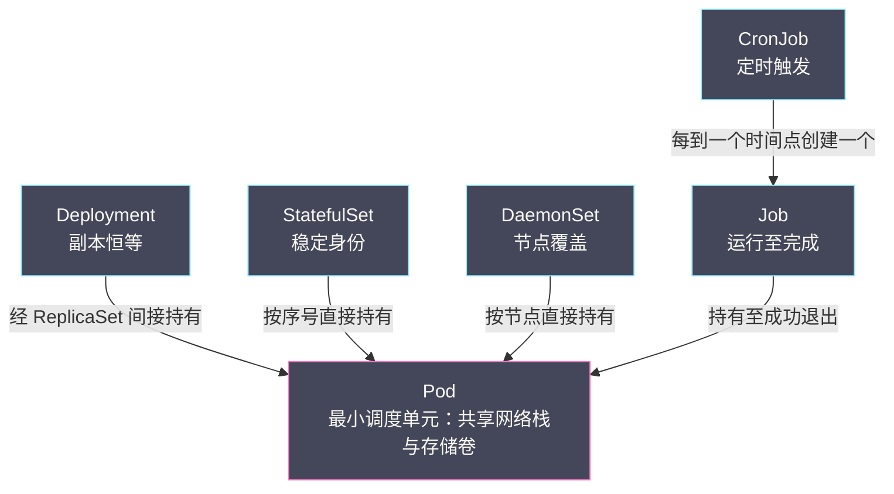
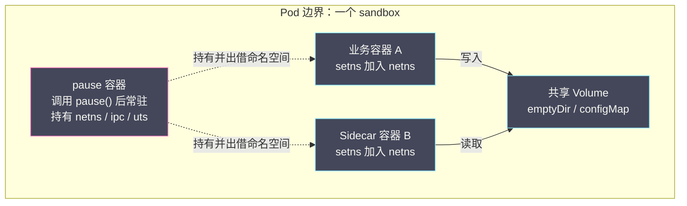
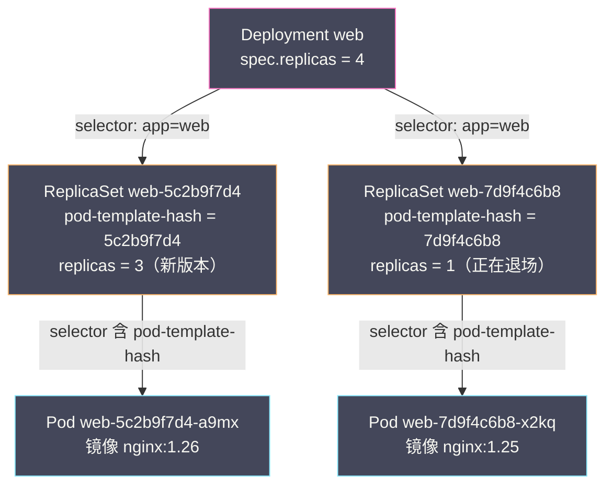
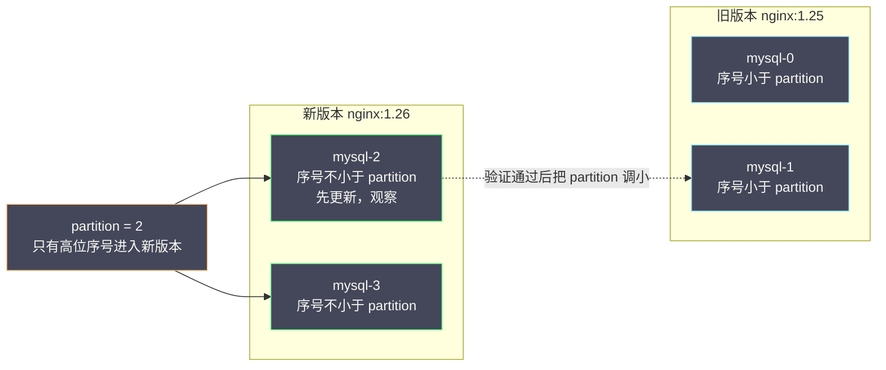
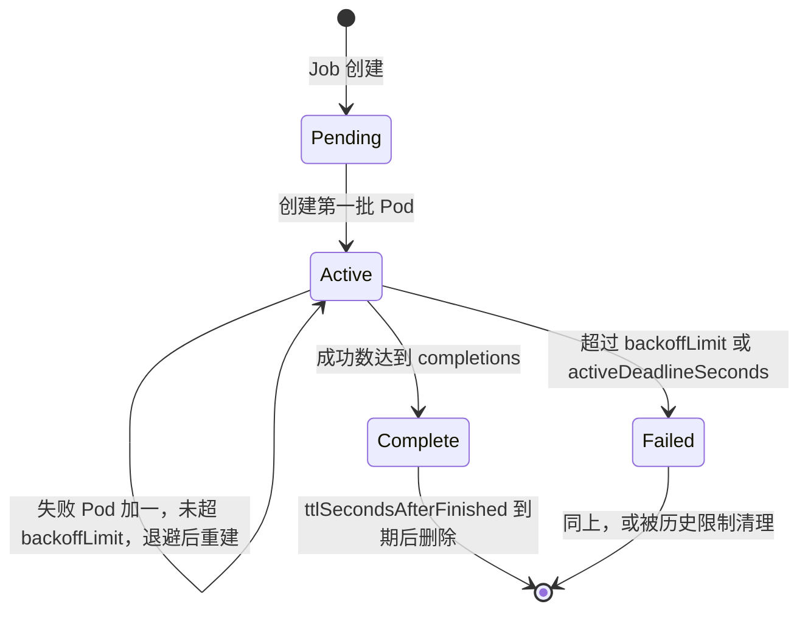
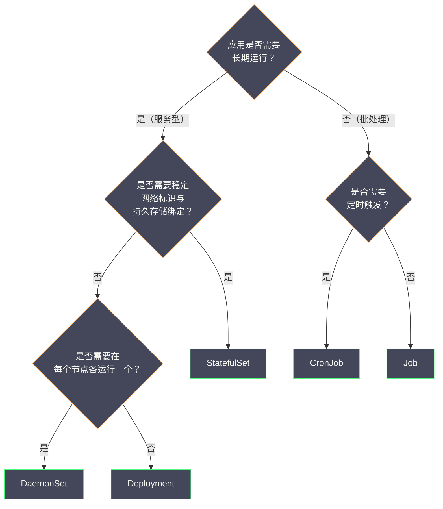

# 05 核心工作负载对象深度解析

**摘要：**

Kubernetes 用五种内置对象描述"怎么跑一个进程"，而多数人第一次读官方文档时读到的是一份字段清单：`replicas`、`volumeClaimTemplates`、`completions`、`concurrencyPolicy`，逐个记住不难，难的是下次遇到"这套服务该用哪种对象"时仍然要在五种 YAML 之间试错。本文换一条读法，把这五种对象看作五组不同的**不变量（Invariant）承诺**——副本恒等、稳定身份、节点覆盖、运行至完成、定时触发，每一种对象只承诺守住其中一条线，也只在那条线成立时才有意义。沿着这条线，文章逐章拆开承诺背后的机制：pause 容器如何替 Pod 持有网络命名空间、Deployment 为什么必须经过 ReplicaSet 才能完成版本化、StatefulSet 的确定性 PVC 命名为何在缩容时刻意留下孤儿盘、DaemonSet 在 1.12 之后为什么把绑定权交还给默认调度器、Job 的 at-least-once 语义把幂等责任推给了谁。最后两章回答两个问题：选型时真正在选的是什么，以及每条承诺在什么条件下会失效。读完这一篇，你应该能把"我要跑一个东西"翻译成"我要系统替我守住哪条不变量"。

---

## 第 1 章 工作负载对象是不变量的集合

### 1.1 从"配置模板"到"承诺"的视角转换

一个容器要跑起来需要的东西并不多：一个镜像、一条命令、几核 CPU、几 GB 内存。既然如此，Kubernetes 为什么要把"跑起来"拆成五种对象、几百个字段？更让人费解的是它连最小调度单元都不是容器——你写不出 `kind: Container` 的对象，只能写 Pod，再让 Pod 去装容器。这两个疑问指向同一件事：**K8s 交付的从来不是"怎么启动进程"，而是"一群进程应该长期保持什么形状"**。

启动进程是容器运行时的事，containerd 与 runc 已经做得很好，K8s 再包一层没有增量价值；真正难的是进程启动之后——挂了谁来补、版本怎么换、三个实例怎么区分、任务跑完怎么算完。这些都是"长期形状"的问题，而形状需要承诺来维持。于是每一种工作负载对象本质上都是一份**写进 API 的承诺书**：你在 `spec` 里写下期望，控制器用永不停止的协调循环去兑现，`status` 记录兑现到了哪一步。

这个视角让字段退到次要位置。字段只是承诺的措辞，措辞随版本演进，承诺本身很少变。Deployment 承诺"任何时刻都有 N 个等价副本在跑"，所以它必须能补副本、能替换副本、能在替换期间不让可用副本跌破下限；StatefulSet 承诺"第 3 号成员永远叫同一个名字、用同一块盘"，所以它必须放弃随机命名与并行创建；DaemonSet 承诺"每个合格节点上都有一个"，所以它的副本数不是一个数字而是一个集合；Job 承诺"这批活干完 N 次就算结束"，所以它把"成功退出"从故障改写成了目标；CronJob 承诺"到点就开一份新的 Job"，所以它自己不管 Pod，只管时间。

这个视角还能解释"它为什么不管某些事"。Deployment 不保证四个副本不落在同一台机器上，那要靠 `topologySpreadConstraints`；StatefulSet 不保证谁是主谁是从，它连"主"这个概念都没有；Job 不保证同一个任务只被执行一次。这些不是遗漏，而是**承诺边界的自觉**——一份保单只承诺它写明的险种，你拿意外险去报门诊，被拒赔不是保险公司的错。选错了对象再抱怨"它居然不保证这个"，多半是自己把承诺读错了。

### 1.2 五组不变量：副本恒等 / 稳定身份 / 节点覆盖 / 运行至完成 / 定时触发

把五种对象的承诺并排放在一起，能看到它们守的是完全不同的那条线：

| 对象 | 承诺的不变量 | 一句话表述 | 承诺失效时的典型症状 |
| --- | --- | --- | --- |
| Deployment | 副本恒等 | 任何时刻都有 N 个可互换的副本在提供服务 | 副本数对不上、滚动期间容量跌破预期 |
| StatefulSet | 稳定身份 | 第 i 号成员的名字、DNS、存储卷永远绑定在一起 | 成员互相找不到、重建后数据"消失" |
| DaemonSet | 节点覆盖 | 每个合格节点上恰好有一个副本 | 新节点采不到日志、监控出现盲区 |
| Job | 运行至完成 | 累计有 N 次成功退出即告完成 | 任务跑完又被重启、失败后无限重试 |
| CronJob | 定时触发 | 到点创建一份 Job，历史可追溯 | 漏跑、重跑、上一份没跑完下一份又来 |

这五条线之间不是"功能多少"的差别，而是**对"什么算正常"的定义不同**。Deployment 认为 Pod 名字变了是正常现象，随机后缀本就是它的设计；StatefulSet 认为名字变了就是事故，因为下游的复制配置、成员列表、`broker.id` 全指望这个名字。Job 认为 Pod 退出码非零是失败，Deployment 认为容器退出本身就是失败——在 Deployment 的世界里，一个进程正常干完活退出和它崩溃退出没有区别，都会被重新拉起，因为它的承诺是"持续运行"，不是"跑完"。

下面这张图给出五种对象与 Pod 的关系。请注意两处细节：所有对象最终都落到 Pod 上，没有一种能绕过 Pod 直接管容器；CronJob 是通过 Job 间接管 Pod 的，它自己并不持有 Pod 模板之外的运行时知识。



### 1.3 为什么不用一种对象加参数开关解决

既然都是"管一批 Pod"，为什么不设计一个统一对象，用 `mode: replica | stateful | daemon | batch` 切换行为？API 数量能少四倍，学习成本似乎也更低。这个设计在纸上很诱人，落到实现上会立刻散架——**复杂性不会消失，只会转移**，问题只是转移到谁身上。

**第一处转移是校验。** 合并成单一类型后，字段之间会出现大量互斥组合：`volumeClaimTemplates` 在 `mode: daemon` 下没有意义，`completions` 在 `mode: replica` 下没有意义。这些约束无法用 OpenAPI schema 表达，只能写成准入逻辑里的一长串 `if`，于是 `kubectl explain` 帮不了用户，IDE 补全也给不出提示，用户拿到的是"什么字段都有、但不知道哪些能用"的超大 spec。

**第二处转移是控制器。** 五种对象的协调逻辑差异极大：Deployment 要算滚动步长，StatefulSet 要维护序号与 PVC 的映射，DaemonSet 要跟随节点集合变化，Job 要统计成功次数并做退避。合并之后这些逻辑会挤进同一个 Reconcile 的巨型 `switch`，任何一处改动都可能波及别的模式；而现状是五个独立控制器，StatefulSet 控制器的 bug 不会让 Deployment 停摆——这是**故障隔离**在控制器粒度上的体现。

**第三处转移是权限与策略。** 平台团队需要表达"允许业务改 Deployment，但不许碰 StatefulSet 与 DaemonSet"，因为后两者承载数据库与系统组件。这个诉求只有在"不同 kind"前提下才能用 RBAC 与准入策略表达；所有负载同 kind 时，RBAC 只能精确到对象名，无法按模式切分。

**第四处转移是生态契约。** HPA 认的是 `scale` 子资源，PodDisruptionBudget 认的是 `minAvailable`，GitOps 工具认的是 kind 与版本，Operator 的 ownerReference 也按 kind 建立——整个生态都建立在"不同类型有不同语义"之上。

用一个比喻收束这一节：把五种工作负载做成带模式开关的万能对象，就像把钢琴、小提琴、长笛焊成一件"全能乐器"，每个音色都靠旋钮切换，结果谁也演奏不好；分立成五件要多学四遍指法，但每一件都能被独立打磨到足够深。K8s 选择后者，代价是学习者要分清五种语义，收益是每种语义都能演进——而它也没让成本真的翻五倍，因为五种对象共享同一套骨架。

### 1.4 三个问题读懂任何一个工作负载对象

五种对象的字段加起来上千，但真正决定行为的只有三个问题。**它怎么决定"要几个"**：Deployment 看 `spec.replicas`，DaemonSet 看节点集合，Job 看 `completions` 的成功次数，CronJob 看时间。**它怎么决定"哪个是哪个"**：Deployment 用随机后缀加 `pod-template-hash`，认为所有副本等价；StatefulSet 用序号，认为每个副本都是特定成员。**它怎么决定"旧的怎么换成新的"**：Deployment 造一个新的 ReplicaSet 双向调节，StatefulSet 从最大序号往回逐个重建，DaemonSet 按 revision hash 滚动，Job 压根没有"更新"，只有"重试"。

| 对象 | 怎么决定"要几个" | 怎么决定"哪个是哪个" | 怎么决定"旧的怎么换成新的" |
| --- | --- | --- | --- |
| Deployment | `spec.replicas`（可被 HPA 通过 scale 子资源接管） | 随机名 + `pod-template-hash`，副本完全等价 | 新建 ReplicaSet，按 maxSurge / maxUnavailable 双向调节 |
| StatefulSet | `spec.replicas`，编号固定为 0 到 N-1 | 序号同时决定名字、DNS 与 PVC | 从最大序号往回逐个重建，可用 partition 卡住 |
| DaemonSet | 节点集合，不是数字 | 每节点一个，名字带随机后缀 | 按 `controller-revision-hash` 滚动，或 OnDelete |
| Job | `completions` 与 `parallelism` | 完成计数，或 Indexed 模式的索引 | 不适用，失败即重建 Pod |
| CronJob | 每个调度时刻创建一个 Job | Job 名由 CronJob 名与调度时刻派生 | 改模板只影响之后创建的 Job |

后面每一章都可以用这三个问题去对齐：能脱口说出"它怎么数副本、怎么认身份、怎么换代"，剩下的字段就只是细节。

---

## 第 2 章 Pod：为什么最小单元不是容器

### 2.1 三个理由：紧耦合辅助进程、共享网络栈、共享存储卷

Docker 和 containerd 都以单个容器为管理单元，K8s 在这个粒度之上硬插了一层 Pod，理由不是"容器不够用"，而是**有一类耦合关系容器表达不了，而调度器必须知道它**。

**第一个理由是紧耦合的辅助进程。** 一个 Java Web 应用很少只由一个进程构成：Tomcat 跑业务逻辑，Filebeat 读日志目录往外发，一个配置代理监听 ConfigMap 变化并触发热加载，服务网格兴起之后还要再加一个 Envoy 接管进出流量。这四个进程之间存在极强的共生关系——Filebeat 必须读到 Tomcat 写的那份文件，配置代理要通过 `localhost` 调 Tomcat 的管理端口，Envoy 要劫持同一个网络命名空间里的流量。以容器为调度单元的话，K8s 只能把它们当成四件互不相干的事：可能被分到四台机器，日志读不到、`localhost` 调不通；你得手工加亲和性拴住它们、手工挂同一块盘、手工共享网络命名空间，还得自己保证"Tomcat 挂了 Filebeat 也该走"。

**第二个理由是共享网络栈。** 同一个 Pod 里的容器共用一套网络命名空间，于是共享同一个 IP 与端口空间，互相用 `localhost` 就能通信。这一条的价值在服务网格时代被放大到极致：Envoy 之所以能透明劫持业务流量，前提是它与业务容器同处一个网络命名空间，能改 iptables、能监听同一地址。没有 Pod，这种共享只能用 `--network container:<name>` 之类的底层手段实现，在大规模集群里几乎不可管理。

**第三个理由是共享存储卷。** Pod 级别的 Volume 可以被所有容器挂载，日志场景里的 `emptyDir` 是最典型的用法：业务容器往 `/var/log/app` 写，采集容器从同一目录读，走本地文件系统而不是网络，既没有序列化开销，也不会因为采集端慢而反压业务。它让"旁路处理"变得便宜，大量 Sidecar 模式都建立在"能低成本读到主容器输出"这个前提上。

三个理由的共同点是它们描述**进程之间的耦合关系**，而不是进程本身。调度器需要的恰恰是这份知识——哪些进程必须待在一起、必须共享什么、必须同生共死。Pod 就是把这个知识编码进 API 的方式，它把"一组进程"变成调度、驱逐、资源核算、优先级与 QoS 分类的统一粒度。

### 2.2 pause 容器与命名空间持有

共享网络命名空间说起来轻巧，实现上有个绕不开的难题：命名空间需要一个持有者。Linux 的 Network Namespace 有引用计数，最后一个引用它的进程退出时，这个命名空间连同里面的 IP、路由表、iptables 规则一起被销毁。那么由谁来持有？

如果让第一个业务容器持有，问题立刻出现：它一崩，命名空间就没了，Pod 的 IP 随之消失，指向这个 IP 的一切——EndpointSlice、CoreDNS 记录、客户端已建立的连接——全部失效。而"容器崩溃后被重启"在 K8s 里是日常事件，让 IP 跟着崩几十次显然不可接受。

K8s 的答案是**用一个什么都不干的容器来持有命名空间**。kubelet 处理一个 Pod 时先通过 CRI 调用 `RunPodSandbox`，创建一个极轻量的 **pause 容器**（也叫 infra 或 sandbox 容器，镜像形如 `registry.k8s.io/pause:3.9`，体积不足 1MB），它的进程启动后只调用一次 `pause()` 系统调用便永久休眠，不监听端口、不处理信号、几乎不消耗 CPU，唯一职责是持有 Pod 的 Network、IPC 与 UTS 命名空间。

业务容器随后通过 `setns()` 加入这些命名空间，于是它们看到同一张网卡、同一个 IP、同一份路由表。业务容器重启时销毁的只是自己的进程与文件系统层，pause 容器纹丝不动，命名空间仍有引用者，Pod IP 保持不变。



两个常被混淆的细节需要点出。其一，Pod 内共享的是网络、IPC、UTS 命名空间，**不共享 PID 与挂载命名空间**——每个容器的进程树独立，`ps` 看不到邻居，根文件系统各是各的；想共享 PID 需显式打开 `shareProcessNamespace: true`，代价是容器间可以互相发信号、读 `/proc`。其二，Pod IP 的稳定只覆盖"容器重启"这一种情况，**Pod 一旦被删除重建，CNI 会重新分配 IP**——这一点在第 4 章还会出现，那里正是"稳定身份"最容易被误解的地方。

### 2.3 Pod 的边界判据

Pod 能装多个容器，不代表应该装多个。判断两个容器该不该放进同一个 Pod，有三条标准，只要一条不满足就该拆开。

**第一条：是否存在共享文件系统或网络命名空间的硬需求，且延迟敏感。** 硬需求指"拆开就做不到"，而不是"拆开要多写点代码"：日志采集要读主容器写的文件，这是硬需求；两个服务通过 HTTP 调用传数据，那不是硬需求，是 Service 该管的事。延迟敏感指这条通路不能容忍一次网络栈往返，`localhost` 通信天然满足。

**第二条：生命周期是否必须绑定。** 主容器退出时辅助容器继续活着有没有意义？如果辅助容器的工作对象就是主容器的输出，主容器没了它就该走，同 Pod 是合理的；如果它有独立生命周期（譬如同时服务本机上其他 Pod），它就该是 DaemonSet 或独立 Deployment。

**第三条：能否独立扩缩容。** 这是反向判据，也最容易被忽略。前端要 3 个副本、后端要 5 个，塞进同一个 Pod 就只能二选一：要么 3 个 Pod 里每个后端只分到 0.6 个副本的算力，要么 5 个 Pod 里前端白白浪费两台。**能独立扩缩容的东西，就不该共享同一个副本单位**，这是 Pod 边界里最硬的一条。

由此还能反推出两条结论：同 Pod 的容器共享资源配额与 QoS 等级，一个容器吃满内存可能让整个 Pod 被 OOM 或驱逐；它们也共享升级节奏，改一个容器的镜像就要重建整个 Pod，如果两个容器由不同团队维护，这个耦合会变成交付瓶颈。

> [!note] 一条经验判据
> 如果你无法用一句话说清两个容器之间的耦合关系（"B 读 A 写的日志"、"B 替 A 挡外部流量"），那它们大概率不该在同一个 Pod 里。绝大多数生产 Pod 只包含一个业务容器，多容器 Pod 的理由几乎总是那几种：日志、代理、配置同步、指标导出。

### 2.4 Sidecar 的演进：从普通容器到原生 sidecar

"辅助容器"这个模式在 K8s 里有个专门的名字：**Sidecar（边车）**。名字贴切——边车挂在摩托车旁边，跑同一条路，动力却来自主车。问题在于 2023 年之前 K8s 里并没有"边车"这个一等概念，Sidecar 只能写成 `spec.containers` 里多出来的一个普通容器，而"普通"带来了三个真实痛点。

**痛点一是启动顺序没有保证。** 普通容器并行启动，主容器可能先起来并开始监听，而代理还没初始化完，第一批请求直接失败。Istio 早期为此专门加了 `holdApplicationUntilProxyStarts` 开关，本质上是给"没有顺序保证"打补丁。

**痛点二是生命周期无法收尾。** 这一点在批处理场景里是致命的：Job 的 Pod 里如果挂了日志采集容器，主容器成功退出后采集容器仍在运行，Pod 永远进不了 `Completed`，Job 会一直等下去，直到 `activeDeadlineSeconds` 把它判死。当时的解法只能让 Sidecar 自己监听主容器的退出信号再主动退出，把顺序问题推给应用。

**痛点三是探针语义缺失。** 普通容器的 readiness 失败会拉低整个 Pod 的 Ready 状态，可"代理还没连上控制面"和"业务还没预热完"是两回事，混在同一个 Ready 条件里，滚动更新时很难判断是谁拖慢了自己。

**原生 Sidecar（Native Sidecar）** 就是来修这三个洞的，实现方式很巧：不新增容器类型，而是允许 `initContainers` 里的容器声明 `restartPolicy: Always`——init 容器天然有顺序，加一个"永不结束"的重启策略，就得到了"按顺序启动、但一直运行"的语义。这个特性在 1.28 进入 alpha，1.29 默认开启，1.33 转为稳定。

```yaml
apiVersion: v1
kind: Pod
metadata:
  name: web-with-sidecar
spec:
  initContainers:
    - name: log-shipper
      image: fluent-bit:2.2
      restartPolicy: Always        # 声明为原生 sidecar
      startupProbe:                # 探针通过即视为 init 阶段结束，主容器才开始
        httpGet:
          path: /healthz
          port: 2020
        periodSeconds: 2
  containers:
    - name: app
      image: myapp:v3
      volumeMounts:
        - name: logs
          mountPath: /var/log/app
  volumes:
    - name: logs
      emptyDir: {}
```

新语义正好修掉三个痛点。**启动顺序**：sidecar 按 init 规则依次启动，等 startupProbe 通过才轮到主容器，代理一定已就位。**生命周期**：Pod 终止时主容器先收 SIGTERM，sidecar 随后才被终止，Job 因此能正常完成——这是批处理场景最重要的变化。**重启策略独立**：sidecar 的 `restartPolicy` 覆盖 Pod 级设置，即使 Pod 是 `Never`，sidecar 崩了也会被拉起；kubelet 还会把它的 OOM score 调到与主容器同档，避免内存压力下先被内核杀掉。

代价是迁移成本。`initContainers[*].restartPolicy` 这个字段在 1.28 之前的 API Server 上会被直接拒绝，一份用上新语法的 Helm chart 不能无差别推给所有集群，需要做能力探测（`semverCompare` 判断版本）；而依赖"sidecar 阻止 Pod 完成"这一旧行为的应用，在升级后会失效。

### 2.5 Pod 的不可变性

Pod 是 K8s 里最"不可变"的对象之一。绝大多数 `spec` 字段一旦创建就不能改，`kubectl apply` 会直接报 `field is immutable`。允许原地更新的只有寥寥几个：`spec.containers[*].image`、`spec.initContainers[*].image`、`spec.activeDeadlineSeconds`、`spec.tolerations`（只能新增）、`spec.terminationGracePeriodSeconds`，较新版本还允许改 `spec.schedulingGates`。

为什么这么严格？因为 Pod 描述的不是"一个应该长什么样的容器"，而是**一段已经绑定到某台机器上的现实**。改 `spec.volumes` 意味着 kubelet 要重新挂载，改 `resources` 意味着重建 cgroup，改 `nodeSelector` 更是荒谬——Pod 已经在节点上了。允许随便改，控制器就得实现"部分重建"，而部分重建的语义边界极其模糊。K8s 的选择是把"重建"显式化：你改的是模板，控制器据此创建新 Pod、删掉旧 Pod，UID 变化、IP 变化，一切清清楚楚。

这个设计带来一条必须记住的实践规则：**直接 `kubectl edit pod` 改镜像是调试手段，不是运维手段**。改完之后这个 Pod 与 ReplicaSet 模板产生漂移，而 ReplicaSet 控制器只对账"数量"，不会修正单个 Pod 的镜像——要等它被删除、由模板重建时才"恢复"。在 GitOps 体系里这种漂移会一直存在到下一次 Pod 重建，而那次重建可能发生在几周后的节点维护时，于是你会在最不该出现意外的时候看到"镜像突然变回旧版本"。

> [!warning] 调试容器是唯一被鼓励的例外
> 想在运行中的 Pod 里加工具，正确做法是用调试容器（Ephemeral Container），它通过 `pods/ephemeralcontainers` 子资源注入，不触发 Pod 重建，也不写进模板。把 `kubectl debug` 用熟，能省掉大量"改镜像重建"的折腾，也不会留下模板漂移。

---

## 第 3 章 Deployment：副本恒等

### 3.1 它解决的三件事

如果只拿裸 Pod 跑应用，你会连续撞上三堵墙。**第一堵是副本管理**：想跑三个副本就写三个 YAML，扩到五个再加两个文件，Pod 被 OOM 杀掉之后不会自己回来。有人会说"那我写个脚本 watch 一下"，可一旦写了这个脚本，你就在写一个非常糟糕的控制器——没有幂等、没有重试退避、没有领导者选举、没有本地缓存，一次网络抖动让它漏掉一个事件，副本数就永远少一个。**第二堵是版本更新**：发布时逐个删除旧 Pod、创建新 Pod，删除与创建的间隔就是服务的中断时长；中途出错要回滚，而回滚意味着反向操作一遍，此时线上是什么状态谁也说不清。**第三堵是历史追溯**：Pod 一删配置就消失，"上个版本用的哪个镜像 tag"只能去翻 CI 日志。

Deployment 用一层间接结构把三件事一起解决：它不直接管 Pod，而是管 **ReplicaSet（副本集）**，由 ReplicaSet 管 Pod。多出来的这一层，就是"版本"的容器。

### 3.2 Deployment → ReplicaSet → Pod 的版本化结构

[[04 Label Selector 与松耦合设计]] 已经拆过这个三级级联的 selector 关系，这里只补 Deployment 独有的那部分：**它把"一次模板变更"变成了"一个新对象"**。

正常运行时 Deployment 只维护一个活跃 ReplicaSet，`spec.replicas` 全部落在它身上。发布新版本时，控制器并不修改现有 Pod，而是用新的 `spec.template` 创建一个**全新的 ReplicaSet**，然后同时调节两个 ReplicaSet 的副本数：新的往上加，旧的往下减。旧 ReplicaSet 缩到 0 之后并不删除，它成了一份"历史版本快照"，随时可以被重新激活。

这里有个实现细节：两个 ReplicaSet 的 selector 如果完全一样，就会互相"认领"对方的 Pod，副本统计立刻乱套。K8s 的解法是给每个 Pod 模板算一个哈希，写进 `pod-template-hash` 标签，同时注入 ReplicaSet 的 selector，于是 `app=web` 在实际存储中变成 `app=web,pod-template-hash=5c2b9f7d4`，两个版本的 Pod 集合天然不重叠。哈希由模板内容算出，"模板不变则哈希不变"，同一份模板反复 apply 不会造出一堆 ReplicaSet。



三层责任边界也很清楚：Deployment 负责"版本"与"节奏"，写 `status.updatedReplicas`、`status.availableReplicas` 这类聚合数字；ReplicaSet 负责"数量"，只做一件事——把匹配 selector 的 Pod 数拉到 `spec.replicas`；Pod 负责"运行"，由 kubelet 管。发布过程中真正被反复计算的只有两件事：新集合该有几个、旧集合该剩几个。

### 3.3 滚动更新的两个旋钮与可用性下限

滚动更新的节奏由两个字段决定，它们共同定义了"更新期间允许的容量形状"：

| 参数 | 含义 | 默认值 | 取整方式 |
| --- | --- | --- | --- |
| `maxSurge` | 更新期间 Pod 总数最多超出期望副本数的量 | 25% | 向上取整 |
| `maxUnavailable` | 更新期间最多允许多少个 Pod 不可用 | 25% | 向下取整 |

两者不能同时为 0，否则控制器既不能先建也不能先删，更新会直接卡死（准入阶段就会拒绝这个组合）。可用性下限由 `maxUnavailable` 单独决定：**更新期间可用副本数不低于 `replicas - maxUnavailable`**。

不同组合带来完全不同的行为。`replicas=4, maxSurge=1, maxUnavailable=0` 是最常见的"零不可用"配置：控制器先建 1 个新 Pod，等它就绪再删 1 个旧 Pod，任何时刻都有 4 个可用副本，代价是更新期间多占 25% 的资源。`replicas=10, maxSurge=0, maxUnavailable=2` 是"资源不能超卖"的配置：只能先删后建，容量在更新期间会掉到 8 个，适合资源紧张但能容忍容量波动的场景。

用 F1 进站换胎来类比很贴切：`maxSurge` 决定你能不能在维修区多备一套轮胎，`maxUnavailable` 决定你能不能让车带着三个轮子先跑一段，两者都为 0 意味着"既不许备胎也不许缺轮"，只能停在维修区不动。这个比喻有一处失真需要立刻限定：赛车的轮子换上去立刻可用，而 Pod 的"可用"要靠就绪探针判定，没有 readinessProbe 的容器一旦进程起来就被标记 Ready，滚动的实际效果会变成"把流量打向还在预热的实例"。

所以真正决定可用性的往往不是这两个数字，而是三件配套的事。**就绪探针**让 Ready 有业务含义；**`minReadySeconds`** 让刚就绪的 Pod 再观察若干秒才计入 available，排除"启动即崩"的实例；**`progressDeadlineSeconds`**（默认 600 秒）负责判定更新是否卡住，超时后把 `Progressing` 置为 `False`、原因记为 `ProgressDeadlineExceeded`。

> [!warning] 卡住不等于回滚
> `progressDeadlineSeconds` 超时只是**上报**，Deployment 不会自动回滚，正在跑的新 Pod 也不会被撤掉。这是生产事故里最常见的误判：以为"K8s 会自己恢复"，实际上需要人工 `kubectl rollout undo`，或者由流水线根据 `rollout status` 的失败触发回滚。

### 3.4 回滚与 revisionHistoryLimit

回滚能成立，靠的是"旧 ReplicaSet 缩到 0 但不删除"这个设计。每次模板变更都会在 `deployment.kubernetes.io/revision` 注解里记一个递增版本号，`kubectl rollout history` 读的就是它。

```bash
# 查看历史版本（CHANGE-CAUSE 来自 kubernetes.io/change-cause 注解）
kubectl rollout history deployment/web
# REVISION  CHANGE-CAUSE
# 1         Initial deploy
# 2         Update to nginx:1.25
# 3         Update to nginx:1.26

# 回滚到上一个版本
kubectl rollout undo deployment/web

# 回滚到指定版本
kubectl rollout undo deployment/web --to-revision=1

# 观察滚动过程，直到完成或失败（CI 流水线里应作为门禁）
kubectl rollout status deployment/web --timeout=180s
```

三个容易踩的细节。**第一，`undo` 不是时间倒流**：它把目标 revision 的模板复制回 `spec.template`，再触发一次正常滚动，于是产生一个**新的 revision**（版本号继续递增），而不是把历史指针往回拨。**第二，`revisionHistoryLimit` 决定你能回多远**，默认 10，设成 0 会清掉所有历史 ReplicaSet，等于主动放弃回滚能力。**第三，回滚只回滚 K8s 对象，不回滚外部世界**：数据库 schema 迁移、已发出的消息、已写入的对象存储都不会因此回退。更隐蔽的坑是镜像 tag 漂移——旧版本用的是 `myapp:latest`，等你回滚时这个 tag 已指向新代码，于是"回滚"回滚到了一个从未存在过的组合。**生产环境请用 digest 固定镜像**，这不是洁癖，而是让回滚这件事真的可执行。

### 3.5 与 HPA 抢 `spec.replicas` 的冲突

`spec.replicas` 是一个典型的"多方写入"字段：用户或 GitOps 想写它，HPA 也想写它。这场争夺在生产里的现象很好认——副本数每隔几分钟在 Git 里的值和 HPA 算出的值之间来回跳，日志里能看到连续的 scale 事件。

机制上，HPA 走的是 `scale` 子资源（`PUT .../deployments/web/scale`），只读写副本数、不碰模板，这样它的权限可以收得很窄——HPA 控制器的完整机制见 [[云原生/Kubernetes/kubernetes控制器和调度器/00 专栏导览|控制器和调度器专栏]]。但 GitOps 走的是完整对象 apply，清单里只要写了 `replicas: 3`，每次同步都会把这个字段拉回 3。服务端应用（Server-Side Apply）的字段所有权机制能缓解一部分，却缓解得不彻底：它协商的是"哪些字段由哪个 apply manager 拥有"，而 HPA 的写入走 `Update` 而非 `Apply`，不参与这场协商。工程上的解法只有两个，都很朴素：**把 `replicas` 从 Git 清单里删掉**，让 HPA 独占这个字段（代价是新建的 Deployment 默认 1 个副本，要等 HPA 第一次计算才拉起）；或者在 Argo CD 里配 `ignoreDifferences`、在 Flux 里配忽略规则。

还有一处更隐蔽的冲突：**HPA 与 VPA 不要同时基于 CPU 工作**。HPA 按"实际用量 / requests"算利用率决定扩副本，VPA 又会去改 requests，两个控制器互相追着对方的输出调整，形成震荡。常见折中是 HPA 看 CPU、VPA 只看内存，或者干脆只保留一个。

---

## 第 4 章 StatefulSet：稳定身份

### 4.1 有状态应用的三条硬需求

Deployment 的管理策略建立在一个假设上：所有副本完全等价。Pod 名字随机、调度到哪台机器不确定、删除重建后名字与 IP 都变。对无状态 Web 服务这是优点，对分布式数据系统是灾难。

设想一个三节点 MySQL 主从集群，Deployment 的假设会在三处同时崩掉。**第一处是网络标识**：从库的复制配置里必须写明主库地址，主库 Pod 重建后地址一变，三台从库的复制线程全部断开，DBA 得挨个登上去改 `CHANGE REPLICATION SOURCE TO`；更麻烦的是"谁是主库"本身也需要稳定锚点，你不能用"当前 IP 最小的那个"来定义主库。**第二处是存储绑定**：每个实例的数据目录必须是自己那块盘，而 Deployment 的典型写法是所有副本共享一个 PVC，`ReadWriteOnce` 根本不允许被多节点同时挂载，多副本要么调度失败，要么共享同一块盘导致文件锁冲突与数据损坏。**第三处是有序操作**：主从集群要先起主库再起从库，因为从库启动时要连上主库做全量同步；缩容时该先撤最后一个从库，随机撤掉主库会让整个集群失去写入能力。

这三条需求在传统运维里靠"给机器起名字"解决：数据库部署在三台主机上，主机名固定、IP 固定、数据盘挂在固定挂载点。**StatefulSet 做的事情，本质上是把"主机名 + 固定盘 + 固定启动顺序"这套物理世界的确定性在容器世界里重建出来**。用宿舍类比：学生一届一届换，但床号不变、每个床号配的储物柜不变，新生按床号入住，柜子里的东西还在原处；Deployment 更接近酒店——客人随机分配房间，退房后房间清空重分，谁也不认哪个房间是自己的。

### 4.2 提供的不变量

| 维度 | Deployment | StatefulSet |
| --- | --- | --- |
| Pod 名称 | 随机后缀（`web-5c2b9f7d4-a9mx`） | 有序编号（`mysql-0`、`mysql-1`、`mysql-2`） |
| 网络标识 | 无稳定 DNS，靠 Service 负载均衡 | 每 Pod 一条稳定 DNS（`mysql-0.mysql-svc.default.svc.cluster.local`） |
| 存储绑定 | 共享同一 PVC 模板，或手工为每副本建 PVC | `volumeClaimTemplates` 按序号生成独立 PVC，重建后自动挂回 |
| 创建顺序 | 并行创建所有 Pod | 默认按序号逐一创建，前一个 Ready 才创建下一个 |
| 删除顺序 | 随机删除 | 按逆序号删除（2 → 1 → 0） |
| 更新顺序 | 滚动替换，新旧混杂 | 按逆序号逐个重建，可用 partition 卡住 |
| 扩容行为 | 新 Pod 与旧 Pod 完全等价 | 新 Pod 的序号、DNS、PVC 都是确定的，应用可据此初始化 |
| 缩容行为 | 随机删，无身份概念 | 从最大序号开始删，PVC 默认保留 |

最容易被低估的是最后两行。扩容与缩容在 Deployment 里只是数量变化，在 StatefulSet 里是**成员集合变化**——新增成员意味着应用要做 rebalance、加入复制组、重新分配分片，这些动作需要应用知道自己"是第几号"。这也是为什么 StatefulSet 的 `spec.replicas` 变更往往不能只改一个数字，还要配合 Operator 做成员管理。

### 4.3 Headless Service 与稳定 DNS

普通 Service 有一个 ClusterIP，CoreDNS 对它解析返回这个虚拟 IP，客户端连过去由 kube-proxy 做四层转发，落到哪个 Pod 全凭运气。这个模型对无状态服务完美，对有状态服务完全不可用——从库需要的是"连到 0 号主库"，不是"连到任意一个 MySQL"。

**Headless Service** 就是为这个场景准备的：把 `clusterIP` 显式设为 `None`，Service 不再分配虚拟 IP，解析时直接返回所有就绪 Pod 的 A 记录；同时，只要这个 Service 被某个 StatefulSet 的 `serviceName` 引用，CoreDNS 还会为每个 Pod 单独生成一条 `<pod>.<service>.<namespace>.svc.cluster.local` 记录。

```yaml
apiVersion: v1
kind: Service
metadata:
  name: mysql-svc
spec:
  clusterIP: None          # Headless：不分配虚拟 IP，直接返回 Pod 地址
  selector:
    app: mysql
  ports:
    - port: 3306
      name: mysql
---
apiVersion: apps/v1
kind: StatefulSet
metadata:
  name: mysql
spec:
  serviceName: mysql-svc   # 必须指向已存在的 Headless Service，否则 DNS 不生成
  replicas: 3
  selector:
    matchLabels:
      app: mysql
  template:
    metadata:
      labels:
        app: mysql
    spec:
      containers:
        - name: mysql
          image: mysql:8.0
          volumeMounts:
            - name: data
              mountPath: /var/lib/mysql
  volumeClaimTemplates:     # 每个 Pod 独立的一块盘
    - metadata:
        name: data
      spec:
        accessModes: ["ReadWriteOnce"]
        resources:
          requests:
            storage: 10Gi
```

创建之后的 DNS 记录大致如下（IP 每次重建都可能变，名字不变）：

```text
mysql-0.mysql-svc.default.svc.cluster.local → 10.244.1.5
mysql-1.mysql-svc.default.svc.cluster.local → 10.244.2.8
mysql-2.mysql-svc.default.svc.cluster.local → 10.244.3.2
```

于是从库的复制配置写的是 `mysql-0.mysql-svc`，主库重建、换节点、换 IP，DNS 记录随之更新，从库重连时自动解析到新地址，配置一行都不用改。这是"稳定身份"最直接的兑现方式：**身份不是地址，身份是一个永远指向当前地址的名字**。两个细节值得记下：Headless Service 默认只发布就绪 Pod 的记录，`publishNotReadyAddresses: true` 能让未就绪的 Pod 也出现在 DNS 里（主从选举、成员互相发现常需要它，因为"未就绪"恰恰是成员加入过程中的正常状态）；跨命名空间访问必须写全 FQDN，短名只在同命名空间内可靠。

### 4.4 volumeClaimTemplates 的确定性命名与"缩容不删 PVC"

`volumeClaimTemplates` 不是一个 PVC，而是一份**PVC 模板**，控制器为每个 Pod 从模板生成 PVC，命名规则是确定的：

```text
<模板名>-<StatefulSet 名>-<序号>

mysql-0 → PVC data-mysql-0 → PV pv-xxx-001
mysql-1 → PVC data-mysql-1 → PV pv-xxx-002
mysql-2 → PVC data-mysql-2 → PV pv-xxx-003
```

确定性命名带来的关键性质是：`mysql-0` 被删除重建后仍然叫 `mysql-0`，于是它仍然去找 `data-mysql-0`，而 PVC 与 PV 的绑定关系是持久的，数据因此"跟着身份走"。

接下来是这条承诺里最反直觉的一处设计：**缩容时不删 PVC**。把 `replicas` 从 3 改成 2，`mysql-2` 会被删除，但 `data-mysql-2` 会留下，变成一块没有任何 Pod 使用的孤儿盘——`kubectl scale statefulset mysql --replicas=2` 之后，`kubectl get pvc` 里依然能看到 `data-mysql-2` 处于 `Bound` 状态。

为什么明知留下垃圾也不删？因为删除 PVC 往往等于删除 PV，而 PV 背后可能是云盘的 `Delete` 回收策略，数据不可恢复。**在"多留一块没人用的盘"和"误删一次生产数据"之间，K8s 选了前者**。对运维的含义是：再扩容回 3 时，新的 `mysql-2` 会自动绑回 `data-mysql-2`，数据原样回来；而如果确定不再需要，必须手工 `kubectl delete pvc data-mysql-2`，这一步没有自动化兜底。

后来 K8s 补上了这个缺口的可控版本：`persistentVolumeClaimRetentionPolicy`（1.27 进入 beta），用 `whenDeleted` 与 `whenScaled` 分别声明"删 StatefulSet 时"和"缩容时"该 `Retain` 还是 `Delete`，默认仍是双 `Retain`。

> [!warning] 缩容再扩容不等于"什么都没发生"
> PVC 会被复用，但**Pod 未必能调度回原来的节点**。如果 StorageClass 用的是本地盘或节点亲和型云盘，PV 上带有节点亲和约束，重建的 Pod 可能因为目标节点资源不足而长期 `Pending`。这不是 StatefulSet 的 bug，而是"数据位置被钉死"的必然代价；`volumeBindingMode: WaitForFirstConsumer` 能让首次绑定时就考虑调度，但救不了已经绑定的盘。

### 4.5 更新策略：RollingUpdate + partition 做灰度

StatefulSet 的默认更新策略是 `RollingUpdate`，顺序与删除顺序一致：从最大序号开始逐个重建，前一个 Ready 才动下一个。这个顺序本身就是保护——数据库集群里先更新从库（大序号）、最后更新主库（0 号），风险最小。

真正让它在生产里好用起来的是 `partition`。它定义一条分界线：**序号大于等于 partition 的 Pod 会被更新，小于 partition 的保持旧版本，而且即使被删除也会按旧模板重建**。



灰度流程因此可控：`partition` 设成 `replicas-1`，只有最后一个成员进入新版本，观察一段时间；确认无误后递减，让更新范围逐步扩大；出问题时调回高位，新版本不再扩散，已更新的成员会被"回滚"回旧模板（这也是一次重建，不是原地降级）。这种"卡在某个序号"的能力 Deployment 完全没有，它只能整体滚动。

另一个常被忽略的旋钮是 `podManagementPolicy`。默认的 `OrderedReady` 严格逐个创建、逐个等待 Ready，`Parallel` 则一次性拉起所有 Pod、缩容时也一次性删除。差别在成员多时非常明显：每个成员启动 30 秒，10 个成员用 `OrderedReady` 要 5 分钟才全部就绪，`Parallel` 只要 30 秒。选哪个取决于"成员之间有没有启动依赖"：etcd、ZooKeeper 的第一个成员要独立完成自举、后续成员连上已有集群加入，`OrderedReady` 恰好匹配；某些缓存集群成员彼此无依赖、靠客户端分片，`Parallel` 更快也够用。代价是 `Parallel` 放弃了"0 号先就绪"的保证，如果应用其实依赖它，就会出现成员互相等待超时的启动风暴。

### 4.6 StatefulSet 不保证什么

"稳定身份"这个承诺读起来很舒服，但它覆盖的范围比多数人以为的窄得多。

**不保证角色。** StatefulSet 只知道序号，不知道谁是主。它不会因为你把 `mysql-0` 叫"主库"就给特殊待遇，也不会在主库挂掉后把 `mysql-1` 提升为主库——角色是应用层概念，必须由应用协商或由 Operator 管理。

**不保证数据一致性。** 复制方向、同步/异步、冲突解决全是数据库的事。StatefulSet 只保证"盘跟人走"，盘里的内容它一无所知。

**不保证跨可用区分布。** 默认调度器可能把三个成员全放进同一个可用区，一次机房级故障就让整个集群消失。要打散得自己写 `topologySpreadConstraints` 或 `podAntiAffinity`，而 `requiredDuringScheduling` 的反亲和又会带来新问题——第三个副本可能因为没有满足条件的节点而永远 `Pending`。

**不保证 IP 稳定。** 这是最常被误解的一条：稳定的是名字，不是地址。Pod 重建后 IP 会变，任何把 IP 缓存进配置文件或连接池的做法都会在重建时出问题，应用必须每次走 DNS 解析并尊重 TTL。

**不保证"就绪"等于"可用"。** `OrderedReady` 只等 Ready 条件，而 Ready 由 readinessProbe 决定。如果探针只探端口通不通，那么"进程起来了但还没完成数据加载"的成员也会被当成就绪，下一个成员立刻开始启动——整个集群在一个还没准备好的基础上继续搭建。

---
## 第 5 章 DaemonSet：节点覆盖

### 5.1 为什么 Deployment + replicas=N 不行

有一类需求看起来用 Deployment 就能满足：集群有 10 个节点，我想要 10 个日志采集器，那 `replicas: 10` 不就行了？不行，而且是在两个层面上不行。

**第一个层面是调度不会均匀分布。** 调度器的默认打分倾向是"资源利用率均衡"与"镜像本地性"，它没有"每个节点一个"的约束。10 个副本完全可能 3 个落在 node-1、2 个落在 node-2、node-7 一个都没有，节点规格不一致时更明显：大机器分数更高，会被反复选中。给 Pod 加 `podAntiAffinity`（`requiredDuringSchedulingIgnoredDuringExecution`，topologyKey 为 `kubernetes.io/hostname`）确实能强制打散，但它解决的是"不堆叠"，不是"全覆盖"——节点数比副本数多时，总有节点分不到。

**第二个层面是语义错了。** `replicas: 10` 表达"总共 10 个"，而需求是"每个节点 1 个"。前者是**计数语义**，后者是**覆盖率语义**。计数语义下，集群扩到 12 个节点不会有任何变化——Deployment 依然维持 10 个副本，两个新节点成为监控盲区；缩到 8 个时，10 个副本里两个变成"多余"，却不会因为"所在节点消失"而被特殊处理。覆盖率语义下，节点增删直接改变期望副本集合，控制器自动跟随。

用一个比喻说明差别：消防规范要求"每层楼配两个灭火器"，这是覆盖率；若理解成"整栋楼配 20 个灭火器"，一楼可能堆了 8 个、顶楼一个都没有，检查时总数达标，着火时照样没得用。DaemonSet 保证的是前者。

### 5.2 控制器如何跟随节点增删

DaemonSet 控制器的协调逻辑比其它工作负载多一层：它同时 watch Node 与 Pod 两类对象，对每个节点计算"该不该有一个 Pod、现在有没有"。

节点加入集群时，Node 对象从 `Pending` 变为 `Ready`，控制器收到事件后为这个节点生成一个 Pod；节点被删除时，该节点上的 Pod 通过 ownerReference 级联清理——owner 是 DaemonSet 对象，但触发删除的是节点消失后 kubelet 不再续租、Node 对象被 GC 的连锁反应。版本管理用 `controller-revision-hash` 标签，作用与 `pod-template-hash` 类似：区分新旧模板产生的 Pod，让滚动更新能算清"还剩几个旧 Pod"。更新策略有 `RollingUpdate`（默认，`maxUnavailable: 1`）与 `OnDelete`（只改模板，等人工删 Pod 才更新），后者把"什么时候动这个节点"的决定权留给了运维。

还有一段用户没写、由控制器注入的 `affinity`，它是"节点覆盖"在调度层的落地方式：

```yaml
affinity:
  nodeAffinity:
    requiredDuringSchedulingIgnoredDuringExecution:
      nodeSelectorTerms:
        - matchFields:
            - key: metadata.name
              operator: In
              values: ["node-7"]      # 控制器按目标节点名填入
```

### 5.3 1.12 之后改由默认调度器调度

在 1.12 之前，DaemonSet 控制器创建 Pod 时直接写 `spec.nodeName`，也就是跳过调度器自己完成绑定。这个做法简单直接，却带来三个越来越难忍的后果。**一是资源账算不准**：调度器判断"某节点还能不能放新 Pod"时看的是已分配 requests 的总和，而直接写 `nodeName` 的 Pod 在它眼里从未占用资源，于是它会在一个已经跑了三个 DaemonSet Pod 的节点上继续塞业务 Pod，实际用量远超容量，最后大家一起 OOM。**二是不遵守调度约束**：资源请求、节点亲和、拓扑约束、优先级与抢占全在调度器内部实现，绕过它等于绕过这些机制。**三是无法与业务 Pod 协同**：抢占需要调度器知道每个 Pod 的优先级以及能否被驱逐，绕过调度器的 Pod 不参与这场博弈。

1.12 的改动是把绑定权交还给默认调度器：控制器不再写 `nodeName`，改为注入上面那段用 `matchFields: metadata.name` 锁定节点名的 `nodeAffinity`，再由调度器正常走一遍 Filter/Score 完成绑定。同时控制器自动追加一组容忍，让它们能在"看起来不该调度"的节点上运行：`not-ready`、`unreachable`、`disk-pressure`、`memory-pressure`、`pid-pressure`、`unschedulable`，以及仅在使用 hostNetwork 时追加的 `network-unavailable`。

这次改动的收益与代价都很清楚。收益是 DaemonSet Pod 终于进入调度器的资源账本，可以被抢占、可以配 PriorityClass、可以因为资源不足而老实 `Pending`；代价是它不再"保证能跑"——节点资源真的不够时，日志采集器会卡在 Pending，而以前的实现会硬塞进去。从"一定要跑起来"到"应该跑起来，但要排队"，这个转向与 K8s 整体的资源治理方向一致：**可见性优先于强制性**。

### 5.4 典型场景与 hostPath 的取舍

DaemonSet 的典型场景几乎都与"节点本地"有关：日志采集（Fluent Bit、Filebeat）、节点指标导出（node-exporter）、网络插件数据面（Calico 的 Felix、Cilium 的 Agent）、存储插件的节点组件（各类 CSI driver 的 node 部分）、kube-proxy 与 CNI 初始化容器。它们的共同点是必须**访问节点上的东西**，而"节点上的东西"在 K8s 里只能通过 `hostPath` 表达：`/var/log/pods`、`/var/lib/kubelet`、`/proc`、`/sys`、运行时 socket。这就是 DaemonSet 与 `hostPath` 天然绑定的原因。需要限定范围的场景用 `nodeSelector`（譬如只监控带 `hardware: gpu` 标签的节点），配合对 GPU 污点的 `tolerations`，让调度器能把 agent 精确投放到目标节点。

不过 `hostPath` 是 K8s 里风险最高的挂载方式。它绕过了 PV/PVC 的全部抽象：没有容量限制、没有访问模式约束、没有回收策略、没有配额；它的权限就是节点的权限，挂载 `/` 且可写等于把节点 root 交给容器；Pod 安全准入的 baseline 级别会直接拒绝 `hostPath`，restricted 级别完全禁止，启用严格策略的命名空间里 DaemonSet 只能跑在 `kube-system` 这类豁免区。收敛做法有三条：**能只读就只读**；**显式声明 `type`**（`Directory`、`File`、`CharDevice`、`Socket`），让"路径不存在"有确定行为而不是悄悄创建空目录；**尽量缩小挂载范围**，挂 `/var/log/pods` 而不是 `/var/log`，挂具体 socket 而不是整个 `/run`。确实需要特权能力时，用 `securityContext.capabilities` 精确授予，而不是 `privileged: true` 一把梭。

---

## 第 6 章 Job 与 CronJob：运行至完成

### 6.1 与 Deployment 的根本差异

两者的差别不在字段，而在**对"退出"的解释**。Deployment 的世界里容器退出是故障，kubelet 会按重启策略拉起它，因为承诺是"持续运行"；Job 的世界里退出码 0 是目标达成，非零才是故障，因为承诺是"运行至完成"。

这个差别带来一连串连锁反应。Job 的 Pod 模板里 `restartPolicy` 只能填 `Never` 或 `OnFailure`，填 `Always` 会被拒绝——一个"总是重启"的 Pod 永远无法完成，Job 的语义会自相矛盾。Job 的 Pod 完成后不会被删除，它留在那里供你查日志，直到 TTL 或历史限制把它清掉。Job 的控制器不看"当前有几个 Pod 在跑"，而是看"累计成功了几次"，因为它的目标是累计量而不是瞬时量。

用施工队类比很贴切：Deployment 像物业常驻的保安，岗位上必须一直有人，谁请假就换一个顶上，换人不影响岗位存在；Job 像请来的装修队，活干完验收合格就走，走时还留下现场让你检查。这个比喻的技术限定是：Job 的"验收合格"只由退出码判定，它不知道活干得好不好，业务正确性得靠你在容器里保证。

还有一处极易混淆的细节：`Never` 与 `OnFailure` 的重试语义完全不同。`Never` 时容器退出后 Pod 变成 `Failed`，Job 控制器看到失败计数增加，创建一个**新 Pod**，这次失败计入 `backoffLimit`；`OnFailure` 时容器崩溃由 kubelet 原地重启同一个容器，Pod 不重建，`restartCount` 增加，这种重启**不消耗** `backoffLimit`。于是同一个崩溃循环，在 `Never` 下会在 6 次之后把 Job 判死，在 `OnFailure` 下会一直重启到 `activeDeadlineSeconds` 兜底。选哪个，取决于你想让"崩溃"由 Job 层计数还是由 kubelet 层处理。

### 6.2 并行模型：completions / parallelism / backoffLimit / activeDeadlineSeconds

| 参数 | 含义 | 默认值 | 关键细节 |
| --- | --- | --- | --- |
| `completions` | 需要累计成功完成的 Pod 数 | 1 | 设了才是"固定完成数"模式；不设则进入工作队列模式 |
| `parallelism` | 同时运行的 Pod 数上限 | 1 | 可大于 `completions`，但实际并发不超过剩余完成数 |
| `backoffLimit` | 允许的失败 Pod 数 | 6 | 计数的是失败 Pod，不是容器重启；退避为指数（10s 起，上限 6 分钟） |
| `activeDeadlineSeconds` | Job 的最长存活时间 | 无 | 从 `status.startTime` 起算，超时终止所有 Pod 并置 `Failed` |

`backoffLimit` 与 `activeDeadlineSeconds` 是"或"的关系，谁先触发谁生效，两者的失败原因不同（`BackoffLimitExceeded` 与 `DeadlineExceeded`），排障时要看 condition 的 reason 而不是只看 Failed。此外还有两个较新的字段：`suspend`（1.21 引入，1.24 稳定）让 Job 先创建而不启动，适合"先建好、等人放行"的流水线；`podFailurePolicy`（1.31 稳定）允许按退出码或 Pod 条件区分可重试与不可重试的失败，动作有 `Ignore`（不计入 backoffLimit）、`FailJob`、`FailIndex` 与默认的 `Count`——它的价值在于避免"用一个大 `backoffLimit` 容忍偶发抢占，结果真正的代码 bug 也被重试六次"这种两难。

Job 的生命周期可以画成一台状态机，注意"重试"是回到 Active 而不是新建 Job：



```yaml
apiVersion: batch/v1
kind: Job
metadata:
  name: db-migrate
spec:
  backoffLimit: 2                  # 迁移脚本重试两次还不行，就该人来看
  ttlSecondsAfterFinished: 3600    # 完成后一小时清理，避免 Job 无限堆积
  template:
    spec:
      restartPolicy: Never         # Job 的 Pod 只能是 Never 或 OnFailure
      containers:
        - name: migrate
          image: myapp:v1
          command: ["python", "migrate.py"]
```

### 6.3 Indexed Job 与工作队列模式

任务需要"分成 N 份并行处理"时有三种建模方式，取舍在于**分片是静态可枚举的，还是动态待领取的**。

**固定完成数（NonIndexed）**：`completions: 10, parallelism: 3`，共需 10 次成功，最多 3 个同时跑。适合"10 个彼此无差别的子任务"，但每个 Pod 不知道自己该处理哪一份，必须靠外部分配。

**工作队列（Work Queue）**：不设 `completions`，只设 `parallelism: 3`，三个 Pod 各自从外部队列取任务，队列空了就退出，Job 在"至少一个 Pod 成功退出且没有 Pod 仍在运行"时完成。它弹性最好——处理快的 Pod 自然多领任务，但把"队列真的空了"这个判断交给了应用：如果某个 Pod 因为队列临时为空而提前退出 0，Job 可能被误判为完成。

**Indexed Job**：`completionMode: Indexed` 配合 `completions: N`，每个 Pod 拿到一个 0 到 N-1 的索引，暴露在 `JOB_COMPLETION_INDEX` 环境变量与 `batch.kubernetes.io/job-completion-index` 注解里。索引的用处有两个：静态分片，环境变量直接决定这个 Pod 处理哪一段数据，不需要任何队列；配合 Headless Service 做成员发现，此时 Pod 的 hostname 是 `<job-name>-<index>`，第 0 号与第 3 号可以互相用 DNS 找到对方——这正是分布式训练、MPI 作业、分片索引重建这类"需要固定成员关系的一次性任务"所需要的东西。

```yaml
apiVersion: batch/v1
kind: Job
metadata:
  name: shard-reindex
spec:
  completions: 8
  parallelism: 4
  completionMode: Indexed       # 每个 Pod 拿到固定索引，静态分片
  template:
    spec:
      restartPolicy: Never
      subdomain: shard-svc      # 配合 Headless Service，hostname 变成 shard-reindex-<index>
      containers:
        - name: worker
          image: reindexer:v2
          command: ["sh", "-c", "reindex --shard=${JOB_COMPLETION_INDEX} --total=8"]
```

需要提醒的是，Indexed 并没有改变"至少一次"的语义：同一个索引仍可能被执行两次（原因在 8.3 展开），所以按索引分片的逻辑必须可重入——同一个分片重建两次索引，结果应该一样。

### 6.4 TTL Controller 与 Job 对象清理

Job 完成后 Pod 会留在集群里，这个设计对排障友好，对 etcd 不友好。一个每天跑 24 次的 CronJob，一个月就是 720 个 Job 加上它们各自的 Pod、事件记录，在几千节点的集群里，这类"历史垃圾"足以把 etcd 存储配额顶到告警线。

`ttlSecondsAfterFinished` 就是来收这个尾的：从 Job 进入完成（或失败）状态起算，到期后由 **TTL 控制器**（运行在 kube-controller-manager 里）删除 Job 对象，Pod 通过级联删除一并清掉，这个字段在 1.23 转为稳定。几个要点：**设 0 表示"完成即删"**，CI 场景常用，代价是失败后没有现场可查，必须先把日志送出去（这又回到 sidecar 的话题）；**TTL 控制器不运行时 TTL 不生效**，被裁剪过组件的控制面会让这个字段静默失效；**TTL 与 CronJob 的历史限制是两条独立路径**，`successfulJobsHistoryLimit`（默认 3）与 `failedJobsHistoryLimit`（默认 1）由 CronJob 控制器负责，两者谁先到谁生效，不要指望它们互相兜底。

### 6.5 CronJob：并发策略、错过调度与时区

**`concurrencyPolicy` 处理"上一次还没跑完，这一次又到点"：**

| 策略 | 行为 | 适用场景 |
| --- | --- | --- |
| `Allow`（默认） | 允许并发，每次都创建新 Job | 每次执行彼此独立、可并行 |
| `Forbid` | 上一次还在跑就跳过本次 | 有资源争抢或互斥要求的任务（对账、清理） |
| `Replace` | 杀掉正在跑的 Job，创建新的 | "只要最新一次结果"的任务（缓存刷新、快照） |

`Forbid` 与 `Replace` 的差别值得细想：前者会**丢一次执行**，后者会**丢一次结果**。对"每天凌晨对账"这类任务，丢一次执行意味着账目缺口，应选 `Forbid` 并配合告警；对"每五分钟刷新一次推荐快照"，旧结果本来就要被覆盖，`Replace` 更合适。

**`startingDeadlineSeconds` 处理"错过了预定时刻"**：集群停机两小时，中间错过的调度恢复后要不要补跑？不设字段时控制器会尝试补上最近一次错过的调度；设了它，只有"现在距预定时刻"还在窗口内才补跑，超出就记为 missed。真正的用途是给补跑设时效边界——每小时执行的数据同步任务，晚了六小时再补跑已经没有意义，`startingDeadlineSeconds: 300` 等于说"超过五分钟就别补了"。这里还有个隐藏边界：控制器计算错过的调度次数有上限，错过过多（百次量级）时会放弃计算并打出 "Cannot determine if job needs to be started" 事件，此后这个 CronJob 可能长期不再触发。**长时间停机后恢复的集群，务必检查 CronJob 的 lastScheduleTime 是否还在推进**。

**时区是最容易造成生产事故的一项。** 不设 `spec.timeZone` 时，cron 表达式按 kube-controller-manager 进程的本地时区解释，而绝大多数容器镜像默认是 UTC。运维在文档里写"每天凌晨 3 点跑报表"，实际执行可能是北京时间 11 点，也可能是 UTC 3 点，取决于控制面节点怎么配的。`spec.timeZone`（1.27 转为稳定）让这件事变确定：

```yaml
apiVersion: batch/v1
kind: CronJob
metadata:
  name: daily-report
spec:
  schedule: "0 3 * * *"
  timeZone: "Asia/Shanghai"          # 显式声明，不依赖控制面节点的本地时区
  concurrencyPolicy: Forbid
  startingDeadlineSeconds: 600
  successfulJobsHistoryLimit: 3
  failedJobsHistoryLimit: 1
  jobTemplate:
    spec:
      backoffLimit: 2
      template:
        spec:
          restartPolicy: Never
          containers:
            - name: report
              image: report-generator:v1
```

如果需求是"跑一次"，用 Job；如果需求是"按事件触发"，用 Job 加外部触发器（CI、Argo Events、消息队列消费者），而不是把 CronJob 的 schedule 写成每分钟一次再在脚本里判断"今天该不该跑"——后者把调度语义藏进了业务代码，出问题时既没有 CronJob 的事件可查，也没有 Job 的失败计数可依。

---

## 第 7 章 选型：决策树与对比表

### 7.1 决策树

真实的选型问题往往不是清晰的二选一，而是一句含糊的"这套服务该怎么部署"。把五份承诺压成四个判断，就能得到一条可执行的路径：先问"它是长期运行还是运行至完成"，这是 Deployment 家族与 Job 家族的分水岭；长期运行一侧再问"副本是否需要稳定身份"，需要就往 StatefulSet 走，不需要再问"是否需要每个节点一个"，是则 DaemonSet，否则 Deployment；运行至完成一侧只问"是否需要定时触发"，是则 CronJob，否则 Job。



这棵树能覆盖八成日常选型，但有两个盲区必须提前说清。**一是"看起来有状态、其实是共享存储的无状态服务"**：如果三个副本都要读同一份配置或同一批静态文件，`ReadWriteMany` 的共享 PVC 加 Deployment 就够了，StatefulSet 的价值在"每个成员有独立身份与独立数据"，不在"能挂盘"。**二是"需要固定成员关系的一次性任务"**：分布式训练、MPI 作业、批量索引重建既不该走 Deployment（活干完就该退出），也不该走普通 Job（需要成员互相发现），正确答案是 Indexed Job 加 Headless Service。

### 7.2 六维对比表

| 维度 | Deployment | StatefulSet | DaemonSet | Job | CronJob |
| --- | --- | --- | --- | --- | --- |
| 运行模式 | 长期运行 | 长期运行 | 长期运行 | 运行至完成 | 按时刻创建 Job |
| 副本语义 | 计数（`replicas`） | 计数（序号 0..N-1） | 覆盖率（节点集合） | 成功次数（`completions`） | 不直接管副本 |
| Pod 标识 | 随机后缀，可互换 | 有序编号，唯一身份 | 每节点一个，节点即身份 | 随机后缀，或索引 | 由 Job 决定 |
| 网络标识 | 靠 Service 负载均衡 | 每 Pod 稳定 DNS | 通常用 hostNetwork 或节点 IP | 一般无稳定标识 | 同 Job |
| 存储 | 共享 PVC 或临时卷 | 每 Pod 独立 PVC，随身份绑定 | 通常 hostPath | 通常无持久存储 | 同 Job |
| 更新策略 | 滚动（maxSurge / maxUnavailable） | 有序滚动（partition） | revision hash 滚动或 OnDelete | 不适用，只有重试 | 改模板只影响新 Job |
| 典型场景 | Web 服务、API 网关 | MySQL、Kafka、ZooKeeper、etcd | 日志采集、监控 Agent、CNI / CSI 节点组件 | 数据迁移、批量导出、分布式训练 | 报表生成、定时对账 |

表里最值得反复看的是"副本语义"那一行，它是五条承诺的根：计数语义可以随便换副本，覆盖率语义必须盯住节点集合，成功次数语义只关心累计结果。**一旦你发现自己需要"计数 + 唯一身份"，那其实是两条承诺同时要，StatefulSet 就是唯一答案；一旦你发现自己需要"覆盖率"，那么无论 `replicas` 填多少都表达不出来**。

顺带把第 1 章那三个问题当排障工具用一遍：**"它怎么数副本"对不上时，先看是谁在写这个字段**——Deployment 的副本数反复波动，多半是 HPA 与 GitOps 在抢 `spec.replicas`；StatefulSet 卡住，多半是某个序号的 Pod 起不来，`OrderedReady` 阻塞了后续所有成员；DaemonSet 的副本数少于节点数，先查 `nodeSelector` 与污点容忍，再看是否资源不足导致 `Pending`。**"它怎么认身份"出问题，症状通常像"找不到对方"**——成员互相解析失败，先确认 `serviceName` 指向的 Headless Service 存在、selector 匹配、Pod 处于 Ready。**"它怎么换代"出问题，症状是"新旧混杂且停不下来"**——看 `progressDeadlineSeconds` 是否已触发 `ProgressDeadlineExceeded`，以及 `partition` 是否把更新范围锁住了。

---

## 第 8 章 边界与反例

### 8.1 用 Deployment 跑有状态应用会踩什么坑

把 MySQL、Redis、Kafka 直接塞进 Deployment 是生产里最常见的一类错误，它的失败往往延迟出现——前两周跑得好好的，某次节点维护之后集群就再也起不来了。这一类问题的落地解法（共享存储卷、节点亲和、持久化规划）在 [[云原生/Kubernetes/kubernetes生产实践与集群管理/00 专栏导览|生产实践专栏]] 里有专门篇幅，这里只讲失败机制。

**第一类坑是共享 PVC 导致的数据损坏。** 团队给 Deployment 挂一个 `ReadWriteOnce` 的 PVC，想着"每个副本都能读写"，结果调度器只能把多个副本塞到同一个节点（RWO 卷只允许单节点挂载），于是三个 MySQL 进程写同一份数据目录。InnoDB 的 redo log 与 undo log 不是为多进程并发写设计的，轻则报错退出，重则数据文件损坏。

**第二类坑是身份丢失导致集群无法重组。** Kafka 的 broker 依赖 `broker.id` 与 `log.dirs` 的对应关系，ZooKeeper 依赖 `myid` 文件，etcd 依赖 `initial-cluster` 里的成员列表。这些信息要么写在配置文件里（所有副本拿到同一份，互相冲突），要么靠启动时探测（重建后探测到新身份，旧数据成了孤儿），而 Deployment 的随机后缀恰好抹掉了"我是第几号"。

**第三类坑是滚动更新打断复制关系。** 滚动更新是"先起新的、再杀旧的"，对主从集群意味着短时间内出现两个"主"——旧主还没退，新主已经接受写入，双主写入在异步复制下几乎必然造成数据分歧。StatefulSet 的逆序更新恰好把 0 号留到最后。

**第四类坑是扩容时的"新生儿失忆"。** 新副本起来后不知道自己该复制谁、该分哪些分片，只能去连一个固定地址问"我该干什么"，而这个固定地址本身又是个不稳定实体，循环依赖就此形成。

四条坑指向同一个结论：**Deployment 的副本等价假设不是"实现细节"，而是它整个设计的公理**——你无法通过加配置让它"顺便支持有状态"，正如无法通过加装后视镜让自行车变成汽车。

### 8.2 StatefulSet 不是数据库银弹

反过来，以为"上了 StatefulSet 就等于有了数据库集群"，是另一类同样昂贵的误解。StatefulSet 提供的只有三样东西：确定的名字、确定的盘、确定的顺序；而一个真正可运维的分布式数据系统还需要另外三样：角色管理、成员变更、故障转移。

**角色管理**指"谁是主、谁是从、主挂了谁接"。StatefulSet 连"主"这个概念都没有。有些团队在启动脚本里判断 `hostname` 是否以 `-0` 结尾，是就 `--initialize`，否则 `--join`。这个做法第一次部署能跑，主库宕机后完全失效——0 号的 Pod 重建回来仍然是 0 号，它不知道自己错过了什么，也不会自动成为新的主。

**成员变更**指"扩容时新成员如何加入复制组"。Kafka 扩容要触发分区 rebalance，etcd 扩容要执行 `member add` 并更新 `initial-cluster`，Redis Cluster 扩容要做 slot 迁移。这些操作都要读取集群当前状态、做决策、再写回配置，是典型的"需要领域知识的状态机"，正是 Operator 的用武之地。**故障转移**涉及数据不一致时的裁决，早已超出编排层的能力范围。

所以现实中的分工是：StatefulSet 负责"身份与存储的确定性"，Operator 负责"协议与角色的正确性"，CloudNativePG、Vitess、Strimzi 与各家 etcd operator 走的都是这条路。这也解释了它们为什么常常不满足于默认的 `OrderedReady`——一个 30 成员的 Kafka 集群按序重启，每个成员等 30 秒，恢复时间会拉到十几分钟，很多 Operator 改用 `Parallel` 加自己的成员健康检查来换速度。**StatefulSet 的顺序保证在大规模场景下从保护变成了负担**，这是它设计时没有预料到的边界。

### 8.3 Job 的 at-least-once 语义与幂等性要求

Job 的文档里有一句容易被跳过的话：Job 不保证同一个任务只被执行一次。它的语义是**至少一次（at-least-once）**，不是恰好一次。

原因藏在"完成"这个判断的实现方式里。控制器通过 Pod 状态统计成功次数，而"Pod 已经完成"与"控制器已经看到 Pod 完成"之间隔着网络、API Server、etcd 三次可能失败的通信。设想一个 Pod 已经跑完任务、容器退出 0，但在它上报状态的那一刻节点失联了，控制器看到的是一个既没成功也没失败、最后被标记为 `Failed` 的 Pod，于是它会再创建一个 Pod 重做同样的工作。在 NonIndexed 模式下，这就是"`completions=10` 的 Job 实际执行了 11 次"；在 Indexed 模式下，就是"同一个索引被处理了两遍"。

这个语义对应用提出了硬要求：**Job 里的处理逻辑必须幂等**。幂等的实现方式取决于副作用的形态：写数据库时用业务唯一键加唯一约束，让第二次写入变成"冲突即成功"；写对象存储时用确定性对象键（`shard-3-part-0007.parquet`），覆盖写天然幂等；发消息时用去重表或让下游按消息 ID 去重；调用外部 API 时用客户端生成的幂等键。最难处理的是"追加型"副作用，譬如给账户加钱、给计数器加一，这类操作必须先落一条带唯一键的记录，再执行变更。

还有两处细节会加剧这个问题。`restartPolicy: OnFailure` 时 kubelet 原地重启容器，而重启前容器可能已经完成了部分工作（写了三张表里的两张），"部分完成"的状态必须能被下一次执行识别并跳过。`podFailurePolicy` 的 `Ignore` 动作会忽略某些失败（譬如抢占导致的中断），让它不计入 `backoffLimit`，这提高了完成率，同时也意味着"重试次数可能比你配置的多"。

> [!warning] 别把 Job 当分布式锁用
> "同一个任务只跑一次"在 K8s 里没有原生支持。想靠 `completions: 1` 加 `parallelism: 1` 保证互斥是错的——Job 的重试机制、Pod 重建、多副本控制器都会打破这个假设。需要严格互斥时，把锁放在外部系统里（数据库行锁、etcd 租约、Redis 的 SET NX），而不是指望 Job 的语义。

### 8.4 DaemonSet 与节点资源挤兑

DaemonSet 的设计初衷是"系统组件必须能跑"，为此它被赋予了自动容忍一大串节点压力污点的能力。这个能力在正确的场景里是救命稻草——节点磁盘满了，你仍然需要日志采集器活着，否则连"为什么满"都查不到。但它同时制造了一个资源治理难题：**这些 Pod 在节点紧张时不会先被驱逐，而它们本身也在消耗资源**。

场景是这样演化的：节点上跑着 20 个业务 Pod 与 5 个 DaemonSet Pod，业务侧按 limits 配了大内存、实际只用一半，节点看似"还有余量"；某个业务 Pod 突发内存增长，节点进入 `MemoryPressure`，kubelet 按 QoS 等级驱逐——`BestEffort` 先走，再轮到 `Burstable` 里超用 requests 最多的。DaemonSet 的 Pod 带着 `memory-pressure` 容忍，不会因污点被赶走，但它若 QoS 同为 `Burstable` 且超用，一样会被挑中——于是出现"日志 agent 先被驱逐，然后你失去了排障的眼睛"。

收敛做法有三条。**给系统组件配 PriorityClass**：`system-node-critical` 与 `system-cluster-critical` 是内置的高优先级类，绑定它们的 Pod 在驱逐排序里排在最后，也允许它们抢占低优先级业务 Pod。**DaemonSet 的 requests 必须如实申报**：很多 agent 的 requests 填 10m CPU / 20Mi 内存、实际用 100m / 200Mi，这个差额就是超卖的来源。**把"系统层"与"业务层"的资源账分开算**：用节点标签加 `nodeSelector` 做资源池隔离，或用 kubelet 的 `system-reserved` / `kube-reserved` 预留资源，让调度器看到的"可分配"从一开始就扣掉系统组件的份额。

### 8.5 工作负载对象的"过度抽象"反模式

最后这类反例不发生在使用 K8s 的人身上，而发生在给 K8s 造轮子的人身上：**为一个 CronJob 就能表达的需求写 Operator**。

笔者见过这样的项目：需求是"每天凌晨把昨天的订单表导出到对象存储，失败重试三次，成功发个通知"。实现方式是定义一个 `OrderExport` CRD，写一个控制器 watch 它，控制器内部再创建 Job，Job 完成后更新 CRD 的 status，失败时写事件并触发通知 webhook，配套还有一套 CRD 版本迁移逻辑与 RBAC 定义。这个方案能跑，但代价与需求完全不成比例：CronJob 已经提供了定时、重试、并发控制、历史保留、错过调度的处理与时区，"发通知"可以用 Job 的最后一个容器做，也可以由外部监控读 Job 的 condition 触发；多写一个 CRD 换来的唯一好处是"业务同学不用懂 cron 表达式"，而这个好处用一份带注释的 YAML 模板加 CI 校验就能拿到。

判断该不该写 Operator，标准只有一条：**是否存在一个必须被持续维护的领域状态机**。MySQL 的主从切换、Kafka 的 rebalance、etcd 的成员变更都是这种状态机——有多个中间状态、迁移条件依赖外部事实、失败还需要补偿动作；而"定时跑个脚本"没有中间状态，要么成功要么失败，失败就重试，这是 Job 已经内建的模型。把没有状态机的东西包装成 Operator，等于给自行车装一台航空发动机：推力过剩、维护昂贵、故障模式还多了一堆。这条反模式的另一面同样值得警惕——**把 Operator 该做的事硬塞进 StatefulSet 的启动脚本**，在 initContainer 里判断 `hostname` 定主从、用 `curl` 轮询同伴是否就绪、把成员列表硬编码进 ConfigMap 再期待它自动更新，这些做法演示环境里很聪明，在生产里每一个都是一次故障的伏笔。

---

## 第 9 章 结语

回看这一路，五种工作负载对象其实在回答同一个问题的五个变体：**当现实偏离期望时，系统应该替你把哪条线拉回来**。Deployment 拉的是副本数量，StatefulSet 拉的是身份与存储的绑定关系，DaemonSet 拉的是节点覆盖率，Job 拉的是成功次数，CronJob 拉的是时间点。声明式 API、控制器模式、电平触发的协调循环这些第 1 篇讲过的原则，在五种对象上以完全相同的形状复现，差别只在"什么算偏离"。

也正因为如此，选型不是"哪个功能更强"的比较，而是**选择让系统替你守住哪条不变量，并接受它在别处什么也不管**。选 Deployment 是接受"副本可互换"这个前提，放弃对身份的任何期待；选 StatefulSet 是接受"有序"带来的慢启动与慢恢复，换取成员关系的确定性；选 Job 是接受"至少一次"的语义，把幂等的责任接回自己手里。每一条承诺都标着价格，价格写在"它不保证什么"那一节里——那一节往往比"它保证什么"更值得先读。

还有一层更普遍的教训：这五种对象没有一种是凭空设计出来的，每一种都对应着一类具体的失败经验——裸 Pod 补不回来、随机名字让集群无法重组、`replicas=N` 让节点出现监控盲区、常驻重启让批处理永远跑不完。**架构不是发明出来的，是演进出来的**，工作负载对象的边界就是这些失败留下的疤痕；理解了疤痕的来历，才不会在下一次遇到"为什么它连这个都不支持"时误以为是缺陷。

下一篇 [[06 etcd 与 Kubernetes 的状态存储]] 会把视角从"对象应该承诺什么"转到"承诺被记在哪里"——所有 `spec` 与 `status` 最终都要落进 etcd，Raft 如何保证它们不丢、MVCC 如何让 Watch 能重放、Revision 又如何变成你熟悉的 `resourceVersion`。

---

## 参考资料

1. Kubernetes Documentation. *Pods*. https://kubernetes.io/docs/concepts/workloads/pods/
2. Kubernetes Documentation. *Deployments*. https://kubernetes.io/docs/concepts/workloads/controllers/deployment/
3. Kubernetes Documentation. *StatefulSets*. https://kubernetes.io/docs/concepts/workloads/controllers/statefulset/
4. Kubernetes Documentation. *DaemonSet*. https://kubernetes.io/docs/concepts/workloads/controllers/daemonset/
5. Kubernetes Documentation. *Jobs*. https://kubernetes.io/docs/concepts/workloads/controllers/job/
6. Kubernetes Documentation. *CronJob*. https://kubernetes.io/docs/concepts/workloads/controllers/cron-jobs/
7. Kubernetes Enhancement Proposal 753. *Sidecar Containers*. https://github.com/kubernetes/enhancements/blob/master/keps/sig-node/753-sidecar-containers/README.md
8. Brendan Burns. *Designing Distributed Systems*. O'Reilly, 2018. Chapter 2: The Sidecar Pattern.

---

> [!note] 思考题
> 1. 一个应用要把审计日志先写本地文件、再由采集进程转发出去。采集进程应该做成同 Pod 的 native sidecar，还是节点级的 DaemonSet？请从故障域（谁挂了会影响谁）、资源核算（requests 记在谁头上）、升级节奏（改采集配置要不要重启业务）三个角度比较。
> 2. `OrderedReady` 在成员数量大时会把恢复时间拉得很长，`Parallel` 又失去了"0 号先就绪"的保证。如果让你给一个 30 成员的集群设计启动策略，你会怎么组合 `podManagementPolicy`、readinessProbe 的探针内容与 Operator 的成员管理逻辑？
> 3. Job 的 at-least-once 语义意味着同一个索引可能被处理两次。你会把幂等键放在哪一层（数据库唯一约束、对象存储的确定性对象键、外部锁服务），又该如何验证"重跑不产生副作用"这件事真的成立？
> 4. DaemonSet 自动容忍了磁盘、内存、PID 压力与不可调度污点，这既是它能承担系统组件职责的原因，也是它会与业务 Pod 争夺节点资源的根源。你会怎样用 PriorityClass、如实的 requests 与 kubelet 的预留资源，给节点上的"系统层"和"业务层"划一条清晰的线？

