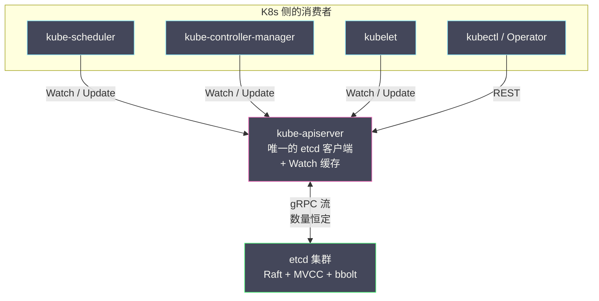
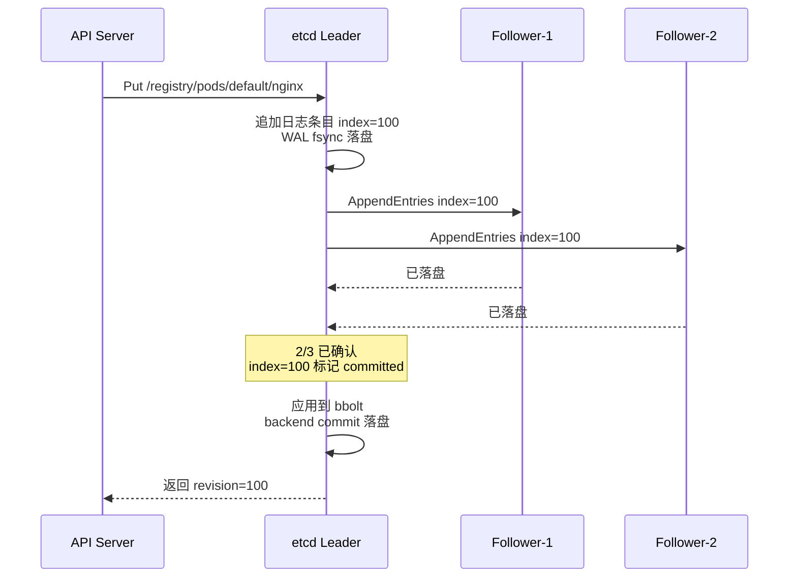
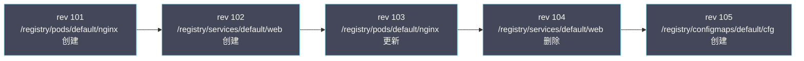
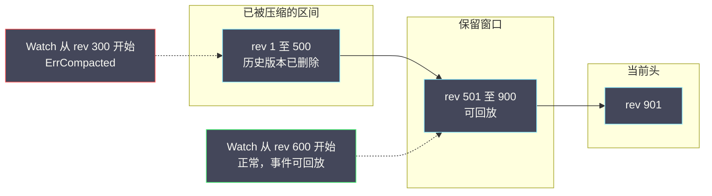
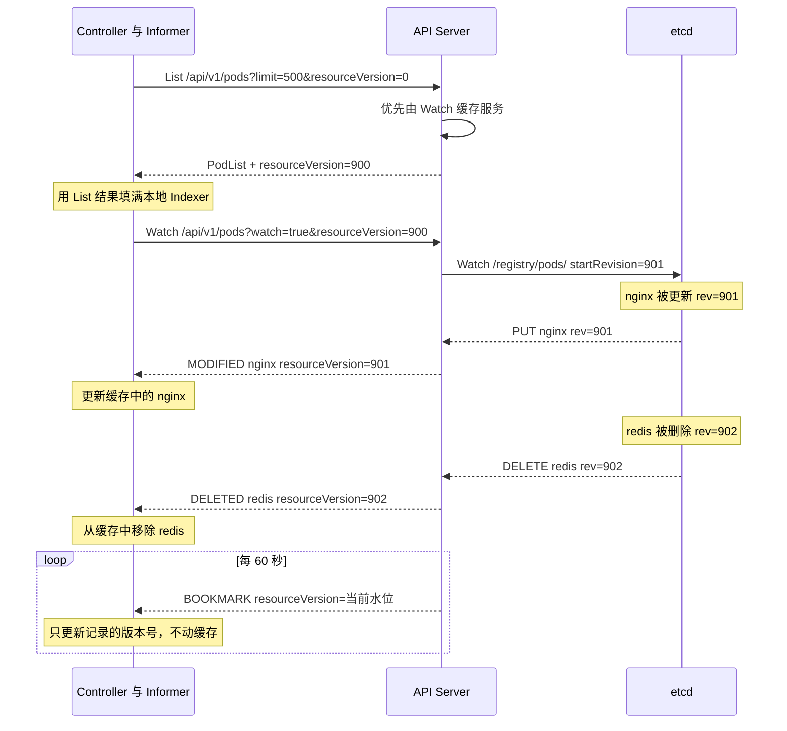
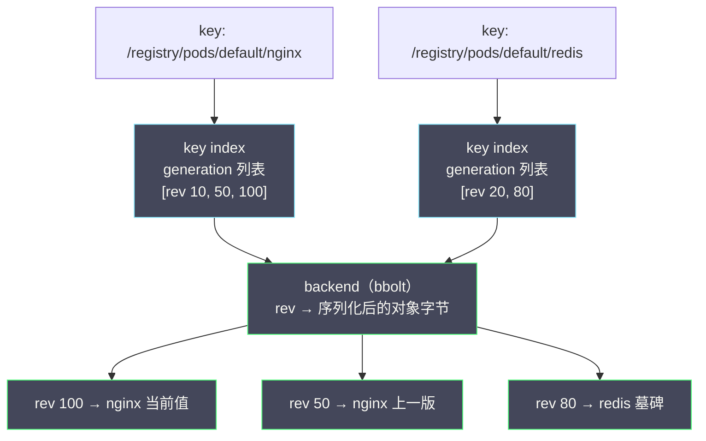
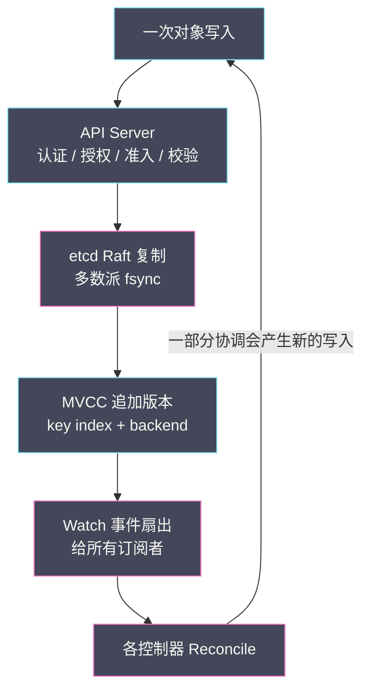

# 06 etcd 与 Kubernetes 的状态存储

**摘要：**

2013 年 CoreOS 给这个新项目命名的时候，它要解决的问题朴素得近乎无聊——给一堆 Container Linux 机器找一处能共享配置的地方，名字就是从 Unix 的 `/etc` 加一个 `d`（distributed）拼出来的。十多年过去，这个"分布式配置文件目录"变成了整个云原生世界的账本：你在 `kubectl apply` 里写下的每一个字段、每一次滚动更新留下的旧版本、每一个 Pod 的 `resourceVersion`，最终都要落成 etcd 里一条被多数节点确认过的键值对。本文不复述 Raft 论文，也不写 etcd 集群运维手册——`中间件/ETCD` 专栏已经把那两件事做完了；本文只取"Kubernetes 实际消费的那部分 etcd 语义"，回答三个问题：K8s 从 etcd 那里到底要了哪几样东西，这些语义在 K8s 侧被翻译成了什么形状，以及这层依赖如何悄悄变成集群规模的天花板。沿着"为什么是 etcd → Raft 只讲够用的部分 → MVCC 与 revision → Watch 语义 → 存储引擎与 Lease → 容量与性能 → 运维 → 边界"这条线走完，你会看到 `resourceVersion`、List-Watch、Lease 心跳这些日常词汇背后是同一套账本机制的不同侧面，也会明白为什么"把 etcd 换成 MySQL"这个看起来合理的念头，在 Watch 语义面前会立刻散架。

---

## 第 1 章 为什么是 etcd

### 1.1 命名与角色之间的那道裂缝

etcd 的官方定义是"分布式可靠的键值存储，用于保存分布式系统中最关键的数据"，这句话读起来平淡，但藏着一个常被忽略的落差：**这个系统的名字承诺的是"配置"，而它今天承担的是"账本"**。配置可以丢，丢了重新生成一份就是；账本不能丢，丢了之后所有参与方的余额都对不上。Kubernetes 把后者压在了 etcd 身上——集群里每一个对象的每一次变更、每一个历史版本、每一个正在被 Watch 的中间状态，全都只存在于这一处。

这个落差不是设计出来的，是被用户的需求顶出来的。2014 年 K8s 开源时 etcd 只是几个候选之一，Google 内部那套 Borg 用的是自研的 Paxos 存储，而 [[01 Kubernetes 的诞生与设计哲学]] 已经交代过，Omega 留给 K8s 的三样遗产之一就是"所有状态放在一个支持事务的存储里"。真正要回答的问题是：这个"支持事务的存储"该长什么样。

把 K8s 对存储的需求拆开，其实是四条互相拉扯的要求，任何一条单独拿出来都不难，四条叠在一起就把市面上绝大多数系统筛掉了。

**线性一致性（Linearizability）**：API Server 写完一个对象，紧接着的任何一次读都必须看到它，不能出现"写成功但读不到"的时间窗。这条要求听起来只是"别返回旧数据"，实际约束的是整个复制协议——它排除了所有异步复制方案，也让"读从副本走、写从主走"这类常见的读写分离优化失效。控制器依赖这条保证来做决策：如果它读到旧状态，就会重复创建一个本该存在的 Pod，这是笔者在排障时见过最多的"看起来像 bug、其实是存储语义被误用"的案例。

**高可用**：etcd 不可用，等于 API Server 不可用，等于所有控制器停摆、所有 kubectl 超时、所有故障 Pod 无法自愈。K8s 的可用性上限被这一个组件钉死了，这也是为什么高可用设计的所有重量都压在它身上——它可以慢，但不能没有。

**Watch**：K8s 是事件驱动的，几万个控制器各自盯着自己关心的那部分对象，靠推送而不是轮询来感知变化。如果没有 Watch，一个万级 Pod 的集群里，每个控制器每秒轮询一次全量列表，光是序列化开销就能把 API Server 按死——这正是 List-Watch 协议存在的理由，第 4 章会展开它的机制。

**事务与比较交换（Compare-And-Swap）**：K8s 的乐观并发控制完全建立在这条之上——更新对象时带上 `resourceVersion`，服务端检查"这个对象的版本还是你看到的那个吗"，是就写，不是就拒绝。没有原子 CAS，多个控制器并发修改同一对象时只能靠加锁，而分布式锁会把松耦合架构拖回串行世界。

### 1.2 与 ZooKeeper、Consul、Redis 的对比

2014 年前后能同时满足前三条要求的系统并不多，把它们放在同一张表里对照，选型逻辑就一目了然了。

| 维度 | etcd | ZooKeeper | Consul | Redis |
| --- | --- | --- | --- | --- |
| 共识算法 | Raft | ZAB（类 Paxos） | Raft | 无（异步主从复制） |
| 一致性 | 线性一致（默认读走 ReadIndex） | 顺序一致（读可能陈旧） | 线性一致（默认读） | 最终一致 |
| 数据模型 | 扁平键值 + 前缀范围查询 | 树形 znode 层次结构 | 键值 + 服务目录 | 丰富的数据结构 |
| Watch 语义 | 基于 revision 的持久流，可从历史点重放 | 一次性触发，需重新注册 | 阻塞查询（长轮询） | Pub/Sub，不保证送达 |
| 事务能力 | 多 key 的 If/Then/Else 原子事务 | 多 op 原子事务 | 单 key CAS | 单命令原子，无跨 key 事务 |
| 客户端协议 | gRPC（v3）/ HTTP-JSON（v2） | 自定义二进制协议 | HTTP + DNS | RESP |
| 定位 | 元数据与配置的强一致存储 | 分布式协调 | 服务发现 + KV | 缓存与数据结构服务器 |

这张表里真正决定胜负的是 **Watch 这一行**。ZooKeeper 的 Watch 是一次性的：客户端注册监听，服务端在数据变化时触发一次然后注销，客户端必须重新注册才能继续。这个设计在协调场景里非常合适——它天然保证不会给慢客户端积压事件；但对 K8s 这种"必须持续感知几万个对象变化"的场景来说，每次事件之后都要重新往返一次注册请求，而且**触发与重新注册之间那段窗口里发生的变化会被永久错过**。

Consul 的阻塞查询是另一个思路：客户端带着上次的 index 发长轮询，服务端等到 index 变化或超时才返回，语义仍是"轮询的变体"，拿到的还是最新快照而不是中间每一条变更。Redis 更根本：复制是异步的，网络分区时可能丢写。

> [!info] Watch 语义为什么这么难做对
> "推送变更"看起来简单，难的是三件事同时成立：客户端断线重连后不能漏事件、慢客户端不能拖垮服务端、服务端不能为了记住"谁看到哪了"而无限制地占内存。ZooKeeper 放弃了第一条，Redis 放弃了第一条和第三条，Consul 用轮询绕开了这个问题，只有 etcd v3 用"全局递增 revision + 服务端只保留一个日志窗口"这套组合把三条都接住了。代价是它必须做压缩，而压缩又带来了第 3、4 章要讲的连锁反应。

### 1.3 从 v2 到 v3：一次被 K8s 推着走的改造

K8s 早期用的是 etcd v2。v2 的 API 是 HTTP + JSON，每个 key 有自己的 `index`，Watch 通过长连接推送，但没有全局序号，也没有多版本保留——一个 key 只有当前值，历史值看不到。这套设计在"存配置"的场景里够用，在"存几万个对象的账本"场景里很快就撑不住：没有全局序号，客户端重连时无法表达"我要从某个确切的位置继续"；没有多版本，任何一次误写都不可回溯。

etcd v3 的三项改造，恰好一一对应 K8s 的需求。**gRPC 取代 HTTP/JSON**，序列化开销降下来，Watch 变成一条真正的双向流；**MVCC 取代单版本 key**，每个 key 拥有版本链，全局维护单调递增的 revision，这一项直接催生了 `resourceVersion` 与整个乐观并发控制体系；**Lease 取代 v2 的 TTL key**，v2 里给 key 设 TTL 是一个 key 一个定时器，开销随 key 数量线性增长，v3 把 TTL 抽象成独立对象，多个 key 挂同一个 Lease，续租一次全部续上。

迁移是分阶段完成的：1.6 引入 etcd3 存储后端，此后数个版本两套后端并存，直到 1.13 把 v3 后端转为 GA 并彻底移除了 v2 后端。这个时间点值得记住，因为它解释了为什么今天所有关于 K8s 存储行为的讨论——`resourceVersion` 的语义、Watch 的 `ErrCompacted`、压缩的默认策略——都以 v3 为前提；如果你在网上看到"每个 key 有独立版本号"这类描述，那说的是 v2，跟现代 K8s 无关。

### 1.4 唯一客户端：一条比性能更重要的约束

[[02 Kubernetes 整体架构]] 里已经把这条铁律摆出来过：**只有 kube-apiserver 直接与 etcd 通信，其余所有组件都是 API Server 的客户端**。在本文的语境里，这条约束需要再往下挖一层，因为它决定了 etcd 的负载形状。



图里最要紧的是那条标着"数量恒定"的连线。假设 K8s 允许每个控制器自己连 etcd，那么集群里有多少个控制器实例、多少个 Operator、多少个自研 Informer，etcd 上就有多少条 Watch 流——**etcd 的并发压力会随 K8s 生态的繁荣程度线性增长**，而生态繁荣恰恰是 K8s 的核心竞争力。把连接收拢到 API Server 之后，etcd 面对的永远是一组由 API Server 实例数决定的连接。

这层收拢带来两个副作用，它们在第 8 章会变成关键论据。其一是**读放大被 API Server 的 Watch 缓存挡住了**：成千上万个 Informer 的读请求在内存里就被消化，只有缓存尚未追平或者需要强一致读的少数请求才会穿透到 etcd。其二是**写放大一点都没被挡住**：每一个对象的每一次变更，无论多少人在 Watch，都必须完整走一遍 Raft 复制与磁盘落盘。这条不对称，是理解 etcd 容量瓶颈的起点。

---

## 第 2 章 Raft：只讲 K8s 需要的那部分

### 2.1 三个子问题与一个朴素的目标

Raft 在 2014 年由 Diego Ongaro 与 John Ousterhout 在 USENIX ATC 上提出，论文标题就叫 *In Search of an Understandable Consensus Algorithm*——它的第一设计目标不是性能，而是可理解性。这个动机值得留意，因为 K8s 选它做底座时看中的正是这一点：一个运维人员能在半夜三点看懂的系统，比一个理论上更优雅但没人敢动的系统更可靠。

Raft 把"多节点达成一致"拆成三个子问题：**领导者选举（Leader Election）**、**日志复制（Log Replication）**、**安全性（Safety）**。三者不是并列关系，而是层层递进——选举决定谁能写，复制决定写怎么传播，安全性决定"传播到多数就算成功"这件事不会在故障时出错。对 K8s 来说，只需要记住这套机制产出的三个可观测后果：写入必须等多数节点确认，因此写延迟的下界是两个网络往返加两次磁盘同步；任意时刻只有一个 Leader 接受写入，因此 etcd 的写吞吐无法靠加节点横向扩展；多数派永久丢失时集群既不能读也不能写，因此 quorum 是比"数据损坏"更常见的宕机形态。

### 2.2 选举：随机超时是在跟概率做交易

Raft 里的节点有三种角色：领导者、跟随者、候选人。稳态下只有前两种，Leader 周期性向所有 Follower 发心跳（etcd 默认 `--heartbeat-interval=100ms`），Follower 只要按时收到心跳就老实待着。

一旦某个 Follower 在选举超时（etcd 默认 `--election-timeout=1000ms`，官方建议至少是心跳间隔的十倍）内没收到心跳，它就认为 Leader 已死，把自己切成 Candidate，任期号加一，向所有节点发 `RequestVote`。每个节点在一个任期内只投一票，先到先得；Candidate 拿到多数票就升任 Leader，立刻开始发心跳，压住其他还想发起选举的人。

这里有一个容易被当成细节、实际是设计核心的机制：**选举超时被设成随机值**。如果所有 Follower 用同一个超时，Leader 一挂，全体同时变 Candidate、同时发投票请求、各自投给自己，谁都不够多数，于是一起超时、一起再来一轮——这种选票分裂可以持续很多轮，集群在这段时间里完全不可写。随机超时把它变成了概率问题：N 个节点的超时是 N 个随机数，其中最小值唯一的概率极高，那个节点会最先发起选举，在其他人还没醒过来时就把票拉够了。

### 2.3 日志复制：commit 的判据是多数派

写入路径是 Raft 最需要讲清楚的一段，因为它直接决定 etcd 的延迟构成。客户端（在这里就是 API Server）把请求发给 Leader，Leader 把它转成一条日志条目追加到本地日志，同时并行发给所有 Follower；等到包括自己在内的多数节点都确认"这条日志已经落到本地磁盘"，Leader 才把它标记为已提交（committed），应用到状态机（也就是 bbolt 里的键值数据），然后回复客户端。这段路径上有两处必须串行的等待，笔者的经验是排障时先看这两处：其一，Leader 必须等多数节点的磁盘 fsync 完成，机械盘的 fsync 可以到十几毫秒，而 SSD 在亚毫秒级；其二，网络往返必须走完两跳，跨可用区部署时这一项会显著吃掉预算。这两处等待的量化分析放在 2.5 节，这里先记住"写延迟的下界由磁盘与网络共同决定"这个结论。



这个"多数派签字"的机制，本质上跟一份合同要过半数股东签字才生效是一回事——不过这里签字的对象是日志条目而不是最终数据，签完还要各自在自己的账本上誊抄一遍。这个区别很重要：日志是顺序追加的，誊抄（apply）可以异步、可以批量、可以重放。正因为如此，Raft 才能把"持久化"这件昂贵的事压缩到一次顺序写 WAL 上，而不需要每次写入都随机更新 B+ 树。

多数派的具体数字是 `floor(N/2) + 1`。3 节点需要 2 票，能容忍 1 台故障；5 节点需要 3 票，能容忍 2 台。这也解释了为什么 etcd 的容错能力永远是"少数派全丢"而不是"任意丢"——丢掉的必须严格少于一半，集群才能继续做出承诺。

安全性部分对 K8s 的影响是间接的，但值得用一句话交代：Raft 保证同一任期最多一个 Leader、Leader 只追加不修改日志、日志匹配性质、以及"已提交的条目在所有节点上最终以相同顺序应用"。这四条合起来保证了**任何一次成功返回给 API Server 的写入，都不会在后续的 Leader 切换中消失**——K8s 的整个声明式模型都建立在这个承诺上，否则"我明明 apply 成功了"就会变成一句无法追责的话。

### 2.4 线性一致读：为什么读也要确认 Leader

写入要多数派，这一点好理解。不太好理解的是：读为什么也要走一趟确认。

Raft 的 Leader 并不是永久有效的。网络分区发生时，多数派那一侧会选出新 Leader 并接受写入，少数派那一侧的旧 Leader 并不知道自己已被废黜——它还保持 Leader 身份，还持有本地状态机，还能响应请求。如果它直接用自己的本地数据回答读请求，客户端就会读到一个已被覆盖的历史版本，而且读到的数据看起来完全正常，没有任何迹象表明它是旧的。

这种"读到旧值但看不出来"的失败模式，比"报错"危险得多。etcd 的默认读模式因此不是"直接读本地"，而是 **ReadIndex**：Leader 在处理读请求之前先向所有 Follower 发一轮心跳，收到多数回应后确认自己仍然是 Leader，记下当前提交位置，然后才读取本地状态机到那个位置。这一轮确认不写日志、不动磁盘，代价只是一次网络往返，但它把"我可能是过期 Leader"这个可能性排除掉了。与之相对的是 **Serializable Read**：直接读本地状态机，不问任何人，速度最快，但可能读到旧值，需要客户端显式用 `clientv3.WithSerializable()` 开启。

这两种模式在 K8s 侧有一个精确的对应物，就是 `resourceVersion` 的三种取值。

| `resourceVersion` 取值 | 语义 | 一致性 | 典型来源 |
| --- | --- | --- | --- |
| 不设置（空串） | Most Recent：读最新已提交数据 | 线性一致 | `kubectl get` 的首次查询 |
| `"0"` | Any：任意版本都可以 | 可能陈旧 | 控制器启动时的初始 List |
| 具体值（如 `"1024"`） | Not Older Than：不早于该版本 | 单调 | Watch 的起点、分页续读 |

`"0"` 这一档是性能优化的关键：控制器启动时并不在乎"这一刻的绝对最新状态"，它只在乎"拿到一份完整快照然后从那里开始 Watch"。允许服务端返回缓存里的任意版本，意味着这次 List 可以由 API Server 的 Watch 缓存直接服务，完全不碰 etcd。这个选择之所以安全，是因为紧随其后的 Watch 会把中间漏掉的变更全部补上——快照旧一点没关系，只要起点是明确的。

### 2.5 写路径的端到端延迟构成

把前面几段拼起来，一次对象写入的延迟就可以逐段拆开。理解这个构成，是判断"我的集群为什么慢"的唯一办法。

| 阶段 | 主要成本 | 量级（SSD + 同机房） | 出问题时的表现 |
| --- | --- | --- | --- |
| API Server 准入与校验 | CPU、webhook 往返 | 亚毫秒到数十毫秒 | webhook 超时导致整体写入失败 |
| 客户端到 Leader 的网络 | 一次单向传输 | < 1ms | 跨可用区部署时放大到数毫秒 |
| Leader 追加 WAL + fsync | 一次磁盘同步 | 0.1 - 1ms | 机械盘或云盘 IOPS 打满时飙到 10ms 以上 |
| 复制到 Follower + 其 fsync | 一次往返 + 一次同步 | 0.5 - 2ms | Follower 磁盘慢会直接拖慢 Leader |
| 应用到 bbolt（backend commit） | 一次批量提交 | 数毫秒（批量摊薄） | `backend_commit_duration` 上升 |
| 返回 API Server | 一次单向传输 | < 1ms | — |

表里最容易被低估的是第四行：**Follower 的磁盘慢，会拖慢 Leader 的写入**。因为 commit 的条件是"多数派落盘"，Leader 必须等够票数，任何一个慢 Follower 只要还在多数派里，就会把整个写入的关键路径拉长。这也是为什么 etcd 的运维建议反复强调"所有成员用同一规格的磁盘"——不是为了让平均值好看，而是为了让最慢的那个不要成为多数派里的短板。

从这张表还能推出一个反直觉的结论：**etcd 的写吞吐上限不由 CPU 决定，而由 fsync 次数决定**。每一次写入至少两次 fsync（Leader 一次、多数派里至少一个 Follower 一次），SSD 的单盘 fsync 能力大约在每秒数千次量级，加上 Raft 的批量提交，实际吞吐落在每秒数千到数万次写入之间。这个数字听起来不小，但它要承载的是整个集群所有对象的所有变更——第 8 章会把这条线索接回去。

---

## 第 3 章 MVCC 与 revision

### 3.1 一次写入，一个全局序号

etcd v3 的 MVCC 有一个设计决定，影响面远超它自己的实现：**每次写入不是覆盖旧值，而是追加一个新版本，并给它分配一个全局单调递增的 revision**。

关键词是"全局"。revision 不是某个 key 自己的版本号，而是整个 etcd 集群的写入流水号——写 key A 得到 101，写 key B 得到 102，再更新 key A 得到 103，删掉 key B 得到 104。哪怕这两个 key 属于完全不同的 API 资源、不同的 Namespace、不同的租户，它们共用同一条流水线。



"全局序号"这个说法在工程上意味着两件事。其一是旧版本可以被整体裁剪：压缩的语义是"删掉 revision 小于 X 的所有版本"，一条边界就能切开所有 key 的历史，不需要逐个 key 判断。其二是"不早于某个版本"的读可以被精确定义：给定 revision X，服务端能准确回答"X 之后发生的所有变更"，这个能力正是 Watch 重放的基础。

至于为什么需要 MVCC 而不是简单覆盖，答案在第 1 章已经出现过——如果只有当前值，客户端断线重连时无法表达"我要从某个确切位置继续"，只能重新拉全量。MVCC 用磁盘空间换来了"可以从任意历史点继续"这个能力，压缩机制负责在空间不够之前把这段历史收回去。它同时带来一个 K8s 用户经常撞上的副作用：**删除不是真的删除，而是一次写入**。删掉一个 key 会产生一条墓碑（tombstone）记录，同样占一个 revision、同样要经过 Raft 复制、同样要在 bbolt 里占一页。

### 3.2 `resourceVersion` 就是 revision

现在可以回答 K8s 文档里最含糊的一句话了。API 对象的 `metadata.resourceVersion` 是一个字符串，文档只说"用于乐观并发控制"，不说它到底是什么。**它是这个对象最后一次被写入时对应的 etcd 全局 revision**，仅此而已。

这个映射由 API Server 在读写两端各做一次转换：从 etcd 读出对象时，返回的 `ModRevision` 被填进 `resourceVersion`；写入时，客户端带来的 `resourceVersion` 被转成 etcd 事务的前置条件。

理解这一点之后，几个原本奇怪的现象就都顺了。**为什么不能拿它比较"谁更新"？** 因为它全局递增，同一个 Namespace 里两个毫不相干的对象，版本号也会互相跳号；A 是 100、B 是 105，这只说明"B 的最后一次变更发生在 A 之后"，不说明任何业务含义。**为什么不保证连续？** 因为中间那些序号被别的对象的写入占掉了。**为什么客户端不能自己指定数值？** 因为它不是业务字段，而是服务端账本上的位置标记，客户端只能引用一个从服务端拿到的值，不能创造一个。

> [!warning] 一个常见的误用
> 有些自研控制器会把 `resourceVersion` 存进数据库，用来判断"这个对象我处理过没有"。这个做法在单集群、低频变更的场景里能跑，但它假设了 `resourceVersion` 单调且唯一，而这个假设在 etcd 从快照恢复之后会失效——恢复后的集群 revision 会从快照点重新往上走，之前记录的数值可能比新值还大。正确的做法是用 `metadata.uid` 加 `generation` 来判断"是不是同一个对象的同一次变更"。

### 3.3 CAS 事务：409 Conflict 的来处

K8s 的乐观并发控制全部落在 etcd 事务上。etcd 的事务语法是 `If / Then / Else` 三段式，K8s 只用到其中一个极窄的子集。更新一个已存在的对象，API Server 发出的事务等价于：

```text
If (ModRevision(key) == 客户端带来的 resourceVersion)
Then (Put(key, 新值))          # 产生新的 revision
Else (Abort)                   # 比较失败
```

比较失败时，API Server 把 etcd 的错误翻译成 HTTP 的 **409 Conflict**，响应体里带上当前的最新对象，让客户端自己决定要不要重试。这个"把冲突暴露给调用方"的选择，是 [[01 Kubernetes 的诞生与设计哲学]] 里那条"冲突是可以被重试消解的"信念的直接落地——控制器不把 409 当成异常，而是当成一次"我读到的东西过期了，重读一遍再来"的正常分支。创建对象用的是同一个机制的另一面：`If (CreateRevision(key) == 0) Then (Put) Else (Abort)`，比较失败就是 409 AlreadyExists。

### 3.4 Compaction：必须做，但会伤到 Watch

MVCC 保留所有历史版本，磁盘迟早被填满。压缩（Compaction）就是那个回收动作：指定一个 revision，把所有小于它的历史版本删掉，只保留每个 key 的最新值。K8s 侧的压缩不是 etcd 自己做的，而是 API Server 定期发起的，由 `--etcd-compaction-interval` 控制，默认 5 分钟——也就是说 etcd 里保留着最近 5 分钟的完整历史版本。



压缩与 Watch 的冲突就在这里：**Watch 的起点如果落在压缩边界之前，etcd 已经没有那段历史可以回放**，只能返回 `ErrCompacted`。API Server 收到后无法给客户端补上中间缺失的事件，唯一诚实的做法是告诉客户端"你要求的版本太旧了"——在 HTTP 层就是一个 **410 Gone**，客户端收到后必须重新做一次全量 List。

这个连锁反应的每一环都值得记住：控制器断线 → 重连时从旧 `resourceVersion` 开始 Watch → 该版本已被压缩 → 410 Gone → 清空本地缓存、重新 List → 从新的 `resourceVersion` 开始 Watch。一次全量 List 在万级对象的集群里是几十 MB 的数据传输加上一次完整的缓存重建，期间该控制器对所有对象都处于"信息过期"状态。这就是为什么第 4 章要专门讲 Bookmark——它是用来把这个连锁反应的发生概率压下去的。

压缩还有一个不那么显性但同样重要的后果：**它不会立刻把磁盘空间还给操作系统**。压缩只是把 bbolt 里的页标记为可复用，文件大小不会变小。这是第 7 章要讲碎片整理的直接原因。

---

## 第 4 章 Watch 语义

### 4.1 startRevision：断线重连不丢事件的唯一依据

etcd 的 Watch 请求可以带一个 `startRevision` 参数，语义是"从这个 revision 之后的第一个变更开始推送"。这个参数是整套事件机制的地基，因为它把"我从哪里继续"变成了一个客户端可以精确表达、服务端可以精确满足的问题。

```text
Watch(key="/registry/pods/", prefix=true, startRevision=101)
  → WatchEvent{Type=PUT,    Key=".../nginx", Value=..., ModRevision=101}
  → WatchEvent{Type=DELETE, Key=".../redis",             ModRevision=102}
  → WatchEvent{Type=PUT,    Key=".../nginx", Value=..., ModRevision=105}
```

如果 `startRevision` 不设置，默认行为是从当前最新 revision 之后开始，也就是"只关心未来"。如果设置成 0，etcd 会从它保留的最早历史开始回放——这在客户端不知道自己该从哪继续时很有用，但代价可能是把整个保留窗口重放一遍。

这个设计跟 [[01 Kubernetes 的诞生与设计哲学]] 里的电平触发原则有一个很有意思的呼应：Watch 事件本身是"边缘"的（它记录某一次具体变更），但整套机制通过 revision 把它变成了"可以重新对齐的电平"。事件丢了不要紧，只要你还记得自己上次处理到哪个 revision，就能从这个位置重新接上；如果连这个位置都丢了，就退回到 List，用一次全量快照重建。

### 4.2 前缀 Watch 与 K8s 的 key 布局

etcd 支持对 key 前缀做 Watch，这个能力如果不存在，K8s 的 List-Watch 架构根本无法实现——总不能为每一个 Pod 单独建一条 Watch 流。K8s 的 key 布局是刻意设计成能跟前缀 Watch 配合的：

```text
/registry/pods/default/nginx            # 有命名空间：/<资源>/<ns>/<name>
/registry/pods/kube-system/coredns
/registry/services/default/web
/registry/nodes/node-1                  # 集群级资源：/<资源>/<name>
/registry/leases/kube-node-lease/node-1
```

前缀就自然对应到了资源维度与命名空间维度：Watch `/registry/pods/` 拿到全集群的 Pod 变更，Watch `/registry/pods/default/` 只拿 default 的。API Server 对每个资源类型维护一条到 etcd 的 Watch 流，再把事件按 Namespace 与 Label Selector 过滤后扇出给成千上万个客户端。

### 4.3 List-Watch 全流程与本地缓存

把 List 与 Watch 拼起来，就是 K8s 里所有控制器、kubelet、kube-proxy 获取状态的唯一标准姿势。它的核心约束是：**List 返回的那个 `resourceVersion`，必须是 Watch 的起点**，中间不能有任何缝隙，否则就会漏事件。



**本地缓存的意义**在这张图里体现得最清楚：控制器做协调决策时读的是内存里的 Indexer，不是 API Server，更不是 etcd。在万级 Pod 的集群里，一个控制器每秒可能做几十次协调，每次都要读几个对象；如果这些都落到 API Server，光是反序列化就能把 CPU 吃满。本地缓存把读压力挡在进程内部，代价是缓存可能过期——但这个代价被"最终会收到事件"这个保证抵消了。

### 4.4 Watch Bookmark：为了不被压缩逼着重拉全量

上一节留下的问题是：如果一条 Watch 流长时间没有任何事件，客户端手里的 `resourceVersion` 就会停在原地不动，而 etcd 的压缩却在往前走。等到客户端因为网络抖动重连时，它拿着一个几十分钟前的 `resourceVersion` 去请求 Watch，很可能已经被压缩掉，于是 410 Gone，重新全量 List。

这个问题的隐蔽之处在于**它跟集群负载负相关**：集群越闲，事件越少，版本号越旧，越容易触发全量重拉；而全量重拉的代价又跟集群规模正相关。一个安静的大集群，恰恰是最容易被这个问题击中的组合。

**Watch Bookmark** 是 K8s 1.15 以 Alpha 引入、1.17 转 GA 的机制，解决的正是这件事。API Server 在 Watch 流里定期（默认 60 秒）发送一个 `BOOKMARK` 类型的事件，它不携带任何对象数据，只携带当前的 `resourceVersion`。客户端收到后把本地记录的版本号刷新一下，缓存内容一个字都不改。

这个机制的成本极低——每 60 秒一个空事件，几百字节——收益却很大：客户端持有的版本号永远比当前水位落后不超过一分钟，远在 5 分钟的压缩窗口之内。**它本质上是用一点点固定带宽，把"全量重拉的触发概率"从"取决于集群有多闲"压成了"取决于网络有多差"**。

### 4.5 可靠性边界：事件是通知，不是账本

讲到这里必须把一条边界划清楚，因为它是很多人对 Watch 产生误解的源头。

**Watch 事件是通知，不是账本。** 它的职责是"告诉你有些东西变了，顺便把变成什么样也带上"，而不是"保证你按顺序收到每一条变更"。真正的账本在 List 里——那一次全量快照才是权威事实，Watch 只是让你不必反复去读它。这个定位解释了 Watch 的一系列"不可靠"行为为什么都不算缺陷：事件可能重复（重连、缓存重建、API Server 切换都可能让同一个变更被推送两次），因此协调函数必须幂等，这不是"最好做到"而是"必须做到"；事件可能被合并（同一对象在极短时间内被改十次，中间几次可能不会逐个推送），因为通知的语义是"它变了"而不是"它变了十次"；事件可能整体缺席（压缩之后的老版本事件永久消失），只能靠 List 重建。

反过来说，如果某个业务真的需要"一条不漏地记录每一次变更"，那它需要的是**审计日志（Audit Log）**而不是 Watch。K8s 的审计日志由 API Server 在写入路径上同步产生，它是账本；Watch 是广播。把广播当账本用，是所有基于 Watch 的自研同步工具最终都会撞上的那堵墙。

> [!note] 一条实用的判据
> 写控制器时，如果你的代码里有"我上次处理到哪个事件了"这样的状态，基本可以确定你把 Watch 当账本用了。正确的心智模型是：缓存里现在有什么（List 给的），期望状态是什么（spec 给的），两者的差就是要做的事。事件只负责叫醒你，不负责告诉你该做什么。

---

## 第 5 章 存储引擎与 Lease

### 5.1 bbolt：一本只能一个人动笔的账本

etcd 的持久化落在 **bbolt** 上（boltdb 的一个 fork，etcd 从 3.4 起内置维护）。它是一个嵌入式的事务型键值存储，核心数据结构是 B+ 树，全部数据放在磁盘上的单个文件里。它的四个特性，每一个都在 etcd 的行为里留下了痕迹。

B+ 树结构天然支持范围扫描，这是 etcd 前缀查询与前缀 Watch 的实现基础——"找出所有以 `/registry/pods/` 开头的 key"在 B+ 树里是一次连续的叶子遍历，而不是全表扫描。**单写多读**是同一时刻只允许一个写事务、但可以有任意多个并发读事务，这把写锁就是 etcd 写入串行的物理来源：**哪怕 Raft 层能并行处理一百个提案，落到 bbolt 上仍然是一个接一个地提交**。mmap 把整个文件映射进虚拟地址空间，读操作直接访问内存页，让读非常快，但也意味着**文件里那些被压缩释放的空闲页不会自动归还给操作系统**。写时复制（Copy-on-Write）让写事务不原地修改页，而是复制一份、改副本、再原子切换根指针，读事务因此永远能看到一致快照、不需要加读锁，代价是每次写入都产生新页，旧页变成空闲页留在文件里。

用一句话概括 bbolt 的性格：它像一本**只能一个人动笔、但可以很多人同时翻阅的账本**，而且每一页写坏了都不擦掉重写，而是另起一页誊抄，旧页留着当草稿纸。这个性格让读变得极其便宜、让崩溃恢复变得简单，却让写入变成了严格的串行操作，也让磁盘文件只增不减。

### 5.2 两级结构：key index 与 backend

etcd 在 bbolt 之上又套了一层索引，把"按 key 查"和"按 revision 查"这两件事拆开。理解这个两级结构，是理解 etcd 为什么能在保留全部历史版本的同时保持读性能的关键。



**key index** 是一个常驻内存（并持久化到 backend 的特殊 bucket 里）的映射，从 key 指向这个 key 的所有 generation；每个 generation 记录创建时的 revision、被删除时的 revision（如果还活着就是空）、以及这个 generation 内所有修改的 revision 列表。**backend** 是 bbolt 里真正存数据的部分，key 是 revision（8 字节大端序），value 是对象序列化后的字节。由于 key 是 revision，backend 天然按 revision 有序——"扫出 rev 501 到 900 之间的所有变更"在 backend 里就是一次范围扫描，这正是 Watch 回放的实现方式。

查最新值的路径是：key → index → 该 key 的最大 revision → backend 里查这个 revision。查历史版本的路径是：key → index → 找出小于等于目标 revision 的最大值 → backend 里查。删除一个 key 时，index 里记一个删除 revision，backend 里写一条墓碑，两者通过 revision 对应起来。

这套结构有一个副作用值得知道：key index 是常驻内存的。几百万个 key 的集群，光是 index 就要占用几百 MB 到 GB 级内存，而且压缩之后 index 里的历史 revision 列表也要跟着裁剪，否则内存会一直涨。这就是为什么 etcd 的内存占用与"对象数量 × 历史版本数"相关，而不是与"对象总大小"相关——一个 1MB 的 ConfigMap 和一个 1KB 的 ConfigMap，在 key index 里的开销是一样的。

### 5.3 WAL 与快照：一个负责不许丢，一个负责不用等

etcd 的磁盘上有两类持久化产物，职责完全分开。**预写日志（Write-Ahead Log，WAL）** 是 Raft 的账本：每一次写入在应用到状态机之前，先作为一条日志条目追加到 WAL 并 fsync 落盘。它的关键性质是顺序追加——不需要随机寻道，一次 fsync 可以覆盖多条待提交的条目，Raft 的多数派确认、崩溃恢复、日志重放全都依赖它。**快照（Snapshot）** 是 backend 在某个 revision 上的完整拷贝，它的作用是让 WAL 可以被截断：如果没有快照，WAL 会无限增长，重启时要重放几十 GB 的日志，恢复时间会从秒级变成小时级。etcd 默认每 10 万条日志（`--snapshot-count`）打一次快照，然后把该快照之前的 WAL 段删掉。

两者的分工可以这样理解：**WAL 保证"已经答应的写入不会丢"，快照保证"重启时不用从盘古开天辟地开始重放"**。前者是正确性要求，后者是可用性要求，节奏也完全不同——WAL 每条写入都要落盘，快照几万条才打一次。这个分工在 K8s 侧有一个直接对应的现象：etcd 重启的耗时主要由"上次快照到崩溃点之间的 WAL 长度"决定。如果一个集群写入量很大但快照间隔没调小，崩溃恢复时可能要重放十几万条日志，表现为"etcd 进程起来了但 API Server 一直报超时"。

### 5.4 Lease：K8s 借走的是概念，不是实现

etcd 的原生 Lease 是一个带 TTL 的租约对象：客户端创建一个 Lease，把若干 key 挂上去，然后定期续租（KeepAlive）；如果 TTL 到期还没续上，etcd 会自动把这些 key 删掉。它的价值在于把 N 个 key 的过期判断收敛成一次续租操作，而不是给每个 key 配一个定时器。

这里必须澄清一个在中文技术文章里流传很广的错误说法：**Kubernetes 的 Lease 对象并不是 etcd 的原生 Lease**。`coordination.k8s.io/v1` 里的 `Lease` 是一个普通的 API 对象，它落在 etcd 里就是一条普通的 key，走的是完整的 Raft 复制与 MVCC 版本管理。kubelet 续租的操作，本质上是一次对 API 对象的更新，而不是对 etcd 原生 Lease 的 KeepAlive。K8s 借用的是"租约"这个概念模型，实现完全在 API 层。这个区别在性能上有实际意义：**每一次节点心跳都是一次真正的 etcd 写入**，要经过准入、Raft 复制、fsync、MVCC 版本追加、Watch 扇出，所以节点心跳的成本不是"内存里改个时间戳"，而是"给账本添一笔"。

K8s 用 Lease 承载了三件事。**节点心跳**：1.14 起 GA 的 Node Lease 特性把节点存活信号从 Node 对象的 `status` 里拆出来，放进 `kube-node-lease` 命名空间下同名的 Lease 对象，kubelet 默认每 10 秒续租一次、租约 40 秒过期。动机非常直接：Node 对象很大（几十个 condition、容量信息、几百 KB 的镜像列表），而心跳只需要一个时间戳，每次心跳都更新整个 Node 对象等于把几百 KB 反复写进 etcd 并扇出给所有 Watch 者，Lease 只有几个字段，写入量小一到两个数量级。**Leader Election**：kube-controller-manager、kube-scheduler 以及几乎所有高可用控制器都用 Lease 选主，Leader 持有租约并定期续，竞争者盯着 `holderIdentity` 与 `renewTime`，过期就尝试抢占；`kubectl get lease -n kube-system` 能直接看到当前谁是 Leader、上次续租是什么时候。**API Server 身份注册**：APIServerIdentity 特性让每个实例在 `kube-system` 下注册一个 Lease，记录身份与最近一次请求处理时间。

三件事共用一个模式：**把高频、小载荷、只关心"还活着吗"的信号，从大对象里拆出来放进小对象**。这是 [[05 核心工作负载对象深度解析]] 里"对象的设计边界"那条思路在存储层的复用——对象的形状决定写入的成本，而写入的成本决定集群能长多大。

---

## 第 6 章 容量与性能

### 6.1 2GB 的默认配额与 8GB 的建议上限

etcd 有一个硬性的数据库大小配额，由 `--quota-backend-bytes` 控制，**默认 2GB**，官方建议不要超过 **8GB**。超过配额的后果不是"写入变慢"，而是立刻变得很难看：etcd 触发 NOSPACE 告警，集群进入**只读模式**——所有写入被拒绝，只允许删除与压缩。K8s 侧的表现是 API Server 开始报 `etcdserver: mvcc: database space exceeded`，所有创建、更新、删除全部失败，连删掉对象腾空间都做不到，因为删除本身也是一次写入。

8GB 这个上限不是拍脑袋定的，它来自三处约束：bbolt 的 mmap 在文件很大时对虚拟内存与页缓存压力显著；快照文件大小与数据库大小同阶，8GB 的库意味着 8GB 的快照要传输、要落盘、要在恢复时载入；碎片整理的时间与文件大小成正比，一个 8GB 的库整理一次可能让节点失联数分钟。

2GB 听起来很小，但对 K8s 的元数据来说通常够用——K8s 存的是对象的描述，不是应用数据。下面这组数字是社区经验值，用来建立量级直觉，不应作为容量规划的精确依据。

| 集群规模 | 大致 etcd 数据量 | 备注 |
| --- | --- | --- |
| 100 个 Pod，50 个 Service | ~50 MB | 单机开发或小规模测试 |
| 1000 个 Pod，200 个 Service | ~200 MB | 中等生产集群 |
| 5000 个 Pod，1000 个 Service | ~500 MB - 1 GB | 需注意 Secret 与 ConfigMap 的体量 |
| 10000+ 个 Pod | 1 GB 以上，通常需调大配额 | 同时关注 fsync 延迟与 Watch 数量 |

这张表最容易被误读的是"数据量"三个字。它指的是 etcd 数据库文件的大小，而这个大小由所有历史版本决定，不是由当前对象数决定：一个刚做过压缩与碎片整理的集群，与一个跑了半年没整理过的集群，同样的对象数量可能差两三倍。所以容量规划的正确姿势不是"数对象"，而是看 `etcd_mvcc_db_total_size_in_bytes` 与 `etcd_mvcc_db_total_size_in_use_in_bytes` 的比值——两者的差距就是等待被整理掉的碎片。

单个对象的大小也有一条硬线：API Server 的 `--max-request-bytes` 默认 **1.5MB**，超过这个大小的对象连请求都进不来。这条限制与 etcd 配额的关系是乘法的——一个 1MB 的 ConfigMap 在 etcd 里占用的空间会超过 1MB（protobuf 编码加上元数据、加上历史版本、加上 B+ 树的页填充率），一百个这样的 ConfigMap 就能吃掉几百 MB。把大块数据塞进 ConfigMap 或 Secret，是让 etcd 空间莫名膨胀的头号原因。

### 6.2 三个真正决定性能的变量

etcd 的性能调优看起来参数很多，实际上只有三个变量在真正起作用，其余都是它们的派生。

**磁盘 fsync 延迟**是最硬的一条。2.5 节已经算过，每次写入至少两次 fsync，所以 fsync 延迟几乎线性地决定写入延迟。生产环境必须用 SSD 或高性能云盘：机械盘在 5-20ms 量级，SSD 在 0.1-1ms 量级，差了整整一个数量级，而多数派确认会把这个差距再放大一次。云环境还要特别注意 IOPS 与吞吐限额——很多"etcd 突然变慢"的案例最后都追到"云盘 IOPS 被别的进程抢走了"。

**节点间网络延迟**同样关键。Raft 的每次写入需要一个往返，ReadIndex 读也需要一个往返。同机房内通常小于 1ms，同地域跨可用区 1-5ms，跨地域可能超过 50ms。跨地域部署在技术上不是不行，但它会把每一次写入的延迟下界抬高到几十毫秒，而 K8s 的控制平面每秒要做成千上万次写入——延迟一乘，整个控制平面的响应速度就崩了。**etcd 的成员必须部署在同一个低延迟网络里，这是硬约束，不是优化建议**。

**Watch 数量**是第三个。每一次 key 变更，etcd 都要遍历所有匹配的 Watch 并把事件推送出去；Watch 数量本身不会拖慢写入的 fsync，但会显著推高 CPU 与内存，并在写入量大时形成"事件扇出跟不上写入"的积压。K8s 侧的 Watch 数量由 API Server 收拢过，所以 etcd 看到的 Watch 数大致等于 API Server 实例数乘以被 Watch 的资源类型数，通常在几十到几百的量级；真正的问题在于扇出到客户端的那一层——几千个 Informer 各自订阅，API Server 的内存与 CPU 才是瓶颈。

> [!info] 一个容易被忽略的第四变量
> 对象大小分布的尾部。平均对象 2KB、p99 是 200KB 的集群，与平均 2KB、p99 也是 2KB 的集群，在 etcd 上的表现完全不同——因为写入是批量的，一个超大对象会拖慢它所在批次的所有写入，并且会在快照、压缩、碎片整理时被反复搬运。控制 ConfigMap 与 Secret 的体积，比调任何 etcd 参数都有效。

### 6.3 关键指标与告警阈值

etcd 暴露的指标很多，但真正需要盯着看的只有七八个。下表把阈值一并列出，其中延迟阈值取自 etcd 官方文档的推荐值。

| 指标 | 含义 | 健康值 | 告警阈值 |
| --- | --- | --- | --- |
| `etcd_disk_wal_fsync_duration_seconds` | WAL 落盘耗时 | p99 < 10ms | p99 > 25ms 持续 5 分钟 |
| `etcd_disk_backend_commit_duration_seconds` | bbolt 提交耗时 | p99 < 25ms | p99 > 100ms |
| `etcd_mvcc_db_total_size_in_bytes` | 数据库文件大小 | < 配额的 60% | > 配额的 80% |
| `etcd_server_leader_changes_seen_total` | Leader 切换累计次数 | 长期不变 | 一小时内多次增长 |
| `etcd_server_proposals_failed_total` | Raft 提案失败数 | 0 | 持续增长 |
| `etcd_server_slow_apply_total` | 应用日志到状态机的慢操作 | 0 | 持续增长 |
| `etcd_network_peer_round_trip_time_seconds` | 成员间网络往返 | p99 < 10ms | p99 > 50ms |

这七个指标里，前两个延迟指标最值得优先接入告警——它们是其余所有症状的上游，写延迟一坏，提案失败与慢应用会跟着一起坏。

### 6.4 事件对象：悄悄吃掉空间的隐形负担

在讨论 etcd 空间时，几乎所有人都会先想到 Pod、Secret、ConfigMap，而真正的常客是 Event。Event 是 K8s 里记录"发生了什么"的对象：调度成功、拉镜像失败、探针失败、卷挂载超时，每一条都会创建一个 Event。它的特点是数量大、生命周期短、写入频率高。一个几百节点的集群，在滚动更新期间每秒可能产生几十个 Event；一次大规模驱逐能让 Event 数量在几分钟内翻几倍。

K8s 对 Event 的处理有两道闸门。第一道是 TTL：API Server 的 `--event-ttl` 默认 1 小时，超过这个时间的 Event 会被清理掉。第二道是聚合：从 1.19 起 Event 使用 `events.k8s.io/v1` 的新 schema，同一个来源的重复事件会被聚合成一条，带 `count` 与 `lastTimestamp`，而不是每次都新建对象。这两道闸门合起来，把 Event 的稳态占用压在了一个可控范围内。

但两道闸门都有失效的时候。TTL 的清理是批量删除，而删除本身也是写入；如果 Event 的产生速率超过清理速率，etcd 里就会堆积大量即将被删除的墓碑。聚合只对"同一来源的重复事件"有效，一个不断在失败与恢复之间摇摆的探针，每次的 message 都不同，聚合就帮不上忙。**在 etcd 空间告警的排查里，先看 Event 的数量，往往比先看 Pod 更有效**。

---

## 第 7 章 运维要点

### 7.1 备份与恢复：唯一真正的保险

etcd 是 K8s 集群状态的唯一副本。API Server 挂了可以重启，节点挂了可以换，网络断了会恢复；但 etcd 的数据如果没了，集群里的一切——Deployment、Service、Secret、RBAC 规则、甚至 Namespace 本身——都随之消失，剩下的只是一堆跑着容器但没人管理的机器。

```bash
# 创建快照：必须用 v3 API，且要带全 TLS 参数
etcdctl snapshot save /backup/etcd-$(date +%Y%m%d-%H%M%S).snap \
  --endpoints=https://127.0.0.1:2379 \
  --cacert=/etc/kubernetes/pki/etcd/ca.crt \
  --cert=/etc/kubernetes/pki/etcd/server.crt \
  --key=/etc/kubernetes/pki/etcd/server.key

# 校验快照：不看一眼的备份等于没有备份
etcdctl snapshot status /backup/etcd-20260304-100000.snap --write-out=table
```

`snapshot save` 的实现方式是向 etcd 发起一次快照请求，etcd 在内部做一次一致性读并把结果流式传给客户端。它的开销与数据库大小成正比，所以在 8GB 的库上做一次备份要几十秒，这段时间里 etcd 的 I/O 会明显上升——**备份本身是会给集群制造压力的**，这就是为什么备份频率不能无脑调高。

实践中的几条经验：频率按"能接受丢多少数据"来定，多数团队用 30 分钟一次；保留至少 7 天，跨越一个完整的发布周期；**备份文件必须离开 etcd 节点**，因为整机损坏时本地备份会一起消失；最后也是最要紧的，**定期做恢复演练**——恢复流程里有很多容易踩的坑（TLS 证书、`--initial-cluster` 参数、数据目录权限），第一次在事故现场摸索的代价通常很大。

### 7.2 碎片整理：一个会阻塞的操作

5.1 节讲过，bbolt 的写时复制会让旧页变成空闲页留在文件里，压缩只是把这些页标记为可复用，文件大小不会缩小。**碎片整理（Defragmentation）** 就是把这些空闲页真正回收的动作：它读一遍整个数据库，把有效数据重写到新文件，然后原子替换。

```bash
etcdctl defrag --endpoints=https://127.0.0.1:2379 --command-timeout=600s
```

碎片整理有两个特性必须记住。其一是它是阻塞的：整理期间该节点不响应任何读写请求。其二是耗时与文件大小成正比，一个 4GB 的库可能需要几分钟。这两条合起来决定了操作纪律：**逐节点执行，先动 Follower，最后动 Leader**。在 3 节点集群里同时对两个节点整理，剩下的第三个凑不够多数派，集群直接失去 quorum；先对 Leader 整理，则集群会在整理期间重新选主，而新主刚上任又要处理积压的提案。整理之后还要发一次压缩并等待完成，否则空闲页很快又会被新的历史版本填满——压缩与整理是配套动作。

### 7.3 节点数量：奇数、容错与延迟的三角

| 节点数 | 多数派 | 容忍故障数 | 写入延迟 | 适用场景 |
| --- | --- | --- | --- | --- |
| 1 | 1 | 0 | 最低 | 开发、测试、边缘单机 |
| 3 | 2 | 1 | 低 | 绝大多数生产环境 |
| 5 | 3 | 2 | 中 | 跨可用区部署、可用性要求极高 |
| 7 | 4 | 3 | 高 | 极少使用，收益远小于运维成本 |

**3 节点是最常见的生产配置**，原因不是"够用"，而是"性价比恰好落在拐点上"：它容忍 1 台故障，写入只需要 2 票，延迟低；同时只需要 3 台机器，运维成本可控。5 节点把容错提到 2 台，代价是每次写入要等 3 票，而 Raft 的 commit 时间由"多数派中最慢的那个"决定——节点越多，撞上一个慢节点的概率越高，写入延迟的尾部就越长。

**为什么不用偶数？** 因为容错能力只跟"多数派门槛"有关，而门槛是 `floor(N/2)+1`。4 节点的门槛是 3，容忍 1 台故障，跟 3 节点完全一样；但它的写入要等 3 票而不是 2 票，延迟更高，多出来的那台机器对可用性毫无贡献。6 节点同理，容错等同 5 节点，延迟更高。偶数节点是用更多的机器买更差的性能，没有任何一项收益。还有一条比"选几个节点"更容易被忽略的原则：**节点数要在建集群时定下来，事后改动极其昂贵**——Raft 的成员变更需要走一次特殊的配置变更流程，协议上支持，但在生产集群上操作的风险远高于收益。

### 7.4 Stacked 与 External：故障域的差别

kubeadm 提供两种 etcd 部署形态，它们的差别不在性能，而在**故障域的形状**。

Stacked etcd 把 etcd 成员和控制平面组件放在同一台机器上，由 kubelet 以静态 Pod 的方式管理。优点是机器数量少（3 台就能组成高可用控制平面），部署简单，证书与生命周期都由 kubeadm 统一管理。缺点是故障域重叠：一台机器挂了，同时失去一个控制平面实例和一个 etcd 成员；如果这台机器的磁盘坏了，坏掉的不只是 API Server 的进程，还有 etcd 的数据。在 3 节点 stacked 部署里，一台机器故障就同时消耗了控制平面和 etcd 各一份冗余，剩下两台勉强维持多数派——这时候再挂一台，集群就彻底没了。

External etcd 把 etcd 放在独立的一组机器上，控制平面节点只跑 API Server、控制器和调度器。优点是故障域分离：控制平面节点挂了不影响 etcd 的 quorum，etcd 节点挂了也不影响 API Server 进程本身。缺点是需要双倍的机器（3 台控制平面 + 3 台 etcd），部署与证书管理更复杂。

### 7.5 quorum 丢失意味着什么

这是 etcd 运维里最需要提前想清楚、又最容易被回避的问题。3 节点集群丢了两台，剩下的那一台还活着、进程健康、数据完整，但它**什么也做不了**：不能选自己当 Leader（票数不够），不能处理写入（无法 commit），也不能处理强一致读（ReadIndex 需要多数派回应）。API Server 的所有请求都会超时，整个集群从用户视角看就是"死了"。

此时唯一可行的恢复路径是**从快照重建**：在一个干净的环境里用 `etcdctl snapshot restore` 把快照恢复成一个新的集群，然后让 API Server 指向它。这个动作的后果必须被明确说出来：**集群状态回退到快照时刻**。

回退意味着什么值得逐条推演，因为它会暴露 K8s 与 etcd 之间一层平时看不见的耦合。快照之后创建的 Pod 在 API Server 眼里从未存在过，但容器还在节点上跑着，kubelet 会继续管理它们，直到某次重启或者被驱逐。快照之后删除的 Deployment 在恢复后会"复活"，控制器重新创建它的 Pod，而那些 Pod 可能已经在节点上跑着，于是出现同名但不同 `uid` 的对象。快照之后被修改的 Secret 会回退到旧值。所有 `resourceVersion` 会从快照点重新往上走，之前记录过版本号的外部系统会看到"版本号变小了"。

这套推演得出的结论只有一条：**quorum 丢失不是"等一等就好"的故障，而是一次需要人工决策的数据回退**。所以真正的防线在故障发生之前——备份要能覆盖"最坏情况下能接受回退到哪个时间点"，以及不要为了省机器而把 etcd 集群压到 2 节点或者跨地域部署，这两种做法都会让 quorum 丢失从"极端情况"变成"迟早的事"。

---

## 第 8 章 边界：etcd 是 K8s 的规模天花板

### 8.1 API Server 的缓存掩盖了什么，没掩盖什么

[[02 Kubernetes 整体架构]] 里反复强调过 API Server 是唯一入口，1.4 节又指出这层收拢让 etcd 的连接数恒定。现在要把这笔账算清楚，因为它是"K8s 能长多大"这个问题的核心。

API Server 的 Watch 缓存挡住了**读放大**：成千上万个 Informer 的 List 与 Watch 绝大部分在内存里就被满足，etcd 看到的读请求只有"缓存尚未追平"的那一小部分，所以"多加几个控制器"在存储层几乎没有成本。但**写放大一点都没被挡住**：一个对象的每一次变更，无论多少人在 Watch、有多少个 API Server 实例，都必须完整走一遍 Raft 复制、两次 fsync、MVCC 追加版本、key index 更新与事件扇出。写放大还有第二层——控制器看到事件后的协调往往产生新的写入（更新 status、更新 EndpointSlice、更新 Lease），这些写入又触发新的事件。



图里那个回环就是关键。**etcd 的写入量不是由"用户操作了多少次"决定的，而是由"控制器的协调产生了多少次写回"决定的**。一个健康的集群，稳态下每秒的写入量可能是用户操作的几十倍——心跳、status 更新、Endpoints 更新、Event 创建，全都在这个回环里。这就是为什么"我们业务量没涨，etcd 怎么就撑不住了"是一个常见的困惑：涨的可能不是业务，而是某个控制器开始抖动，或者某类对象开始频繁更新 status。

### 8.2 三种压力形态

不同的用法会以完全不同的方式压垮 etcd，认清自己属于哪一种，比盲目调参有用得多。

**大对象压力**的特征是 `db_total_size` 涨得比对象数快、`backend_commit_duration` 上升，典型来源是塞了几百 KB 的 ConfigMap、把证书链整个放进 Secret、把大段脚本写进 CRD 的 spec。它的麻烦之处在于会放大所有其他操作的成本：快照更大、压缩更慢、碎片整理更久、事件更大。对策不是调 etcd 而是改用法——大块数据放对象存储或独立配置中心，K8s 里只放引用。

**高频更新压力**的特征是写入 QPS 高但 `db_total_size` 增长不快，`wal_fsync_duration` 与 `proposals_failed_total` 是主要症状，典型来源是控制器每轮协调都写一次 status（哪怕内容没变）、探针频率过高导致 status 反复翻转、Operator 在 Reconcile 里无条件 `Update`。这类问题最难定位，因为写入的绝对量看起来不大，却持续消耗 fsync 配额，把其他写入的延迟一起抬高。

**海量小对象压力**的特征是对象数量巨大（几十万个 ConfigMap、几十万个 Pod），`db_total_size_in_use` 高、碎片比例正常，但内存占用高，瓶颈不在磁盘而在 key index 的内存开销与 Watch 缓存的维护成本。对策是减少对象数量——用一个大 ConfigMap 装多个小配置、用 EndpointSlice 代替巨型 Endpoints、定期清理已完成 Job 的 Pod。

### 8.3 为什么"把 etcd 换成 MySQL"不是等价替换

每隔一段时间就会有人提出这个想法，理由通常很实际：团队已经有一套成熟的 MySQL 运维体系，DBA 比 SRE 便宜，备份恢复工具链齐全，为什么要多维护一个 etcd。这个想法在"存数据"这一层是成立的——MySQL 当然能存下这些键值对，还能顺便做点报表。它崩在另外两层。

**第一层是 Watch 语义**。MySQL 没有"从 revision 500 开始把之后的所有变更按序推给我"这个能力。你可以用 binlog 去模拟，但 binlog 的位点语义与 revision 完全不同：它记录的是行的变更，不是全局有序的写入序号，而且不保证能被任意客户端从任意历史点开始订阅。你也可以用触发器加轮询表，但那等于把"推送"退化成"轮询"，在万级对象的集群里立刻撞上延迟与开销的墙。要在这上面重建一套等价的 Watch，本质上就是重新实现一遍 etcd 的 MVCC 加事件流，而这个实现还要同时满足"断线重连不丢事件""多客户端扇出""慢客户端不拖垮服务端"三条。

**第二层是事务与延迟**。K8s 的每一次对象写入都需要一次 CAS 事务，而 MySQL 的主从复制是异步的（半同步也只是等一个从库的 ACK，与 Raft 的多数派语义不同）。要拿到 Raft 级别的保证，就得在 MySQL 前面加一层共识层，而那层共识层最终会长成另一个 etcd。更现实的问题是延迟：MySQL 的行锁与 B+ 树更新在写入路径上的开销比 etcd 的顺序追加 WAL 大得多，而 K8s 的写入模式是大量小事务的高频写入，恰好是 MySQL 最不擅长的形状。

**第三层是耦合的语义**。`resourceVersion` 是 revision，revision 是全局递增序号，全局递增序号是 MVCC 的产物，MVCC 是保留历史版本的手段，保留历史版本是 Watch 重放的前提。这条链条上任何一环被替换，`resourceVersion` 的语义都会变，而 K8s 的所有控制器、客户端库、GitOps 工具都建立在这个语义上。换存储不是换一个实现，而是换一套对外承诺。这个想法的正确版本因此不是"用 MySQL 替换 etcd"，而是"在 etcd 之外再放一份数据供分析用"——把对象变更通过 Watch 导到数仓里做报表、做审计，etcd 仍是账本，MySQL 变成账本的副本。

### 8.4 分集群与分片的真实代价

当单集群撑不住时，最直接的念头是"分成两个集群"或者"按 Namespace 分片"。这两件事在技术上都能做，代价需要算清楚。

**分集群**最直接的代价是对象不能跨集群引用。Service 找不到另一个集群的 Pod，RBAC 不跨集群生效，Secret 要在两边各放一份，跨集群访问时网络策略、DNS、证书全都要重新设计。跨集群服务发现（如 Submariner、Multi-Cluster Services API）能缓解一部分，但它们把复杂度从 etcd 转移到了网络层，总量并没有减少。分集群还有一个隐性的组织成本：它把"集群"变成了一个需要被管理的资源维度——哪个团队用哪个、如何保证配置一致、如何做统一的策略下发，这些问题在单集群时都不存在，而 Cluster API、Karmada、ApplicationSet 这类工具本质上都在回答它们，每一个都是一个新的系统。

**按 Namespace 分片**听起来更轻，实际上更麻烦。K8s 的 API 层没有"把某个 Namespace 的存储放到另一套 etcd"这个能力——`--etcd-servers` 是 API Server 级别的配置。要做出这个效果，得部署多个 API Server 各自指向不同的 etcd，再用聚合 API 拼成一个逻辑集群；这条路能走通，但额外跳转、额外证书体系、额外版本兼容问题往往让收益不抵成本。

比较务实的路线是**先榨干单集群，再考虑拆分**：清理高频写入的控制器、控制对象数量、把大对象挪走、把 Event 与审计日志导出、给 etcd 换更好的盘。这些动作通常能把单集群的上限推高一个数量级，而且都是可逆的。等到真的需要拆分时，通常是组织边界（不同的安全域、不同的成本中心）在推动，而不是技术本身撑不住了——这时候拆分是治理需求，不是性能需求，评判标准也完全不同。

---

## 第 9 章 结语

回看这一路：K8s 向 etcd 要了四样东西——线性一致、高可用、可重放的 Watch、原子 CAS，而 Raft 用多数派签字兑现了前两样，MVCC 用全局 revision 兑现了第四样并让第三样变得可实现；`resourceVersion` 是 revision 在 API 层的投影，List-Watch 是它在客户端侧的用法，Lease 是把高频心跳从大对象里拆出来的减负手段。这些不是六个独立的知识点，而是同一套账本机制在不同抽象层的回声。

但这条链的末端非常朴素。**所有承诺最终都要落到磁盘上**：一次 `kubectl apply` 的"成功"，本质上是"多数节点的磁盘上多了一条顺序追加的记录"；一次 409 Conflict 的"冲突"，本质上是"你看到的那个序号已经过期了"；一个 3 节点集群的"高可用"，本质上是"两块盘同时坏掉的概率比一块低"。etcd 的性能上限由 fsync 次数决定，容量上限由配额与碎片决定，可用性上限由 quorum 决定——**磁盘的物理极限就是集群的逻辑极限**，中间那几层抽象没有消除它，只是把它推迟到了更难看见的地方。

这也是本专栏六篇文章走下来的那条线：[[01 Kubernetes 的诞生与设计哲学]] 讲 K8s 为什么选择"把现实拉向描述"，[[03 API 对象模型与 GVR 体系]] 讲这份描述长什么形状，[[05 核心工作负载对象深度解析]] 讲不同形状各自承诺什么不变量，而这一篇补上最后一环——这些承诺之所以可信，不是因为它们写在 YAML 里，而是因为有一台台机器的磁盘愿意为它们签字。可声明、可关联、可扩展都是接口层的自由，可持久化才是自由的代价。

账本讲完了，接下来该讲那个每天把账本翻来翻去、把所有请求挡在门外、并决定谁有权改账的组件。下一篇 [[云原生/Kubernetes/kubernetes之API Server/00 专栏导览|API Server 专栏]] 会进入请求处理管线——一个 HTTP 请求从进来到落成一条 etcd 记录要过多少道关卡，以及每道关卡为什么必须存在。想把 Raft 协议与存储引擎补齐的，[[中间件/ETCD/00 专栏导览|etcd 专栏]] 是这条线的纵深；想看 `resourceVersion` 的源码级剖析，[[云原生/Kubernetes/Kubernetes架构深度剖析/00 专栏导览|Kubernetes 架构深度剖析]] 的第 07、08 篇接着讲。

---

## 参考资料

1. Diego Ongaro, John Ousterhout. *In Search of an Understandable Consensus Algorithm*. USENIX ATC 2014.
2. etcd Documentation. *etcd v3.5 Documentation*. https://etcd.io/docs/
3. etcd Documentation. *etcd Learning / Technical Overview*. https://etcd.io/docs/v3.5/learning/
4. Kubernetes Documentation. *Operating etcd clusters for Kubernetes*. https://kubernetes.io/docs/tasks/administer-cluster/configure-upgrade-etcd/
5. Kubernetes Community. *API Conventions — Resource Version Semantics*. https://github.com/kubernetes/community/blob/master/contributors/devel/sig-architecture/api-conventions.md
6. Kubernetes Enhancement Proposal. *Watch Bookmarks (KEP-956)*. https://github.com/kubernetes/enhancements/tree/master/keps/sig-api-machinery/956-watch-bookmark
7. boltdb / bbolt Documentation. https://github.com/etcd-io/bbolt
8. Michael Hausenblas, Stefan Schimanski. *Programming Kubernetes*. O'Reilly, 2019.

---

> [!note] 思考题
> 1. `resourceVersion` 是全局 revision，因此同一个 Namespace 里两个毫不相干的对象，版本号也会互相跳号。如果一个自研控制器把两个对象的 `resourceVersion` 拿来比大小、并据此判断"谁更新"，在并发写入的集群里会得出什么错误结论？正确的替代方案是什么？
> 2. 压缩默认只保留 5 分钟窗口。假设一个 Watch 客户端因为网络抖动断开了 8 分钟，它重连时会收到什么？这个行为如何印证"事件是通知不是账本"这条结论？如果业务确实需要"一条不漏"，应该在哪一层补偿，而不是在 Watch 层加逻辑？
> 3. 3 节点 etcd 丢了两台，quorum 永久丧失，只能从快照恢复，集群状态回退到快照时刻。请推演回退之后的三件事：快照之后创建的 Pod 会怎样、快照之后删除的 Deployment 会怎样、外部 GitOps 工具记录的 `resourceVersion` 会怎样。这个推演能推出哪几条运维纪律？
> 4. Node Lease 把节点心跳从 Node 对象的 `status` 更新里拆了出来，默认 10 秒续租、40 秒过期。为什么不能直接让 kubelet 高频更新 Node 对象？这次拆分对 etcd 的写入量、Watch 扇出量分别意味着什么？如果集群有 5000 个节点，心跳本身会占掉多少写入配额？
