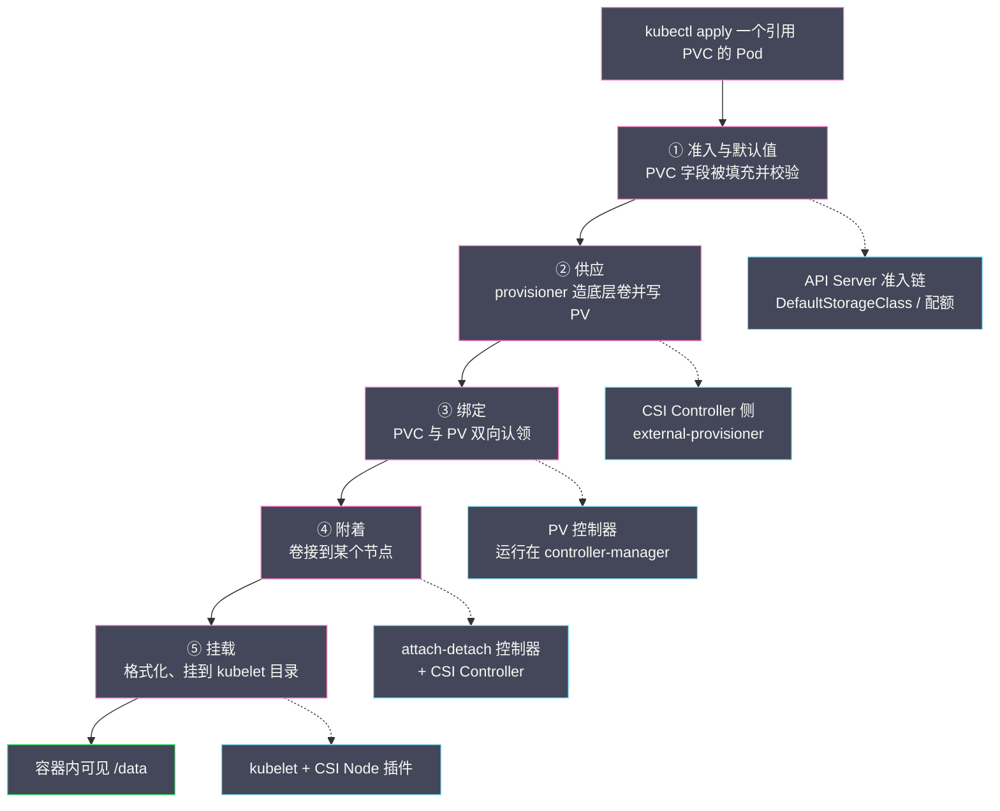
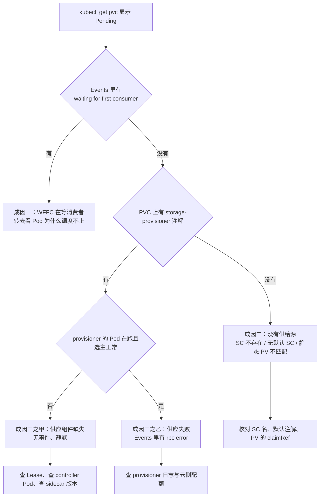
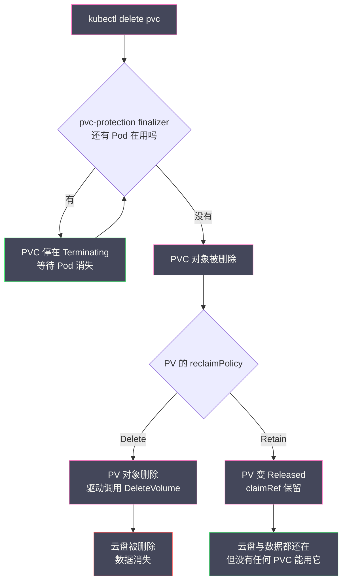
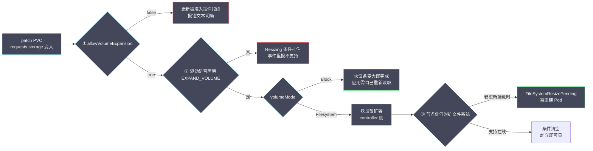
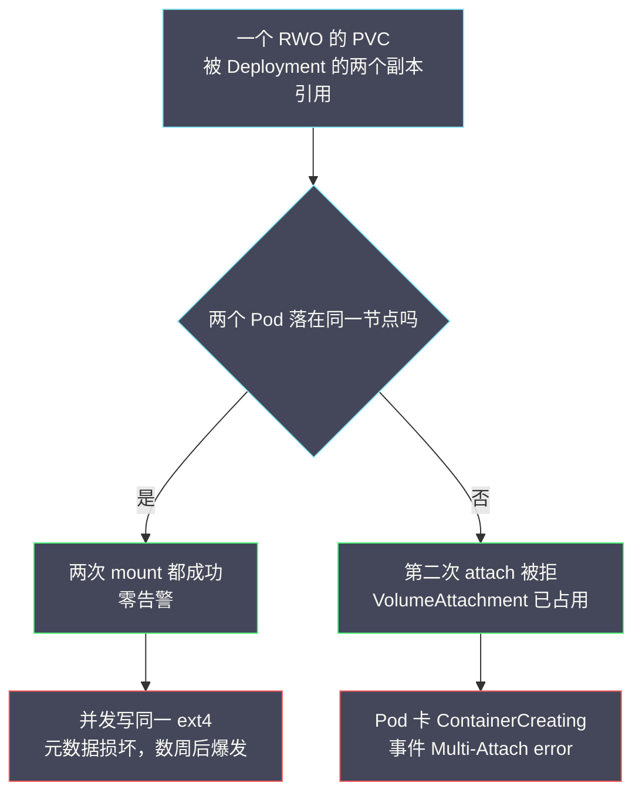

# 01 持久化存储——PV PVC StorageClass 与 CSI

**摘要：**

存储大概是 Kubernetes 里最不像云原生的一块：Pod 可以随删随建，卷背后的数据删一次就再也没有第二次机会。PV、PVC、StorageClass 这三层抽象把"存储的供给"与"存储的消费"分开，也把责任一并切开，切开的地方正是故障与误判的产地。本文换一个角度讲这套对象，不谈 CSI 驱动怎么写、不谈调度器如何绑定卷，只谈它们落到运维手里会以什么形态出事。主线沿绑定链推进：PVC 的准入与默认值、StorageClass 的供应、PV 的绑定、卷的附着与挂载，逐段给出失败时证据留在哪里，并用一张判定表把"PVC 一直 Pending"这个笼统现象拆成三类成因。中段讨论三处最容易踩空的行为细节：`volumeBindingMode` 在跨可用区与误判之间的取舍、`reclaimPolicy` 决定"删掉 PVC 之后数据在哪"、扩容要同时满足准入、驱动与文件系统三层前提。后段收在快照与访问模式两处语义陷阱，再落到五类典型故障与三个反例：NFS 做数据库盘、hostPath 做有状态服务、忽略回收策略。读完应当能回答两个问题——删掉一个 PVC 究竟发生了什么，以及为什么"扩容成功"与"容量可用"是两件事。

---

## 第 1 章 一块删不掉的盘

### 1.1 两个账单

笔者用一个中等规模的集群当底稿。六十个工作节点散在三个可用区，控制面托管，存储侧按用途分了四个 StorageClass：`standard` 挂通用云盘，`ssd` 挂高 IOPS 盘，`shared-nfs` 指向云文件存储，`local-nvme` 用节点本地盘。工作负载大致三类：无状态的 Web 与 API 层、一组订单与支付服务（MySQL 主从、Kafka 三副本）、以及若干日志采集与离线任务。

事故的起点是一次看起来很干净的清理。某位同学把已经下线的 staging 命名空间里一批 PVC 删掉，顺手确认了盘也消失了。三个月后财务对账，发现云账号里长期挂着四十多块没人认领的云盘，容量加起来接近二十个 TiB，而 K8s 里一块对应的 PV 都查不到。同一时期还有另一张工单被翻出来重看：订单库的盘从 1 TiB 扩到 2 TiB 之后跑了两周又报磁盘满，登上去 `df -h` 一看还是 1 TiB。

这两个故事正好构成本文的两条主线。一条是"对象删了、资源还在"，另一条是"对象改了、容量没到"。它们都不是 kubelet 或者某个 CSI 驱动的缺陷，而是三层抽象的责任边界没被看清：回收策略把"删除"这件事拆成了两个动作，只做完了第一个；扩容把"变大"拆成了三步，只走完了第一步。

### 1.2 存储是声明式 API 的例外

Kubernetes 的声明式模型建立在一个很少被明说的前提上：期望状态可以被重建。Deployment 被删了，重新 apply 就是同一份东西；Pod 挂了，控制器拉一个新的，换一副皮囊而已。声明式协调之所以能收敛，是因为"缺失"可以被等价地创造出来。

存储对象是这条前提的例外。PVC 重建之后确实还是同样的名字、同样的容量请求，但它背后的内容不会跟着回来。协调循环在这里只完成了一半工作：控制器能把"缺的对象"补上，补不回"已有的内容"。这也解释了为什么存储类对象上的每个删除动作都比别处危险——其他对象的误删是一个可以回滚的运维事件，存储对象的误删是一个只能靠备份收场的数据事件。

所以本文的重心不是"怎么用"——装驱动、写一个能跑的 PVC，入门材料里都有，且版本一变就过期。真正让人凌晨三点坐起来的是另外几件事：这个 PVC 为什么一直 Pending，这块盘删了为什么账单还在，容量扩了为什么业务还报磁盘满，节点挂过之后为什么新 Pod 起不来。

### 1.3 一次挂载的五个阶段

把"Pod 用上一块盘"这件完整的事拆开，有五个阶段，分属四五个不同的组件。这个拆法在排障时很要紧，因为每个阶段的证据留在完全不同的地方，找错地方就只能看见一堆无关的日志。



第①段在 API Server 里发生。PVC 的缺省字段被填入，配额被核算，不可修改的字段被挡住。这一段失败的表现是 `apply` 直接报错，而不是对象进了集群之后卡住；因此只要 PVC 存在，这一段就已经通过了，排查时不必回头怀疑它。

第②段在 CSI 驱动的控制器侧发生。external-provisioner 这个 sidecar 通过选主争到唯一处理权，调用驱动的 `CreateVolume` 造出底层卷，再写一个 PV 对象进 API Server。这一段是动态供给的全部内容，也是"云 API 报错"最集中的地方。

第③段回到 PV 控制器。它把 PV 的 `claimRef` 指向 PVC、把 PVC 的 `spec.volumeName` 指向 PV，两边打上 `bind-completed` 之类的注解。这一段做完，声明层面的事情就结束了，后面两步与声明无关。

第④段是 attach-detach 控制器算出"这块卷该在哪个节点上"，通过 `VolumeAttachment` 对象驱动 CSI 的 `ControllerPublishVolume`。云盘这类块设备必须在这里被挂到目标虚拟机上，网络文件系统这一步通常是空操作。

第⑤段交给目标节点上的 kubelet 与 CSI Node 插件：分区、格式化、`fsck`、`mount`，最后挂到容器里。一段盘从"云账号里的一行记录"变成"容器里的一个目录"，到这里才算完成。

### 1.4 五种失败形态

五个阶段各自有典型的失败形态，把它们排成一张表，排障时先对症状再挖细节，比一上来翻日志有效得多。

| 卡住的阶段 | 用户看到的现象 | 证据留在哪里 | 常见根因 |
| :--- | :--- | :--- | :--- |
| ① 准入 | `apply` 直接被拒 | 命令返回的报错文本 | 缩容请求、修改不可变字段、超过配额 |
| ② 供应 | PVC 一直 Pending，无 Pod 参与 | `kubectl describe pvc` 的 Events；provisioner 日志 | 配额不足、参数不被驱动接受、凭证失效、provisioner 未运行 |
| ③ 绑定 | PVC Pending，但 PV 已经存在 | `kubectl get pv` 里 PV 的 `claimRef` 与状态 | 静态 PV 的 `claimRef` 未清、容量或访问模式不匹配 |
| ④ 附着 | Pod 停在 ContainerCreating | `kubectl describe pod` 与 `kubectl get volumeattachment` | 跨可用区、Multi-Attach、节点附着数到顶、云 API 限流 |
| ⑤ 挂载 | Pod 停在 ContainerCreating，`describe` 里有 FailedMount | kubelet 日志、CSI Node 插件日志、`dmesg` | fsck 慢、`fsGroup` 递归改属主、NFS 服务端不可达、残留挂载点 |

表里最右一列写着"根因"，现场先看到的却是中列。反过来用更有效：先看 Pod 有没有被调度、PVC 有没有绑定，把范围压到两段之内。

---

## 第 2 章 绑定链的三段判定

PVC 从创建到绑定，要过三关。三关由不同的组件把关，失败时给出的事件文本互不相同，这是区分"Pending 的三种成因"的唯一可靠依据。

### 2.1 第一段：PVC 自己的合法性

PVC 创建时先经历准入链，其中三个插件与存储直接相关。

`DefaultStorageClass` 负责填默认值。PVC 里不写 `storageClassName` 时，它去找带 `storageclass.kubernetes.io/is-default-class: "true"` 注解的 StorageClass，把名字填进去。这里有个容易出事的细节：集群里存在多个默认 StorageClass 时，它挑的是最近创建的那个。装第二套 CSI 驱动、顺手把它的 StorageClass 标成默认，全集群所有不写 SC 的 PVC 就会静默地换到新后端，没有任何告警——因为这个改动不产生任何事件。治理的办法是只让一个 SC 带默认标记，并且用准入策略（譬如 Gatekeeper 一类）锁住这个注解，不让它随安装包漂移。

`ResourceQuota` 会按 StorageClass 分别计数。配额项除了 `requests.storage` 总量，还有形如 `<sc-name>.storageclass.storage.k8s.io/requests.storage` 的分项，以及按 PVC 个数的 `persistentvolumeclaims`。多租户集群里只设总量不设分项，结果是某个团队用便宜盘把配额吃干净，贵的盘一个也申请不到。

`PersistentVolumeClaimResize` 在更新时把关，后文扩容一节再说。

准入之外，PVC 还有几个字段一旦落地就不许改：`spec.volumeMode`（文件系统还是裸块设备）、`spec.dataSource`（除少数情况）、以及绑定之后的 `accessModes`。想换只能新建 PVC 再迁数据。这一条在规划阶段最容易被忽略——把 `volumeMode` 当成可以随时调整的开关，等到要换的时候才发现需要停机搬数据。

还有一个语义陷阱藏在"空字符串"里。PVC 的 `storageClassName` 省略，意思是"我接受默认 StorageClass"；显式写成 `storageClassName: ""`，意思是"我不要任何 StorageClass，只和没有类的 PV 静态匹配"。两者只差一对引号，行为完全相反。把 `""` 误当成"用默认"，结果是 PVC 永远等一个不存在的静态 PV。

### 2.2 第二段：供应

动态供给的触发点不在 PVC 控制器，而在 PVC 上的一个注解。PV 控制器先给 PVC 打上 `volume.beta.kubernetes.io/storage-provisioner: <驱动名>`（较新版本还会写 `volume.kubernetes.io/storage-provisioner` 这一新键），external-provisioner 通过 watch 看到这个注解与自己匹配，才开始干活。这个顺序解释了现场一个很常见的问题：PVC 的 Events 里一条供应相关的事件都没有。没有事件不等于没报错，而是意味着 PV 控制器还没走到"找供应者"这一步，譬如 StorageClass 名字根本不存在。

供应成功要三个条件同时成立：StorageClass 存在且 `provisioner` 字段能对上已注册的驱动名；provisioner 的 Pod 在跑且拿到了选主；`CreateVolume` 需要的参数（容量、访问模式、拓扑、`parameters` 里的键值）被驱动接受。三者缺一，症状各不相同。

| 缺哪一环 | PVC Events 的样子 | 进一步取证 |
| :--- | :--- | :--- |
| StorageClass 名不存在 | `storageclass.storage.k8s.io "fast-ssd" not found` | `kubectl get sc` 核对拼写与大小写 |
| provisioner 没起来 | 长时间无事件，PVC 上已有 provisioner 注解 | `kubectl -n kube-system get pods` 找 CSI controller；看 Lease 是否被旧实例占着 |
| 驱动拒绝参数 | `failed to provision volume with StorageClass "fast-ssd": rpc error: ...` | `kubectl -n kube-system logs deploy/<driver>-controller -c csi-provisioner` |
| 云侧配额或凭证 | 同上，错误文本里带云厂商的错误码 | 云控制台的配额页与 RAM/AK 状态 |

选主这一点值得单独说一句。external-provisioner 用 Lease 对象选主，正常情况下切换在秒级完成，但如果旧实例是异常退出（节点宕机、Pod 被 OOM 杀掉），Lease 要等到租期过期才释放，这段时间内新实例不干活，PVC 就处于"注解齐全、无人处理、无事件"的静默状态。这种静默是最难排查的形态，因为它没有任何报错可供搜索。

### 2.3 第三段：绑定

供应完成之后，PV 控制器负责把两个对象对上。它做的事不复杂：写 `PV.spec.claimRef`（含 PVC 的 UID）、写 `PVC.spec.volumeName`、补注解、改状态。但有几条约束决定了它的行为。

绑定是一对一的，而且不可拆分。一个 100 GiB 的 PV 绑定给一个请求 10 GiB 的 PVC 之后，剩下 90 GiB 不会退还给任何其他 PVC。静态供给时代这是容量浪费的主要来源；换到动态供给，它变成另一个问题的注脚——很多团队在迁到云盘之后，PVD 容量利用率看着很高，实际是 PVC 请求值虚高，而不是真的写满了。

容量匹配是"足够"而非"相等"。这个宽松规则在静态 PV 复用时会造成尴尬：一块被 Retain 下来、容量 2 TiB 的旧盘，想给一个请求 500 GiB 的新 PVC 复用，可以绑上，但从此这 2 TiB 就锁死在这一个 PVC 上。

`claimRef` 是绑定的牙齿。PV 上写了 `claimRef` 之后，只有 UID 匹配的那个 PVC 能绑它，其他 PVC 一律绕开。回收策略为 `Retain` 的 PV 在 PVC 删除后会停留在 `Released` 状态，`claimRef` 仍然指着一个已经不存在的 PVC——这就是第 4 章要展开的那半个动作。

### 2.4 Pending 的三种成因怎么区分

"PVC 一直 Pending"是一句几乎不含信息的描述。把它还原成成因，只需要看两处：PVC 的 Events，以及 PVC 上有没有 provisioner 注解。下图是笔者在值班时按顺序走的判定路径。



三种成因的判据如下，顺序不要颠倒，因为它们的证据互相覆盖。

| 成因 | 决定性证据 | 常见于什么场景 |
| :--- | :--- | :--- |
| 无供给源 | Events 里有 `no persistent volumes available for this claim and no storage class is set`，或 `storageclass ... not found`；PVC 上没有 provisioner 注解 | 手写 PV 忘了建、SC 拼错、集群没有默认 SC、显式写了 `storageClassName: ""` |
| 供应失败 | PVC 上有 provisioner 注解，Events 里有 `failed to provision volume with StorageClass`；或完全没有事件 | 云配额、凭证、参数、驱动版本、选主卡住 |
| WFFC 等待 | Events 里有 `waiting for first consumer to be created before binding`；PVC 上可能有 `selected-node` 注解 | 使用了 `volumeBindingMode: WaitForFirstConsumer` 的 SC，且 Pod 尚未调度成功 |

还有第四种，不在上图的干路上，却经常让人误判：静态 PV 明明存在、容量也够，PVC 就是绑不上。原因通常是这块 PV 处于 `Released`，`claimRef` 指向一个已经消失的 PVC，在 `kubectl get pv` 的输出里它的状态是 Released 而不是 Available，容量那一栏却还在，看上去"有一块空闲的大盘"。这种 PV 必须先清掉 `claimRef` 才能重新参与绑定，清理动作本身又意味着放弃它上面的数据，所以第 4 章里会把它和回收流程放在一起处理。

---

## 第 3 章 绑定时机的两条路

`volumeBindingMode` 是个只有两个取值的字段，却决定了 PVC 从创建到可用的整个节奏，也决定了故障会以什么面貌出现。Immediate 与 WaitForFirstConsumer 的差别不在机制上，而在"谁先做决定"——盘先有位置，还是 Pod 先有位置。

### 3.1 Immediate 的后果：盘先落位，Pod 后追

`Immediate` 是默认值。PVC 一创建，供应与绑定立刻发生，与有没有 Pod 无关。对没有拓扑约束的存储这是最省事的选择：NFS、CephFS 这类网络文件系统在哪个可用区挂都一样，早绑定没有任何代价。

对块存储，Immediate 会把一个可用区的选择提前锁死。云盘只能在创建它的可用区里被挂载，而 Immediate 模式下驱动一般在 `allowedTopologies` 允许的区里挑第一个有容量的，Pod 之后被调度到哪里完全不受这层约束。于是出现一类很有辨识度的现象：PVC 是 Bound 的，PV 也正常，Pod 全都在 Pending，事件里只有一句 `node(s) had volume node affinity conflict`。这句事件的意思不是"节点有问题"，而是"这块盘只认某一个区的节点，而你所有的候选节点都不在那个区"。

这类故障的迷惑性在于它看起来像调度问题。团队会去查节点亲和、污点、资源余量，全都正常；真正的原因在几天前 PVC 被创建的那一刻就已经定了。副本数越多，症状越像"部分 Pod 起不来"：落在盘所在区的那个副本正常，其余全部卡住。

修正的代价不低。改 StorageClass 的 `volumeBindingMode` 只对之后创建的 PVC 生效，已经绑定的 PV 不会回退，它带着 `nodeAffinity` 留在原地；要迁移只能新建 PVC、把数据拷过去、改引用、删旧的。所以这条字段属于"规划期一次定死"的类型，改起来的成本与它看起来的体量完全不成比例。

Immediate 也有它站得住的场景。一是无拓扑约束的卷，二是确实需要"先有盘、后有计划"的流程，譬如从快照恢复一块盘、先在临时 Pod 里校验数据完整、再交给正式工作负载。第二种用法在 WFFC 下并非做不到，起一个占位 Pod 把 PVC 绑上即可，但占位 Pod 的镜像、调度约束、清理逻辑都得自己维护，代价不一定比 Immediate 低。

### 3.2 WFFC 的后果之一：Pending 是正常态

`WaitForFirstConsumer` 把供应推到第一个消费者出现之后。PVC 创建完成时没有任何动作，只有等某个 Pod 引用它、并且调度器为这个 Pod 选定了节点，供应与绑定才开始。PVC 在 `kubectl get pvc` 里一直显示 Pending，Events 里反复刷 `waiting for first consumer to be created before binding`。

这行事件是所有监控口径失效的源头。以"PVC Pending 超过 5 分钟"为条件的告警，在 WFFC 集群里会对着一切正常的对象持续报警；值班同学的应对方式通常是关掉这条告警，于是真正的绑定失败也一起被关掉了。

正确的口径要按绑定时机分层。Immediate 的 PVC 可以用年龄；WFFC 的 PVC 必须结合"是否存在引用它的 Pod"与"这个 Pod 是否可调度"来判断。后者的信息在 Pod 的 `describe` 里：调度失败的原因、`selected-node` 注解有没有写进去、绑定超时事件有没有出现。巡检脚本里可以用一条 jsonpath 把两类 PVC 分开，避免用一套阈值套两种语义。

| 判读对象 | Immediate 下意味着 | WFFC 下意味着 |
| :--- | :--- | :--- |
| PVC 年龄超过阈值 | 疑似供应或绑定失败 | 无意义，取决于是否有消费者 |
| PVC 有绑定失败事件 | 真实故障 | 真实故障 |
| Pod 不可调度 | 与 PVC 无关，独立问题 | 可能同时是 PVC 不绑定的原因 |
| PVC 上有 `selected-node` 注解 | 不该出现 | 正常，表示调度器已选定节点 |

### 3.3 WFFC 的后果之二：选定节点之后才发现没盘

WFFC 把顺序改成"先调度 Pod、再创建卷"，但它没有承诺"选中的地方一定有盘"。调度器为 Pod 选节点时，能看到的信息是驱动上报的拓扑与容量（调度框架如何消费这两类信息见 [[11 Scheduler 调度算法：预选、优选与扩展机制]]）；容量这条信息要靠 external-provisioner 的容量跟踪（`--enable-capacity`）把 `CSIStorageCapacity` 对象发布出来，调度器才看得见。没有开启容量跟踪的集群，调度器只知道"这个区在拓扑上可达"，不知道"这个区的盘配额已经用光了"。

后果是一个来回震荡的循环：调度器选中 A 区节点 → 绑定流程往 A 区创建卷 → 云侧配额不足，`CreateVolume` 失败 → PVC 回到 Pending，`selected-node` 注解却留下了 → 下一轮重试仍然优先往 A 区 → 继续失败。事件里能看到的只有供应失败，看不到"为什么总是 A 区"。

两个缓解手段。一是把容量跟踪开起来，让调度器在选节点时就知道余量，失败会提前到调度阶段，报错也更直白。二是用 `allowedTopologies` 把 StorageClass 限制住，减少候选区数量——这等于用一部分可用性冗余换收敛速度，属于典型的取舍，不是纯粹的优化。

### 3.4 互等：StatefulSet 与 WFFC

WFFC 最典型的互等发生在 StatefulSet 上。`volumeClaimTemplates` 生成的 PVC 在 Pod 之前创建，Pod 调度不上，PVC 就永远等；PVC 一直 Pending，Pod 的调度事件里又会出现"未绑定的 PVC"这条原因，两边互相指认。

这条互等在 [[10 StatefulSet 深度解析：有序部署与持久化身份]] 里从控制器角度展开过，落到运维手上只有一条处置顺序：先看 Pod 的调度失败原因（资源、亲和、污点、拓扑），再看 PVC。反过来查会把时间花在"为什么卷不绑定"上，而真正的原因往往是"这个 Pod 根本调度不到任何有该卷拓扑的节点"。

还有一种互等藏在删除侧。Pod 卡在 Terminating（卷卸载不干净），它引用的 PVC 因为有 `pvc-protection` finalizer 删不掉，垃圾回收看起来全部停滞。此时该处理的不是 PVC，是那个卡住的 Pod 和节点上的挂载点。

### 3.5 两条路的选型

把两条路放在一起，判断依据其实只有一条：底层存储有没有拓扑约束。有约束就必须让 Pod 先决定位置，没有约束就没必要付出 WFFC 带来的认知成本。

| 维度 | Immediate | WaitForFirstConsumer |
| :--- | :--- | :--- |
| 卷创建时机 | PVC 创建后立即 | 第一个 Pod 调度成功后 |
| 跨可用区风险 | 高，盘的位置与 Pod 位置解耦 | 低，由调度决定位置 |
| PVC Pending 的含义 | 失败信号 | 多数时候是正常态 |
| 监控口径 | 可用 PVC 年龄 | 必须结合消费者状态 |
| 预热、先验数据 | 天然支持 | 需要占位 Pod |
| 适用存储 | NFS、CephFS 等无拓扑卷 | 云盘、本地盘、任何带区级约束的卷 |

判断自己集群里某个 SC 走的是哪条路，看 `kubectl get sc <name> -o yaml` 里的 `volumeBindingMode` 一栏。省略这个字段时用的是 `Immediate`，这一点在跨可用区集群里值得逐条过一遍——默认值不写，等于默认接受跨区风险。

---
## 第 4 章 删掉 PVC 之后，数据在哪

回收策略这个名字容易误导。它听起来像"删了之后怎么处理数据"，实际描述的是"PVC 消失之后，PV 与底层存储各自还走不走下一步"。三个对象、两种策略，组合出来的行为比字段名复杂。

### 4.1 三个对象与两次删除

一次 `kubectl delete pvc` 之后，链路上有三个东西可能被删：PVC 对象本身、PV 对象、云账号里的那块盘。删哪些、按什么顺序删，**由 `reclaimPolicy` 与 finalizer 共同决定**。



图里最右边两个终局，是本文开篇两个账单的技术来源。`Delete` 那条路的终点是"数据没了"，`Retain` 那条路的终点是"数据还在，但没人管"。

### 4.2 Retain 只做了一半

`Retain` 的行为常被描述成"保留 PV 和数据"，这只对了一半。PVC 删除之后，PV 会转到 `Released` 状态，它上面的 `claimRef` 仍然指向那个已经消失的 PVC，**这个引用不会自动清掉**。带着 `claimRef` 的 PV 谁也不能绑，它在 API 里存在、容量也显示着，但对任何新的 PVC 都不可见。

所以 Retain 的后半段是人工完成的，标准动作有三步。

```bash
# 1. 确认这块盘上的数据不再需要，或者已经另有备份
kubectl get pv pvc-3f2a... -o jsonpath='{.status.phase}{"\n"}{.spec.claimRef.name}{"\n"}'

# 2. 清掉 claimRef，让 PV 回到 Available
kubectl patch pv pvc-3f2a... --type=merge -p '{"spec":{"claimRef":null}}'

# 3. 决定这块盘归谁：写一个显式绑定它的 PVC，或改回收策略后交给供应流程
kubectl get pv pvc-3f2a... -o yaml | grep -E 'reclaimPolicy|capacity'
```

第 2 步做完，PV 变成 `Available`，可以被一个新的 PVC 绑走——容量、访问模式都要满足，而且要留意静态绑定并不认"你们是一个团队"这种关系，任何满足条件的 PVC 都可能把它拿走。多租户集群里这一步应该配合 `claimRef` 显式指定，而不是让它自然匹配。

比"忘了清 `claimRef`"更常见的错误是直接删 PV 对象。很多人以为删 PV 就等于"释放了"，实际上删 PV 只删掉了 API 里的记录，云账号里的盘毫发无损。三个月后财务对账，那四十多块盘就是这么来的。

孤儿盘的盘点不能靠人回忆，要拿两边做差集。云侧列出的盘与集群里 PV 的 `volumeHandle` 求差，剩下的就是孤儿。

```bash
# 集群侧：把所有 PV 背后的卷 ID 收集出来
kubectl get pv -o jsonpath='{range .items[*]}{.spec.csi.volumeHandle}{"\n"}{end}' | sort > /tmp/pv-handles.txt

# 云侧：按标签或创建时间导出盘清单（命令随云厂商而异，示例用 aws cli）
aws ec2 describe-volumes --query 'Volumes[].VolumeId' --output text | tr '\t' '\n' | sort > /tmp/cloud-volumes.txt

# 差集：云上存在、集群里没有
comm -13 /tmp/pv-handles.txt /tmp/cloud-volumes.txt
```

这段脚本值得每个月跑一次并留档，因为孤儿盘只会增加，不会自己消失。

### 4.3 Delete 的失败形态：finalizer 卡住

`Delete` 的正常路径很短：PVC 删除、PV 删除、驱动收到 `DeleteVolume`、云盘消失。异常几乎都发生在中间那一步——**PV 对象卡在 Terminating**。

原因有两层。老一点的保护是 `kubernetes.io/pv-protection`，防止绑定中的 PV 在 PVC 还引用它时被删；较新的实现给 CSI 动态供给的 PV 加了外部 provisioner 的 finalizer，把"底层卷真的删掉"这一步也纳入保护，避免 PV 对象先消失、盘还在的竞态（具体 finalizer 名与启用版本以对应版本文档为准）。两层保护都依赖 provisioner 干活：**provisioner 一挂，finalizer 就没人摘，PV 永远 Terminating**。

现场的样子很有特征。`kubectl get pv` 里状态是 Terminating，`AGE` 一栏是几十天；对应的 PVC 早就没了；云控制台里盘还在。此时正确的处置顺序是先恢复 provisioner（看它的 Pod、看选主、看云凭证），让它把积压的删除任务做完，而不是手工去摘 finalizer。手工摘 finalizer 会让 PV 记录消失、盘永久成为孤儿，等于把一个小故障固化成一条账单。

另一种变体更隐蔽：`DeleteVolume` 调用成功了，但驱动在写回结果之前挂了。重试时 `DeleteVolume` 对已经不存在的卷返回 `NotFound`，如果驱动没把这个错误当成"已达终态"处理，就会一直失败、一直重试、finalizer 一直不摘。这类问题的判据在 CSI controller 日志里——同一个卷 ID 反复出现 `NotFound` 或者 `InvalidArgument`。

### 4.4 谁在什么时候删：五条路径

"PVC 是怎么没的"这件事，在事故复盘里经常说不清楚，因为删除 PVC 的往往不是人，而是某条更高层的删除动作级联下来的。下面这张表按删除源排列，是笔者在复盘中反复用到的对照。

| 删除源 | PVC 会不会被删 | PV 与底层卷 | 最容易踩的地方 |
| :--- | :--- | :--- | :--- |
| `kubectl delete pvc <name>` | 会 | 按 `reclaimPolicy` | 以为 Retain 就等于备份 |
| `kubectl delete ns <ns>` | 会，级联 | 按 `reclaimPolicy`，通常是 Delete | 下线环境时顺手删命名空间，盘随之消失 |
| `helm uninstall <release>` | chart 里直接定义的 PVC 会；`volumeClaimTemplates` 生成的不会 | 同上，取决于策略 | 两种 PVC 的命运不同，容易误判 |
| `kubectl delete sts <name>` | 默认不会 | 不动 | 删了工作负载以为数据没了，实际盘还在计费 |
| `kubectl delete pvc --force --grace-period=0` | 会，且绕过 finalizer | 可能留下不一致状态 | Pod 还在写、PVC 记录已被移除，盘最终成孤儿 |

第四行与第五行的对比最值得记住：默认情况下**删 StatefulSet 不删 PVC**，这是刻意设计的，为了让有状态负载可以被重新创建而不丢数据；而 `--force` 删除绕过所有 finalizer，包括 `pvc-protection`，等于在别人还在用的时候把门拆了。命令本身能成功，代价要等到下一块盘挂不上、或者数据对不上账时才显现。

如果确实需要"删 StatefulSet 时连 PVC 一起删"，较新版本提供了 `persistentVolumeClaimRetentionPolicy` 字段，可以分别设置缩容（`whenScaled`）与删除（`whenDeleted`）时的行为。这个字段的出现说明社区也承认默认值两难：不删会积累垃圾，删了会丢数据，只能交给使用者显式选择。

### 4.5 改 StorageClass 不回溯

一个反复出现的误判：把生产 StorageClass 的 `reclaimPolicy` 从 `Delete` 改成 `Retain`，然后认为存量数据安全了。

这个字段只在创建 PV 的那一刻被读取，动态供给出来的 PV 会把当时的值抄下来写进自己的 spec，**改 SC 只影响之后新建的 PV**，此后与 StorageClass 再无关系。改 SC 只影响之后新建的 PV。要把存量盘保护起来，必须逐个 patch PV：

```bash
# 只对确实需要保护的 PV 批量改，先 dry-run 看清单
kubectl get pv -o json | jq -r '.items[] | select(.spec.persistentVolumeReclaimPolicy=="Delete") | .metadata.name'
kubectl patch pv <name> -p '{"spec":{"persistentVolumeReclaimPolicy":"Retain"}}'
```

反向的误判同样存在：把 SC 从 `Retain` 改成 `Delete`，以为下次清理会省事，结果存量盘纹丝不动，清理流程照样要人工。

---

## 第 5 章 扩容的三层前提

PVC 扩容看起来只是一条 patch 命令，实际要穿过三道门：准入层允许不允许、驱动层支持不支持、文件系统层什么时候扩。三道门任何一道没开，结果都不是报错，而是"看起来成功、实际没变"。

### 5.1 三道门的位置



### 5.2 第一层：准入

StorageClass 的 `allowVolumeExpansion` 省略时是 `false`。在这种 SC 下 patch PVC 的存储请求，更新会被 `PersistentVolumeClaimResize` 准入插件直接拒掉，报错大意是"只有动态供给的 PVC 才能扩容，且其 StorageClass 必须支持扩容"。

两句报错其实各指一件事。前半句排除了静态供给：**手工创建 PV 再绑定的 PVC 不支持扩容**，哪怕底层盘明明可以变大。这一条在从传统存储迁移过来的集群里很常见——管理员手工建了一批 PV，业务方想扩容时发现路根本不通，只能新建 PVC 搬数据。后半句则是 SC 开关没开。

这一层有个容易被当成 bug 的行为：先删后建不解决问题。改 SC 的 `allowVolumeExpansion` 对已经创建的 PVC 立即生效（这个字段是每次更新时现读的），所以补开开关之后，之前被拒的 PVC 可以重新 patch 成功。这与 `reclaimPolicy` 完全不同，两个字段一个现读、一个落盘，混在一起记就会反复犯错。

### 5.3 第二层：驱动

CSI 规范里扩容是两个独立的能力位：控制器侧 `EXPAND_VOLUME` 负责把云盘改大，节点侧 `EXPAND_VOLUME` 负责在节点上把文件系统改大。两个都要有，缺一个就只完成一半。

缺控制器能力的表现是块设备根本没有变大。PVC 会挂上 `Resizing` 条件，原因里指向外部扩容失败，事件里能看到驱动返回"不支持"之类的错误。缺节点能力的表现更微妙：块设备已经变大，文件系统没变，`df` 看不到任何变化，而 `lsblk` 显示盘确实大了。这两种现象必须分开看，否则会把"驱动不支持"误判成"kubelet 没执行"。

`volumeMode: Block` 的 PVC 走到这里就结束了。裸块设备没有文件系统，扩容在节点上的动作只是设备尺寸变了；容器里的 `/dev/xvdf` 会反映新尺寸，但正在打开这个设备句柄的进程（数据库、消息队列）拿到的还是老尺寸，需要重启才能重新读取。这一条在第 5.5 节的原因表里还会出现。

### 5.4 第三层：文件系统在谁手里扩

文件系统扩容这一步由 kubelet 在节点上完成，调用 `resize2fs`（ext4）或 `xfs_growfs`（XFS），触发时机是"卷被挂载的时候"。这就引出最典型的现场：扩容流程停在 `FileSystemResizePending`，因为**卷一直挂着就不会触发重新挂载**。

PVC 的 condition 是判断进度最可靠的依据，比看事件和看日志都准。

| condition | 含义 | 下一步 |
| :--- | :--- | :--- |
| `Resizing`（reason `ExternalExpanding`） | 正在等控制器侧把块设备改大 | 查 provisioner 日志与云侧 |
| `Resizing`（reason `VolumeExpansionPending`） | 块设备已扩，等着节点侧动作 | 看 `FileSystemResizePending` 是否同时出现 |
| `FileSystemResizePending` | 块设备已扩，文件系统未扩 | 重建 Pod 触发重新挂载 |
| 两个条件都没有 | 全流程完成 | 看 `status.capacity` 是否已更新 |

处置动作只有一个：让卷重新挂载一次。StatefulSet 下删 Pod 即可，控制器会重建并重新挂载；普通 Deployment 同理。手工 `kubectl exec` 进去执行 `resize2fs` 也能让 `df` 立刻变好看，但它绕过了 kubelet 的记录，`status.capacity` 不会更新，下一次调度或迁移时状态就对不上了。这种"手工修好一个指标、留下一个错误状态"的操作，在扩容场景里尤其不值得。

### 5.5 "扩容成功但看不到"的五个原因

这个现象在工单里的描述几乎都一样："PVC 显示 2TiB，Pod 里 df 还是 1TiB"。按发生频率排列，原因有这么五类。

| 原因 | 判据 | 处置 |
| :--- | :--- | :--- |
| 文件系统待扩（`FileSystemResizePending`） | `kubectl get pvc -o yaml` 看 conditions | 重建 Pod，让卷重新挂载 |
| 中间有分区或 LVM 层 | 节点上 `lsblk` 显示盘大、分区小 | 驱动需支持扩分区，或改直连块设备 |
| `volumeMode: Block` 且应用未重读 | `lsblk` 已是新尺寸，应用报容量旧 | 重启应用进程；文档里明确其对在线扩容的支持 |
| 子路径挂载或只扩了数据卷 | `df` 看的是另一个挂载点 | 逐卷核对，别只扩 `volumeClaimTemplates` 里第一个 |
| 应用层自己的空间划分 | 数据目录所在的表空间、日志目录满了 | 扩的是卷，不是应用的存储池 |

第二行值得展开。云盘变大之后，如果 PV 背后是一个分区（`/dev/xvdf1`），驱动通常只扩整盘不扩分区；如果是 LVM，还要 `pvresize`、`lvextend` 才能让文件系统看到空间。这类情况在自建存储与虚拟化平台上比在托管云盘上常见，迁移时要专门验证，不能假设"驱动支持扩容"就等于"链路全通"。

### 5.6 容量算术：为什么扩到 2TiB 还是满

绝对容量与可用容量之间隔着几层损耗，规划时把它们算进去，比出事之后再加一块盘便宜。

按示例推算：申请 2 TiB（TiB 口径），云厂商按 GiB 计费时数值一致，但如果控制台用十进制 TB 展示，2 TiB 会显示成约 2.2 TB，看起来比预期大，实际一字节没多；ext4 默认给 root 预留 5%，`df` 的 `Avail` 立刻少掉这 5%；XFS 的元数据开销随 inode 数量浮动，小文件多的场景比大文件多耗几个百分点；Kafka 这类系统还要给 segment 滚动与清理留出空间，实践上不能把水位推到 90% 以上。

把这四层乘起来，一块标称 2 TiB 的盘在业务眼里可能只有 1.6 TiB 可用。扩容规划应该按**业务可用容量**下单，而不是按 `spec.resources.requests.storage` 的数值下单，中间的差值是固定的，每次都会出现，不会因为运气好而消失。

---

## 第 6 章 快照不是备份

VolumeSnapshot 是 1.20 进入 GA 的能力，用起来像给卷拍一张照片，恢复时把它挂回去。它确实好用，但"一致性"与"备份"两件事在它身上都只有一半。

### 6.1 快照抓到了什么

CSI 的 `CreateSnapshot` 是存储设备层的动作：指针快照或写时复制，抓的是块设备在某一瞬间的内容。这个"瞬间"对文件系统和应用都是不可见的，它不会通知任何人暂停，也不会等待缓存落盘。

于是快照里可能包含这些东西：文件系统 journal 未回放的状态（相当于一次断电后的磁盘）、页缓存里尚未写入的数据的缺失、应用 redo 日志与数据文件不对齐的时点。恢复之后需要 `fsck` 走一遍，应用需要做自己的崩溃恢复——InnoDB 会回放 redo、Kafka 会重建索引。这不是缺陷，这是**崩溃一致性（crash consistency）**的定义：存储层给的是"像断电一样断在那一刻"的镜像。

对很多场景，崩溃一致性够用。无状态服务的数据目录、构建缓存、可以重建的中间结果，恢复后跑一次校验就行。对数据库，够不够用取决于它的崩溃恢复是否能容忍"最后几百毫秒的事务丢失"，以及业务能否接受。

### 6.2 应用一致性要应用自己配合

**应用一致性（application consistency）**要求快照时数据文件、日志文件、元数据处在同一个逻辑时点上。这个时点只有应用自己知道，所以这件事必须由应用侧发起。

| 一致性等级 | 做法 | 代价 | 恢复后的动作 |
| :--- | :--- | :--- | :--- |
| 崩溃一致性 | 直接 `CreateSnapshot` | 无 | `fsck` + 应用崩溃恢复 |
| 文件系统一致 | 快照前 `fsfreeze -f`，快照后 `-u` | 秒级写停顿，冻结期间 IO 阻塞 | 基本无需修补 |
| 应用一致 | 应用进入备份态再快照（数据库自带的备份态命令，或以只读锁冻结写入） | 需要应用配合与脚本编排 | 直接可用 |

第二行与第三行之间的差别在于"文件系统冻结"与"应用静止"不是一回事。`fsfreeze` 只保证没有新的写进入，已经提交到文件系统的数据是完整的，但应用的内存状态（连接池、未刷盘的 WAL 缓冲）仍然不在快照里。数据库通常有自己的备份态机制，走它比走 `fsfreeze` 稳。

多卷一起快照时还要面对时序问题。订单库的数据卷与 binlog 卷必须处于同一时点，逐个拍快照会得到一个"数据在 T1、日志在 T2"的组合，恢复时要么少一段日志，要么多一段无法对上。解决办法是驱动支持一致性组快照（一次调用拍多卷），或者自己控制顺序：先冻结、再逐卷拍、最后解冻，把窗口压缩到可接受范围。后者在卷多、驱动不支持组快照时是唯一可行的路，代价是冻结时间随卷数线性增长。

### 6.3 快照对象的生命周期

VolumeSnapshot 的对象结构照着 PV/PVC 抄了一遍：命名空间级的 `VolumeSnapshot` 是用户视角的"我要一张快照"，集群级的 `VolumeSnapshotContent` 是实际存在的那份数据。两者的关系与 PV/PVC 一样是一对一，只是方向反过来——先有声明、后由控制器补上内容。

几个实践上的边界。

快照类（`VolumeSnapshotClass`）的 `deletionPolicy` 决定删除 `VolumeSnapshot` 时底层数据留不留。设成 `Delete` 时，删快照即删数据；设成 `Retain` 时，`VolumeSnapshot` 没了但 `VolumeSnapshotContent` 还在，且不再有人引用它——这与 PV 的 `Retain` 是同一类"半自动"设计，同样需要人工收尾。

从快照恢复时，新 PVC 的 `requests.storage` 不能小于快照的 `status.restoreSize`。小于会被拒，等于是"恢复目标比源卷小"这种情况在 K8s 层面就不允许，必须给足容量再谈缩容。

恢复的过程未必是拷贝。部分驱动实现的是惰性恢复：新卷先建立指针，读时回到快照、写时才拷贝。这会带来一个不被注意的后果——**恢复后的一段时间内性能明显低于正常盘**，因为首次读要跨存储层取数。恢复演练时如果只验证数据正确、不验证性能，很容易把"恢复成功但慢"当成应用问题。

### 6.4 快照与备份的四个差别

把快照当备份，是这类系统里最常见的认知错位。两者在四个维度上根本不同。

| 维度 | 卷快照 | 备份 |
| :--- | :--- | :--- |
| 故障域 | 与源卷同一存储账号、同一区域 | 必须跨出源卷的故障域 |
| 权限域 | 能删 PVC 的身份往往也能删快照 | 应当由另一套权限体系保护 |
| 生命周期 | 常与源卷绑定，源卷删除时快照可能一并清理 | 独立于源卷存在，按保留策略管理 |
| 可恢复粒度 | 整卷，不能只恢复一张表 | 可做到表级、库级、文件级 |

第一行最要紧。同一块存储阵列、同一个云账号下的快照，遇到账号被误删、区域级故障、勒索软件删除快照，与源数据一起消失的概率很高。第二行更现实：拿到集群管理员权限的人可以删 PVC，也可以删 VolumeSnapshot，快照对这类误操作没有免疫力。

真正的备份要把数据搬出这个故障域，并且是独立可恢复的。这通常意味着对象存储加上一个能读 K8s API 的备份工具，或者干脆走应用层的逻辑备份（`mysqldump`、`pg_dump`、对象存储里的分片归档）。集群侧的备份方案与容灾设计在 [[06 集群升级 备份与容灾]] 里展开，本篇只强调一点：快照解决的是回滚到某个时点，备份解决的是存储与集群一起没了之后还能重建。

克隆（clone）是另一条容易与备份混淆的路：从一个 PVC 直接克隆出另一个，省掉快照这个中间对象，但源与目标必须同 StorageClass、同命名空间（跨命名空间要借道快照）、同驱动。它适合复制环境做测试，不适合当数据保护手段。

---

## 第 7 章 访问模式的语义陷阱

`accessModes` 是 PVC 里最容易被当成"注释"读的字段。四个取值的名字都很直白，直白到让人跳过语义，直接按直觉使用，然后在半年后某次滚动发布时撞上它真正的含义。

### 7.1 RWO 是节点级，不是 Pod 级

`ReadWriteOnce` 的准确定义是"这个卷只能被挂载到一个节点上读写"，与 Pod 数量无关。同一节点上两个 Pod 挂同一个 RWO 的 PVC 是**允许的，且不报错**。

原因在强制点。RWO 的约束由附着层执行：attach-detach 控制器为某个卷维护一个 `VolumeAttachment`，同一个卷在任意时刻只能有一个 `nodeName`。同一节点上的第二个 Pod 走的是同一个 attach 结果，两次 `mount` 各自成功，没有任何一层会去检查"是不是已经有别的 Pod 在用"。于是两个进程同时往一个 ext4 上写，元数据互相踩踏，短时间内可能看不出异常，等到某次重启、某次 `fsck`、某次数据校验时才爆出来，而那时已经很难从现场反推是哪两个 Pod 造成的。

这条语义还有另一半常被忽略：如果两个 Pod 落在不同节点，第二个会直接被**拦在附着层**，事件里是 `Multi-Attach error`（见 8.1 节）。于是同一个错误配置（一个 RWO 卷给多副本用）会表现出两种完全不同的症状：调度到同节点时静默损坏，调度到不同节点时明确报错。这种"取决于调度结果"的故障，测试环境往往复现不出来。



### 7.2 RWOP 补的那一刀

`ReadWriteOncePod` 就是为堵住 7.1 的静默损坏设计的。它在 1.22 引入、1.29 进入 GA，把约束从"一个节点"收紧到"一个 Pod"：同一个卷在任意时刻只能被一个 Pod 使用，跨节点当然不行，同节点也不行。

强制点也随之搬家——**从附着层搬到 kubelet**。节点在挂载一个 RWOP 卷之前，会去查这个卷是否已经被别的 Pod 占用，占了就拒绝挂载。这带来一个运维上必须知道的后果：约束的正确性依赖每个节点的 kubelet 版本与配置，混部了老版本 kubelet 的集群里，RWOP 只能部分生效。升级期间"某些节点上还能双挂"这种现象不是驱动的问题。

代价也是真实的。RWOP 的语义与"滚动更新"天然冲突：新 Pod 必须等旧 Pod 彻底卸载卷之后才能挂载，滚动更新的并行度退化为严格串行，`maxSurge` 调得再大也没用。对单实例数据库这不是损失（本来就不能并行），对"看起来能并行、实际共享了一个卷"的历史配置，升级到 RWOP 会发现一批负载跑不起来了——那些负载本来就是错的，只是之前没人发现。

### 7.3 RWX 的语义依赖协议

`ReadWriteMany` 表示"可以被多个节点同时挂载为读写"。它不是一个由 K8s 实现的能力，而是底层协议的能力：NFS、CephFS、云文件存储这类网络文件系统天生支持，块存储天生不支持。

支持"能挂上"和保证"写对了"是两件不同的事，差别体现在协议细节上。

NFSv3 的 `fcntl` 锁依赖 NLM 与 `lockd`，客户端侧还要跑 `rpc.statd` 才能参与锁恢复。容器镜像里常常没有这些组件，结果是应用以为拿到了排他锁，实际上**锁根本没生效**，两个进程同时进入临界区。NFSv4 把锁集成进主协议，好一些，但锁恢复仍有边界；CephFS 有类似的历史包袱，以对应版本文档为准。

写语义的差别更致命。NFS 服务端如果以 `async` 导出，客户端 `fsync` 返回成功时数据可能还在服务端页缓存里，服务端掉电就丢；`sync` 导出能保住这一点，代价是写延迟成倍上升。这种"客户端看起来写入成功、服务端其实没落盘"的行为，对数据库是直接的损坏来源。

`ReadOnlyMany` 则常被高估。真正需要 ROX 的场景（模型文件、静态资源、共享数据集）在实践中大多用 RWX 卷加只读挂载实现，因为支持 ROX 的驱动比支持 RWX 的少得多。这里要区分两个层次：`accessModes` 声明的是供应方承诺的卷级能力，`volumeMounts.readOnly` 声明的是这一次挂载怎么挂。**前者在供应时校验，后者在挂载时生效**，能用后者解决的问题，没必要去要求前者。

### 7.4 accessModes 是请求，不是承诺

这条判断值得单独写一段。PVC 里的 `accessModes` 是一句请求，它不产生任何强制力。onboarding 的校验在 CSI 驱动自己手里：external-provisioner 把请求原样传给 `CreateVolume`，**驱动返回成功就成功了**。驱动如果忽略 ROX 这个模式，你拿到的是一个可写的盘，而 K8s 不会替你发现。

静态供给时连这道校验都没有。PV 上写什么就是什么，PVC 上写什么就是什么，两者只要满足子集关系就允许绑定，至于底层是否真的支持，全靠人工核对驱动文档。

| 模式 | 强制点 | 常见后端 | 失效时的表现 |
| :--- | :--- | :--- | :--- |
| `RWO` | 附着层（`VolumeAttachment`） | 云盘、本地盘、iSCSI | 跨节点报 Multi-Attach；同节点静默损坏 |
| `ROX` | 驱动与挂载选项 | NFS、CephFS、部分文件存储 | 驱动不支持时被忽略，实际可写 |
| `RWX` | 协议本身 | NFS、CephFS、云文件存储 | 挂得上，但锁与写语义不保证 |
| `RWOP` | 各节点的 kubelet | 依赖驱动配合 | 老版本 kubelet 放行，双挂仍可能发生 |

所以"能挂上"是一句很弱的结论：判断语义是否正确，要同时看驱动文档、PV 的 `accessModes` 与应用的真实需求。

---

## 第 8 章 五类典型故障

本节把前面散落的行为细节收拢成故障形态，每一类按"症状、判据、根因、处置"四段写。顺序按现场出现的频率排列。

### 8.1 多 Pod 同挂 RWO：Multi-Attach 与滚动更新死锁

症状是新起的 Pod 一直在 ContainerCreating，`kubectl rollout status` 永远不返回。`describe pod` 的 Events 里有这么一行：

```text
Warning  FailedAttachVolume  attachdetach-controller
  Multi-Attach error for volume "pvc-8f1c..." Volume is already
  exclusively attached to one node and can't be attached to another
```

判据很直接：`kubectl get volumeattachment | grep pvc-8f1c`，看一眼 `NODE` 那一栏是不是新 Pod 所在的节点。不是，就说明旧 Pod 还占着附着位。

根因通常是一个 RWO 的 PVC 被 Deployment 多副本共享。真正让事故扩大的不是这条约束，而是**滚动更新的默认行为把死锁固化了**：`RollingUpdate` 先起新 Pod、等它 Ready 之后再删旧 Pod；新 Pod 因为卷挂不上永远不 Ready，旧 Pod 因为新 Pod 不 Ready 永远不被删。两侧互相等待，Deployment 的进度卡在 `1 old pod pending termination`，K8s 不会因为"新 Pod 卡住太久"就替你做决定。

处置分三层。临时手段是把副本数退回 1，或者在节点上确认旧 Pod 已不在运行后清理附着记录；根本手段是改 `strategy: Recreate`（先删后建，停机窗口与启动时间等长），或者改用 StatefulSet 让每个副本有自己的 PVC。用 `Recreate` 的团队要接受一个后果：发布期间必然有几十秒到几分钟不可用，这个时长取决于新 Pod 挂卷与启动的耗时，与镜像大小、`fsck`、`fsGroup` 处理都有关系。

还有一种变体：旧 Pod 已经删了，新 Pod 仍然报 Multi-Attach。这时问题在卸载侧——旧节点上的 `unmount` 卡住了（NFS 服务端不可达、设备忙），`VolumeAttachment` 一直没被摘。判据是旧节点上 `mount | grep pvc-`、`dmesg` 里的卸载报错，以及 attach-detach 控制器日志。处置要落到那个节点上，重启 kubelet 或直接重启节点，而不是在控制面反复删 Pod。

### 8.2 fsGroup 与权限

症状是容器以非 root 运行时写卷报 `Permission denied`，或者 Pod 卡在 ContainerCreating 很久。这两个症状同源，都指向 `fsGroup` 在挂载阶段做的那次属主调整。

`fsGroup` 的作用是让卷的文件属组变成一个指定的 GID，同时把这个 GID 加入容器的补充组，于是非 root 进程也能写。kubelet 实现这件事的方式是 `chown`——默认 `fsGroupChangePolicy: Always`，意味着每次挂载都**递归 chown 整卷**。卷上有一百万个文件、总量上 TB 时，这一步以分钟计，挂载在 kubelet 看来就是"没完成"，Pod 一直 ContainerCreating。这也是 8.3 节里"挂载超时"的一个常见来源，很容易被误判成 CSI 驱动慢。

处置的第一选择是把策略改成 `OnRootMismatch`：只在卷根目录的属组不对时才递归。绝大多数场景下卷的属主只需要设一次，后续挂载可以跳过。第二选择是缩小递归范围——把大卷拆成"数据卷"与"临时卷"，只对需要写的小卷设 `fsGroup`。

网络文件系统在这里是另一套规则。NFS 这类卷不支持属主管理，kubelet 会跳过这一步，`fsGroup` 写了也不生效，表现为"配置明明加了、权限还是不对"。可行的替代是 `runAsUser` 加上 NFS 服务端的 uid 映射（`all_squash`、`anonuid` 之类），或者干脆在初始化容器里 `chown` 一次。CSI 驱动则通过 `CSIDriver.spec.fsGroupPolicy` 声明自己的支持程度（`None`、`File`、`ReadWriteOnceWithFSType`），这个字段配错的表现是"权限策略完全没起作用"或"块设备卷被当成文件系统卷处理"，排查时值得先看一眼驱动的 CSIDriver 对象。

### 8.3 挂载超时导致 Pod 卡在 ContainerCreating

这一类是整个存储排障里最费时间的，因为"卡住"本身不携带信息。事件谱通常按这个顺序出现：先是 `FailedAttachVolume`（附着失败），恢复后变成 `FailedMount`（挂载失败），到了 kubelet 的重试上限，事件收敛成一句概括：

```text
Warning  FailedMount  kubelet
  Unable to attach or mount volumes: unmounted volumes=[data],
  unattached volumes=[data kube-api-access-xxxx]:
  timed out waiting for the condition
```

这行事件的用词要会读。"unattached"说明卷还没接到节点，问题在附着层；"unmounted"说明卷已经接上但没挂进来，问题在节点侧。两个词同时出现时以 unattached 为先，因为挂载依赖附着。

卡点可以按阶段分类，每类有自己的取证位置。

| 卡点 | 关键事件或日志 | 取证命令 |
| :--- | :--- | :--- |
| 云 API 限流或故障 | `FailedAttachVolume ... rpc error: code = DeadlineExceeded` | CSI controller 日志、云 API 的错误码 |
| 节点附着数到顶 | 调度期或附着期报超出上限 | `kubectl get csinode -o yaml` 看 `allocatable.count` |
| 首次格式化大卷 | `FailedMount`，`mkfs` 耗时 | 节点 `ps aux \| grep mkfs`、`iostat` |
| `fsck` 未干净卸载的卷 | `FailedMount`，节点 `dmesg` 有 ext4 恢复信息 | `dmesg -T \| tail`、`journalctl -u kubelet` |
| `fsGroup` 递归改属主 | 挂载迟迟不结束，`chown` 进程可见 | `ps aux \| grep chown` |
| NFS 硬挂载阻塞 | 事件停留不动，节点上 `mount` 卡住 | `cat /proc/mounts \| grep nfs`、`nfsstat -c` |

倒数第二行与最后一行值得单独说。ext3/ext4 卷在发现上一次没有干净卸载时，挂载前会先跑一次 `fsck`，大卷上这一步可能以分钟计，期间 kubelet 只是"在等"，看不出任何异常。NFS 的 `hard` 挂载则是另一种性质：`mount` 系统调用会永远阻塞在服务端响应上，而 kubelet 的卷管理器对同一节点上的卷操作是串行处理的，**一个硬挂载卡住，会把同节点后续所有卷的挂载排队堵死**。于是现场呈现出"一台节点上若干互不相关的 Pod 同时卡住"，看起来像节点级故障，实际是一个 NFS 挂载点。这类现象在没有经验的团队里极容易被归因到 CNI 或容器运行时，因为报错文本里全是挂载超时。

处置顺序建议固定下来：先 `describe pod` 看事件用词，再 `get volumeattachment` 判断附着状态，再进 CSI controller 日志，最后进节点看 kubelet 日志与内核消息。顺序颠倒的代价是时间——从控制面查到节点侧要跨越两套日志体系。

### 8.4 节点 NotReady 之后卷回不来

节点故障是存储侧最标准的演练场景，它有一条可以算出来的时间线，把"为什么新 Pod 起不来"解释得很清楚。

按默认参数做一段示例推算：节点心跳中断，`node-monitor-grace-period` 默认 40 秒后节点被标记 NotReady；Pod 上的 `node.kubernetes.io/not-ready:NoExecute` 容忍时间默认 300 秒，所以在约 340 秒后 Pod 被驱逐、控制器在别的节点重建它；而 attach-detach 控制器对"不能确定已卸载"的卷有一段强制等待，源码里是 6 分钟的 `maxWaitForUnmountDuration`，超过之后才强制摘盘，日志里会出现 `this volume is not safe to detach, but maxWaitForUnmountDuration expired, force detaching`。

把这三段叠起来就很清楚：Pod 在约 5.7 分钟时开始重建，卷要到约 6 分钟之后才可能被摘，中间那段窗口里新 Pod 必然报 Multi-Attach。这不是配置错误，是 RWO 卷在节点失联场景下的固有停顿，做 RTO 估算时必须把它算进去；把容忍时间调短只会把停顿提前，不会消掉停顿。

判据是 `kubectl get volumeattachment` 里目标卷的 `NODE` 还是旧节点，且 `ATTACHED` 为 true。此时最危险的处置是手工 `kubectl delete volumeattachment`：这个对象被删掉只代表控制面认为它不存在了，云侧"盘已附着在旧机器上"的事实并没有改变，新节点去附会失败，或者更糟——两边都认为自己在读写同一块盘。正确做法是让 csi-attacher 重算状态（重启 sidecar 即可），或者走云 API 侧的强制卸载。

节点恢复之后还有另一类问题。旧节点重新 Ready，kubelet 重连后尝试重建它记忆中的挂载点，而设备已经被强制摘走，挂载会报 `device or resource busy` 或 NFS 的 `Stale file handle`。这类节点的干净处理方式是 `drain` 之后重启，不要指望它自己恢复到可用状态。

### 8.5 local PV 与节点绑定

`local` 卷把"数据在哪个节点"这件事写进了 PV 的 `nodeAffinity`，调度器据此把 Pod 钉在那台机器上。它换来的是本地盘的性能，代价是这台机器一旦没了，数据也没了，而且**没有任何自动恢复路径**——卷不可移动，Pod 只能等节点回来。

最常见的配置错误是静态 local PV 陪着 `Immediate` 的 StorageClass 使用。绑定发生在 PVC 创建时，此时还没有 Pod，等到 Pod 出现，它要么被调度到 local PV 所属的节点（正常），要么因为资源不足去不了（永远 Pending，事件是 `node(s) had volume node affinity conflict`）。动态的 local 供应器（如 sig-storage local-volume-provisioner）会自动要求 WFFC，静态 PV 则要自己确认 SC 的绑定模式。

它与 `hostPath` 的区别不该被混淆：local PV 走 PV/PVC 生命周期，有回收策略、能被调度器感知、能进配额；`hostPath` 什么都没有，是第 9 章要单独说的反例。

节点维护流程因此要反过来设计。drain 一个跑着 local PV 的节点之前，先确认这些 Pod 有别的副本可以承接；如果是单副本且数据不可重建，drain 就是一次计划内的数据迁移，需要用应用层手段（主从切换、快照恢复）来完成，不能靠调度器。很多团队的节点轮换脚本在这里出过问题：脚本假定"Pod 会被重建到别处"，而 local PV 的 Pod 只会在原地等，脚本卡在 `drain` 上，最后被人工中断。

---

## 第 9 章 三个反例

前面八章写的都是"这套机制怎么运作"，最后用三个反例收束，是因为这三件事在工单里出现的频率远高于真正的机制缺陷，而它们的共同点是：配置能跑通，验收能通过，出问题时已经过了很久。

### 9.1 用 NFS 做数据库盘

把 MySQL 或 MongoDB 的数据目录放在 NFS 上，通常在开发与测试环境毫无问题：写入量小、单客户端、网络稳定。到了生产，三个问题会依次出现。

第一个是写入语义。NFS 服务端以 `async` 导出时，客户端的 `fsync` 返回成功并不代表数据落到了稳定介质上，服务端掉电就丢一截已经提交的数据。数据库的持久性承诺建立在这个系统调用之上，服务端一旦撒谎，数据库自身的 WAL 保护也不成立。改成 `sync` 导出能修好语义，代价是每次提交多一次往返，写延迟成倍上升，事务型负载基本不可接受。

第二个是锁。NFSv3 的 `fcntl` 锁依赖 NLM 与 `lockd`，容器镜像里往往缺 `rpc.statd`，锁在客户端侧静默失效。数据库的行锁大量走 `fcntl`，锁失效意味着并发写直接进入临界区，数据结构性损坏。NFSv4 把锁并入主协议后好得多，代价是客户端侧的状态管理更重，锁恢复失败时的表现也更难判读。

第三个是缓存一致性。NFS 只保证关闭再打开时的可见性，数据库会长时间持有打开的文件句柄，自己维护页缓存，多个客户端之间没有缓存失效通知。单实例不会暴露这一点，主从切换、备份挂载、运维临时挂载都会踩上。

厂商文档里的态度很直接：MySQL 与 MongoDB 都把网络文件系统列为不支持或不推荐的数据目录位置（具体表述以对应版本文档为准）。真要共享文件系统给需要 POSIX 语义的负载，只能选实现了完整语义的分布式文件系统，并接受它对延迟与吞吐的折损。

### 9.2 用 hostPath 做有状态服务

`hostPath` 能挂上节点上的任意目录，写起来比建 PV 方便得多，于是常被用来"先把有状态服务跑起来"。它的代价分四层。

第一层是数据与节点绑定，而调度器不知道这件事。Pod 被重建到另一台机器，`hostPath` 会挂上一个空目录——配上 `DirectoryOrCreate` 之后，它还会静默地创建目录，看起来一切正常，数据却是空的。这比直接报错更坏，因为它把"数据丢失"伪装成"服务正常启动"。

第二层是容量不可见。`hostPath` 的占用不进入 PV 的容量体系，也不被 kubelet 的卷统计覆盖，它会直接吃掉节点上的磁盘。写满之后受影响的不只是这个 Pod，容器运行时的镜像层、日志、kubelet 自己的状态目录都在同一块盘上，节点会直接 NotReady。这类故障的现场是"一台节点突然挂了"，而根因是某个 Pod 三天前开始写本地盘。

第三层是安全。基线级 Pod 安全标准禁止 `hostPath`，因为一条挂 `/` 的配置就能让容器读写节点上的所有文件；挂 `/var/run` 则能碰到运行时套接字，等于拿到节点控制权。多租户集群里这一条要当硬约束（[[03 多租户隔离与资源治理]] 里有 Pod 安全标准的完整分级）。

第四层是可运维性。没有回收策略、没有绑定关系、没有配额，运维要清理时只能登机器逐台找目录。

迁移路径是清晰的：`hostPath` 换成 `local` PV，保住本地盘的性能，同时获得调度约束、生命周期与容量归属；如果连"数据在本地"这件事都不想承诺，就往上换成网络存储，并在应用层做副本。

### 9.3 忽略 reclaimPolicy 导致数据被删

这是本文开篇第一个账单背后的那条路径，也是最可预防的一条。

默认情况下，动态供给的 PV 继承 StorageClass 的 `reclaimPolicy`，而多数云厂商的默认 StorageClass 走的是 `Delete`。于是"删工作负载"与"删数据"之间的保护层，只剩下一个没人看的字段。三个高频事故：删命名空间时级联删掉 PVC；`helm uninstall` 删掉 chart 里定义的 PVC；清库时手滑敲了 `kubectl delete pvc --all -n <生产命名空间>`。第三个事故在复盘里出现率最高，因为 `--all` 与 `-n` 配合起来，破坏力与"删整个命名空间"等价，但命令看起来只是清理。

防护不是把 SC 改成 Retain 就完了。Retain 把删除从自动改成人工，它保护了数据，也把"磁盘泄漏"变成了常态——这正是 4.2 节那个盘点脚本存在的理由。一套可用的组合是三件事同时做：生产 SC 用 Retain；卷级快照按计划执行，且快照的 `deletionPolicy` 为 Retain；每月的孤儿盘盘点与账目核对有人负责。三件事缺一件，另外两件都会被绕过。

演练是验证这套组合的唯一方式。在演练环境删一个生产类 PVC，观察三个时间点：PVC 多久消失、PV 进入什么状态、云控制台里的盘是否还在；再从快照恢复一个新 PVC 并跑一次数据校验。整个过程走完，团队对"我们的回收策略到底保护了什么"才有第一手认知，而不是停留在文档里的一句话。

---

## 第 10 章 运维基线

存储的日常运维不需要很多工具，需要的是把少数几个决定固定下来，并让它们的后果可观测。

StorageClass 的规划宜少不宜多。按介质与用途分三到四层足够：通用盘、高 IOPS 盘、共享文件、本地盘各一。每个 SC 上有四个开关决定行为，值得逐条写进运维手册并定期核对：`volumeBindingMode` 决定跨区风险，`reclaimPolicy` 决定删除的后果，`allowVolumeExpansion` 决定扩容路通不通，`allowedTopologies` 决定卷能落在哪里。默认标记只留一个，且用准入策略锁住，避免安装新驱动时把默认 SC 悄悄换掉。

监控要盯的是"卡住的对象"和"消失的容量"，而不是笼统的错误率。kubelet 暴露的 `kubelet_volume_stats_*` 系列能给出每个 PVC 的容量、已用与可用字节，这是容量告警的基础；PVC 处于 Pending 的时长要按 SC 分类统计，把 WFFC 的正常等待排除掉；PV 处于 `Released` 与 `Terminating` 的个数是回收链路健康度的直接指标，两者长期不为零说明有人在漏掉收尾动作；`VolumeAttachment` 卡住的个数能提前发现附着层问题。接入方式见 [[04 集群可观测性与故障排查]]，与节点、Pod 指标同板展示，故障时才分得清是节点挂了还是卷挂了。

告警口径上有两个细节值得坚持。容量用使用率而不是绝对值，因为不同卷的容量差着两个数量级；阈值分两级，80% 预警留出扩容的采购与变更窗口，90% 紧急。Pending 的告警必须带上"是否有消费者"这个维度，否则在 WFFC 集群里第一天就会被关掉。

最后是演练。删一个 PVC 看数据还在不在，把一台节点断电十分钟看 RTO，把一次扩容从头走到尾看 `df` 什么时候变，把一份快照恢复到新 PVC 并跑一致性校验。这四件事各自验证一层抽象，做完之后，前文所有关于"边界"的讨论才算落到自己集群的事实上。

存储这套机制的落点始终是权衡。把自动删除打开，换来的是干净的资源账目与更高的误删风险；把它关掉，换来的是安全与持续的人工收尾。用 WFFC 换来跨区可靠性，代价是"Pending 是正常态"这件反直觉的事要教给每一个值班的人。用快照换来回滚速度，代价是要另建一套真正跨故障域的备份。没有哪一种配置能把这些问题消掉，只能决定它们由谁在什么时候承担；运维能做的是把选择写清楚，把后果量出来。

---

## 参考资料

1. Persistent Volumes 概念与回收策略：https://kubernetes.io/docs/concepts/storage/persistent-volumes/
2. Storage Classes 与 volumeBindingMode：https://kubernetes.io/docs/concepts/storage/storage-classes/
3. 扩容 PersistentVolumeClaim：https://kubernetes.io/docs/concepts/storage/persistent-volumes/#expanding-persistent-volumes-claims
4. 卷快照：https://kubernetes.io/docs/concepts/storage/volume-snapshots/
5. 存储容量跟踪：https://kubernetes.io/docs/concepts/storage/storage-capacity/
6. CSI 规范与能力位：https://github.com/container-storage-interface/spec/blob/master/spec.md
7. ReadWriteOncePod 进入 GA 的说明：https://kubernetes.io/blog/2023/12/18/read-write-once-pod-access-mode-ga/
8. Pod 安全标准（hostPath 限制）：https://kubernetes.io/docs/concepts/security/pod-security-standards/
9. 节点失联与卷分离行为：https://kubernetes.io/docs/concepts/storage/volumes/#volume-detach
10. 卷的调试与 `VolumeAttachment`：https://kubernetes.io/docs/tasks/administer-cluster/verify-mounted-volumes/
11. 本地卷：https://kubernetes.io/docs/concepts/storage/volumes/#local
12. CSI 驱动开发文档（fsGroupPolicy 与扩容能力）：https://kubernetes-csi.github.io/docs/

---

> [!info] 时效说明
> 事实口径以 Kubernetes 1.37 为准。`ReadWriteOncePod` 在 1.22 引入、1.29 GA；VolumeSnapshot 在 1.20 GA；`persistentVolumeClaimRetentionPolicy` 与 CSI 动态供给 PV 的 finalizer 行为在多个版本中演进过。涉及默认值与是否 GA 的判断，请以对应版本文档与 release note 为准。文中容量损耗比例、时间线（40 秒、300 秒、6 分钟）与孤儿盘数量均为示例推算，实际值随集群参数与存储后端变化。

---

> [!note] 思考题
> 1. 一个 PVC 停在 Pending，而 `kubectl get pv` 里明明有一块容量足够的 Available 盘。哪些原因会让它绑不上？
> 2. WFFC 集群里，怎么设计一条既能在供应失败时报警、又不会因为正常等待而误报的监控规则？
> 3. 把生产 StorageClass 的 `reclaimPolicy` 从 Delete 改成 Retain 之后，仍然出现盘被删的事故，最可能的三条路径是什么？
> 4. 扩容流程停在 `FileSystemResizePending` 而业务不允许重启 Pod，有哪些替代办法？各自留下什么隐患？
> 5. 同一节点上两个 Pod 挂同一个 RWO 卷，为什么不会报错？如何在不改变应用的前提下提前发现这类配置？
> 6. 一次节点断电后，新 Pod 报 Multi-Attach 的错误持续了六分钟才消失。这六分钟是配置问题还是机制必然？调整 `tolerationSeconds` 会改变什么？
