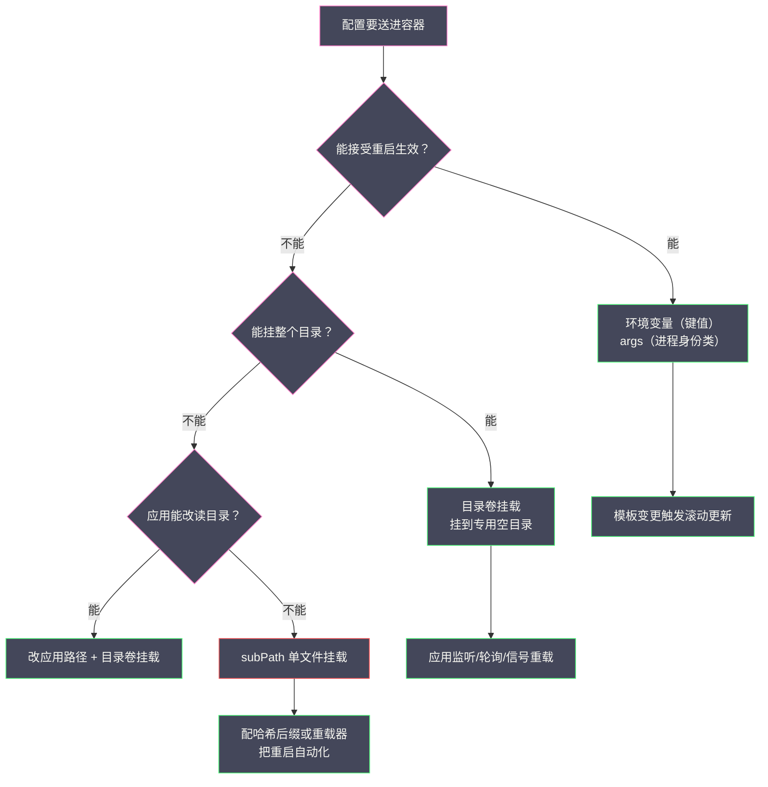
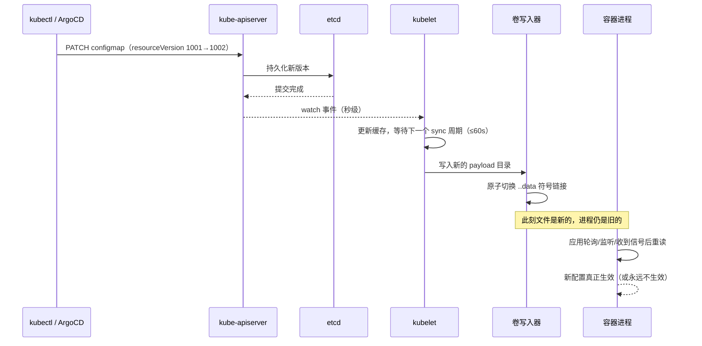
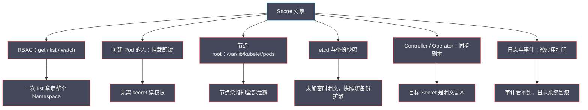
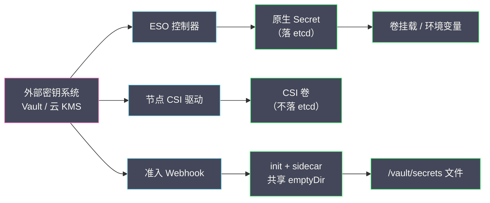
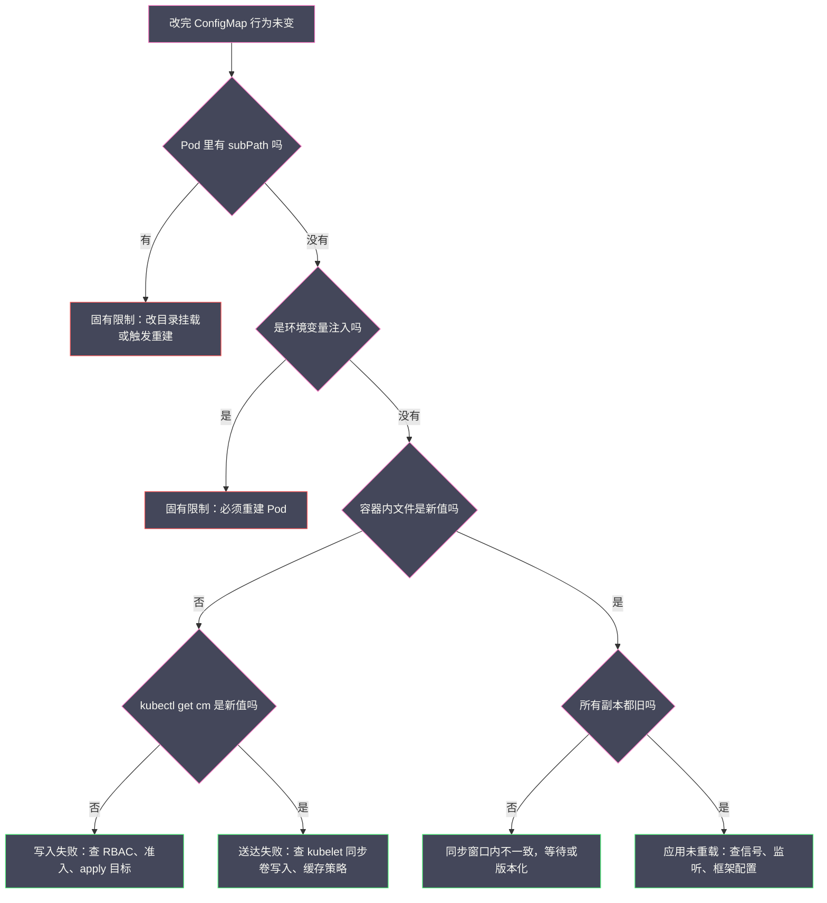

# 02 配置管理——ConfigMap Secret 与外部密钥

**摘要：**

2016 年 3 月 Kubernetes 1.2 发布时，发布说明里有一句不太起眼的描述：动态配置可以通过 ConfigMap API 提供，让应用在运行时拉取配置，而不是在构建时塞进镜像。这句话后来被概括成"配置与代码分离"，写进了十二要素应用（Twelve-Factor App）的第三条。但它实际改变的不只是文件存放位置，而是责任边界：镜像由流水线产出、有版本号、跑过测试，而配置由任何持有写权限的人在任意时刻改动，既不经构建，也不经测试。配置管理在生产中的难点因此并不在"存"——ConfigMap 与 Secret 的 schema 简单到几乎没有可讨论的余地——而在"送达"与"边界"：一条变更要经过 API Server、etcd、kubelet 缓存、卷插件、容器文件系统五段路才抵达进程，中间任何一段都可能把它丢掉、延后或送错形态；而 Secret 一旦被创建，它的读取面远远超出"谁能 kubectl get"这一个维度。

本文以一套中等规模的电商订单与支付域集群为贯穿案例，回答三个问题：四种注入方式（环境变量、卷挂载、命令行参数、subPath）各自在哪里失效；从 `kubectl apply` 到应用进程真正读到新值，中间的真实时序有多长、卡在什么地方；以及 Secret 的安全边界与外部密钥系统（External Secrets Operator、Secrets Store CSI Driver、Vault Agent 注入）的接入代价该怎么算。文中不展开 etcd 静态加密的实现与 API Server 的认证授权链，那些属于机制层的拆解，读者可按双链跳转。

---

## 第 1 章 配置成了唯一没人测试的代码

### 1.1 一次没有经过构建的变更

笔者维护的这套集群有 40 个节点、约 700 个 Pod、90 余个微服务，开发、预发、生产三套环境共用同一份配置仓库，每周的配置变更在 20 到 40 次之间。近两年复盘下来，与配置相关的线上问题在数量上超过了镜像本身引发的问题，而它们有一个共同的形状：变更确实写入了 etcd，`kubectl get configmap` 显示的就是新值，但服务的行为没有变，或者只有一部分副本变了。

这种故障之所以难排查，是因为它不报错。镜像构建失败会红，Pod 起不来会 CrashLoopBackOff，探针失败会被摘流量，而"配置送达失败"是静默的——API Server 认为写入成功，kubelet 认为挂载完好，容器里的进程照旧跑着，一切健康检查都是绿色的。等到业务指标出现偏差，中间已经过去了几个小时。

### 1.2 一条配置的四段旅程

下图把配置从仓库到进程的路径摊开，每一段都有自己的失效方式。


第一段是写入，失败的表现是准入拒绝（名称不合规、键名含非法字符、超过 1 MiB 上限）；第二段只有 etcd 可用性一个变量，通常不成为问题；第三段是 watch 通知，缓存策略决定了它是秒级还是分钟级；第四段是卷插件把内容落到节点磁盘并切换符号链接，这一段对 subPath 挂载直接失效；第五段是容器拿到的形态，环境变量在这一段被固化成一份快照，之后无论如何重新同步都改不了它。

把这条链记住，后面所有故障都可以归位：新值没写进去、写进去了但没通知到节点、通知到了但文件没换、文件换了但进程没重读、进程重读了但形态本来就不支持更新。

### 1.3 四种失效形态

配置问题按成因可以分成四类，它们需要的治理手段完全不同，混在一起谈就会得出"上 Vault 就好了"这类错误结论。

| 形态 | 典型成因 | 表现 | 治理手段 |
| :--- | :--- | :--- | :--- |
| 写错 | 键名拼错、缩进破坏 YAML、单位写错（`500` 而非 `500m`） | 启动失败、行为异常但健康检查通过 | 提交前 lint 与 schema 校验、dry-run |
| 漂移 | 有人 `kubectl edit` 改了线上，Git 里没变 | 下次同步被改回，或环境之间行为不一致 | 配置进 Git、GitOps 收敛、漂移告警 |
| 泄漏 | 凭据写进 ConfigMap、日志打印、Git 提交明文 | 短期无感知，长期是审计发现项 | Secret 与 RBAC、外部密钥、日志脱敏 |
| 过期 | 凭据轮换后未同步，证书到期 | 间歇性认证失败、TLS 握手失败 | 短生命周期凭据、轮换与刷新机制 |

四类里只有第一类能靠评审发现，后三类都必须靠机制：漂移靠"唯一真相来源"，泄漏靠"读权限收敛"，过期靠"自动轮换"。这也是后文为什么把配置版本化和外部密钥放在一起讲——它们解决的是不同的问题，但都要求把配置从"随手改的资源"变成"有出处、有版本、有生命周期的对象"。

---

## 第 2 章 四种注入方式

### 2.1 环境变量：进程启动那一刻的快照

环境变量的语义在操作系统层面就已经定死了：`execve` 把一份环境区复制给新进程，此后进程内看到的 `environ` 与父进程再无关联。Kubernetes 只是在这份环境区里多填了几个键——kubelet 在创建容器时把 `valueFrom` 解析成具体字符串，写进 OCI 运行时规格，容器运行时执行 `execve` 之后就与 ConfigMap 脱钩了。

由此可以推出三个必然结论。第一，改 ConfigMap 不会改变任何已运行容器里的环境变量，无论等多久。第二，想让新值进入进程，**只能重建容器**，也就是让 Pod 的模板发生变化、由控制器创建新的 Pod。第三，`envFrom` 与 `env` 的合并有明确顺序：`envFrom` 先展开，`env` 后写入，同名时 `env` 覆盖 `envFrom`，这个顺序常被用来做"共享一份配置、个别键在 Pod 里覆盖"。

另外两个细节值得单独记。其一，被 `envFrom` 引入的键必须符合环境变量名的规则，首字符是数字（譬如 `2fa_enabled`）会被 kubelet 跳过，并在 Pod 上产生一条 `InvalidVariableNames` 事件——不会失败，只是少了一个变量，应用读到空值后用自己的默认值继续跑，这类问题极难发现。含点号或横线的键（`log.level`、`log-level`）在 ConfigMap 里合法，不少运行时也照样接受，但 shell 里无法用 `${}` 引用，跨语言时极易踩坑，惯例统一用下划线。其二，`envFrom` 引用的 ConfigMap 不存在时，Pod 会停在 `CreateContainerConfigError` 而不是启动失败，`kubectl describe pod` 的事件里能看到 `configmap "xxx" not found`；加 `optional: true` 可以让它被跳过，代价是把"配置缺失"从启动期错误变成了运行期空值。

环境变量真正的优势是简单：几乎所有语言和框架都原生支持，不需要应用做任何改造。它的代价是每次配置更新都要重建 Pod，而重建在长连接服务上是可见的业务抖动。

### 2.2 卷挂载：文件、符号链接与目录覆盖

卷挂载把 ConfigMap 的每个键变成一个文件，键名就是文件名。这条路径的更新能力来自 kubelet 的原子写入器（atomic writer）：它在卷目录里创建 `..<时间戳>` 子目录写入新内容，把 `..data` 这个符号链接原子地指向新目录，目录里每个键则是指向 `..data/<key>` 的符号链接。读者要么看到整套旧文件，要么看到整套新文件，不会读到写了一半的内容。

这个结构带来两个必须提前知道的行为。其一是**目录整体覆盖**：卷挂载是 bind mount，不是合并。把 ConfigMap 挂到 `/etc/nginx` 会让镜像里原有的 `nginx.conf`、`mime.types` 全部被隐藏，容器启动时报 `open /etc/nginx/nginx.conf: no such file`。所以惯例是挂到镜像里本来为空的专用目录，譬如 `/etc/app/conf`，再让应用把配置路径指过去。

其二是 `items` 的白名单语义：一旦写了 `items`，只有列出的键会被投影到卷里，未列出的键即使存在于 ConfigMap 也不会出现；`path` 字段可以带子目录，从而把扁平键铺成目录树。这条特性常被用来只投影几个必要文件，避免把整份配置暴露给容器。

文件权限是另一个高频坑。ConfigMap 与 Secret 卷的默认 `defaultMode` 是 `0644`，属主为 root；容器以非 root 用户运行时，若把 Secret 设成 `0400`，应用会读不到文件（`permission denied`）。实践中更常见的做法是保持 `0444` 这类人人可读的模式，把"谁能读"交给容器与 Pod 的隔离，而不是文件权限位——在单容器 Pod 里，文件权限位几乎不提供额外保护。

### 2.3 命令行参数：最不该走的一条路

把配置写进 `command` 或 `args`，本质上与写进镜像没有区别：它们是 Pod 模板的一部分，改一次就要改模板、触发一次滚动更新。Kubernetes 支持在 `args` 里用 `$(VAR_NAME)` 引用同一容器内的环境变量，这看起来提供了一条"从 ConfigMap 到参数"的通路，但展开同样只发生在容器创建时，热更新依然不存在。

比"不更新"更严重的是暴露面。进程的命令行对同节点任何有权限的用户可见（`ps aux`，以及 `/proc/<pid>/cmdline`），会出现在 Pod 规约、`kubectl get pod -o yaml`、审计日志与事件里。把数据库密码拼进 `args`，等于把凭据写进了三四个本不该有它的地方；即使改用环境变量注入，`/proc/<pid>/environ` 也仍然是同用户可读的。

命令行参数适合传递真正属于"进程身份"的东西，譬如启动模式、监听端口、角色标识——它们在语义上不该在运行期变化。

### 2.4 subPath：绑定到 inode 的那一刀

`subPath` 解决的是一个真实问题：应用只接受从固定路径读单个文件，譬如 `/etc/app/application.yaml`、`/etc/nginx/nginx.conf`、`/etc/ssl/certs/ca.crt`，而这个文件必须来自 ConfigMap 或 Secret，同时不能把整个目录覆盖掉。写法是把卷的挂载点指向文件本身并声明 `subPath`。

```yaml
spec:
  containers:
    - name: app
      volumeMounts:
        - name: app-file
          mountPath: /etc/app/application.yaml
          subPath: application.yaml      # 只挂这一个文件
          readOnly: true
  volumes:
    - name: app-file
      configMap:
        name: app-config
```

它解决的问题是真的，代价也是真的：这个文件从此不再更新。机制细节与判定方法留到第 4 章单独讲，这里只需要记住一条判据——Pod 规约里出现 `subPath`，这个挂载点就应当被默认视为"只读一次"。

### 2.5 一张表与一棵决策树

把四种方式放在一张表里，差别集中在三列：能否更新、更新多久到达、暴露面多大。

| 注入方式 | 运行期可更新 | 到达进程的形态 | 生效条件 | 主要风险 |
| :--- | :--- | :--- | :--- | :--- |
| 环境变量 | 否 | `execve` 时的环境区副本 | 重建 Pod | 大值膨胀、非数字开头键被跳过、`/proc` 可读 |
| 卷挂载（目录） | 是 | 文件，符号链接指向 `..data` | kubelet 同步加应用重读 | 目录整体覆盖、跨对象非原子 |
| 命令行参数 | 否 | 进程命令行 | 改模板并滚动更新 | 出现在 `ps`、Pod 规约、审计日志 |
| `subPath` 挂载 | 否 | 具体 inode 的 bind mount | 重建 Pod | 文件看起来在挂载点、内容永远旧 |

选择顺序可以按下面的树走：先问"配置能不能接受重启生效"，能接受就用环境变量或参数，简单且不需要应用配合；不能接受则必须走目录挂载，并且接受"应用要自己重读文件"这个前提；如果应用只认固定文件路径又改不动，落到 `subPath`，再用第 6 章的哈希后缀或重载器把"重启"自动化。



---

## 第 3 章 热更新的真实时序

### 3.1 一条变更的完整旅程

"改完 ConfigMap 大约一分钟生效"这句话在多数集群里是错的，它把**两个互不相关的延迟**混在了一起：kubelet 把新内容写进卷的延迟，以及应用发现文件变了并重读的延迟。前者由集群侧决定，后者完全由应用决定，而后者经常是无穷大。

下图给出一次变更从写入到进程生效的完整时序，注意最后两步之间没有任何机制保证。



按这条链推算端到端延迟，可以分成三段做示例估算：watch 事件传播通常在一秒到数秒之间；kubelet 的周期同步最坏要一个完整周期，默认 `syncFrequency` 为 1 分钟；应用侧若每 30 秒轮询一次文件，最坏再加 30 秒。三段相加最坏约 95 秒，常见区间在 20 到 70 秒。这是一个示例推算，实际值取决于 kubelet 配置、节点负载与应用的轮询间隔，但它足以说明"改完立刻验证"这个动作在时序上根本不成立。

### 3.2 两个默认值决定上限

控制这段延迟的是 kubelet 侧的两个配置项，它们决定了**最坏情况而非平均值**。

`syncFrequency` 是 kubelet 同步运行中容器与配置的最大周期，默认 1 分钟。它决定了 kubelet 多久检查一次卷内容是否需要刷新，是延迟的硬上限之一。

`configMapAndSecretChangeDetectionStrategy` 决定 kubelet 如何得知对象变了，有三个取值：`Watch` 用 watch 观察它关心的对象，是默认值；`Cache` 使用带 TTL 的缓存，延迟等于缓存有效期；`Get` 每次直接向 API Server 请求，没有缓存。三者是一组明确的取舍——`Watch` 在延迟与 API Server 负载之间最平衡，`Get` 的时效最好但把每次同步都变成一次 GET 请求，`Cache` 居间。

`Get` 的代价可以用算术看清：40 个节点，每个节点上平均 17 个 Pod，每个 Pod 引用 2 个 ConfigMap 或 Secret，即每节点约 35 个对象；按 60 秒同步周期算，额外请求约 40 × 35 ÷ 60 ≈ 23 QPS，且这个数字与节点数、Pod 密度、对象数成正比。这还是一组示例推算，但方向是确定的：`Get` 在大集群上会把 watch 压力换成 API Server 的线性请求压力，不可变对象甚至可以完全不进这个循环，这也是它在规模化集群里被反复推荐的原因。

### 3.3 符号链接切换的三个坑

原子写入器用符号链接换目录，这个设计在文件系统层面是干净的，但对"监听文件变化"的应用来说有三个具体的坑。

第一，监听跟随的是 inode，不是路径。如果应用用 inotify 监听 `/etc/app/conf/application.yaml` 这个具体文件，内核实际注册的是解析后 `..<时间戳>/application.yaml` 那个 **inode**。下一次更新把 `..data` 指向新目录后，旧 inode 被删除，监听器收到的是删除或失联，而不是"内容变化"；此后文件再更新它也不会收到通知。正确做法是监听父目录、或者监听 `..data` 链接本身的变化，并在收到事件后重新打开文件。

第二，只跟旧文件不放手的读取者会一直读旧内容。`tail -f` 这类工具跟随的是已打开的 inode，切换后不会自动跟到新文件，`tail -F`（大写）才会重新打开。同理，把日志或证书文件用 `tail -f` 送进 sidecar 的做法在轮换后就会停在旧内容上。

第三，多文件之间没有事务。同一个卷内所有文件来自同一次写入，版本一致；但两个不同 ConfigMap 挂到两个目录时，它们各自独立更新，应用可能在某一瞬间读到旧目录里的 a 和新目录里的 b。把一份有内部约束的配置拆成两个对象，等于引入了一个短暂的不一致窗口。

还有一个容易被忽略的细节：`..data` 的时间戳目录名每次更新都会变，靠 `find -newer` 或文件时间戳做变更检测的脚本会把整目录当成"全部新文件"，触发不必要的全量重载；靠 `realpath` 或绝对路径做缓存键的应用则可能因为路径变化而丢弃缓存。

### 3.4 应用侧：reload 才是最后一公里

kubelet 把文件换掉之后，进程是否重读，取决于应用的实现。常见的有四类。

启动时读一次，是最普遍的做法（Spring Boot 的 `application.yaml`、大多数 Go 服务的初始化流程），这类应用天然不支持热更新，文件换了也不会看。收到信号重读（`SIGHUP`）是 Nginx、部分 Java 服务的做法，需要运维知道该给哪个进程发信号，而容器里通常只有一个进程，`kubectl exec` 进去 `kill -HUP 1` 可行但不适合自动化。框架级监听（Log4j2 的 `monitorInterval`、部分配置中心客户端的重连机制）能在秒级感知，但要注意它们多数也是基于文件监听，会踩上面第一条的坑。每次请求读一次，行为上最实时，但在高 QPS 下会引入显著的系统调用开销，而且读到的多文件之间可能不是同一版本。

框架能力可以借助配置中心规避：Spring Cloud Kubernetes 的 ConfigMap 支持、Apollo 与 Nacos 的客户端，本质都是把"文件变更"换成"长轮询或推送"。代价是引入一个新的依赖与一套新的故障模式，对 90 个微服务的集群来说，这是一次需要统一决策的选型，而不是可以逐个服务自由发挥的细节。

### 3.5 重建派与热更派

把"文件换了"翻译成"进程读到了"，有两条路。

**热更派**让应用自己重读，优点是不重建 Pod、不打断连接、不重新拉镜像；代价是每个服务都要正确实现监听逻辑，且难以统一验证——你无法从集群侧确认"这个服务真的重载了"。

**重建派**让配置变更等价于一次滚动发布，常用手段是给 Pod 模板加一个由配置内容算出的 annotation（Helm 的 `checksum/config`），或者用工具监听 ConfigMap 变化后修改 Deployment 的 annotation（Stakater 的 Reloader 属于这一类）。它的优点是行为确定、可回滚、可在发布流水线里观察；代价是每次配置变更都要重新拉镜像、重启进程、重建连接池，变更频繁时发布噪声很大。

两派的分界线是变更频率与业务容忍度：一周改几次的配置，重建派更省心；一天改几十次的开关类配置，热更派更合适，但这类配置通常不应该放在 ConfigMap 里逐条修改，而应该走配置中心或特性开关系统。

> [!warning] 热更新的爆炸半径与传播速度成正比
> 目录挂载的热更新会在一个同步周期内把新配置铺到所有副本上，这既是优点也是风险：如果新配置本身有语法错误或语义错误，它会在几十秒内同时作用于全部副本，没有任何灰度环节，也没有"先起一个看看"的机会。热更新要求配置在写入前就经过校验（CI 里跑配置 lint、`kubectl apply --dry-run=server`），不能依赖"改坏了再回滚"。

---

## 第 4 章 subPath：最常见的那个坑

### 4.1 为什么需要它

subPath 的存在是因为应用对路径有硬编码的预期。Nginx 只从 `/etc/nginx/nginx.conf` 启动，Java 应用习惯读 `/etc/app/application.yaml`，TLS 库只认 `/etc/ssl/certs/ca.crt`。把整个 ConfigMap 挂到这些目录上会覆盖目录里其余的镜像内容，而不挂又没法把外部配置送进去，subPath 就是这个夹缝里的产物。

它常出现在三类位置：覆盖单个配置文件、注入单个证书或密钥文件、把 `.dockerconfigjson` 送进需要它的目录。三类场景的共同点是"只替换一个文件"，这恰好也是热更新能力被放弃的地方。

### 4.2 为什么它不更新

理解这一点要先看清 bind mount 的粒度。普通卷挂载把节点上的卷目录 bind mount 到容器路径，容器看到的是目录本身，目录里的符号链接会随 `..data` 切换而指向新内容。subPath 挂载走的是另一条路：kubelet 把卷目录下的某个具体路径再 bind mount 一次到容器里的目标文件，而那个路径在解析时指向了 `..<时间戳>/application.yaml` 这个具体 inode。

于是更新流程变成：kubelet 写入新目录、切换 `..data` 链接、删除旧目录。容器这一侧的 bind mount 仍然指向旧 inode——这个 inode 因为仍被挂载引用而不会被真正释放，内容也就永远是旧的。宿主机上卷目录里的文件已经是新的，容器里的那一份是另一份数据。Kubernetes 官方文档对此的表述很直接：以 subPath 方式使用 ConfigMap 或 Secret 的容器不会收到更新。

这不是实现疏漏，而是取舍。单文件 bind mount 之后没有"切换符号链接"这一层可以借用，要换内容必须卸载再挂载，而卸载会破坏运行中进程对文件的引用（尤其是用 mmap 打开的文件）。`subPathExpr` 同样不支持更新，它只是把 subPath 的值从环境变量求值而来，而环境变量本身在容器创建时就固定了。

### 4.3 怎么在十分钟内判定

判定这类问题的关键是分清"新内容没送到节点"和"送到了但容器拿的是旧 inode"。前者要查 kubelet 与卷写入，后者是 subPath 的固有行为。下表给出可执行的判据。

| 检查点 | 命令 | 结论 |
| :--- | :--- | :--- |
| 对象是否已更新 | `kubectl get cm app-config -o yaml` | 与仓库比对，确认写入成功 |
| 容器内文件是否为旧值 | `kubectl exec <pod> -- sha256sum /etc/app/conf/application.yaml` | 与下面一行比对 |
| 期望内容的摘要 | `kubectl get cm app-config -o jsonpath='{.data.application\.yaml}' \| sha256sum` | 两个摘要不同即送达失败 |
| 挂载点形态 | `kubectl exec <pod> -- ls -l /etc/app/conf` | 有 `..data` 符号链接是目录卷；单文件无链接多为 subPath |
| 节点上的卷内容 | 节点上查看 `/var/lib/kubelet/pods/<uid>/volumes/kubernetes.io~configmap/app-config/` | 这里是新内容而容器是旧值，基本可以定性 |
| subPath 挂载记录 | 节点上 `/var/lib/kubelet/pods/<uid>/volume-subpaths/` | 出现该目录项即说明用了 subPath |

两步摘要比对是最省时间的办法：容器内 `sha256sum` 与 `kubectl get cm` 的输出比对，若不一致，问题在集群侧；若一致而行为没变，问题在应用侧没重读。这一个判断能把排查范围立刻减半。

### 4.4 四种处置

确认是 subPath 之后，可选的处置有四条，按改造成本从低到高排列。

第一，**改挂目录**。把挂载点从文件改成目录（`mountPath: /etc/app/conf`），应用配置路径同步改为该目录下的文件名。这要求应用能改配置路径，通常只需改一个启动参数或一行配置，是最彻底的方案。

第二，initContainer 加 emptyDir。用 init 容器把 subPath 下的文件复制到 emptyDir，应用从 emptyDir 读。它在 Pod 启动时生效，运行期仍不更新，但拿到了"每次重启都读最新值"的确定性，而且不再受 subPath 的挂载语义限制。适合配置结构复杂（多个文件、子目录）而应用只认固定目录的场景。

第三，接受不热更新，把重启自动化。用 Reloader 或哈希后缀让配置变更触发滚动更新，本质是把"热更新"这个需求降级成"发布"。这是多数团队的真实选择，也是笔者倾向的方案：它牺牲了秒级生效，换来了版本一致、可回滚、可观察。

第四，换载体。把这类配置从 ConfigMap 迁到配置中心（Apollo、Nacos）或特性开关服务，由客户端长轮询推送。代价是新依赖与新故障模式，收益是配置文件不再是部署单元的一部分。

> [!info] 一条经验规则
> 只要 Pod 规约里出现 `subPath`，就把这个挂载点当作"启动时读一次"来设计，并把对应的配置变更纳入发布流程。反过来，如果某个配置确实需要运行期生效，就不要用 subPath 挂它——这两件事在 Kubernetes 里是互斥的，靠加参数、换版本都绕不过去。

---

## 第 5 章 Secret 的边界

### 5.1 data 与 stringData

Secret 有两个数据字段。`data` 要求值是以 base64 编码的字符串，API 读取时也只返回 `data`；`stringData` 是写入期的便利字段，接受明文，API Server 在写入时把它合并进 `data`，读取时不会再返回。同一个键同时出现在两个字段时，`stringData` 的值优先。

这个设计带来一个实用分工：仓库里手写的清单用 `stringData`（可读、可评审、便于 diff），落库后自动变成 `data`。但要注意两点：`stringData` 只是免去手工编码，不是加密，任何人 `kubectl get secret -o yaml` 之后一次 base64 解码就能拿到明文；`kubectl apply` 时若清单里同时保留了旧的 `data` 与新的 `stringData`，冲突由 `stringData` 胜出，这个规则在排查"为什么改的值没生效"时值得先确认一下。

base64 编码本身不提供任何保密性，它存在的理由是让 Secret 能携带二进制内容（TLS 证书、密钥文件）。真正意义上的静态保护是 etcd 侧的加密与 KMS Provider，那属于存储层的机制，实现细节在 [[云原生/Kubernetes/Kubernetes架构深度剖析/16 生产化集群管理：多租户隔离、资源治理与安全加固]] 与 [[云原生/Kubernetes/Kubernetes架构深度剖析/07 etcd 深度剖析：Raft 共识、MVCC 与 Watch 机制]] 里有完整拆解。本文关心的是另一个维度：对象被正确加密之后，它仍然会被很多人读到。

### 5.2 真正的风险是谁能读

把 Secret 的读取面画出来，会发现 etcd 只是其中一个入口，而且往往不是最容易被利用的那个。



RBAC 的粒度与它的提权面在 [[云原生/Kubernetes/Kubernetes架构深度剖析/05 认证、授权与准入控制：K8s 的安全三级防线]] 里有完整拆解，落到 Secret 上只剩一个后果：`get` 是读一个，`list` 是一次拿走整个 Namespace 的所有 Secret，`watch` 更彻底，它会在建立连接后持续收到变更。给一个 ServiceAccount 授予 `list secrets` 权限，等价于给它该 Namespace 全部凭据的永久读取权。审计日志会记录"谁在何时读了哪个 Secret 对象"，但不记录读了哪个键、也不记录值，所以它能事后追溯，不能阻止泄漏。

### 5.3 创建 Pod 就等于能读 Secret

这是最容易被忽略的一条边界：kubelet 以节点身份读取 Secret 并挂载，**创建 Pod 的人**不需要任何 Secret 读权限，只要知道 Secret 的名字，就可以在自己的 Pod 里挂载它。

```yaml
# 只有 create pods 权限的账号也能这样拿到同 Namespace 的任何 Secret
spec:
  containers:
    - name: dump
      image: busybox
      command: ["sh", "-c", "cat /x/password"]
      volumeMounts:
        - name: x
          mountPath: /x
  volumes:
    - name: x
      secret:
        secretName: db-credentials
```

后果是权限模型上的一个等式：在同一个 Namespace 内，**创建 Pod 的权限约等于读 Secret 的权限**。多团队共享 Namespace 时，这条等式会把"只给开发一个调试权限"变成"给了全部凭据"。缓解手段有三类：按团队拆 Namespace 并把 Secret 放在各自 Namespace；用准入策略限制 Pod 能引用的 Secret 白名单（Kyverno、OPA Gatekeeper 都能表达）；对不需要访问 API 的工作负载关掉 `automountServiceAccountToken`，减少凭据本身的暴露面。

同一条链上还有更狠的一档：能创建带 `hostPath` 的 Pod 就能读节点上所有 Pod 的挂载目录，包括 kubelet 写下的所有 Secret 卷。这条路径只有在 Pod 安全准入（Pod Security Admission 的 restricted 级别或等价策略）拦掉 hostPath 之后才被堵住，仅靠 RBAC 收 Secret 权限是堵不住的。

### 5.4 文件权限与挂载方式

Secret 卷的默认模式是 `0644`，与 ConfigMap 相同。把 `defaultMode` 收紧到 `0400` 看起来很安全，实际效果取决于容器以什么用户运行：属主是 root 时，非 root 进程连自己的配置都读不到，服务直接起不来。若确实需要"只有属主可读"，要么让容器以 root 运行（安全上得不偿失），要么用 `0440` 配合组权限，而卷的属组行为在不同版本与不同卷类型上有过差异，落地前应当在目标集群上实际验证一次，不要照抄文档。

用环境变量注入 Secret 的问题在暴露面而不在权限位：环境变量会进入 `/proc/<pid>/environ`、可能进入崩溃转储（core dump）、会被某些框架在启动日志里整体打印。卷挂载至少把内容限制在一个文件里，日志泄漏的概率低一些。两者都比"把凭据拼进命令行"要好，原因见第 2 章。

### 5.5 immutable：把配置当工件

给 ConfigMap 或 Secret 加 `immutable: true`（1.19 引入，1.21 起稳定），对象创建后内容不可修改，任何修改请求都会被 API Server 以字段不可变的错误拒绝。

收益有三层。性能上，kubelet 不再 watch 不可变对象（watch 机制本身见 [[云原生/Kubernetes/Kubernetes架构深度剖析/06 List-Watch 与 Informer：K8s 的分布式神经系统]]），大规模集群里这能显著降低 API Server 的 watch 连接数与序列化开销，前面算过的那 23 QPS 也一并省掉。安全上，误改线上配置这条路被直接堵死，改动必须走"新建对象"的流程，天然留下版本痕迹。工程上，它把配置变成了**不可变工件**，与镜像的语义对齐：同一个名字永远对应同一份内容，回滚就是切引用。

代价同样明确：不能改，也不能"改回去"，只能删了重建；删除正在被引用的不可变 ConfigMap 会让新 Pod 起不来（已在运行的 Pod 不受影响，但扩容与重建会失败）；引用它的 Pod 模板不变，所以重建对象本身不会触发任何滚动更新，需要配合名称变更。

### 5.6 类型与强制键

Secret 的 `type` 不只是标签，内置类型会对必须存在的键做校验，缺失时 API Server 直接拒绝创建。这张表在排查"Secret 建不出来"和"镜像拉不动"时最有用。

| 类型 | 必须包含的键 | 用途 | 常见误用 |
| :--- | :--- | :--- | :--- |
| `Opaque` | 无 | 自定义键值对 | 把 TLS 证书塞进来，绕过了类型校验 |
| `kubernetes.io/tls` | `tls.crt`、`tls.key` | Ingress 与 TLS 终止 | 链证书顺序错误导致握手失败 |
| `kubernetes.io/dockerconfigjson` | `.dockerconfigjson` | 镜像仓库认证 | 键名漏掉前导点，或类型写成 `Opaque` 失去校验 |
| `kubernetes.io/basic-auth` | `username`、`password` | HTTP Basic 认证 | 密码里含特殊字符未转义 |
| `kubernetes.io/ssh-auth` | `ssh-privatekey` | SSH 公钥认证 | 私钥带 passphrase，运行时无法解锁 |
| `kubernetes.io/service-account-token` | 由控制器填充 | 旧版 SA Token | 1.24 起不再自动创建，手写此类型多为历史遗留 |

`.dockerconfigjson` 那一行值得展开：Secret 里存的是 `~/.docker/config.json` 的序列化内容，其中的 `auth` 字段是 base64 的用户名密码，官方文档对此有一句很直白的提醒——任何能读这个 Secret 的人都能拿到仓库的访问令牌。所以拉镜像用的凭据与业务凭据应当分对象管理，只挂给需要拉镜像的 ServiceAccount，不要顺手塞进业务 Secret 里。

### 5.7 静态 Pod 的另一条路

有一条容易踩空的分支：静态 Pod 不能使用 ConfigMap 与 Secret。kubeadm 部署的控制平面组件（`kube-apiserver`、`kube-controller-manager`、`kube-scheduler`、`etcd`）都是以静态 Pod 形式运行的，它们的配置来自 `/etc/kubernetes/manifests/` 下的清单文件，改配置等于改节点上的文件，由 kubelet 检测文件变化后重建 Pod。

这也解释了一个常见疑问：为什么控制平面组件的参数不能用 ConfigMap 管理、也不能用热更新。它们的配置生命周期跟集群节点绑定，跟 API 对象无关。要统一管理，只能靠配置管理工具（Ansible、Cluster API）在节点层面做，而不是靠 Kubernetes 自己的配置对象——这是一个典型的"引导依赖"问题：管理 API Server 的配置不能依赖 API Server。

---

## 第 6 章 配置版本化：当代码管还是当资源改

### 6.1 两种做法

配置进入集群之后，有两种截然不同的管理方式。

当资源改：直接对集群里的 ConfigMap 执行 `kubectl edit`、`kubectl patch`，或者用控制台点几下。变更即时生效、无需流水线，适合调试与紧急处置。

当代码管：配置写在 Git 仓库里，经过评审、CI 校验，由流水线或 GitOps 控制器同步到集群（工具链细节在 [[05 应用交付——Helm Kustomize 与 GitOps]] 里展开）。变更多了一道门，但获得了**版本、审计与回滚**。

两者的差别不在"方便程度"，而在三件事上：出事之后能不能说清发生了什么、能不能准确回到上一个状态、能不能发现有人绕过流程。前两件事在事故里是分钟级的差别，第三件事在合规审计里是能不能过的问题。

### 6.2 回滚能力的差异

配置回滚听起来简单——把旧值写回去就行。但"旧值"从哪来，决定了回滚是不是真的可行。

| 维度 | 当资源改 | 当代码管 |
| :--- | :--- | :--- |
| 变更审计 | API 审计日志，需要专门查询 | `git log`，附评审意见与提出人 |
| 上一个状态 | 依赖 etcd 历史与审计回放，人很难还原 | 上一个 commit，`git revert` 即得 |
| 回滚动作 | 手工写回旧值，容易写错 | 提交回滚，走同一条流水线 |
| 漂移检测 | 无，线上与仓库的差异不可见 | GitOps 控制器持续比对，差异可告警 |
| 多环境一致 | 各环境独立演化，必然分叉 | 同一 base，overlay 叠加差异 |
| 入门门槛 | 极低 | 需要仓库、流水线、评审文化 |

真正致命的差别在第四行。当资源改的集群里，配置的"当前值"只存在于 etcd，而人对它的记忆很快失效；下次流水线同步时，GitOps 会把线上被手改的值覆盖回仓库版本，这个"自愈"在事后看就是一次没有记录的回滚事故。笔者遇到过的最典型的一次，是有人为了临时放开限流 `kubectl edit` 了一个 ConfigMap，三天后 ArgoCD 自动同步把限流改回去，流量峰值时段直接触发熔断。

### 6.3 哈希后缀：把热更新换成滚动发布

Kustomize 的 `configMapGenerator` 会为生成的对象名追加内容哈希后缀，Deployment 里通过 `configMapRef` 引用的名字也随之变化，于是配置内容一改，Pod 模板就变，滚动更新自动发生。

```yaml
# kustomization.yaml
configMapGenerator:
  - name: app-config
    files:
      - application.yaml
# 生成结果：app-config-7k2m9c4f8d，内容变化时哈希随之变化
```

这个手法把"配置热更新"这个不确定的需求，转换成了**配置随发布走**这个确定的流程，收益有四个：同一 ReplicaSet 内的副本保证读到同一版本（不会出现同步时序导致的副本间不一致）；回滚配置等于回滚发布，`kubectl rollout undo` 就能退；配置变更进入发布审批与观察流程；配置历史与镜像版本一一对应，事后可复现。

Helm 的 `checksum/config` annotation 是同一思路的另一种实现：模板在渲染时对配置文件内容取校验和写进 Pod 模板，内容变了校验和就变，滚动更新被触发。区别在于 Kustomize 靠对象名变化，Helm 靠 annotation 变化——前者连对象都是新的（需要清理旧对象），后者复用对象名但换 Pod 模板。

代价也要说清：每次改配置都要重新拉镜像、重启进程，配置变更频繁时发布队列会被占满；不可变对象堆积需要定期清理（`configMapGenerator` 的旧哈希对象不会自动删除，要配 garbage collector 或定期清理脚本）。

### 6.4 灰度的可能性

热更新做不到灰度。一次 `kubectl apply` 之后，40 个节点会在一个同步周期内陆续更新，所有副本几乎同时读到新配置，没有"先让 10% 的流量试试"这个环节。

版本化的配置可以做到灰度：先把 Deployment 的引用从 `app-config-7k2m9c4f8d` 改成新哈希，滚动更新按 `maxSurge` / `maxUnavailable` 推进，新旧 Pod 在窗口内共存；配合 Argo Rollouts 这类渐进式交付工具，还能按流量比例放量并在指标异常时自动中止。这套能力的前提是配置有名字、有版本、有内容哈希，也就是前一节那套东西。

对一天改几十次的开关类配置，这套流程太重了。这类配置不该走 ConfigMap，而该走特性开关系统（Feature Flag），它的语义是"运行期可切换的业务决策"，与"部署单元的配置"是两类东西，混在一起会让两者都变差。

### 6.5 热更新带来的副本间不一致

即便接受热更新，也要接受一个事实：在 kubelet 同步的那个窗口里，同一个 Deployment 的不同副本会读到不同版本的配置。40 个节点依次同步，窗口最长可达一个 `syncFrequency`（默认 1 分钟）；如果应用的重读时机各不相同，不一致窗口还会更长。

大多数场景下这没有问题——日志级别、缓存 TTL 这类配置容忍短暂不一致。但涉及协议版本、序列化格式、开关阈值的配置就不行：一半副本按旧阈值限流、一半按新阈值，压测与容量规划都会算不准；灰度期间新旧副本的差异会被误判成"灰度效果"。

判断标准很直接：如果两个副本读到不同值时业务语义会矛盾，这类配置就必须版本化并随发布走；如果只是效率参数，热更新完全可以接受。

---

## 第 7 章 外部密钥：三种接入模式

### 7.1 原生 Secret 的三处不足

原生 Secret 在多数团队够用：有 RBAC、有 Namespace 隔离、可以开启静态加密、可以卷挂载热更新。它缺的是三样东西。

**轮换**。改 Secret 之后，用环境变量注入的 Pod 不会更新，用卷挂载的 Pod 文件会更新但应用未必重读；数据库连接池这类有状态资源还会继续用旧密码建立的连接，直到下一次重连才暴露问题。轮换在原生 Secret 里是一次需要人工编排的发布，不是一次自动动作。

**审计**。API 审计能记录"谁读了 Secret 对象"，但回答不了"这个应用什么时候用了这个凭据、用了哪一次签发"。密钥管理系统的审计粒度是"某身份在某时间获取了某路径的凭据"，这是完全不同的信息。

**动态凭据**。数据库临时账号、短期云凭证、短期证书这类东西无法预先写进 Secret，它们需要按需签发、自动过期。原生 Secret 是一个静态存储，没有签发能力。

三处不足对应三类需求，也对应外部密钥系统的三种接入形态。它们的差别不在"哪个更安全"，而在密钥在什么位置被解密、由谁负责把它送进 Pod、以及引入了哪个新的**故障域**。

### 7.2 模式一：控制器同步

External Secrets Operator（ESO）把外部密钥系统里的内容同步成原生 Secret。声明一个 `ExternalSecret`，指定来源与目标，控制器按 `refreshInterval` 周期拉取并更新目标 Secret。

```yaml
apiVersion: external-secrets.io/v1
kind: ExternalSecret
metadata:
  name: db-credentials
spec:
  refreshInterval: 5m
  secretStoreRef:
    name: vault-backend
    kind: SecretStore
  target:
    name: db-credentials
  data:
    - secretKey: password
      remoteRef:
        key: production/mysql
        property: password
```

这条路径的关键特征是：密钥最终仍然落在 etcd 里的一个原生 Secret 上。所以它继承原生 Secret 的全部读取面（RBAC、节点、备份），只是把"写 Secret"这个动作从人手里交给了控制器，并附带了轮换能力。

热更新能力完全取决于下游形态：ESO 更新了 Secret 之后，用卷挂载的 Pod 能在下一个同步周期看到新文件（仍需应用重读），用环境变量注入的 Pod 什么都不会发生。这一层是 ESO 无法越过的，它只负责把新值写进集群。

新引入的单点是一个控制器 Deployment：它挂了不会让正在运行的服务失联（Secret 还在集群里），但轮换会停、新 Namespace 无法引导、新建的工作负载可能起不来。这个组件值得至少两副本并配 PodDisruptionBudget，且 SecretStore 的后端认证（云上多用 IRSA 或 Workload Identity，Vault 多用 Kubernetes 认证）要纳入监控——认证过期时 ESO 的日志只会给出 `ExternalSecret` 的 `SecretSyncedError` 条件，不盯着看就发现不了。

外部依赖的维护风险也应当计入。2025 年 8 月，ESO 曾因维护人力不足暂停全部发布与支持，随后在社区推动下转入 CNCF 孵化并补充了维护者。一个承担全集群凭据同步的组件，其上游活跃度是选型时必须评估的项，而不是安全的加分项。

### 7.3 模式二：CSI 挂载

Secrets Store CSI Driver 走的是另一条路：密钥不经过 etcd，由节点上的 CSI 驱动在 Pod 启动时向外部系统取回，作为卷挂载进容器。声明方式是 `SecretProviderClass`，Pod 里引用它作为 CSI 卷。

```yaml
apiVersion: secrets-store.csi.x-k8s.io/v1
kind: SecretProviderClass
metadata:
  name: vault-db
spec:
  provider: vault
  parameters:
    vaultAddress: "https://vault.example.com"
    roleName: "app-orders"
    objects: |
      - objectName: "password"
        secretPath: "secret/data/production/mysql"
        secretKey: "password"
```

它的优势是明确的：密钥不落 etcd，因此 RBAC、etcd 备份、节点上的静态存储这几个泄漏面同时消失；取回凭据的身份是 Pod 的 ServiceAccount（通过 Vault 的 Kubernetes 认证或云上的工作负载身份），粒度是"这个工作负载能取哪些键"，比"这个账号能读哪些 Secret"更贴近最小权限。

代价同样明确。每个节点上多一个 CSI 驱动的 DaemonSet，它是新的故障域：驱动异常时，需要挂载密钥的新 Pod 会卡在 `ContainerCreating`，已有的 Pod 不受影响，但任何重建都会失败。取不到密钥时 Pod 直接启动失败，这是安全上正确的 fail-closed 语义，运维上的含义是外部密钥系统的可用性直接决定集群的启动能力。轮换依赖驱动的轮询（`rotationPollInterval`），而轮换后的新文件仍需应用重读，这一层与卷挂载完全一样。

这条路径还要求改造 Pod：加卷、加 `volumeAttributes`、给 ServiceAccount 配好认证绑定。对已经跑起来的 90 个服务逐个改造，工作量不小，通常的做法是只对新增服务强制、存量服务按轮换周期逐步迁移。

### 7.4 模式三：Agent 注入

Vault Agent Injector 用准入 Webhook 在 Pod 创建时注入两个容器：一个 init 容器负责取回凭据并渲染模板，一个 sidecar 持续运行以维持租约与重新渲染。业务容器与它们通过共享的 emptyDir 交换文件，默认落在 `/vault/secrets/` 下。

```yaml
metadata:
  annotations:
    vault.hashicorp.com/agent-inject: "true"
    vault.hashicorp.com/role: "app-orders"
    vault.hashicorp.com/agent-inject-secret-db: "secret/data/production/mysql"
    vault.hashicorp.com/agent-inject-template-db: |
      {{- with secret "secret/data/production/mysql" -}}
      {{ .Data.data.password }}
      {{- end -}}
```

它的优势是把"取密钥"和"用密钥"解耦：业务容器只需要读一个文件，不需要任何 Vault 客户端代码，也不需要改镜像；模板可以把 Vault 返回的 JSON 渲染成应用需要的格式（譬如 JDBC 连接串），这在实际迁移里省了大量改造成本。密钥不落 etcd，与 CSI 模式相同。

代价集中在三处。第一是准入 Webhook 变成了集群级的关键路径：`failurePolicy: Fail` 时，Webhook 不可用会导致全集群 Pod 创建失败——一个外部密钥系统的故障直接升级为控制面故障，这是"引入新单点"最直观的形态，配置时必须评估 `failurePolicy`、`timeoutSeconds` 与 Webhook 自身的副本数。第二是 sidecar 的资源开销与生命周期：每个 Pod 多一个进程、多一份内存，且 sidecar 需要在业务容器退出后才退出，对 Job 类负载要求额外配置。第三是调试链路变长：凭据取不到时的日志分散在 init 容器、sidecar、Vault 服务端三处。

### 7.5 Sealed Secrets 与它的位置

Sealed Secrets 常被和上面三种方案并列，但它解决的是另一个问题：如何把密钥安全地提交到 Git。它用集群内的控制器公钥加密 Secret，产出 `SealedSecret` 对象，只有集群内的私钥能解密；解密后的结果仍是普通 Secret，落在 etcd 里。

所以它的定位是"Git 存储的**加密信封**"，不是密钥管理系统：没有轮换、没有动态凭据、没有除集群私钥之外的审计，私钥丢失意味着所有已加密对象都要重新加密。它适合的场景很小但很真实——团队已经用 GitOps 管理一切，密钥变更频率低，也没有预算引入 Vault。

### 7.6 对比与选型

把三种接入模式放在同一张表里，比较的维度应当是运维成本而不是"安全等级"。

| 维度 | 控制器同步（ESO） | CSI 挂载 | Agent 注入 |
| :--- | :--- | :--- | :--- |
| 密钥是否落 etcd | 是（目标 Secret） | 否（可选同步） | 否 |
| 运行期可热更新 | 落 Secret 后随卷更新 | 随驱动轮询更新 | sidecar 重新渲染 |
| 应用是否需改造 | 否 | 是（加卷与认证） | 否（读文件即可） |
| 新增的故障域 | 控制器与后端认证 | 每节点 CSI 驱动 | 准入 Webhook 与 sidecar |
| 故障影响面 | 轮换停摆，运行中服务不受影响 | 新 Pod 无法启动 | Webhook 故障可阻塞全集群建 Pod |
| 运维复杂度 | 低 | 中 | 中高 |
| 适合的团队 | 已用外部密钥系统、服务多、改造意愿低 | 强合规、要求密钥不落 etcd | 已用 Vault、需要模板渲染 |

选型的落点可以用一句话概括：ESO 把复杂度放在集群里，CSI 把复杂度放在节点上，Agent 注入把复杂度放在准入链上。三者都不是"更安全"的递进关系——密钥落不落 etcd 只影响一个泄漏面，而 RBAC、Pod 创建权限、节点权限、日志泄漏这四个面一个都没消失。选择取决于团队愿意在哪个位置承担复杂度，以及外部密钥系统本身的可用性能否支撑那个位置的关键性。下图把三条路径的落点摆在一起，它们都从同一个外部密钥系统出发，只是把复杂度分别卸在了集群、节点与准入链上。



---

## 第 8 章 故障形态与诊断路径

### 8.1 改了 ConfigMap 但服务没生效

这是配置类故障里最常见的一种，排查的第一步不是看 kubelet，而是看注入方式。判定顺序可以按下面这张图走。



这张图的价值在于它先用两问排除掉大半情况：有 subPath 就是固有限制，是环境变量注入就是固有限制，两者都不需要继续查。剩下的才需要看是写入失败、送达失败，还是应用没重载。

"应用没重载"的判定有一个简单办法：容器内文件已经是新值，而应用日志里没有任何配置加载记录。这时候 `kubectl exec` 进去给主进程发 `SIGHUP`，如果行为立刻改变，就确认是重载机制缺失，接下来要么改应用，要么接重载器。

### 8.2 Secret 更新后 Pod 仍是旧值

Secret 的"看起来更新了但仍是旧值"有四种成因，按隐蔽程度排序。

环境变量注入，最直接，改多少次都不会生效，必须重建 Pod。subPath 挂载，与 ConfigMap 同理，文件根本不更新。轮换未到达，ESO 的 `refreshInterval` 还没到，或者 `ExternalSecret` 处于 `SecretSyncedError` 状态（后端认证失败、路径写错、权限不足），此时 `kubectl get secret` 看到的是上一次成功同步的值，`kubectl describe externalsecret` 的 conditions 里会写明原因。连接池与内存缓存，最隐蔽：文件已经更新、应用也重读了配置，但数据库连接池里仍握着用旧密码建立的连接，直到连接被回收或超时重连才会暴露；对这类应用，轮换应当配合"主动重建连接池"或滚动重启，光换凭据是不够的。

还有一类容易误判的：Secret 更新了，但 Pod 用的不是这个 Secret。同一 Namespace 里可能有多个名字相近的对象（`db-credentials` 与 `db-credentials-v2`），Deployment 引用的是旧的；或者 Pod 由 Helm 渲染，`values.yaml` 里的名字与手动创建的名字不一致。这种情况下 `kubectl get secret` 一切正常，Pod 里挂的却是另一个对象。

### 8.3 .dockerconfigjson 与镜像拉取

镜像拉不动的错误信息集中且指向明确，`kubectl describe pod` 的事件会给出三类：`ErrImagePull`、`ImagePullBackOff`、`FailedToPullImage` 附带的具体原因。逐项核对的对象是 Secret 本身。

常见成因有五个：Secret 与 Pod 不在同一 Namespace（`imagePullSecrets` 不能跨 Namespace 引用）；键名写错，`.dockerconfigjson` 是有前导点的，误写成 `dockerconfigjson` 或旧格式的 `.dockercfg` 都不会被识别；JSON 内容里 `auths` 的仓库地址与实际镜像地址不匹配（带端口、带路径前缀的仓库经常出错）；ServiceAccount 没有引用这个 Secret，或 Pod 显式覆盖了 `imagePullSecrets`；凭据本身过期或没有该仓库的拉取权限。

最快的核对方式是把 Secret 解出来看结构：

```bash
kubectl get secret regcred -o jsonpath='{.data.\.dockerconfigjson}' | base64 -d | jq '.auths | keys'
# 输出的仓库地址必须覆盖镜像的 registry 部分
```

`defaultMode` 对拉取本身没有影响，kubelet 以节点身份读取这个 Secret，不经过容器里的文件权限；但若把它同时挂进容器复用，`0400` 会让非 root 进程读不到，`0444` 又等于把仓库令牌摊给容器里所有进程。正确做法是只作为 `imagePullSecrets` 使用，或者干脆用节点的凭据提供者（credential provider）与工作负载身份，让节点直接从云厂商的镜像服务取凭据。

### 8.4 挂载覆盖与启动失败

另一类故障的表现是容器起不来，日志只有一行文件不存在的错误。典型成因是把 ConfigMap 挂到了已有目录：`mountPath: /etc/nginx` 会隐藏镜像里整个目录，`nginx.conf` 消失，进程启动即退出；如果探针配置不当，控制器会不断重启，形成 CrashLoopBackOff，而事件里只有"退出码 1"。

判定方法是看容器的退出日志与挂载点：`kubectl logs --previous` 拿到上一次的退出输出，`kubectl exec` 进不去时用 `kubectl debug` 起一个临时容器看挂载点的实际内容。修复方式是把挂载点挪到专用目录，或者在卷里用 `items` 只投影需要的键（但目录覆盖依然成立，`items` 不改变这一点）。

### 8.5 一张诊断表

| 症状 | 首要判据 | 常见根因 | 处置方向 |
| :--- | :--- | :--- | :--- |
| 改了没生效，容器内文件旧 | 容器内摘要与 `kubectl get cm` 摘要比对 | subPath、kubelet 同步未到 | 改挂目录或触发重建 |
| 改了没生效，容器内文件新 | 应用日志无加载记录 | 应用未实现重载 | 信号重载、重载器、版本化 |
| 部分副本行为不一致 | 各副本文件摘要 | 同步窗口内不一致 | 接受窗口或改版本化发布 |
| Pod 卡在 `ContainerCreating` | `kubectl describe` 事件 `FailedMount` | ConfigMap/Secret 不存在、键名错 | 补对象或加 `optional` |
| Pod 卡在 `CreateContainerConfigError` | 事件里的 `not found` | 环境变量引用的对象或键缺失 | 修正键名，慎用 `optional` |
| 镜像拉取失败 | 事件里的 registry 报错 | `.dockerconfigjson` 结构或权限 | 解码核对、补 SA 引用 |
| 容器反复重启，日志报文件不存在 | `kubectl logs --previous` | 挂载点覆盖了镜像目录 | 改挂载点到专用目录 |

---

## 第 9 章 反例与边界

### 9.1 四则反例

下面四个反例都在笔者的集群里真实出现过，修复成本一个比一个高。

用环境变量传大配置。某服务把一份 200 KB 的 JSON 摊成两百多个键塞进 ConfigMap，再用 `envFrom` 注入，理由是"应用只读环境变量"。后果有三层：容器启动明显变慢（环境区要经过 API Server、etcd、kubelet、运行时四层序列化与复制）；单对象 1 MiB 的上限被吃掉一大块，这条路走不了多远；每次改一行配置都要重建全部副本。正确的做法是把大块内容作为文件挂载，环境变量只保留少量标量。

把凭据放 ConfigMap。理由通常是"Secret 的 base64 太麻烦"。后果是凭据失去了 Secret 类型带来的 RBAC 语义（很多集群对 ConfigMap 的读权限给得更宽）、失去了静态加密的覆盖范围（加密配置通常只列 `secrets` 资源）、并且会被 `kubectl get cm -o yaml` 与日志直接打出来。这类对象在下一次安全审计里必然被列为问题项。

依赖 subPath 做热更新。笔者这套集群里有一次事故：风控阈值放在 ConfigMap 里，用 subPath 挂在 `/etc/app/rules.yaml`，上线后按流程改了 ConfigMap 并验证了 `kubectl get` 是新值，但服务行为六小时没变，直到复盘才发现挂载方式是 subPath。同一类错误的变体是"用 subPath 挂 TLS 证书"，证书轮换后容器里仍是旧证书，直到过期告警响起。

用热更新代替发布。配置没有版本、没有哈希、没有灰度，靠 `kubectl apply` 直接推全量。它的短期收益是快，长期代价是每次变更都没有回滚点：出问题时只能凭记忆写回旧值，而旧值往往已经没人记得。

| 反例 | 症状 | 代价 | 替代做法 |
| :--- | :--- | :--- | :--- |
| 环境变量传大配置 | 启动慢、逼近 1 MiB、每次改动都要重建 | 中等，需重构注入方式 | 文件挂载加少量标量环境变量 |
| 凭据放 ConfigMap | 审计发现项、日志泄漏 | 高，需轮换全部泄漏凭据 | 用 Secret 并收紧 RBAC |
| 依赖 subPath 热更新 | 变更静默失效，验证通过但行为不变 | 高，事故定位成本最大 | 改挂目录或接受重建 |
| 热更新代替发布 | 无回滚点、无灰度 | 高，事故恢复靠记忆 | 哈希后缀加渐进式交付 |

### 9.2 什么时候重启就够

反过来也要说清楚：不是所有场景都值得为热更新付出复杂度。

无状态、低频变更、单副本影响可控的服务，环境变量加滚动重启完全够用。一组 90 个微服务的集群里，真正需要运行期生效的配置通常不到两成，其余都是连接串、超时、日志级别这类"改了也就改了"的东西。为这两成建一套配置中心，为其余八成建热更新机制，是典型的过度设计。

判断标准可以落到三个问题上：这条配置改了之后，业务能在多长时间内容忍旧值（分钟级可以重启，秒级不行）；配置变更多频繁（一周几次用发布流程，一天几十次需要配置中心）；配置错误的影响面有多大（影响全部流量就必须有灰度与回滚点）。三个问题的答案一致指向"发布"时，就不要引入热更新这一层。

> [!note] 一条边界
> Kubernetes 的配置对象本质上是一个"分发机制"，不是"变更管理机制"。它负责把内容送到容器，不负责保证内容正确、送达及时、变更可回滚——后三件事要靠版本化、校验与发布流程，它们不在 API 对象的能力范围内。

---

## 第 10 章 落点：三种成熟度

配置管理在实践中的形态，可以按成熟度分三层，每一层解决前一层遗留的主要矛盾，而不是替代前一层。

第一层是"能跑"：ConfigMap 与 Secret 分开，环境变量与卷挂载按需选择，配置变更靠重建 Pod 生效。多数团队长期停在这一层，对无状态服务而言这没有错——它的成本最低，行为最可预测，唯一缺的是变更效率。

第二层是"可审计"：配置进 Git、有评审、有哈希后缀或重载器，Secret 收紧 RBAC 并开启静态加密，轮换有流程。这一层解决的是"出事之后说不清、回不去"的问题，投入产出比最高，也是本文篇幅最多的地方——因为绝大多数配置事故发生在这一层缺失的时候，而不是发生在缺少外部密钥系统的时候。

第三层是"可轮换"：接入外部密钥系统，凭据从静态字符串变成按需签发的对象，生命周期由系统管理而不是由人记着。它的门槛不在技术，而在组织：一套高可用 Vault 加上 CI 里的签发流程，成本可能高于它防住的风险；只有当凭据数量、合规要求或轮换频率达到某个阈值时，这笔账才算得平。

三层的顺序不能颠倒。笔者见过把 Vault 接进来、却仍在用环境变量注入数据库密码的集群：密钥管理系统做得再漂亮，只要注入方式是环境变量，轮换仍然要重启 Pod，前一层的问题一点没解决。也见过配置全部进 Git、却仍靠 `kubectl edit` 应急的团队：GitOps 的收敛会把应急变更反向覆盖，反倒制造新的故障。

所以真正的落点不是"用哪套工具"，而是先确认当前最痛的是哪一层的问题：**变更效率、可追溯性，还是凭据生命周期**。三个问题的答案不同，选型结论会完全不同，而这正是这类基础设施决策无法外包给别人的原因。

---

## 参考资料

1. Kubernetes Documentation, ConfigMaps：https://kubernetes.io/docs/concepts/configuration/configmap/
2. Kubernetes Documentation, Secrets：https://kubernetes.io/docs/concepts/configuration/secret/
3. Kubernetes Blog, Kubernetes 1.2 发布说明（ConfigMap 与动态配置，2016）：https://kubernetes.io/blog/2016/03/kubernetes-1-2-even-more-performance-upgrades-plus-easier-application-deployment-and-management/
4. Kubernetes Reference, Kubelet Configuration v1beta1（`syncFrequency`、`configMapAndSecretChangeDetectionStrategy` 默认值）：https://kubernetes.io/docs/reference/config-api/kubelet-config.v1beta1/
5. Kubernetes Documentation, Encrypting Confidential Data at Rest：https://kubernetes.io/docs/tasks/administer-cluster/encrypt-data/
6. Kubernetes Documentation, Good practices for Kubernetes Secrets：https://kubernetes.io/docs/concepts/security/secrets-good-practices/
7. External Secrets Operator 文档：https://external-secrets.io/
8. Secrets Store CSI Driver 文档：https://secrets-store-csi-driver.sigs.k8s.io/
9. HashiCorp Vault, Agent Sidecar Injector：https://developer.hashicorp.com/vault/docs/platform/k8s/injector
10. Bitnami Sealed Secrets：https://github.com/bitnami-labs/sealed-secrets
11. The Stack, External Secrets 项目转入 CNCF 孵化（2025）：https://www.thestack.technology/crisis-wracked-eso-finds-cncf-home-lots-of-volunteers/
12. Stakater Reloader：https://github.com/stakater/Reloader

---

> [!note] 思考题
> 1. 你的集群里有多少配置是通过 subPath 挂载的？如果有人现在改其中一个 ConfigMap，多久之后你才能确定它生效了？
> 2. 如果给一个只应调试用的账号授予 `create pods` 权限，它实际上能读到什么？这个权限边界在你的租户模型里被堵住了吗？
> 3. 热更新把配置传播压缩到一分钟内，同时也把错误配置的爆炸半径压到一分钟内；你会用什么手段在两者之间取得平衡？
> 4. 把配置做成不可变对象、用哈希后缀驱动发布，代价是每次配置变更都要重建 Pod。在你的服务规模下，这笔钱花得值吗？
> 5. 假设明天要给全集群换一套外部密钥系统：你会在哪个环节先改，哪个环节最后改？判定"改完"的标准是什么？