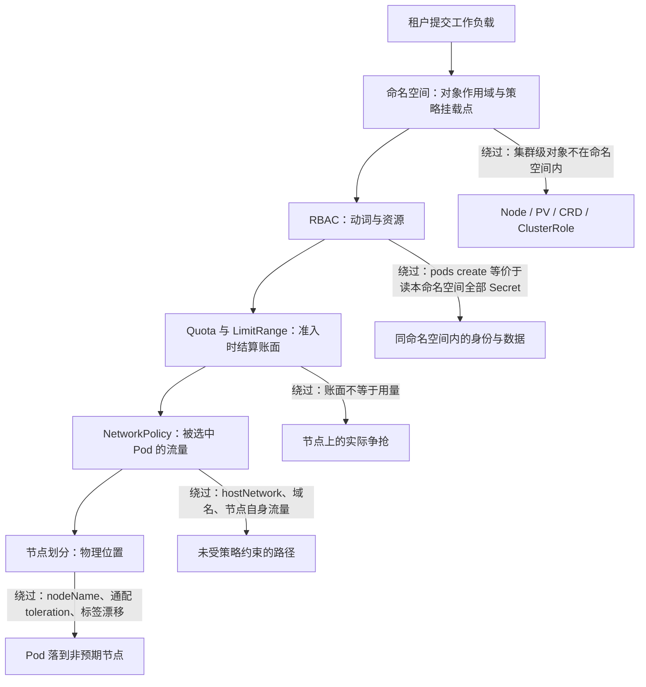
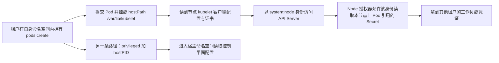
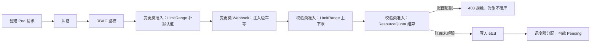
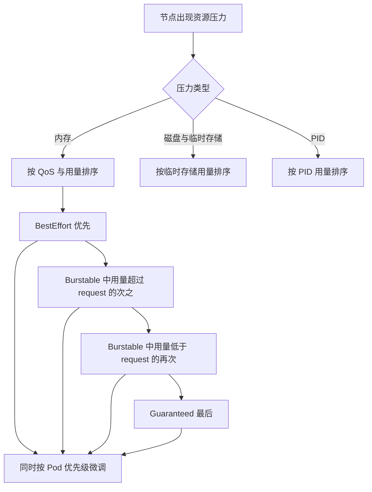
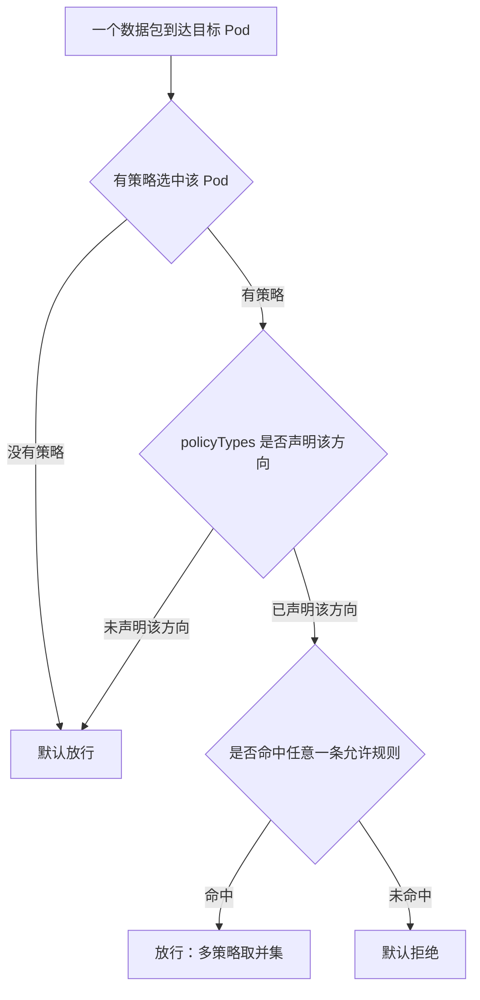

# 03 多租户隔离与资源治理

**摘要：**

多租户的难点不在于把租户分进不同的命名空间，而在于四种互不替代的机制各管一段：命名空间（Namespace）管对象名与策略挂载点，RBAC 管动词，资源配额（ResourceQuota）与限制范围（LimitRange）管准入时的账面，网络策略（NetworkPolicy）与节点划分管数据包与物理位置。它们都在"请求被接受"或"数据包被转发"的瞬间生效，而不在"资源被消耗"的瞬间生效，误判于是成批出现：以为配额限制了用量，其实只限制了 requests；以为命名空间是安全边界，其实只隔离了名字；以为策略对象创建即生效，其实 CNI 未必执行。本文以一个 30 节点、四个租户的混部集群为贯穿案例，逐层给出每层的真实边界与绕过路径，再讨论配额与 LimitRange 在准入链上的相互影响、QoS 三级与驱逐顺序、NetworkPolicy 的语义缺口与 DNS 漏配、节点隔离的三种做法及其运维账单，最后给出判断"隔离够不够用"的度量方法与四类高频故障的判据。资源在调度器内部如何比较与打分属于另一条线，本文只关心它暴露在运营侧的行为。

---

## 第 1 章 四层隔离，与每层拦不住的东西

先把范围限定清楚：这里说的多租户，指的是同一套控制平面、同一批工作节点被两个以上在利益或信任上存在差异的使用方共享，差异可能来自部门、来自供应商、也可能来自同一团队的生产与实验环境。这个定义把"一人一个命名空间"式的开发便利排除在外，因为那种场景没有对抗性，配不配隔离只影响整洁程度；只有在使用方之间存在"越界会有收益"的动机时，隔离的边界才值得逐层推敲。

多数多租户方案的失败，不是发生在"没有配隔离"，而是发生在"配了隔离，但把某一层的边界当成了另一层的边界"。三种形态最常见：把命名空间当成安全边界，把 ResourceQuota 当成容量上限，把 NetworkPolicy 对象的创建当成策略已经生效。三种误判的共同结构是，把"声明存在"等同于"效果存在"，而 Kubernetes 的隔离能力恰恰分散在声明、准入、调度、数据面四个完全不同的执行点上。

### 1.1 四层各自回答的问题

四层机制回答的是四个不同的问题，混用会导致期待落空。

| 层次 | 回答的问题 | 生效位置 | 真实边界 |
| :--- | :--- | :--- | :--- |
| 命名空间 | 对象叫什么、策略挂在哪 | API Server 的对象作用域 | 只隔离名字与命名空间级对象，不隔离可达性 |
| RBAC | 谁能对什么对象做哪个动词 | API Server 鉴权 | 只管动词，不管动词造成的后果 |
| ResourceQuota / LimitRange | 一个租户的账面配额与单对象形状 | API Server 准入 | 只结算 requests，不约束实际消耗 |
| NetworkPolicy / 节点划分 | 谁能连谁、Pod 能落在哪 | CNI 数据面 / 调度器与 kubelet | 只管被策略选中的 Pod 与被正确标注的节点 |

把这四层串起来看，会发现它们并不构成一条纵深防线，而是四条互不覆盖的平行线，缺口只能被其他层部分缓解，不能被自动补上。四层之间**互不传递**，某一层的缺口不会被另一层自动收紧。



四层关系可以用一栋写字楼作比：门牌号（命名空间）让你知道谁住哪间，门禁卡（RBAC）决定你能刷开哪扇门，车位登记（配额）限制你占几个车位，围墙与保安（网络策略与节点划分）才决定你翻不翻得出去。这个比喻的失真之处也要说清楚：楼里配了保安不等于每扇窗都装了锁，四层机制在 Kubernetes 里是并列的行政边界，不是层层设卡的安全纵深。

### 1.2 贯穿全篇的集群

为了让后面的推演有具体对象，设定一个中等规模的混部集群（以下数字为示例推算，只用于说明量级关系）：30 台工作节点，每台 32 vCPU 与 128 GiB 内存，扣除 kube-reserved、system-reserved 与驱逐阈值后单节点可分配约 28 vCPU 与 110 GiB，集群可分配总量约 840 vCPU 与 3.2 TiB。四个租户：`saas-api` 跑在线业务，`data-pipeline` 跑离线 ETL，`ml-training` 是外包团队的训练任务，`platform` 放 Ingress、监控、日志等平台组件。稳态约 700 个 Pod，日均创建与销毁约 400 个。

这个规模不大，但足以暴露问题：配额接近可分配量时头部余量不足，在线与离线的 QoS 混杂，外包租户还带来了自己的 ServiceAccount。后面四类故障分别落在这个集群的不同年份：一次 Secret 越界读取、一次发布被配额整批拒绝、一次上线 NetworkPolicy 后全站 DNS 解析失败、一次节点池标签漂移导致租户 Pod 落到公共节点。

### 1.3 隔离强度是一条连续谱

多租户方案经常被简化成"命名空间隔离"和"独立集群"两个选项，实际可选的档位更多，每档的代价与盲区都不同。

| 方案 | 隔离强度 | 共享的部分 | 典型盲区 | 适用信任关系 |
| :--- | :--- | :--- | :--- | :--- |
| 命名空间 + 四层策略 | 弱 | 控制平面、节点、内核、CNI | 集群级对象、宿主机维度、资源争抢 | 同一组织内互相知晓的团队 |
| vCluster 虚拟集群 | 中 | 宿主节点、内核、CNI、网络 | 逃逸与 noisy neighbor 仍在宿主层 | 需要独立 API 与 CRD 但共享算力的团队 |
| 独立集群 | 强 | 云账号、网络边界、镜像仓库 | 成本、多集群运维、跨集群服务发现 | 外部客户、合规边界、不可信代码 |
| 独立云账号 + 独立集群 | 最强 | 仅供应商层面 | 治理成本高 | 强合规、强隔离诉求 |

vCluster 这一档容易被高估。它在宿主集群的 Pod 里跑一套独立的 API Server 与 etcd，租户因此拥有完整的 Kubernetes API——可以装 CRD、可以自定义 RBAC、可以安装需要集群级权限的 Operator 而不污染宿主集群，这是命名空间方案给不了的。但虚拟控制平面之下仍是宿主的节点、宿主的内核与宿主的 CNI，容器逃逸的威胁没有变化，Pod 之间的资源争抢没有变化，NetworkPolicy 依然由宿主的 CNI 执行。隔离强度与运营成本同向增长，选型的落点不是"哪一档最强"，而是"最弱的那一档能否覆盖自己的信任模型"——这一点在第 9 章还会回到度量上。

---

## 第 2 章 命名空间：逻辑边界的真实宽度

命名空间（Namespace）常被描述为"Kubernetes 的逻辑隔离单元"，这句话本身没错，错在读者容易把"逻辑"读成"轻量但完整"。它隔离的是名字与一批命名空间级对象的归属，不隔离可达性、不隔离算力、也不隔离宿主。它与 [[02 Linux Namespace 深度解析]] 里讲的 Linux 命名空间只有名字上的巧合，后者是内核提供的视图隔离，前者是 API Server 对象模型里的一个字段。

### 2.1 它确实提供的四样东西

命名空间提供的第一个能力是名字作用域，同名对象可以并存，`mysql` 在 `team-a` 与 `team-b` 里是两个独立对象，Service 的短域名因此有了确定含义。第二个能力是策略挂载点：ResourceQuota、LimitRange、NetworkPolicy、Pod Security Admission 的标签、默认 ServiceAccount 都挂在命名空间上，离开这个作用域，四层隔离里有两层根本无处安放。第三个能力是授权范围，RoleBinding 的作用域就是一个命名空间，这是 RBAC 能做租户级授权的前提。第四个能力是 DNS 作用域，`<service>.<namespace>.svc.cluster.local` 的命名规则让跨命名空间访问有可枚举的入口，这既是便利也是攻击面的清单。

命名空间从不拥有 CPU，也不拥有节点，它只是策略的容器。

### 2.2 它拦不住的五个维度

| 维度 | 默认行为 | 命名空间能否拦住 |
| :--- | :--- | :--- |
| 网络可达性 | 任意命名空间的 Pod 可互访 | 不能，需 NetworkPolicy |
| 实际算力争抢 | 共享节点内核与磁盘 | 不能，需配额、QoS 与节点隔离 |
| 集群级对象 | Node、PV、StorageClass、CRD、ClusterRole、Webhook 配置 | 不能，它们不在任何命名空间内 |
| 宿主机维度 | hostPath、hostNetwork、hostPID、privileged | 不能，需 Pod Security 阻断 |
| 云元数据服务 | Pod 默认可访问节点实例的元数据端点 | 不能，需出口策略封禁 |

第三行与第四行是多租户事故的主要来源。集群级对象的存在意味着：只要某个租户拿到了创建集群级对象的权限，它就在命名空间体系之外活动了，配额、LimitRange、NetworkPolicy 一概管不到它。而宿主机维度更直接——命名空间方案默认假设"Pod 只能在容器里折腾"，一旦 Pod 能挂载宿主路径或共享宿主网络命名空间，这条假设就不成立了。

### 2.3 一条从命名空间走到集群的越权链

把上述两点串起来，可以得到一条不需要任何漏洞、只用合法 API 就能走通的越权链。



这条链的每一环都是 Kubernetes 的合法行为。kubelet 需要客户端证书才能向 API Server 报告状态，该证书代表 `system:nodes` 组的节点身份；Node 授权器为了不让 kubelet 拿到全集群权限，只授予它读取"与自己节点上 Pod 相关的 Secret、ConfigMap、Service"等有限权限——从集群视角看这是**最小权限**，从租户视角看，任何一个能进入节点文件系统的 Pod 都自动继承了这份权限，而这份权限的覆盖范围恰好是"这台节点上所有租户的凭证"。

第二环的技术细节值得展开：`hostPath` 挂载 `/var/lib/kubelet` 或 `/etc/kubernetes` 通常就能找到 kubelet 的 kubeconfig，Pod 不需要 privileged 也能读；`privileged: true` 加 `hostPID: true` 则可以 `nsenter` 进宿主机的命名空间，读取范围扩大到系统盘上的所有配置。前者只需要 `pods create` 与一条 `hostPath` 卷声明，门槛低到几乎所有"能部署应用"的角色都具备。

云上还多一条链：节点实例的元数据服务默认可达，Pod 里 `curl` 一下 `169.254.169.254` 就能拿到节点实例角色的临时凭证，凭这个凭证能访问的对象往往远超集群本身。这条路径既不需要 hostPath 也不需要特权，只需要出口网络默认放行——而这正是 NetworkPolicy 未配置时的默认状态。封堵手段是在出口策略里显式拒绝该地址段，或使用强制 IMDSv2 与跳数限制，具体以云厂商文档为准。

### 2.4 Pod Security 阻断的是最粗糙的那一档

Pod 安全标准（Pod Security Standards）与 Pod 安全准入（Pod Security Admission）在 Kubernetes 1.25 转为正式可用，它把"禁止 privileged、禁止 hostPath、要求非 root、要求丢弃全部 capabilities"做成了命名空间标签上的三档策略，是当前阻断上述越权链最直接的机制。启用方式如下，三个标签分别对应拒绝、告警与审计：

```yaml
apiVersion: v1
kind: Namespace
metadata:
  name: tenant-ml
  labels:
    pod-security.kubernetes.io/enforce: restricted
    pod-security.kubernetes.io/warn: restricted
    pod-security.kubernetes.io/audit: restricted
```

迁移路径上不必一步到位：存量命名空间先只用 `warn` 与 `audit`，从审计日志里统计哪些工作负载会违规，改造完成后切 `enforce`。

但这一层也有它拦不住的东西，需要提前说清楚。`restricted` 只约束 Pod 安全相关的字段，不管这个 Pod 请求多少资源、能连哪些地址、能不能读同命名空间的 Secret；`baseline` 甚至允许一部分宿主交互。更关键的是，Pod Security 只对 Pod 的创建与更新生效，对已在运行且不符合新策略的 Pod 不做处理——这与后面 LimitRange 的行为是同一种模式，准入层的规则总在"请求被接受"这一刻起作用，不追溯既有对象。

### 2.5 命名空间按信任域切，而不是按组织架构切

组织架构会变，信任域变得慢。按部门切命名空间，半年后部门重组，命名空间就成了历史包袱；按"谁能接受与谁共享内核"切，边界更稳定。常见的错误是按项目切得极细，一个租户十几个命名空间，然后 Strategy 里每个命名空间都要单独配 quota、LimitRange、NetworkPolicy 与 RBAC——只要漏配一个，缺口就出现在那个漏配的命名空间上，而审计很难发现"少了一个"。

可行的做法是把租户级策略做成模板强制下发：租户命名空间用统一标签标识（譬如 `tenant: saas-api`），由 GitOps 或策略引擎批量渲染四类对象，新增命名空间走同一个模板，把"漏配"从人工疏忽变成渲染失败。命名空间的命名与标签规范同时承担另一个职责：NetworkPolicy 的 `namespaceSelector` 与配额审计都依赖标签，标签一旦由人工维护，就一定会漂移。

---

## 第 3 章 RBAC：权限能表达的部分与不能表达的部分

RBAC 的模型只有三样东西：主体（User、Group、ServiceAccount）、动词（get、list、create、delete 等）、资源（含子资源），加上作用域（命名空间级或集群级）。[[05 认证、授权与准入控制：K8s 的安全三级防线]] 拆解过认证与鉴权在请求链路上的位置，这里只讨论它在多租户场景下的表达力边界：它登记的是"能不能刷这扇门"，不登记"进门之后会干什么"。

### 3.1 动词与后果之间的鸿沟

租户拿到 `pods create` 意味着什么？直觉上是"能跑容器"，实际后果要宽得多。能创建 Pod 就能在该命名空间内挂载任意 Secret 与 ConfigMap 作为卷，于是"读 Secret 的权限"被绕过了——不需要 `secrets get`，只要把 Secret 挂进自己的 Pod 再 `cat` 出来。同理，能创建 Pod 就能挂载该命名空间内任意 PVC 读取其中的数据，能指定任意 ServiceAccount 从而继承其 API 身份，能写 `spec.nodeName` 直接绕过调度器。RBAC 对这一切无能为力，因为它只看到 `create pods` 这一个**动词**。

这个不对称值得记住：给租户 `create pods` 的权限，等价于给它"该命名空间内全部数据与全部 ServiceAccount 身份"的权限，因此同一命名空间里不该共存信任级别不同的工作负载，否则一个能部署应用的角色就能读到邻居的数据库口令。

### 3.2 四条真实的提权路径

| 路径 | 机制 | 后果 | 防御 |
| :--- | :--- | :--- | :--- |
| `bind` 动词 | 允许创建引用某角色的绑定，即使自己不具备该角色的权限 | 把 `cluster-admin` 通过 RoleBinding 绑进自己的命名空间 | 不授予 Role/ClusterRole 的 `bind` |
| `escalate` 动词 | 允许创建或修改权限高于自身的 Role | 自造授权链 | 不授予 Role 的 `escalate` |
| `impersonate` | 以他人身份发起请求 | 完整继承目标身份 | 只在排障账号上短期授予 |
| CSR `approve` 与 `sign` | 批准并签发客户端证书 | 直接拿到带任意 Group 的证书，等同集群管理员 | 严格控制 `certificatesigningrequests` 子资源 |

前两条是 RBAC 自身设计的柔性之处：`bind` 让"授权者"与"授权操作者"分离，好处是运维不必自己拥有全部权限，代价是它把提权能力也一并授权出去了。第三条容易被忽略，因为 `impersonate` 通常被当成排障便利，而它在多租户里的语义其实是"变成别人"。第四条属于集群级权限，租户侧不应该有任何接触机会，但历史上有过 `nodes/proxy` 这类子资源被误授、进而借 kubelet 接口访问任意 Pod 的案例，说明子资源的粒度也需要逐项审。

此外还有一条非技术路径：共享的 kubeconfig 等于共享身份，审计日志里所有操作都落在同一个用户名下，事后无法区分操作者，RBAC 的边界也因此不可验证。

### 3.3 一租户一个 ServiceAccount 是反模式

把同一个 ServiceAccount 发给租户内所有工作负载，看起来省事，实际同时破坏三件事。

第一件是审计。API Server 的审计日志记录 `user.username` 为 `system:serviceaccount:<ns>:<sa>`，租户内所有工作负载共用一个名字，出现异常调用时无法定位到具体工作负载，也就无法判断是哪个应用被盗用。第二件是授权精度。RBAC 只能按 ServiceAccount 授权，**身份即权限**，任何一个被攻破的工作负载都能以该身份做同一租户内其他工作负载能做的事。第三件是令牌暴露面。默认 ServiceAccount 的令牌会被自动挂载进 Pod，任何能 `exec` 进该 Pod 或读到 Pod spec 的人都能使用它；关闭自动挂载（`automountServiceAccountToken: false`）应当成为不访问 API Server 的工作负载的默认动作，而按需访问的工作负载应当使用各自独立的 ServiceAccount。

### 3.4 RBAC 表达不了的条件，以及补位的代价

RBAC 是纯属性匹配，没有条件判断：不能表达"只允许工作时间操作"、"只允许从公司网段发起"、"不允许修改 image 字段"这类约束。这些需求只能落到准入层，用校验型准入策略（ValidatingAdmissionPolicy 的 CEL 表达式）或校验型 Webhook 实现。租户级隔离里最典型的两条策略是"禁止工作负载设置通配 toleration"与"禁止工作负载引用非本命名空间的 ServiceAccount"——前者关系节点隔离能否成立，后者关系身份边界。

补位不是免费的。Webhook 是集群级组件，它的可用性直接影响所有写操作；`failurePolicy: Fail` 下 Webhook 不可用等于集群不可写，`Ignore` 下则是策略静默失效。策略引擎本身也需要集群管理员维护，表达能力强的地方往往就是租户看不见的隐性耦合。所以一个务实的排序是：能用 RBAC 表达的用 RBAC，能用 Pod Security 的用 Pod Security，剩下确实需要字段级判断的才用策略引擎，并把策略引擎的可用性纳入与 API Server 同级的告警。

---

## 第 4 章 ResourceQuota：一本在准入层结算的账

如果要给多租户的配额机制找一句准确的描述，那就是：它结算的是 requests 的账面，不是实际用量。ResourceQuota 在命名空间维度累计该空间内所有 Pod、PVC、Service 等对象的 requests 总量与对象数量，超过上限时拒绝创建。理解了"账面"二字，后面所有的反直觉行为都能推出来。

### 4.1 三个不同的数字

同一个租户的 CPU 有三套数字，混用就会得出错误结论。

| 数字 | 来源 | 决定了什么 | 谁在用 |
| :--- | :--- | :--- | :--- |
| requests 之和 | Pod spec 里的 requests | 调度时的预留量、配额的账面 | 调度器、ResourceQuota |
| limits 之和 | Pod spec 里的 limits | 运行时的 cgroup 上限 | 内核、kubelet |
| 实际用量 | cgroup 统计 | 真实消耗与争抢 | 监控、驱逐判断 |

配额通常只对前两个数字设上限，且这两个字段是分别限制的：只配 `requests.cpu` 时，租户可以把 `limits.cpu` 设成 requests 的十倍，只要节点空闲就能跑满十倍，配额对此毫无感知。这也是为什么"配额配好了为什么还能把节点打满"是一个伪问题——配额从来没有承诺限制真实消耗，它承诺的是限制**调度预留量**。

### 4.2 为什么是 403 而不是 Pending

配额拒绝发生在 API Server 的**准入阶段**，对象根本没有写入 etcd，因此既不会有 Pod 对象存在，也不会出现 Pending 状态。这个区别在排障时非常关键：Pending 意味着对象已经存在但调度器找不到落脚点，403 意味着对象从未存在。



发生在准入阶段的拒绝还有一个副作用：错误信息会以事件的形式挂在发起创建的一方身上，而不是挂在被拒绝的 Pod 上。直接 `kubectl run` 能看到完整的 403，但通过 Deployment 创建时，错误被 ReplicaSet 控制器接收，只在 ReplicaSet 上留下一条 `FailedCreate` 警告事件，Deployment 层面看到的只是副本数上不去。新手在这里的第一个误判往往是"Deployment 卡住了"，于是去查镜像、查节点、查调度，绕了一大圈才想起来看 ReplicaSet 的事件。

配额拒绝的错误文本有几类固定形态，认得出就能直接定位：

```text
# 账面已满
pods "api-7c9d4f" is forbidden: exceeded quota: compute-quota, requested:
requests.cpu=500m, used: requests.cpu=19800m, limited: requests.cpu=20000m

# 配额存在但 Pod 没声明对应资源
pods "api-7c9d4f" is forbidden: failed quota: compute-quota:
must specify limits.cpu,limits.memory,requests.cpu,requests.memory

# ResourceQuota 的 used 与实时账面不符时，以准入报错里的数字为准
```

第二类错误常常是"突然开始出现"的：某天给命名空间加了 ResourceQuota，第二天所有没写 requests 的 Deployment 全部发布失败。原因在于一旦配额里包含计算资源字段，该命名空间内创建的 Pod 必须显式声明对应资源，否则准入拒绝——这条硬性要求是为了让账本能算清楚，代价是所有历史模板都要补 resources 字段，而 LimitRange 正是为补这个坑设计的。

### 4.3 配额字段的相互约束

| 字段类别 | 示例 | 语义与注意点 |
| :--- | :--- | :--- |
| 计算资源 | `requests.cpu`、`limits.memory` | 分别统计，只配 requests 不限制实际用量 |
| 本地存储 | `requests.ephemeral-storage` | 不配则租户可写满节点磁盘，触发全节点驱逐 |
| 对象数量 | `pods`、`services.nodeports`、`secrets` | 防止 etcd 与 API Server 被对象数量压垮 |
| 存储容量 | `requests.storage`、`fast-ssd.storageclass.storage.k8s.io/requests.storage` | 按 PVC 申请量统计，不按实际写入量 |
| 优先级作用域 | `scopeSelector` 匹配 `PriorityClass` | 为高优先级 Pod 单独设限，防止优先级抢占被滥用 |
| 终止态作用域 | `scopeName: Terminating` 或 `NotTerminating` | 分别约束带与不带 activeDeadlineSeconds 的 Pod |

作用域（scope）是配额里最容易被忽略的能力：同一个命名空间可以有多份配额，一份约束全部 Pod 的总量，另一份只约束高优先级 Pod 的数量，还有一份约束非终止态 Pod 的请求总量。对于"离线任务可以占满、在线业务必须保留余量"的混部场景，按优先级分账比按命名空间分账更贴合实际。

存储配额有一个细节：它统计的是 PVC 的申请量，不是底层卷的实际使用量。一个申请 100 GiB 的 PVC 里只写了 1 GiB 数据，配额照样扣 100 GiB；卷扩容时配额按新的申请量重新结算，于是扩容可能因为配额不足而失败，失败信息同样出现在 PVC 的事件里。

### 4.4 与滚动更新、HPA、Job 的相互作用

配额是**账面**，而滚动更新会在短时间内把账面抬高，这是发布期间配额拒绝的主要成因。

以示例推算说明：某 Deployment 20 副本，单副本 `requests.cpu: 500m`、`limits.cpu: 2`，配额里 `limits.cpu: 40`。稳态时 `limits.cpu` 账面是 20 × 2 = 40，正好用满。发布时默认 `maxSurge: 25%` 会额外起 5 个 Pod，账面瞬时需要 50 核，超过 40 的上限，于是新 Pod 全部被 403 拒绝，ReplicaSet 事件刷屏 `FailedCreate`，发布卡住而旧 Pod 继续服务。把 `maxSurge` 设为 0 可以规避，代价是发布期间可用副本数下降；更好的做法是给配额留出与 `maxSurge` 对齐的余量，或干脆不把 `limits` 纳入配额（只用 requests 控总量，用 LimitRange 的 `maxLimitRequestRatio` 控制超卖倍数）。

HPA 与配额的不一致是另一类固定故障。HPA 按 CPU 利用率把副本数推到 50，而配额只允许 20 个 Pod 的 requests，结果是 Deployment 的期望副本数与实际可用副本数长期背离，HPA 反复调整、事件里持续出现配额拒绝。诊断时不要只看 HPA 的当前指标，要同时看 `kubectl describe hpa` 的事件与 ReplicaSet 的 `FailedCreate`——HPA 自己并不知道配额的存在。正确的做法是让 `maxReplicas` 与配额上限在数值上闭合成一个算术恒等式，并在 CI 里校验这个恒等式。

Job 与 CronJob 的问题在于瞬时性：一个并行度 100 的 Job 会在一瞬间申请大量 requests，与在线业务争抢账面。给批处理单独一份带 `PriorityClass` 作用域的配额，或者在 CI 里限制并行度，比事后调大总配额更安全。

### 4.5 配额规划的一版算术

配额总和该怎么定，取决于可分配量与目标超卖比。仍以本文的集群为例（示例推算）：集群可分配 840 vCPU，若四租户配额总和按 100% 分配，任何一次节点故障都会让某个租户无处可去；经验上把 requests 配额总和控制在可分配量的七到八成，剩余部分作为故障域与发布 surge 的缓冲。按 0.8 计，可分配给租户的 requests.cpu 总量约 670 核，四个租户按 3:3:2:1 分，约 250、200、140、80 核。

这套算术只对 requests 成立。如果配额同时限制 `limits.cpu`，就要额外考虑超卖倍数：limits 总和通常是 requests 总和的两到三倍，此时节点的真实超卖风险由调度器决定而不是由配额决定，配额只保证"不会被某一个租户的账面独占"。

### 4.6 配额管不到的四类东西

第一类是实际用量，前面已经说过由 cgroup 决定，配额不参与。第二类是节点级资源：租户的 Pod 写得再多，只要通过了准入，节点上的磁盘 IO、网络带宽、PID、conntrack 表都不在配额视野内，第 6 章会展开这些争抢路径。第三类是集群级对象：Namespace 之外的资源不计入任何命名空间配额。第四类是**终止中的 Pod**：Pod 删除有一个优雅退出窗口，窗口内它仍占用账面，于是"删了却还是超配额"是正常现象，紧接着的重建请求可能被拒绝——滚动发布与快速重启场景里这一点尤其明显。

---

## 第 5 章 LimitRange：默认值注入的连锁反应

如果 ResourceQuota 是账本，LimitRange 就是填表时的默认选项：它决定了一个没写 resources 的容器最终以什么数字入账。多租户集群里，LimitRange 往往是"看起来最无害、实际影响最大"的对象，因为它改的不是上限，而是所有人模板里没写的那些字段。

### 5.1 注入发生在配额结算之前

LimitRange 的默认值注入由 LimitRanger 准入插件完成，它是**变更类准入**，在 ResourceQuota 之前执行。这个顺序决定了两件事：一是没写 requests 的 Pod 能通过"必须声明 requests"的配额校验，因为准入时它已经有值了；二是被注入的值会被配额如实结算，注入得越大，账面消耗越大。

同样在这个顺序里还有变更类 Webhook，它排在 LimitRanger 之后、ResourceQuota 之前。于是边车注入器添加的容器既会继承 LimitRange 的默认值，其 requests 也会计入配额；而 LimitRanger 的上下限校验已经执行完毕，边车注入的容器不再受 `min`/`max` 约束——这是一个纯粹由执行顺序造成的盲区，靠读文档很难想到，只有在对账时才会发现"Pod 的总 requests 超过了 LimitRange 里 Pod 级 max"。

### 5.2 四种把 request 补成奇怪值的路径

| 写法 | 补齐后的结果 | 典型后果 |
| :--- | :--- | :--- |
| 只配 `default`，不配 `defaultRequest` | 未写 request 的容器最终以 limit 作为 request | 账面放大数倍，配额提前用满，QoS 意外变成 Guaranteed |
| `min` 高于存量模板的请求值 | 存量模板整体被拒 | 老应用无法发布，报错指向 min 而非模板 |
| Pod 级 `max` 与容器级 `max` 同时设置 | Pod 级 max 校验容器请求之和 | 多容器 Pod 被拒，单容器测试却通过 |
| `maxLimitRequestRatio` 配合缺失 request | 比值为无穷大或按 0 处理，校验失败 | 报错文本含糊，容易被误判为字段拼写问题 |

第一种路径最常见也最贵。只写 `default` 不写 `defaultRequest` 的 LimitRange，会让所有没写 request 的容器最终以 limit 入账——无论是通过 API Server 的缺省复制（写了 limit 没写 request 时 request 取 limit），还是通过准入补齐，结果一致。于是一个"只想给没配资源的容器兜个底"的 LimitRange，可能把整个租户的 requests 账面抬高数倍。

第二种路径的隐蔽性在于报错文本。开发者看到的是 `minimum memory usage per Container is 256Mi, but request is 64Mi`，第一反应是"我明明写了 64Mi"，然后去改模板，改完发现还是被拒，因为实际被拒的是集群里另一批由旧 Chart 渲染出来的 Pod。这类错误在批量发布时表现为"部分工作负载成功、部分失败"，很容易被当成随机故障。

### 5.3 一条从默认值到不可调度的事故链

把上面的机制连起来，可以得到一条在多租户集群里反复出现的链条（示例推算）。某租户的模板只写 limit 不写 request，历史原因是早期为了"省事"；集群后来上了 LimitRange，只配了 `default`，没配 `defaultRequest`；单副本从 `request 100m / limit 2Gi`（内存）变成 `request 2Gi / limit 2Gi`；20 副本的 Deployment 内存 requests 账面从 2 GiB 涨到 40 GiB，超过租户 `requests.memory: 32Gi` 的配额，新 Pod 被 403 拒绝；发布卡住，旧 Pod 继续跑，监控上"服务正常"，只有发布时间线对不上。

运维看到"配额满了"，最自然的动作是调大配额。调大之后发布成功，但真实原因没有解决：requests 被默认值放大了一个数量级，节点上的预留量随之膨胀，两周后集群可分配量被账面吃光，其他租户开始 Pending。这时才回到 LimitRange 去查，才发现问题出在一个当初为了让"没写资源的容器有兜底"而创建的对象上。这条链的教训不是"不要用 LimitRange"，而是变更 LimitRange 时必须先做存量影响分析，尤其是 `default` 与 `defaultRequest` 是否成对配置。

### 5.4 一套成对配置的模板

配额与 LimitRange 应当成对下发，且 `default` 与 `defaultRequest` 必须同时出现，两者之间的比值就是允许的突发倍数。

```yaml
apiVersion: v1
kind: LimitRange
metadata:
  name: tenant-defaults
  namespace: tenant-saas
spec:
  limits:
    - type: Container
      default:              # 未写 limits 时采用的默认上限
        cpu: "1"
        memory: 1Gi
      defaultRequest:       # 必须与 default 成对，否则 request 会等于 limit
        cpu: "250m"
        memory: 256Mi
      min:                  # 下限拦住明显不合理的模板，避免把 node 拖进碎片化
        cpu: "50m"
        memory: 64Mi
      max:                  # 单容器上限，防止一个容器吃掉整个 Pod 级额度
        cpu: "4"
        memory: 8Gi
      maxLimitRequestRatio: # 限制超卖倍数，比单纯限制 limits 更贴近真实风险
        cpu: "8"
        memory: "2"
    - type: Pod
      max:                  # 容器之和的上限，拦住"多容器叠加"绕过单容器上限
        cpu: "8"
        memory: 16Gi
    - type: PersistentVolumeClaim
      max:
        storage: 200Gi
```

`maxLimitRequestRatio` 值得单独说明：它约束的是同一个资源上 limit 与 request 的比值，等价于"允许这个容器把 CPU 超卖到几倍"。相比直接限制 `limits.cpu` 总额，这个字段把风险绑定在单个对象上，不会因为副本数变化而在发布期间抖动，也不会与 `maxSurge` 打架。代价是它对缺失 request 的容器不友好——比值算不出来时校验会失败，于是必须确保默认值链路完整，这正是 `default` 与 `defaultRequest` 要成对出现的原因。

### 5.5 变更 LimitRange 只影响新对象

与 Pod Security 一样，LimitRange 是准入约束而不是运行时约束。改小 `max` 不会驱逐已经在跑的 Pod，改大 `default` 也不会给存量 Pod 补资源。这条特性带来一个具体的运维风险：把 `max` 调小之后，存量 Pod 一切正常，直到某次滚动发布才突然全部被拒，而发布恰好发生在业务高峰期。

反过来，把 `default` 调大之后，存量 Pod 的账面不变，新 Pod 的账面变大，于是同一个 Deployment 的副本在配额账本里出现两种口径，容量规划的口径开始漂移。笔者建议的纪律是：LimitRange 的每次变更都视为一次容量事件，变更前跑一遍存量清单的模拟校验（用 dry-run 提交现有模板），变更后重新核算该租户的配额占用，并把变更时间点写进容量记录。

---

## 第 6 章 QoS 与驱逐：软隔离的代价

前四层机制解决的是"哪些对象存在、谁能操作、账面多少、能连哪里"，它们都作用在 API 层。真实消耗发生在节点上，而节点是被共享的：共享内核意味着所有容器跑在同一个操作系统里，共享节点意味着所有容器争抢同一份 CPU、内存、磁盘与网络。这一层没有任何命名空间能提供隔离，只能通过优先级与配额做"伤害分配"。

### 6.1 共享内核的两种代价

第一种是侧信道（Side Channel）。同一台物理机上的两个容器共享最后一级缓存、内存带宽、页缓存与 CPU 的超线程兄弟核，攻击者可以通过缓存争用与计时推断出邻居的访问模式，这类攻击在虚拟化时代已经成立，在容器共享内核的模型下只会更容易。缓解手段是物理核绑定（CPU Manager 的 static 策略）、独占节点、机密计算实例，每一种都有明确的成本，没有一种是"默认开启"的。

第二种是内核共享带来的故障放大。一个租户触发内核漏洞或资源耗尽（文件句柄、PID、conntrack 表、inode），影响面是整台节点上的所有租户；容器逃逸同样只需一次成功。这也是为什么"不可信代码"这条线通常直接越过命名空间方案，落到独立集群或独立云账号。

### 6.2 共享节点的六种争抢

| 资源 | 争抢表现 | 是否被配额约束 | 缓解手段 |
| :--- | :--- | :--- | :--- |
| CPU 时间 | CFS 配额导致限流，尾延迟抬高 | 否，由 limits 与权重决定 | 合理 limits、CPU Manager、独立节点池 |
| 内存 | 回收页缓存、OOM 杀进程、节点驱逐 | 否，由 limits 与用量决定 | requests 贴近真实用量、驱逐阈值、节点预留 |
| 本地磁盘 | emptyDir 与日志写满，触发 DiskPressure | 需显式配 `ephemeral-storage` | 配额加临时存储、日志轮转、独立磁盘 |
| 磁盘 IO | 数据库与批任务互相拖慢 | 否，Pod spec 无原生 IO 限制 | 独立节点池、本地盘隔离、cgroup v2 io 控制 |
| 网络带宽与连接数 | 大流量租户抬高邻居延迟、耗尽 conntrack | 否 | 出口限速、独立网卡、连接数治理 |
| PID 与文件句柄 | fork 风暴拖垮节点 | 否 | kubelet 的 Pod PID 上限、节点级 ulimit |

这张表说明：命名空间、配额、网络策略在这六行里几乎全部缺席。多租户方案宣称的"资源隔离"如果只做到配额，覆盖的只是调度预留量，剩下的维度靠"邻居比较守规矩"。

一个具体的例子：租户的容器往 emptyDir 里写日志，没有配 `ephemeral-storage` 的配额，日志写满节点磁盘，kubelet 进入 DiskPressure，按驱逐顺序杀掉一批 Pod——被杀的很可能是另一个租户的 Pod，因为驱逐不看命名空间。肇事者与受害者在这套机制里没有任何关联。

### 6.3 QoS 三级是怎么算出来的

服务质量等级（Quality of Service，QoS）不是声明出来的，是 kubelet 根据 Pod 里所有容器的 requests 与 limits 推导出来的。

| 等级 | 判定条件 | 调度与运行的默认待遇 |
| :--- | :--- | :--- |
| Guaranteed | 所有容器都为 CPU 与内存同时设置了 request 与 limit，且两者相等 | 最低的 OOM 分数调整值，驱逐顺序最后 |
| Burstable | 至少一个容器设置了 request 或 limit，但不满足 Guaranteed 条件 | 按 request 比例分享 CPU，用量超 request 的内存 Pod 优先被驱逐 |
| BestEffort | 所有容器都没有设置任何 request 与 limit | 最高的 OOM 分数调整值，最先被驱逐 |

这里有一个长期被误解的点：Guaranteed 不等于"保证有资源"，它只保证在这台节点上**相对最不容易被牺牲**。如果节点本身超卖严重、或者节点上所有 Pod 都是 Guaranteed，那么压力来临时仍然会有 Guaranteed 的 Pod 被杀，只是排在最后。真正的保证需要额外的机制配合，见 6.6 节。

### 6.4 驱逐顺序与内核的 OOM 打分



驱逐之上还有一层内核裁决。每个容器启动时会被写入一个 OOM 分数调整值：Guaranteed 取接近下限的负值，BestEffort 取上限正值，Burstable 按内存 request 占节点容量的比例线性插值。这个值的含义是，当内核在节点层面必须杀进程时，先杀分数高的——于是"谁的 request 小、QoS 低，谁先死"在两套机制里是一致的，它们共同构成了软隔离的伤害分配规则。

需要区分内核 OOM 与 kubelet 驱逐：容器超过自身 memory limit 时，内核在 cgroup 内杀掉容器进程，Pod 状态是 `OOMKilled`，与节点压力无关；节点整体内存不足时，kubelet 按上面的顺序驱逐 Pod，事件里会出现 `The node was low on resource: memory`，Pod 状态是 `Evicted`。两者的处置完全不同，前者要调 limit，后者要看节点容量与其他租户。

### 6.5 受害方往往不是肇事方

驱逐排序只看被驱逐者自身的 QoS 与用量，不看"是谁造成了压力"。这带来一个在多租户集群里反复出现的场景：租户 A 的批任务以 BestEffort 跑满节点内存，节点进入 MemoryPressure，kubelet 从 BestEffort 开始驱逐——如果租户 B 也有 BestEffort 的工作负载，它会被一起杀掉，甚至可能先被杀（排序在用量维度上做微调）。租户 B 的视角是"我的服务无故重启"，而监控上看不到任何直接原因。

更隐蔽的是 Burstable 之间的相互影响：租户 A 的 Pod 内存用量长期是 request 的三倍，节点内存吃紧时它可能被驱逐，但在此之前它的增长已经让 kubelet 反复触发软驱逐，租户 B 的 Pod 因为用量略高于 request 而被选中。压力归因的缺失是软隔离的**结构性缺陷**，只能用度量来补——第 9 章会给出用指标做归因的方法。

### 6.6 让 Guaranteed 真的"有保证"

如果确实需要可预测的性能，仅有 QoS 等级不够，还需要以下条件同时成立（具体参数以对应版本文档为准）：

- kubelet 的 CPU Manager 启用 `static` 策略，Guaranteed 且 request 为整数的容器才能拿到独占的物理核，否则只是 cgroup 权重差异。
- 节点禁用 swap，或明确接受 swap 带来的尾延迟不确定性。
- 节点预留 `kube-reserved` 与 `system-reserved`，否则系统进程与 kubelet 自身会与租户争抢，Guaranteed 也会被拖慢。
- 驱逐阈值留出余量（`eviction-hard` 与 `eviction-soft` 的配置要覆盖节点上最大的单个 Pod），否则一次驱逐可能连带引发连锁反应。
- 大页与 NUMA 对齐按需配置，否则内存带宽仍然在租户之间共享。

这五条每一条都有运维成本，合起来意味着"真正有保证的隔离"只适合少数关键工作负载，而不是整个集群的默认配置。这也解释了为什么多数团队的最终选择是分层：核心业务用 Guaranteed 加独占节点池，其余工作负载接受 Burstable 的不确定性，把不确定性交给容量与告警兜底。

---

## 第 7 章 网络隔离：语义、执行与最容易漏的一格

Kubernetes 的网络模型要求所有 Pod 之间可以直接通信，这是扁平网络的设计取舍：简单、可预测、不需要 NAT 穿透，代价是默认没有任何访问控制。网络策略（NetworkPolicy）是在这个扁平模型上叠加的声明式过滤，但它的语义与执行都有明确的缝隙。

### 7.1 语义：默认放行、规则取并集

三条规则决定了 NetworkPolicy 的全部行为。没有策略选中某个 Pod 时，该 Pod 的全部进出流量放行；有策略选中但 `policyTypes` 包含 Ingress 而没有任何 ingress 规则时，所有入站流量被拒绝；有多条策略选中同一个 Pod 时，允许规则取并集，只要有一条策略允许就算通过。**并集**语义意味着"加一条策略"永远不会收紧访问，只会放宽——这一点与很多人的直觉相反，也是策略审查时最容易出错的地方。



```yaml
apiVersion: networking.k8s.io/v1
kind: NetworkPolicy
metadata:
  name: default-deny
  namespace: tenant-saas
spec:
  podSelector: {}          # 空选择器匹配命名空间内全部 Pod
  policyTypes:
    - Ingress
    - Egress
```

默认拒绝是所有租户命名空间的起点，但只有它并不够：拒绝之后必须按依赖逐条放行，放行的顺序应当由调用关系图驱动，而不是由"哪个服务报错了"驱动——后者会遗漏低频调用，等下一次批处理或月末结算时才暴露。

### 7.2 命名空间选择器依赖标签

跨命名空间放行靠 `namespaceSelector`，它匹配的是命名空间对象的标签。手工给命名空间打标签是最常见的失败点：漏打、打错、或者新命名空间创建时忘了打，策略就静默不生效（表现为拒绝，而不是放行，方向上是安全的，但故障同样真实）。更稳的做法是用 API Server 自动维护的命名空间名标签，它以命名空间名为值、由控制面自动写入，租户无法伪造也无法遗忘（该标签的引入与转正版本以对应版本文档为准）。

```yaml
  ingress:
    - from:
        - namespaceSelector:
            matchLabels:
              kubernetes.io/metadata.name: platform-ingress
      ports:
        - protocol: TCP
          port: 8080
```

用这个标签还有一个副作用值得注意：它把命名空间名变成了策略的一部分，重命名命名空间（实际是删除重建）会连带破坏策略，因此命名空间名在规划期内应当视为不可变标识。

### 7.3 DNS 是最常漏的一格

默认拒绝 Egress 之后，第一个坏掉的一定是 DNS。症状很稳定：应用日志里是 `dial tcp: lookup db.tenant-data.svc.cluster.local on 10.96.0.10:53: no such host` 或者 `i/o timeout`，而 Pod 本身是 Running、就绪探针也通过（探针通常不解析域名）。

修复只需要一条规则，但有三处容易写错。

```yaml
  egress:
    - to:                                     # 只放行 kube-system 里的 DNS
        - namespaceSelector:
            matchLabels:
              kubernetes.io/metadata.name: kube-system
      ports:
        - protocol: UDP
          port: 53
        - protocol: TCP                       # 响应超过 512 字节或 EDNS 失败时会回落 TCP
          port: 53
```

第一处容易写错的是只放 UDP 53。DNS 响应超过 UDP 报文上限时客户端会回落到 TCP，只放 UDP 的表现是"大部分解析成功、偶发超时"，比全失败更难排查。第二处是把放行范围放宽成 `namespaceSelector: {}` 加 53 端口，这等于允许访问任意命名空间里的任意 53 端口——DNS 隧道与内网探测都能走这条路，等于给出口策略开了个后门。第三处是忽略 `ndots` 的放大效应：默认 `ndots: 5` 会让一个只含三四个点的域名先尝试若干条 search 域后缀，一次解析放大成三到六次查询，DNS 侧的压力与超时概率都随之上升；跨命名空间访问时直接写 FQDN 并把 `ndots` 调小，能同时降低延迟与故障率。

还有一种更隐蔽的症状：解析成功但连接失败。这通常是策略放行了 DNS 却没有放行目标端口；另一种情况是把规则写到了 Service 的 ClusterIP 上——策略作用在目标 Pod 上，ClusterIP 只是虚拟地址，为它单独写 `ipBlock` 不会生效，按 Pod 选择器放行即可。

### 7.4 CNI 决定策略是否真的存在

NetworkPolicy 只是声明，执行者是 CNI 插件。这一点在选型时经常被忽略，在排障时经常被忘记。

| CNI 插件 | 标准 NetworkPolicy | 扩展能力 | 注意 |
| :--- | :--- | :--- | :--- |
| Calico | 支持 | 全局策略、主机端点策略、更细的选择器 | 需要确认数据面模式与策略执行点 |
| Cilium | 支持 | L7 策略、按域名放行、策略审计模式 | eBPF 数据面，需确认内核版本 |
| Flannel | 不支持 | 无 | 创建策略对象不报错，流量照常通行 |
| 多数云厂商 CNI | 部分支持 | 依赖安全组或厂商策略引擎 | 混合模型，需逐项验证 |
| 其他 | 视实现 | 视实现 | 以对应版本文档为准 |

Flannel 这一行的危险之处在于**静默失败**：`kubectl apply` 成功，对象存在，`kubectl describe` 看起来一切正常，流量完全不受影响。判断集群是否具备执行能力，不能看有没有 NetworkPolicy 对象，要看 CNI 的文档与实测——从两个命名空间各起一个测试 Pod，验证策略生效前后连通性是否变化，这是唯一可靠的验证方式。

即使 CNI 支持，仍有几类流量在标准模型里无法表达：

- `hostNetwork` 的 Pod 不走 CNI 数据面，多数实现不对其执行策略，租户只要能把 Pod 设为 hostNetwork 就绕过了整层网络隔离。
- 节点自身发起的流量（kubelet 探针、日志采集、监控抓取）来源是节点地址，通常需要单独放行；部分实现会把探针也纳入策略，于是默认拒绝上线后出现"Pod 反复重启但容器日志正常"的症状，是否受影响取决于实现，需要以对应版本文档与实测为准。
- 标准 NetworkPolicy 无法按域名放行，出口策略只能写成 IP 段；想访问外部 API 时往往被迫放行 `0.0.0.0/0`，出口策略退化成只剩"允许出网"一条，隔离名存实亡。
- 策略只覆盖三层与四层，同一命名空间内横向移动的防护靠端口选择器，表达不了 HTTP 路径与方法级别的约束，这类需求要落到服务网格或 CNI 的 L7 扩展上。

---

## 第 8 章 节点隔离：三种做法与各自的账单

命名空间、RBAC、配额、网络策略都在逻辑层工作，把租户的工作负载放到不同节点上，是唯一能触及物理层的低成本手段。三种做法在 API 上都很简单，难的是它们各自会在运维上留下什么。

### 8.1 nodeSelector：最省事，也最脆

`nodeSelector` 是最直白的做法：给节点打标签，给 Pod 写上同样的标签。它的问题有三个。第一，标签是可读的公共信息，租户能看到所有节点池的标签，于是可以把自己的 Pod 写到别人的池子里；第二，Pod 侧的 `nodeSelector` 完全由提交者控制，任何能创建 Pod 的人都能改；第三，标签与节点的对应关系依赖外部系统维护——云上节点被替换后标签可能丢失，自建集群重装节点后忘记重打标签，结果是 Pod 落到默认节点池，隔离在无人察觉的情况下失效。

```yaml
spec:
  nodeSelector:
    tenant-pool: saas          # 只约束"愿意去哪"，不阻止改写
```

单靠这一行不构成隔离，它只是"约定"。它适合的场景是"把批处理引导到便宜的机型上"，也就是调度引导而非安全隔离。

### 8.2 nodeAffinity：表达能力更强，硬约束更危险

节点亲和性（nodeAffinity）把上面的约定写成带表达式的规则，支持 `In`、`NotIn`、`Exists`、`DoesNotExist` 与数值比较，并区分硬约束与软约束：`requiredDuringSchedulingIgnoredDuringExecution` 是硬约束，不满足就不调度；`preferredDuringSchedulingIgnoredDuringExecution` 是软约束，按权重打分。

软约束在多租户里几乎不提供隔离，它只在容量充足时"尽量"把 Pod 放在目标节点，一旦目标节点满，Pod 会落到任何能落的地方。硬约束提供确定性，但代价是可用性：目标节点池不可用时 Pod 直接 Pending，不会自动降级。`IgnoredDuringExecution` 这个后缀的含义也要理解准确——它只保证调度时刻的匹配，节点标签在 Pod 运行期间变化不会导致驱逐，于是"运行中池子被改标签"这件事会静默地破坏隔离。

### 8.3 taint 与 toleration：排他的必要条件，不是充分条件

污点（Taint）与容忍度（Toleration）的组合是目前最接近"排他"的做法：给独占节点池打上 `NoSchedule` 污点，只有带对应容忍度的 Pod 才能调度上去。

```yaml
# 节点侧：只有显式容忍的 Pod 才能进入
kubectl taint nodes node-pool-a dedicated=saas:NoSchedule

# Pod 侧：容忍度由提交者声明
spec:
  tolerations:
    - key: dedicated
      operator: Equal
      value: saas
      effect: NoSchedule
```

关键在于容忍度是 Pod 侧声明，不是节点侧授予。任何能创建 Pod 的租户都可以写一条宽容忍度，或者直接写**通配容忍度**（`operator: Exists` 不指定 key）把节点池当成公共资源——Helm Chart 里"为了兼容各种集群"而写上的通配容忍度是这条路径的常见来源。要让它真正排他，必须在准入层拒绝非授权命名空间提交的容忍度，这是第 3 章里"RBAC 表达不了的条件"的具体用途之一。

还有一条绕过路径值得单独记下：Pod 可以直接写 `spec.nodeName`，跳过调度器直接绑定到节点。节点亲和性与 `NoSchedule` 污点都由调度器执行，跳过调度器等于跳过它们。`NoExecute` 污点由控制面的污点管理器兜底，最终会把不匹配的 Pod 删掉，但在此之前 Pod 已经在节点上运行过一段时间——足够读一次文件、发一次请求。因此在有不可信租户的集群里，禁止写 `nodeName` 与禁止写通配容忍度应当是同一条准入策略的两个条款。

### 8.4 三种做法的账单

| 做法 | 隔离强度 | 主要代价 | 失效模式 |
| :--- | :--- | :--- | :--- |
| nodeSelector | 弱 | 几乎为零，靠约定维持 | 标签漂移、提交者改写 |
| nodeAffinity 硬约束 | 中 | 目标池不可用时 Pending | 容量规划失误导致可用性下降 |
| taint + toleration + 准入限制 | 较强 | 需要准入策略与节点池治理 | 通配容忍度、nodeName、标签变更 |
| 独立节点池 + 独立集群 | 强 | 每池都要留故障余量，扩缩容按池 | 成本、多集群运维复杂度 |

节点隔离真正的成本不在配置，而在**容量**。每个独享节点池都要按自己的峰值留余量，不能与其他租户共享空闲容量，碎片化是必然结果；弹性伸缩要按池配置，每池都要有最小节点数；升级与维护要按池安排窗口，租户之间的升级节奏因此解耦成多份工作；节点标签与污点本身需要生命周期管理，节点被替换时标签丢失是最常见的隔离失效原因。

### 8.5 什么时候该放弃节点隔离，直接分集群

判断标准可以简化成三个问题：租户的代码是否可信；租户之间是否存在合规意义上的数据边界；单次隔离失效的损失是否可以接受。三个问题里只要有一个答案是"否"，节点隔离就不足以覆盖，应当直接分集群或分云账号。反过来，如果三个问题都是"是"，节点隔离通常是性价比最高的一档——它把物理层的位置差异做了出来，却没有引入多控制平面的运维成本。

---

## 第 9 章 度量：怎么判断隔离"够用"

隔离方案没有"配完"这个状态，只有"当前够用"与"当前不够用"。判断依据不能是策略清单的完整度，只能是度量：隔离是否真的在拦住东西，代价是否在可接受范围。这一章给出四组指标与一套归因方法，指标名以 kube-state-metrics 与 cAdvisor 的常规指标为准，具体版本以对应文档为准。

### 9.1 先回答四个问题

第一，账面是否可持续：配额利用率是否长期贴近上限，拒绝率是否随发布波动。第二，伤害是否发生：驱逐与 OOM 的频率、集中度，以及是否跨租户。第三，策略是否真的生效：跨租户可达性是否被探测证实为不可达。第四，出事能否归因：一次跨租户影响事件能否在半小时内定位到肇事租户与触发动作。四个问题对应四组指标，缺任何一组，"够用"都只是感觉。

### 9.2 四组指标

| 组别 | 关键指标 | 判据 | 数据来源 |
| :--- | :--- | :--- | :--- |
| 配额 | 各资源 `used/hard` 比值、配额拒绝计数 | 稳态低于 80%，拒绝集中在发布窗口 | kube-state-metrics 的配额指标、审计日志中的 403 |
| 驱逐与 OOM | `Evicted` 状态 Pod 数、`OOMKilled` 容器数、按命名空间聚合 | 非预期驱逐为零，OOM 只出现在已知的异常工作负载上 | kube-state-metrics 的 Pod 状态原因指标 |
| 邻居干扰 | CPU 限流比例、节点压力等待时间、磁盘与网络饱和度 | 租户之间的限流峰值不同步 | cAdvisor 的 CFS 限流指标、节点压力指标 |
| 可达性 | 跨租户探测通过率 | 必须恒为零 | 自建的连通性探针 |

第三组最有价值也最少被建。CPU 限流比例可以用限流周期数与总周期数之比算出，它反映的是"这个租户被自己的 limit 卡住了多少次"，而不是"被邻居影响了多少"；后者要看节点维度的压力指标与同节点其他租户的负载曲线是否同步抬升。把两者叠加到同一张时间轴上，"邻居干扰"才从感觉变成证据。

第四组是唯一能证明网络隔离真实生效的手段。策略对象存在不等于策略生效，CNI 不支持、选择器写错、命名空间标签漏打，三种情况都会让对象看起来齐全而流量照通。做法是常驻的连通性探针：在每个租户命名空间里跑一个 Job，周期性尝试连接其他租户的代表性 Service 与端口，结果上报为指标。通过率必须**恒为零**，一旦非零就告警——这条指标比任何策略审查都可靠，因为它测的是结果。

### 9.3 跨租户影响事件的归因

一次"某服务尾延迟抬升"的事件，归因路径通常是三步。第一步确定时间窗与节点集合，从延迟指标反查受影响 Pod 所在节点。第二步查同节点同时间窗的其他租户负载：是否有批任务启动、是否有 HPA 扩容、是否有大镜像拉取。第三步查变更事件：那次发布是否改了 requests、LimitRange 是否在同一天被修改、节点池是否发生了替换。

三步里最容易漏的是第二步里的"合法但破坏性"的动作：一次正常的 HPA 扩容会把节点 CPU 推到饱和，触发邻居的限流；一次正常的镜像拉取会吃满节点磁盘带宽。这类事件在各自的审计里都是成功操作，只有把时间轴对齐才能看出关联，因此值得把节点维度的压力事件与租户维度的变更事件写进同一张事件表。

### 9.4 一次季度评审的清单

| 检查项 | 判据 | 不通过的处置 |
| :--- | :--- | :--- |
| 配额利用率分布 | 无租户长期高于 85%，无租户长期低于 20% | 重算配额，回收闲置额度 |
| 配额拒绝原因 | 拒绝集中在发布窗口且可解释 | 调整 surge 或配额余量 |
| 驱逐与 OOM | 无非预期驱逐，OOM 有明确归属 | 补 requests、修 limit、查泄漏 |
| 跨租户可达性 | 探测通过率恒为零 | 修策略或换 CNI |
| 宿主机维度 | 租户命名空间内无 privileged、无 hostPath、无 hostNetwork 例外 | 切 Pod Security 档位或清退例外 |
| 节点隔离 | 无通配容忍度、无 nodeName 直写、节点标签无漂移 | 上准入策略、重建标签治理 |
| 身份 | 每工作负载独立 ServiceAccount，无共享 kubeconfig | 补 SA、轮换令牌 |

笔者建议把这张清单固定进季度容量评审的议程：它的价值在于把"隔离够不够用"从主观判断变成可核对的事实。评审结论只有三种：维持现状、补一层机制、升级一档方案。三种结论都要带上成本估算，否则"再隔离一点"会变成没有终点的工程。

---

## 第 10 章 故障形态与反例

前面几章拆的是机制，这一章按症状组织，给出四类高频故障的判据与处置，再把反例集中列一遍。

### 10.1 配额莫名拒绝

症状：发布卡住，Deployment 副本数上不去，Pod 列表里既没有 Pending 也没有 CrashLoopBackOff。

判据：`kubectl describe rs -n <ns> <rs>` 里出现 `FailedCreate` 事件，事件内容为 `exceeded quota` 或 `failed quota: must specify`；`kubectl describe quota -n <ns>` 的 `Used` 与事件里的 `used` 不一致时，以事件为准，因为配额状态由控制器周期性刷新，可能与准入时的实时结算存在时间差。

根因通常在三处：一是滚动更新瞬时抬高账面（`maxSurge` 与配额余量不匹配）；二是终止中的 Pod 仍占账面，快速重建时超限；三是新加了包含计算资源的配额，而存量模板没有写 requests。

处置：先看事件确认是账面还是字段缺失，字段缺失用 LimitRange 补齐默认值，账面不足则算清 `maxSurge` 的瞬时需求再调配额，避免直接把配额翻倍掩盖问题。

### 10.2 LimitRange 把 request 补成了奇怪的值

症状：发布后配额突然不够，或者 Pod 变成 Pending 且事件为 `Insufficient memory`，而模板里的数字看起来没变。

判据：`kubectl get pod -o yaml` 对比容器里声明的值与实际生效的值；`kubectl describe limitrange -n <ns>` 检查 `default` 与 `defaultRequest` 是否成对；比对 `limits` 与 `requests` 是否相等——相等往往意味着 request 被 limit 顶了上去，QoS 也因此变成了 Guaranteed。

根因：只配了 `default` 没配 `defaultRequest`，或者 `min` 高于存量模板的请求值。

处置：补齐 `defaultRequest` 并重新核算该租户的配额占用；对存量部署执行一次滚动，让新值生效；把 LimitRange 纳入变更评审，与配额一并审查。

### 10.3 上了 NetworkPolicy 后 DNS 解析失败

症状：应用启动失败或运行时偶发超时，日志里是 `no such host` 或 `i/o timeout`，Pod 状态 Running，就绪探针通过。

判据：`kubectl exec` 进 Pod 执行 `nslookup kubernetes.default` 复现；检查该命名空间的出口策略是否包含到 kube-system 的 53 端口放行，且 UDP 与 TCP 都写了；确认放行范围不是 `namespaceSelector: {}` 这种过度放宽。

根因：默认拒绝出口后只放行了业务端口，忘记 DNS；或者只放行 UDP，遇到大响应回落 TCP 时失败。

处置：补 DNS 出口规则，优先用命名空间名标签限定到 kube-system；把 DNS 放行写进租户模板的基线策略，而不是逐次手工补。

### 10.4 策略齐全但流量照通

症状：策略审查通过，渗透测试或探测仍能从租户 A 访问租户 B。

判据：确认 CNI 是否支持 NetworkPolicy（不支持时对象会被静默忽略）；确认目标 Pod 是否 `hostNetwork`；确认放行规则里是否有 `ipBlock: 0.0.0.0/0` 或 `namespaceSelector: {}` 这类等价于全开的条目；确认流量是否来自节点（探针、日志采集、监控抓取往往需要单独放行，放行时容易顺手写宽）。

根因：执行层缺失（CNI）、边界外对象（hostNetwork）、或者白名单过宽。

处置：换成支持策略的 CNI 或补上厂商侧安全组；禁止租户使用 hostNetwork（Pod Security 可阻断）；把出口白名单从 CIDR 改成命名空间加端口的最小集合。

### 10.5 反例清单

| 反例 | 直接后果 | 改法 |
| :--- | :--- | :--- |
| 只用命名空间做隔离 | 跨租户互访、Secret 越界读取、资源争抢全部成立 | 补齐四层，并按信任模型评估是否该分集群 |
| 一租户一个共享 ServiceAccount | 审计无法定位、权限无法收敛、令牌全员可见 | 按工作负载建 SA，关闭不必要的自动挂载 |
| 忽略 LimitRange 的默认注入 | requests 被放大数倍，配额与调度双失真 | `default` 与 `defaultRequest` 成对配置，变更前做存量校验 |
| 只配 requests 配额，不配临时存储 | 一个租户写满节点磁盘，全节点驱逐 | 配额加 `ephemeral-storage`，日志轮转与容量告警并行 |
| 通配容忍度 + 污点做隔离 | 任意租户可进入独占节点池 | 准入层禁止非授权容忍度，禁止 nodeName 直写 |
| 只有入站策略，没有出站策略 | 数据外带与横向移动无约束 | 默认拒绝出站，按依赖放行 |
| 命名空间标签手工维护 | 策略静默失效或误拒 | 用自动维护的命名空间名标签，策略即代码 |
| 把配额当成容量上限 | 账面未满但节点已满，实际争抢无人管 | 配额管预留、QoS 管伤害、节点池管物理 |

### 10.6 分档建议

把方案按信任关系分档，比按技术组件分档更实用。同一组织内互相知晓、代码可评审的团队，命名空间加四层策略足够，重点是配额与网络策略的自动化下发；需要独立 API 与 CRD 但共享算力的团队，vCluster 一档更合适，但要接受宿主层的逃逸与争抢风险；外部客户、不可信代码、合规边界，直接分集群或分云账号，节点隔离在这个档位上不值得讨论。分档的界线应当由第 9 章的度量来校准：如果某租户的驱逐率、限流比例与跨租户事件长期高于其他租户，说明它已经不在当前档位的信任模型里，应当升级一档而不是继续加策略。

---

## 第 11 章 结语

四层隔离的价值不在于任何一层有多强，而在于每一层的边界是否被准确知道。命名空间管名字与策略挂载点，RBAC 管动词，配额与 LimitRange 管准入账面，NetworkPolicy 与节点划分管流量与位置；每一层都有清晰的绕过路径，而多租户事故几乎都发生在"把某一层当成了另一层"的地方。配额与 LimitRange 的关系最能说明问题：两者都作用在准入层，一个管总量、一个管形状，默认值注入的顺序决定了配额看到的数字，也决定了发布失败时该查哪里。

软隔离的代价是结构性的。共享内核意味着侧信道与内核故障的放大，共享节点意味着驱逐排序只会按 QoS 与用量裁决，不会按责任归属裁决；Guaranteed 只是"最后被牺牲"，要变成真正的保证还需要 CPU Manager、节点预留与驱逐阈值一起配合。这些代价不会因为策略配得细而消失，只能被度量出来并被接受或规避。

因此判断"够不够用"的顺序是：先定**信任模型**，再选机制档位，最后用度量校准。度量不足时加策略只是增加维护面，不会增加安全性；信任模型变了却不升级档位，再多的策略也只是延长事故的暴露时间。隔离方案的目标不是让越界不可能，而是让越界的代价与发生的概率都落在一个被明确接受的范围内——这是取舍问题，不是完备性问题。

---

## 参考资料

1. Kubernetes Documentation - Namespaces：https://kubernetes.io/docs/concepts/overview/working-with-objects/namespaces/
2. Kubernetes Documentation - Resource Quotas：https://kubernetes.io/docs/concepts/policy/resource-quotas/
3. Kubernetes Documentation - Limit Ranges：https://kubernetes.io/docs/concepts/policy/limit-range/
4. Kubernetes Documentation - Network Policies：https://kubernetes.io/docs/concepts/services-networking/network-policies/
5. Kubernetes Documentation - Pod Quality of Service Classes：https://kubernetes.io/docs/concepts/workloads/pods/pod-qos/
6. Kubernetes Documentation - Node Pressure Eviction：https://kubernetes.io/docs/concepts/scheduling-eviction/node-pressure-eviction/
7. Kubernetes Documentation - Pod Security Standards：https://kubernetes.io/docs/concepts/security/pod-security-standards/
8. Kubernetes Documentation - Admission Controllers Reference（准入插件执行顺序）：https://kubernetes.io/docs/reference/access-authn-authz/admission-controllers/#order-of-execution
9. Kubernetes SIG Multi-tenancy：https://github.com/kubernetes-sigs/multi-tenancy
10. vCluster Documentation：https://www.vcluster.com/docs

---

> [!note] 思考题
> 1. 如果你的租户里有人能创建 Pod，那么他是否等价于拥有该命名空间内全部 Secret 的读取权限？在这个前提下，同一个命名空间里还能不能放信任级别不同的工作负载？
> 2. LimitRange 的 `default` 与 `defaultRequest` 不成对时，request 会被 limit 顶上去。这个行为在你的集群里是否已经发生了，只是没有人去对账？
> 3. 驱逐排序只看 QoS 与用量、不看责任归属。你会用哪几个指标把"邻居干扰"从感觉变成证据？
> 4. NetworkPolicy 只在 CNI 支持时才生效，而策略对象会静默存在。你的集群上一次验证"策略真的拦住了东西"是什么时候？
> 5. 节点隔离的三种做法各有失效模式，其中通配容忍度最常见。准入层禁止通配容忍度会带来哪些兼容性代价，值不值得？