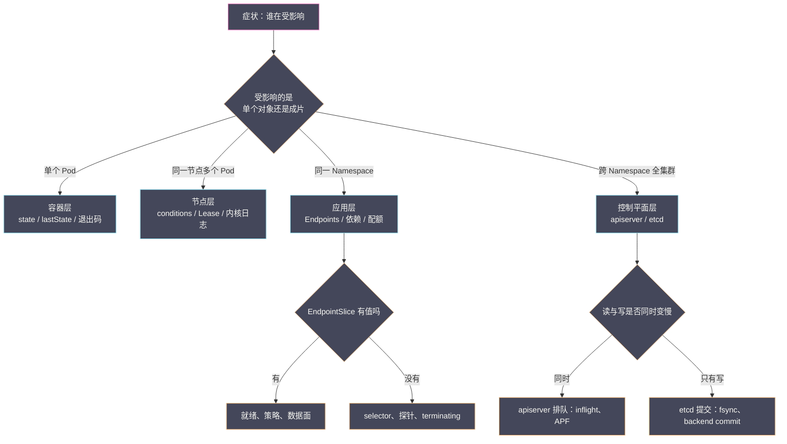
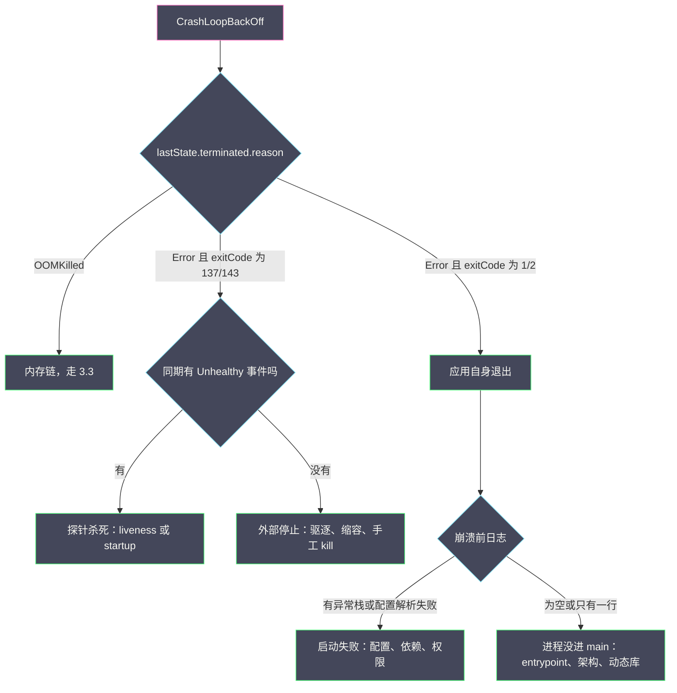
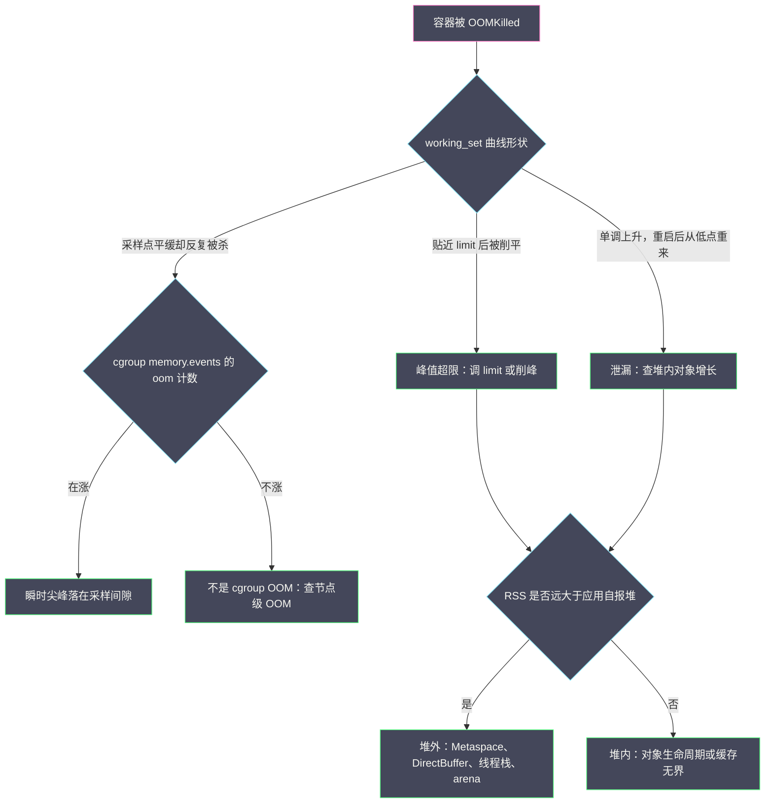
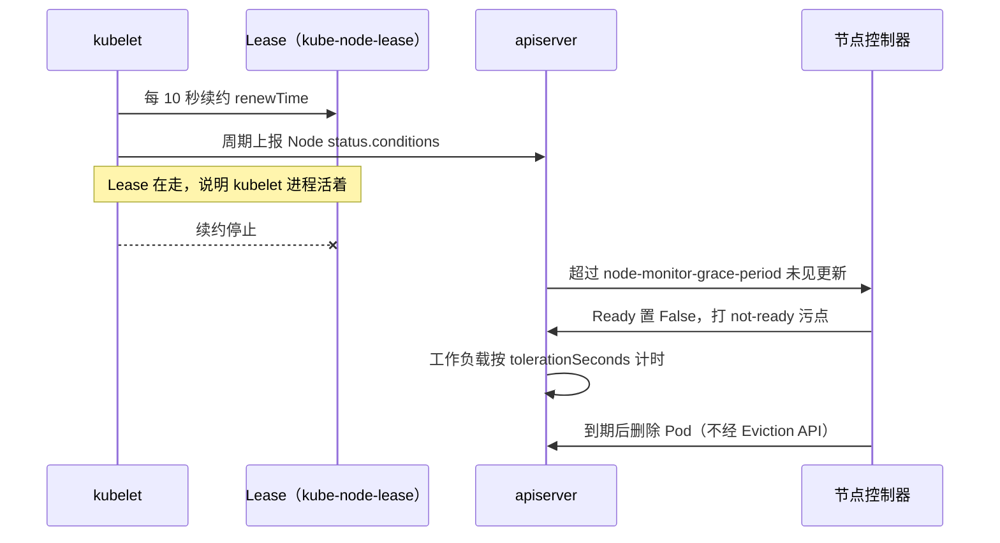
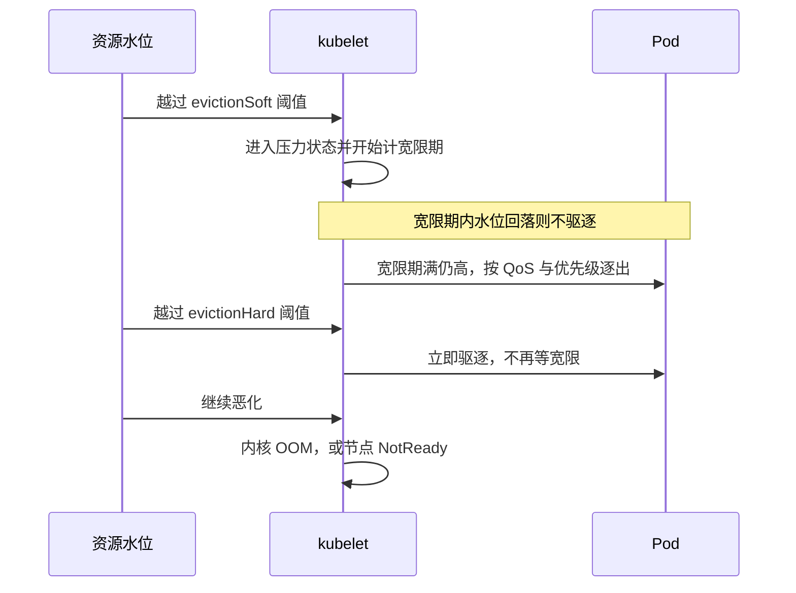

# 04 集群可观测性与故障排查

**摘要：**

集群出问题的时候，值班的人拿到的往往不是一句精确的报障，而是"下单页转圈""Pod 起不来""这台机器好像挂了"这类把症状和猜测混在一起的话。本文要补的是从这句话到"具体哪个对象、哪个字段、哪条判据"之间的那段路：先把问题定到节点层、控制平面层、调度层、容器层或应用层中的某一层，再按这一层的首查位置取证——事件的保留期与命名空间边界、`describe` 里真正带判据的几行、`--previous` 与退出码、以及事件过期之后还能拿到的替代证据。中段用五条判据链拆开高频故障：Pending 的"调度失败 / 配额拒绝 / 卷未绑"、CrashLoopBackOff 的"启动失败 / 探针杀死 / 依赖未就绪"、OOMKilled 的"limit 过低 / 泄漏 / 堆外"、节点 NotReady 的"心跳 / 运行时 / 磁盘压力"、服务 5xx 的"端点为空 / 就绪未过 / 策略拦截"。后段讨论容量与压力信号的阈值口径——`evictionSoft` 与 `evictionHard` 之间那段就是处置窗口——以及病因指标与症状指标各自该挂在告警上还是看板上。落点是一句朴素的话：排障的产出不是"我猜是内存问题"，而是"下一个假设被排除之前，我已经知道该看哪里"。

---

## 第 1 章 从"看起来不对"到"哪一层不对"

### 1.1 值班电话里没有"层"这个概念

凌晨三点十七分，值班手机上收到的不是告警，而是业务方转来的一句话：下单页转圈，有人重复付款。这句话里混着症状（转圈）、后果（重复付款）和一个还没验证的猜测（大概是下单服务挂了）。

集群这一侧同时给出了另一份安静的描述：`kubectl get nodes` 全绿，`kubectl get pods -n orders` 十二个副本都在 Running，`kubectl top node` 水位正常。两边都没有说谎，它们说的是两套语言——业务方描述请求在链路上的遭遇，集群描述对象的状态字段。诊断链路的第一道工序，是把前者翻译成后者。

翻译的产物不能是"可能是网络问题"，而必须是一个能被证伪的问句。譬如把"下单页 5xx"翻译成四句可判定的话：网关到后端的端点还在不在、后端是不是还在返回 5xx、后端所有实例是不是同时变差、集群里有没有对象在这段时间变了状态。四句话分别对应四个可查的位置，这就是**分层入口**的全部意义——它不承诺给你答案，只承诺把搜索空间切小。

日常报障的说法与可判定问句之间，大致是这样对应的：

| 报障的说法 | 可判定的问句 | 首查位置 |
| :--- | :--- | :--- |
| "页面一直转圈" | 网关的上游延迟是否抬升，抬升在哪个服务 | 网关 access log 的 `upstream_response_time` |
| "Pod 起不来" | 是没被调度、没建容器，还是容器退出 | NODE 列与 `containerStatuses` |
| "机器好像挂了" | 节点的 Ready 与 Lease 是否还在更新 | node conditions 与 `kube-node-lease` |
| "刚发布完就出问题" | 出问题的实例是不是来自新 ReplicaSet | Pod 创建时间与 ReplicaSet 哈希 |
| "配额不够了" | 是配额拒绝，还是调度没地方放 | `FailedCreate` 事件与 `FailedScheduling` message |

最后一行值得提前说明：配额拒绝与调度失败在用户侧都表现为"Pod 起不来"，但前者 Pod 对象从未存在，后者 Pod 一直在 Pending。翻译错这一句，后面的取证方向全反。

### 1.2 五个入口与五个第一问

分层的依据不是组件归属，而是证据归属：每一层的证据来自不同的写入者，因此每一层都有一个明确的首查对象和处置动作。下表把五层并排放开，最后一列是这层最容易被忽略的部分——什么时候该往上一层走。

| 层 | 典型证据 | 首查对象 | 第一问 | 什么时候往上一层走 |
| :--- | :--- | :--- | :--- | :--- |
| 节点层 | `Ready=False`、`MemoryPressure`/`DiskPressure`、同节点多个 Pod 同时异常、`Evicted` | `describe node` 的 conditions 与 `kube-node-lease` 里的 Lease | 这是单台机器的问题，还是所有机器都一样 | 三台以上节点出现同类 Condition |
| 控制平面层 | `kubectl` 普遍变慢、创建与更新超时、watch 断流、选主抖动 | apiserver 的请求延迟与 inflight、etcd 的提交延迟 | 请求在进 etcd 之前就排队了，还是 etcd 提交慢 | 连只读请求都开始超时 |
| 调度层 | Pod 长时间 Pending、rollout 卡住、`FailedScheduling` 反复出现 | `scheduler_pending_pods` 的三个队列与事件 message | 是没有地方放，还是规则不允许放 | 全集群 Pending 且 apiserver 也慢 |
| 容器层 | `CrashLoopBackOff`、`OOMKilled`、`ImagePullBackOff`、`CreateContainerConfigError` | `containerStatuses` 的 `state`/`lastState` 与 `--previous` 日志 | 进程为什么退出，退出码是多少 | 同一节点上所有容器同时退出 |
| 应用层 | 集群指标全绿但业务 5xx 或变慢、端点数量变化、单实例错误率异常 | EndpointSlice、应用自身的请求与依赖指标 | 是我这个进程的问题，还是它依赖的东西 | 依赖是共享单点，直接定性 |

表的最后一列值得单独说。排障最常见的浪费不是查不到，而是在一个已经被排除的层里反复回看：明明十二个副本只有一个异常，却还在翻 etcd 的 fsync 延迟；明明所有命名空间都受影响，却还在重启某个 Deployment。上移条件的作用，是给"这层不是原因"一个可写下的结论，让下一步有方向。

### 1.3 定界在前，归因在后

定界只需要三个答案：几个对象受影响、分布在哪些节点与命名空间、从什么时刻开始。

第一问的价值是除法。三十台节点里只有一台异常，搜索空间立刻除以三十；十二个副本里只有两个异常，问题大概率在实例内部（连接池、GC、坏节点上的 CPU 争抢），而不是集群配置。判定"是不是同一台机器"有一行命令就够：

```bash
# 按节点聚合，看异常是不是集中在少数节点上
kubectl get pods -A --field-selector status.phase!=Running \
  -o custom-columns=NS:.metadata.namespace,NAME:.metadata.name,NODE:.spec.nodeName
```

用指标做同一件事更省事：每个节点上未就绪 Pod 的数量，一次聚合就能看出共因。

```promql
# 节点级共因的判据：某个节点上未就绪 Pod 数明显高于其他节点
sum by (node) (kube_pod_status_ready{condition="false"} == 1)
```

第二问常被跳过，后果是拿错证据。同一个"5xx 上升"，如果只发生在 orders 命名空间，查端点与配额；如果 orders、pay、gateway 三个命名空间同时上升，先查控制平面与网络，不要挨个重启服务。

第三问的坑在时间源。业务方说"大概九点开始慢"，人对时间的记忆误差常在十几分钟量级；集群这一侧有三套时间：事件时间戳（apiserver 写入时刻）、日志时间戳（容器进程本地时钟）、指标采样点（Prometheus 抓取时刻）。三者对不齐，因果就会倒置。排查前先确认节点时钟同步（chrony 或 systemd-timesyncd 在跑），再看面板上"最后一个正常点"，比问人可靠。



图里有一个分支没有画到底：控制平面读写都慢的时候，仍然有两种可能——请求量本身暴涨（某个控制器反复全量 list），或者排队机制（API Priority and Fairness）把低优先级请求压住了。这两者的判据在架构剖析专栏里推导过，本篇只负责把它作为一个分支指出来，不重复机制。

### 1.4 取证的代价排序

排障动作本身是有成本的，而且成本差着数量级。`kubectl get` 读的是 apiserver 的 watch 缓存，在大多数场景下近乎免费；`kubectl describe` 是一次对象读取加一次事件 list，代价也不高；`kubectl logs` 要 apiserver 反向代理到节点 kubelet 的 10250 端口再读磁盘，跨了一跳网络且日志可能很大；PromQL 查询在大基数下要扫大量序列，慢查询会占用 Prometheus 的查询内存，重的时候会和采集抢资源；追踪最贵，因为要么等复现，要么依赖采样命中。

成本排序决定了**取证顺序**：先用便宜且覆盖面大的证据把假设压到一两个，再用贵的证据验证。反过来先翻日志，一次发布十二个 Pod、几千行输出，噪声会把信号埋掉；先查追踪，在 1% 采样下很可能连现场都没有。

但顺序不是教条。症状本身是"业务慢而集群全绿"时，应用层入口（上游延迟、trace、连接池）才是对的，事件列表里那两百条 Normal 只会消耗耐心。判断依据不是习惯，而是"哪一层还没被排除"。

还有一条很少被提起的自律：排障动作会改变现场。五千个 Pod 的集群上执行一次 `kubectl get pods -A -o yaml`，响应是几百 MB 量级，足够把 apiserver 的内存与带宽推向高位；在压力现场用 `--field-selector`、`-l`、`--chunk-size` 收窄结果，既是效率也是保护。

### 1.5 一条贯穿全篇的故障

后面各章共用一个场景。集群三十个节点（二十四个通用型、六个内存型），ordersvc 是十二副本的 Deployment，按机架标签跨三个故障域打散；入口是 ingress-nginx，监控用 Prometheus 加 kube-state-metrics，日志进 Loki，etcd 三节点，apiserver 三副本。

某个周四凌晨，故障是这样展开的：

| 时刻 | 现场 |
| :--- | :--- |
| 04:03 | worker-07 的 kubelet 停止上报，节点进入 NotReady |
| 04:04 | 该节点上三个 ordersvc 副本被摘出端点，可用端点从 12 降到 9 |
| 04:05 | 网关 5xx 升到 7%，下单接口 P99 从 120 毫秒升到 2.4 秒 |
| 04:08 | `tolerationSeconds` 到期，worker-07 上九个 Pod 被删除（其中三个是 ordersvc） |
| 04:11 | 三个重建的副本通过 readiness，端点回到 12 |
| 04:13 | 5xx 回落到 0.3% |
| 04:18 | kubelet 恢复上报，节点回到 Ready |

这条链的起点在应用层（5xx 与延迟），根因在节点层（kubelet 停止上报），中间隔着两个编排层的动作——先把副本摘出端点，再在容忍时间到期后删除。如果一上手就在应用层深挖——重启 Pod、扩副本、调超时——处置会全部打空，因为少的是节点，不是进程。后面的章节会回到其中三段：节点为什么 NotReady（3.4）、端点为什么在删除之前就已经减少（3.4 与 3.5）、300 秒的等待从哪里来、节点为什么会进入压力（3.4 与第 4 章）。

---

## 第 2 章 首查位置：事件、describe 与日志

### 2.1 事件能回答什么，不能回答什么

事件是排查的第一入口，也是被误用最多的入口。它在 apiserver 里是一等对象（`events.k8s.io/v1` 自 1.25 起 GA，`kubectl describe` 展示的兼容视图来自核心组的 Event），由调度器、kubelet、各控制器与节点控制器分别写入。作为对象，它有命名空间、有 `involvedObject`、能按 field-selector 检索；作为记录，它有保留期、会聚合、只有一句话。

它的边界有六条，每一条都对应一种踩过的坑。

其一，保留期。`kube-apiserver` 的 `--event-ttl` 默认一小时，凌晨发生、早上排查时事件早已过期。把 TTL 调长代价不小：Event 写在 etcd 里，高频对象的写放大可观，所以严肃集群的选择是导出而非延长——event-exporter 把事件转成日志或指标，既留了历史，也给 apiserver 减了负。

其二，命名空间作用域。`kubectl get events` 默认只查当前命名空间；节点事件落在 `default`；要看全集群必须 `-A`。这是"我明明看到事件了，同事却查不到"最常见的原因。

其三，聚合与计数。同一 `involvedObject`、同一 `reason`、同一 `message` 不会无限追加对象，而是累加 `count`、刷新 `lastTimestamp`。所以 `describe` 里那行 "Back-off restarting failed container, 41 times" 要读成"重试了四十一次"；判断"从什么时候开始坏"要看 `firstTimestamp`，不是 `lastTimestamp`。

其四，只有判定，没有上下文。`FailedScheduling` 的 message 由调度器生成，能说清"0/30 nodes are available: 3 Insufficient cpu"，但不会说为什么 request 是四核。事件回答"谁在什么时候做了什么判断"，不回答"为什么这个判断成立"。

其五，不是告警，也不是趋势。事件不主动通知，也回答不了"过去一周这个错误出现过几次"。要趋势就得导出成指标或日志，要通知就得配规则。

其六，对象删除之后，`describe` 那头就没有了。Event 对象在 TTL 内还在，但没人会把它们和新对象关联起来，除非按 UID 去检索。

```bash
# 全集群最近的 Warning，按时间倒序看最后 30 条
kubectl get events -A --field-selector type=Warning --sort-by=.lastTimestamp | tail -30

# 单对象的判定记录，describe 尾部那段就是它
kubectl get events -n orders \
  --field-selector involvedObject.kind=Pod,involvedObject.name=ordersvc-7d9f4b6c8-x2m9p

# 节点事件在 default 命名空间
kubectl get events -n default --field-selector involvedObject.kind=Node

# 现场复现时盯住看
kubectl get events -n orders -w
```

field-selector 支持哪些字段要记住：`involvedObject` 的 kind/name/namespace/uid、`reason`、`type`、`source` 等，不能按 message 子串搜。较新版本提供了 `kubectl events` 子命令，排序与过滤更贴近 `events.k8s.io/v1`，成熟度以对应版本文档为准。

### 2.2 describe 里值得逐行读的字段

Pod 的 `describe` 有四十多行，真正带判据的不到十行。

先看 `Phase` 与 `QoS Class`。Phase 是 `Running` 只说明容器进程在，不说明它在服务；QoS 是 `Guaranteed` 说明内存压力驱逐时它排在最后——这两个字段一个回答"在不在"，一个回答"被牺牲的次序"。

四个 Condition 是分层判据的主干，谁为 false，下一步就明确：

| Condition | 为 false 的含义 | 下一步 |
| :--- | :--- | :--- |
| `PodScheduled` | 调度器还没给它找到节点 | 看 `FailedScheduling`，走 3.1 |
| `Initialized` | init 容器没跑完，或卷没挂上 | 看 `-c <init>` 日志与卷事件 |
| `ContainersReady` | 至少一个容器的 readiness 没过 | 走 3.2 与 3.5，区分探针与依赖 |
| `Ready` | 组合条件：容器全 ready 且就绪门（`readinessGates`）通过 | 网关端点是否摘除，就看它 |

再往下是 `Containers` 段，四行有用：`State`（是否在 `CrashLoopBackOff`）、`Last State`（`reason`、`exitCode`、`startedAt` 与 `finishedAt`）、`Restart Count`、`Limits/Requests`。`finishedAt - startedAt` 是上一次实例活了多久，这个数字常被忽略，却是区分"启动失败"与"探针杀死"最直接的一条：活了四十秒被杀，与活了零点三秒退出，指向完全不同的链。`Limits` 是 OOM 判据的分母，`Requests` 是调度判据的分子，两者混着看是新手最容易犯的错。

`Environment` 与 `Mounts` 段也在这里，但 Secret 只显示长度、ConfigMap 只显示名字，看配置内容要 `kubectl get` 对象本身，别指望 `describe`。

Node 的 `describe` 里三样最有用。`Conditions` 连同 message：`KubeletNotReady` 的 message 会直接写 "container runtime is not running" 或 "PLEG is not healthy"，这一句往往就是结论。`Allocatable` 与 `Allocated resources`：后者是 requests 的汇总与占比，不是实际用量，"cpu requests 96%" 配上 `kubectl top` 的 30%，说明是装箱问题而不是负载问题。`Taints` 与 `Non-terminated Pods`：前者解释"为什么新 Pod 不来"，后者解释"这台机器上还有谁"。

最容易跳过的是 Deployment 与 ReplicaSet 的 `describe`。配额类故障的答案在那里：`Conditions` 里的 **ReplicaFailure** 为 True，事件 reason 是 `FailedCreate`，message 里带 `exceeded quota`。而此时 `kubectl get pods` 一个 Pending 都看不到，因为 Pod 从未被创建。这条判据在 3.1 展开。

### 2.3 日志的四条边界

`kubectl logs` 用起来最顺手，边界也最硬。

第一，`--previous` 只到上一次实例。容器每次重启会产生新的日志文件，`--previous` 读的是上一个实例的完整文件；连续崩溃十次，前九次的现场已经不在 `--previous` 里，只剩节点上尚未被轮转掉的碎片。

第二，轮转额度。`containerLogMaxSize` 默认 10Mi、`containerLogMaxFiles` 默认 5，高频刷日志的进程能在崩溃循环里把自己的现场冲掉。把额度调大只是延后问题，正解是结构化日志加集中采集。

第三，Pod 删除即消失。日志文件在节点的 `/var/log/pods/<namespace>_<pod>_<uid>/`，Pod 对象删除时 kubelet 清理目录，`kubectl logs` 与 `--previous` 同时失效。要回溯已删实例，唯一通道是集中日志，而且采集侧必须带 `pod_uid`，否则同名重建的实例会混成一条时间线。

第四，多容器必须 `-c`。默认目标是 Pod 里的第一个容器（可用注解 `kubectl.kubernetes.io/default-container` 指定），sidecar 与 init 容器默认看不到。init 容器失败导致 Pod 卡在 `PodInitializing` 时，主容器日志为空是正常的，要看的是 `kubectl logs <pod> -c <init-name>`。

```bash
# 按标签拉多个副本，默认只并发 5 路，Pod 多时要显式放开
kubectl logs -n orders -l app=ordersvc --all-containers --max-log-requests=12 \
  --since=10m --timestamps | grep -iE "error|timeout|refused"
```

时区这一条单独提醒：`--timestamps` 输出的是 RFC3339 的 UTC 时间，应用日志常打本地时间，两边的"04:11"可能差八小时。把时钟与时间格式对齐，是排障前十分钟最值得做的事，比多查三条指标有用。

### 2.4 退出码：比日志更早的证据

容器**退出码**是运行时立刻记录的，日志可能因为缓冲、轮转、进程直接崩溃而缺失，退出码几乎总在。笔者排障时习惯先读退出码再翻日志，理由很实际：退出码只有几个值，翻日志要面对几千行，先读它能把范围砍掉一半。

| 退出码 | 含义 | 常见来源 | 判据 |
| :--- | :--- | :--- | :--- |
| 0 | 正常退出 | 任务型容器完成、被停止时优雅退出 | `restartPolicy=Always` 下仍会重启，别当成功 |
| 1 / 2 | 应用自己退出 | 配置解析失败、依赖连不上、断言或 panic | 看 `--previous` 尾部的异常栈 |
| 126 | 命令不可执行 | entrypoint 权限、挂载盘 `noexec` | 事件里 `exec: ... permission denied` |
| 127 | 命令不存在 | entrypoint 写错、镜像里没有该 shell | 事件里 `exec: "xxx": executable file not found` |
| 137 | 128+9，SIGKILL | cgroup OOM、探针超时后被强杀、外部 kill | 看 `terminated.reason`：`OOMKilled` 是内存，`Error` 是别的 |
| 139 | 128+11，SIGSEGV | 原生代码崩溃、JVM crash | 日志里的 `hs_err_pid`、core dump |
| 143 | 128+15，SIGTERM | kubelet 停止容器（探针、驱逐、滚动更新、缩容） | 与 137 相邻出现，说明优雅退出超时后被强杀 |

137 是歧义最大的一个。同一段日志里出现 "Killed" 不代表内存问题：`OOMKilled` 是内核 cgroup 记账给出的结论，`Error` 是 kubelet 停止容器给出的结论。这一步分错，后面整条链都会走偏——去调 limit，而真正的原因可能是 liveness 的 1 秒超时。

### 2.5 事件过期之后

事件一小时后消失，但现场不会只剩空白。四类替代证据按可得性排序。

kube-state-metrics 保留"最后一次"：`kube_pod_container_status_last_terminated_reason`、`kube_pod_container_status_waiting_reason`、`kube_pod_container_status_restarts_total`。它能回答"多常发生、什么原因"，不能回答"某一次为什么"。

事件导出把一小时变成可检索的历史。event-exporter 把事件写成日志或指标，代价是又一套采集与存储，需要按 reason 聚合降噪，否则 Warning 事件很快会把日志系统灌满。

审计日志回答另一类问题：谁在什么时候改了配额、cordon 了节点、更新了镜像。人为操作引发的事故，只有审计日志有痕迹。

节点现场是最后一道。`crictl ps -a`、`crictl inspect`、`journalctl -u kubelet`、`dmesg`，在 apiserver 不可用时也能用——crictl 直连 CRI socket，绕过 apiserver 与 kubelet 的 API 路径，这是它存在的最大理由。

---

## 第 3 章 五条判据链

### 3.1 Pod Pending：没被调度、没被允许、还是没等到卷

Pending 的定义是"对象已被接受，但没有进入运行"，它把两种完全不同的状态压在同一个 Phase 里：还没被调度的，与已调度但容器没起来的。所以第一步永远是看 NODE 列，而不是看 Phase。

| 子类 | 现场特征 | 判据位置 | 常见根因 | 处置方向 |
| :--- | :--- | :--- | :--- | :--- |
| 调度失败 | NODE 为空，`PodScheduled=False` 且 reason 为 Unschedulable | `describe` 尾部 `FailedScheduling` 的 message | 容量、污点、亲和、拓扑约束、卷 | 改约束或加容量 |
| 配额或准入拒绝 | Pod 根本不存在，副本数少于期望 | Deployment/ReplicaSet 的 `ReplicaFailure` 与 `FailedCreate` | `ResourceQuota` 某维度用尽、`LimitRange` 抬高了默认 requests、准入 webhook 拒绝 | 调配额或降 requests |
| 卷未绑定 | NODE 为空，或已调度但卡在 ContainerCreating | PVC 的 Pending 状态与卷事件 | StorageClass 无可用 provisioner、`WaitForFirstConsumer` 下无可用节点、卷拓扑与节点冲突 | 修卷或改拓扑 |

调度失败的判据全在那一行 message 里，它形如"原因清单加节点计数"：

```text
0/30 nodes are available: 3 Insufficient cpu, 3 Insufficient memory,
24 node(s) didn't match Pod's node affinity/selector.
```

读法有两步。第一步确认各原因的节点数加起来等于总数，这说明失败是全量而非局部；第二步判断这一堆原因是不是同一个约束的多种表述。常见片段与对应结论：

| message 片段 | 结论 |
| :--- | :--- |
| `Insufficient cpu` / `Insufficient memory` | requests 装不下，与 limit、实际用量无关 |
| `node(s) had untolerated taint` | 污点不匹配，常见于专用节点池与 master |
| `node(s) were unschedulable` | 节点被 cordon，或在 NotReady 后被打了污点 |
| `didn't match Pod's node affinity/selector` | 标签体系出问题：拼写、节点池改名、selector 与模板不一致 |
| `didn't match pod topology spread constraints` | 打散约束的 `DoNotSchedule` 生效，宁可 Pending 也不违规 |
| `pod has unbound immediate PersistentVolumeClaims` | PVC 尚未绑定 |
| `node(s) had volume node affinity conflict` | 卷钉在某个故障域，节点不在同一域 |
| `Too many pods` | 节点 `maxPods`（默认 110）到顶 |

这张表里最容易误读的是 `Insufficient cpu`：它说的是 requests 装不下，不是 CPU 用满了；一个节点 CPU 实际使用率 20%、requests 95% 时，照样报它。第二容易误读的是亲和类失败——二十四台节点全部"didn't match"，先怀疑约束本身写错，而不是先扩容，扩容对标签错配毫无帮助。

污点与 cordon 的症状很像"节点明明空闲却不接活"。cordon 只阻止新 Pod 调度，已有 Pod 继续跑，所以看板上节点空得发慌而新 Pod 就是不去；判据是 `kubectl get node` 的 `SchedulingDisabled` 与 `describe node` 的 Taints。

卷这一支有两个反直觉点。`WaitForFirstConsumer` 的 StorageClass 下，PVC 在 Pod 被调度前一直是 Pending，事件顺序反过来（先有 Pod 等待、后有卷创建），把它当故障是误判。卷的拓扑约束则会把 Pending 变成"部分节点永远不行"：本地盘与 zone 绑定的云盘都带节点亲和，Pod 若被 `nodeSelector` 限在别的故障域，两边永远对不上。绑定模型的细节在本系列的 [[01 持久化存储——PV PVC StorageClass 与 CSI]] 里，这里只取判据。

还有一类常被塞进 Pending 的：镜像拉不回来。此时 Pod 已经有节点，状态列显示 `ErrImagePull` 或 `ImagePullBackOff`，属于"已调度、未运行"。判据是 `describe` 里事件的 message 原文，四种原因各有特征：`not found` 或 `manifest unknown` 是 tag 写错或镜像被清理；`unauthorized` 或 `denied` 是 `imagePullSecrets` 缺失、键名不对或凭据过期；`dial tcp ... i/o timeout` 是仓库不可达，常见于私有仓库域名解析失败或被网络策略挡住；`no match for platform in manifest` 是架构不匹配。镜像拉取同样按指数退避重试，所以"过一会儿自己好了"多半是仓库抖动，不是配置被修好了。

配额拒绝与 Pending 的区别要记住：配额是**准入层拒绝**，Pod 对象根本没被创建，所以 `kubectl get pods` 看不到任何 Pending，只有副本数不足与 Deployment 的 `ReplicaFailure`。事件查询要按 reason 走：

```bash
kubectl get events -n orders --field-selector reason=FailedCreate
# Message 形如：exceeded quota: orders-quota, requested: requests.cpu=2,
#   used: requests.cpu=46, limited: requests.cpu=48
```

配额按维度独立计算，CPU 用尽不代表内存也满；`LimitRange` 的默认 request 会把没写 requests 的容器抬到一个下限，于是"我只加了一个很小的 Pod"也可能触发拒绝。配额维度的划分见 [[03 多租户隔离与资源治理]]。

资源碎片是第四类，判据不在单个节点上：所有节点 `Allocated resources` 都在 60% 到 90% 之间，看起来都没满，却没有单台能容下新 Pod 的 request。处置的三条路代价不同——降低 request（最便宜，前提是原来那个数字是从别处抄来的四核）、把大 Pod 拆小（改应用形态）、加节点（最贵且掩盖问题）。descheduler 的重整也属于这一类，但它会引入驱逐，得在变更窗口里跑。

Pending 不烧 CPU，但它卡住的是变更窗口。滚动发布时旧副本已缩、新副本未起，可用容量在漏斗里漏；所以 Pending 的处置优先级不取决于它占了多少资源，而取决于它是否让可用副本数跌破底线。

两处典型反例：看到 Pending 就加节点，实际是 selector 写错，加多少台都一样 Pending；看到 Pending 就去调 memory limit，而调度只认 requests 与约束，limit 与 Pending 无关。

### 3.2 CrashLoopBackOff：退出的是应用、探针、还是依赖

CrashLoopBackOff 是"容器启动后退出的循环"，不是一种错误。kubelet 按指数退避重启：10 秒起、翻倍、300 秒封顶；BackOff 事件是合并计数。这个状态里容器不在运行，所以"这时候 exec 进去看看"多半失败，要么等下一个窗口，要么用临时容器取证（机制在 [[云原生/Kubernetes/Kubernetes架构深度剖析/13 kubelet 深度剖析：Pod 生命周期与容器运行时接口|kubelet 与容器运行时接口]] 一篇里）。



三分支的判据组合如下。注意"容器活了多久"这一列，它是最省时间的分界。

| 分支 | 退出码与 reason | 容器存活时长 | 日志特征 | 常见根因 |
| :--- | :--- | :--- | :--- | :--- |
| 启动失败 | `Error`，1 或 2 | 毫秒到几秒 | 有异常栈、配置解析错误、依赖连接拒绝 | 配置或密钥缺失、依赖地址错、数据库不可达、代码 panic |
| 探针杀死 | `Error`，137 或 143 | 稳定在探针预算附近（三十秒到几分钟） | 应用已打印启动完成，甚至已开始处理请求 | liveness 过于激进、缺 startup 探针、CPU 被节流导致探针超时 |
| 依赖未就绪 | 不退出，`Ready=False` | 容器持续运行 | 反复输出 "waiting for db" 一类等待日志 | 依赖单点故障、连接池配置、DNS 解析慢 |

探针杀死这一支要算账：liveness 的 `periodSeconds` 10 秒乘 `failureThreshold` 3，判定窗口是 30 秒，再加 `initialDelaySeconds`；如果应用启动要 90 秒而没配 startup 探针，就会被每 30 秒杀一次，永远起不来。判据是容器存活时长稳定在 30 到 60 秒之间，且日志显示应用每次都在"启动到一半"。

依赖未就绪与启动失败的分界在进程是否活着：进程活着、日志持续输出、只是 readiness 不过，走依赖与探针那条；进程退出，走启动失败那条。这条分界错位的代价是方向性错误——一个去调探针参数，一个去翻应用代码。

还有一类常被归错：`CreateContainerConfigError`。它根本不是 CrashLoop——ConfigMap 或 Secret 不存在时容器不会被创建，没有 `lastState`，日志为空，Pod 停在 ContainerCreating。判据是 `describe` 里的 `Failed` 事件 message：`Error: configmap "ordersvc-config" not found`。把它当 CrashLoop 会去改应用配置，而实际是配置对象缺失或键名拼错。

退避还有一个影响处置节奏的副作用：镜像或配置改好之后，处于 BackOff 的 Pod 仍要等下一次重试，最长五分钟。这不是修复没生效，而是还没到重试窗口；`kubectl rollout restart` 或删除 Pod 会立刻拉起新实例。判断"改动是否生效"，看的是新实例的启动结果，不是旧实例的退避计时。

### 3.3 OOMKilled：limit 太低、泄漏、还是堆外

先立事实：OOMKilled 是 cgroup 记账的结果——内核发现这个 cgroup 的内存用量触及 limit，杀掉组内最占内存的进程，运行时把 `reason` 记成 `OOMKilled`。它只说"触及 limit"，不说"为什么触及"。几种成因的判据方向完全不同。



第一种，limit 低于真实峰值。判据是 `container_memory_working_set_bytes` 与 `kube_pod_container_resource_limits{resource="memory"}` 的比值在故障前一直接近 1，重启时刻与发布、定时批任务、流量高峰这些事件相关，同时节点整体内存充裕（排除节点压力）。这条判据有个前置：口径要选对。`container_memory_usage_bytes` 含 inactive file cache，`working_set` 才是 OOM 与驱逐的判据；拿 usage 当 RSS，会得出"limit 明明够"的错觉。

第二种，泄漏。判据是每次重启后工作集从低点单调上升、斜率稳定，被杀后重置，重启周期越来越短或稳定出现；堆内指标（JVM 的 heap used after GC、Go 的 heap inuse）同步上涨。处置指向应用代码，调 limit 只是把炸点延后。

第三种，堆外。判据是 RSS 明显大于应用自报的堆，且随流量或连接数增长。JVM 上有四个常客：Metaspace（动态生成类、反射代理、脚本引擎）、DirectByteBuffer（NIO 与 Netty 的堆外缓冲，`-XX:MaxDirectMemorySize` 默认等于 `-Xmx`，很多团队不知道它算在堆外）、线程栈（默认每线程 1MiB，线程数暴涨直接吃 RSS）、glibc 的 malloc arena（多线程分配器的碎片，`MALLOC_ARENA_MAX` 可以收）。验证手段是 `-XX:NativeMemoryTracking=summary` 配 `jcmd <pid> VM.native_memory summary`，看 committed 的分类构成；容器里的 `memory.stat` 中 anon 与 file 的占比也能给出方向。

采样盲区是第四种，容易被忽略。Prometheus 十五秒采样会漏掉一秒级的分配尖峰，曲线看着平，容器却反复被杀。判据在计数类指标：cAdvisor 的 `container_oom_events_total`，或容器内读 `/sys/fs/cgroup/memory.events` 里的 `oom` 计数；内核侧 `dmesg` 里的 "Memory cgroup out of memory" 与 `node_vmstat_oom_kill` 能进一步区分 cgroup 级与节点级。这是"症状指标看不见、计数指标看得见"的典型例子，第 5 章会用到它。

节点级 OOM 与容器级 OOM 必须分开。节点 OOM 由内核在节点维度挑 `oom_score` 高的进程，可能杀掉 kubelet、containerd 或任意进程，Pod 的表现是 Unknown、连接断、或整节点 NotReady；容器级 OOM 只影响那个 cgroup，重启后继续跑。判据是 dmesg 里是否有 cgroup 前缀，以及 `node_vmstat_oom_kill` 的增长是否伴随节点 Conditions 变化。

把 requests 与 limits 的四种组合摆在一起，能看清为什么同一份代码在不同集群上死法不同：

| requests | limits | QoS | 调度按 | 被杀按 | 典型用途 |
| :--- | :--- | :--- | :--- | :--- | :--- |
| 未设 | 未设 | BestEffort | 0 | 节点压力下第一个走 | 可中断的临时任务 |
| 设 | 未设 | Burstable | requests | 节点 allocatable，容器本身没有上限 | 内部工具，代价是吃内存时连累整台机器 |
| 设 | 设且更大 | Burstable | requests | limit | 大多数在线服务 |
| 设且相等 | 设且相等 | Guaranteed | requests | limit | 关键服务与有状态组件 |

这张表解释两件常被混淆的事。requests 不设的 Pod 在调度器眼里是免费的，会把节点装到严重超卖，等到压力出现时它又是第一个被驱逐的——"看起来没占资源"的代价是"最先被牺牲"。limits 不设的 Pod 没有 cgroup 上限，吃内存时不会触发容器重启，而是把节点推到内核 OOM 或 NotReady，故障形态从"一个 Pod 重启"变成"整台机器抖动"；后者排查成本高一个数量级，因为它没有 OOMKilled 这个明确信号。

处置有四种，代价依次上升：调 limit（最快，但让节点超卖更严重，可能把容器级 OOM 升级成节点级）；调 requests（不改变被杀阈值，改变的是调度与 QoS，也是 HPA 利用率的分母）；削峰（批任务错峰、连接池与缓存设上限、JVM 用 `-XX:MaxRAMPercentage` 让堆跟随 limit 并给堆外留 25% 到 30%）；用 Guaranteed QoS 保护关键服务（requests 等于 limits，代价是装箱率下降，节点能放的 Pod 变少）。

一个反例值得单独写出来：看到 OOMKilled 就翻倍 limit，几周后节点级 OOM，故障从"一个 Pod 重启"升级成"一台机器上的服务全挂"。把结果当原因，处置就会把问题推到更贵的一层。

### 3.4 节点 NotReady：心跳、运行时、还是磁盘

节点心跳有两条通道：Node 对象的 `status` 与 `kube-node-lease` 里的 Lease。kubelet 高频续约 Lease（`nodeLeaseDurationSeconds` 默认 40 秒，续约间隔 10 秒），节点控制器用 `node-monitor-grace-period`（默认 40 秒）判断失联。拆成两条通道的原因是写压力——把心跳从 Node 对象里挪出来，状态更新与心跳解耦，这是机制层的取舍，本篇只取它的诊断价值。



判据顺序是三段：先看 Lease，再看 conditions 的 message，最后上机。

```bash
# 第一段：心跳有没有在走
kubectl get lease -n kube-node-lease worker-07 -o jsonpath='{.spec.renewTime}'

# 第二段：Conditions 里 kubelet 自己写的原因
kubectl get node worker-07 -o jsonpath='{range .status.conditions[*]}{.type}={.status} {.reason} {.message}{"\n"}{end}'
```

Lease 在走而 Ready 是 False，说明 kubelet 活着，问题在状态上报路径：apiserver 到 kubelet 的反向通道不通、status 更新被限流、或 PLEG 卡住导致 status 迟迟算不出来。Lease 不走，说明 kubelet 与 apiserver 断联，或 kubelet 进程已经死了。

conditions 的 message 是第二层判据，多数时候一句话定性：

| message 或 condition | 结论 |
| :--- | :--- |
| `container runtime is not running` | 容器运行时不可用，CRI socket 连不上 |
| `PLEG is not healthy` | 运行时响应慢，relist 超过阈值；`systemctl status` 看起来正常 |
| `MemoryPressure=True` | 内存压力，走第 4 章 |
| `DiskPressure=True` | 磁盘或 inode 压力，走 4.2 |
| `PIDPressure=True` | PID 耗尽，走 4.3 |
| `x509: certificate has expired` | kubelet 客户端证书过期，日志里是 401 |
| message 为空且 Ready=False | 常见于网络分区，kubelet 上报不上来 |

上机检查是一条固定的清单，按"进程、运行时、资源"三段走：

```bash
systemctl status kubelet
journalctl -u kubelet --since "15 min ago" | tail -50
crictl info | head -20
crictl ps -a | wc -l
df -h /var/lib/kubelet /var/lib/containerd
df -i /var/lib/kubelet
cat /proc/loadavg
ss -s
```

网络分区有一个不对称的后果：kubelet 到 apiserver 不通时，节点上的容器照常跑，但节点被标 NotReady 后，这些 Pod 会先被摘出端点（流量转移到其他副本），300 秒后（`tolerationSeconds`）才被删除重建。所以"节点挂了业务没感觉"只在副本充裕时成立，处置窗口就是这五分钟——要么修好 kubelet，要么接受删除重建。

这里有一处与直觉相反的地方：节点控制器删除 Pod 走的是直接删除而不是 Eviction API，kubelet 的压力驱逐同样绕过 Eviction API，两者都不看 PodDisruptionBudget。想在节点故障时保住可用副本，靠的是跨节点打散（`topologySpreadConstraints` 或反亲和），不是 PDB——PDB 保护的是 `kubectl drain` 与主动驱逐那条路径。

把第 1 章那条案例的算术走一遍（示例推算）：ordersvc 十二副本跨三个故障域、每域四个，worker-07 上有三个副本。NotReady 之后端点先掉到 9，可用容量少了四分之一，剩余副本被打满、排队时间抬升，5xx 就是从这里开始的；300 秒后 Pod 被删除，端点并没有再掉——它早在五分钟前就掉过了；控制器在别的节点重建，镜像拉取、连接池建立、readiness 通过按每个 40 秒算，还要两到三分钟。加起来接近十分钟，而节点本身"挂"了十五分钟。这十分钟里，真正能缩短的只有两段：容忍时间（调小则搬得更快，代价是网络抖动时误搬）与启动时间（镜像预热、就绪判断前移）；摘流那一段是自动的，也正是它把"节点故障"转换成了"容量不足"。

处置要看根因落在哪一段。kubelet 崩溃或配置错：修配置重启 kubelet，节点上的容器通常不受影响（容器由运行时保活），但状态会短暂不一致。运行时卡住：重启 containerd 会重启该节点所有容器，等于滚动重启一台机器，必须在变更窗口内做，并确认副本能承接。磁盘满：先清镜像与日志，再谈扩容，注意 `df -h` 有空而 `df -i` 耗尽的情况。证书过期：走各自的轮换流程，kubeadm 集群有 `kubeadm certs renew`，自建集群按自己的签发流程来。

### 3.5 服务 5xx：端点为空、就绪未过、还是策略拦截

5xx 的第一问不是"应用哪里错了"，而是"这个 5xx 是谁返回的"。网关的 access log 里有两个字段：`status` 与 `upstream_status`。两者都是 5xx，说明后端确实返回了错误；只有 `status` 是 5xx 而 upstream 没有记录，说明请求根本没到后端——端点为空、连接被拒、或超时。这一步不做，后面所有排查都是在猜。

判据链按"端点、就绪、策略、数据面、应用"五段走。

第一段看端点。`kubectl get endpointslice -n orders -l kubernetes.io/service-name=ordersvc -o wide`，看 endpoints 数量与 ready 条件。数量为 0，进第二段；有值但流量不均，跳到第四段。

第二段问端点为什么是空的，只有三个原因。selector 不匹配：比对 `kubectl get svc ordersvc -o jsonpath='{.spec.selector}'` 与 Pod 标签，Deployment 改了标签忘了改 Service selector 是常见事故。Pod 未 Ready：读 describe 的 `Ready=False` 与 `Unhealthy` 事件。Pod 正在终止：默认不进端点，除非 `publishNotReadyAddresses` 打开；判据是 `deletionTimestamp` 与 `preStop` 加 `terminationGracePeriodSeconds` 的时长。

第三段查就绪探针。readiness 失败不重启容器，症状因此很有辨识度：容器 Running、端点消失、网关 5xx、应用日志一切正常。要分开"应用真不健康"与"探针太严"：前者日志里有依赖错误或初始化未完成，后者应用侧延迟指标正常而探针侧超时。探针太严有个自指的机制——`exec` 探针要在容器内 fork 进程，CPU 贴着 limit 时它自己会被 CFS 节流拖到超时，越忙的实例越容易被判死。判据是对比探针失败时段与 `container_cpu_cfs_throttled_seconds_total` 的抬升。

第四段查策略与数据面。端点有值却连不上，先看 `kubectl get networkpolicy -n orders`：策略选的是被访问的 Pod，不是来源，egress 阻断 DNS 会让应用报 "no such host"。再看 conntrack（`node_nf_conntrack_entries` 与上限的比值）、`targetPort` 与容器实际监听端口、以及 kube-proxy 的规则是否同步——EndpointSlice 有值但节点上没有对应的 DNAT 规则，是少见的真实故障，判据是 `kubectl -n kube-system logs -l k8s-app=kube-proxy`。

第五段才是应用自身。单实例错误率高、其他实例正常，方向在连接池、线程池、下游超时、坏节点；同一 Deployment 内不同 Pod 的错误率分布是这一段的入口指标。

| 现象 | 首查 | 常见根因 |
| :--- | :--- | :--- |
| 网关 503，后端无 upstream 记录 | EndpointSlice 数量与 ready 条件 | 端点为空：selector、readiness、terminating |
| 网关 502，upstream 有记录但立即断开 | 后端进程与监听端口 | 进程崩溃、端口写错、TLS 握手失败 |
| 网关 504 | upstream 响应时间分布 | 后端慢：依赖超时、GC 停顿、连接池排队 |
| 后端返回的 5xx 原样透传 | 应用日志与依赖指标 | 业务异常、下游错误、数据库问题 |
| 只有部分来源失败 | NetworkPolicy、conntrack | 策略拦截、表满、单节点网络问题 |

反例是把网关 5xx 一律当应用 bug：端点为空时，重启应用一万次也不会恢复，因为问题在 Service 与 Pod 的标签关系上；反过来，后端透传 5xx 时去查 CNI，同样是在错误的一层打转。区分这两个方向，靠的就是 access log 里的那两个字段。

网关日志里还有一个容易混进来的码：499，客户端在响应返回之前断开。它常被误算进 5xx 排查，实际是客户端超时先于服务端返回，方向在超时预算（网关、客户端、应用三层的超时谁更短）而不是后端错误。判据是这个码与 504 是否在同一时间段成对出现——成对出现说明后端慢已经溢出到客户端侧。

### 3.6 五条判据链的共用骨架

五条链各管一段，骨架是同一个：状态字段给出方向，事件 message 给出判定，日志与退出码给出原因，指标与计数器给出量级与频次。取证顺序也一致——先读状态与事件（便宜且带判定），再读日志与退出码（贵但带原因），最后用指标确认影响面与时间窗。五条链的差异只在"哪个字段是第一步"，不在方法。

> [!info] 证据与判据是两回事
> 证据是现场能取到的东西——一条事件、一段日志、一个计数；判据是拿它做的那个二选一。同一份证据可以支持不同判据："容器反复重启"既能支持"内存不够"，也能支持"探针太紧"，差别只在你还看了哪几个字段。所以判据链的写法是先给判据、再给证据，反过来写出来的只是一份命令清单。

还有一个共同的动作原则：一次只改一个变量，改完等一个完整的验证周期。改 limit、改探针、改 selector 三件事同时做，等于放弃了归因——"改完好了"和"改完没好"都拿不到信息。验证周期的长度由对象的状态机决定：CrashLoop 要等退避，NotReady 要等 `tolerationSeconds`，readiness 要等 `periodSeconds` 乘 `failureThreshold`，滚动发布要等 `progressDeadlineSeconds`。在周期走完之前下结论，得到的多半是噪声。

最后一条是记录。处理完当场写下三行——时间线、判据、处置——比事后回忆的复盘可靠得多；这三行也是下次遇到同类症状时最省时间的入口。故障不会按文档发生，但判据链会重复使用。

---

## 第 4 章 容量与压力：阈值在哪，窗口就有多长

### 4.1 驱逐信号与两档阈值

kubelet 周期评估一组资源信号，越过 soft 阈值进入压力状态并开始计时，越过 hard 阈值立即动手。默认只配 hard，soft 需要显式打开。

| 信号 | 默认 hard 阈值 | 覆盖范围 |
| :--- | :--- | :--- |
| `memory.available` | < 100Mi | 节点可用内存，给 kubelet 与系统进程留的余量 |
| `nodefs.available` | < 10% | 节点文件系统：`/var/lib/kubelet`、日志、emptyDir |
| `imagefs.available` | < 15% | 镜像与容器可写层所在文件系统 |
| `nodefs.inodesFree` | < 5% | 仅 Linux |
| `imagefs.inodesFree` | < 5% | 仅 Linux |

soft 一侧的四个参数要一起看：`--eviction-soft` 给出更早的阈值，`--eviction-soft-grace-period` 给出宽限期长度，`--eviction-max-pod-grace-period` 限制单个 Pod 的终止宽限，`--eviction-minimum-reclaim` 要求每次驱逐至少回收多少资源（譬如 1Gi 内存或 5% 磁盘），避免"驱逐一个、水位又上去、再驱逐"的拉锯。还有一个滞回参数 `--eviction-pressure-transition-period`（默认 5 分钟），控制从压力状态退出的时机，防止水位在阈值边缘抖动导致反复进入压力态。

驱逐次序按三个因素排：Pod 是否超出自己的 requests（超出的先走）、PriorityClass（低的先走）、QoS（BestEffort 先走、Burstable 次之、Guaranteed 最后）。具体排序以对应版本文档为准，但三者的相对关系稳定：一个没写 requests 的 BestEffort Pod，是节点压力下**第一个被牺牲**的。

### 4.2 磁盘与 inode：两种耗尽长得不一样

`nodefs` 与 `imagefs` 是两个文件系统，故障形态不同。

imagefs 满的症状是"节点还能跑，但新镜像拉不动"：`Failed to pull image`、`no space left on device`。清理手段是 `crictl rmi --prune`，同时检查 `imageGCHighThresholdPercent`（默认 85）与 `imageGCLowThresholdPercent`（默认 80）——GC 的触发阈值如果被调得太高，镜像会把盘吃满。

nodefs 满的症状更重：emptyDir 写入失败、日志丢行、kubelet 无法写 Pod 状态，最后节点 NotReady。清理要看单 Pod 的日志与 emptyDir，注意 `containerLogMaxSize` 10Mi 乘 `containerLogMaxFiles` 5 的额度是每容器算的，一百个 Pod 的节点上，日志这一项就能吃掉几十 GB。

inode 耗尽的形态最容易被误判：`df -h` 显示还有空间，写入却报 "No space left on device"。来源是大量小文件——镜像层、emptyDir 里的临时文件、未清理的日志轮转残留。判据是 `df -i`，定位大户用 `du -s /var/lib/kubelet/pods/*`。inode 耗尽的处置比空间耗尽更麻烦，因为删大文件没用，得删文件数量。

本地临时存储也可以按 Pod 配额：`ephemeral-storage` 的 requests 与 limits（1.25 起 GA，以对应版本文档为准）。超限被驱逐的 reason 是 `Evicted`，message 里写 "ephemeral local storage usage exceeds the total limit"。这一条把"某个 Pod 写爆节点盘"从节点级事故降级为单实例事故，代价是要维护每个工作负载的临时存储预算。

### 4.3 PID 与 Pod 数：两个被忽略的上限

PID 压力比内存和磁盘少见，症状却很难认。节点级 PID 上限来自内核 `kernel.pid_max`，单 Pod 可以用 `--pod-max-pids` 设 `pids.max`。PIDPressure 为 true 时 fork 失败，表现是应用报 "Resource temporarily unavailable"、fork 或 exec 失败、`exec` 探针本身执行不了（它也要 fork）。判据是 `cat /sys/fs/cgroup/pids.current`、`ps -eLf | wc -l`、容器内 `cat /sys/fs/cgroup/pids.max`。

PID 耗尽最常见的来源不是"进程多"，而是"线程多"——**线程也算 PID**，cgroup 记账里两者同等计数，所以一个线程泄漏的 Java 服务可以在进程数只有几个的情况下把 PID 吃满。其次是 sidecar 里的循环 fork 与未回收的僵尸进程。

Pod 数上限更直白：节点 `maxPods` 默认 110，看板上用 `kube_node_status_capacity{resource="pods"}` 与它的 allocatable 值核对，调度器给出的 message 是 `Too many pods`。但实际先耗尽的常常不是 Pod 数，而是 CNI 的 IP 池——症状是 `FailedCreatePodSandBox` 事件里 CNI 报 "no IP addresses available"，而 Pod 数离上限还有距离。

### 4.4 容量算术：requests 决定装得下，usage 决定活不活

下面这组数字是示例推算，不是任何真实集群的测量值，只用来演示两个口径的关系。

一台 16 核 64GiB 的节点，`--system-reserved` 与 `--kube-reserved` 合计 2 核 4GiB，Allocatable 就是 14 核 60GiB；已调度 Pod 的 requests 之和是 12 核 52GiB。此时来一个 request 2 核 8GiB 的 Pod：14 减 12 正好 2 核，60 减 52 正好 8GiB，算起来刚好装下。问题在于"刚好"等于零余量：这个 Pod 一旦把 request 用满，节点就贴着驱逐阈值运行，任何一个 DaemonSet 滚动、任何一次内存尖峰都会把节点推进 MemoryPressure；而如果它是滚动发布中的第三个新副本，前两个已经把余量吃掉，第三个就变成 Insufficient memory。这就是容量规划不能把 Allocatable 算到小数点后一位的原因。

若这个 Pod 的 limit 是 4 核 16GiB，节点就存在约 2 倍 CPU、2.6 倍内存的超卖。超卖本身不是问题，云原生集群靠它提升装箱率；问题是所有 Pod 同时接近 limit 时，节点会进入 MemoryPressure，而那时谁先被驱逐由 QoS 与 PriorityClass 决定。这也是关键服务要 Guaranteed 的真实理由：不是性能更好，而是在压力时刻排在最后。

两个数字回答两个问题，混用会得出矛盾结论：requests 之和决定"装不装得下"，这是调度器唯一看的量；usage 决定"活不活得下去"，这是 kubelet 驱逐与内核 OOM 看的量。看板上把两者放进同一张图——requests 用柱状、usage 用曲线——一眼就能分出是装箱问题（柱高线低）还是负载问题（柱低线高）。

滚动发布还要额外留一份余量。`maxSurge` 25% 在十二副本上是三个新 Pod，意味着旧副本全在的情况下，节点上还要能容纳三个新 Pod 的 requests；`maxUnavailable` 设为 0 时这份余量必须真实存在，否则发布会卡在 Pending。而 Pending 的 Pod 不消耗 CPU，看板上完全看不出异常，处置的人会误以为"资源够用"。容量规划的判据因此是"峰值副本数加 surge 的 requests 总和"，不是稳态副本数；同理，HPA 的 `maxReplicas` 也应当被容量检查覆盖，否则扩到一半就开始 Pending。

`kubectl top` 在这里帮不上忙：它是 metrics-server 的当前值，没有历史，也不和 requests 对照。核对装箱要看 `kubectl describe node` 的 `Allocated resources`。

### 4.5 从水位到驱逐的时间轴

soft 与 hard 两档阈值之间的那段距离，就是**处置窗口**的长度。



窗口有多长取决于消耗速率，而不是阈值差本身：内存从 500Mi 余量掉到 100Mi，可能只用几十秒（一个批任务启动），也可能用几小时（缓慢泄漏）。所以 soft 阈值要按"预期反应时间乘消耗速率"来定，而不是照抄别人的百分比。三件事应该在窗口内做完：确认是哪个 Pod 在吃（`kubectl top pod` 加 requests 对照）、把非关键负载迁走或停掉、准备扩容或让 HPA 生效。第 1 章那条贯穿案例里，worker-07 从 NotReady 到 Pod 被删除只有五分钟——这就是 tolerationSeconds 给窗口定的长度。

---

## 第 5 章 指标的选择：病因与症状

### 5.1 一条判据：它恶化了，用户是不是必然受损

**症状指标**恶化时，用户几乎一定受损：请求成功率、P99 延迟、可用端点数量、就绪 Pod 数。**病因指标**恶化时，用户只是"可能"受损：磁盘水位、etcd 的 fsync 延迟、apiserver 的 inflight 请求数、conntrack 用量、`working_set` 与 limit 的比值。

判据只有一句话：问"它恶化的时候，用户是不是必然受损"。回答是否定的，它就是病因指标。这不是在贬低病因指标——恰恰相反，处置动作几乎都发生在病因层——而是在决定它的用途：挂在告警上，还是放在看板上。

### 5.2 三层指标对照

同一个故障，从症状到根因往往要跨三层。下表按层列出这三层的指标，选取原则是"每一层只给两三个真正会被用来判定的量"，指标名以对应版本的 kube-state-metrics、cAdvisor 与 node-exporter 文档为准。

| 层 | 症状指标 | 病因指标 | 根因证据 |
| :--- | :--- | :--- | :--- |
| 应用 | HTTP 5xx 率、上游 P99 | 连接池使用率、线程池队列深度 | 依赖调用错误码、GC 停顿 |
| 容器 | 重启计数、就绪数 | `working_set` 与 limit 的比值、CPU 节流 | `last_terminated_reason`、cgroup 的 oom 计数 |
| 调度 | Pending 的 Pod 数、rollout 时长 | `scheduler_pending_pods` 的三个队列 | `FailedScheduling` 的 message 分布 |
| 节点 | `Ready=False` 的节点数 | `DiskPressure`/`MemoryPressure`、filesystem 可用量 | inode、`node_vmstat_oom_kill`、conntrack、PLEG relist 时长 |
| 控制面 | apiserver 的 5xx 率与延迟 | inflight 请求、APF 排队时延 | etcd 的 fsync、backend commit、leader 变更 |
| 网络 | Pod 间请求失败率 | 节点 conntrack 用量、CNI 丢包 | 策略拒绝计数、网卡错误 |

这张表的用法是从左往右读，不是从右往左。告警触发时你手上是症状；判断"要不要叫醒人"用症状，判断"往哪里下手"用病因；判断"到底是什么"要根因证据，而根因证据往往不是指标，是事件、日志与内核计数器。

### 5.3 告警挂症状，看板挂病因

三条规则。

第一条，告警必须能被"用户受损"证明。磁盘用到 85% 在 500GiB 的盘上是日常，不是事件；把它做成告警，一周后所有人都会忽略它，包括真正需要它的那一次。

第二条，病因类告警要带预测窗口。`predict_linear(node_filesystem_avail_bytes[6h], 12*3600) < 0` 的意思是"按当前斜率，十二小时内会耗尽"，而不是"现在低于某个百分比"。前者对应一个处置动作，后者只对应一次已读。

第三条，告警要写清三件事：它意味着什么、第一步查哪个面板或哪条命令、什么条件下升级到人工介入。写不出第一步的告警，说明它测的不是可操作状态，应当降级为看板信息。这三件事需要跟规则一起版本化，规则改了 annotation 必须同一次提交改掉。

把这三条落到组织上，还要回答"谁该被叫醒"。可行的口径是**错误预算**：症状指标跌破 SLO 的速率决定告警级别，预算缓慢流失的故障走工单，快速流失的走电话。病因指标不参与这个判定——它没有预算概念，只有趋势；把病因指标也接进电话告警，等于让磁盘水位替所有人决定半夜谁起床。

反例是一次典型的告警风暴：滚动发布期间 `kube_pod_container_status_restarts_total` 一涨就响，实际是新副本在 startup 探针上正常重试。改成"同一 Deployment 在十五分钟内重启率超过阈值，且可用副本低于下限"才有信号——前者是动作，后者是后果。

### 5.4 四个会被读反的指标

`container_memory_usage_bytes` 与 `container_memory_working_set_bytes`。前者含 inactive file cache，后者是 OOM 与驱逐的判据。用 usage 做 limit 告警会大量误报，用 usage 判断"内存够不够"会低估风险。

`kube_pod_status_phase{phase="Running"}`。只说明容器进程存在，不说明 Ready。用 phase 做"服务可用"的看板，会漏掉整整一类故障：容器跑着、端点已经空了。

`rate(x[1m])` 与十五秒采样。窗口小于两个采样点会得到跳变的假尖峰；`rate` 窗口与 `for` 的搭配决定告警是灵敏还是迟滞。同一个表达式，`[1m]` 加 `for: 0` 是抖动制造机，`[5m]` 加 `for: 10m` 才接近可用。

counter 与 Pod 重建。`kube_pod_container_status_restarts_total` 的序列带 Pod 名与 UID，Pod 重建后旧序列消失、新序列从零开始，`increase` 跨重建会丢数据。跨重建统计要用 `kube_pod_container_status_last_terminated_reason` 的计数，或者干脆在日志侧聚合。

---

## 第 6 章 反例与边界

### 6.1 用 kubectl logs 查一个已经删掉的 Pod

现场很常见：告警说四点十分有 Pod 崩溃，四点半才上手，Pod 已被控制器重建或被驱逐清理，`kubectl logs` 报 not found，`--previous` 同样失败。

原因在日志的存放位置：日志留在节点上，Pod 删除时 kubelet 清理目录；控制器重建产生新的名字，`kubectl logs deploy/ordersvc` 只会挑一个新 Pod，看到的不是出事的那个。唯一的正解是**集中日志**，且采集侧必须带 `pod_uid`，查询按时间窗加标签，而不是按 Pod 名。

代价要说透：没有集中日志的集群，等于放弃了"事后复盘"这一半能力。剩下的事件只活一小时，指标只留计数，两者都回答不了"那次崩溃的堆栈是什么"。

### 6.2 事件全绿，业务已经红

另一种现场：`kubectl get events -A` 只有 Normal，Pod 全 Ready，节点全 Ready，业务 5xx 持续了二十分钟。

这不是"事件没用"，是事件的作用域到此为止。事件记录**编排层的判定**：调度器说这个 Pod 该去哪、kubelet 说容器起没起来、探针说这个实例能不能接流量。它不记录应用内部的逻辑——探针只回答"某个端点能不能返回 200"，不回答"这笔订单算得对不对"。5xx 持续而事件全绿，证据在应用指标与日志里：下游超时、连接池耗尽、缓存击穿、数据库慢查询。

判据是一条组合：集群指标全绿、业务指标红，入口直接切到应用层，不要在编排层继续找；业务指标红而应用日志干净，转去查依赖与网络（3.5 的四、五段）。

### 6.3 把 OOMKilled 一律当泄漏

看到 OOMKilled 就加 limit，是这一类误判最常见的动作。后果在第 3.3 章已经算过：容器级 OOM 被推成节点级 OOM，一次单实例故障变成一台机器上的服务集体不可用。

判据回指三个方向：`working_set` 曲线的形状（削平、单调上升、采样盲区）、重启后的斜率、RSS 与应用自报堆的差值。泄漏与峰值超限的处置方向相反——一个改代码，一个改配置；两者都用"加 limit"应付，等于用更贵的一层问题替代更便宜的一层问题。

### 6.4 三处把结果当原因的误判

`Evicted` 与 `OOMKilled` 不是一回事。前者是 kubelet 在节点维度的决策（资源压力），后者是内核在 cgroup 维度的决策（limit）。判据是 `reason` 字段与节点 Conditions；把 Evicted 当 OOM，会去调 limit，而真正该处理的是节点容量或装箱策略。

探针失败不等于网络故障。`Unhealthy` 加连接超时看起来像 CNI，真实原因常是探针超时短于应用 P99、CPU 节流让 `exec` 探针 fork 不出来、或网络策略拦了来自节点的探测。判据是应用侧延迟正常而探针侧超时——两边用的不是同一条路径。

5xx 不等于应用 bug。网关返回的 5xx 与后端返回的 5xx 是两种故障，前者查端点与数据面，后者查应用；判据是 access log 的 `upstream_status`。

这三处的机制推导在 [[云原生/Kubernetes/Kubernetes架构深度剖析/17 集群可观测性与故障排查：监控、日志、追踪与诊断|可观测性体系与信号分层]] 一篇里，本篇只保留判据，不重复机制。

还有一种不写成误判、破坏性却更大的动作：不问判据先重启。重启能解决"进程状态坏了"这一类问题，对配置错误、容量不足、标签错配一律无效；更糟的是它销毁现场——旧实例的日志随容器消失、`lastState` 被覆盖、事件被新的 Normal 记录淹没。**重启是成本最高的赌**，判据没建立之前，它只是把一次可诊断的故障变成一次无法复盘的事故。

### 6.5 判据链照不到的地方

三类故障在这套体系之外。状态漂移：期望与实际在数量上一致、指标全绿，但某个 Pod 挂的是旧版 ConfigMap，或者镜像 tag 被覆盖而节点上还是旧层。逻辑错误：金额算错、重复扣减、幂等失效，服务一切正常，监控一切正常。从未被观测的路径：灰度开关关掉的代码、只在灾备切换时才走的链路、没有流量的接口。

这三类的共同点是"没有可观测的异常信号"，加埋点解决不了，属于对账、金丝雀发布与演练的领域。判据链的边界也在这里：它能诊断"被观测到的异常"，不能诊断"没被观测到的正确性"。

---

## 第 7 章 收束

排障的产出不该是一句"我猜是内存问题"，而是一条能自我证伪的路径：症状定层、层内首查、判据排除、处置验证。判据链的价值在于把"猜"压缩成"排除"——每走完一条链，剩下的假设少一个，而不是多一种说法。

两处权衡值得记住。定界优先于深挖，因为影响面会把搜索空间除以节点数，先回答"多少、哪些、何时"比先回答"为什么"便宜得多。症状告警优先于病因告警，因为对外承诺的是用户体验，而病因指标的位置在看板上，它的作用是提前处置，不是叫醒凌晨三点的人。

可观测性解决"看得见"，判据链解决"收敛快"。工具会换，字段名与指标名随版本演进，但"症状、判据、处置"这条链的形状不会变——它是这套体系里唯一不随版本漂移的部分。

---

## 参考资料

1. Kubernetes API 参考 · Event（`events.k8s.io/v1`）：https://kubernetes.io/docs/reference/kubernetes-api/events/event-v1/
2. Kubernetes 文档 · 调试 Pod：https://kubernetes.io/docs/tasks/debug/debug-application/debug-pods/
3. Kubernetes 文档 · 调试运行中的 Pod：https://kubernetes.io/docs/tasks/debug/debug-application/debug-running-pod/
4. Kubernetes 文档 · 节点压力驱逐：https://kubernetes.io/docs/concepts/scheduling-eviction/node-pressure-eviction/
5. Kubernetes 文档 · 节点状态与心跳：https://kubernetes.io/docs/concepts/architecture/nodes/
6. Kubernetes 文档 · Pod 生命周期与容器状态：https://kubernetes.io/docs/concepts/workloads/pods/pod-lifecycle/
7. Kubernetes 文档 · 资源请求与限制：https://kubernetes.io/docs/concepts/configuration/manage-resources-containers/
8. Kubernetes 文档 · EndpointSlice：https://kubernetes.io/docs/concepts/services-networking/endpoint-slices/
9. Kubernetes 文档 · NetworkPolicy：https://kubernetes.io/docs/concepts/services-networking/network-policies/
10. kube-apiserver 命令行参数（`--event-ttl`）：https://kubernetes.io/docs/reference/command-line-tools-reference/kube-apiserver/
11. kubelet 命令行参数（驱逐与 GC 阈值）：https://kubernetes.io/docs/reference/command-line-tools-reference/kubelet/
12. kube-state-metrics 指标清单：https://github.com/kubernetes/kube-state-metrics/tree/main/docs
13. cAdvisor 暴露的容器指标：https://github.com/google/cadvisor/blob/master/docs/storage/prometheus.md
14. etcd 监控指标：https://etcd.io/docs/latest/op-guide/monitoring/

---

> [!info] 时效说明
> 本文事实与版本口径截至 Kubernetes 1.37。默认值取自对应版本官方文档：`--event-ttl` 一小时、`node-monitor-grace-period` 40 秒、`tolerationSeconds` 300 秒、`evictionHard` 的五个默认信号、`containerLogMaxSize` 10Mi 与 `containerLogMaxFiles` 5、`maxPods` 110、重启退避 10 秒至 300 秒。集群若经参数调优，以实际配置为准；`ephemeral-storage` 配额、`events.k8s.io/v1` 与 `kubectl events` 的成熟度在各小版本不同，具体以对应版本文档为准。

---

> [!note] 思考题
> 1. 如果事件的保留期从一小时改成二十四小时，apiserver 与 etcd 的代价分别落在哪里？event-exporter 与调大 TTL 这两条路，什么规模下该选哪条？
> 2. 一个 Pod 处于 Pending，但 `FailedScheduling` 的 message 里同时出现 `Insufficient cpu` 与 `didn't match node affinity`，你会先排除哪一个，依据是什么？
> 3. 某服务 OOMKilled 的频率是每天一次，每次重启后工作集都从 400MiB 开始缓慢上升，而 limit 是 2GiB。你会先改 limit 还是先查堆？判断的关键证据是什么？
> 4. 节点 NotReady 但业务毫无感知，此时处置窗口由哪个参数决定？如果这个参数被调大到一小时，风险与收益各是什么？
> 5. 把磁盘水位告警改成 `predict_linear` 之后，误报会减少，但可能漏掉"突发写入"这一类故障。如何用两条互补的规则覆盖这两类情形？