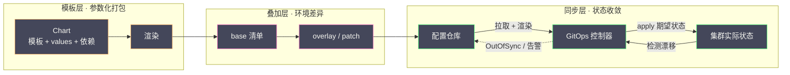
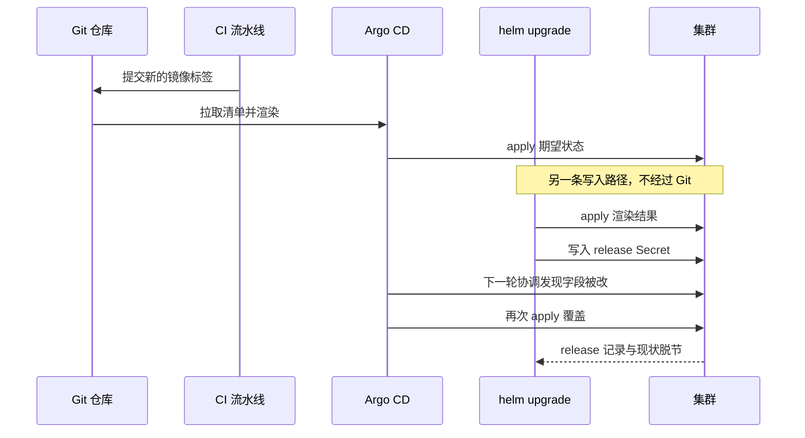
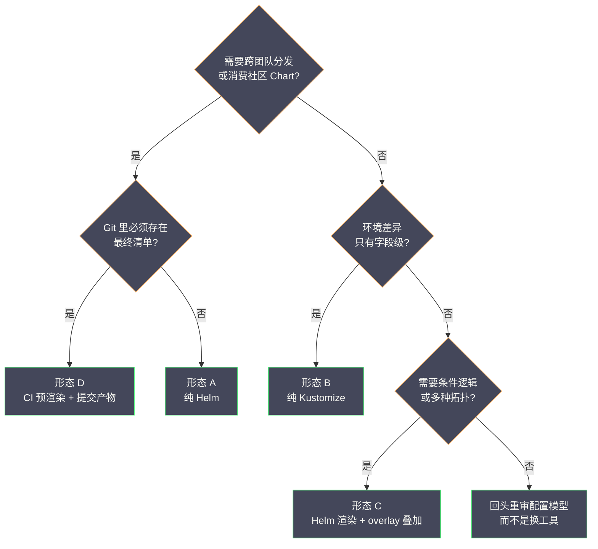
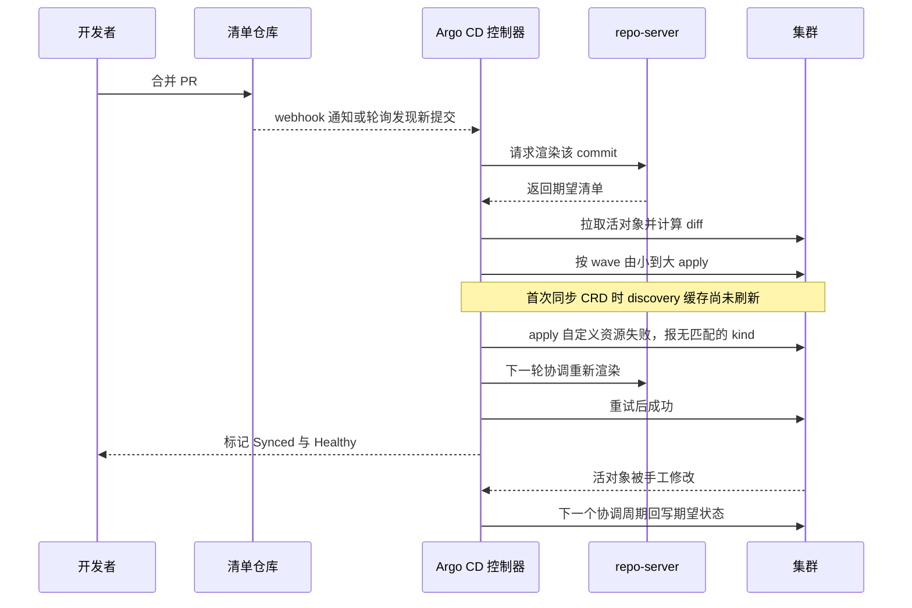
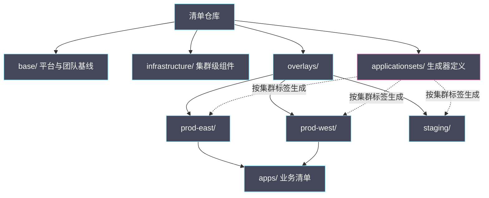

# 05 应用交付——Helm Kustomize 与 GitOps

**摘要：**

一条完整的交付链上横着三个断面：用 Helm 把应用打包成可分发、可参数化的 Chart，用 Kustomize 把同一份清单叠加出环境差异，用 Argo CD 或 Flux 把 Git 里的声明收敛成集群的实际状态。这三段常被当成三个互相竞争的选项排队比较，于是"Helm 还是 Kustomize"成了看似二选一、实则同层替代的问题，而"上了 GitOps 就该丢掉 Helm"则是把不同层混为一谈的判断。本文按三段各自的职责边界展开代价：Helm 的抽象泄漏在于 values.yaml 事实上成了对外 API、渲染结果依赖集群上下文因而不再是纯函数、release 记录存在集群里形成了与 Git 并行的第二个真相源；Kustomize 的代价在于它没有版本与依赖概念、patch 的合并语义在 strategic merge 与 JSON6902 之间反复咬人、overlay 嵌套超过三层后维护成本陡增；GitOps 的代价在于它把"谁有权改集群"从 CI 搬到了 Git，于是 Secret 如何进 Git、latest 标签如何摧毁 diff 的意义、多集群目录如何对应权限模型、sync wave 如何补足声明式系统不表达的顺序，都成了必须显式设计的东西。文末给出四种组合形态的判据与四类反复出现的反例：用 `--set` 做生产变更、overlay 堆到四层、GitOps 里放明文 Secret、CI 直接 `kubectl apply` 绕开 CD。

---

## 第 1 章 三个断面：交付链为什么要分三段

### 1.1 一份被复制了四遍的 Deployment

2019 年前后是容器交付工具定型的一段时间。这一年的 3 月，Kustomize 随 kubectl 1.14 进入命令行，`kubectl apply -k` 让"无模板的清单叠加"变成了开箱能力；同年 11 月，Helm 3.0 发布，把服务端组件 Tiller 从架构里彻底删掉，release 元数据改为存成集群内的 Secret。两条路线在同一年完成各自的形态收敛，此后关于"到底该用哪个"的讨论就再没有停过。

笔者接手过一个 40 节点的生产集群，上面跑着 60 个自研微服务和 15 套社区中间件，分四个环境：dev、staging、prod-east、prod-west。最初的做法是四份目录，一个环境一套完整清单。这套做法的成本不在磁盘上，而在注意力上——一次 readinessProbe 的 `timeoutSeconds` 从 1 调到 3，要记得改四个地方；漏掉的那个环境不会立刻报错，只会在某次滚动发布时表现成"新 Pod 就绪得比预期慢"，而现场的人大概率先去查应用的启动日志。

配置漂移的麻烦之处就在于它不是一次性事故，而是持续的背景噪声：没有任何一个时刻能指着某个文件说"这里错了"，只有在一连串含糊的故障之后，才有人把四个环境渲染后的清单 diff 一遍，发现某处多了一行。

把这类问题归结为"缺少工具"很容易，但工具其实一直很多；难的是分清它们各自在回答哪个问题。

### 1.2 三个不同层次的问题

一条交付链上其实横着三个层次的提问。第一层问的是：如何把一个应用打成可以跨团队、跨集群分发的制品，并允许下游在不 fork 的前提下调整参数——这一层的答案是 Chart。第二层问的是：如何把同一份制品适配到不同环境，让差异以增量的形式被表达和审阅——这一层的答案是 overlay（叠加层）。第三层问的是：如何保证集群里实际运行着的东西，始终等于声明过的东西——这一层的答案是控制器与 Git。

三层之中，前两层是**替代关系**，第三层是**包含关系**。Helm 与 Kustomize 的输入输出落在同一个位置：左边是人的意图，右边是 K8s 清单，两者都在清单落到集群之前做变换，所以同一段路上挑一个就够。GitOps 的输入是清单、输出是集群状态，它在清单之后，与前两者不构成竞争。

把这件事说反的例子随处可见。有人问"我们上了 Argo CD，还需要 Helm 吗"，这个问题相当于问"我们请了快递，还需要排版吗"——快递不负责排版，排版也不保证书店书架上的书与印厂出来的一致，两者各管一段路。比喻到这里为止有一个限度：印刷的版是死的，集群是活的，控制器会用自己的逻辑改写字段，这一点在后面的漂移检测里会反复出现。

### 1.3 三段链路的全貌

把三段画在同一张图上，它们之间的手递手关系就清楚了：模板层与叠加层合起来负责产出清单，同步层负责把清单变成集群现状，并把现状与清单的差距反馈回去。



这张图有一个容易看漏的地方：模板层与叠加层画成了串行，但在实际项目里它们大多时候只出现一个，串行只是当两者同时存在时的形态。真正必须串起来的是"清单 → 集群"这一段，中间没有第二个选择。

### 1.4 每一段都有自己的账本

分段看的另一个好处，是每一段都有一本明确的账——它为哪一类事实的正确性负责，失败的形态是什么。把三者混着看时，故障的归因会变得含糊，因为"这个字段不对"可能来自模板层的默认值、叠加层的补丁，也可能来自同步层的遗漏。

| 段 | 输入 | 输出 | 这本账记什么 | 典型失败形态 |
| :--- | :--- | :--- | :--- | :--- |
| 模板层 | Chart + values | 渲染后的清单 | 参数与版本：这次装的是哪个 Chart 版本、哪个镜像 | 渲染成功但语义错误，譬如端口对不上、探针路径写错 |
| 叠加层 | base + overlay | 最终清单 | 环境差异：这个环境与基线差在哪 | patch 未命中目标而静默无效；合并语义把无关字段一起改掉 |
| 同步层 | 清单仓库 | 集群状态 | 集群现状：跑着的与声明的是否一致 | 漂移、部分同步、prune 卡在 Terminating、字段被控制器反复改写 |

### 1.5 三种典型的错配

三种**错配**在真实项目里反复出现，它们共同的特征都是"把某一层的账记到了另一层"。

第一种是用 Helm 做环境差异。表现是 values 目录里躺着 dev.yaml、staging.yaml、prod.yaml、prod-west.yaml 四个文件，每个文件一半的键是用来抵消 Chart 默认值的，另一半键在三个环境里完全相同。这实际上是在模板层里手写了一份 overlay：差异本该是增量的，却被展开成了全量的参数副本，于是"生产与开发到底差在哪"这个问题又变得难以回答。

第二种是用 Kustomize 做分发。表现是平台团队发一个 base，二十个业务仓库各自复制一份，再各自往上叠 patch。上游改一个安全上下文配置，下游二十个仓库不会知道，也不会被动更新——分发需要版本与依赖，而这两样恰好是 Kustomize 不提供的。

第三种是用 GitOps 做发布审批。表现是以为开了 auto-sync 就等于有了发布流程，于是没有灰度、没有回滚预案、没有变更窗口，只有"提交即上线"。GitOps 的职责是让集群状态与 Git 一致，它不表达"什么时候允许改"——那是发布策略的事，要另配 Argo Rollouts、Flagger 或 CI 侧的门禁。

---

## 第 2 章 Helm：参数化打包的代价

### 2.1 Chart 是一台编译器

Helm 的本体不是模板引擎，而是包管理与生命周期管理的组合。一个 Chart 里装着四样东西：`templates/` 下的 Go template、`values.yaml` 里的默认参数、`Chart.yaml` 里的元数据与依赖声明、以及 hook 注解表达的生命周期动作。四样东西合在一起，Chart 就成了一台接受"参数 + 集群上下文"、输出一整套 K8s 清单的编译器。

编译器这个比喻有一个关键推论：既然它是编译器，输出就不是源文件。集群里跑的是渲染产物，Git 里存的是模板与参数，两者之间的映射需要工具来重放。这条推论会一路延伸到本章要讲的两个代价——values 变成对外 API，以及 release 状态成为第二个真相源。

Helm 的价值集中在三件事上：Chart 推到 HTTP 仓库或 OCI Registry 之后，版本语义由 `Chart.yaml` 的 `version` 承担；subchart 与 `dependencies` 让一个应用可以声明"我需要一个 Redis"而不必把清单抄进自己的仓库；values 允许下游在不 fork 的前提下调整。三件事 Kustomize 都不做，第 3 章会看到它为此付出的对称代价。

### 2.2 抽象泄漏之一：values.yaml 成了事实上的 API

任何 Chart 从"自己用"走向"别人用"的那一刻，values.yaml 的键名就变成了**对外契约**。这个转变没有仪式，没有评审，也没有人宣布它发生了，它只是悄悄地生效：下游的 values 文件里开始出现 `image.repository`、`resources.limits`、`ingress.hosts` 这样的路径，于是这些路径的重命名就从"重构"变成了"破坏性变更"。

泄漏的具体机制是：模板作者必须为每一个"下游可能想改的东西"预先开一个 values 键，而且开键的位置要恰好落在下游想改的那一层。开不出来的东西，下游只有两条路——fork 整个 Chart，或者用 `--set` 硬塞一个模板根本不读的键。后者不会报错，只是静默无效，而静默无效的变更比报错的变更危险得多，因为它会被记进工单、被当作"已修复"。

以最常见的 Ingress 为例，一个 Chart 通常暴露三个键：`ingress.enabled`、`ingress.hosts`、`ingress.tls`。这套结构在"一个域名、一条路径、一张证书"的场景下工作良好；一旦下游需要给三个 host 配三张不同的证书，就会撞上 `ingress.tls` 与 `ingress.hosts` 之间那条只存在于模板循环里的对应关系——数组元素的一一对应在 values 文件上读不出来，下游既不能只覆盖第二个元素，也没法在 README 之外找到准确说明。

这类结构耦合会在 Chart 上留下两种痕迹。一种是键的数量膨胀，一个中等复杂度的自研应用 Chart 有 80 到 150 个 values 键并不罕见；另一种是模板里层层嵌套的条件，`{{- if and .Values.ingress.enabled (not (empty .Values.ingress.hosts)) }}` 这样的表达式，其可读性问题与其说来自 Go template 的语法，不如说来自"所有分支都必须在一个文件里表达"的结构约束。

键一多，兼容负担会自己长出来。常见做法是在模板里同时读新旧两个键，`default .Values.newKey .Values.oldKey`，注释里写"deprecated, use newKey"。这已经是标准的 API 弃用流程，只是它发生在 YAML 里，没有编译期检查，也没有调用方扫描，谁在用旧键只能靠 grep 全站仓库。

为什么说这是 API 问题而不是整洁问题？因为两类改动都会伤到下游，而伤害的方式不同。改键名是破坏性变更，需要升 major 版本，下游会看见渲染失败——这一种反而是好的，因为失败是显式的。改默认值是静默的行为变更：下游没有显式设置那个键，于是它跟着 Chart 的新默认值一起变了，渲染依然成功，行为却不同了。生产事故更常来自第二种。

Helm 3 提供了两个官方缓解手段。一是在 Chart 根目录放 `values.schema.json`，用 JSON Schema 校验合并后的 values，它能挡住类型错误、缺字段、非法枚举，挡不住语义变更——把 `replicaCount` 的默认值从 1 改成 2 依然合法。二是 `Chart.yaml` 里的 `version` 与 `appVersion` 两个字段，前者是 Chart 自身的版本，后者是被打包应用的版本；Helm 只用 `version` 做依赖解析，`appVersion` 纯属信息性字段，语义由 Chart 作者自己定义。混用两者的典型症状是只升 `appVersion` 不升 `version`，于是 Chart 仓库里"最新版本"指向的还是旧模板，而镜像标签已经换了一轮。

### 2.3 抽象泄漏之二：渲染结果不是纯函数

如果说 values 泄漏讲的是"Chart 的输入面太窄"，那么第二条泄漏讲的是"Chart 的输入不止 values"。Helm 模板里可以访问三类集群上下文：`.Capabilities`（目标集群支持的 API 版本与 K8s 版本）、`.Release`（这次是安装还是升级、revision 号是多少）、以及 `lookup` 函数（渲染时查询集群里的现存对象）。

这三样东西让渲染结果变成"**参数 + 集群状态**"的函数，而不是参数的函数。同一份 commit、同一份 values，在不同集群上可以渲染出不同清单：`.Capabilities.APIVersions.Has "policy/v1"` 为真时走 PodDisruptionBudget 分支，为假时整段跳过；`.Release.IsInstall` 为真时生成一个初始化 Job，为假时生成另一个形态的 Job。

`lookup` 更麻烦。它在 `helm install` 与 `helm upgrade` 时真的去查集群，用于满足"升级时保留集群里已存在的某个字段"这类需求，而在 `helm template` 下返回空。于是同一份 Chart，在 CI 里预览、在 GitOps 控制器里渲染、在运维手上手工 install，三条路径给出三种输出——Argo CD 渲染 Helm Chart 走的就是等同 template 的路径，不创建 release，因此也没有 release 上下文。

这里并不是说 `lookup` 是坏设计，它解决的是真实需求。但需求与"Git 是唯一真相源"直接冲突：如果渲染依赖集群里的现存对象，那么这个对象的来源就不在 Git 里，漂移检测也就失去了基准。判据可以写得很直接——只要 Chart 里出现 `lookup` 或者依赖 `.Capabilities` 的条件分支，就应该把它归类为"在 GitOps 里无法确定性渲染"的 Chart，要么改掉这些依赖，要么接受渲染产物必须提交进仓库，也就是第 4 章要讲的 rendered manifests 方案。

### 2.4 release 状态存在集群里：双源

Helm 3 把 release 记录存成集群里的普通对象，默认是 Secret。一次 install 或 upgrade 之后，命名空间里会出现 `sh.helm.release.v1.<release>.v<revision>` 这样的 Secret，内容是渲染后的完整清单、合并后的 values、Chart 元数据的序列化串，先 gzip 再 base64。这个设计让 Helm 不再依赖外部数据库（Helm 2 时代的 Tiller 与 ConfigMap 组合正是被运维诟病的重点），代价是集群里从此有了一份 Git 没有的状态，也就是与 Git 并行的**第二个真相源**。

存储驱动可以换，`HELM_DRIVER` 支持 secret、configmap、sql、memory 四种，默认是 secret，sql 用于需要跨集群查询 release 的托管场景。历史条数由 `--history-max` 控制，默认保留 10 条。

按 60 个服务、两个生产集群的布局，默认历史条数下 release Secret 的稳态数量是 60 × 2 × 10 = 1200 个（示例推算，不含中间件与 hook 残留）。单个 Secret 装的是渲染后清单，压缩后几 KB 到几十 KB，总量并不吓人；要留意的是 K8s 对象 1 MiB 的硬上限——依赖众多 subchart 的 Chart 容易逼近这个量级，触顶时 Helm 报的是 Secret 过大的错误，而这条错误不会直接说明"你的 Chart 太大了"。

双源的第一个后果是回滚语义错位。`helm rollback` 回滚到的是集群里保存的某个 revision，也就是"上次渲染出来的那份清单"，而不是 Git 里的某个 commit。在 GitOps 体系里，一次 rollback 会让集群状态短暂离开 Git 的声明，控制器在下一个协调周期（Argo CD 默认 3 分钟一轮）发现 OutOfSync，然后把这次回滚纠正回去——现场表现成"回滚没生效"，实际上回滚生效了，只是又被推回去了。

第二个后果是两套工具互相看不见对方。Argo CD 渲染 Helm Chart 不创建 release，所以它没有 `helm history`，也不能用 `helm rollback`；反过来，一个用 `helm upgrade` 装的 release 被 Argo CD 接管之后，Argo 用 `kubectl apply` 的三方合并去改资源，release Secret 里的记录与集群实际从此脱节，`helm get manifest` 读到的是历史快照而不是现状。两边都"有记录"，但没有一份记录描述此刻的集群。



如果双方都开了 server-side apply，问题会以另一种形式出现：managedFields 记录着每个字段的最后一个写入者，两个写入者反复争同一个字段时，manifest 层面看不出任何异常，每次同步都在产生字段冲突或者用强制覆盖压过去。检查手段是 `kubectl get deploy <name> -o yaml --show-managed-fields`，看 manager 一栏里是不是同时出现了 helm 与 argocd-controller。

判据可以直接落到对象上：如果同一个命名空间里既有 `owner=helm` 的 release Secret，又有指向同一批资源的 Argo CD Application，那这里就是双源，必须选定一方。常见分法有两种——"中间件与平台组件用 Helm 装、业务资源只由 GitOps 写"，或者"全部走 GitOps，Helm 只保留本地调试用途"。分法本身可以商量，但边界必须写进规范，否则半年后没人说得清某个 Deployment 归谁管。

把 Chart 当作编译器，把 release 当作编译缓存，这个比喻的最后一块拼图在这里：缓存与源文件不一致时，编译器不会报错，它只会给你一份过期却语法正确的产物。

### 2.5 原子性的真实边界

回到一个更基础的问题：一次 `helm upgrade` 失败，集群处于什么状态？答案是"不确定，要靠人判断"。Helm **没有事务**，它按 kind 的固定优先级顺序 apply——Namespace、ResourceQuota、PodDisruptionBudget、ServiceAccount、Secret、ConfigMap、StorageClass、PersistentVolume、PersistentVolumeClaim、CustomResourceDefinition 依次在前，Deployment、StatefulSet 在中段，Job、CronJob 在末尾，同类资源按名字排序。这个顺序覆盖了大部分创建期依赖，剩下的靠 hook 表达。

所以中途失败会留下"一半新一半旧"的集群：已经 apply 的资源是新版本，排在后面的还是旧版本，release 状态被标成 failed。此时再 upgrade 会被拒绝，除非加 `--force`；`--force` 的语义是用替换而不是打补丁的方式重建资源，对有状态负载来说这等于重建 Pod 与卷的绑定关系，代价不小。

`--wait` 把"对象创建成功"提升为"对象 Ready"：Deployment 看 availableReplicas，StatefulSet 看 readyReplicas，Job 看完成状态。但它判定的只是 K8s 的 readiness，不是业务健康——一个连不上数据库的 Pod，只要探针配得宽松，在 `--wait` 眼里就是就绪的。超时默认 5 分钟，一个需要跑十分钟初始化的服务会在 `--wait` 阶段被判失败然后回滚，这类"用 `--wait` 反而更容易失败"的案例并不少见。

`--atomic` 隐含 `--wait`，失败或超时自动回滚到上一个 revision。它确实解决了一部分问题，但它保证的是"release 记录的 revision 退回去了"，不是"集群回到了上一个状态"。下面五类东西不在回滚范围内：

- `crds/` 目录下的 CRD：Helm 只负责安装，不负责升级也不负责删除，Chart 新版本带来的 CRD 字段变更永远不会被自动应用，得单独用 `kubectl apply` 或其他工具管
- StatefulSet 的 `volumeClaimTemplates` 申请的 PVC：回滚不会把已经扩容的卷缩回去，也不会解除保留策略
- 已经完成的 Job：回滚不会让它重跑
- hook 资源：`helm.sh/hook-delete-policy` 决定它在成功或失败后是否残留，默认策略下失败留下的 hook Job 会让下一次 install 撞名失败
- 准入配置：ValidatingWebhookConfiguration 回滚后，`caBundle` 可能与回滚后的证书不匹配，表现成集群级写入被拒——不只是这个应用失败，是整个集群的创建请求都卡在准入阶段

### 2.6 Helm 该用在哪儿

综合下来，Helm 的收益集中在三个位置。其一，需要跨团队或跨集群分发同一个应用，分发对象里包含版本与依赖解析——这时 Chart 仓库承担的是"制品库"的职责。其二，需要消费社区生态，Prometheus、cert-manager 以及各类 Operator 的官方 Chart 已经把复杂的 CRD、webhook、RBAC 组织好了，自己重写既不划算也容易漏。其三，应用本身形态高度可变，譬如一个 Kafka Chart 要支持单机、三节点、跨机房三种拓扑，参数化比写三份清单更省。

反过来，如果场景是"一个团队、一个应用、三个环境、差异只在副本数与资源配额"，那么上 Helm 拿到的主要不是参数化能力，而是额外一层模板抽象，以及一个存在集群里的 release 状态。这两种代价在 GitOps 体系里尤其明显，因为 Git 本身已经提供了版本与历史，Helm 的 release 历史在这里是一本重复的账。

| 维度 | 用 Helm 的收益 | 用 Helm 的代价 | 判据 |
| :--- | :--- | :--- | :--- |
| 分发 | Chart 仓库 + 语义化版本 + 依赖解析 | 下游开始依赖你的 values 键名 | 有跨团队下游才成立 |
| 参数化 | 条件、循环、函数都能表达 | 模板里出现无法穷举的分支 | 超过三种拓扑才值得 |
| 生命周期 | install/upgrade/rollback 三件套 | release 状态与 Git 双源 | 不用 GitOps 时才划算 |
| 生态 | 社区 Chart 开箱即用 | 要审 Chart 的 CRD 与 values 键面 | 中间件与 Operator 优先 |
| 可调试性 | `helm template` 可本地预览 | 预览与真实安装未必一致 | Chart 里出现 `lookup` 即失效 |

---

## 第 3 章 Kustomize：无模板叠加的边界

### 3.1 base 是可以直接跑的东西

Kustomize 的出发点与 Helm 相反。Helm 认为清单是渲染出来的，模板才是源文件；Kustomize 认为清单就是源文件，环境差异只是增量。这个差别决定了两者在评审体验上的分野：审一个 Helm 变更，你看到的是模板 diff，需要在脑内渲染一遍才知道最终哪个字段变了；审一个 Kustomize 变更，你看到的是 patch diff，而 patch 本身就是"我要改什么"的陈述。

2019 年 kubectl 内置 Kustomize 之后，`kubectl apply -k overlays/prod` 成了不依赖额外二进制的标准动作；它也不引入新语法，base 目录里的 YAML 就是普通 K8s 清单，没接触过 Kustomize 的人也能读懂。但"读得懂"与"读得到结论"是两件事：base 与 patch 都可读，不等于合成结果可读，理解一个字段的最终值需要把 patch 按顺序在脑内叠一遍，这个成本随层数线性增长，3.4 节会具体算这笔账。

### 3.2 没有版本，也没有依赖

Kustomization 有 `apiVersion`（当前为 `kustomize.config.k8s.io/v1beta1`），但那是工具 schema 的版本，不是你的配置集的版本。Kustomize 没有"这个 base 的第 2.3 版"这样的概念，也没有"这个 overlay 依赖那个 base 的哪个版本"这样的声明。

于是分发只能靠三种土办法：git submodule 锁住 base 仓库的 commit；远程 base 引用，在 resources 里写 `github.com/org/repo//base?ref=v1.2.0`，构建时由 kustomize 去取；直接复制目录，改一次同步一次。

| 分发方式 | 版本可否锁定 | 构建期外部依赖 | 主要风险 |
| :--- | :--- | :--- | :--- |
| git submodule | 可以（commit） | clone 权限 | submodule 指针漂移、CI 忘记递归拉取 |
| 远程 base 引用 | 可以（ref） | 网络 + 仓库读取权限 | 构建时取到的代码不在评审范围内 |
| 复制目录 | 不可以 | 无 | 上游变更无人知晓，漂移无任何提示 |
| Helm 依赖 | 可以（Chart 版本） | Chart 仓库 | 需要引入 Helm 的整套语义 |

第三种在真实项目里最常见，也最容易被低估。它的问题不在复制本身，而在于复制之后没有人负责同步——上游修了一个安全上下文配置，下游二十个仓库不会知道，也不会被动更新。

远程 base 那一条值得多说一句，因为它破坏了 Kustomize 最重要的一个前提。Kustomize 的可读性建立在"清单与 patch 在同一个仓库、同一次 review 里"，远程 base 把这个前提还了回去：你 review 的 patch 所依赖的 base 不在你的仓库里，构建时才取。多数平台团队因此禁止 overlay 引用远程 base，改由 CI 预渲染并提交产物，或者干脆用 Helm 的依赖机制承担分发——后者虽然引入了模板，但至少版本是可声明、可解析的。

依赖这件事上 Kustomize 是彻底缺席的：没有"CRD 先于 CR"的概念，没有"这个组件需要那个组件"的声明，需要顺序时只能靠 GitOps 的 sync wave 或 CI 脚本排序。这不是设计疏忽，而是定位——Kustomize 把自己限定在"清单变换"，顺序属于应用阶段的问题，5.5 节会看到顺序这件事在声明式体系里有多难。

### 3.3 patch 的合并语义

patch 的合并语义是这一层最容易出错的地方，因为它有三种，语义完全不同，而错误往往是静默的。

strategic merge patch 是 K8s 特有的，不是 RFC 标准，它依赖对象 OpenAPI schema 里的元数据：`x-kubernetes-patch-merge-key` 指明列表的合并键（Pod 的 containers 列表合并键是 name），`x-kubernetes-patch-strategy` 指明合并还是替换。有了这份元数据，patch 里只写 `containers: [{name: app, resources: {...}}]` 就能精确改到名为 app 的那个容器，同列表里的其他容器不受影响。

它的坑集中在两处。一处是 CRD：自定义资源没有内置 schema，kustomize 拿不到 patch 元数据，列表字段会退化成整体替换，"我只想改某个列表元素的一个字段"可能变成"把整个列表覆盖掉"；补救办法是用 `openapi.path` 提供 CRD 的 schema，但这要求 CRD 作者正确标注了 merge key，而多数自研 CRD 没有。第二处是删除与替换语义：strategic merge 里把标量写成 null 表示删除，删除整个列表项要写 merge key 再加 `$patch: delete` 指令，写成 `$patch: replace` 则是整块替换；边界不清楚时，结果是"改了一个地方，另一个地方也被顺带改了"。

JSON merge patch（RFC 7386）的规则更简单：对象递归合并，列表整体替换，null 表示删除。它不需要任何 schema，所以对 CRD 与对内置资源的行为一致，代价是列表永远**整体替换**——想在 containers 里加一个 sidecar，必须把原列表完整抄一遍再追加，抄漏一项就是配置回退，而渲染不会报错。

JSON6902（RFC 6902）是操作列表：op 取 add、remove、replace、move、copy、test，path 是 JSON Pointer。它精确、无歧义，代价是路径里带索引——`/spec/template/spec/containers/0/resources` 在有人往列表前面插了一个容器之后，指向的就不是原来那个容器了。而且 `replace` 要求路径必须存在，删不存在的字段会报错，报错信息形如 `In jsonPatch op replace`，读起来需要一点耐心。`test` 操作可以当断言用（路径上的值等于期望值才继续），在守护"这个字段不能被改掉"时相当好用，但用的人很少。

| patch 类型 | 列表合并行为 | 是否需要 schema | 适用场景 | 主要坑 |
| :--- | :--- | :--- | :--- | :--- |
| strategic merge | 按 merge key 合并 | 需要（内置类型自带） | Deployment、Service 等内置资源的结构性字段 | CRD 退化为整体替换；`$patch` 指令语义需记清 |
| JSON merge (RFC 7386) | 整体替换 | 不需要 | CRD 资源、简单的 map 字段覆盖 | 列表必须整段抄写，抄漏即回退 |
| JSON6902 (RFC 6902) | 按索引操作 | 不需要 | 列表中间插入、精确断言 | 索引脆弱；路径不存在即报错 |

三者的分工可以这样定：结构性字段（replicas、resources、labels、annotations）用 strategic merge，因为它按 merge key 合并，意图最接近"打补丁"；对 CRD 资源默认用 JSON merge patch，并接受列表整体替换的代价；需要按位置精确操作（譬如在 args 列表中间插一个参数）或者需要断言时用 JSON6902。跨资源的引用关系——比如让 Deployment 引用由 `configMapGenerator` 生成的、带哈希后缀的 ConfigMap 名——不要用 patch 硬写名字，用 `replacements`，否则哈希一变引用就断，而断裂表现为 Pod 起不来、`kubectl describe pod` 里一串 CreateContainerConfigError。

还有一个所有 patch 共有的隐性坑：patch 没匹配到目标时是**静默成功**的。patch 里写的 kind 是 Deployment 但 base 里改成了 Rollout，或者 metadata.name 差一个字符，`kubectl kustomize` 一样返回退出码 0，渲染结果里就是没有你的改动。这类问题在 CI 里只能靠断言——渲染后 grep 关键字段，或者先用 `kustomize build` 与上一版渲染结果做 diff，diff 为空时问一句"这次改动到底生效了吗"。

### 3.4 overlay 嵌套的读解成本

一个典型的四层结构长这样：平台团队维护 platform-base（安全上下文、资源配额默认值、日志 sidecar），业务团队在它之上加 team-base（团队命名规范、镜像仓库前缀），再有 region overlay（prod-east / prod-west），最后是环境 overlay（dev / staging / prod）。

追一个字段的最终值，需要从最外层往回数四层 kustomization.yaml。每一层都可能用 patch、用 namePrefix、用 commonLabels，于是同一个逻辑资源在四层里有四个名字。kubectl 里看到 `prod-east-team-payment-app-config-8f2k1`，要还原出"这是 payment 应用在 prod-east 的配置"，得同时知道哈希后缀来自 `configMapGenerator`、前缀来自 `namePrefix`、中间的 team 段来自 team-base。

`namePrefix` 与哈希后缀叠在一起还会带来一个运维层面的麻烦：哈希后缀本来是用来触发滚动更新的（内容变了名字就变，Deployment 引用新名字，自然滚起来），但一旦前缀也参与，Argo CD 的 diff 里出现的就是一整套"消失的旧名 + 出现的新名"，评审时需要人肉确认"这只是改名，不是删资源"。这类 diff 噪声会训练出一种危险的评审习惯——看到一堆红绿就点通过。

`components` 机制缓解的正是这个问题：把可插拔的 patch 集合抽成组件，需要时引入、不需要时不引入。它比再叠一层 overlay 干净，但引入之后 patch 的应用顺序变成隐式的——组件与 overlay 的 patch 谁先谁后，只能靠读实现文档或者试出来，因此它适合互不重叠的横向能力（加 sidecar、加 NetworkPolicy），不适合同一个字段的多处覆盖。

判据很朴素：base + overlay 两层是常态，加一层 region 或 cluster 是上限。第四层应该被折叠——要么变成 component，要么变成显式参数（这时说明你需要的是 Helm 的 values），要么这个差异本来就该由控制器负责（副本数交给 HPA，资源配额交给 ResourceQuota），而不是写进清单。

这里有一句对称的观察：overlay 的膨胀与 values 的膨胀是同一个问题的两个面相，两者都在用声明式的手段模拟条件逻辑——"如果这个环境是生产，就……"。声明式语言没有分支，人便用文件层叠与键组合去凑出分支，层数越多凑得越像，也越难读。

### 3.5 Kustomize 该用在哪儿

三类场景适合 Kustomize。一是自研应用、环境差异以字段级为主（副本数、资源、镜像标签、少量环境变量），团队希望评审时看到真正的 YAML。二是平台团队给业务团队提供默认配置：平台维护 base、业务只写 overlay，base 是"约束"、overlay 是"申请变更"，权限与目录结构能对上，第 6 章会把这条展开成权限模型。三是清单要被别的工具消费——输出的纯 YAML 喂给策略引擎与审计工具都没有额外成本。

反过来，凡是需要"分发"和"版本"的地方，Kustomize 都要靠外部机制补课，补课成本一旦超过 Helm 的模板成本，就该换。这个临界点比多数人预想的早：只要出现第二个团队消费你的 base，或者出现"这个 base 的旧版本还在用"的情况，就已经越过临界点了。

---

## 第 4 章 组合与互斥：谁在哪一层

### 4.1 四种组合形态

Helm 与 Kustomize 的组合问题，在工程上不是"能不能"，而是"渲染发生在哪一步、由谁执行"。按渲染位置分，实际存在四种形态，它们的差别不在功能而在账本归属。

| 形态 | 渲染发生位置 | 好处 | 代价 | 适用 |
| :--- | :--- | :--- | :--- | :--- |
| A 纯 Helm | 控制器或 CLI | 社区 Chart 直接用，版本与依赖齐全 | values 成 API；release 与 Git 双源 | 中间件、有跨团队下游的应用 |
| B 纯 Kustomize | `kustomize build` | 评审看到真实 YAML，无额外语法 | 无版本、无依赖、无分发机制 | 自研应用、单团队、字段级差异 |
| C Helm 渲染 + Kustomize 叠加 | kustomize（helmCharts）或 CI | 复用社区 Chart，同时保留可读的环境差异 | 两套覆盖链，排障要分层定位 | 既要社区 Chart 又要精细环境差异 |
| D rendered manifests | CI 预渲染并提交产物 | Git 里即最终清单；渲染确定性可保证 | 多一次提交 + 一个校验门 | 合规要求可审计的最终清单 |

第四种常被当作第三种的一个变体，实际差别很大。它的关键在于渲染发生在 CI，而 CI 的输入是被钉死的：Chart 版本、values 文件、显式指定的 `--kube-version` 与 `--api-versions`，所以 `.Capabilities` 与 `lookup` 带来的不确定性被消掉了。GitOps 控制器拿到的就是最终清单，它不需要理解 Helm——渲染与同步被彻底解耦，这也是它最本质的优势。

### 4.2 形态 C 的机制与排障成本

形态 C 有两种实现。一种是 kustomize 原生的 `helmCharts` 字段：在 kustomization.yaml 里声明 name、repo、version、releaseName、namespace、valuesFile、valuesInline、includeCRDs，构建时由 kustomize 调用 helm 渲染。它要求使用独立的 kustomize 二进制并显式开启 `--enable-helm`，构建环境还需要能访问 Chart 仓库或者预先下载到 `chartHome` 缓存。

```yaml
# overlays/prod/kustomization.yaml（形态 C：Helm 渲染之后再叠加环境差异）
apiVersion: kustomize.config.k8s.io/v1beta1
kind: Kustomization
helmCharts:
  - name: my-app
    repo: oci://registry.example.com/charts
    version: 2.4.1              # 钉死 Chart 版本，渲染才可复现
    releaseName: my-app
    namespace: production
    valuesFile: values-prod.yaml
    includeCRDs: true
resources:
  - ../../shared/networkpolicy.yaml
patches:
  - path: patch-resources.yaml
    target:
      kind: Deployment
      name: my-app
images:
  - name: registry.example.com/my-app
    newTag: v2.4.1-9f2c1a       # 镜像版本与 Chart 版本解耦，各有来源
```

另一种实现是在 CI 里跑 `helm template` 把结果落盘，再用 kustomize 在此基础上叠加，也就是形态 D 的前半段。两者渲染结果等价，差别在于"渲染产物是否进 Git"：前者的产物只在构建时存在，后者的产物是一个可评审、可 diff 的文件。

形态 C 有一个绕不开的成本：一个字段的最终值有两套覆盖链。Helm 侧是 Chart 默认值、valuesFile、`--set` 依次覆盖，Kustomize 侧是 base、patch 依次覆盖；当某个字段不对时，"是谁把它改成了这个值"有两个候选答案，需要分别用 `helm template` 与 `kustomize build` 各渲染一次才能定位。团队规模小、Chart 与 overlay 由同一批人维护时这不算问题；一旦 Chart 来自上游社区，排障就得同时读社区 Chart 的模板与自己的 patch，而这个动作在故障现场往往来不及做。

形态 D 的校验门是关键，没有它这个方案会慢慢腐化：CI 里跑一次渲染，把产物与仓库里的文件比对，不一致就失败。少了这一步，会出现"Chart 版本改了但产物没重新提交"的状态——集群跑的是旧清单而 Git 声明是新版本，两边都"有记录"，却没有任何一份记录是错的，比双源更难查。

### 4.3 该互斥的两种情形

有两种情形下两者应当互斥。第一种是团队没有能力维护两套语义。两套覆盖链意味着两类排障路径、两套文档、两种评审习惯；人力不足时叠加只会把错误变成"不知道错在哪一层"，而"不知道错在哪一层"比"用错工具"更难纠正。

第二种是合规要求"Git 里必须存在最终清单"。此时只有形态 D 满足，形态 A、B、C 都要求审计者理解渲染过程才能回答"集群当时跑的是什么"。审计要的是可读的事实，不是可重放的推导。

还有一种形态技术上可行但不该做：把 Kustomize 的渲染产物塞进 Helm Chart 的 templates 目录，再用 Helm 分发。它让 values 参数化与 overlay 覆盖去争同一个字段，两边都不再是唯一入口；而且 Chart 的模板必须是模板，塞静态清单进去等于主动放弃 Helm 唯一的优势。

### 4.4 一棵判据树

把前面的判断串起来，可以得到一棵足够用的决策树。它的用处不在于给出标准答案，而在于让团队在争论时知道分歧发生在哪个节点上。



树上有两处值得强调。其一，"是否需要分发"问的是"有没有下游"而不是"应用复不复杂"——一个极其复杂的应用如果只在一个团队内部跑，Helm 的参数化能力可能一次都用不上，反而要承担 values 契约与 release 状态两份成本。其二，"是否需要条件逻辑"通常应该被推回去：需要"如果生产环境就加这个 sidecar"时，更稳的做法是"所有环境都加、用配置关掉"或者"由平台统一注入"。分支一旦写进模板就成了需要测试的代码路径，而 Chart 没有单元测试的传统。

### 4.5 字段所有权

无论选哪种形态，叠加方案的第一原则是**每个字段只能有一个所有者**。这句话听起来像常识，但违反它的方式非常多，而且每种都有自己的表现。

| 字段 | 可能的写入者 | 冲突表现 | 建议所有者 |
| :--- | :--- | :--- | :--- |
| replicas | values、overlay patch、HPA、手工 scale | 副本数每隔几分钟跳一次 | 用 HPA 时不写，或显式忽略 diff |
| image | CI 改 overlay、Chart values、`--set` | 集群跑的镜像与任何文件都对不上 | CI 改清单仓库，其余路径禁用 |
| resources | 平台 base、业务 overlay、LimitRange 默认值 | diff 永远不干净，多出默认字段 | 清单里显式写全，LimitRange 只兜底 |
| labels | commonLabels、Chart 模板、准入 webhook | 标签被反复加回或反复删除 | 平台统一注入，模板不写 |
| annotations | Chart、GitOps 追踪注解、控制器回写 | 每次同步都显示有差异 | 明确哪些由控制器写，加入忽略列表 |

replicas 是冲突最集中的一个。清单里写 3，HPA 把它改成 7，GitOps 控制器认为应该回到 3——如果没有显式忽略这个字段，集群会在两个值之间来回跳，表现成"副本数每隔几分钟变一次"，而且监控图上看起来像是震荡型负载，很容易被误判成流量问题。正确的做法是：用 HPA 的环境里清单不写 replicas，或者显式声明"HPA 拥有这个字段"，并在同步侧配置忽略。

resources 的冲突更隐蔽：LimitRange 会给没写 resources 的 Pod 注入默认值，于是"清单里没写"与"集群里有值"永远对不上，diff 永远不干净。处置方式要么是清单里显式写全，要么是接受这类默认值并把它加入忽略列表——前者更好，因为它把"用了什么资源"写进了可评审的地方；配额与默认值的分层逻辑可以参看 [[03 多租户隔离与资源治理]]。

---

## 第 5 章 GitOps：把真相源从集群搬到 Git

### 5.1 两个阶段的分界

GitOps 这个词容易让人以为它是一类工具，其实它首先是一条职责分界：CI 的产出只有两样东西，一个不可变的镜像，和一份指向该镜像的清单变更；CD 的产出只有一样，集群的实际状态。分界两侧都不许越界。

CI 侧不持有集群凭据，CD 侧不构建镜像。前者是为了让"能改集群"这个权力不落在流水线上，后者是为了让"能产出二进制"这个能力不落在控制器里。分界一旦模糊，审计就无从下手——你无法回答"这个 Deployment 是谁改的"，因为可能是 CI，可能是运维，也可能是某个刚上线的控制器。

没有这条分界会怎样？最典型的表现是双写：CI 直接 apply，同时 GitOps 也在同步，两边都以为自己是唯一写入者。集群进入"谁最后写谁赢"的状态，而每次赢家不同。第 7 章会把这个场景列成反例，并给出唯一可靠的处置方式。

### 5.2 Pull 的实质不是方向

Push 与 Pull 的差别常被描述成"谁发起连接"，这个描述没错但不够。真正的差别是**信任边界**朝向哪一侧：Push 模式下 CI 是特权方，它拿着 kubeconfig，于是流水线的任何一个环节被污染都能直接写生产；Pull 模式下集群是主动方，它只需要能读 Git，写权限被收进集群内部，而对 Git 的写权限被收进代码评审流程。

这个转向带来三个实际变化。其一，凭据面缩小：CI 里不再有集群凭据，泄露的影响从"能改生产"降到"能改清单仓库"，后者依然严重，但可审计、可回滚。其二，变更记录搬家：Push 模式下 `kubectl apply` 的记录躺在 CI 日志里，日志有保留期，过期就查不到；Pull 模式下记录在 commit 里，与代码同寿命。其三，持续纠偏成为可能：Push 只在流水线跑的那一刻看一眼集群，Pull 每一轮协调都在看。

不过 Pull 不是免费的。控制器挂掉时交付停摆——集群能自愈但不能更新，因为更新这条路要经过控制器；Git 成为单点，Git 不可用则发布不可用；控制器的权限通常是"读整个清单仓库、写多个命名空间"，它本身成了一个需要重点保护的高价值目标，一旦被攻破，影响面比一个 CI 大得多。这三条代价不常写进方案，但它们在故障复盘里反复出现。

### 5.3 漂移检测：三个来源与假漂移

漂移（drift）指集群实际状态与 Git 期望状态不一致。检测原理很朴素：把 Git 清单渲染成期望对象，与集群里的活对象做字段级比较，差异非空即判漂移。

难点全在"比较"这一步，因为差异有三个来源，性质完全不同。

第一个来源是控制器自己的写入。HPA 会改 Deployment 的 `spec.replicas`；Deployment 控制器（协调过程见 [[云原生/Kubernetes/Kubernetes架构深度剖析/09 控制器模式与协调循环：从 Deployment 到 Operator|控制器模式与协调循环]]）会在 Pod 模板变化时更新 `metadata.annotations` 里的 revision 记录；Service 创建后 `spec.clusterIP` 由 apiserver 分配，清单里通常不写；这些字段都是"集群有、清单无"，却完全正常。

第二个来源是准入链路上的注入。mutating webhook 会给 Pod 注入 sidecar、给命名空间补标签、给镜像补 digest；安全策略可能给所有 Pod 加 seccompProfile。于是清单里没有的东西在活对象上出现了，这不是漂移，而是集群在按自己的规则补全。

第三个来源才是真漂移：人工 `kubectl edit`、`kubectl scale`、`kubectl patch`，或者其他仍在运行的旧流水线。

三者混在一起时，"diff 不为空"这个信号本身没有诊断价值。工程上的处置分两层：第一层是规范化，让比较忽略那些必然不同的字段；第二层是忽略列表，把已知的**假漂移**按 group/kind/字段路径显式排除。

```yaml
# 只对 HPA 管理的副本数关闭比较，而不是整份对象都不比
spec:
  ignoreDifferences:
    - group: apps
      kind: Deployment
      jsonPointers:
        - /spec/replicas
    - group: ""
      kind: Secret
      name: app-tls
      jsonPointers:
        - /data
      managedFieldsManagers:
        - cert-manager          # 由证书控制器回写，Git 里不存明文
```

`managedFieldsManagers` 这个字段值得单独说：它让忽略规则只对"被某个 manager 写过的字段"生效，比按 jsonPointer 全量忽略精确得多。上面那段的意思是"Secret 的 data 里由 cert-manager 写过的部分不比"，而不是"整个 data 都不比"——后者会让真正的人工篡改一起隐身。

忽略列表的危险在于它会自证清白。一个被忽略的 `/spec/replicas`，在没人配 HPA 的环境里等于给"有人把副本改成 1"开了一张永久免检通行证。所以忽略规则应当逐条带理由，并且定期审；这件事没有技术手段能替代，只能靠规范，以及一条更硬的约束——忽略列表的每一行都要在提交信息里说明它对应哪个控制器。

| 差异来源 | 典型字段 | 是不是真漂移 | 建议处置 |
| :--- | :--- | :--- | :--- |
| HPA 写入 | `/spec/replicas` | 否 | 按 kind 精确忽略，且仅在启用 HPA 的环境忽略 |
| Deployment 控制器写入 | `metadata.annotations` 里的 revision | 否 | 交给规范化处理，不写规则 |
| apiserver 分配 | `clusterIP`、`clusterIPs`、`nodeName` | 否 | 通常已被内置规范化吸收，以版本行为为准 |
| 准入注入 | sidecar、digest、seccompProfile、标签 | 否 | 用 `managedFieldsManagers` 限定到注入者 |
| 人工修改 | 任意业务字段 | 是 | 自动纠正或告警，取决于该 Application 的分级 |
| 旧流水线写入 | 镜像标签、副本数 | 是 | 先撤掉旧流水线的凭据，再加规则 |

### 5.4 手工改了集群怎么处置

这是 GitOps 落地时最需要事先吵清楚的问题，因为它牵扯到两拨人的工作方式：平台团队希望状态收敛，排障工程师希望现场能动手。

Argo CD 的两个开关给了极端的两个选项。`prune: true` 决定 Git 里删掉的对象要不要在集群里删掉；`selfHeal: true` 决定偏离 Git 的字段要不要被改回去。两个都开就是严格模式，两个都关就是"只报告不干预"。

| 策略 | 行为 | 好处 | 代价 | 适合 |
| :--- | :--- | :--- | :--- | :--- |
| 严格自动纠正 | selfHeal + prune 全开 | 状态可信、审计成本低、回滚可靠 | 排障中的手工改动被回滚，紧急止血可能失败 | 平台组件、CRD、RBAC、准入配置 |
| 只告警 | 关闭自动同步，只看 OutOfSync | 不干扰现场，人能主导 | 漂移累积，最终没人说得清哪些改动是合法的 | 早期迁移期、调试环境 |
| 分级 | 按 Application 分档 | 关键路径严格、业务路径留余地 | 需要维护分级清单与配套流程 | 大多数生产环境 |

`selfHeal` 的代价值得展开。协调间隔是分钟级的（Argo CD 默认 3 分钟），这意味着一个手工 hotfix 的存活时间上限大约就是一个协调周期——如果这个 hotfix 是"先把副本调回 1 止血"，那么几分钟后它会被改回 3，而恰好是这 3 个副本在打满数据库连接池。这类事故的复盘结论通常是"关掉 selfHeal"，但更好的答案是 **break-glass** 流程。

break-glass 的做法是：先暂停该 Application 的自动同步，把手工改动记进工单并写明原因与预期恢复时间，改动验证有效之后回填 Git，然后恢复自动同步并确认 diff 为空。流程的每一环都要留痕，因为它是审计里唯一能被接受的"临时偏离"形式；而"事后回填 Git"这一步最容易被跳过，跳过之后集群里就留下了一段没有来源的状态，下一次有人做全量 diff 时会把它当成垃圾清掉。

判据可以写成一句可执行的话：如果"改 Git、评审、合并、同步"这条路径的耗时小于业务可承受的中断时长，就开 selfHeal；否则就该走 break-glass，而不是把 selfHeal 关掉。两者的区别在于责任归属——前者把责任放在 Git，后者把责任放在流程，而流程需要有人维护，这本身也是一项成本。

### 5.5 sync wave 与依赖顺序

声明式系统**不表达顺序**，这件事在交付链上会被反复撞上：CRD 必须先于 CR、Namespace 必须先于其下的资源、准入配置必须先于被它拦截的负载、数据库迁移必须先于读它的应用。Git 里的清单是一个集合，集合没有先后，于是顺序必须由额外机制补足。

Argo CD 的机制是 sync wave 注解，`argocd.argoproj.io/sync-wave` 取整数值，默认 0，从负值到正值依次应用；同一个 wave 内的资源并行 apply，等这一 wave 的资源健康之后才进入下一个。数值区间给得很大，实践里用的通常是 -5 到 5 这一段，因为再大的数值差异只是让人更难记。

关键限制在"等健康"这一步：wave 屏障依赖内建的 health assessment，而多数自定义资源没有对应的健康检查，会被直接判为健康，屏障也就形同虚设。补救手段是把 CRD 放在低 wave、把 CR 放在高 wave，并在需要时插入一个能反映"CRD 已可用"的中转资源；这个技巧要在具体版本上验证，因为 Argo CD 对不同 kind 的健康判断规则在版本之间有过调整——凡涉及此处，以对应版本文档为准。

| 顺序需求 | 具体场景 | 推荐做法 | 常见错误 |
| :--- | :--- | :--- | :--- |
| CRD 先于 CR | 安装 Operator 与其自定义资源 | CRD 放低 wave，CR 放 0 | 同 wave 一起申请，首次同步报无匹配的 kind |
| 命名空间先于资源 | 新环境下创建首个应用 | Namespace 放低 wave，或用 CreateNamespace 选项 | 同 wave，资源因命名空间不存在而失败 |
| 准入配置先于负载 | 证书注入、策略拦截 | webhook 配置放低 wave | 业务 Pod 先起，被未就绪的 webhook 拒绝 |
| 迁移先于应用 | 数据库 schema 变更 | 迁移 Job 放 0，应用放 1 | 两者并行，应用读到旧 schema |
| 应用先于流量 | 灰度、Ingress 切换 | 负载放 0，Ingress 放 1 | Ingress 先指过来，打到还没起来的版本 |

prune 的方向是反的：删除按 wave 从高到低进行，先删流量入口再删负载，这个方向本身是对的。但删除比创建更容易卡住——一个带 finalizer 的资源，如果对应的控制器已经消失，会停在 Terminating，整个 sync 卡在"删除中"，后续 wave 不再推进。这类卡死的现场特征是 Application 一直显示 Progressing，事件里看不出问题，得靠人工清 finalizer 才能继续。

还有一层跨应用的问题。wave 只在单个 Application 内部生效，跨 Application 的依赖要靠 app-of-apps 的 wave，或者 ApplicationSet 的 progressive sync。Flux 在这方面提供了更显式的表达：Kustomization 的 `dependsOn` 直接声明"这个同步依赖那个同步完成"，配合 `wait` 与 `healthChecks`，依赖关系是建模出来的而不是靠 wave 编号推理出来的。

这是一个真实的取舍：Argo CD 的 wave 简单，用一个整数就能表达顺序，但顺序是隐式的，读者需要知道数字约定；Flux 的 dependsOn 显式，但要为每条依赖建边，配置量随依赖数增长。前者适合依赖相对扁平的环境，后者适合依赖成链、且需要把依赖关系本身纳入审计的场景。

### 5.6 一次同步的时序

把上面的机制按时间轴摊开，一次同步的真实形状就出来了。图里特意画了首次同步 CRD 失败的那一步，因为它是声明式体系最典型的一次"顺序欠账"。



图里失败与重试之间的空档，就是声明式模型与异步 API 发现之间的接缝。

---

## 第 6 章 四个必须显式设计的坑

### 6.1 Secret 怎么进 Git

Secret 进 Git 有三个方向，选哪个取决于"你愿意让密文进仓库，还是只让引用进仓库"。

| 方案 | Git 里存什么 | 解密发生在哪 | 密钥放在哪 | 主要代价 |
| :--- | :--- | :--- | :--- | :--- |
| SOPS | 加密后的完整文件或字段 | 渲染期（控制器侧插件） | 集群内的 age 私钥或云 KMS | 控制器必须持有解密能力，秘密只是搬家 |
| Sealed Secrets | SealedSecret 资源 | 控制器 reconcile 时 | 控制器私有密钥（不出口） | 绑定命名空间与名称，跨环境需重新封装 |
| External Secrets | ExternalSecret 引用 | 运行时从外部系统拉取 | 外部密钥管理系统 | 运行期强依赖外部系统，有同步延迟 |

SOPS 的做法是值级或文件级加密，密钥可以用 age、PGP 或云厂商 KMS。它在 Git 里留下的是密文，因此"仓库被读"这件事不再等于"秘密泄露"；代价是解密必须发生在渲染期，Argo CD 需要额外的插件（KSOPS 或 helm-secrets 一类），控制器因此具备了读取明文的通道——安全性最终取决于那把解密密钥的保护等级，而不是加密算法。

Sealed Secrets 把加密能力收进集群：用户用控制器的公钥把 Secret 加密成 SealedSecret，只有集群里的控制器能解出明文。它的代价是绑定——默认按命名空间和名称加密，于是同一份数据库口令在四个环境要封四次；控制器私钥轮换时，所有 SealedSecret 都要重新封装，这个动作在几十个服务规模下并不轻松。

ESO 走的是另一条路：Git 里只放引用，真值留在外部密钥管理系统。代价是运行期依赖，而依赖会以启动顺序问题的形式暴露：ExternalSecret 同步成 Secret 需要一轮 reconcile，Pod 创建却可能先发生——用 `envFrom` 引用不存在的 Secret 时容器停在 CreateContainerConfigError，以卷挂载方式引用时停在 ContainerCreating，两者都会随 kubelet 重试而自愈，但自愈期间看板上全是未就绪的 Pod。更麻烦的是应用自身的启动逻辑：一个只在启动时读一次密钥然后缓存的程序，可能带着空值起来，之后再也不重读。

判据：能接受 Git 里有密文，用 SOPS 或 Sealed Secrets；合规要求"密钥不入库"，用 ESO 并接受它的运行期依赖。后者的适用范围比看上去更宽——不少合规框架把"密文入库"也视为密钥管理失控，理由是解密材料的保护等级通常低于密钥系统本身。

还有一条必须点明的前提：Secret 的 data 只是 base64，**不是加密**。这一点在 [[02 配置管理——ConfigMap Secret 与外部密钥]] 里已经展开，此处只需要它的推论——把 Secret 直接提交进 Git，等于把明文提交进 Git 的历史，而历史是删不掉的，`git log -p` 会一直保留它。

### 6.2 latest 与不可变镜像

标签是一个**可变引用**。同一个 `my-app:latest` 在周一与周三是两个不同的镜像，而清单文本完全一样。这对 GitOps 是致命的，因为 GitOps 的全部能力都建立在"清单文本的差异能代表实际状态的差异"这个假设上。

三个后果依次展开。第一，diff 失去意义：两次同步的期望清单字节相同，集群里跑的东西可能已经换了。第二，回滚失效：回滚是把期望状态改成上一个值，而 `latest` 的上一个值还是 `latest`。第三，拉取策略混乱：标签为 `latest` 时 imagePullPolicy 默认为 `Always`，每个节点每次启动容器都要向 Registry 确认摘要，Registry 抖动会变成集群抖动；反过来，可变标签配上 `IfNotPresent`，节点上可能留着两个月前的旧镜像，怎么看都"已经部署成功"。

三种保证方式各有位置。钉 digest（`repo@sha256:...`）最精确，代价是可读性差，且 CI 必须把 digest 回写到清单——这正是 rendered manifests 模式擅长的动作。Registry 侧开不可变标签（Harbor 的 immutable rule、ECR 的 tag immutability）能把"覆盖已存在标签"变成写入失败，代价是版本号策略必须与之匹配，否则重建同一版本号会直接报错。准入校验（Kyverno 或 OPA Gatekeeper）能拒绝 `latest` 与不带 digest 的镜像，代价是它只在写集群时拦，拦不住已经写错在仓库里的清单。

能耗最低的组合是四层叠加：标签用提交 SHA 或语义化版本，Registry 开不可变标签，清单里同时写 digest，准入层兜底。前两层就足以支撑 GitOps 的全部假设，后两层是给"人一定会犯错"留的余量，成本很低而收益明确。

### 6.3 多集群的目录结构

配置仓库的目录结构其实就是权限模型。同步工具的项目级权限按"仓库 + 目标集群 + 命名空间"三者组合来限定，而目录结构决定了"团队 A 能不能碰团队 B 的 overlay"——两者必须对齐，否则要么权限过宽（一个项目指向整个仓库），要么结构别扭（每个团队一个仓库，跨仓库一致性靠人）。



三种落法各有明确的交换。base 加 per-cluster overlay 最常见：扩一个集群要新建一个 overlay 目录、补一条集群条目，权限按目录限得清楚，代价是 overlay 会慢慢长出"只对这个集群有意义"的特例。ApplicationSet 生成器把"扩集群"变成"打标签"，代价是一个模板错误会在一次生成里产出 N 个错误的 Application，所以变更生成器之前必须先看它将要生成的应用清单。每集群一仓库的隔离最彻底，适合"生产仓库读权限也要分区"的合规场景，代价是跨集群一致性完全交给人工同步。

### 6.4 渲染与准入的时序

最后一个坑不涉及工具选型，而是声明式系统的固有属性：顺序。

最典型的现场是把 CRD 与 CR 放在同一个提交里。首次同步时，控制器按 wave 应用 CRD，然后立刻应用 CR。这中间隔着一个事实：apiserver 的 discovery 缓存对刚创建的 CRD 未必已经刷新，于是 apply CR 的那一刻返回"找不到该 kind"，同步失败；等下一轮协调重新渲染，缓存已经更新，第二次就过了。这个过程看起来像工具 bug，实际上是"声明式系统不表达顺序"与"API 发现是异步的"这两件事撞在一起。

同类问题还有准入配置。证书控制器注入 `caBundle` 有延迟，业务 Pod 如果在 webhook 还没就绪时创建，会被拒绝；Namespace 级的 ResourceQuota 与 LimitRange 也有顺序——LimitRange 不存在时创建 Pod，默认值不会被注入，事后补上 LimitRange 也不会回溯修改已存在的 Pod。

处置原则不是"加更多的 wave"，而是把有顺序要求的东西从声明式集合里拿出来，放进能表达顺序的机制里：schema 迁移用 Job 加显式前置检查，外部依赖就绪用 initContainer 等待，CRD 升级用独立的同步单元。这一条与 [[云原生/Kubernetes/kubernetes生命周期管理和服务发现/04 优雅停机与滚动更新的零停机]] 里讲的启动顺序问题同源——K8s 的最终一致性模型给了你无穷的弹性，代价是任何"必须按顺序"的诉求都得自己显式表达。

---

## 第 7 章 四类反复出现的反例

### 7.1 用 `--set` 做生产变更

症状：集群里跑的东西与仓库里任何一份文件都对不上。`helm get values` 是唯一记录，而它只记录这一次的输入，不记录输入的历史链条——你没法从 release 里还原出"上一个版本是用什么参数装上去的"。

更隐蔽的是 `--reuse-values`。它把上一次的合并结果当作基础，忽略 Chart 的新默认值。于是 Chart 升级后新增的 values 键在你这里仍然是旧值或空值，模板里 `toYaml` 一个空对象会渲染出空的字段块，资源限制静默消失——CPU limit 没了，调度器按无限制对待，节点上的 Pod 密度随之失控，而渲染与 apply 全程没有报错。

判据：`helm get values <release>` 的输出里出现不在任何 `-f` 文件里的键，就说明有人用 `--set` 改过。这个检查可以放进日常巡检，成本极低。

处置：values 全部落文件；禁用 `--reuse-values`，升级时显式给全量 values；CI 里只允许 `-f`；升级前用 helm-diff 一类插件看渲染差异。审计层面还有一条常被忽略——`--set` 的值会进 shell 历史、CI 日志、工单系统，既是泄漏面也是**不可审计面**，因为一条只存在于别人终端历史里的变更，无法被评审。

### 7.2 overlay 深达四层

症状：某个字段的最终值要读四个 kustomization.yaml 才能确定；`kustomize build` 的输出里出现没人预期过的值，追问之下发现是某个 team-base 里留下的一句 patch。

判据有两条，都很容易查。其一，从 overlay 往上数超过三层，且每一层都有 `patches`。其二，中间某一层里出现了环境判断式的内容——比如 team-base 里写着 `prod` 相关的名字或标签，这说明"团队基线"与"环境差异"这两种关注点已经混在一层里了。

处置：把第四层折叠成 component；或者承认这些差异本质上是参数，改用 Chart 的 values；或者承认这些差异该由控制器负责——副本数交给 HPA、资源配额交给 ResourceQuota、网络策略交给平台统一的策略引擎，而不是写进每一层的 patch 里。

### 7.3 GitOps 里放明文 Secret

症状：仓库里出现 `kind: Secret` 配 `stringData`，或者一段明显是 base64 的长串。后者更危险，因为它看起来"已经处理过了"，评审时容易被放过。

判据：仓库扫描（gitleaks 一类的工具）能查出绝大部分；但真正的判据是想清楚一件事——这条提交有没有进入远端，一旦进入，删除文件不等于撤销，因为历史里还在。

处置分两步，顺序不能反。第一步是轮换：把出现在 Git 历史里的所有凭据全部换掉，这一步与"删文件"无关，删文件不影响已经泄露的事实。第二步是引入 SOPS、Sealed Secrets 或 ESO，并在合并前加扫描门禁。把顺序做反的团队很常见——先花两周搭好加密方案，泄漏的凭据还活着。

### 7.4 CI 直接 `kubectl apply`

症状：同步工具显示 OutOfSync，但没人知道是谁改的；排查一圈发现 CI 配置里有 kubeconfig，某条流水线在"顺手"做部署。

判据：CI 的配置里搜索 kubeconfig、集群地址、服务账号令牌。只要存在，这条流水线就具备了绕过同步层的能力，无论它当前是否在用。

处置只有一种可靠方式：**撤掉凭据**。文档里写"以后不要这么做"没有用，因为下一个人只会在需要快速修复时想起那条流水线还在。撤掉之后，CI 的产出改成一个更新清单仓库的 PR，交付重新回到单一路径上。

还有一个变体值得单列：把 apply 的顺序交给脚本，用 `kubectl apply -f dir/` 靠文件名字母序（`00-namespace.yaml`、`10-crd.yaml`、`20-app.yaml`）实现依赖。它看起来在工作，直到有人重命名文件或者在中间插入一个 `15-xxx.yaml`。这类"命名约定即顺序"的方案，本质上是把顺序编码进了字符串排序，而字符串排序不在任何 review 关注的地方。

---

## 第 8 章 结语

三段各有账本，各记一类事实：模板段记"这次装的是哪个版本、用什么参数"，叠加段记"这个环境与基线差在哪"，同步段记"此刻集群是否等于声明"。选型争到最后，实质是决定哪一本账由谁来记、记在哪个仓库里，而不是选一个功能更全的工具。

三者之间没有高下。Helm 用一个存在集群里的 release 状态换来了可回滚，Kustomize 用零新增语法换来了可读，GitOps 用"集群唯一写入者"换来了持续纠偏——每一种交换都有它不适用的场景，也都有它明显优于另两种的场景。由此可见，因地制宜不是一句和事套话，它要求先把每一段的账本写清楚，再决定谁来记。

有一点可以确定：交付链上的问题很少来自工具不足，多数来自边界不清。边界清楚之后，选择余地反而变小——大部分团队最终都会走到"**渲染在 CI、同步在集群、状态在 Git**"这个形状上，差别只在于花多久才承认这一点。

---

## 参考资料

1. Helm 官方文档：https://helm.sh/docs/
2. Helm Chart 最佳实践：https://helm.sh/docs/chart_best_practices/
3. Helm 3.0 发布说明（移除 Tiller）：https://helm.sh/blog/helm-3-released/
4. Kustomize 参考文档：https://kubectl.docs.kubernetes.io/references/kustomize/
5. Kustomize patches 参考：https://kubectl.docs.kubernetes.io/references/kustomize/kustomization/patches/
6. Kubernetes API 约定（patchMergeKey 与 patchStrategy）：https://github.com/kubernetes/community/blob/master/contributors/devel/sig-architecture/api-conventions.md
7. kubectl patch 与三种 patch 类型：https://kubernetes.io/docs/tasks/manage-kubernetes-objects/update-api-object-kubectl-patch/
8. RFC 7386 JSON Merge Patch：https://datatracker.ietf.org/doc/html/rfc7386
9. RFC 6902 JSON Patch：https://datatracker.ietf.org/doc/html/rfc6902
10. Argo CD 文档：https://argo-cd.readthedocs.io/
11. Argo CD 同步波次：https://argo-cd.readthedocs.io/en/stable/user-guide/sync-waves/
12. Argo CD 差异比较与忽略规则：https://argo-cd.readthedocs.io/en/stable/user-guide/diffing/
13. Flux 文档：https://fluxcd.io/flux/
14. Flux Kustomization（dependsOn 与健康检查）：https://fluxcd.io/flux/components/kustomize/kustomizations/
15. Sealed Secrets：https://github.com/bitnami-labs/sealed-secrets
16. External Secrets Operator：https://external-secrets.io/
17. SOPS：https://github.com/getsops/sops
18. Kubernetes 镜像与 imagePullPolicy：https://kubernetes.io/docs/concepts/containers/images/
19. helm-diff 插件：https://github.com/databus23/helm-diff

---

> [!note] 思考题
> 1. 如果团队的 Chart 里出现了 `lookup`，而你们又要求 Git 是唯一真相源，你会选择改造这个 Chart，还是把渲染产物提交进仓库？两种做法各自的长期成本落在谁身上？
> 2. selfHeal 打开之后，值班手册里的"紧急调副本"该怎么写？break-glass 的每一步需要在哪个系统留痕，才能让审计接受这段临时偏离？
> 3. CRD 与 CR 放在同一个提交里，首次同步为什么必然失败一次？这个"必然"能被消除，还是只能被管理？
> 4. SOPS 与 ESO 都让 Git 里"看起来"没有明文，它们的信任根分别落在哪里？哪一个的密钥轮换更难？
> 5. 一个字段同时被 HPA、overlay patch 和 Chart 默认值写入时，你会把所有权判给谁？判据来自工具能力还是组织结构？