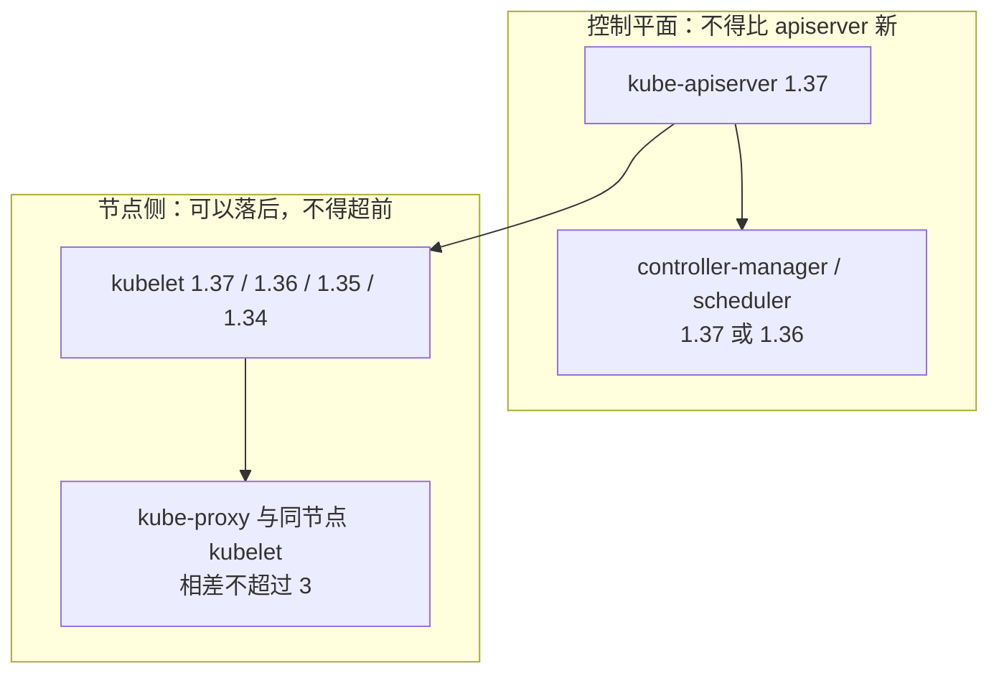
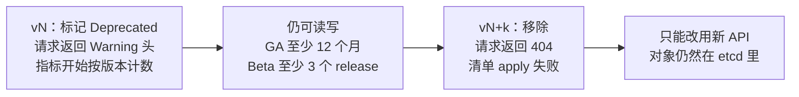
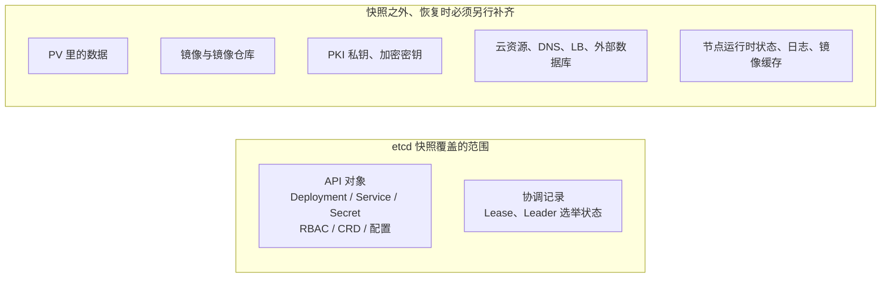
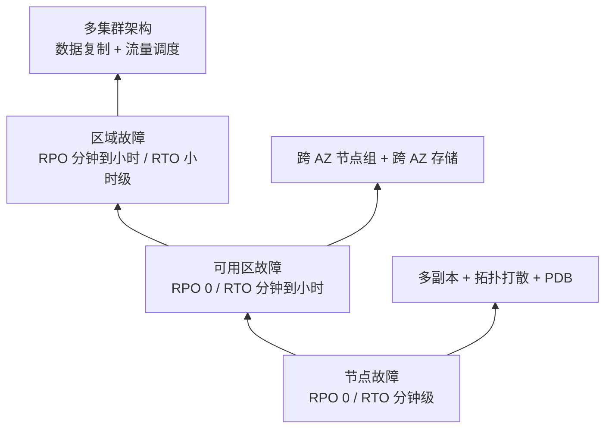
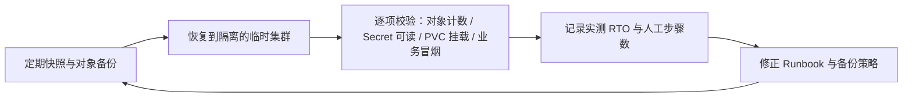

# 06 集群升级 备份与容灾

**摘要：**

集群的日常运维几乎都是可逆的：改错的 ConfigMap 可以改回来，多开的副本可以缩回去，打错的注解可以撤掉。例外只有三件——升级、备份、容灾，它们分别动的是契约、时间和架构，一旦做错，退路不在命令里，而在事故发生之前就准备好的那份快照、那套顺序、那个演练过的流程里。本文以 1.37 与一个 120 节点的自建集群为背景，先把**不可逆**拆成格式、契约、时间三层，再逐条落到升级顺序与**版本偏差**规则（kubelet 最多落后 apiserver 三个小版本、控制面组件最多落后一个、任何组件不得超前）、API 弃用窗口的检测手段，以及升级前那张真正能拦住事故的检查清单；随后讨论 etcd 快照的能力边界——它为什么不含 PV 数据、镜像与 PKI 私钥，恢复到新集群还要补哪七块——以及快照与 Velero 两种备份粒度在一致性、可选择性上的取舍，还有节点、可用区、区域三个故障域上 RTO/RPO 与架构的对应关系；最后给出把备份变成可恢复能力的演练方法，并把托管控制平面的 SLA 折算成每月的不可用分钟数，末尾盘点六类最常见的事故形态。

---

## 第 1 章 三类不可逆的操作

2019 年 9 月发布的 1.16 把 `extensions/v1beta1` 下的 Deployment、DaemonSet、ReplicaSet、NetworkPolicy 一并移除，那一次升级窗口里出现了一批很难看的故障：集群本身升得干净利落，此后所有人却发现自己仓库里的清单文件一个个被 apiserver 拒绝，报错文本形如 `no matches for kind "Deployment" in version "extensions/v1beta1"`，而被拒绝的对象此前已经跑了两年，谁也没想过它有一天会从服务端消失。这个场景说明了本文要处理的问题的性质：升级的破坏力并不主要来自升级过程本身，而是来自升级之后世界不再接受你手里的那套契约。

笔者把这类操作归为三类，它们失效的方向各不相同。升级改变的是**契约**——API 版本、字段语义、默认值、组件之间的版本约束；备份保护的是**时间**——它让你能回到某个过去的瞬间，但只能回到那个瞬间；容灾保护的是**架构**——它让你在某个故障域整体失效时仍然有服务，但换不来"回到昨天"。

| 操作 | 失效时最先坏掉的东西 | 典型不可逆点 | 唯一可靠退路 |
| :--- | :--- | :--- | :--- |
| 升级 | 客户端契约与组件兼容性 | 被移除的 API、被固化的默认值、被重写的存储版本 | 回到旧版本运行环境（而不是回退 apiserver） |
| 备份 | 恢复能力，而不是备份动作 | 快照之后的时间、快照之外的数据 | 更早的一份可用备份，且必须验证过 |
| 容灾 | 故障域内的可用性 | 切换到备用环境的决策与容量 | 预先演练过的切换流程与足够容量 |

### 1.1 不可逆的三种含义

第一种是格式不可逆。etcd 的存储格式、apiserver 写入对象时的序列化结果、CRD 的存储版本，这些一旦被新版本写过，旧版本就读不懂或者读不全。Kubernetes 官方明确不承诺降级，kubeadm 也没有 downgrade 子命令，所谓"回滚"在实践中等价于"从快照重建一套旧版本环境"。

第二种是契约不可逆。一个 API 被移除后，对象依然躺在 etcd 里，但你无法再通过那个 apiVersion 读写它；此时即使把控制平面降回旧版本，也只是让旧客户端重新能用，而这套旧版本自身又落到了安全补丁之外。

第三种是时间不可逆。快照是一个时间点，它之后创建的对象、修改的配置、删除的命名空间，在恢复之后全部消失；而节点上运行的容器、PV 里的数据、镜像仓库里的 tag，从来不在快照所覆盖的范围里。备份的边界问题在第七章展开。

### 1.2 一个贯穿全篇的集群

为了不让讨论停在抽象层面，本文用一个中等规模的自建集群作为贯穿案例：3 个控制平面节点跑 stacked etcd，120 个工作节点分布在 3 个可用区，节点规格 96 vCPU / 384 GiB，20 个业务命名空间、约 1,800 个 Pod，PV 走 Ceph RBD，镜像来自自建 Registry，集群版本 1.36，计划升到 1.37。这个规模不大不小，正好落在"必须自己动手、又没有专职平台团队"的那一档，绝大多数自建集群的痛点都能在它身上复现。

之所以要固定一个案例，是因为升级、备份、容灾三件事的全部代价都和规模、拓扑、依赖强耦合：同样一条 `kubectl drain`，在 6 节点的测试集群上是几十秒的操作，在 120 节点、副本集中部署的集群上是一次持续的容量挤压；同样一份 etcd 快照，在单可用区的小集群里只是几十 MB 的文件，在三可用区、上千 CRD 的集群里会牵出恢复时长与一致性的一连串问题。

---

## 第 2 章 版本节奏与支持窗口

Kubernetes 每年发布三个 minor 版本，大约每四个月一个，只维护最近三个 minor 分支，1.19 之后每个分支的补丁支持期约为一年。以 1.37 为当前稳定版来算，仍在维护的分支是 1.37、1.36、1.35，1.34 已经出了支持窗口，安全补丁不再回填。这个节奏带来一个容易被低估的后果：升级不是"一次项目"，而是"一项**持续产能**"。

### 2.1 欠下的版本账会以复利计息

`kube-apiserver` 不允许跨 minor 升级，这是项目层面的硬性约定，不是 kubeadm 的保守设计。也就是说，从 1.34 升到 1.37 不是一次升级，而是三次连续的升级，每一次都要走完整的控制平面替换、节点轮转、插件矩阵校验和观察期。把这件事摊到三年不升的集群上，欠下的账是九个 minor 的连续追赶，而没有哪个维护窗口能容下九次升级。

以一个示例推算说明产能占用：3 套集群、每年每个集群升三个 minor，每轮升级的控制平面窗口按 2 小时、每轮节点轮转按 6 小时计，则一年需要 `3 × 3 × 8 = 72` 小时的变更窗口，再加上每季度的恢复演练与备份验证，接近 80 小时。这只是执行时间，不含准备清单、插件升级与事故处理。如果集群数量增长到 10 套而团队规模不变，升级就会从"计划内工作"退化成"总也排不上期的工作"，而版本落后又会反过来拉长下一次升级的工期，形成正反馈。

| 集群当前版本 | 可直接升级的目标 | 需要经过的轮次 | 支持窗口状态 |
| :--- | :--- | :--- | :--- |
| 1.36 | 1.37 | 1 轮 | 1.36 仍在维护 |
| 1.35 | 1.36 → 1.37 | 2 轮 | 临界，下一个 minor 发布即出窗 |
| 1.34 | 1.35 → 1.36 → 1.37 | 3 轮 | 已出补丁支持窗口 |
| 1.31 | 逐个小版本追平 | 6 轮及以上 | 已 EOL，安全补丁缺失 |

### 2.2 为什么"稳定就好"不是一个可选项

不升级的代价并不只是"少几个新特性"，它在四个方面同时施压。其一是安全：CVE 修复只回填到受支持的分支，出了窗口的版本即使有严重漏洞也不再发补丁。其二是节点侧红线：如后文所述，kubelet 与 kube-proxy 一旦落后 apiserver 三个 minor，控制平面自己也无法再升级，必须先把节点补上来，这时升级的主动权已经不在你手里。其三是生态矩阵：CNI、CSI、Ingress 控制器、监控组件都在按 Kubernetes 的支持窗口裁剪自己的兼容范围，你的集群越旧，能用的插件版本越少，迟早会遇到"新驱动不支持旧集群、旧驱动有未修的 bug"的两难。其四是托管服务的强制节奏：主流云厂商会在版本 EOL 之后安排强制升级，窗口由平台决定而不是由你决定。

不过反过来说，把升级频率提得过高也有代价：每轮升级都要占用变更窗口、消耗团队的注意力、引入回归风险，而三个 minor 一年的节奏已经快于很多业务系统的变更频率。多数团队的合理区间是每年两到三次，与社区节奏错开半个身位，既不出支持窗口，也不会每次都踩在刚发布的 x.0 上。

---

## 第 3 章 升级顺序与版本偏差

升级顺序不是风格问题，而是版本偏差策略的推论：规则规定"谁能比谁新、谁可以落后多少"，顺序就是让每一步都不违反规则的唯一排列。反过来，违反顺序的升级会立刻在节点注册、对象写入或控制器启动上暴露出来。

控制平面先升、节点后升，控制平面内部再按 etcd → kube-apiserver → kube-controller-manager/kube-scheduler 的顺序推进；kubelet 在节点被 drain 之后升级，kube-proxy 随 DaemonSet 滚动；CNI、CSI、CoreDNS 这些插件不在这条主链上，按各自的厂商矩阵单独升级。下图给出这条链路的完整形态。


### 3.1 版本偏差的完整规则

**版本偏差（Version Skew）**策略是一张描述组件间允许差异的表，Kubernetes 每次发布新 minor 都会同步更新，1.37 的口径与之前几个版本一致。下表按 1.37 列出规则与直接推论。

| 组件对 | 允许的偏差 | 推论 |
| :--- | :--- | :--- |
| kube-apiserver 实例之间（HA 集群） | 最新与最旧实例相差不超过 1 个 minor | 滚动替换控制平面节点时允许短暂混合版本 |
| kubelet 对 kube-apiserver | 不得更新；最多落后 3 个 minor（1.25 之前只能落后 2 个） | kubelet 1.37/1.36/1.35/1.34 可连 1.37 的 apiserver |
| kube-proxy 对 kube-apiserver | 与 kubelet 相同 | 节点侧不强制与 apiserver 同步 |
| kube-proxy 对同节点 kubelet | 相差不超过 3 个 minor | 二者可以分开升级，但不能拉太远 |
| kube-controller-manager / kube-scheduler / cloud-controller-manager 对 kube-apiserver | 不得更新；最多落后 1 个 minor | 必须等 apiserver 升完，且只能落后一个版本 |
| kubectl 对 kube-apiserver | ±1 个 minor | 客户端可以略新，但不能跨两个版本 |

规则本身不复杂，复杂的是它在 HA 集群里的叠加效应。以 1.37 为例，如果三台 apiserver 处于 1.37 与 1.36 混合的状态，那么 kubelet 的合法区间立刻收窄：1.37 的 kubelet 不行，因为它比仍在服役的 1.36 apiserver 新；可选只剩 1.36、1.35、1.34。同样的逻辑作用在 controller-manager 与 scheduler 上更严——它们如果通过负载均衡器可以连到任意一台 apiserver，就必须等所有 apiserver 都变成 1.37 才能升级，否则自己就比 1.36 的 apiserver 新了。这条推论把"控制平面先升"从一句口诀变成了有约束力的操作序列：先升 apiserver 的全部实例，再升控制器。

下图把"不能超前、可以落后"的方向关系画出来，左侧是控制平面，右侧是节点侧，箭头方向即允许的版本传递方向。



### 3.2 kubelet 落后三个版本会锁死控制平面

版本偏差策略里有一条容易被忽略的警告：如果集群里的 kubelet 长期落后 apiserver 三个 minor，那么在控制平面升级之前必须先升级这些 kubelet。原因是控制平面升到 1.37 之后，落后三个版本的合法底线就从 1.34 抬到了 1.35，1.34 的 kubelet 会掉到区间之外。

这一条把"节点先不管、先把控制平面推上去"的简化策略堵死了。笔者见过的情况是：某个集群因为 GPU 驱动与内核模块的匹配关系，一直把节点冻结在旧版本，控制平面单独往前推。等到跨过第三个 minor 时，节点的升级从"可以排期"变成"必须先做"，而冻结节点恰恰是最难动的部分——驱动、内核、容器运行时、CNI 全部要一起验证。版本偏差的这三个 minor 实际上是**节点侧的债务上限**，超过它，控制平面的升级通道就被债务抵押了。

### 3.3 顺序颠倒时看到的现象

如果先升级 kubelet，症状通常分三层出现。第一层是节点注册异常：kubelet 上报的字段、条件与特性状态超出了旧 apiserver 的认知范围，Node 对象出现异常条件，kubelet 日志里出现版本兼容性告警（具体文案以对应版本文档与源码为准，不值得背）。第二层是工作负载调度受阻：新 kubelet 创建的 Pod 带上了旧版本控制平面不认识的结构，部分对象写入被拒。第三层是控制器的连锁反应：ReplicaSet 反复重建 Pod，事件里堆满失败信息，而排障的人往往先怀疑镜像与网络，最后才发现是版本方向错了。

如果先升级 controller-manager 与 scheduler，症状更隐蔽：组件可能能启动，但一旦通过负载均衡连到尚未升级的 apiserver，就会出现比它新的情况，部分协调逻辑失效，表现为副本数不收敛、Pod 长时间不调度，而 apiserver 与 kubelet 看起来都健康。

### 3.4 kubeadm 的操作骨架与真正的判断点

kubeadm 把上面这条链封装成了几个子命令，命令本身没什么可讲的，值得说的是每个命令前后必须做的判断。

```bash
# 升级前：确认目标版本在当前集群的合法区间内
kubeadm upgrade plan v1.37.3

# 第一台控制平面节点用 apply，先干跑看清楚它要动哪些组件
kubeadm upgrade apply v1.37.3 --dry-run
kubeadm upgrade apply v1.37.3

# 其余控制平面节点、以及每个工作节点用 node 子命令
# 注意：控制平面节点的 node 子命令只更新本地配置，不负责其他节点
kubeadm upgrade node

# 证书有效期与升级窗口要错开，别在同一晚做两件高风险的事
kubeadm certs check-expiration
```

有一点必须在动手前确认：`kubeadm upgrade node` 只作用于执行它的那台节点——在控制平面节点上更新本节点的静态 Pod 清单与 kubeconfig，在工作节点上更新本地 kubelet 配置，它不会替你升级其他节点，也不改变集群的控制平面版本；控制平面版本由第一台节点上的 `apply` 决定。把这两件事记混，后续节点就会在配置上互相矛盾。

kubelet 的升级不能原地跨 minor，官方文档要求先 drain 该节点。原因在于升级过程包含二进制替换与服务重启，而 kubelet 是节点上唯一负责把容器、卷、网络状态与 apiserver 对齐的组件：重启窗口里容器不会立刻停止，但节点管理面失效，任何一次启动失败都只能靠 systemd 反复拉起或人工介入，节点会停在 NotReady 上。

### 3.5 用声明式工具编排同一顺序

把这套顺序交给工具执行，顺序并没有改变，只是从人的操作变成了控制器的状态机。Cluster API 的 KubeadmControlPlane 会逐台替换控制平面的 Machine，同一时刻只动一台，等新节点的 apiserver 就绪后才继续；MachineDeployment 的滚动受 `maxSurge` 与 `maxUnavailable` 约束，这两个字段直接决定升级期需要多少额外容量——`maxSurge: 1` 先建一台新节点再删一台旧节点，安全但吃容量，`maxUnavailable: 1` 先删后建，省容量但牺牲可用副本。

工具能替人守住顺序，守不住前置条件：插件矩阵、PDB 覆盖、证书有效期这些检查仍然要人做，而控制器的自动重试会把一次有问题的升级拖成数小时的慢动作——节点一台台变成 NotReady，控制器一台台重试，直到有人按下暂停。

---

## 第 4 章 硬不可逆点逐条清点

上一章讲的是顺序，这一章把"升上去就回不来"的具体位置逐个点出来。这些位置之所以不可逆，机制各不相同，退路也不同。

| 不可逆点 | 机制 | 一旦发生 | 唯一退路 |
| :--- | :--- | :--- | :--- |
| 字段被新版本写入并固化 | 新版 apiserver 的默认值在写入时落盘，旧版读取时按未知字段裁剪，写回即丢失 | 回退 apiserver 也回不到原来的对象形态 | 从升级前快照重建，或接受字段丢失 |
| API 版本被移除 | 服务端不再注册该 group/version，客户端请求 404 | 清单、Operator、Helm chart 全部失效 | 改用新 API 重写清单 |
| etcd 被升级到新 minor | 官方降级一次只允许退一个 minor，且 Kubernetes 层面不承诺降级 | 旧版 etcd 无法读取新格式数据目录 | 从升级前的 etcd 快照恢复 |
| kubelet 被升级到新 minor | kubelet 不支持原地跨 minor 回退 | 只能重装系统包或重建节点 | 重装节点 |
| 节点被替换或删除 | 本地盘、local PV、hostPath 数据、镜像缓存随节点消失 | 数据不可找回 | 从业务侧的数据备份恢复 |
| 特性门控 GA 后关闭 | GA 能力没有关闭开关，对象上的新行为不可撤销 | 行为永久改变 | 无（只能前向修复） |
| 存储版本迁移 | 控制器把对象重写为新的存储编码，etcd 里的字节变了 | 旧版 apiserver 读到的编码与预期不符 | 快照恢复 |

### 4.1 字段固化：回退 apiserver 不等于回退状态

默认值不是 manifest 里的东西，而是 apiserver 在写入路径上补进去的。一个对象在创建时被新版 apiserver 补上了若干默认字段，这些字段就以新版本的编码写进了 etcd；此后即使把 apiserver 换回旧版本，旧版本在读取时会按自己的类型定义裁剪掉不认识的字段，而任何一次写回都会让这些字段永久消失。变更链路的完整形态在 [[04 API Server 请求链路：从 HTTP 请求到 etcd 写入]] 里拆过，这里只需要记住结论：**默认值一旦落盘，就是数据的一部分**，不是配置的一部分。

> [!warning] 回滚的真实含义
> Kubernetes 层面的"回滚"只有两种落地方式：回到旧版本的运行环境并从快照重建数据，或者接受已经写入的新格式继续向前。没有第三条路，也没有一个命令能把状态和版本一起退回。

这条机制解释了为什么"升级出问题就回退控制平面"在实践中几乎从不奏效。回退能恢复的只有进程版本，恢复不了已经以新形态写入的对象；而服务端版本的来回切换本身又会引入一部分对象被新版本写、一部分被旧版本写的混合状态，排查成本远高于直接从快照重建。

### 4.2 etcd 的版本回退有官方路径，但窗口很窄

etcd 有文档化的滚动降级流程：先用 `etcdctl downgrade validate` 校验目标版本，再用 `etcdctl downgrade enable` 让集群按低版本协议运行、把 schema 迁移到目标版本，然后逐台换回旧二进制；如果还没换完就发现问题，`etcdctl downgrade cancel` 可以把集群拉回原版本。这条路径支持零停机滚动，代价是只允许一次降一个 minor（3.6 直接降到 3.4 不被接受），且要求集群健康、提前留下快照。

窄的地方在于它解决的是"刚升上去、察觉不对"这一种情况。一旦降级完成、存储版本已经迁移，想回到原版本就要按升级流程重新走一遍；而 Kubernetes 层面从来不承诺降级，apiserver 与 etcd 的版本组合也不在降级的支持范围内。kubeadm 升级控制平面时会连带升级 etcd，因此"升级前留快照"仍然是这一章所有建议里唯一没有例外的一条。

这里需要区分两件常被混淆的事：快照是 etcd 数据的一致时间点导出，属于运维动作；Raft 的日志复制与快照机制是 etcd 的内部实现，属于另一层话题，[[07 etcd 深度剖析：Raft 共识、MVCC 与 Watch 机制]] 讲的是后者。运维上真正需要记住的是：快照文件是一个可以独立保存、校验、异地存放的产物，它的价值等于它最后一次成功恢复的时间。

### 4.3 证书：不在 etcd 里的那份状态

集群的 PKI **不在 etcd 里**。kubeadm 把 CA、etcd 对等证书、front-proxy 证书、ServiceAccount 的签名密钥放在 `/etc/kubernetes/pki` 下，这些文件是节点上的静态资产。默认情况下 CA 证书有效期十年，其余证书一年，`kubeadm certs check-expiration` 会列出每一张的剩余时间。

这条边界在恢复场景里非常致命：如果只恢复了 etcd 而丢了 `sa.key`，集群里所有 ServiceAccount 的 token 都会验签失败，Pod 无法访问 apiserver，表现是几乎所有控制器报认证错误；如果只恢复了 etcd 而 CA 换了新的，所有 kubeconfig、所有 webhook 的客户端证书、所有已签发的 kubelet 证书同时失效，集群实际上需要重新引导一遍。备份清单里如果只有 etcd 快照，这份备份在"恢复到新集群"时是不够用的。

---

## 第 5 章 弃用 API 的检测与迁移

API 弃用是升级事故里最可预测的一类，因为它的时间窗是公开的。弃用政策规定了每个稳定性级别的最短存活期：GA 的 API 被标记弃用后，至少十二个月内不得移除；Beta 的 API 被弃用后至少要再支持三个 release；Alpha 的 API 可以随时移除，不给通知。对照每年三个 minor 的节奏，Beta API 从弃用到消失约三个 release，GA API 的时间窗在一年上下，折算下来也是三个 minor 左右。

下图是这条生命周期的形状，关键在于中间那段"还能用但已经在报警"的窗口，所有准备工作都应该在窗口内完成。



### 5.1 用指标发现，而不是用 Warning 发现

最直觉的检测方式是看 `kubectl` 打出的 Warning，但这条路径有一个致命缺口：Warning 只在客户端直接使用被弃用的 API 时才会出现，而集群里真正大量使用 API 的是控制器、Operator、Helm hook、CI 流水线，这些客户端不会把 Warning 打到你的终端上。

可靠的做法是查 apiserver 的指标。apiserver 会为每次对已弃用 API 的请求计数，并把移除版本作为标签带上，因此一条查询就能同时回答"有没有人用"和"还有几个版本的时间"。

```bash
# 按 group/version/resource 聚合，removed_release 直接告诉你还剩几个版本
kubectl get --raw /metrics \
  | grep '^apiserver_requested_deprecated_apis' \
  | grep -v ' 0$'

# 直接问 apiserver 某个版本还注册着哪些资源，用来确认迁移目标是否存在
kubectl api-resources --api-group=networking.k8s.io
```

指标里的 `removed_release` 标签是这条排查路径最有价值的部分，它把"某个客户端还在用旧 API"从模糊告警变成了**带截止日期的待办**。

### 5.2 清单之外的扫描面

静态清单只是扫描面的一部分。按覆盖面从窄到宽，常见的检测手段有四类，各自的盲区不一样。

| 手段 | 覆盖范围 | 盲区 |
| :--- | :--- | :--- |
| apiserver 弃用指标 | 集群内所有实际发生的请求 | 只能看到已发生的流量，看不到未来会 apply 的清单 |
| pluto / kubent 扫描 | 本地清单、Helm release、集群内现存对象 | 对运行时动态构造的对象无效 |
| kubectl-convert 批量转换 | 单个清单文件的 apiVersion 升级 | 字段语义变化不会自动处理，需人工核对 |
| 逐版本读 release note | 全部移除项与行为变更 | 无法自动化，依赖人工阅读 |

`kubectl convert` 自 1.22 起已不再随 kubectl 主体发布，官方把转换能力拆成了独立的 `kubectl-convert` 插件，需要单独安装，版本要与目标集群匹配。转换工具能解决 apiVersion 的换名，但解决不了字段层面的语义变化：Ingress 从 `extensions/v1beta1` 迁到 `networking.k8s.io/v1` 时新增了必填的 `pathType`，这个字段没有默认值，转换出来的清单能通过 API 校验却可能在路由语义上与原来不同，必须人工确认。

### 5.3 webhook 与准入链的兼容性

控制平面升级的一个高频故障点在**准入链**上。`ValidatingWebhookConfiguration` 与 `MutatingWebhookConfiguration` 里注册的 webhook，会在 apiserver 处理请求的路径上被调用；如果 webhook 按旧版本的资源结构做严格解码，新版本引入的字段会让它拒绝请求，而很多 webhook 配置的是 `failurePolicy: Fail`，一旦拒绝，整个资源的写入路径就被堵住。

规避方式在官方文档里有明确建议：webhook 的 `matchPolicy` 设为 `Equivalent`，让它对所有等价的 API 版本生效而不是只匹配注册时的那个版本；同时 webhook 服务端要能容忍未知字段，而不是遇到不认识的结构就报错。这两条在升级前是检查项，在升级后是救火项，检查的成本远低于救火。

---

## 第 6 章 升级前的检查清单

真正能拦住事故的不是"升级步骤"，而是升级前那一小时的核对。清单里的每一项都对应一种已经发生过的事故形态，因此不能靠"上次没问题"来豁免。

### 6.1 PDB 保护的是自愿中断，不是节点故障

PodDisruptionBudget（PDB）**只对自愿中断生效**：`kubectl drain`、节点维护、集群缩容这些由人发起、走驱逐（eviction）接口的动作会被预算拦住，而节点宕机、kubelet 崩溃、网络分区导致的驱逐由节点生命周期控制器在容忍时间到期后执行，完全不看 PDB。把 PDB 当成节点故障的保险，是最常见的误解之一。

在升级场景里，PDB 的实际作用对象就是 drain。这里有几个容易踩的细节：`kubectl drain` 走的是 eviction 子资源，因此会尊重 PDB，默认 `--timeout=0` 意味着无限等待，一旦预算不允许，命令会一直挂在那里，看起来像卡死；`--disable-eviction` 会改用直接删除，绕过 PDB，把它当成"跳过等待"的开关用，等于自己关掉了唯一的保护；`minAvailable: 100%` 或 `maxUnavailable: 0` 在单副本服务上会让 drain 永远无法完成；反过来，如果完全没有 PDB，一次 drain 就可能把某个服务的全部副本同时清掉。

下面这份 PDB 覆盖多副本无状态服务，关键是让 `maxUnavailable` 与副本数留出至少一个副本的余量，而不是追求"一个都不许停"。

```yaml
apiVersion: policy/v1
kind: PodDisruptionBudget
metadata:
  name: order-api
  namespace: production
spec:
  # 三个副本时最多允许一个不可用，drain 会逐个放行
  maxUnavailable: 1
  selector:
    matchLabels:
      app: order-api
```

还有一处细节值得单列：DaemonSet 的 Pod 在 drain 时被忽略（需要 `--ignore-daemonsets`），而 DaemonSet 往往承载日志采集与监控代理，因此整个 drain 窗口里这些节点是观测盲区。这不是拒绝升级的理由，但排障时需要知道盲区存在，别在升级窗口里指望日志采集的完整性。

### 6.2 容量余量的算术

升级期间的容量问题不是"够不够用"，而是"drain 一台之后，剩下的节点能不能装下这一台的 Pod"。若集群有 N 个节点、平均 requests 利用率为 u，串行 drain 单节点时，剩余节点的平均利用率变成 `u × N / (N - 1)`。这个式子是示例推算，用来判断余量是否足够，实际装箱还要受拓扑打散、亲和性、PVC 所在可用区等因素影响。

按此推算：6 节点、75% 利用率的集群 drain 一台后是 90%，已经超过多数团队 85% 的安全水位，只能靠临时扩容或缩短滚动批次；15 节点、75% 是 80.4%，勉强可行，但遇到反亲和打散造成的装箱失败时仍会卡住；120 节点、65% 是 65.5%，看起来宽裕，可真正的瓶颈往往**不是平均值**，而是"某个可用区的剩余容量"和"某类大规格 Pod 的可用碎片"。

还要注意 requests 与实际使用量之间的差额。装箱判断按 requests 计算，风险判断按实际使用量计算，二者之间的差额就是超卖比例。升级窗口里的流量通常不会下降，如果被 drain 的节点上恰好有几个高负载 Pod，剩余节点会同时承接超额使用与请求量，CPU 节流与延迟上升是必然结果。

还要把业务侧 Deployment 自己的 `maxUnavailable` 与 `maxSurge` 算进去。drain 期间被驱逐的 Pod 由 Deployment 补建，`maxUnavailable: 0`、`maxSurge: 1` 的配置每补一个 Pod 都要先占用一份新容量，容量紧张时补建只能排队；如果把 `maxUnavailable` 放大到 25%，drain 与滚动更新叠加，同一时刻的不可用副本数会同时来自两个方向。升级窗口开始之前，先把滚动参数收敛到剩余余量能承接的范围，比在窗口里临时调整要稳妥得多。

### 6.3 插件矩阵与节点侧依赖

控制平面升级不会自动升级插件，而插件对 Kubernetes 版本有明确的兼容区间。检查顺序按"控制平面升级后必须还能工作"来排：CNI 插件（网络不通则一切免谈）、CSI 驱动与 sidecar（存储挂载依赖它）、CoreDNS、Ingress 控制器、metrics-server 与监控采集组件，最后是业务侧的 Operator。

| 检查项 | 判据 | 不满足时的后果 |
| :--- | :--- | :--- |
| 弃用 API 用量 | 弃用指标为 0，或已列入迁移计划 | 升级后清单、Operator 写入被拒 |
| PDB 覆盖 | 每个多副本服务有 PDB，且预算允许 drain | drain 挂死，或副本被同时清空 |
| 容量余量 | `u × N / (N - 1)` 低于安全水位 | Pod 长时间 Pending，业务降级 |
| CNI / CSI 版本 | 在厂商声明的兼容区间内 | 网络不通、卷挂载失败 |
| 准入 webhook | `matchPolicy: Equivalent`，可容忍未知字段 | 升级后所有写入被拒 |
| 证书有效期 | 剩余时间覆盖升级窗口与回滚窗口 | 升级后组件间 TLS 失败 |
| etcd 健康 | 各成员健康、配额未满、碎片率正常 | 升级期间写入变慢甚至失败 |
| 备份可恢复性 | 最近一次恢复演练在有效期内 | 出事时手里只有一份未经检验的文件 |

### 6.4 etcd 侧的三个前提

升级前对 etcd 的检查，除了"三成员健康"这类常规项，还有三点容易被跳过。第一是快照的耗时与影响：在线快照会读取整个数据目录，数据量大、磁盘 IO 紧张时会给 apiserver 的写入带来可观测的延迟上升，因此快照动作本身要放在低峰，并且最好在升级前单独做一次而不是塞进升级脚本。第二是配额与碎片：etcd 的存储配额一旦打满，集群会进入只读的告警状态，所有写入失败；碎片率高则意味着数据目录的实际占用远大于逻辑大小，恢复时的时间与空间预算都会被放大。第三是静态加密：如果集群启用了 Secret 的静态加密，快照里存的是密文，恢复时必须带上同一份 `EncryptionConfiguration` 与可用的密钥后端，这个前提在第七章展开。

---

## 第 7 章 备份的真实边界

etcd 快照经常被当成"集群备份"的同义词，这个等价关系只在"恢复对象定义"这一件事上成立。把快照的覆盖范围与集群运行所依赖的全部状态对齐来看，缺口比覆盖的部分更大。



### 7.1 快照里究竟是什么

etcd 快照是 etcd 数据在一次一致时间点上的完整导出，里面是 apiserver 写入的全部键值：所有 API 对象的序列化结果、CRD 定义本身、RBAC 规则、ServiceAccount 与 Secret 对象（若启用静态加密则为密文）、以及控制器与调度器用于选主的 Lease。它不包含任何"正在发生"的东西——不包含容器的运行状态，不包含卷的内容，不包含节点上的文件。

这里需要强调它与"期望状态"的关系：快照保存的是**声明，不是现实**。快照恢复之后，控制平面重新知道"应该有什么"，然后由控制器去把现实拉回声明；这个过程需要镜像、存储、网络、凭据全部就位，任何一环缺失，声明都变不成现实。

### 7.2 恢复之后的真实行为

一个常见的错误预期是"恢复 etcd 之后，正在运行的 Pod 不受影响，只是控制平面不知道它们"。实际行为更接近相反：kubelet 的 Pod 来源是 apiserver，当它发现本地运行的某个 Pod 在 apiserver 里已经不存在时，会按不可用处理并终止它；同时 Deployment 控制器看到快照时刻的副本状态，会重新创建 Pod。于是恢复后短时间里会出现三件事叠加：快照之后创建的 Pod 被删除、旧 Pod 被重建、重建的 Pod 需要重新调度并拉取镜像。

这意味着"恢复到原集群"本质上是一次**全量重启级别的抖动**，而不是一次无感的回滚。恢复的耗时主要由镜像拉取、存储挂载与调度风暴决定，在 120 节点、1,800 个 Pod 的集群上，几十分钟量级是合理的预期（示例推算，实际取决于镜像大小、仓库吞吐与节点缓存命中率），因此恢复动作应当按"业务中断"来组织，而不是按"后台修复"来安排。

### 7.3 恢复到新集群要补齐的七块

如果事故是"整个集群没了"，恢复流程的目标就不是修好旧集群，而是在新集群上重建。此时 etcd 快照只是起点，下面七块缺一不可。

| 补齐项 | 具体内容 | 缺失时的症状 |
| :--- | :--- | :--- |
| PKI | CA、etcd 对等证书、front-proxy、`sa.key`/`sa.pub` | ServiceAccount 验签失败，全部 Pod 无法访问 apiserver |
| 加密密钥 | `EncryptionConfiguration` 与密钥后端 | Secret 读取报错，工作负载拿不到配置 |
| 网络 | CNI 配置、Pod/Service 网段、LB、DNS 区 | 节点 NotReady，或对象恢复后无法互通 |
| 存储 | CSI 驱动、StorageClass、卷快照或数据备份 | PVC Pending，有状态负载无法启动 |
| 镜像 | Registry 可达、tag 存在且可追溯 | ImagePullBackOff |
| 外部依赖 | 云 LB、安全组、IAM、外部 Secret 源、数据库 | 服务启动但无法对外，或启动即失败 |
| 节点侧 | kubelet 配置、sysctl、容器运行时、驱动 | 节点注册成功但负载行为与原来不一致 |

这七项里最容易被漏掉的是**第一项与第二项**，因为它们不在 Kubernetes 的对象模型里，也不在任何 `kubectl get` 的输出里。笔者建议把 PKI 与加密配置纳入"集群资产"清单，与 etcd 快照一并做异地备份，并且明确它们的轮换周期——证书一年一换，备份里的证书如果过期，恢复出来的集群会在 TLS 握手阶段集体失败。

### 7.4 恢复命令与 etcd 工具链的迁移

恢复的实质是用快照生成一份新的 etcd 数据目录，然后让 etcd 用这份目录启动。工具链在 3.5 之后做过一次拆分：保存快照仍然用 `etcdctl snapshot save`，而离线的状态查询与恢复被收拢到独立的 `etcdutl`；到 3.6，恢复只接受 `etcdutl snapshot restore`。很多流传的操作手册还停留在旧写法，照抄会在新版本上直接失败。

还有一个与 Kubernetes 强相关的参数细节：快照的 revision 必然小于集群当前值，恢复之后 revision 相当于倒退。控制器的 informer 缓存依赖 revision 与 watch 维持，缓存不会因为 revision 倒退而自动刷新，行为会变得不可预测。etcd 文档因此建议在 Kubernetes 场景下恢复时抬高 revision、并把抬升出的区间标记为已压缩，让所有 watch 终止、旧缓存失效，控制器重新做一次全量同步。

```bash
# 校验快照完整性：先确认文件可用，再谈恢复
etcdutl snapshot status /backup/etcd-20261119.db --write-out=table

# 离线恢复：这一步不连集群，参数描述的是"新集群的成员身份"
# --bump-revision 抬高 revision，--mark-compacted 让旧 watch 全部终止
etcdutl snapshot restore /backup/etcd-20261119.db \
  --name=cp-1 \
  --initial-cluster=cp-1=https://10.0.0.11:2380 \
  --initial-cluster-token=prod-cluster \
  --initial-advertise-peer-urls=https://10.0.0.11:2380 \
  --bump-revision=1000000000 \
  --mark-compacted \
  --data-dir=/var/lib/etcd-restored

# 恢复会生成新的成员 ID 与集群 ID，相当于起一个新的逻辑集群
# 因此三台控制平面必须用同一份快照、各自的成员参数分别恢复
```

恢复之后的首要动作不是看业务，而是确认控制平面自身健康：`kubectl get --raw='/readyz?verbose'` 会逐项报告各组件的就绪状态，比反复 `kubectl get pods` 更快定位是哪一层还没起来。等 apiserver 就绪、controller-manager 与 scheduler 选主完成，再去看工作负载的重建进度。

### 7.5 备份纪律

备份的价值不在"有文件"，而在"能在需要时恢复出正确状态"。围绕这个目标，纪律可以压缩成三条：异地存放，快照与集群不在同一故障域、不在同一云账号的同一份权限下；不可变存储，用对象存储的保留策略防住误删与勒索，避免"备份和源数据一起被删"；定期验证，把恢复动作本身当作一项例行工作，而不是事故当天第一次尝试。

还有一条容易被忽略：备份文件里可能是明文。若集群没有启用静态加密，Secret 在快照里就是明文，这份文件一旦泄露等于泄露集群全部凭据；而如果启用了静态加密，快照是密文，但密钥材料本身又成了必须单独保护的资产。两种选择的代价都要提前认下来，别在事故当天才发现自己既没有加密也没有权限控制。

---

## 第 8 章 两种备份粒度

备份的粒度决定了它能回答的问题。"回到某个时刻的整个集群"和"把一个命名空间搬到另一个集群"是两个不同的需求，前者要一致性，后者要可选择性，而两者很难靠同一份产物同时满足。

### 8.1 整集群快照：一致性与速度

etcd 快照是单点一致的，它给出的状态是某个瞬间的完整逻辑视图，没有跨对象的时间差。它的体积小、恢复路径短，恢复动作就是把数据目录换掉，没有逐对象的重建过程，因此在"集群整体损坏"这个场景里，它的恢复速度远快于对象级工具。

代价是粒度粗与可移植性差。你无法只恢复一个命名空间，也无法只回滚一个 Deployment；快照恢复出来的集群版本、CRD 定义、apiserver 配置都必须是与之匹配的，跨大版本恢复并不被支持。它回答的问题是"整台机器坏了怎么办"，而不是"某个同事删错了一个命名空间怎么办"。

### 8.2 对象级备份：可选择性与其代价

Velero 走的是另一条路：它通过 API 逐类列举对象，把对象定义与卷数据分别备份。对象定义进对象存储，卷数据要么走 CSI 快照，要么走文件系统备份（File System Backup，基于 Kopia 的节点代理读取卷目录）。这条路径带来的能力是选择性与可移植性——可以只备份一个命名空间、一批带特定标签的资源，也可以把备份恢复到另一个集群的另一个命名空间，这正是集群迁移与误删恢复需要的形态。

它的代价集中在**一致性**上。对象是逐类列举的，列举过程中对象可能已经被修改，因此备份不是严格的时间点；文件系统备份读的是活动文件系统，官方文档明确说明它"不是在同一个时间点捕获数据"，一致性弱于快照方案。此外，Velero 的卷备份与卷快照对同一个卷是互斥的，走了文件系统备份就不会再打快照，反之亦然，选型时要清楚自己在用哪条路径。

| 维度 | etcd 整集群快照 | Velero 对象级备份 |
| :--- | :--- | :--- |
| 一致性 | 单点一致 | 逐对象列举，弱一致 |
| 粒度 | 全集群 | 命名空间 / 标签 / 资源类型 |
| 恢复目标 | 同版本集群 | 可跨集群、可重命名命名空间 |
| 卷数据 | 不含 | CSI 快照或文件系统备份 |
| 恢复耗时 | 短（换数据目录） | 长（逐对象重建 + 卷数据回填） |
| 主要用途 | 集群整体损坏、升级回滚 | 误删恢复、集群迁移、租户级备份 |
| 依赖 | 同版本 etcd 与 PKI | Velero 组件、插件、CSI 驱动、存储桶 |

两条路径的取舍可以用一句话概括：要"**回到过去**"用快照，要"**搬走一部分**"用对象级备份。多数生产集群两者都需要，因为事故形态本来就有两类。

### 8.3 选择 Velero 时需要知道的限制

Velero 的文件系统备份用 Kopia 作为数据搬运层，节点代理以特权方式挂载 `/var/lib/kubelet/pods` 读取卷内容，因此 `hostPath` 卷不被支持，`local` 卷则被支持。备份仓库使用静态的公共加密密钥，这意味着能访问备份存储的人就能解密备份内容——存储权限边界就是数据权限边界。

这套工具在版本上也经历过一次迁移：Restic 路径从 1.15 起被标记弃用，1.17 与 1.18 禁止新建 Restic 备份但仍可恢复旧数据，1.19 起新旧都不再支持。如果集群里还留着基于 Restic 的历史备份，升级 Velero 之前要先确认恢复路径是否还在。

演练与迁移时还有一个细节：Velero 的恢复可以配合命名空间映射，把生产命名空间的内容恢复到演练命名空间，这是做恢复验证最安全的姿势——不碰生产对象，只验证备份是否完整。

```bash
# 按命名空间备份，并在演练集群里映射到另一个命名空间恢复
velero backup create prod-nightly \
  --include-namespaces production \
  --default-volumes-to-fs-backup

velero restore create drill-20261119 \
  --from-backup prod-nightly \
  --namespace-mappings production:production-drill
```

### 8.4 RPO 与代价的算术

备份频率直接决定 RPO（恢复点目标），也就是"最坏情况下会丢多少时间的数据"。每小时一次的对象级备份意味着 RPO 一小时，每天一次则是二十四小时；如果关键数据在 PV 里，还要看卷数据的备份频率是否与对象定义一致，二者不同步时会出现"对象回到了 10 点、数据回到了 8 点"的错位。

频率提升的代价不是线性的：备份窗口、存储成本、对 etcd 与存储后端的 IO 压力、以及备份失败后的重试风暴都会随频率上升。以示例推算说明，1,800 个 Pod、20 个命名空间、约 12 TB 卷数据的集群，若每天全量文件系统备份耗时 4 小时、每小时增量备份耗时 20 分钟，则每小时备份会占用约三分之一的备份窗口余量，且对节点 IO 的持续压力需要单独评估。合理的做法是按数据的重要性分级：核心交易数据每小时、一般业务数据每天、日志与分析数据每周，而不是对全部数据用同一个频率。

---

## 第 9 章 容灾的层级

备份与容灾经常被混为一谈，但两者回答的问题不同：备份让你回到过去，容灾让你在故障域失效时继续服务。一个只有备份的集群在区域故障面前仍然要经历几小时的业务中断；一个只有容灾没有备份的集群在误删面前会忠实地把误删同步到备用环境。

容灾的分层由故障域决定，故障域越大，需要的架构越重。下图从节点到区域逐层向上，每一层的 RTO 与所需架构都在变化。



### 9.1 三个故障域的对应关系

| 故障域 | 典型 RPO | 目标 RTO | 需要的架构 | 常见残留单点 |
| :--- | :--- | :--- | :--- | :--- |
| 单节点 | 0 | 1–5 分钟 | 多副本、拓扑打散、PDB | 单副本 StatefulSet、副本挤在同一节点 |
| 单个可用区 | 0 | 5–30 分钟（有 N+1 余量）或等 AZ 恢复 | 多 AZ 节点组、跨 AZ 存储、跨 AZ LB | 可用区绑定的 PV、镜像仓库单 AZ |
| 整个区域 | 分钟级到小时级 | 1–4 小时 | 多集群、数据复制、DNS/GSLB 切换 | 密钥管理、镜像仓库、IAM 的区域依赖 |
| 自建控制平面 | 0 | 10 分钟量级 | 三节点 stacked etcd + LB | 控制平面与业务共用同一批节点 |
| 托管控制平面 | 0 | 由 SLA 承诺 | 无自建 | 认证链路、云 API 配额 |

单节点故障是唯一一层"几乎不需要额外设计"的容灾：只要副本数大于一、拓扑打散配置正确、PDB 允许驱逐，新副本在几分钟内就能补上。这里的 RTO 主要花在镜像拉取上，节点本地没有缓存时，几 GB 的镜像会把恢复时间拉到分钟级甚至更久。

可用区故障则暴露出存储的绑定关系。块存储卷通常绑定在某个可用区，Pod 与卷同区时正常，可用区整体失效后 Pod 无法在其他可用区重新挂载同一块卷——此时 RTO 不由调度器决定，而由"可用区什么时候恢复"决定。这个约束是很多"我们已经是多 AZ 了"的集群在真实故障中暴露出来的第一层问题。

自建控制平面还有一层结构选择。stacked 架构把 etcd 与 apiserver 放在同一批节点上，三节点即可获得多数派，代价是一台机器故障同时削弱 etcd 与 apiserver 的冗余；external 架构把 etcd 独立部署，故障域分开，代价是六台机器、两套证书体系，以及跨机器的网络延迟对写入的影响。对本文那个 120 节点的集群来说，stacked 是可接受的选择，它把控制平面容灾压缩成一条纪律：三台控制平面节点不要与业务负载混跑。对合规要求更高、或者对控制平面 API 延迟敏感的场景，external 的隔离性更划算。

### 9.2 区域级容灾的三种模式

跨区域之后，架构选择变成了一组明确的取舍：用多少钱换多少 RTO 与 RPO。

| 模式 | 数据复制方式 | 典型 RPO | 典型 RTO | 主要代价 |
| :--- | :--- | :--- | :--- | :--- |
| 备份恢复 | 定期备份到异地 | 备份间隔（小时级） | 数小时 | 最便宜，但业务中断时间长 |
| 温备（warm standby） | 异步复制，备用集群小规模常驻 | 分钟级 | 十几分钟到一小时 | 需要常驻双份基础设施的一小部分 |
| 双活（active-active） | 双向同步或分片写入 | 接近 0 | 接近 0 | 数据冲突解决、流量调度、成本最高 |

多数业务的合理位置是**温备**：备用集群保留控制平面、基础插件与最小副本，数据异步复制，切换时扩容并切流量。真正做双活的场景通常受限于数据层——关系型数据库的双向写入冲突解决、缓存与队列的跨区域一致性、以及跨区域延迟对写路径的影响，这些问题不在 Kubernetes 的能力范围内，却决定了双活是否可行。

### 9.3 托管控制平面外包了什么，又新增了什么

托管集群把控制平面的容灾做成了合同：控制平面多副本、etcd 由云厂商维护、跨可用区部署、SLA 承诺可用性。按主流厂商 99.95% 的 SLA 档位估算，一个月（43,200 分钟）允许的不可用时间约 21.6 分钟；可用区级集群的 SLA 档位通常更低，约 99.5%，对应每月约 216 分钟。这些数字是示例推算，具体以各家 SLA 文本为准。

外包之后，责任边界发生了变化，但**风险并没有消失**，只是换到了几个新的依赖上。

第一是认证链路。托管集群的认证通常依赖云 IAM 或 STS，kubectl 的凭据、kubelet 的节点身份、webhook 的调用都可能经过这条链路。IAM 服务的区域性故障会导致"集群是好的，但谁也进不去"，而这类故障不在控制平面 SLA 的覆盖范围内。

第二是云 API 与配额。Service 类型为 LoadBalancer 时，控制平面要调用云 LB 的 API 创建负载均衡器；节点扩容要调用计算 API；这些调用受配额与限流约束，控制平面 API 可用并不意味着云资源能创建成功。

第三是控制平面的不可见性。托管集群的 etcd 不由你直接访问，因此你不能自己做控制平面快照，"整集群快照"这条退路变成了厂商的责任，你能做的是对象级备份与业务数据备份。这也意味着备份策略的重心要从"保控制平面"转向"保对象与数据"。

第四是版本窗口。托管集群的版本支持周期由厂商裁剪，自动升级通道可能在你不希望的时间点推进版本；如果你依赖某些即将被移除的 API，节奏不再完全由自己掌握。

> [!info] SLA 与容灾的分工
> 托管控制平面的 SLA 覆盖的是控制平面 API 的可用性，不覆盖数据面、认证链路与云资源配额。合同之外的三块，仍然要按自建集群的方式设计容灾。

第五是数据面责任不变。托管控制平面不覆盖节点、网络、存储、工作负载，节点故障与可用区故障的处理方式与自建集群相同，容灾设计一样要做。

---

## 第 10 章 演练

备份是否可用、容灾是否能切，只有演练能回答。没有演练的备份是一份**未经验证的文件**，没有演练的容灾预案是一份没被人执行过的文档。

### 10.1 把备份变成可恢复能力

恢复演练的做法是把最近一次备份恢复到一个隔离的临时集群，然后在临时集群上做校验。隔离是硬要求：独立集群、独立网络、独立存储桶权限，既不影响生产，也不会因为恢复动作触发生产侧的告警风暴。

恢复演练是一个闭环，下图里的后两步——记录耗时与回写流程——最容易被跳过，也最能决定下一次事故的表现。



校验不能只看"恢复命令返回成功"。恢复工具报告完成，与"恢复出来的东西能用"之间隔着一段距离，需要逐项确认：

| 校验项 | 方法 | 典型失败 |
| :--- | :--- | :--- |
| 对象完整性 | 按 kind 统计生产与演练的对象数量并对比 | 某个 CRD 未被备份，自定义资源整体缺失 |
| Secret 可读性 | 抽样 `kubectl get secret -o jsonpath` 解码 | 加密密钥缺失，Secret 无法解密 |
| 卷数据 | PVC 绑定成功并抽查文件内容与校验和 | 卷快照未包含，或恢复到错误可用区 |
| 服务可用性 | 端口连通、只读接口返回、关键写路径冒烟 | 外部依赖未切换，服务启动即失败 |
| 权限 | 用业务 ServiceAccount 做 `kubectl auth can-i` | RBAC 未恢复，工作负载无权限 |

演练的产出不是"通过"或"失败"，而是**一组可度量的数字**：从决策到恢复完成的总耗时、其中人工步骤有多少、哪一步最慢。多数团队第一次演练会发现 RTO 的大头不是数据恢复，而是"确认事故、决定恢复、找到 Runbook、拿到权限"这几步——这些恰恰是技术之外最该被压缩的部分。

### 10.2 容灾切换的分级演练

容灾切换不能从"真切"开始，按风险从低到高可以分四级推进：桌面推演，只走决策链与命令清单，不动环境；只读演练，在备用环境验证配置与数据可达性，不切流量；单向切换，真实切一部分流量到备用环境，观察足够长时间后切回；双向切换，完整演练切过去再切回来。每上一级，暴露的问题更真实，代价也更大，多数团队停在第三级就足以覆盖大部分风险。

演练频率与变更挂钩：季度一次常规演练，升级前后各做一次，备份策略调整后补一次。频率本身不是目的，目的是让"最后一次成功恢复"的时间戳始终处于可接受范围内。

### 10.3 演练的常见失败形态

第一种是环境不一致。演练集群与生产集群版本不同、CNI 不同、CSI 驱动不同，恢复出来的对象在演练集群上能跑，在生产环境未必；反过来，演练集群上暴露的 API 不兼容问题在生产上不成立，白白消耗排查时间。

第二种是只恢复对象不恢复数据。把对象恢复到演练集群后看到 Pod 全部 Running 就宣布通过，而 PVC 实际是空的、应用读到的是默认配置，这种"看起来成功"的演练比不演练更危险，因为它会让人相信备份可用。

第三种是不记录耗时。演练做完了，没人记下每一步花了多久，于是 RTO 依然是文档里的一个愿望值，事故当天才发现真实恢复时间是预期的三倍。

第四种是只演练成功路径。真实事故里总有意外：快照文件损坏、密钥找不到、权限缺失、备份存储限流。演练时应该刻意制造一两个这类意外，确认流程有兜底。

---

## 第 11 章 六类反例

前面各章的结论，换到反例的形式更容易记住，因为每一类都有明确的失效机制。

只备份 etcd 就以为能恢复业务。快照里没有 PV 数据、没有镜像、没有 PKI 私钥、没有加密密钥，也没有 DNS 与 LB 配置。恢复之后对象齐全、Pod 全部 Pending 或反复拉镜像失败，是最典型的"备份成功、恢复失败"。判定方法很简单：把恢复流程从头走一遍，列出所有需要"另外准备"的东西，凡是列不出来的，就是下次事故的缺口。

升级跳过小版本。有人试图用包管理器直接把 kubelet 从 1.34 装到 1.37，跳过中间版本，结果是 kubelet 比 apiserver 新，节点注册异常、Pod 状态与事件都不再可靠；而控制平面本身也不能跨 minor，强行操作只会得到一个版本关系乱七八糟的集群。正确姿势是逐个小版本推进，`kubeadm upgrade plan` 会直接拒绝不合法的目标版本。

没有 PDB 就直接 drain。副本集中在一个节点、又没有预算约束时，一次 drain 会把某个服务的全部实例同时清掉，业务在几十秒内彻底不可用。另一种反面是 PDB 设成 `minAvailable: 100%`，drain 永久挂起，运维为了推进升级加上 `--disable-eviction`，等于把唯一的保护拆掉。

把容灾当备份。双活集群会把一次误删同步到备用环境，备份才是这类事故的唯一退路；反过来，把备份当容灾也不成立，一份每小时一次的备份在区域故障面前的 RPO 是一小时，业务中断时间仍然要以小时计。两者的指标不同，不能互相顶替。

备份与集群放在同一个故障域。快照存在集群节点本地、备份桶与集群同一个账号同一区域、权限没有隔离，一次账号误操作或一次区域故障就能同时带走源数据与备份。异地、不可变、独立权限这三件事任何一件缺失，备份的可靠性都要打对折。

升级之后才发现 webhook 拒绝新字段。控制平面升到新版本，新字段出现在请求结构里，准入 webhook 按旧结构严格解码并拒绝，配置为 `failurePolicy: Fail` 时整类资源的写入被堵死，回滚又受制于字段固化。这类事故的根因在升级前的检查清单里，属于花十分钟就能避免、花四小时才能恢复的那一类。

---

## 结语

升级、备份、容灾这三件事的共同点，是它们都在**为一个尚未发生的失败付费**，因此它们的成本永远显得"不产出"，而它们的价值只在失败发生的那一刻兑现。升级的顺序与版本偏差规则可以被背下来，但真正决定成败的是能不能把"契约、时间、架构"三种不可逆性分别对待：对契约，用检测与迁移把窗口走完；对时间，用快照与对象备份把退路留住，并且真的验证过；对架构，用故障域与预算把 RTO、RPO 变成可以定价的承诺。至于选哪一档，取决于业务愿意为多短的 RTO 付多少钱——这从来不是技术先进性的问题，而是权衡。

---

## 参考资料

1. Kubernetes Documentation - Version Skew Policy：https://kubernetes.io/releases/version-skew-policy/
2. Kubernetes Documentation - Upgrading kubeadm clusters：https://kubernetes.io/docs/tasks/administer-cluster/kubeadm/kubeadm-upgrade/
3. Kubernetes Deprecation Policy：https://kubernetes.io/docs/reference/deprecation-policy/
4. Kubernetes Documentation - Deprecated API Migration Guide：https://kubernetes.io/docs/reference/using-api/deprecation-guide/
5. Kubernetes Documentation - Operating etcd clusters for Kubernetes：https://kubernetes.io/docs/tasks/administer-cluster/configure-upgrade-etcd/
6. Kubernetes Documentation - Disruptions（PodDisruptionBudget 与自愿中断）：https://kubernetes.io/docs/concepts/workloads/pods/disruptions/
7. etcd Documentation - Disaster Recovery：https://etcd.io/docs/latest/op-guide/recovery/
8. Velero Documentation - File System Backup：https://velero.io/docs/main/file-system-backup/
9. pluto（弃用 API 扫描工具）：https://github.com/FairwindsOps/pluto

---

> [!note] 思考题
> 1. 如果你的集群里 kubelet 长期落后 apiserver 三个 minor，控制平面还能继续升级吗？先补哪一端，为什么。
> 2. 一次 `kubectl drain` 挂住不动，最可能的原因是哪两个？排查时你会先看哪个对象？
> 3. 只有 etcd 快照、没有 PKI 备份的集群，恢复到新环境时会先在哪一步失败？
> 4. 温备与双活之间，真正的分界线通常不在 Kubernetes 层，而在什么层？
> 5. 恢复演练报告"成功"，你还会追问哪两个问题来判断它是否真的可用？