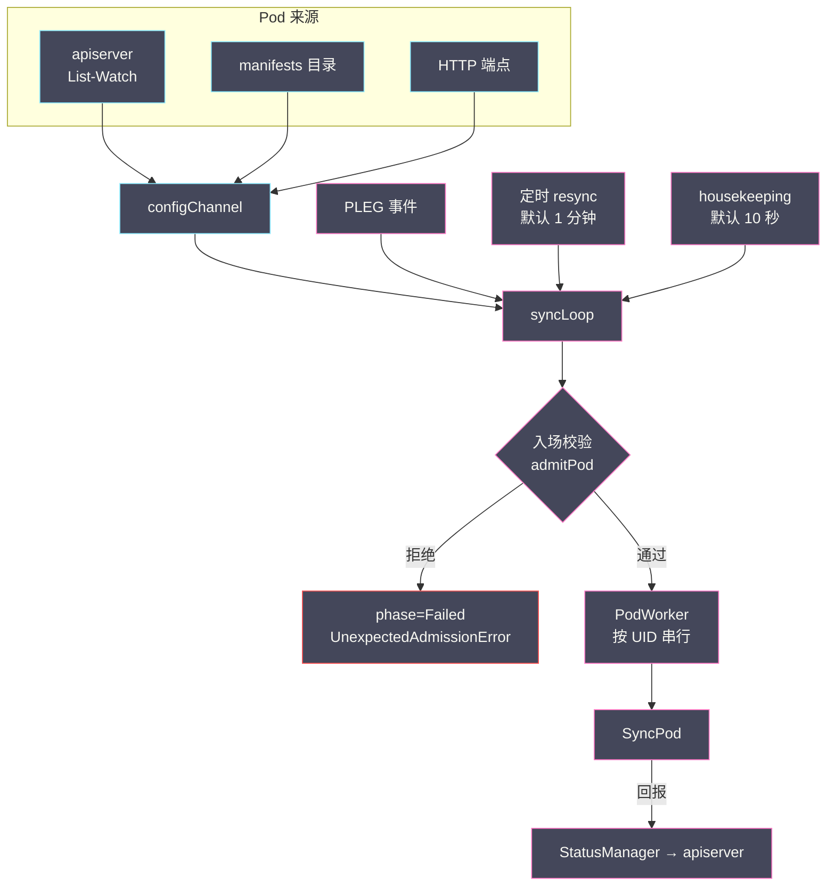
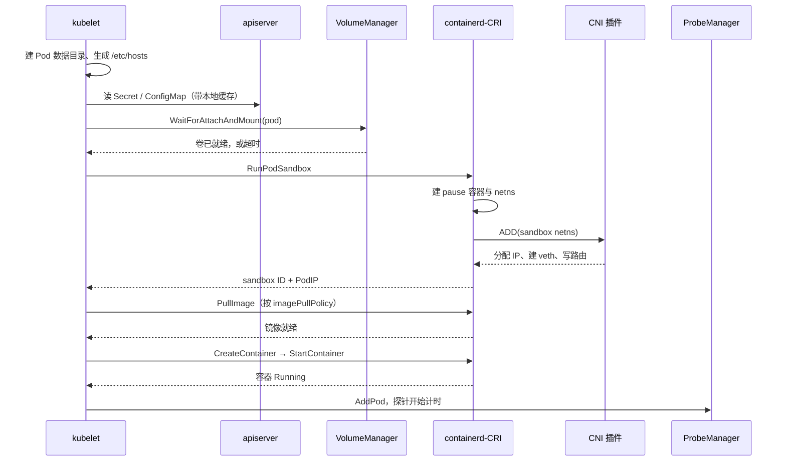
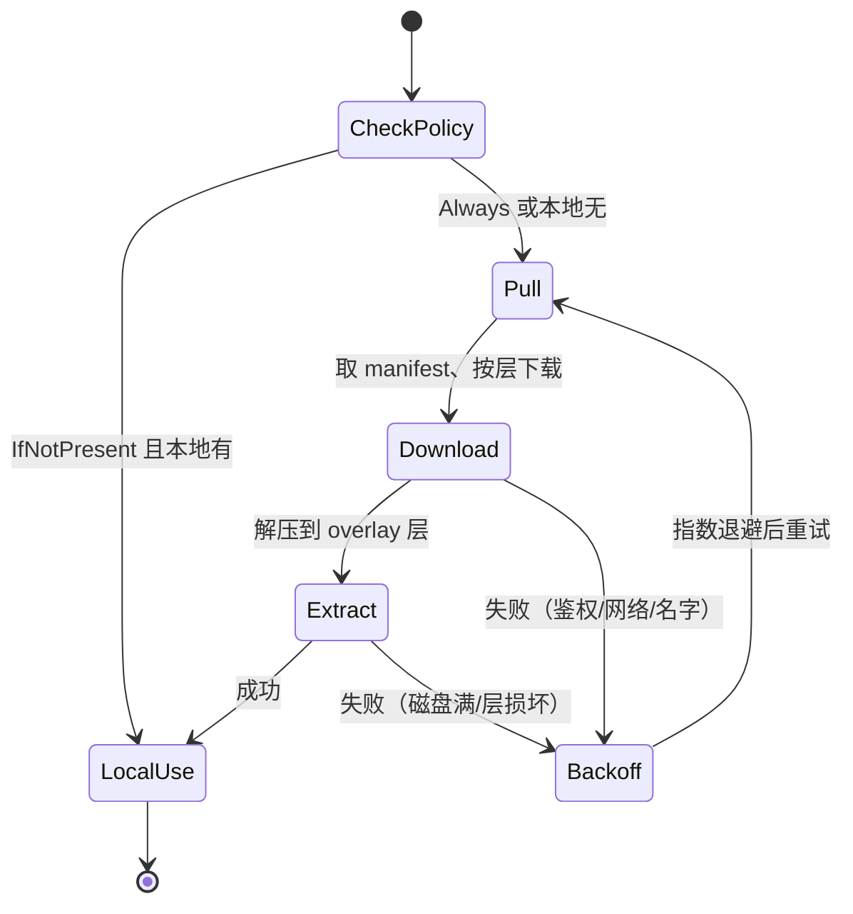
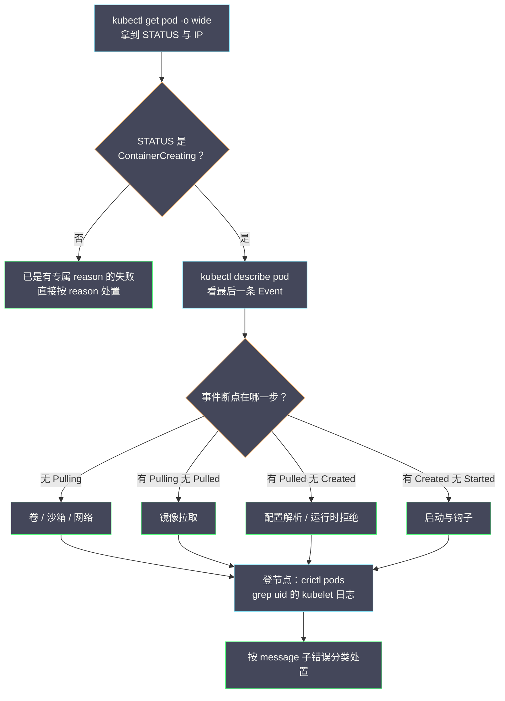
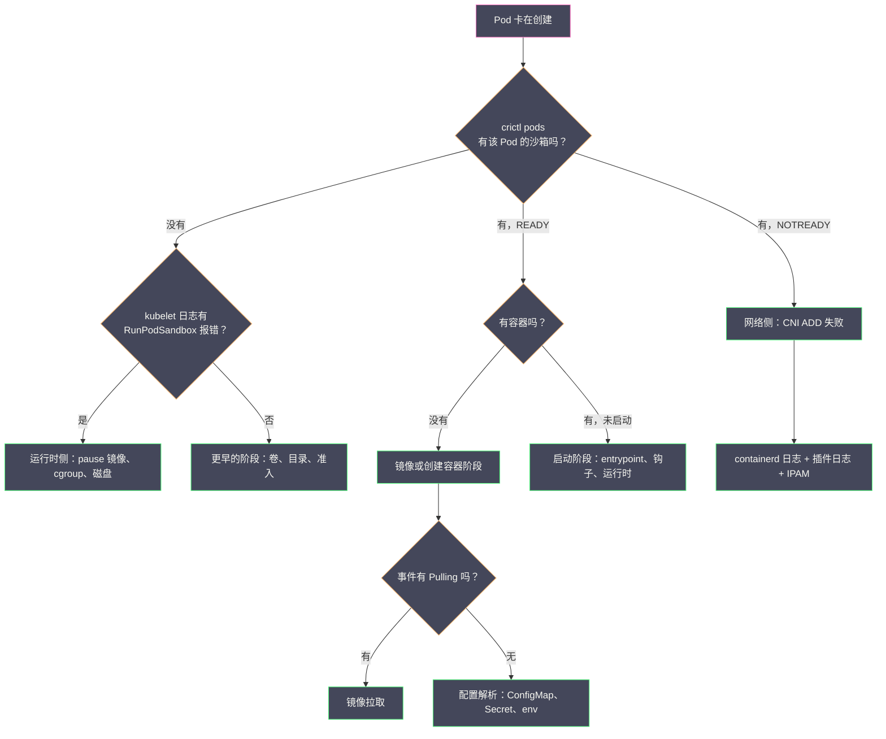
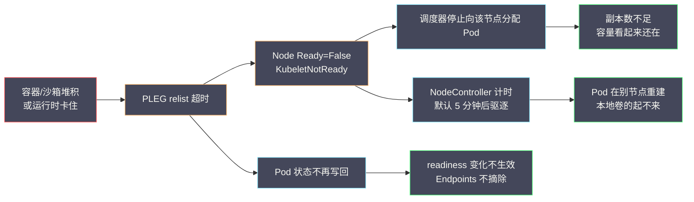

# 01 kubelet 与 Pod 的创建流程

**摘要：**

一个 Pod 被写下 `spec.nodeName` 之后、容器真正跑起来之前，节点侧要依次办完六道手续：落盘建目录、等卷挂好、起 Pod 沙箱、配好网络、把镜像拉到本地、创建并启动容器。这段路平均只有几秒，却贡献了 Kubernetes 日常工单里最集中的一类症状——`ContainerCreating`。本文按可观测边界逐段拆这条链路：kubelet 的入口（`syncLoop` 的四路输入、`PodWorker` 的串行与折叠、入场校验被拒后 Pod 为什么直接变 Failed）；`SyncPod` 六段手续各自失败时外部看到什么，以及能用最后一条 Event 判断卡点的"事件断点法"；Pod 沙箱与 CNI 的责任划分，以及网络故障为什么只能长成"容器没起来"；镜像拉取的四类错误、鉴权三段与串行限速的算术；`ContainerCreating` 六种成因的判据总表；`PLEG is not healthy` 从沙箱堆积到节点被驱逐的传导链；节点压力下的驱逐顺序与它和 QoS 的真实关系；最后是四个高频反例，以及这条链路能解释与不能解释的边界。全文只守一条判断：`ContainerCreating` 是兜底文案而不是诊断结论，真正记录这条链路的是 Pod 的 Events 序列与 kubelet 日志里的 Pod UID。

---

## 第 1 章 节点侧怎么知道该动手

笔者经手过的一个中等规模集群，120 个节点上下、近 4000 个 Pod、日均三四百次 Pod 重建。一次例行扩容里半小时内新增了 600 个 Pod，其中 41 个在 `ContainerCreating` 上停了七分钟以上，值班的人先去查镜像仓库，仓库监控干干净净，真正卡住的是三台新节点的 CNI 配置还没落地。这类误判并不是经验不足，而是 `ContainerCreating` 这四个字母携带的信息本来就少：它只说明"节点已经开始干活"，至于干到哪一步卡住了、卡了多久，得另找证据。

要找证据，先得知道 kubelet 是从哪些口子知道"该我干活"的。

### 1.1 一条 channel 汇三个来源

kubelet 不监听端口等控制平面下指令。它启动后做的头几件事之一，是把三个 Pod 来源合成一条配置流：apiserver 那条走 List-Watch，静态 Pod 目录那条走文件系统监听，还有一条 HTTP 端点（常年没人用，但代码路径一直在）。三条流最终汇进同一个 `configChannel`，`syncLoop` 从里面读到的"Pod 更新"并不区分来自哪一路。

这个做法有一个容易被忽略的后果：kubelet 看到的世界是"三个来源的并集"，而不是"apiserver 里的 Pod 集合"。所以节点上出现一个 apiserver 里查不到、但确实在跑的业务容器时，多半是有人的 YAML 被放进了 manifests 目录，而不是 apiserver 出了幽灵数据。静态 Pod 的镜像对象机制在 [[13 kubelet 深度剖析：Pod 生命周期与容器运行时接口]] 里已经拆开讲过，这里只需记住它在这条链路上的位置——它是与 apiserver 并列的另一个入口，不走调度，也不走准入。

### 1.2 syncLoop 的四路输入

`syncLoop` 是 kubelet 的主循环，它同时等四路信号：

| 输入 | 来源 | 触发含义 |
| :--- | :--- | :--- |
| `configCh` | 上述三个 Pod 来源 | Pod 新增、更新、删除 |
| `plegCh` | PLEG 的容器状态事件 | 容器起来了、死了、被删了 |
| `syncCh` | 定时器，默认 1 分钟 | 无论如何全量对一次账 |
| `housekeepingCh` | 定时器，默认 10 秒 | 该做清理了（容器 GC、孤儿目录） |

四路信号汇到一处，但落点不是"处理这个事件"，而是"重新对一次账"。这是运行态与纯事件驱动的分水岭：事件只负责提醒**该对账了**，对账本身读的是当前期望状态与当前实际状态。理解了这一点，就不会指望"改完 Pod 之后 kubelet 会针对这次修改做什么"，它只会针对"现在的差"做什么。下图把这条入口到出口的路径串起来，可以看出四路信号最终都落到同一个动作上。

### 1.3 入场校验：第一类怪状态的生产者

Pod 进 `PodWorker` 之前要过一次 `admitPod`。这道校验与调度器的预选不是重复劳动，它防的是"调度决策与真正创建之间的时间差"：调度器可能在一分钟前就选定了这个节点，这一分钟内节点内存被别的 Pod 吃掉、PID 逼近上限、或者节点已经进入磁盘压力状态，调度器的视图还没刷新。

被拒的 Pod 不会变成 `Pending`，而是直接被置为 `Failed`，reason 通常是 `UnexpectedAdmissionError`，message 里带一句谓词的原文，譬如"节点上没有足够的内存"或者 PID 相关的拒绝。这个差别在排查时很关键：

- `Pending` 意味着"还没轮到节点"，问题在调度侧；
- `Failed` 且带 `UnexpectedAdmissionError` 意味着"节点看过了，明确拒绝"，问题在节点容量或状态。

更麻烦的是它对上层控制器的影响。ReplicaSet 看到 Pod 处于 `Failed`，会立刻造一个新 Pod 顶上，新 Pod 的 UID 与名字都变了，又可能被同一个节点再一次拒绝——于是 `kubectl get pods` 里出现一串年龄都只有几秒的 Pod，`kubectl describe` 的事件里全是同一句拒绝理由。现场容易把它误读成"Pod 起不来、一直重启"，其实是"Pod 一直在被创建、一直被拒"，前者看容器日志，后者要看节点容量。判据在事件里：能看到 ReplicaSet 写的 `FailedCreate`，而容器侧的 `Pulling`、`Created` 一条都没有——容器从未被尝试创建过。

### 1.4 PodWorker：串行与折叠

每个被接纳的 Pod 会拿到一个 `PodWorker`，之后该 Pod 的所有同步都走这个 worker，按 UID 排队，同一个 Pod 的两次同步不会并发。这一点决定了若干现场行为：

- 一个 Pod 的同步正在跑时又来了新事件，worker 不会并发处理，只把"还有一次待办"记下来，当前那次结束后补跑一次；补跑读的是最新状态，所以中间态被跳过。
- 你连续改两次同一个 Pod 的字段，如果第二次改动在第一次同步完成前到达，kubelet 只会在补跑时看到最终值，中间的版本永远不会被应用。对于探针参数、环境变量这类"改了就该生效"的字段，这意味着观察到的生效时间可能是"改完之后的下一次同步"，而不是"改的那一刻"。
- 一个 Pod 卡在某一步（比如卷一直挂不上），它的 worker 就长时间占着；其他 Pod 不受影响，各自有各自的 worker。所以"节点上只有一个 Pod 卡住"与"节点上所有 Pod 都卡住"是两种完全不同的病，前者的排查范围能缩到单个 Pod 的 Spec，后者才怀疑节点。

---

## 第 2 章 SyncPod：六道手续与它们的失败面

### 2.1 先算差值，再动手

`SyncPod` 的第一件事不是创建，而是 **`computePodActions`**：把期望的容器集合与 `PodStatus` 里记录的实际集合比对，算出一组动作——沙箱要不要重建、哪些 init 容器要跑、哪些业务容器要创建、哪些要杀掉重启。kubelet 从不"从头建一个 Pod"，它每一轮都在算差值。

这个设计带来一个排查上的校准：说"Pod 卡住了"，准确的意思是"某一轮算出的差值为非空，而完成这个差值的那个调用一直失败"。差值本身是可以推断的——Pod 的 `status.containerStatuses` 里已经出现的容器名，就是"已经过了创建关"的那些；没出现的，就是还没轮到。

### 2.2 六道手续的顺序

一个全新 Pod 的第一轮 `SyncPod`，会把下面这条链路从头走一遍。顺序不是随手排的，它遵循"先准备环境、再放应用"：网络与文件系统是容器运行的前提，镜像与配置是容器创建的前提。

`/etc/hosts` 与 Pod 数据目录是纯本地操作，几乎不会成为卡点，但它失败时的形态很怪：`/var/lib/kubelet` 所在分区满了，kubelet 连一个空目录都写不下去，日志里是 `no space left on device`，而 Pod 的事件里什么都没有——因为 kubelet 连写事件的路径都依赖同一块磁盘的可用性。这类故障只能靠节点层面的磁盘告警先发现。

最后一步常被一句话带过，但它是"容器起来了"与"服务可用"之间那条线：`ProbeManager` 拿到 Pod 之后才开始为容器排探针，`initialDelaySeconds` 也是从容器启动的时刻起算，而不是从沙箱建好起算。所以在 `ContainerCreating` 与 `Ready=True` 之间还有第三段窗口——容器已经 Running、探针还没通过，此时 Pod 的 READY 列是 0/1，Endpoints 里没有它，`kubectl get pods` 却已经显示 Running。把这一段与创建阶段混为一谈，会得出"Pod 起来了为什么没流量"这类结论。

### 2.3 每一段失败时外部看到什么

| 手续 | 失败时的 waiting reason | 典型 Event | 卡住的观感 |
| :--- | :--- | :--- | :--- |
| 读 Secret / ConfigMap | `ContainerCreating` 或 `CreateContainerConfigError` | `MountVolume.SetUp failed`；`Error: configmap "x" not found` | 挂载路径卡着不动，env 路径秒失败 |
| 等卷挂载 | `ContainerCreating` | `FailedAttachVolume`、`FailedMount`、`Multi-Attach error` | 数分钟不动的 `ContainerCreating` |
| 建沙箱 | `ContainerCreating` | `FailedCreatePodSandBox` | 事件里唯一一条就是沙箱失败 |
| CNI 配网 | `ContainerCreating` | `FailedCreatePodSandBox`，message 里带插件报错 | 节点上留下 NOTREADY 沙箱 |
| 拉镜像 | `ErrImagePull` → `ImagePullBackOff` | `Failed to pull image`、`Back-off pulling image` | STATUS 列直接显示拉取类文案 |
| 创建容器 | `CreateContainerError` | `failed to create containerd task` | 容器名已出现但状态是 Waiting |
| 启动容器 | `RunContainerError` | `failed to start container` | 与上一条相邻，靠 Events 区分 |

这张表最值得记住的是它的分布：六道手续里有四道的失败都显示成同一个 `ContainerCreating`。也就是说，看到这个状态时，真正的问题可能在后四道中的任意一道，向下定位的唯一线索是 Events。

### 2.4 三个可观测面，各有失效条件

**`status.containerStatuses[].state.waiting.reason`** 是 kubelet 亲自写的，最权威，但它只有有限几个取值，粒度粗。`kubectl get pods` 的 STATUS 列读的就是它，所以你看到的从来不是"原因"，而是"原因的分类"。

**Events** 由 kubelet 的 recorder 写入 apiserver，是最贴近步骤的日志：kubelet 在每一步会写一条事件，失败时写失败事件。它的失效条件是保留期——apiserver 的 `--event-ttl` 默认 1 小时，一个卡了两小时的 Pod，关键事件早就过期了，`kubectl describe` 里能看到的是最新一轮重试的记录，而不是第一次失败的原因。这也解释了一个常见困惑：同一个故障，早看和晚看，事件内容不一样。

**kubelet 日志**信息最全，但要按 Pod UID 找，不能按 Pod 名找——同名 Pod 会被重建，UID 才是唯一标识。实用做法是先从 `kubectl get pod -o jsonpath='{.metadata.uid}'` 拿到 UID，再 `journalctl -u kubelet | grep <uid 前八位>`。日志里的错误串通常是 CRI 原样回传的，会包含 containerd 甚至 runc 的报错原文，这是三层里唯一能把"运行时说了什么"看到底的地方。

三者的时序关系也值得记一笔：waiting reason 先变，事件随后（写入 apiserver 有延迟与聚合），日志最实时但最难读。现场"事件里什么都看不到"的两种可能——要么 kubelet 还在正常推进只是慢，要么事件已经过期。

---

## 第 3 章 沙箱：网络为什么从不自己报错

### 3.1 RunPodSandbox 里发生的事

kubelet 交给 CRI 的是一个沙箱请求，里面带 Pod 的元数据、命名空间模式、端口映射、DNS 配置、`/etc/hosts` 的内容。containerd 收到后的动作序列是：

1. 拉并启动 pause 镜像对应的容器，它的全部职责是持有命名空间；
2. 创建网络命名空间，把它挂到 `/var/run/netns/` 下；
3. 生成沙箱配置，调用 CNI 的 `ADD`，把 netns 路径交给插件；
4. 插件分配 IP、创建 veth、在宿主机侧写路由，返回 IP 与网关；
5. 把沙箱元数据（含 IP、attempt 计数）落到 containerd 的状态里，返回 sandbox ID。

网络配好之前，pause 容器已经存在，netns 也已经存在。这个中间态是排查的关键：CNI 失败时，containerd 并不会把沙箱彻底清掉，节点上会留下一个 NOTREADY 的沙箱，`crictl pods` 里能直接看到。这些**残留沙箱**会越积越多——因为 kubelet 会重试，重试又可能建新的——而 PLEG 每轮要做 `ListPodSandbox`，沙箱越多这一轮越慢，慢到阈值就演变成节点级故障。一条从"某台机器 CNI 配错了"到"整个节点 NotReady"的路径，起点就在这里。

### 3.2 CNI 到底是谁调的

这里需要纠正一个流传很广的表述——包括本文旧版在内的不少资料写成"kubelet 调用 CNI 插件配置网络"。在 dockershim 还在的年代，这句话勉强成立：kubelet 通过 dockershim 这个内嵌适配层去碰 CNI 的配置文件与二进制。dockershim 在 1.24 被移除之后，CNI 的调用点整个下沉到了容器运行时内部，kubelet 只调 CRI，`--cni-conf-dir`、`--cni-bin-dir` 这一组参数随之失去意义——它们在哪个版本被废弃、哪个版本被彻底移除，以对应版本文档为准，但无论如何已经不该出现在新的部署模板里。

这个归属变化直接影响排查动作。现在的分工是：kubelet 调 `RunPodSandbox`，containerd 的 CRI 插件读 `/etc/cni/net.d/` 里的配置、执行 `/opt/cni/bin/` 下的插件、调用 IPAM。所以网络类故障的第一现场是 containerd 的日志，不是 kubelet 的日志。kubelet 日志里确实能看到 CNI 的报错原文，但那是 CRI 把错误串原样回传的结果，只有一行结论，没有上下文；插件自己的详细输出、IPAM 的分配记录、veth 创建失败的内核返回值，都在 containerd 与插件进程那边。

CNI 侧的可配置位置也随之搬了家：二进制路径与配置目录现在由运行时的配置管，containerd 是在 `config.toml` 的 CRI 段里指定 `bin_dir` 与 `conf_dir`。集群升级的交接期，这处配置与旧文档对不上是网络问题的高频来源——按旧文档改了 `/etc/cni/net.d` 却忘了二进制在 `bin_dir` 指向的位置，插件就是找不到。

### 3.3 网络故障为什么只能长成"容器没起来"

三个原因叠在一起，使得 CNI 的失败几乎不可能表现为一条网络错误：

- 报错的主体不存在。容器还没创建，Pod 里没有任何进程可以打印"我连不上"，没有应用日志可供 `kubectl logs` 读取，`kubectl logs` 只会返回 `container is waiting to start`。
- 网络身份还没生成。Pod 的 IP 由 CNI 在 `ADD` 时分配，`ADD` 失败则 `status.podIP` 为空。没有 IP 的 Pod 在 Service 的 Endpoints 里不存在，DNS 里没有记录，任何"从别处访问它"的尝试得到的都是超时，而不是拒绝——超时这个症状会被自然地归到"服务端没响应"。
- 失败发生在容器之外。CNI 是宿主机上的可执行文件，它读的是节点的配置、写的是宿主机的网络设备。它失败时，Pod 沙箱本身可能是健康的，pause 容器在跑，只是没有网。

反过来说，一旦 Pod 起来了、IP 也有了，网络问题就会换一副面孔：间歇性超时、连接被重置、探针失败导致容器反复重启。这时候病灶通常不在 CNI 的 `ADD`，而在数据面——路由没同步、网络策略误伤、MTU 不匹配。这两类问题的分界线画在"有没有 IP"上，判据是 `kubectl get pod -o wide` 的 IP 列与 `status.podIP`，非常干脆。

### 3.4 网络"装好了"由谁判定

kubelet 本身并不判断集群网络是否可用，这个信号来自 CNI 实现自己。部分实现（尤其是公有云的 VPC CNI）会在节点尚未完成网络初始化时，把 Node 的 `NetworkUnavailable` condition 置为 True，并打上 `node.kubernetes.io/network-unavailable` 污点，普通 Pod 因此不会被调度上去，而网络插件的 DaemonSet 通常显式声明了对这个污点的容忍，仍能落地——这正是网络插件自我引导的办法：先用容忍污点的特权 Pod 把网络铺好，再把污点摘掉放业务进来。

自建的 Calico、Flannel 部署里这套信号不一定齐备，于是就有了"节点 Ready 但网络没好"的窗口。运营上可以准备三个不依赖实现的判据：

1. 节点上 `/etc/cni/net.d/` 是否有有效配置（`.conf` 或 `.conflist` 文件存在且内容完整）；
2. 网络插件的 DaemonSet 在该节点上的 Pod 是否 Ready；
3. `crictl pods` 里该节点的 NOTREADY 沙箱数量是否在增长。

三条里任意一条不满足，此时创建的任何 Pod 都会卡在沙箱阶段。这也解释了为什么"新节点刚加入就批量起 Pod"是一个危险动作——它的危险不在于 Pod 起不来，而在于起不来会留下残留沙箱，把问题从"这台机器网络没好"扩大到"这台机器 PLEG 变慢"。

### 3.5 三种网络类失败的分辨

网络侧的失败在 Events 里都是一句 `FailedCreatePodSandBox`，靠 message 分辨：

| message 特征 | 根因 | 节点侧判据 | 处置方向 |
| :--- | :--- | :--- | :--- |
| `failed to find plugin "xxx" in path` | 插件二进制不在 `bin_dir` 里 | `ls <bin_dir>`，确认插件名与配置一致 | 修运行时配置或补齐二进制 |
| `plugin type="xxx" failed (add)` | 插件执行失败 | containerd 日志里紧跟插件 stderr；`ip link` 看残留 veth | 按插件自身日志定位（路由、策略、内核模块） |
| `no IP addresses available` | IPAM 地址池耗尽 | 插件侧地址池使用量；`crictl pods` 数量 | 扩池、回收泄漏的分配、清理残留沙箱 |

第三种最容易被误判成"节点网络坏了"。地址池耗尽的典型成因不是 Pod 太多，而是**沙箱泄漏**——失败的沙箱占着 IP 不释放，池子被一堆不存在的 Pod 吃光。所以处置顺序应该是先清残留再扩池，否则扩完还会再耗尽一次。

---

## 第 4 章 镜像：从仓库到本地的那段时间

### 4.1 默认策略藏在镜像名的写法里

`imagePullPolicy` 不写时会由 apiserver 的默认值逻辑补齐，补成什么取决于镜像名的写法，而不是取决于用户意图：

| 镜像写法 | 补出的策略 | 实际行为 |
| :--- | :--- | :--- |
| `nginx`（省略 tag） | `Always` | 每次创建容器都向仓库确认一次 manifest |
| `nginx:latest` | `Always` | 同上 |
| `nginx:1.29` | `IfNotPresent` | 本地有同 tag 的镜像就直接用 |
| `nginx@sha256:...` | `IfNotPresent` | digest 不可变，本地有就直接用 |

第一行是最常见的坑：模板里干脆不写 `imagePullPolicy`、镜像名又不带 tag，补出来的就是 `Always`，本地缓存形同虚设；很多人以为自己写的是 `IfNotPresent`，其实那份策略留在注释掉的旧版本里。这个默认值有历史原因——不带 tag 等价于 `latest`，而 `latest` 的内容不可预期，所以干脆每次都问一次仓库。

这里还有一个反直觉的细节：`Always` 并不等于"每次都重新下载"。容器运行时会先取 manifest，比对本地已有的层，已经存在的层直接跳过。所以 `Always` 的真实成本是**一次仓库往返**，不是整个镜像的流量。代价恰好落在仓库不可达的时刻：同一个镜像明明就在本地 `crictl images` 里躺着，`Always` 的 Pod 依然会 `ImagePullBackOff`，`IfNotPresent` 的 Pod 却照常起。这是"改了策略之后有的 Pod 起来了、有的没起来"这类现象的常见解释。

### 4.2 鉴权链路有三段

从 Pod 到镜像仓库，凭证要经过三段：

1. Pod 的 `spec.imagePullSecrets` 与 Pod 所用 ServiceAccount 的 `imagePullSecrets` 合并。两处都写了会一起用，ServiceAccount 那份的用途是让整个命名空间的 Pod 都不必逐个声明。
2. kubelet 从 apiserver 读 Secret，解码出 `.dockerconfigjson`，转成 CRI 的 `AuthConfig` 传给运行时。kubelet 侧对 Secret 有缓存，凭证轮转之后，已经跑了很久的 Pod 不会立刻换用新凭证——它要等到下一次真正发生拉取动作时才暴露，于是"昨天轮转的凭证，今天扩容才失败"这种时间错位很常见。
3. 容器运行时的仓库配置。私有仓库若用自签 CA，证书要装到节点上、配到运行时的仓库配置里（containerd 的 `certs.d/<registry-host>/hosts.toml`），否则报的是 `x509: certificate signed by unknown authority`，看起来像"凭证不对"，其实是"根本不信任这台服务器"。

鉴权失败与网络失败的 message 不同，是有效的判据：`401 Unauthorized`、`403 Forbidden`、`failed to authorize` 属于第一、二段；`x509`、`no such host`、`connection refused`、`i/o timeout` 属于网络与配置；`manifest unknown` 则是名字或 tag 写错了。这三类混在一起时，看 message 的第一句基本就能分开。

### 4.3 串行拉取与批量冷启动

`--serialize-image-pulls` 默认是 true，含义是同一个节点上的镜像拉取排队执行。这个默认值不是性能疏忽，而是保护：一次扩容几十个 Pod，如果同时向仓库发起几十路下载，节点带宽、磁盘写入、仓库入口会一起被压垮，失败率上升又触发重试，结果比排队更慢。串行是"牺牲最坏情况下的平均速度，换取确定性"。一次拉取在这条判断链上会经过哪些状态、失败会落到哪个出口，下图画出了完整路径。

串行的代价可以直接算。假设一次扩容在单节点上落 40 个 Pod，镜像平均 800MB，节点有效拉取带宽按 50MB/s 计（千兆网卡但要与仓库端限速、其他流量分享），第一层镜像还需要解压，那么串行拉取的时间下界约为 40 × 800MB ÷ 50MB/s ≈ 640 秒，也就是十分钟出头（示例推算，未计解压与重试）。同样的量若允许四路并行，理论下界降到 160 秒，但此时瓶颈通常已经不在节点，而在仓库出口或节点磁盘的写带宽上，实际收益会比理论值小。后来版本为这组参数提供了并行上限（`maxParallelImagePulls`），具体版本与默认值以对应版本文档为准。

比参数更有效的做法是让镜像不必在扩容时才开始下载：把基础镜像预热到节点上（用一个在所有节点上跑的 DaemonSet 拉取，或用节点镜像预装流程），或者直接把镜像做小。镜像大小对启动时长的影响是超线性的——大镜像不只下载慢，解压还会抢占磁盘 IO，而同一块盘上 PLEG 的容器状态查询、容器日志写入、kubelet 的卷挂载都在排队。

### 4.4 四类拉取失败

| waiting reason | 触发条件 | Event 关键词 | 处置方向 |
| :--- | :--- | :--- | :--- |
| `ErrImagePull` | 刚尝试过一次并失败 | `Failed to pull image` 带具体报错 | 先看 message 分类，再动手 |
| `ImagePullBackOff` | 失败后进入退避期 | `Back-off pulling image` | 同上；注意出现频率下降不等于好转 |
| `InvalidImageName` | 镜像名不符合格式 | `InvalidImageName` | 拼写、正则、变量渲染结果 |
| `ErrImageNeverPull` | 策略为 `Never` 且本地没有 | `Container image is not present with pull policy of Never` | 补镜像或改策略 |

`ErrImagePull` 与 `ImagePullBackOff` 是同一件事的两个阶段：kubelet 先记一次失败，进入退避后把状态改写成后者。这条区分对"是不是镜像问题"没有帮助，但对"问题还在不在"有帮助——停在 `ErrImagePull` 说明刚试过，退避间隔还很短；停在 `ImagePullBackOff` 且隔很久才刷新一次，说明已经陷在退避里，此时去改仓库配置，要等下一个退避窗口才会看到效果，容易误判成"改了没用"。

### 4.5 慢到多少算不正常

冷启动的镜像阶段耗时，取决于四件事的乘积：镜像大小、层复用率、节点拉取带宽、串行排队长度。经验区间是：本地已有镜像的 Pod 从这里过几乎不花时间；几百 MB、节点带宽充裕、没有排队的镜像一两分钟；上 GB 且赶上批量扩容，十分钟以上也不奇怪（以上为示例推算的量级，不同集群差异很大）。

所以"镜像拉取慢"这个结论必须带一个对照：同一节点上其他 Pod 是否在同时拉镜像，同批次其他节点是否同样慢。只在单节点慢，怀疑该节点的磁盘与网络；全批次都慢，才怀疑仓库出口带宽或鉴权服务的响应。判据可以落在 `crictl images` 的本地列表与 containerd 日志里的下载进度上——正在下载和卡住不动，是两种完全不同的处置。

---

## 第 5 章 ContainerCreating 的六种成因

### 5.1 它是兜底文案，不是诊断结论

`kubectl get pods` 的 STATUS 列取自容器 `state.waiting.reason`。kubelet 在开始创建容器的第一个瞬间，给的就是 `ContainerCreating`，此后若没有更具体的错误类型被识别出来，这个值就一直留着。于是它同时覆盖了三种完全不同的处境：

- 卡在容器创建之前的准备工作（卷、沙箱、网络）——这些步骤的失败没有专属的 reason；
- 正在拉镜像但还没失败过一次——一旦失败就会换成 `ErrImagePull`；
- 一切正常、只是某一步慢——没有失败，所以没有新 reason。

反过来说，什么时候它不是兜底：一旦某一步失败并被归类，reason 会变成更具体的值，`ImagePullBackOff`、`CreateContainerConfigError`、`CreateContainerError`、`RunContainerError` 都属于这一类。所以"长时间 `ContainerCreating`"可以精确地重述为"失败发生在尚未归类的那几步，或者根本没有失败、只是慢"。这个重述把排查范围从"所有可能"缩到了"沙箱、卷、网络、正在进行的拉取"。

### 5.2 事件断点法

所谓**事件断点法**，就是把 Events 当断点用。Events 是按时间正序写的，而且 kubelet 在每一步只写成功事件、失败时写失败事件。于是"最后一条事件属于哪一步"，就等价于"卡在哪一步之后"：

- 只有 `Scheduled`，没有 `Pulling` 也没有 `Created`：卡在卷或沙箱。这两步的成功不打事件，所以事件流看起来是断的。
- 有 `Pulling image`、没有 `Pulled image`：卡在拉取，正在下载或正在退避。
- 有 `Pulled`、没有 `Created container`：卡在创建容器，重点看配置解析（ConfigMap、Secret、env）与运行时拒绝（cgroup、权限、磁盘）。
- 有 `Created`、没有 `Started container`：卡在启动，重点看 entrypoint、postStart 钩子、运行时启动失败。
- 有 `FailedCreatePodSandBox`、`FailedMount`、`FailedAttachVolume` 中的任一条：直接对号入座，不必再往上猜。

这个方法的成立依赖一个前提——事件还没过期。卡住时间超过一小时，第一次失败的事件通常已被 apiserver 清掉，剩下的是最新一轮重试的记录，看起来会像"刚失败"，容易把排查引向错误的时序。

### 5.3 六种成因

第一种是拉镜像慢。症状是 `Pulling image` 停在原地，节点上 `crictl images` 看不到目标镜像，containerd 日志里有下载进度或重试。判据是"在下载"与"卡住"的区别：进度在推进就是带宽问题，长时间零推进就是连接被掐或仓库端限流。处置方向是预热、降镜像体积、调并行上限，而不是去改 Pod 的 Spec。

第二种是 CNI 未就绪。症状是 `FailedCreatePodSandBox`，或事件里干脆一条失败都没有（kubelet 在重试前的间隔期不写新事件）。判据是三个：`/etc/cni/net.d/` 是否有有效配置、网络插件 DaemonSet 在该节点是否 Ready、`crictl pods` 里 NOTREADY 沙箱是否在增长。这一种在新建集群与节点扩容时最集中。

第三种是卷未挂载。症状是 `FailedAttachVolume`、`FailedMount`、`Multi-Attach error for volume`，或者干脆什么都没有而 Pod 就是不动。这里要划一条容易踩错的边界：PVC 未绑定不属于这一类。开启了延迟绑定（`WaitForFirstConsumer`）的 StorageClass，PVC 要等 Pod 被调度后才绑定，此时 Pod 的状态是 `Pending`，根本还没轮到节点干活；把它当 `ContainerCreating` 去节点上查，方向从一开始就错了。真正属于节点侧的是"卷已绑定、但 attach 或 mount 失败"（卷的绑定策略与 CSI 的调用细节属于 [[01 持久化存储——PV PVC StorageClass 与 CSI]] 的范围）：云盘挂不上、NFS 不可达、同一块 RWO 卷被两个节点同时挂（`Multi-Attach`）、CSI 的 node 插件没跑起来。

第四种是 fsGroup 拖住了挂载。`securityContext.fsGroup` 的语义是"把挂载进来的卷递归改成该组所有"，这个递归由 kubelet 在挂载完成后同步执行，改的是卷里所有文件的元数据。文件数一多，这一步就从毫秒级变成分钟级，而它发生在容器创建之前，外观就是标准的 `ContainerCreating`。代价可以估算：一百万个小文件、每次 `chown` 平均几十微秒，累计就是几十秒到一两分钟（示例推算，随存储后端与元数据操作差异极大）；如果后端是 NFS 这类不支持 `chown` 语义的存储，还会直接失败，kubelet 日志里是 `failed to apply FSGroup` 一类的错误。治理手段不是删掉 `fsGroup`（很多镜像靠它才能写目录），而是设 `fsGroupChangePolicy: OnRootMismatch`——只在卷根目录的组不对时才递归，把每次挂载的代价从"与文件数成正比"降到"与根目录检查成正比"。

第五种是 ConfigMap 或 Secret 缺失。这一种有两种完全不同的外观，取决于引用方式：作为 **volume** 挂载时，失败发生在卷准备阶段，Pod 停在 `ContainerCreating`，事件是 `MountVolume.SetUp failed for volume "xxx" : configmap "app-config" not found`；作为 **env 或 envFrom** 引用时，失败发生在生成容器配置阶段，reason 直接变成 `CreateContainerConfigError`，事件是 `Error: configmap "app-config" not found`。同一个根因、两种症状，分歧点在于"配置是当文件用还是当环境变量用"；两种引用方式在更新语义上的差异，[[02 配置管理——ConfigMap Secret 与外部密钥]] 里有更细的对照。知道这条对应关系，就不会在 `CreateContainerConfigError` 出现时去翻卷的挂载日志。

第六种是沙箱创建失败。这一类的范围比想象中宽：pause 镜像拉不到（镜像仓库换了地址而运行时的 `sandbox_image` 没改）、cgroup 创建失败（kubelet 与运行时的 cgroup 驱动不一致）、磁盘满导致 runc 写不了 rootfs、`/etc/hosts` 写不进去、运行时进程卡死。共同的外观是 `FailedCreatePodSandBox`，而 message 是唯一有用的线索：

- `failed to get sandbox image` / 镜像相关：先 `crictl pull` 那个 pause 镜像验证；
- `failed to create containerd task` / OCI 相关：往 runc 与 cgroup 驱动方向查；
- `no space left on device`：`df -h /var/lib/containerd /var/lib/kubelet`；
- `context deadline exceeded` 且没有任何子错误：运行时卡住，`crictl ps` 也会超时，这是 PLEG 故障的前兆。

### 5.4 判据总表

| 成因 | STATUS | Events 关键词 | 节点侧判据 | 处置方向 |
| :--- | :--- | :--- | :--- | :--- |
| 拉镜像慢 | `ContainerCreating` 或 `ImagePullBackOff` | `Pulling image` 停留 / `Back-off pulling` | `crictl images` 无该镜像；containerd 日志有下载记录 | 预热、瘦身镜像、调并行 |
| CNI 未就绪 | `ContainerCreating` | `FailedCreatePodSandBox`、插件 not found | `/etc/cni/net.d` 空；插件 DaemonSet 未 Ready；NOTREADY 沙箱增长 | 修节点网络，再重试 |
| 卷未挂载 | `ContainerCreating` | `FailedAttachVolume`、`FailedMount`、`Multi-Attach` | `kubectl get pvc` 已 Bound；CSI node 插件状态 | 修存储链路，别动 Pod |
| fsGroup 递归 | `ContainerCreating` | 可能只有 `FailedMount` 超时 | kubelet 日志中的 FSGroup 相关错误；卷内文件数 | `OnRootMismatch`、换存储 |
| ConfigMap 缺失 | `ContainerCreating`（volume）或 `CreateContainerConfigError`（env） | `MountVolume.SetUp failed`；`Error: configmap ... not found` | `kubectl get cm -n <ns>`；确认引用方式 | 补配置或改引用 |
| 沙箱创建失败 | `ContainerCreating` | `FailedCreatePodSandBox` 带子错误 | `crictl pull` pause 镜像；磁盘；cgroup 驱动 | 按子错误分头处理 |

### 5.5 定位顺序

现场没有一个通用脚本能一次定位，但有一条稳定的顺序：先读 status，再读事件，再进节点，最后才动配置。顺序颠倒的代价是白跑几趟——先登节点看日志，往往因为没有 UID 而在几万行里翻。

---

## 第 6 章 CRI 与 CNI 的分工

### 6.1 责任边界

两层接口都叫"容器接口"，但管的事完全不同，混在一起是很多误判的源头：

| 维度 | CRI | CNI |
| :--- | :--- | :--- |
| 调用者 | kubelet | 容器运行时的 CRI 插件 |
| 形式 | gRPC 服务，常驻进程 | 可执行文件，每次调用起一个进程 |
| 时机 | 沙箱、容器、镜像的全生命周期 | 沙箱创建时 `ADD`、删除时 `DEL`、运行时 `CHECK` |
| 输入 | Pod 与容器配置、镜像名与凭证 | netns 路径、容器 ID、网卡名、IPAM 配置 |
| 失败的后果 | 沙箱或容器不出现 | 沙箱存在但无网络、无 IP |
| 日志在哪 | containerd 日志、kubelet 日志 | containerd 日志、插件自己的日志、内核日志 |

最后一行值得单独强调：CNI 插件是"一次性进程"，它没有常驻的日志流，输出被 containerd 捕获后转手。所以查网络问题时，`journalctl -u containerd` 里能搜到插件的 stderr，而插件自己的日志文件（有些实现会另写一份）往往更完整。反过来，CRI 层的错误是 gRPC 状态码加字符串，kubelet 拿到了也只是一行。

### 6.2 能用什么工具，指示了卡在哪一段

Pod 创建过程中，可用的诊断工具集合本身是一个渐进展开的序列，这个序列比任何日志都直观：

1. 没有沙箱时：Pod 没有 IP，`kubectl exec` 与 `kubectl logs` 都不可用，`kubectl describe` 是唯一入口，之后只能进节点看 kubelet 与 containerd 日志。
2. 有沙箱、没容器时：`crictl pods` 能看到沙箱，`crictl inspectp <id>` 能读到它的状态与元数据，`nsenter -t <pause PID> -n` 能进网络命名空间——此时可以查 IP、路由、`/etc/resolv.conf`，但查不了应用。
3. 有容器、没启动时：`crictl ps -a` 能看到容器的 created 状态，`crictl inspect` 能读 OCI 配置（entrypoint、env、挂载），`crictl logs` 通常为空——进程还没跑，没有输出。
4. 容器启动过又退出时：`crictl logs` 与 `kubectl logs --previous` 有了内容，问题从"起不来"变成"起来就死"，进入应用侧排查。

按这个序列走，每一步的"能看见什么"都在缩小范围，不需要猜。

### 6.3 归属判定

把前两节的内容压成一棵判定树，现场按这四个分支走一遍就够用了。

这条判定树的价值不在分支多细，而在第一步就把"运行时"与"网络"分开了：沙箱根本没建起来，说明问题在 kubelet 到 CRI 这一段；沙箱建了但没就绪，说明 CRI 正常、网络配置失败。这两类的处置人、需要看的日志、需要的权限都不同，早分一秒省半小时。

---

## 第 7 章 同步循环里的慢性病：housekeeping 与 PLEG

### 7.1 housekeeping 每十秒做一次清账

`housekeepingCh` 默认十秒一拍，做的是"没人要的东西收走"：清理已退出的容器、回收它们的可写层、删除已经不存在对应 Pod 的孤儿目录。它不与 Pod 的创建流程直接相连，但两者的资源诉求指向同一块磁盘，于是经常互相拖累。

最典型的是孤儿 Pod 目录。Pod 被删除后，kubelet 要把 `/var/lib/kubelet/pods/<uid>` 整个删掉，包括里面残留的卷挂载点。如果某个挂载点因为存储后端失联、CSI 插件退出、或者 NFS 服务端不响应而卸载不掉，删除就会失败，kubelet 每轮 housekeeping 都重试一次，日志里反复出现 `Orphaned pod "<uid>" found, but volume paths are still present on disk`。单条日志无害，但它意味着三件事在同时发生：这个目录永远占着磁盘、这个卷永远处于"卸载未完成"状态、这个 Pod 的 UID 无法被彻底回收。

规模一上来，这类目录会以每天几十个的速度累积，节点的 `nodefs` 使用率缓慢上升，直到触发镜像 GC——而镜像 GC 又会删掉某些正在被重建的 Pod 需要的镜像，于是"磁盘告警"与"Pod 拉不到镜像"在同一时间出现。这条链在排查时经常被拆成两个独立工单，其实是同一个根因。处置孤儿目录要格外小心：确认没有任何容器还在引用之后才删，直接 `rm -rf` 一个仍在挂载中的目录，可能让卷的卸载状态永久错乱。

### 7.2 PLEG 的三种卡法

PLEG 每轮要做的只有一件事：向运行时问一遍"现在有哪些沙箱、哪些容器、它们什么状态"，再和自己上一轮记下的状态比对，把差异变成事件。这个动作在正常情况下是毫秒级，卡住的时候无一例外是"问不回来"或"问回来的东西太多"。三种常见路径：

运行时本身卡住。containerd 或它下面某次 runc 调用陷入不可中断的 IO 等待、镜像解压把磁盘打满、内部锁被一个超长操作持有，`ListContainers` 就会超时。这一类往往伴随 `crictl ps` 也超时——`crictl` 走的是同一个 socket，是极好的旁证。

容器与沙箱数量爆炸。每轮的 `ListContainers` 与 `ListPodSandbox` 的代价与对象数量成正比。有些节点因为长期累积 NOTREADY 沙箱、或者容器回收策略被放宽（比如把每个 Pod 保留的已退出容器数调大）而堆到上万条记录，一轮 relist 从毫秒变成十秒，再遇到一次 IO 抖动就越过阈值。

节点 IO 层塌陷。容器状态的读取要碰 cgroup 文件系统与运行时的 boltdb，磁盘排队一长，这些读操作就慢。这时候 PLEG 只是受害者，真正的病在生产日志或镜像解压的写放大上。

### 7.3 不健康之后，节点上发生什么

PLEG 的最后一轮 relist 时间戳超过阈值（三分钟）没有更新，kubelet 就把自己报成不健康，Node 的 `Ready` condition 变成 False，reason 是 `KubeletNotReady`，message 形如 `PLEG is not healthy: pleg was last seen active 3m0s ago; threshold is 3m0s`。这一句是整条链上唯一一个一眼能认出的信号，后续的连锁反应则要慢得多：

这张图的每一支都能独立造成事故，而它们同时发生，是这类故障最难缠的地方：

| 连带影响 | 外部表现 | 为什么危险 |
| :--- | :--- | :--- |
| 节点不再接收新 Pod | 扩容的 Pod 全落到别的节点 | 剩余节点容量被快速吃满 |
| Pod 状态停止写回 | 探针照跑，但 readiness 结果不生效 | 流量继续打到已经不健康的 Pod |
| 五分钟后开始驱逐 | Pod 在别处重建，有本地卷的起不来 | StatefulSet 出现单点/数据不可用 |
| 容器本身还在跑 | 节点上 `crictl ps` 显示业务容器照常 | 只看容器会以为"节点没坏" |

第三行的五分钟来自 NodeController 对 NotReady 节点的容忍期，这个值可以通过 Pod 的 toleration 拉长，也可以由集群配置调整，具体以对应版本文档为准。第四行是误判的源头：容器由运行时管，kubelet 挂了不影响已经跑起来的容器，所以"节点 NotReady 但业务还在服务"是正常现象，不是矛盾。此时能做的是尽快把 kubelet 与 PLEG 恢复，而不是去重启业务。

### 7.4 现场判据

判据按成本从低到高排：`kubectl get node -o wide` 看 Ready 与 reason；`kubectl describe node` 的 Conditions 段看 message 原文；节点上 `crictl ps` 与 `crictl pods` 的耗时（与正常节点对比，感受最直接）；`crictl pods | grep -c NOTREADY` 看沙箱残留；kubelet 日志里 grep `pleg` 与 `relist`。指标面上，PLEG 的 relist 耗时是关键指标，kubelet 暴露的 relist 相关指标在不同版本命名有变化，以对应版本文档为准，但趋势判读不变——正常是平的一条线，故障时是一条陡直上升的斜线。

### 7.5 重启 kubelet 的真实代价

"Pod 有问题就重启 kubelet"是一个流传很广的动作，它的实际效果与想象差别很大。

重启 kubelet 不会杀掉正在运行的容器。容器的生命周期由运行时（containerd）持有，kubelet 只是一个客户端，它重启后重新向运行时"认领"现有的沙箱与容器。所以：

- 如果问题出在 kubelet 的内存状态上（PLEG 缓存错乱、卷的挂载状态与磁盘不一致、镜像 LRU 表失效），重启通常有效，因为它把这些状态清空重来。
- 如果问题出在运行时或网络配置上，重启 kubelet 完全无效，只是把故障现场清掉一部分，让下一次排查更难。
- 真正的风险在重启的窗口期：状态回报中断、正在进行的挂载被打断、如果配置在这期间被改过（比如 cgroup 驱动不一致），重新认领失败，容器才会真的被重建。

所以这个动作应该排在"确认问题在 kubelet 自身状态"之后，而不是作为第一反应。判断依据很具体：重启前 `crictl ps` 里容器是好的、`crictl pods` 里沙箱是 READY 的、节点磁盘与运行时都正常，而 kubelet 就是不干活——这才符合"重启有效"的画像。

---

## 第 8 章 节点压力：谁先被拿走

### 8.1 压力的三个可见面

节点资源吃紧时，第一个可见的不是 Pod 消失，而是 Node 的 condition：`MemoryPressure`、`DiskPressure`、`PIDPressure` 三者之一变 True，kubelet 随即给节点打上对应的污点，调度器看到污点就不再往上放新 Pod。这个顺序很重要——节点先"关闭入口"，再"往外搬东西"，中间有一段只出不进的时间窗，容量规划时如果不考虑这段窗口，会得出"节点还有余量"的错误结论。

第二个可见面才是驱逐，Pod 的 `status.reason` 变成 `Evicted`，message 形如"节点内存不足，阈值 100Mi，当前可用多少"，以及被驱逐容器当时的实际用量与它的 request。这段 message 是事后归因的唯一证据，值得在事件过期前抓下来。

第三个可见面是调度器的反应：带着 `memory-pressure` 污点的节点对外表现为"不可调度"，但已经在上面运行的 Pod 不受影响，于是 `kubectl describe node` 里会出现"Allocated resources 显示还有富余、但 Pod 调度不上去"的观感。

### 8.2 顺序：QoS 定大方向，用量与优先级定细节

驱逐顺序的大方向由 QoS 决定：`BestEffort` 最先，`Burstable` 中超出 request 的次之，`Guaranteed` 最后。这个排序的完整判据在 [[13 kubelet 深度剖析：Pod 生命周期与容器运行时接口]] 里拆过，这里只讲它在运营层面的两个后果。

第一个后果是 `Guaranteed` 并不免疫。QoS 只决定排序，不提供豁免——节点压力足够大、其他类别都清空了，Guaranteed 的 Pod 一样会被驱逐。把它当"绝对不会被驱逐"来设计容量，是最常见的误判之一。真正影响"最后才被动"的因素除了 QoS 还有 PriorityClass：同一个 QoS 内部，优先级低的先被驱逐，系统级的关键组件靠它排在队尾。

第二个后果是**驱逐的粒度是 Pod，不是字节**。kubelet 需要把可用内存拉回阈值以上，它只能整个 Pod 地拿掉，无法"回收这个 Pod 的一部分"。一次驱逐经常回收远超所需的量，被腾出的空间随即被其他 Pod 的缓存与突发用量吃掉，压力再次越线，于是出现一轮接一轮的驱逐。这是"驱逐雪崩"的形成机制，起点往往是一个 request 设置得过低的 Pod。

### 8.3 三种"容器消失"必须分清

现场看到 Pod 不在了，可能是三件完全不同的事，处置动作也完全不同：

| 现象 | 谁动手 | 判据 | 后续 |
| :--- | :--- | :--- | :--- |
| `Evicted` | kubelet | `status.reason=Evicted`，message 带阈值与用量 | 控制器重建，可能换节点 |
| `OOMKilled` | 内核 | 容器 `lastState.terminated.reason=OOMKilled`，退出码 137 | 原地重启，取决于 restartPolicy |
| 节点 NotReady 后重建 | NodeController + 控制器 | 原节点 NotReady，Pod 在新节点出现且 UID 变了 | 有本地卷的可能起不来 |

`OOMKilled` 与 `Evicted` 的因果经常被搞反。`OOMKilled` 是容器自己越过 cgroup 的 `memory.limit` 被内核杀掉，它发生之后节点压力反而下降，与驱逐没有关系；而 `Evicted` 是节点整体可用内存不足，被驱逐的 Pod 自己的用量可能完全正常。判据就是看 `lastState.terminated.reason`：写着 `OOMKilled` 的，去调 `resources.limits.memory`；写着 `Evicted` 的，去查节点的 request 总量与超卖比例。

### 8.4 一次驱逐能回收多少

设一个 64Gi 内存的节点，`evictionHard` 里 `memory.available` 的阈值是 100Mi。这个阈值的语义是"可用内存跌破 100Mi 就动手"，所以触发的那一刻可用量已经低于 100Mi，kubelet 要做的是把它推回阈值以上——但不是刚好推到 101Mi，那样下一轮检查立刻又会越线，实际要腾出几个 Gi 才稳。

假设节点上的负载是：4 个 Burstable 的业务 Pod，各 request 2Gi、实际用了 6Gi（合计 24Gi，超出 request 16Gi），300 个 BestEffort 的小 Pod 平均占 100Mi，剩下的内存被页缓存与其他常驻进程吃掉，此时可用量跌破 100Mi。要腾出 6Gi，驱逐 BestEffort 需要拿掉约 60 个 Pod；换成驱逐两个超出 request 的 Burstable Pod 就够了（示例推算，省略了回收顺序与缓存因素的影响）。前一种做法损失 60 个副本，后一种损失 2 个；而 kubelet 的实际排序把超 request 的 Burstable 排在 BestEffort 之后，于是它会先拿掉 60 个小 Pod——这就是"一次内存压力让一堆小 Pod 消失、真正的内存大户安然无恙"的成因。

理解这一点之后，配置上的取舍就清楚了：把内存大户的 request 调到接近实际用量，能让它在排序里排到后面（因为不再"超出 request"）；而把大量小 Pod 标成 BestEffort，等于把它们放到了队首。代价是 request 调高之后调度器会认为节点更满，可调度容量下降——所以这不是"调高就对了"，而是在"驱逐时的存活性"与"平时的装箱率"之间选一个位置。

### 8.5 驱逐之后不会平静

被驱逐的 Pod 由控制器重建，重建出的新 Pod 需要重新调度。如果压力已经通过驱逐缓解，节点污点消失，新 Pod 有一定概率被调度回同一个节点——因为调度器看的是 request 之和，而不是刚才的瞬时用量。于是形成"压力 → 驱逐 → 压力缓解 → 重建回原节点 → 再次压力"的循环，周期通常是几十分钟。

判据很明确：同一个 ReplicaSet 的 Pod 在少数几个节点之间反复迁移，`kubectl get events` 里 `Evicted` 反复出现在同一批节点上。治理方向不是继续调驱逐阈值（那只会让驱逐更早发生），而是把该工作负载的 request 调到接近真实用量，或者把它从这类节点上挪走。把驱逐阈值调低来"减少驱逐"，本质是让节点在更危险的余量下运行，通常会把问题从"Pod 被驱逐"推向"节点直接失去响应"。

---

## 第 9 章 四个反例

### 9.1 把 ContainerCreating 一律当镜像问题

这是最高频的误判。理由看起来很充分：容器没起来，最可能缺的就是镜像。但前面几章已经说明，六道手续里有四道失败都长成这个模样，镜像只是其中一道。判据其实只要一条：`kubectl describe pod` 的 **Events 里有没有 `Pulling image`**。没有这条事件，说明 kubelet 还没走到拉镜像那一步，此时任何关于"仓库带宽""镜像太大""私有仓库鉴权"的讨论都是空转。

误判的代价不只是浪费时间。为了"解决镜像问题"而去改 `imagePullPolicy`、加 `imagePullSecrets`、换镜像地址，这些动作会污染一份本来正确的 Pod 模板，等真正的问题（比如节点 CNI）被修好之后，模板上留下的改动成了新的技术债。

### 9.2 CNI 没就绪就批量创建 Pod

新建集群、节点扩容、网络插件升级——这三种场景下节点的网络能力会有一段真空期。此时如果同时启动大批业务 Pod（比如一次大促扩容、一次滚动发布、或者集群初始化脚本里的 `kubectl apply`），结果是一批 Pod 卡在沙箱阶段，各自留下一个 NOTREADY 的沙箱，重试继续叠加。

正确的顺序是把"网络就绪"变成一个显式前置条件：先确认网络插件在该节点的 Pod 已 Ready，再放业务流量进来。公有云 CNI 用 `NetworkUnavailable` condition 加污点自动做了这件事；自建集群需要在发布流程里自己加一道检查，或者至少让第一批 Pod 是少量、可观测的，而不是一次几百个。

这条反例还有一个隐性代价：残留沙箱是 PLEG 的负担。一次批量失败可能给每个节点留下几十个 NOTREADY 沙箱，它们不会自己消失，会一直拖慢每轮的 `ListPodSandbox`。故障过去了，性能损伤还在。

### 9.3 忽略 fsGroup 的首次挂载代价

`securityContext.fsGroup` 在大部分模板里是"为了能写目录"而顺手加上的，很少有人在加之前算一下它对启动时长的影响。对于文件数上百万的卷（模型文件、依赖目录、日志归档），首次挂载的递归 `chown` 会让 Pod 在 `ContainerCreating` 上停几分钟，而后端是 NFS 时还可能直接失败。

代价的形态很隐蔽：同一个 Deployment，Pod 落到已有缓存的节点上很快，落到新节点上很慢；压测时扩容的 Pod 启动时间远长于平时。这类"时快时慢"的启动，很容易被归到"节点性能不一致"上去。

处置有明确的层次：先看能不能用 `fsGroupChangePolicy: OnRootMismatch`（把每次挂载的代价从"与文件数成正比"降到"检查根目录"）；再看这个卷是否真的需要 `fsGroup`（有些应用只要目录的属组对，用 initContainer 改一次就够，不必让 kubelet 在每次挂载时全量递归）；最后才是换存储后端。加一层 initContainer 的代价是每次 Pod 启动多跑一个容器，但它是幂等的、可控的，比让 kubelet 在挂载阶段做不可见的全量递归更容易观测。

### 9.4 用 max-pods 当容量规划

`--max-pods` 是一个硬上限，超过之后 kubelet 直接拒绝新 Pod（退回到第 1 章那种 `UnexpectedAdmissionError` 的形态）。它经常被当成"控制节点密度"的手段，但这个参数粒度极粗——它只管 Pod 个数，不管每个 Pod 实际吃多少 CPU 与内存。一个节点上 110 个 50m 的小 Pod 与 110 个 2 核的 Pod，在 `--max-pods` 眼里没有区别。

真正的容量规划要落在 `--kube-reserved` 与 `--system-reserved` 上（多租户场景下的额度切分见 [[03 多租户隔离与资源治理]]）：把系统进程与 kubelet 自身需要的资源先从可分配额度里扣掉，让调度器看到的就是真实可用量。不设这两个值，节点会把全部资源承诺给 Pod，操作系统与容器运行时在压力下抢不到 CPU，表现为 kubelet 心跳延迟、PLEG 变慢、`kubectl exec` 卡顿——这些症状全部指向"节点要挂了"，而根因只是没有预留。

---

## 第 10 章 这条链路的边界

把一条链路拆到每一段可观测的边界上，能解释的事情很多，不能解释的事情也要说清楚。

节点侧能回答的是"容器为什么没有出现在这个节点上"，以及"它出现了但为什么没跑起来"。它回答不了"为什么这个 Pod 被调度到这个节点"（那是调度器的判断题），也回答不了"为什么这个 Pod 该存在"（那是控制器的判断题）。三者的分界线在 `spec.nodeName` 这个字段上：有值之前的失败属于调度，有值之后属于节点，`status.phase` 为 `Failed` 且 reason 是 `UnexpectedAdmissionError` 的则夹在中间——调度器已经投了票，节点把它退了回去。

判据本身也有失效条件。事件会过期，指标会因版本改名，日志会因轮转而丢失，`crictl` 的输出格式在不同运行时版本间也不完全一致。所以这些判据应该被当作**读现场的顺序**，而不是"必须匹配的字符串"——现场的时序比字符串更重要：哪一步先停、停了多久、同一批次的其他节点有没有同样的表现。这三问比任何一条 `grep` 都更接近根因。

---

## 参考资料

1. Kubernetes 文档，kubelet 命令行参数与配置：https://kubernetes.io/docs/reference/command-line-tools-reference/kubelet/
2. Kubernetes 文档，Pod 生命周期：https://kubernetes.io/docs/concepts/workloads/pods/pod-lifecycle/
3. Kubernetes 文档，容器运行时接口 CRI：https://kubernetes.io/docs/concepts/architecture/cri/
4. Kubernetes 文档，镜像与 imagePullPolicy：https://kubernetes.io/docs/concepts/containers/images/
5. Kubernetes 文档，节点压力驱逐：https://kubernetes.io/docs/concepts/scheduling-eviction/node-pressure-eviction/
6. Kubernetes 文档，Pod 服务质量等级：https://kubernetes.io/docs/concepts/workloads/pods/pod-qos/
7. KEP-3386，Kubelet Evented PLEG：https://github.com/kubernetes/enhancements/tree/master/keps/sig-node/3386-kubelet-evented-pleg
8. containerd 文档，CRI 插件与 CNI 配置：https://github.com/containerd/containerd/blob/main/docs/cri/config.md
9. Kubernetes 源码，kubelet 同步与 Pod 创建：https://github.com/kubernetes/kubernetes/tree/master/pkg/kubelet

---

> [!note] 思考题
> 1. PLEG 卡住时容器还在正常服务，但 Pod 状态不再更新。如果此时有 Pod 的 readiness 掉了下来，流量会怎么走？这个窗口期应该靠什么机制兜住？
> 2. 串行拉取保护了节点与仓库，代价是批量冷启动排队。如果必须让扩容在五分钟内完成，你会从哪里省时间——镜像、并行度、还是预热？
> 3. fsGroup 的递归 `chown` 与 initContainer 里手动改属组，两者都改变了文件的所有者。前者的代价藏在挂载阶段，后者的代价藏在启动阶段，你更愿意让哪一段变慢，为什么？
> 4. 驱逐的粒度是 Pod，因此一次压力事件往往回收过量。如果 kubelet 可以按字节回收，会带来什么新问题？
> 5. 重建 kubelet 后它会向运行时"认领"现有容器。如果认领失败，容器会被删掉重建——这个过程对正在处理请求的服务意味着什么？
> 6. 一条 `FailedCreatePodSandBox` 的 message 里同时出现插件名与 IPAM 报错时，你会先怀疑配置还是先怀疑地址池？两个方向的验证动作分别是什么？
