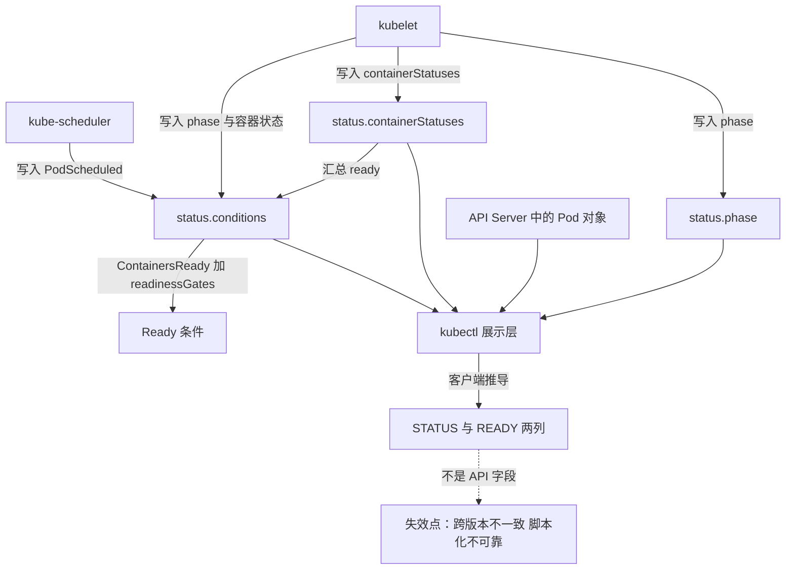
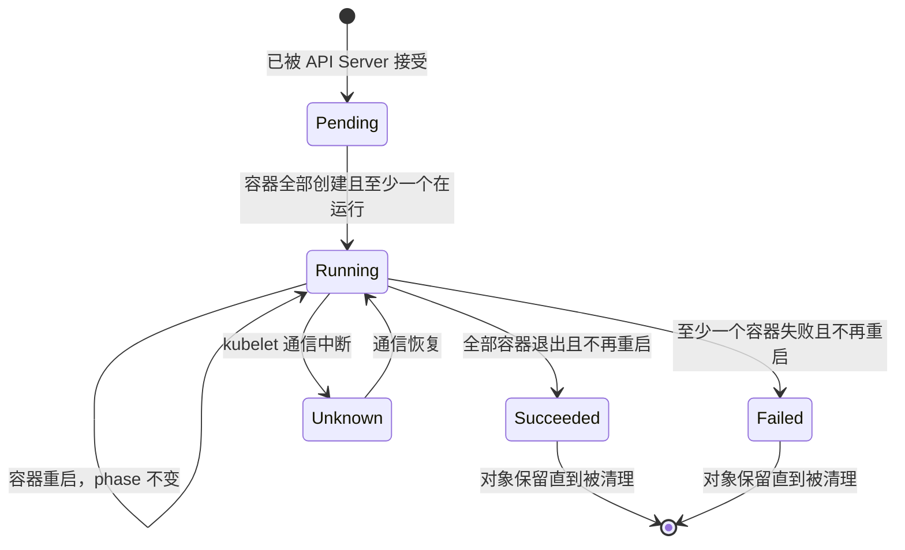
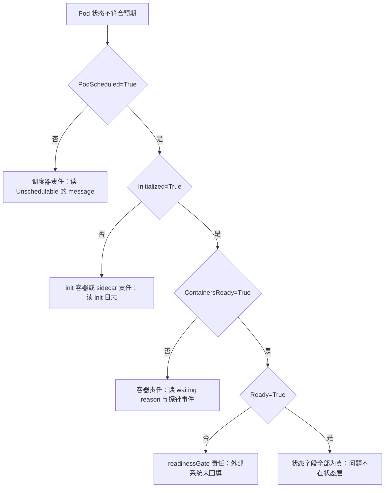
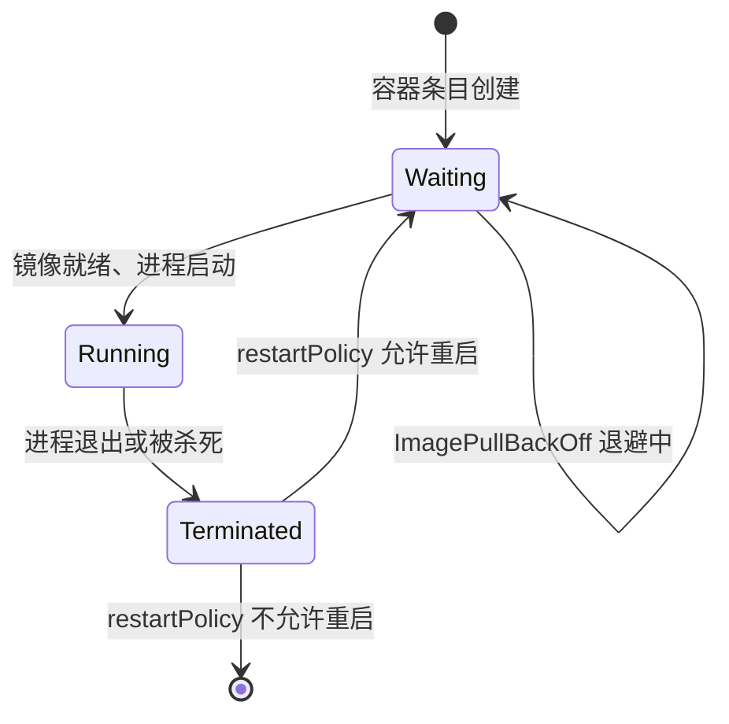
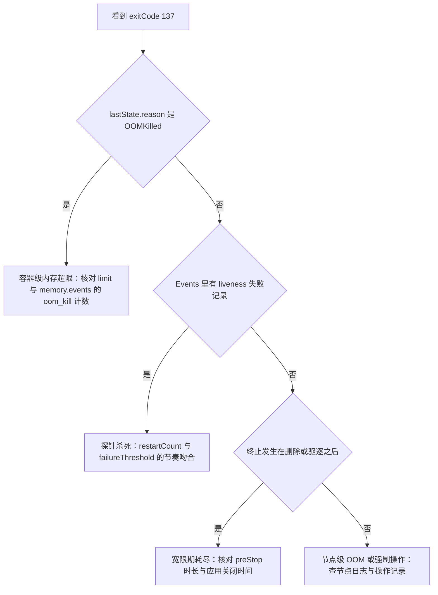
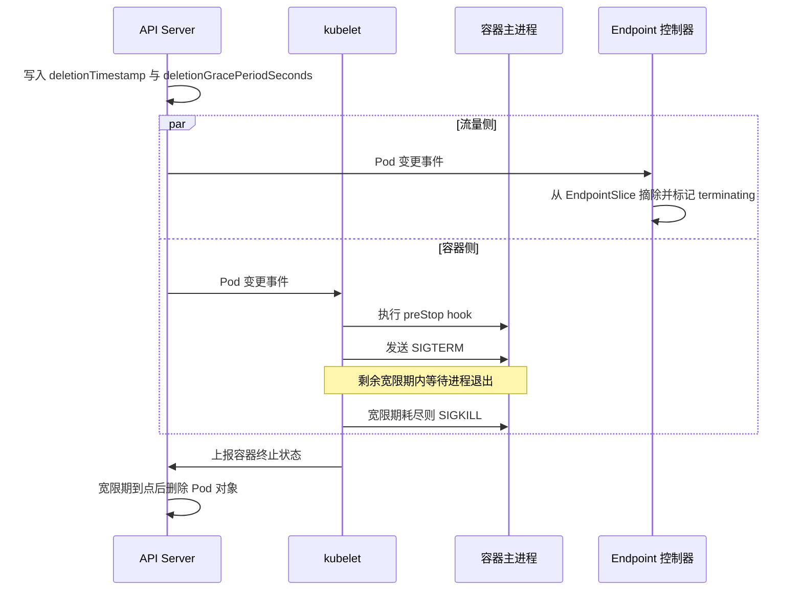

# 02 Pod 生命周期深度解析

**摘要：**

凌晨被叫醒的值班人，转述故障时往往只剩下两句话——「Pod 是 Running 的，2/2」与「退出码 137，应该是 OOM」。两句话都引自真实字段，但据此下的结论经常是错的：`Running` 只说明容器已被创建、至少还有一个容器在运行或等待重启，与服务能否接流量没有关系；137 是 SIGKILL 的数字编码，内存超限只是它的五种来源之一。前者是粗粒度字段被误当成能力断言，后者是窄带信息被误当成完整死因，两者犯的是同一个错：把瞬时、片面的信号当成了可以下结论的证据。本文不按字段罗列，而是把 Pod 的运行时事实拆成 `phase`、`conditions`、`containerStatuses` 三份粒度不同的账本，逐层讲清判据边界、写入者与失效方式——五个 `phase` 值各自能证明什么、READY 列与 Ready Condition 为什么会打架、Waiting 的 `reason` 如何区分「正在创建」与「正在退避」、重启退避从 10 秒到 5 分钟的序列该怎么按时间读、退出码 0/1/137/139/143 的判别路径，以及 preStop、`terminationGracePeriodSeconds`、init 容器、sidecar 与临时容器如何改写这套状态机。这套拆法之所以必要，是因为三类字段由不同组件写入，粒度不同，能承载的判据不同，失效时的表现形态也不同；混着读，就会在错误的层次上找答案。文末给出一张可以把 `kubectl` 输出直接翻译成处置动作的判据表。

---

## 第 1 章 三份账本

笔者先把一个反直觉的结论放在前面：Pod 的运行时状态不是一份记录，而是三份粒度不同的账本，分别由不同组件写入、以不同频率刷新、拥有完全不同的可扩展性。排障真正要判断的，是手上的问题该翻哪一本账，而不是背下某一本账的取值。文中用一个中等规模集群里的 `order-api` 服务贯穿始终——数十个节点、两千来个 Pod 的量级，恰是大多数团队真实面对的规模。

这三份账本都长在 `status` 子资源里，一层比一层细：

| 层次 | 字段 | 写入者 | 粒度 | 刷新频率 | 适合回答的问题 |
| :--- | :--- | :--- | :--- | :--- | :--- |
| 宏观阶段 | `status.phase` | kubelet 的 StatusManager | Pod | 低，只在阶段跃迁时变 | 它处在生命周期的哪一段 |
| 布尔断言 | `status.conditions[]` | kube-scheduler 与 kubelet | Pod | 中，随判定结果翻转 | 它卡在哪一个环节 |
| 容器事实 | `status.containerStatuses[]` | kubelet | 每个容器 | 高，随容器状态机抖动 | 具体哪个容器、因为什么 |

### 1.1 单向推导关系

三层不是并列的，而是单向汇总：`Ready` 由 `ContainersReady` 与 `status.readinessGates` 共同决定，`ContainersReady` 由每个容器状态里的 `ready` 布尔值汇总，`phase` 只看容器是否被创建、是否还有容器在运行或等待重启。反向推导一律不成立——从 `phase: Running` 推不出任何一个容器 `ready`。

不妨拿一个具体对象走一遍。假设集群里有一个十二副本的 `order-api`，其中某个 Pod 跑着两个容器：业务容器 `app` 因配置错误进入崩溃重启循环，边车容器 `log-agent` 正常；同时外层负载均衡器负责回填的 readinessGate 尚未满足。此刻三份账本里的四个字段分别写着：`phase` 是 `Running`，因为所有容器都已创建、至少一个容器在运行或等待重启；`ContainersReady=False`，因为 `app` 的 `ready` 是 false；`Ready=False`，且即使 `app` 修好了，只要 readinessGate 没被外部系统置为 True，`Ready` 依旧是 False；`containerStatuses` 里 `app` 的 `state.waiting.reason` 是 `CrashLoopBackOff`，`lastState.terminated.exitCode` 是 1。同一次故障在四个字段里有四种写法，而 `kubectl get pods` 只会告诉你 `Running` 加 `1/2`。

### 1.2 最粗的字段最稳定

`phase` 从 Kubernetes 1.0 起就是五个值，一直被保守地维护到 1.37。这不是因为设计者认为五个值够用——恰恰相反，`Terminating`、`Evicted`、`CrashLoopBackOff` 这些日常挂在嘴边的状态都不在枚举内——而是因为 `phase` 是一个字符串枚举，下游客户端大量写成 `switch phase { case "Running": ... }` 这样的分支，往枚举里加值等于在所有客户端的默认路径上埋一颗雷。

字段不能加，语义又要继续表达，新增信息于是全部挤进两个地方：`conditions` 数组与 `reason` 字符串。前者是设计出来的**扩展点**，加一个未知 Type，旧客户端会安静地忽略；后者是无模式约束的**自由文本**，同一个故障在 1.24 与 1.30 上可以写成不同的词，换成 CRI-O 或更老的 Docker 运行时更是各说各话。这个差别决定了使用方式：`conditions` 的 Type 可以写进自动化检查，`reason` 只能当线索，不能当 API 契约。

> [!info] Terminating 不是 phase
> 删除中的 Pod，`status.phase` 仍然是 `Running` 或 `Pending`，唯一可靠的判据是 `metadata.deletionTimestamp` 不为空。`kubectl get pods` 显示的 `Terminating`、`CrashLoopBackOff`、`ImagePullBackOff`、`Init:0/2`、`Evicted` 全部是客户端推导出来的展示值，API 里并没有这些 `phase`。

### 1.3 展示层再叠一层推导

`kubectl get pods` 的 STATUS 与 READY 两列**由客户端函数计算，不是服务端字段**。STATUS 的推导优先级大致是：`deletionTimestamp` 非空则显示 `Terminating`；`status.reason` 非空则显示该 reason（`Evicted`、`Shutdown`、`UnexpectedAdmissionError` 都从这里来）；有容器处于 Waiting 则显示该容器的 reason，init 阶段加 `Init:` 前缀；都不满足才回落到 `phase`。READY 列则是「`ready` 为 true 的容器数 / `spec.containers` 总数」，临时容器不计入，readinessGate 也不计入。

由此带来三个实际后果。其一，不同版本的 kubectl 对同一个 Pod 可能显示不同状态，拿两张不同版本的截图做对比，很容易得出「状态变了」的错误结论。其二，`-o json` 里根本没有 STATUS 这一项，脚本若用 `kubectl get pod` 的第三列做判定，等于把一个随时可能调整的渲染结果固化成逻辑。其三，READY 列只数 `spec.containers`，与 `Ready` Condition 并不等价，这一分歧在第 3 章会展开。

还有一层更基础的延迟：状态写入本身不是实时的。kubelet 通过 PLEG 周期性地向运行时询问容器状态（默认每秒一次），把结果交给 StatusManager 合并、防抖后再上报 API Server，因此从进程退出到 `status` 反映出来，中间隔着轮询周期与上报延迟。`kubectl get` 看到的永远是一个稍旧的快照——用「刚 `kubectl delete` 完 Pod 还显示 Running」去质疑删除失败，多数时候只是读到了上一次上报。

下图把三份账本的写入路径与展示层的推导关系放在一起，可以看出为什么「读一个字段」永远不够。



---

## 第 2 章 phase 的五个值与它们能证明的事

五个 `phase` 值读起来像红绿灯，实际更像导航里的路况图层：它能告诉你「这条路大堵」，但说不出堵在第几个路口。本章逐个说清每一格能证明什么、不能证明什么，以及出现异常时第一跳该看哪里。

### 2.1 Pending：被低估的一格

`Pending` 的定义是「Pod 已被 API Server 接受，但还没有任何一个容器进入可运行的状态」。它覆盖的场景远比「没有调度上」宽：

1. 尚未绑定节点，`spec.nodeName` 为空；
2. 已绑定但 sandbox 未就绪，pause 容器与 CNI 还在创建；
3. 已绑定但 Volume 未完成挂载，CSI 在 attach 或 mount；
4. 镜像层正在下载；
5. init 容器正在运行——最容易被忽略的一种，init 跑二十分钟，Pod 就 Pending 二十分钟，既没有调度问题也没有镜像问题。

这五种子状态的排障动作完全不同，因此判据要按顺序收窄，而不是一上来就 `describe` 到底：

| 观察到的现象 | 结论 | 第一跳 |
| :--- | :--- | :--- |
| `spec.nodeName` 为空 | 未调度 | 读 `PodScheduled` 的 `reason` 与 `message` |
| `PodScheduled` 这条 condition 整条缺失 | 没有调度器认领 | 查 `spec.schedulerName` 是否写错、自定义调度器是否存活 |
| `PodScheduled=False` 且 message 含 `0/N nodes are available` | 调度器明确拒绝 | 逐条读 message 里的原因：资源、污点、亲和性、卷拓扑 |
| 已绑定，`Initialized=False` | init 容器或 sidecar 未完成 | `kubectl logs <pod> -c <init 容器名>` |
| 已绑定，Waiting 的 reason 是 `ContainerCreating` | 创建链路中 | 看 `kubectl describe` 最后一条 Event 是否还在推进 |

第二行那个**条件整条缺失**的形态值得单独记一笔。`Unschedulable` 至少证明调度器看过这个 Pod 并做出了拒绝；而 `PodScheduled` 完全不存在，说明根本没有调度器处理过它，问题出在调度链路的入口——`schedulerName` 指向了一个不存在的调度器，或者默认调度器因为选主失败而停摆。这两种情况的处置完全不同，只看「Pending」两个字永远分不出来。

`Pending` 的时长还有一个口径问题。`metadata.creationTimestamp` 记录的是对象被创建的时刻，`status.startTime` 记录的是 kubelet 首次接手这个 Pod 的时刻，两者之差包含了准入、排队与调度等待；在多副本滚动发布时，控制器缩容、调度排队、镜像预热都可能把这段差值拉到分钟级。直接用 `creationTimestamp` 算「Pending 多久」，会把调度前的排队时间一并算进去，得出一个比真实创建耗时更吓人的数字；要量化创建阶段的耗时，应取 `startTime` 与第一条 `ContainerCreating` 事件之间的间隔。

### 2.2 Running：判据比想象中严格，结论比想象中弱

按文档定义，`Running` 需要同时满足两件事：所有 `spec.containers` 都已创建，且其中至少一个处于运行、启动中或重启中的状态。注意最后半句里的「重启中」——容器进入 `CrashLoopBackOff` 时 `state` 是 `Waiting`，语义上却属于正在等待重启，因此单容器崩溃循环的 Pod 依然会报 `Running`。这是「Running 不代表健康」最直接的机制来源，也是它最常见的失灵现场。

反过来，判据比直觉更严格的地方在于**所有容器都已创建**。一个双容器 Pod 里，`app` 已经跑起来、`log-agent` 还在 `ContainerCreating`，此时 `phase` 是 `Pending` 而不是 `Running`。换句话说，`Running` 的准确含义是「创建阶段已经全部走完，问题进入运行期」，它能证明的事情仅此而已：不表示就绪，不表示健康，不表示所有容器都在跑，不表示 Service 有端点。

量化一下这个落差。三个副本的 Deployment，两个 Pod 的容器在崩溃循环，一个正常。`kubectl get pods` 会显示两行 `Running`、`1/2` 或 `0/1`，`availableReplicas` 可能已经掉到 1，但没有任何一行的 STATUS 写着「不可用」——`Running` 这个词本身就在误导，它描述的是进程层面的运气，不是服务层面的能力。

### 2.3 Succeeded 与 Failed：终态只对「不会重启」的 Pod 成立

这两个 `phase` 的判据不是「退出码是 0 还是非 0」，而是「所有容器都已终止，且不会有容器被重启」。默认的 `restartPolicy: Always` 意味着容器终止后总会被拉起，因此 Deployment、StatefulSet、DaemonSet 的 Pod 永远不会进入 `Succeeded` 或 `Failed`——它们要么 `Running`，要么被删除。只有 `OnFailure` 与 `Never` 的 Pod（典型是 Job 的 Pod）才走得到终态。

`Failed` 旁边还有一个常被忽略的字段：`status.reason`。被驱逐的 Pod 是 `Failed` 加 `reason: Evicted`，message 里写着实际原因（`The node was low on resource: memory`）；节点优雅关机是 `Shutdown`；Job 超时是 `DeadlineExceeded`；准入阶段被拒绝的创建请求会留下 `UnexpectedAdmissionError`。只看 `phase` 会把「被驱逐」误判成「应用崩溃」，然后去翻一份根本没有异常的日志。

另一组容易混淆的是 `Evicted` 与 `OOMKilled` 的层次差别：前者是 Pod 级结论，由 kubelet 的驱逐管理器写入 `status.reason`；后者是容器级结论，写在 `containerStatuses` 里。节点内存压力下两条路都可能走到，分岔取决于是否设了 `resources.limits.memory`——设了 limit 的容器先撞 cgroup 这道墙，被 OOM killer 杀死，留下 `OOMKilled`；没设 limit 的容器会把压力传导到节点，由驱逐管理器按 QoS 与优先级决定谁先走，留下 `Evicted`。同一个「内存不够用」，在状态字段里走出两种完全不同的记录，处置方向也不同：前者调 limit 或查泄漏，后者补 requests 或换节点规格。

### 2.4 Unknown：不是故障结论，是观测失败

`Unknown` 的含义是 kubelet 与 API Server 之间的通信中断，控制面拿不到这个 Pod 的最新状态。它表示「不知道」，而不是「已经挂了」。处置上的区别很大：`Failed` 的 Pod 应该去看容器退出原因，`Unknown` 的 Pod 应该先确认节点本身是否还在线、kubelet 是否还在上报。kubelet 恢复后 `phase` 会回到真实值；节点长时间失联则由节点控制器接管，打污点、驱逐、收敛副本——那属于控制器的职责边界，机制属于控制面协调循环的范畴，见 [[09 控制器模式与协调循环：从 Deployment 到 Operator]]。

一个容易混淆的相邻状态是「Pod 对象还在，但节点上的容器已经被清掉」：`Unknown` 期间节点重启，容器被清理，kubelet 恢复后发现自己管理的 Pod 状态与缓存不符，会重新创建容器。此时 `restartCount` 会跳变，`lastState` 里出现一次并非应用原因的 `Error`。把这类重启计进应用的可靠性数字里，是监控口径上很常见的一处污染。

### 2.5 五个值之外的两个高频误读

第一个误读是把 `Pending` 当「调度失败」。调度失败只是 Pending 的一个子集，而且是最容易被日志证明的那个子集，所以它抢走了注意力，让「Volume 挂载卡住」和「init 容器死循环」被误当成调度问题处理。

第二个误读是把 `Running` 当「部署完成」。部署是否完成属于控制器的判断，看 `status.availableReplicas`、`minReadySeconds` 与 `progressDeadlineSeconds` 的组合，而不是 `kubectl get pods` 里那一列绿色。拿 Pod 的 `phase` 做发布门禁，等价于用体温计判断手术是否成功。

下图把五个值之间的跃迁画成状态机，重点标出两条容易被忽略的边：`Running` 可以通过容器重启回到自己，以及删除动作不改变 `phase`。



---

## 第 3 章 conditions：从「哪一段」到「卡在哪一环」

`phase` 回答的是「处在生命周期哪一段」，`conditions` 回答的是「卡在哪一环」。四个核心 condition 之间是层层依赖的判定链，排障时必须按依赖顺序从上往下看，否则会把下游现象当成上游原因。

### 3.1 四个核心 condition 的语义

| Condition | 为 True 的含义 | 为 False 的典型 reason | 写入者 |
| :--- | :--- | :--- | :--- |
| `PodScheduled` | 已绑定到节点，`spec.nodeName` 有值 | `Unschedulable`、`SchedulingGated` | kube-scheduler |
| `Initialized` | 所有 init 容器已成功完成 | `ContainersNotInitialized` | kubelet |
| `ContainersReady` | `spec.containers` 中每个容器的 `ready` 都为 true | `ContainersNotReady` | kubelet |
| `Ready` | 可以接收流量：`ContainersReady=True` 且所有 readinessGate 通过 | `ContainersNotReady`、`PodCompleted` | kubelet |

这张表最容易读错的是 `Initialized`。它不是说「Pod 初始化完毕」，而是特指 init 容器这一阶段完成；一个没有 init 容器的 Pod，它从创建起就是 True。反过来，`Initialized=False` 是一个很强的信号：业务容器连创建都还没轮到，此时去看业务容器的日志必然是空的。

### 3.2 为什么必须按顺序看

四个 condition 之间存在真实的依赖：没绑定节点就不会有容器，`Initialized` 无从谈起；init 没完成，业务容器不会被创建，`ContainersReady` 必然是 False；`ContainersReady` 为 False，`Ready` 也一定为 False。这条链像机场的四道关口——值机、安检、登机口、登机，任何一道没过，后面的都不会发生。查延误时先看旅客卡在哪道关口，比同时盯着四个屏幕有效得多。

下图是这套顺序的判定树，每一层对应一个明确的责任方。



读取这四个条件的命令比 `describe` 更适合脚本化，因为输出稳定、无需解析表格：

```bash
kubectl get pod order-api-7c9f8b6d5-x2v7q \
  -o jsonpath='{range .status.conditions[*]}{.type}={.status} {.reason}{"\n"}{end}'
```

### 3.3 Ready 的合成：readinessGate 与 READY 列的分歧

`Ready` 是 `ContainersReady` 与所有 readinessGate 的逻辑与。readinessGate 的意义在于把「就绪」的定义权部分交给外部系统：ELB、Ingress 控制器、自研的流量调度器可以在 Pod 上声明一个自定义 Condition，在它把后端注册完成之前，kubelet 不会把 `Ready` 置为 True，Endpoint 控制器也不会把这个 IP 加进 EndpointSlice。

这里就出现了第 1 章埋下的分歧：`kubectl get pods` 的 READY 列只统计 `spec.containers` 的就绪数，不看 readinessGate。于是会出现一个非常诡异的现场——READY 列显示 `2/2`，`Ready` 条件却是 `False`，Service 的端点列表里没有这个 IP。笔者见过不止一次有人拿着 `2/2` 的截图去和网络团队争论「后端是好的」。

判据要落到 Condition 与 EndpointSlice 两个地方：

```bash
kubectl get pod order-api-7c9f8b6d5-x2v7q -o jsonpath='{.status.conditions[?(@.type=="Ready")]}'
kubectl get endpointslice -l kubernetes.io/service-name=order-api \
  -o jsonpath='{range .items[*].endpoints[*]}{.addresses[0]} {.conditions.ready}{"\n"}{end}'
```

回填 readinessGate 需要写 Pod 的 `status` 子资源，外部组件必须持有对应的 RBAC 权限。这是 readinessGate 落地时最常见的故障——控制器部署好了、配置也写了，权限没给，`Ready` 永远停在 `False`，而控制器日志里除了一条 `forbidden` 什么都没有。判据是查权限与日志里的 403，而不是继续在探针上打转。

### 3.4 时间戳与条件缺失

`lastTransitionTime` 只在 `status` 翻转时更新，`reason` 与 `message` 可以变化而时间戳不动。因此「时间戳没变」不等于「什么都没发生」，判断是否在推进要看 `reason` 与 Endpoint 数量，不能只看时间。

condition 数组的顺序没有任何保证，`kubectl describe` 里那套固定顺序是客户端排序的结果。真正需要区分的是**条件为 False**与**条件缺失**：前者说明判定过且不通过，后者说明还没有人写过——刚创建的 Pod 没有 `Ready` 就是这种情况，kubelet 尚未完成首次上报；而 `PodScheduled` 缺失则指向调度器链路。

`kubectl wait --for=condition=Ready` 的语义也值得说清：它在超时后以非零退出码结束，适合做发布脚本的门禁，但不适合对已完成的 Pod 使用——Job 的 Pod 进入 `Succeeded` 之后，`Ready` 是 False 且 reason 为 `PodCompleted`，等待会一直挂到超时。

### 3.5 语义还在往 conditions 里长

较新版本把一些原本藏在 `reason` 里的信息提升成了 condition：`PodReadyToStartContainers` 把 sandbox 就绪从 `PodScheduled` 里拆出来，`DisruptionTarget` 把「因驱逐、抢占或节点关机而终止」从自由文本变成可查询的断言，原地调整资源能力引入的 `PodResizePending` 与 `PodResizeInProgress` 也是同一模式。具体在哪个版本转正，以对应版本文档为准，但趋势很清楚：`phase` 保持不动，`conditions` 持续扩列。

使用方应当把 condition 当开放集合处理，忽略不认识的 Type，而不是写死四个。反过来，如果你写的巡检脚本断言「conditions 长度等于 4」，那么一次集群升级就会让它全线报警。

### 3.6 用 conditions 做告警的三个坑

把 `Ready=False` 直接接进告警，会在三种情况下持续误报。其一是 Pod 刚创建：`Ready` 这条 condition 还没被写入，规则若把「缺失」当成「为假」，每次扩容都要打出一片噪声。其二是滚动发布：旧 Pod 在终止过程中 `Ready` 必然变成 `False`，而这正是设计意图，不是故障。其三是 Job 的 Pod：进入 `Succeeded` 后 `Ready` 是 `False` 且 reason 为 `PodCompleted`，一条面向全部 Pod 的规则会把每个成功完成的任务都算成不可用。

三种误报的共同修法是把断言写全：只统计 `phase` 为 `Running`、`deletionTimestamp` 为空、且属于长驻工作负载的对象，再把 reason 为 `PodCompleted` 的情形排除。字段本身没有问题，问题在于规则常常只取了其中一个布尔值，而把一个多层合成的结论拆成了单点判断。

---

## 第 4 章 容器状态机：Waiting、Running、Terminated

`phase` 与 `conditions` 都是 Pod 级的汇总，真正记录事实的是每个容器自己的状态机。三个状态互斥，但每个容器同时保留两份记录：`state` 是**此刻**，`lastState` 是**上一次终止的现场**。只读 `state` 会看到一片 `Waiting`，读 `lastState` 才能知道上一次到底是怎么死的。三个档位的切换条件由运行时与 kubelet 两方共同决定，像一台闸机——放行、通行、出站，任何一次非法停留都会被记录下来。

### 4.1 字段结构与判读入口

每个容器条目里有几个关键字段：`state`（三选一）、`lastState`（重启过才有）、`ready`（是否通过就绪判定）、`started`（是否已启动完成，与 startup 探针配合）、`restartCount`、`imageID` 与 `containerID`。`restartCount` 是单调递增的计数器，Pod 被重建后会归零，因此它只能与「当前这个 Pod 对象」的年龄一起看。

一个典型的崩溃容器，在 `describe` 里的样子是这样的：

```text
Containers:
  app:
    Container ID:   containerd://3f7c...
    Image:          registry.internal/order-api:v2.14.3
    State:          Waiting
      Reason:       CrashLoopBackOff
    Last State:     Terminated
      Reason:       Error
      Exit Code:    1
      Started:      Thu, 19 Nov 2026 02:41:07 +0800
      Finished:     Thu, 19 Nov 2026 02:41:09 +0800
    Restart Count:  47
```

这段输出里藏着四个独立事实：当前在退避，上一次是应用层错误退出，存活时间是两秒，累计重启四十七次。第 5 章会用这组数字反推崩溃周期。

### 4.2 Waiting 的十种 reason

Waiting 是信息密度最高也最容易误读的状态，因为「没在跑」的原因可能是正常的创建过程，也可能是故障。按判据把它们分开：

| reason | 含义 | 判据与第一跳 |
| :--- | :--- | :--- |
| `ContainerCreating` | 正在创建容器：sandbox、CNI、卷挂载、镜像层下载 | 看最后一条 Event 是否推进；看节点磁盘与镜像仓库 |
| `PodInitializing` | init 容器尚未全部完成，业务容器还没轮到创建 | `kubectl logs` 看 init 容器的进度 |
| `CrashLoopBackOff` | 容器反复退出，正在退避等待下一次重启 | 读 `lastState` 的 reason 与 exitCode |
| `ImagePullBackOff` | 拉取失败后进入退避，等待重试 | 读 Events 里的拉取错误原文 |
| `ErrImagePull` | 本次拉取尝试失败，尚未进入退避 | 镜像名、tag、仓库凭证、网络 |
| `InvalidImageName` | 镜像引用格式非法，kubelet 根本没发起拉取 | 检查镜像字符串是否含非法字符 |
| `ErrImageNeverPull` | `imagePullPolicy: Never` 且节点本地无此镜像 | 预加载镜像或改策略 |
| `CreateContainerConfigError` | 引用的 ConfigMap、Secret 或其 key 不存在 | 核对挂载引用与命名空间 |
| `CreateContainerError` | 运行时创建失败：权限、cgroup、名称冲突 | 节点 kubelet 日志与运行时日志 |
| `RunContainerError` | 运行时启动失败：entrypoint 不存在、动态库缺失 | 核对 `command`、镜像架构与 libc |

`ImagePullBackOff` 与 `ErrImagePull` 经常成对出现，两者不是两种故障，而是同一条故障时间线上的两个阶段：拉取失败记一次 `ErrImagePull`，退避重试期间显示 `ImagePullBackOff`。看到前者别急着下结论，看到后者说明已经失败过至少一次。这两者也各自有一套退避计时器，与容器重启的退避互不相干。

`ContainerCreating` 则是一个覆盖整个创建链路的笼统标签，它可能只持续两秒，也可能持续十分钟。判断它是否异常，判据不是时长，而是**事件流是否还在推进**。

### 4.3 ContainerCreating 为什么会挂很久

创建阶段的耗时由五段串联组成：sandbox 创建（一到三秒）、CNI 配置网络（一到两秒）、卷挂载（五到六十秒，云盘 attach 可能更久）、Secret 与 ConfigMap 同步（通常不足一秒，首次可能数秒）、镜像层下载（最大头）。

给一组示例推算：镜像 1.2GB、共六层，节点上命中两层约 300MB，有效下行带宽 50MB/s，纯下载约 18 秒，加上沙箱、网络与一次小卷挂载，总计落在 25 到 35 秒之间。若同一节点上有四十个 Pod 同时首次拉取不同镜像，仓库侧限速 20MB/s，光下载就要 60 秒以上，叠加串行化的挂载操作，停在 `ContainerCreating` 两三分钟完全正常。真正需要警惕的是另一类形态：Event 停在 `FailedAttachVolume` 或 `FailedMount` 上十几分钟不动，那已经不是慢，是挂载链路断了，后续动作要转向存储侧。

### 4.4 Terminated：Completed、Error 与两个时间戳

`Terminated` 的 `reason` 只有几个值：`Completed`（退出码 0）、`Error`（非 0）、`OOMKilled`（运行时判定内存超限），另有 `ContainerStatusUnknown`、`DeadlineExceeded` 等边缘情形。注意 `OOMKilled` 是一个特例：它在语义上属于「被杀死」，不在「正常退出」与「异常退出」的二分里，这也解释了为什么第 6 章不能只看退出码。

`startedAt` 与 `finishedAt` 的差值是容器存活时长，用它可以把「启动即崩」与「长跑后崩」分开——这是第 5 章读崩溃序列的核心输入。这两个时间戳偶尔会出现零值或顺序异常（运行时时钟、容器被强杀时来不及记录），适合做量级判断，不适合做精确计量。`Terminated` 里还有一个 `signal` 字段，记录杀死进程的信号编号，但它只在部分运行时实现里被填充；`exitCode` 始终可用，`signal` 只能作为补充，退出码与信号的对应关系仍然要靠人记。

### 4.5 ready 字段的三个来源

`ready` 这个布尔值有三个来源，读的时候要分清：没有配置 readinessProbe 的容器，进程一起来就算就绪；配了探针的容器，由探针的连续成功与失败决定；容器处于重启退避或已终止时，`ready` 会被强制置为 false。第三种最容易被误判成「探针配错了」——实际上应用根本没有在跑，探针连执行对象都不存在。探针本身的参数与误杀形态见 [[03 健康检查与就绪探针]]，这里只强调它对状态字段的影响：`ready` 是瞬时值而非累计结论，任何一次探测失败都会立刻反映到 `ContainersReady`，进而让这个 Pod 从端点列表里消失。

### 4.6 状态机的两个闭环

容器状态机的完整形态如下图。一种是正常路径，另一种是 `restartPolicy` 允许重启时形成的循环——只要退避计时器还在跑，这个循环就会一直转下去，而 `phase` 始终保持 `Running`。



区分两个闭环的性质是排障的分水岭：`Terminated → Waiting` 这个循环代表「进程在退出」，而 `Waiting → Waiting` 的自环代表「创建动作在失败」。前者要读 `lastState`，后者要读 Events。把退避自环误当成崩溃循环，是看错根因的高发原因。

---

## 第 5 章 restartPolicy 与重启退避

`restartPolicy` 只有三个取值，却被反复误读成「重启几次」的策略——它实际控制的是「是否重启」，重启的节奏由退避机制决定，两者层次不同。退避的配时思路与路口的黄灯相似：偶发一次就快速放行，连续失败才把等待拉长，直到确认这不是抖动。

### 5.1 三个取值与终态判定

| 策略 | 容器退出码 0 | 容器退出码非 0 | 适用的工作负载 |
| :--- | :--- | :--- | :--- |
| `Always`（默认） | 重启 | 重启 | Deployment、StatefulSet、DaemonSet |
| `OnFailure` | 不重启 | 重启 | Job、一次性任务 |
| `Never` | 不重启 | 不重启 | Job、需要保留现场的任务 |

`restartPolicy` 作用于 Pod 内所有普通容器，不能逐容器设置——唯一的例外是 init 容器里的 sidecar（`restartPolicy: Always`），属于另一个机制，第 8 章展开。Job 的校验会明确拒绝 `Always`，因为那会让任务永远跑不完。

### 5.2 退避序列与它的上限

kubelet 为每个容器维护独立的退避计时器。大致规律是：第一次失败后等待约 10 秒重启，之后每次失败把等待翻倍——10 秒、20 秒、40 秒、80 秒、160 秒、300 秒，封顶 5 分钟。容器若持续运行超过一个阈值（社区实现长期以 10 分钟为界，具体以对应版本源码为准）后退避计数归零，下一次崩溃重新从 10 秒起算。

三个容易漏掉的细节。其一，退避是每个容器的，不是每个 Pod 的：双容器 Pod 里只有崩溃的那个进入 `CrashLoopBackOff`，边车容器完全不受影响，这也是为什么 `restartCount` 必须按容器分别看。其二，退避状态**保存在 kubelet 内存中**，kubelet 重启后计时器清零，崩溃容器会被立即重启一次——「重启 kubelet 之后退避消失了几秒又回来了」不是灵异现象，是内存态丢了。其三，拉镜像走的是另一套退避，两套计时器都封顶在 5 分钟量级，互不干扰。

### 5.3 怎么读 CrashLoopBackOff 的时间序列

只看 `restartCount` 说明不了什么，把它和 Pod 年龄、`lastState` 的时间戳放在一起，才能读出崩溃的形态。三种形态对应三类根因：

| 形态 | 数字特征 | 常见根因 |
| :--- | :--- | :--- |
| 秒级崩溃 | 存活一两秒，间隔按 10/20/40 秒增长，`restartCount` 快速上升 | 启动即失败：命令路径、配置格式、依赖地址、权限 |
| 封顶循环 | `restartCount` 与年龄的比值接近每 5 分钟一次 | 每次重启后活不过阈值，退避已封顶，根因通常在启动日志第一屏 |
| 长跑后崩 | 每次存活十几分钟以上，重启间隔反而很短 | 退避被重置，故障是周期性的：内存增长、连接泄漏、证书过期 |

第三种形态（**长跑后崩**）最容易被误判。因为容器每次都能活过重置阈值，退避计数被清零，于是每次崩溃后十秒内就重新拉起，`restartCount` 匀速增长却看不到 5 分钟的长等待，运维往往会把它归类成「偶发重启」而不追查。实际上它的周期非常稳定，把 `lastState.terminated.finishedAt` 按时间排开，间隔会精确到分钟级地一致。

事件流是另一条独立证据。kubelet 在每次重启尝试时写一条 `Back-off restarting failed container`，事件的 `count` 与相邻两条的时间差合起来能还原退避曲线；而 `kubectl describe` 只显示最后一条，并把重复项折叠成一行计数。判断退避是否已经封顶，比较相邻事件的时间差比看 `restartCount` 更直接。

给一个读数的例子：一个 age 4 小时、`restartCount=47` 的 Pod，平均重启间隔是 240/47，约 5.1 分钟，恰好等于封顶值。这说明它每次重启后都活不过几十秒，退避早已封顶——此时给容器加内存、把探针调宽都不会有用，该看的是启动日志第一屏。

```bash
kubectl get pod order-api-7c9f8b6d5-x2v7q -o json \
  | jq '.status.containerStatuses[] | {name, restartCount, ready, state, lastState}'
kubectl get events --field-selector involvedObject.name=order-api-7c9f8b6d5-x2v7q \
  --sort-by=.lastTimestamp
```

### 5.4 退出码 0 也会循环

`restartPolicy: Always` 下，退出码 0 的容器照样会被拉起，Waiting 的 reason 同样是 `CrashLoopBackOff`。这意味着从 `CrashLoopBackOff` 反推「应用崩溃」是错的：一个 `command: ["sh", "-c", "echo done"]` 的 Pod 在 Always 下就是标准的崩溃循环，`lastState` 的 reason 明确写着 `Completed`。看到 `Completed` 加 `CrashLoopBackOff`，根因是「这个容器本来就不该被放进 Always 的 Pod 里」，处置手段是换工作负载类型或改启动命令，而不是排查应用错误。

### 5.5 不要和 Job 的失败计数混在一起

Job 层面还有一套独立的失败计数（`backoffLimit`、`podFailurePolicy`），计数对象是「失败的 Pod」，与 kubelet 的容器退避是**两层机制**：前者决定换不换 Pod，后者决定同一个容器多久重试一次。两层同时生效时，日志里既有 `Back-off restarting failed container`，又能看到 Pod 数量在增长，很容易让人以为重启风暴失控。Job 侧的判定与替换逻辑属于控制器的职责，见 [[04 DaemonSet Job CronJob 控制器解析]]。

---

## 第 6 章 退出码：137 从来不是 OOM 的同义词

退出码是容器留给后人的最后一份现场记录，但它只有八位有效信息，能表达的语义非常有限。它像一张只填了死因大类的死亡证明——「循环衰竭」四个字可以对应心梗、失血与中毒，而三者的处置方向完全不同。把它当结论、而不是当线索，是 Pod 排障里代价最高的一次误判。

### 6.1 编码规则

退出码是 0 到 255 的单字节。约定俗成的分区是：0 表示成功；1 到 125 由应用自由使用；126 与 127 由 shell 保留，分别表示「找到了但无法执行」与「命令不存在」；128 以上表示进程被信号杀死，取值是 **128+n**，n 是信号编号。这个 128+n 的约定来自 shell，不是内核强制的，但容器运行时普遍遵循它，所以看到 137 就可以确定是 SIGKILL，看到 143 就是 SIGTERM，看到 139 就是 SIGSEGV。

| 退出码 | 等价信号 | 常见来源 | 首要判据 |
| :--- | :--- | :--- | :--- |
| 0 | 无 | 进程正常结束 | reason 为 `Completed`；Always 下仍会重启 |
| 1 | 无 | 应用自定义错误、未捕获异常 | 日志尾部与 termination message |
| 2 | 无 | shell 内建误用、部分工具的用法错误 | 命令行拼写与参数 |
| 126 | 无 | 有执行位但无法执行：权限、格式、动态库缺失 | `command` 与镜像架构 |
| 127 | 无 | 命令不存在：PATH 缺失或拼写错误 | 镜像内是否有该可执行文件 |
| 130 | SIGINT | 交互式中断、进程组收到中断信号 | 少见，多为手工操作 |
| 134 | SIGABRT | 断言失败、glibc 检测到堆损坏、JVM 主动 abort | core dump、JVM 的 hs_err 日志 |
| 137 | SIGKILL | OOM、宽限期耗尽、探针杀、强制删除、节点级 OOM | 见 6.2 的五路判别 |
| 139 | SIGSEGV | 原生代码空指针或越界、指令集不匹配 | core dump、内核 segfault 记录 |
| 143 | SIGTERM | 正常终止、容器内自伤、`docker stop` | Events 里有无删除动作 |

### 6.2 137 的五种来源

137 之所以危险，是因为它把五种完全不同的处置方向压缩成了同一个数字：

1. 容器内存超过 limit，cgroup 的 OOM killer 杀死进程，`reason` 为 `OOMKilled`；
2. 删除或驱逐时宽限期耗尽，kubelet 补上 SIGKILL，`reason` 为 `Error`；
3. liveness 探针连续失败，kubelet 主动杀容器，处置接近零宽限，`reason` 为 `Error`；
4. 节点级内存压力下，内核 OOM killer 挑中该进程，`reason` 可能是 `OOMKilled` 也可能是 `Error`；
5. 强制删除、节点关机、手工 `kill`、运行时直接停止容器。

下图是判别顺序，关键在于先看 `lastState.reason` 再看时间线，而不是先看退出码。



判别的几个关键证据位：

```bash
# 容器是否记录过 OOMKilled
kubectl get pod order-api-7c9f8b6d5-x2v7q -o jsonpath='{range .status.containerStatuses[*]}{.name}{" "}{.lastState.terminated.reason}{" "}{.lastState.terminated.exitCode}{"\n"}{end}'

# 节点上的 OOM 记录（需要节点权限）
dmesg -T | grep -i "killed process"

# cgroup v2 下的内存事件计数
cat /sys/fs/cgroup/kubepods.slice/.../memory.events
```

`memory.events` 里的 `oom_kill` 计数比 `reason` 更可信：`OOMKilled` 依赖运行时正确上报，某些内核与运行时组合下会漏记，而 cgroup 的计数器不会。这也是为什么在追查内存类故障时，笔者习惯把节点侧的 cgroup 计数作为交叉验证，而不是只信 `describe` 里那一行。

反例很有代表性：某个服务反复 137，团队按 OOM 处理，内存 limit 从 512Mi 一路加到 4Gi，137 依旧出现在同一秒。最后发现是 preStop 里写了一个 `sleep 30`，而 `terminationGracePeriodSeconds` 是 30 秒，应用完全没有机会响应 SIGTERM——宽限期一到，kubelet 补刀，退出码 137，`reason` 是 `Error` 而不是 `OOMKilled`。这一行 `reason` 的区别，本来可以在第一次就省下三轮加内存的变更。

### 6.3 143 的两种解释

143 是 SIGTERM 的编码，它有两种截然不同的来源。第一种是正常终止的产物：删除 Pod 时 kubelet 先发 SIGTERM，容器若在此信号下退出，会记录 `exitCode=143`——只是 Pod 对象随后被删除，这条记录往往来不及看。第二种是容器内部自伤：进程收到 SIGTERM，但信号并不是 kubelet 发的，例如 PID 1 是一段脚本、脚本被同容器内的其他进程 `kill`，或者进程管理器配置错误地把子进程当成了要清理的目标。

在 `restartPolicy: Always` 下，第二种会变成「143 退出、重启、再次 143」的循环，而应用日志里可能一个 error 都没有，因为对应用来说这是一次「优雅关闭」。判据只有两条：Events 里有没有对应的删除或驱逐动作；容器内是否存在会给自己发信号的进程。若两条都不成立而重启仍在继续，就要怀疑 PID 1 与信号转发的实现问题，相关细节与零停机方案在 [[04 优雅停机与滚动更新的零停机]] 里展开。

### 6.4 139 与 134：原生代码的两类死法

139 是 SIGSEGV，典型来源是原生代码的空指针与越界、native 栈溢出、指令集不匹配（在新 CPU 上编译的二进制跑到旧节点上）、glibc 版本不匹配。JVM 应用出现 139 时，先找 `hs_err_pid` 日志，默认写在工作目录里，容器一重建就没了，所以要么挂载可写卷，要么用 `-XX:ErrorFile` 指到持久化路径。

134 是 SIGABRT，多是主动中止：C 库的断言失败、glibc 检测到堆被写坏（日志里会出现 `malloc(): corrupted top size` 一类文本）、JVM 遇到 `Fatal error` 后主动 abort。134 与 139 的差别在于责任方——前者通常是代码或库主动判断「已经不能继续」，后者是硬件或内存访问直接翻了车。

这两类退出码的排查都依赖 core dump，而容器里的 core 默认往往被关掉：`ulimit -c` 为 0，`core_pattern` 指向宿主机的某个路径。要留下现场，得在 Pod 上显式调整，并确认宿主机磁盘能容下。这一步在事故当下通常来不及做，所以更实际的做法是在基础镜像里固定好开关，而不是等故障发生后再改。

### 6.5 退出码之外的证据

`kubectl describe` 输出的 `Message` 一栏来自容器的 termination message，默认读容器内 `/dev/termination-log` 文件；若把 `terminationMessagePolicy` 设为 `FallbackToLogsOnError`，非 0 退出时 kubelet 会取日志最后若干行填进这个字段。这一栏的信息密度往往高于退出码本身——应用自己写的「配置项 X 缺失」「连接池初始化失败」都会留在这里。

---

## 第 7 章 终止流程与宽限期

删除一个 Pod 是一条有明确顺序的链路，顺序错了，应用就来不及收尾；预算算错了，收尾做到一半会被 SIGKILL 打断。这一章的关注点是顺序与预算，流量摘除的竞态与零停机配置在 [[04 优雅停机与滚动更新的零停机]] 中另有完整分析。

### 7.1 顺序：preStop 在 SIGTERM 之前

删除请求到达 API Server 后，Pod 被写入 `metadata.deletionTimestamp`，同时 `deletionGracePeriodSeconds` 被设为一个总预算（默认 30 秒）。kubelet 观察到这个变化后执行的顺序是：先跑 preStop hook，等它返回，再向容器的 PID 1 发送 SIGTERM，然后等剩余预算，最后补 SIGKILL。

这个顺序决定了 preStop 的定位：它是**停机广播之前的一次巡场**，不是「进程退出后的收尾」。把清理逻辑放在 preStop 里，进程还活着、连接还在、日志还能写；把同样的逻辑放在 SIGTERM 处理函数里，也能工作，但会与应用的优雅关闭流程争抢同一段时间。

下图把终止过程的两侧时钟画在一起：API Server 侧的宽限期从 `deletionTimestamp` 起算，kubelet 侧的计时从它开始处理删除动作时起算。两者并不总是同步，这个偏差在节点繁忙或 PLEG 卡顿时会变得可观。



普通容器的终止是并行进行的：每个容器各自跑 preStop、各自收到 SIGTERM，宽限期是它们共用的总预算而不是逐个累加，所以一个 Pod 的总终止时间取决于最慢的那个容器。sidecar 是唯一有顺序的例外，它在普通容器之后终止，这也是它能在主容器关闭期间继续转发日志与代理流量的原因。由此得到一条容易忽视的推论：双容器 Pod 里只要有一个容器的 preStop 卡满预算，另一个容器即使一秒退完，整个 Pod 的删除也要等到预算耗尽。

### 7.2 预算算术

**宽限期是一个总预算**，preStop 的执行时间从里面扣，没有独立的超时。给一组示例推算：`terminationGracePeriodSeconds: 30`、preStop 里 `sleep 10`，应用收到 SIGTERM 时只剩 20 秒可用；若应用在高峰期需要 25 秒排空长连接，那么第 30 秒 kubelet 会补 SIGKILL，日志里留下一条 `Killing` 事件，容器退出码 137。团队看到 137 的第一反应通常是查内存，而真正的原因是预算不够。

合理的分配方式是：宽限期等于 preStop 时长、应用最长优雅关闭时间与一段余量之和。余量按 20% 到 30% 取，因为优雅关闭的耗时会随负载波动，而 SIGKILL 一旦发生，前面所有收尾工作全部作废。长连接场景（WebSocket、gRPC 流、大文件上传）把宽限期设到 300 秒并不夸张，这是一个显式字段，没有硬性上限。

这里还有一处容易忽略的细节：预算耗尽时容器退出码是 137 而不是 143，进程确实是被 SIGKILL 杀的。于是「137 等于 OOM」的误解又会被强化一次。

### 7.3 preStop 的三条约束

第一条，不要在 preStop 里做依赖主进程已完成初始化的事。preStop 与主进程的启动没有顺序保证——删除可能发生在一个正在启动的 Pod 上，此时 hook 里的逻辑会跑在一个尚未就绪的应用旁边。

第二条，不要把 preStop 当唯一的数据落盘机会。hook 失败不会阻止终止：kubelet 记录事件后照常发 SIGTERM，落盘逻辑如果只写在这里，就等于没有兜底。

第三条，hook 的等待方式是同步的，它没有一个独立于宽限期的超时。写一个 `sleep 60` 到 30 秒宽限期的 Pod 里，结果是 hook 被打断，SIGTERM 根本没有机会发出，容器直接被强杀。宽限期为 0 的强制删除更彻底，preStop 根本没有执行机会。

### 7.4 终止期间哪些字段变了

这一段是「状态字段说明不了的事」最集中的地方：Pod 正在被删除，但它的大部分字段看起来仍然健康。

| 字段 | 终止期间的值 | 说明 |
| :--- | :--- | :--- |
| `status.phase` | 仍为 `Running` | 五值枚举里没有 Terminating |
| `metadata.deletionTimestamp` | 有值 | 唯一可靠的「正在删除」判据 |
| `Ready` 条件 | `False` | Endpoint 摘除的依据之一 |
| `containerStatuses[].state` | 可能仍是 `Running` | 进程还在跑，只是正在被杀 |
| EndpointSlice 端点 | `ready=false`、`terminating=true` | 判断是否还在接流量的正确位置 |
| `restartCount` | 不再增长 | 删除中的容器不会被重启 |

用 `phase` 判断「这个 Pod 是否正在服务」在这一刻彻底失效：它显示 `Running`，而流量早已被摘除。反过来，用 `deletionTimestamp` 判断「是否正在删除」是可靠的，这也是巡检脚本应该盯的字段。

### 7.5 非正常终止的宽限期差异

不同触发路径给出的宽限期差别很大，这解释了为什么同一次发布里，有的 Pod 优雅退出了，有的直接 137：

| 触发方式 | 宽限期 | preStop 是否执行 |
| :--- | :--- | :--- |
| 常规删除（`kubectl delete`、控制器缩容） | Pod 上配置的值，默认 30 秒 | 执行 |
| `kubectl delete --grace-period=N` | 命令行指定的 N 秒 | 执行，但预算可能不足 |
| `kubectl delete --force --grace-period=0` | 0 | 不执行，直接强杀 |
| 节点资源硬驱逐 | 取决于驱逐信号与配置 | 视实现与压力类型而定 |
| 节点优雅关机 | 按优先级与设置的时长协商 | 执行 |
| kubelet 长时间失联后节点恢复 | 无（清理孤儿容器） | 不执行 |

最后一行值得单独理解：节点失联期间，控制面已经把这个 Pod 判为失效并收敛了副本，等 kubelet 恢复，它要做的是清理本地残留的容器，此时没有任何「优雅」可言——新的副本早在别的节点上跑起来了，残留容器的收尾不影响服务可用性，只是会留下一次没有日志的强制终止记录。

### 7.6 PID 1 与信号转发的状态机后果

SIGTERM 是发给容器 PID 1 的。如果 PID 1 是 shell，而 shell 没有把信号转发给子进程，应用就收不到终止信号，会一直跑到宽限期结束，然后被 SIGKILL——从状态机上看，这就是一次标准的 `Terminated` 加 `exitCode: 137`。修复方式（exec 形式启动、用轻量 init 进程）属于运行时约定，[[04 优雅停机与滚动更新的零停机]] 里有逐条对照。

---

## 第 8 章 init、lifecycle 与临时容器如何改写状态机

前面七章描述的是「普通 Pod」的状态机。Kubernetes 后来加的三种机制——init 容器（含 sidecar 变体）、生命周期钩子、临时容器——各自改写了其中一段逻辑，不把它们算进去，前面所有判据都会在特定场景下失灵。

### 8.1 init 容器：把 Pending 合法地拉长

init 容器的语义是串行、必须成功、运行至完成。它对状态机的第一处改写是让 `Pending` 合法地持续很久：业务容器还没创建，`phase` 就一直是 `Pending`，`Initialized` 为 `False`，Waiting 的 reason 是 `PodInitializing`。这期间 `kubectl get pods` 的 STATUS 列会显示 `Init:0/2` 这样的进度，比 `Pending` 一词有用得多。

第二处改写发生在失败路径上，且与 `restartPolicy` 强耦合：

| `restartPolicy` | init 容器失败后的行为 | 对状态字段的影响 |
| :--- | :--- | :--- |
| `Always` 或 `OnFailure` | kubelet 原地重试这个 init 容器，走同一套退避 | `Init:CrashLoopBackOff`，`Init:Error` |
| `Never` | 不再重试，Pod 直接进入终态 | `phase: Failed`，`status.reason` 记录退出信息 |

第三处是资源计算规则：Pod 的有效 requests 取「所有业务容器 requests 之和」与「单个 init 容器 requests 的最大值」中的较大者。理由是 init 容器串行执行且都在业务容器启动前退出，同一时刻最多只有一个在跑，所以取最大值而不是求和。

排障上的一个具体动作：init 容器失败后，`kubectl logs` 必须带 `-c` 指定容器名，否则默认返回第一个业务容器的日志，而那个容器可能根本还没被创建，于是你看到的是一个空结果，很容易误判成「没有日志说明没启动」。

### 8.2 sidecar：把 init 容器变成常驻进程

把 init 容器的 `restartPolicy` 设为 `Always`，它就变成了 sidecar：启动阶段按 init 的顺序等待，但不会退出，而是与业务容器一起长期运行。这个能力在 1.28 以 Alpha 引入，之后逐级转正，具体阶段以对应版本文档为准。

它对状态机有三处改写。其一，`Initialized` 的判据从「全部 init 容器退出」变成「init 容器与 sidecar 都已完成启动」——初判逻辑没更新的话，会看到一个 `Initialized=True` 却在跑 init 容器的 Pod，进而怀疑集群有 bug。其二，资源规则变化：sidecar 是常驻的，它的 requests 要累加进总和，而不再适用「取最大值」的规则。其三，终止顺序变化：正常容器先收到 SIGTERM，sidecar 最后退出，这样主容器关闭期间的日志转发与出口代理仍然可用——这正是过去把日志采集器放进 `containers` 里最头疼的问题。

版本演进带来行为变化是常态，升级集群时若发现 `Initialized` 的时序与旧版本的监控口径对不上，先查这条。

### 8.3 生命周期钩子：两个会把计数推高的位置

postStart 在容器启动后执行，但与 ENTRYPOINT 没有先后保证，也没有独立超时。它失败时容器会被杀死并按 `restartPolicy` 重启——于是一次配置错误的 postStart 会表现为「容器反复重启，日志里没有任何应用层异常」，`restartCount` 涨得很快，而 `lastState.terminated.exitCode` 只是一个平平无奇的 1 或 137（取决于 hook 失败后被如何终止）。这类故障的判据是反向的：应用日志显示启动正常，容器却在几秒内被杀，就要怀疑 hook。

preStop 的改写点在第 7 章已经讲过：它占用宽限期预算，且没有自己的超时。两个 hook 合起来构成一条经验：任何 `lifecycle` 配置都应该**按它会失败来设计**，而不是按「它会成功执行」来设计。

### 8.4 临时容器：给已经跑起来的 Pod 开一扇门

调试 distroless 镜像或已经崩溃的应用时，`kubectl exec` 没用——镜像里没有 shell，或者进程已经不在。临时容器（Ephemeral Container）允许往一个存活的 Pod 里注入一个新的容器，用来观察文件系统、抓包、attach 进程。

它对状态机的影响集中在「只读侧」：临时容器的状态单独出现在 `status.ephemeralContainerStatuses`，不进 `containerStatuses`，因此不计入 `kubectl get pods` 的 READY 列；它不参与 `restartPolicy`，退出即终止，不会被拉起；它不能配置探针，也不能声明端口；它加入之后不可删除，只能重建 Pod 才能移除。

`kubectl debug` 提供了两条常用路径：`--target` 指向目标容器时，调试容器共享目标容器的命名空间视图，可以直接看到它的进程；`--copy-to` 则复制一份 Pod 并把镜像换成带工具链的版本，适合需要修改启动参数的场景。两者的代价不同——前者动的是线上 Pod，后者动的是一个新的副本，排查完后者的残留更容易清理。

把临时容器列入状态机的讨论，是因为它打破了一个隐含假设：Pod 的容器集合在创建后是固定的。一旦接受集合可变，那么「容器数」就不能再作为判断 Pod 形态的依据，巡检脚本也不该假设 `len(status.containerStatuses)` 恒定。

审计上的代价也值得记一笔。临时容器里执行的操作不进入应用镜像的变更记录，也不会体现在 Deployment 的 `spec` 里，事后只能从审计日志与容器启动命令行还原。生产集群若允许 `kubectl debug`，通常要配合准入策略限制可用的镜像与命令，否则它等于开了一条绕过镜像签名与不可变性的侧门。

### 8.5 三种机制的影响面

| 机制 | 对 `phase` 的影响 | 对 `conditions` 的影响 | 对容器状态的影响 |
| :--- | :--- | :--- | :--- |
| init 容器 | 延长 `Pending` 窗口 | 决定 `Initialized` | 新增 `initContainerStatuses` 数组 |
| sidecar | 同 init，但常驻 | 改变 `Initialized` 判据 | 累加资源，终止顺序靠后 |
| 生命周期钩子 | 无直接影响 | 无直接影响 | 制造重启、占用宽限期 |
| 临时容器 | 无 | 无 | 独立数组，不参与重启策略 |

---

## 第 9 章 反例与判据

把前面八章的机制收束成三个反例与一张判据表，是因为 Pod 状态排障的真实失败点几乎都落在「用一个粗粒度字段代替一次判断」上。

### 9.1 反例一：用 phase 判断服务可用性

`Running` 的判据是「容器都创建了，至少一个在跑或等待重启」，它与服务能力之间隔着小半个系统：就绪探针、readinessGate、EndpointSlice、kube-proxy 规则。用 `phase` 做可用性判断，等价于用体温计判断病人能不能出院——体温正常只说明某一项指标正常。

正确的判据链是：`Ready` 条件为 True，端点存在且 `ready=true`，应用自身的业务指标正常。三者缺一不可，且第三条前两条都替代不了。

把这条判据落到监控口径上，一个常见的错误是直接拿 Pod 数量或 `phase` 做可用性指标。更接近用户感知的口径是从 EndpointSlice 的 `ready` 端点比例出发，它同时吸收了就绪探针、readinessGate 与终止摘除三类信号；退一步的做法是统计 `Ready` 为 True 且 `deletionTimestamp` 为空的 Pod 比例。两者都比 `phase` 准确，代价是多采集一个对象，或者在查询里多写一个条件。

### 9.2 反例二：忽略 preStop 与宽限期的顺序

这里有两个方向的错。一个方向是认为「SIGTERM 会先到，preStop 只是补充」，于是把清理逻辑都写在信号处理里，preStop 留空——在多数场景下能跑，但一旦应用在 SIGTERM 处理上有阻塞，就没有任何兜底。另一个方向是认为「preStop 是最后的机会」，在里面写长耗时的落盘或远程注销，把宽限期预算吃光，应用来不及优雅关闭就被 SIGKILL，最终表现为 137，然后被误判成 OOM。

判据很简单：把 `terminationGracePeriodSeconds`、preStop 的实际耗时、应用在 SIGTERM 后的最长关闭时间三个数写在同一张纸上，若前两者之和已经接近第一个数，配置就是错的。这类错误不会在压测里暴露，只会在真实缩容与发布时暴露。

### 9.3 反例三：把 137 一律当 OOM

137 只说明进程被 SIGKILL 杀死，来源包括 cgroup 内存超限、宽限期耗尽、liveness 探针、节点级 OOM 与强制操作。判别的顺序是 `lastState.reason`、Events 中的探针与删除记录、节点日志三处交叉，而不是直接去看内存曲线。第 6 章那张判定图可以直接照着走。

`reason` 为 `OOMKilled` 时可以基本确定是容器级内存超限；`reason` 为 `Error` 且退出码 137 时，内存的可能性就已经很低了，先查时间线与操作记录。这个区分能省下的不只是变更次数，还有对「加内存能解决问题」这一错误信念的迁移成本。

### 9.4 判据总表

| 现象 | 先看的字段 | 判据 | 处置方向 |
| :--- | :--- | :--- | :--- |
| Pod 长时间 `Pending` | `spec.nodeName`、`PodScheduled` | 条件缺失即无调度器认领 | 查 `schedulerName` 或调度器存活 |
| STATUS 显示 `Init:0/2` | `initContainerStatuses` | init 未完成，业务容器未创建 | 读 init 日志 |
| `Running` 但无端点 | `Ready` 条件、EndpointSlice | `Ready=False` 或端点 `ready=false` | 查探针与 readinessGate |
| READY 显示 `2/2` 却无端点 | readinessGate | `ContainersReady=True` 而 `Ready=False` | 查外部系统回填 |
| `CrashLoopBackOff` | `lastState.terminated` | reason 与 exitCode 决定根因类别 | 按第 5 章三形态定性 |
| `ImagePullBackOff` | Events 原文 | 拉取错误已被记录至少一次 | 镜像名、凭证、网络 |
| `ContainerCreating` 超过五分钟 | 最后一条 Event | Event 不再推进即卡住 | 卷挂载或镜像仓库 |
| 退出码 137 且 reason 为 `OOMKilled` | `memory.events` | cgroup 计数确认 oom_kill | 调 limit 或查泄漏 |
| 退出码 137 且 reason 为 `Error` | Events 时间线 | 无探针失败、无 OOM 记录 | 查宽限期预算与强制操作 |
| 容器退出码 143 且反复重启 | Events、容器内进程 | 无删除动作即容器内自伤 | 查 PID 1 与信号源 |
| 删除中的 Pod 仍在 `Running` | `deletionTimestamp` | 非空即终止中 | 看流量是否已摘除 |

### 9.5 收束

状态字段是**给人读的摘要**，不是**给程序用的协议**。`phase` 被刻意维持在五个值，说明 Kubernetes 从设计上就没打算让它承载可自动化的语义；`conditions` 是扩展点，可以放心写进判据；`reason` 与 kubectl 的展示列处在两者之间，适合辅助人快速建立假设，不适合作为长期契约。把这层区分想清楚，排障的路径会短很多——不是去记更多状态码，而是知道每个字段的判据边界在哪里，以及越过边界之后该去哪个字段找答案。

---

## 参考资料

1. Kubernetes Documentation - Pod Lifecycle：https://kubernetes.io/docs/concepts/workloads/pods/pod-lifecycle/
2. Kubernetes Documentation - Pod Conditions：https://kubernetes.io/docs/concepts/workloads/pods/pod-lifecycle/#pod-conditions
3. Kubernetes Documentation - Container Lifecycle Hooks：https://kubernetes.io/docs/concepts/containers/container-lifecycle-hooks/
4. Kubernetes Documentation - Init Containers：https://kubernetes.io/docs/concepts/workloads/pods/init-containers/
5. Kubernetes Documentation - Ephemeral Containers：https://kubernetes.io/docs/concepts/workloads/pods/ephemeral-containers/
6. Kubernetes Documentation - Debugging with Ephemeral Containers：https://kubernetes.io/docs/tasks/debug/debug-application/debug-running-pod/#ephemeral-container
7. KEP-753 Sidecar Containers：https://github.com/kubernetes/enhancements/tree/master/keps/sig-node/753-sidecar-containers
8. Kubernetes Source Code - pkg/kubelet/kuberuntime：https://github.com/kubernetes/kubernetes/tree/master/pkg/kubelet/kuberuntime

---

> [!note] 思考题
> 1. 同一个 Pod 里，业务容器崩溃循环而边车容器正常，`phase` 显示 `Running`、`Ready` 显示 `False`。如果只允许你用一条命令做巡检，你会选哪个字段，为什么它比另一个更接近「服务是否可接流量」这个真实问题？
> 2. 一个 Pod 的 `restartCount` 在四小时内涨到 47，平均间隔约五分钟。请判断它属于「秒级崩溃」还是「长跑后崩」，并说明你需要哪一个额外字段才能确认。
> 3. 宽限期 30 秒、preStop 里 `sleep 10`，应用在 SIGTERM 之后需要 25 秒排空连接。最终退出码会是什么，`lastState.reason` 又会是什么，两者为什么不是同一个问题？
> 4. 临时容器不能删除、不能配探针、不计入 READY 列。这些限制各自是为了保护哪一类不变量？如果允许删除临时容器，会破坏什么？
> 5. 把 readinessGate 交给外部负载均衡器维护，会让 `Ready` 的语义从「应用自己说行」变成「外部系统说行」。在什么规模的团队与什么流量拓扑下，这个交换是值得的？