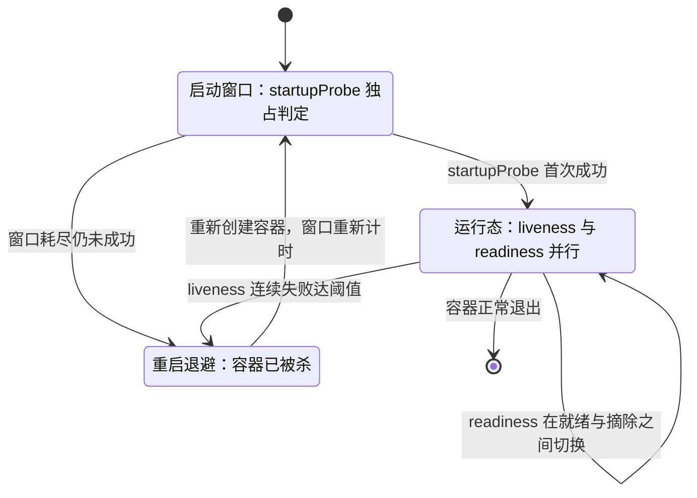
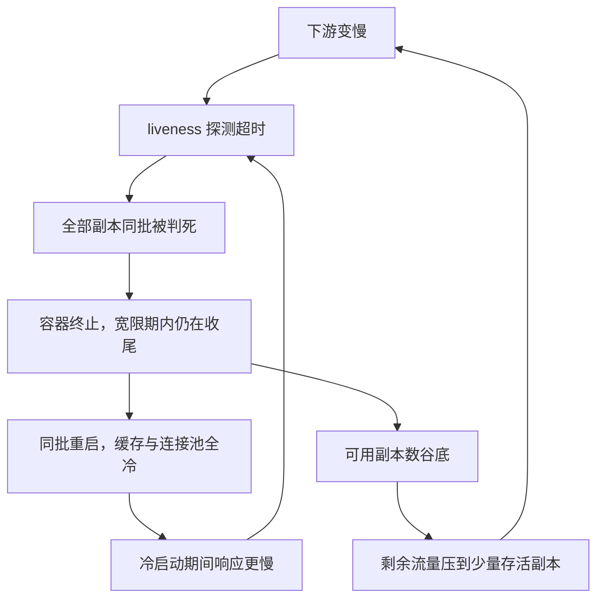
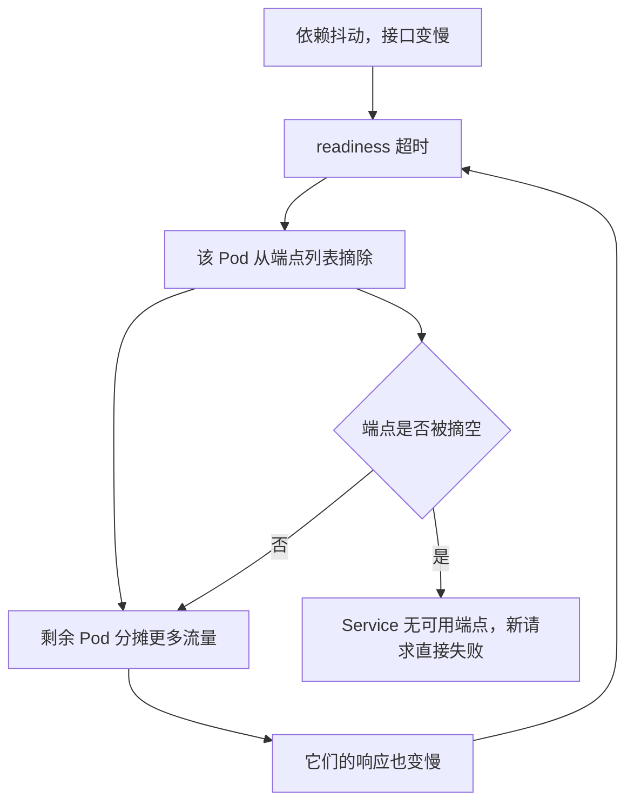
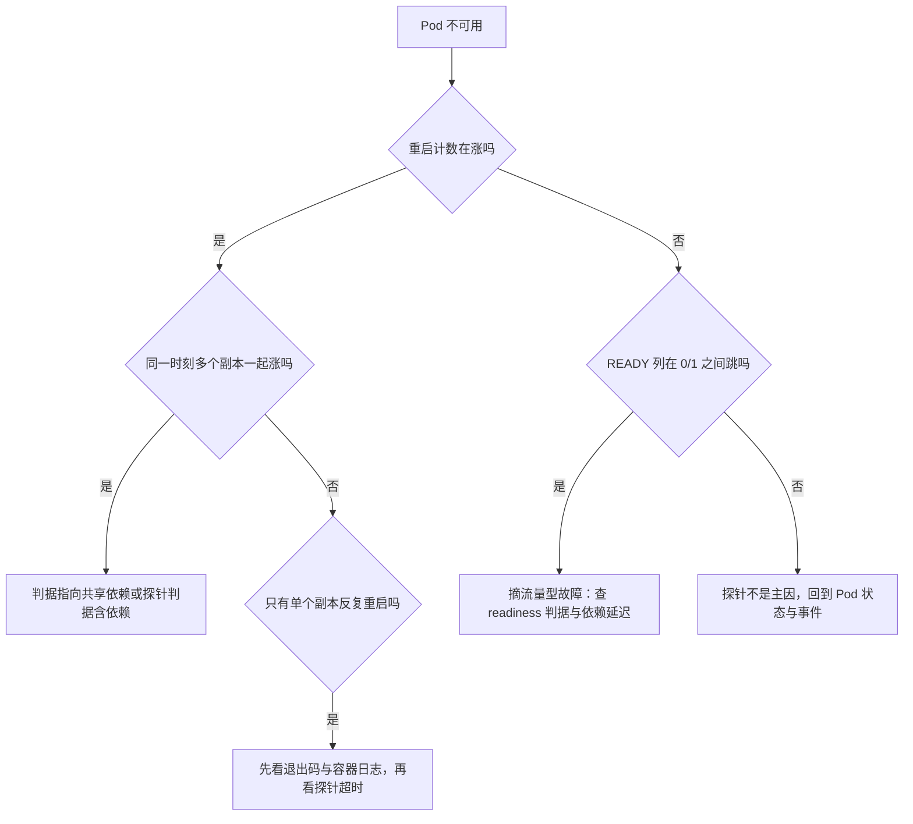
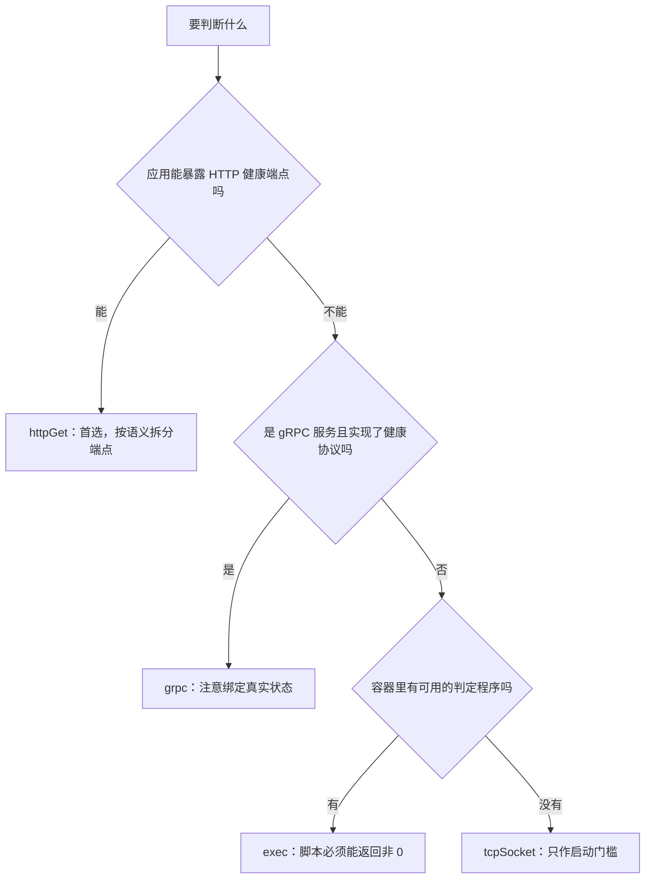
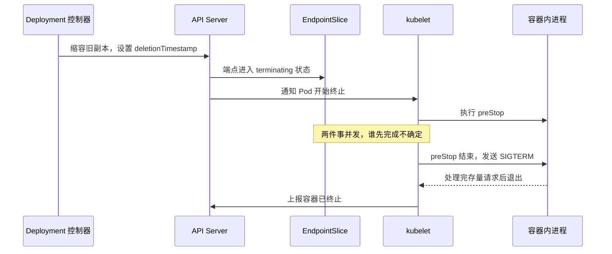

# 03 健康检查与就绪探针

**摘要：**

探针是 Kubernetes 里少数会自己动手改状态的字段：liveness 失败会杀掉容器，readiness 失败会把 Pod 从端点列表里摘掉，startup 失败会把一个还没起来的进程判成死循环。多数人把它们当成三轮"健康检查"，实际它们是三份判决书，判决对象不同、动作不同、代价也不同。本文不重讲 kubelet 如何执行探测，而是围绕语义、算术、连锁三条线展开：先逐份拆开三张判决书的评价对象与动作边界，再给出最坏判定时间、startup 窗口、滚动更新预算的精确算式（含常见公式高估或低估的那一个周期），接着用两条放大回路说明配置失误如何从小抖动变成全站故障——liveness 的同步重启雪崩与 readiness 的摘除级联，随后比较 httpGet、tcpSocket、exec、gRPC 四种探测方式各自能证明什么、开销落在哪里，最后把探针接回 Deployment、PDB、HPA、优雅停机与 Service 末端，给出一张从症状回到配置的判据表与八个高频反例。全文只守一个判断：探针阈值不是监控阈值，它是容量与可用性之间的一份契约，写下去就等于承诺"越过这条线之后的系统我还接得住"。

---

## 第 1 章 三份判决书

本节讨论的范围限定在 Pod 的容器探针，也就是 `livenessProbe`、`readinessProbe`、`startupProbe` 这三个字段；节点级别的健康、kubelet 自身的探活（`/healthz`、`/livez`、`/readyz`）不在此列，它们由控制面消费，判定错了只是换一个调度决策，而容器探针判定错了会直接杀进程或改流量。

笔者经手过的一个在线业务集群，规模在四十个节点、一千四百个 Pod 上下，有一次持续六分钟的数据库主从切换，最终演变成全站不可用。事后翻时间线，数据库只慢了两分半，真正把事故拉长的是三件事叠在一起：liveness 探针里带了数据库连通性检查，主从切换瞬间二十四个副本同时被判死；kubelet 杀掉容器时用的是 Pod 级的三十秒宽限期，进程又卡在关闭数据库连接池上，等于每个副本有三段"被判死但还在收尾"的时间；重启完成后缓存全冷，全部请求同时打到刚恢复的从库上。这三个环节里没有一个属于数据库故障本身。

要讲清楚这类事故，得先接受一个不那么直观的区分：探针不是监控，它不做度量、不留曲线、不产生告警，它只产生判决，而判决会被别的东西直接执行。

### 1.1 判决与度量的分界

Prometheus 抓取端点失败，除了少一个样本点之外什么都不会发生，抓取器不会去重启进程；探针恰恰相反，它失败之后的动作是写进系统里的：liveness 失败走杀掉容器这条路，readiness 失败走修改 Pod 的 Ready 条件这条路。也就是说，探针带着**自我实现**的属性，一条写错的判断不会停留在报表上，而会在几秒之后变成一个真实的重启或者一次真实的流量摘除。

探针的输出只有三态：成功、失败、未知。未知这一态在实现里通常并入失败处理，它出现于探测本身没能得出结论的场合，譬如连接被拒绝、请求超时、命令被信号打断。这种合并是合理的，因为对 kubelet 而言"问不出来"和"答了不行"在运营上等价，但对排障而言区别很大：前者说明探针根本没打到应用上（端口写错、网络策略挡住、进程还在 listen 之前的阶段），后者说明应用自己回答了"我不行"。事件里的文案能把两者分开，`Liveness probe failed: Get "http://10.244.3.17:8080/healthz": dial tcp 10.244.3.17:8080: connect: connection refused` 与 `Liveness probe failed: HTTP probe failed with statuscode: 503` 指向的完全是两个方向。

判决结果最终落在两处可观测位置：Pod 的 `status.conditions` 里，`Ready` 与 `ContainersReady` 由探针结果合成；容器的 `status.containerStatuses[].ready` 里，单个容器的就绪状态。这两处都是 kubelet 通过 StatusManager 定期回写 apiserver 的，因此探针的判决不是一个本地事件，它要经过一次 API 写入才能被 EndpointSlice 控制器、Deployment 控制器、HPA 这些东西看到。这条传播链在第 2 章算时间预算时会重新出现，因为它是判定延迟之外的第二段延迟。

### 1.2 liveness：把不可逆动作放在最后

liveness 的评价对象是"这个容器还值得继续跑吗"，失败后的动作是杀掉容器并按 `restartPolicy` 决定是否重启。它处理的是进程自己不退出的那类故障：死锁、线程池耗尽后主循环卡住、内存泄漏到频繁 Full GC、事件循环被一个同步调用堵死。这些状态下进程还在，退出码不会到来，kubelet 只靠容器状态是看不出来的。

判断某段逻辑该不该放进 liveness，笔者习惯用一个提问：如果真的出了问题，重启有没有可能让它变好。死锁、线程池耗尽后主循环卡住、内存泄漏到频繁 Full GC、事件循环被同步调用堵死，这些都属于进程还在、退出码不会到来，但内部状态已经**不可恢复**的情况，重启是有效手段，因为新进程会拿到一份干净的内存；数据库不可达、依赖服务超时、证书过期、磁盘写满，重启什么也改变不了，只会把"一个副本不能用"变成"一个副本正在重启"。

这里还要划一条常被忽略的边界：liveness 失败杀的是容器，不是 Pod。一个双容器 Pod 里只有业务容器被判死时，kubelet 只重启那一个容器，Pod 不重建、IP 不变、边车容器不受影响。反过来，如果被判死的是边车（典型是注入的服务网格代理），业务容器会被一起带走吗？不会，被杀的仍然只是代理容器本身，但业务容器的网络出口随之失效——这种"只杀了一半"的状态比整体重启更难排查。

当 `restartPolicy` 是 `Never` 时，liveness 失败没有重启可走，容器终止后 Pod 直接进入 `Failed`。这条路径在 Job 上最容易出问题：一个跑批任务配了 liveness 探针，某次探测超时把容器杀掉，Pod 变成 `Failed`，Job 控制器再起一个新的，于是任务从"慢"变成"反复重跑"。

### 1.3 readiness：可逆动作也有账要算

readiness 的评价对象是"这个容器现在能不能接新流量"，失败后的动作是从 Service 的端点列表里移除。它不重启任何东西，因此在理论上完全可逆：探针再次通过，Pod 重新出现在端点列表里。

"可逆"这个词容易让人放松警惕，但摘除的代价是实打实的。摘除期间这个副本的容量为零，负载被摊到剩余副本上；如果摘除的原因是依赖抖动，而此时正好是流量高峰，那么摘除本身就是一次容量削减。更要紧的一点是，摘除**只影响新连接**——存量连接不会因为 readiness 失败而断开，长连接服务里的 gRPC streaming、WebSocket、数据库连接池上的会话会一直打在这台"已经不可用"的 Pod 上，直到连接自然结束。所以对长连接占主导的服务，readiness 的止损效果会衰减得很慢，指望它在秒级把流量搬走是靠不住的。

不配 readiness 时的默认语义经常被误读：容器进程一起来就算就绪。对于一个启动要加载几 GB 缓存、要预热 JIT、要等配置中心推送的服务，这等于把一段注定失败的窗口直接接进了负载均衡。

### 1.4 startup：把"出生"与"存活"分开

startup 的评价对象是"启动完成了没有"，它成功一次之后自我禁用，把评价权交给 liveness 与 readiness；在它成功之前，另外两个探针不执行；它自己失败到阈值，kubelet 同样杀容器重启。

在 startupProbe 出现之前，慢启动一直靠 `initialDelaySeconds` 硬扛，而 `initialDelaySeconds` 是**时间语义**，它的毛病在于把启动时长当成一个常量：启动时间从三十秒涨到一百秒，就得把延迟改成一百二十秒，改完之后启动快的版本要白白躺九十秒才能被检查；更糟的是这段时间里 liveness 完全不工作，一个真的死锁的进程要等到延迟结束才可能被发现。startup 把这个常量换成了条件：窗口给得宽，但一旦应用自己说"我起来了"，立即进入正常判定。

两者的差别可以用一个比喻收束：`initialDelaySeconds` 是给每个新生儿固定准备一百二十秒的产房，不管他是三秒就出来还是根本出不来；startupProbe 是助产士守在产房门口，孩子一落地就转入普通病房。前者在时间上浪费，后者在语义上准确。

窗口每轮重启都要重算，这一点在排查"为什么重启间隔是五分钟一次"时非常关键：应用永远起不来时，每轮的耗时是 startup 窗口 + 终止宽限 + 重启退避，三者相加才是你看到的 RESTARTS 间隔。

### 1.5 三份判决书的对照

把三者的评价对象、动作、可逆性与作用域并排放，语义差别才看得清：

| 维度 | livenessProbe | readinessProbe | startupProbe |
| :--- | :--- | :--- | :--- |
| 回答的问题 | 这个容器还值得跑吗 | 现在能接新流量吗 | 启动完成了没有 |
| 失败后的动作 | 杀容器，按 restartPolicy 重启 | 从端点列表摘除，不动容器 | 杀容器并重启 |
| 成功后 | 无状态变化，继续周期执行 | 重新加入端点列表 | 自我禁用，交出评价权 |
| 是否可逆 | 不可逆，重启有真实代价 | 理论可逆，代价是容量损失 | 可逆，但窗口期不可用 |
| 执行时机 | startup 成功后 | startup 成功后 | 容器启动后立即开始 |
| `successThreshold` | 只能为 1 | 可大于 1 | 只能为 1 |
| 典型误用 | 依赖下游可用性 | 用恒定成功绕开真实检查 | 当成 liveness 的延迟器 |

下面这张状态图把三者与容器的关系画在同一条时间线上，重点看 startup 窗口内另外两个探针是挂起的，以及 liveness 失败之后会回到 startup 窗口重新开始：



### 1.6 语义错配的四种组合

绝大多数探针事故并不是参数算错，而是把三张判决书用错了对象。四种组合里，前两种最像、后果最不同：

| 错配方式 | 表面现象 | 真实后果 | 正确做法 |
| :--- | :--- | :--- | :--- |
| readiness 承担存活判定 | READY 列长期 0/1，Pod 不重启 | 容量悄悄流失，故障被"软隔离"掩盖 | 进程内死锁判据放进 liveness |
| liveness 承担就绪判定 | 依赖抖动时全量重启 | 重启风暴，冷启动叠加载荷 | 依赖可用性放进 readiness |
| 缺 startup 且延迟配得短 | 慢启动应用反复重启 | 永远起不来的循环 | 用 startupProbe 表达启动窗口 |
| startup 窗口配得过长 | 真故障要等很久才重启 | 判定延迟被拉长到窗口长度 | 窗口按启动时间 P99.9 给余量 |

第一种最隐蔽。readiness 失败不会杀容器，所以一个死锁的进程会安静地挂在集群里，指标上只看到"某个副本 READY 0/1"和"负载下降了"，没人会半夜为这个报警起身；等到其他副本也陆续进入同样状态，才发现是应用级问题而不是单点问题。

---

## 第 2 章 时序算术

探针的所有争议最后都会落到同一个问题上：从"出问题"到"系统做出反应"要多久，以及这个时长能不能接受。这一章把这段时间拆开算。

### 2.1 判定延迟与处置延迟是两笔账

用户感知到的不可用时长，并不等于探针的判定延迟。以 liveness 为例，完整的链路是：应用开始异常 → 探针连续失败到阈值（判定）→ kubelet 杀容器并等待宽限期（处置）→ 按退避策略等待（处置）→ 容器重新创建、拉镜像、启动（处置）→ startup 通过（处置）→ readiness 通过（处置）→ 重新接流量（恢复）。

处置延迟里还有一段容易被忽略：liveness 失败触发的终止同样会执行 preStop hook，官方文档把探针失败明确列为会触发 preStop 的场合之一。于是一个配了 15 秒 preStop sleep 的服务，被判死之后还要再多等 15 秒才会真正重启，这段时间它既在收尾又不接流量，纯亏。preStop 的用途是让存量请求排空，而一个被判死的容器通常已经没有能力处理存量请求了，这两件事放在同一个容器上会互相拖累——这也是探针级 `terminationGracePeriodSeconds` 值得配置的理由之一。

**判定延迟**通常只有几十秒，**处置延迟**却可能是几分钟到十几分钟，因为里面包含了宽限期、退避和冷启动三段。运维侧常犯的错是只优化判定延迟：把 `failureThreshold` 从 3 降到 1、`periodSeconds` 从 10 降到 2，判定确实从二十几秒变成了两秒，但处置那一段一秒没少，反而因为判定过于灵敏引入了误杀。

### 2.2 最坏判定时间的精确算式

设第一次探测在 `initialDelaySeconds` 之后开始，之后每 `periodSeconds` 一次，那么第 k 次探测落在 `initialDelaySeconds + (k-1) × periodSeconds`。要在最不利的时刻起算——也就是异常恰好发生在一次成功探测之后——第 `failureThreshold` 次失败最早出现在：

```text
T_detect = initialDelaySeconds + (failureThreshold - 1) × periodSeconds + timeoutSeconds
```

最后那个 `timeoutSeconds` 是最后一次探测本身可能花掉的时间，判断要在那次探测结束之后才能下。

常见的简化写法是 `initialDelaySeconds + failureThreshold × periodSeconds`，它把窗口多算了一个周期，当预算宽松时无所谓，当你在凑 `terminationGracePeriodSeconds` 或者 `progressDeadlineSeconds` 这种精确预算时，一个周期的偏差就会让结论反转。下表按几种典型配置算一遍，全部为示例推算：

| 配置（initialDelay / period / timeout / failureThreshold） | 精确判定时间 | 简化公式结果 | 差值 |
| :--- | :--- | :--- | :--- |
| 0 / 10 / 1 / 3 | 21 秒 | 30 秒 | 9 秒 |
| 5 / 5 / 3 / 3 | 18 秒 | 20 秒 | 2 秒 |
| 0 / 2 / 1 / 1 | 1 秒 | 2 秒 | 1 秒 |
| 10 / 15 / 5 / 4 | 60 秒 | 70 秒 | 10 秒 |

公式算的是最坏值，实际观测值还要看异常发生的**相位**。异常若恰好落在一次成功探测之后，要等满一个周期才会被第一次看见，这是最坏情况；若落在下一次探测前一刻，当轮就会被判失败，这是最好情况。`failureThreshold` 的取值越大，相位的影响被摊得越薄、判定时间越接近公式值；`failureThreshold` 等于 1 时，判定时间在 0 到一个周期之间随机，这种不确定性本身就是事故来源，因为同样的故障在两次事件里会表现出完全不同的恢复速度。

判断这套参数合不合适，要拿它跟"服务能承受多久的僵尸副本"对齐，而不是跟"我希望多快发现问题"对齐。一个二十四副本、每副本承担约百分之四流量的服务，单副本僵尸三十秒的代价是全局错误率上浮几个百分点；十个副本的服务，同样的三十秒就是百分之十的流量打空。

### 2.3 timeoutSeconds 的 1 秒地板

`timeoutSeconds` 是整数秒，默认 1，不能写 0.5。也就是说探针对单次响应的耐心下限就是一秒，这个粒度对 P99 在几十毫秒的接口已经非常宽松，对会被 Full GC 打断的 JVM 却远远不够。

JVM 里一次 Full GC 的停顿在一到三秒是常事，堆大、老年代碎片多的实例偶尔能到五秒以上。如果 liveness 的 `timeoutSeconds` 是 1、`failureThreshold` 是 3，一次五秒的停顿会连续打掉三次探测，容器在一轮 GC 里被判死。修复不是把 `timeoutSeconds` 调到 10 了事——那会把所有真实故障的判定延迟也拉长到 10 秒——而是让 liveness 的判据落在"进程是否还能被调度"这类更稳的信号上，同时把 `failureThreshold` 留给偶发停顿。

还有一种情况会被误算到 GC 头上：CPU 节流。容器设了 `limits.cpu` 之后，运行期一旦超过配额就会被 cgroup 节流，单次节流的时长取决于配额与该周期内的请求量，表现是响应时间出现台阶式的抬升，而这种抬升恰好会落在探针的超时窗口里。此时把 `timeoutSeconds` 调大只是给配额不足打补丁，副作用是真实故障的判定也被拖慢。判据在容器内的 `cpu.stat` 里，`nr_throttled` 与 `throttled_usec` 会给出答案，节点侧的 `container_cpu_cfs_throttled_periods_total` 能看到同一件事。**CPU 节流**是"探针超时"里最常被误判成 GC 的一类。

还有一层实现细节影响算术：探测是串行执行的。单次探测占用超过一个 `periodSeconds` 时，后面的节奏会被推迟，`periodSeconds` 实际上变成了"两次探测起点之间的最小间隔"而不是"固定间隔"。所以当 `timeoutSeconds` 大于 `periodSeconds` 时，2.2 节算出来的只是下界，真实判定时间会更长。配置上应保证 `timeoutSeconds < periodSeconds`，否则等于主动放弃了周期控制。

### 2.4 startup 窗口的算法

startup 探针能容忍的最长启动时间，同样按上面的公式反推：

```text
T_startup = initialDelaySeconds + (failureThreshold - 1) × periodSeconds + timeoutSeconds
```

反解 `failureThreshold` 时：

```text
failureThreshold ≥ ⌈(T_max - initialDelaySeconds - timeoutSeconds) / periodSeconds⌉ + 1
```

`T_max` 取什么值是这道题真正的难点。取平均启动时间必然出事，因为滚动更新期间的启动时间分布跟单机重启完全不同：同一批新副本在少数节点上并发拉镜像、竞争 CPU，冷缓存、冷连接池、配置中心推送延迟叠加，尾部会明显变长。笔者的经验值是按压测环境下的 P99.9 再乘 1.5，并且把这个数写进注释里说明依据，否则半年后没人敢改。

下表是三类服务的启动画像与对应参数，数值为示例推算，三行都按 `initialDelaySeconds` 取 0、`timeoutSeconds` 取 2 计算：

| 服务类型 | 启动时间画像 | period / failureThreshold | 实际窗口 | 余量 |
| :--- | :--- | :--- | :--- | :--- |
| Go 静态编译服务 | P50 1 秒，P99.9 4 秒 | 2 / 6 | 12 秒 | 3 倍 |
| Spring Boot 应用 | P50 40 秒，P99.9 95 秒 | 5 / 30 | 147 秒 | 1.5 倍 |
| 加载大模型的推理服务 | P50 90 秒，P99.9 300 秒 | 10 / 45 | 442 秒 | 1.5 倍 |

注意最后一行的反作用：窗口给到七分钟，意味着真正卡死的进程要七分钟零几秒才会被判死重启，这段时间里它占着资源、占着副本名额、也占着发布批次。窗口不是越大越安全，它是一份明确的取舍——窗口是给正常启动的耐心，不是留给异常状态的豁免。

### 2.5 退避与窗口的叠加

容器重启不是立刻重试。kubelet 对同一个容器的重启间隔从 10 秒开始翻倍，20、40、80、160，封顶 5 分钟，在容器无故障运行约十分钟之后重置。把退避和 startup 窗口相加，就能还原出运维看到的那个"神秘周期"：

| 场景 | 每轮耗时（示例推算） | 外部观感 |
| :--- | :--- | :--- |
| 窗口 12 秒 + 宽限 30 秒 + 退避 10~80 秒 | 约 1 到 2 分钟 | 明显在崩，一直在重启 |
| 窗口 147 秒 + 宽限 30 秒 + 退避 10~80 秒 | 约 3 到 4 分钟 | 崩得"有节奏" |
| 窗口 442 秒 + 宽限 30 秒 + 退避封顶 300 秒 | 约 13 分钟 | 看起来像偶发重启，实际每轮必死 |

第三行的观感最危险：十三分钟一次的重启频率，在监控上是一条稀疏的尖刺，容易被当成"节点抖动"或"偶发 OOM"，而实际是应用从来没起来过。判据很简单，`kubectl get pod -w` 观察 RESTARTS 的增长间隔，如果它稳定地等于窗口加宽限加退避，就不用再怀疑运气了。

### 2.6 与滚动更新预算的对齐

Deployment 的 `progressDeadlineSeconds` 默认 600 秒，含义是"超过这个时间还没有任何进展就判定发布失败"。这里的"进展"指新副本数或可用副本数发生变化。如果 startup 窗口加 readiness 判定时间接近甚至超过 600 秒，就会遇到一种很难解释的现象：发布被标记为 `ProgressDeadlineExceeded`，但几分钟后 Pod 其实全部 Ready 了。

对齐方式是把发布批次的总时长算出来：设副本数 N、`maxSurge` 百分比 s、每批新 Pod 从创建到 Ready 的时间为 t，则批次数约为 ⌈N / (s × N)⌉，总时长为批次数 × t。二十个副本、`maxSurge: 25%`、t 约 100 秒，总时长约 7 分钟，离 600 秒还有余量；若 t 因为镜像大、启动慢涨到 200 秒，总时长就顶到 14 分钟，必然超时。此时要么放宽 `progressDeadlineSeconds`，要么提高 `maxSurge` 让批次并行度上来，两条路对应的是"接受慢"和"用资源换时间"两种取舍。

---

## 第 3 章 失败连锁

探针配置错误的危害不在单点，而在它天然是集群范围生效的：同一份 Deployment 模板生成的所有副本，共享同一组阈值，也就会在同一个时间点被同一个条件触发。

### 3.1 liveness 的放大回路

liveness 的失败判定是同步的。依赖服务慢下来，如果判据里带了依赖，所有副本会在同一到两个周期内一起被判死，一起进入终止流程，一起重启，一起冷启动。这条回路每转一圈，系统的有效容量就再低一档：



回路里最容易被低估的是"同批"这两个字。分布式系统里，随机化的重启不可怕，可怕的是**同步重启**，因为同步意味着没有任何副本处在热状态可以兜住请求。前面那个四十节点集群的事故，二十四个副本在同一个探测周期内全部超时，也是同一个道理。

打断这条回路的手段按有效性排序：把依赖从 liveness 里拿出去；加大 `failureThreshold` 让判定跨越一次抖动窗口；给探针级 `terminationGracePeriodSeconds` 设一个小值，让"被判死但还在收尾"的时间缩短（这个字段的来历见 5.4 节）；以及接受部分副本主动退出，用 PDB 之外的编排手段保证不同时下线，这一点在小规模集群里往往做不到，只能靠前三条。

### 3.2 readiness 的摘除级联

readiness 太严会走向另一条回路，而且它比 liveness 的更隐蔽，因为每一步看起来都很合理：



这条回路的临界点可以做一点算术。设每个副本的容量为 C，共 N 个副本，正常运行在利用率 u 上（u 是负载与总容量之比）。摘掉 k 个之后，剩余副本的利用率为 u × N / (N - k)。如果探针的阈值恰好设在利用率接近 1 的位置，即探针在"接近饱和"时才开始失败，那么只要摘掉少数几个副本，剩余副本就会被推过阈值，级联就必然发生。

反过来讲，探针阈值实质上是**容量规划边界**的一次公开声明：读超时 3 秒、失败 3 次，等于宣称"响应超过 3 秒的副本不配接流量"，也就等于宣称"剩余副本在被推到 3 秒之前可以扛住这次摘除"。这个声明在容量利用率长期处于 70% 以上的集群里几乎必然被打破。

全摘空之后的症状取决于入口：直接访问 Service 的客户端拿到连接被拒或超时，经过 Ingress 或网关的请求拿到 502 或 503，网关侧如果有重试，还会在另一个维度上放大——一次用户请求变成三次后端请求，全部打在已经空了的端点上。

### 3.3 抖动与控制面的写放大

第三个连锁发生在控制面。每一次 Ready 翻转都要写一次 Pod status，写成功之后 EndpointSlice 控制器跟着更新端点，再之后每个节点上的 kube-proxy 都要重算一次转发规则。也就是说，一次探针抖动不是本地事件，它的成本随集群规模线性增长。

按示例推算：两千个 Pod、`periodSeconds` 为 5、坏掉的探针让百分之十的 Pod 每轮都抖一次，就是每秒几十次状态写入，外加相应的 EndpointSlice 更新和节点侧规则重算。apiserver 的写 QPS 与 etcd 的 fsync 会先顶不住，而它们一慢，kubelet 上报状态就慢，Pod 状态反而更滞后，形成又一层耦合。这类故障的表象通常是"apiserver 写延迟升高"，很少有人会想到根因是某个 Deployment 的 readiness 探针在抖。

抑制抖动最有效的手段是把阈值设成**不对称**的：进入就绪要连续成功多次（`successThreshold` 大于 1），离开就绪只需要少量失败（`failureThreshold` 保持默认或更小）。前者提高了"重新接流量"的门槛，让抖动中的实例不至于反复进出；后者保证真的坏了能快速摘掉。这套组合只适用于 readiness，liveness 与 startup 的 `successThreshold` 被强制为 1，API 会直接拒绝其他取值。

### 3.4 判据：是探针的问题还是应用的问题

排障时最先要分开的是"探针配错了"与"应用真的坏了"。三条证据足够做初判，一张判据流图把它串起来：



第一份证据是重启计数的时间分布。多个副本在同一分钟内一起涨，指向共享依赖或含依赖的探针判据；单个副本长期反复，更可能是该副本所在节点的资源问题或应用自身的状态问题。第二份证据是事件里的探针文案，`connection refused` 与 `statuscode: 503` 分别指向"没打到应用"与"应用自己拒绝"。第三份证据是把探针端点单独打一遍，看响应时间的分布——如果手工请求的 P99 远小于 `timeoutSeconds`，而探针仍在超时，问题多半在探测路径上（网络策略、边车代理、端口写错），不在应用。

---

## 第 4 章 四种探测方式

四种方式回答的问题并不等价：httpGet 与 gRPC 问的是"应用自己的健康语义"，exec 问的是"容器里的某个判定程序说什么"，tcpSocket 问的只是"内核还在接受连接吗"。选型之前先想清楚要的是哪一种答案。

### 4.1 httpGet：语义最接近"能不能服务"

kubelet 从节点侧向 Pod IP 发一个 HTTP 请求，状态码 200 到 399 视为成功。几个容易踩的实现细节值得记住：

- 目标默认是 Pod IP，不是 127.0.0.1。这一点决定了探针流量会受 NetworkPolicy、节点到 Pod 的网络可达性、以及某些安全组配置影响，也决定了在容器里 `curl localhost` 成功不能证明探针没配错。
- 不跟随重定向。3xx 直接按成功计，所以一个把 `/healthz` 302 到登录页的配置会永远"健康"。
- HTTPS 不校验服务端证书。证书过期、证书域名不匹配都不会让探针失败，别指望用探针来兜 TLS 有效期。
- `port` 可以写端口名，此时按容器的 `containerPort` 解析。改名忘记同步是经典事故：应用正常、`curl` 正常、探针全红，事件里全是连接被拒。
- `httpHeaders` 可以覆盖 `Host` 头，在虚拟主机或多租户路由的场景里是必需项，也能用来带一个内部标记头让应用区分探测流量。
- HTTP/1.1 是长期以来的唯一选项，明文 HTTP/2（H2C）要靠 `protocol` 字段，这项能力在 1.37 前后的版本里才出现，升级前先确认 kubelet 版本支持，以对应版本文档为准。

探针流量走的是一条独立路径，这一点决定了它会有独立的故障形态：探测请求不经过 Service、不经过 Ingress 与网关，源地址是节点而不是集群内的网关 Pod。于是默认拒绝入站的 NetworkPolicy 一上线，业务流量因为从网关命名空间进入而被放行，探针流量却从节点被挡在门外，症状是 Pod 全红而接口全通。反过来，在网关上给 `/healthz` 加一条拒绝规则也不会影响探针，它只保护了外部访问。排查"探针不通但业务正常"时，先确认这条路径上的三件事：节点到 Pod 的可达性、NetworkPolicy 是否放行节点来源、以及探针端口有没有只监听在 127.0.0.1。

端点设计上有一条硬规则：liveness 的端点和 readiness 的端点分开，前者只回答进程内的事，后者可以回答依赖的事。更好的做法是给探针单独开一个端口，好处是探针不经过业务的鉴权中间件、限流器、熔断器，也不跟业务抢同一个线程池——高负载时把业务线程池打满的应用，往往也会把探针排在同一个队列里，于是"负载高 → 探针超时 → 被判死 → 重启"这条回路自己就走通了。

### 4.2 tcpSocket：只证明端口在听

TCP 探测的做法是跟目标端口完成三次握手，握手成功算成功。问题在于这一步里没有应用层的任何参与：内核的 listen backlog 会把连接收下来，应用是否 accept、是否处理、是否卡在业务逻辑里，探针一概不知。进程已经死锁、线程池打满、依赖全部超时的情况下，只要 socket 还在 listen，TCP 探测就永远是绿的。

数据库类场景的错误用法最能说明它的上限。MySQL 进程起来之后很快就开始监听 3306，但此时崩溃恢复、缓冲池预热、元数据加载可能还要几分钟；用 tcpSocket 做 readiness，这几分钟里 Pod 一直是 Ready，流量进来就报错。

那它还有用吗？有，但只适合当门槛：startup 探针用 tcpSocket 等端口起来，再交给 httpGet 判语义；或者纯 TCP 代理这类本来就没有应用层健康语义的容器。把它当最终的存活判据，等于用一个几乎不会失败的检查来安慰自己。

### 4.3 exec：能力最强，代价最高

exec 在容器内执行一条命令，退出码 0 算成功。它的上限最高，能在容器里跑 `pg_isready`、检查文件是否存在、验证证书剩余有效期、调用只在内网可达的诊断接口。

代价有两块。第一块是资源开销：每次探测都要通过 CRI 起一个进程，容器里要有对应的二进制和解释器。按示例推算，两千个容器、每 10 秒一次 exec 探测，就是每秒两百次进程创建，节点上的 PID 与调度开销都不小，探针本身成了一种持续的负载。第二块是正确性风险：脚本的退出码是唯一的判据，一行 `|| true` 或者最后一句 `echo` 就能让整个探测**恒返回 0**，于是探针永远健康、永远不报警、永远不重启，比不配探针还危险——因为它给人一种"已经检查过了"的错觉。

distroless 或 scratch 镜像里没有 shell，`exec` 直接无法执行，事件里会写 `exec: "sh": executable file not found in $PATH`，这是配置错误而不是应用故障。另外，`timeoutSeconds` 到点之后 kubelet 会终止这次 exec，但如果命令自己又拉起了子进程，清理是否彻底取决于运行时实现，长跑命令务必自己带上超时。

### 4.4 gRPC：由协议兜底的语义

gRPC 探针直接调用 gRPC 的健康检查协议（`grpc.health.v1.Health/Check`），不需要应用额外暴露 HTTP 端点，也不需要容器里放一个探测二进制。它的版本演进比较清楚：1.23 进入 alpha，1.24 随 `GRPCContainerProbe` 默认开启转入 beta，1.27 转正，此后无需特性门控（以对应版本文档为准）。

几个行为细节：`port` 只接受数字，不像 httpGet 那样支持端口名；`service` 字段指定要检查的服务名，留空表示检查整个服务端；走 HTTP/2 上的 TLS，但既不校验服务端证书，也不支持客户端证书；只调用 `Check`，不支持 `Watch`。

它最大的陷阱不在配置，而在应用侧。很多框架的健康服务是默认实现，永远返回 `SERVING`；只要 grpc server 起来了，探针就绿，跟业务初始化没有关系。用了 gRPC 探针却不在应用里把 health 服务的状态跟真实就绪状态绑定，等于把探针退化成了 TCP 探测。

### 4.5 协议覆盖的边界

这四种方式是枚举，不是一个能覆盖任意协议的框架。除它们之外，别的协议只能走 exec：UDP 服务、自定义二进制协议、只暴露 Thrift 或 Dubbo 接口的服务，都没有原生支持。这个边界在实践中表现为，一个纯 UDP 的 DNS 服务想判"能不能解析"，只能 exec 一个 `dig`，而容器里还得带上这个工具，distroless 镜像直接出局。

httpGet 也有覆盖不到的地方：它只发 GET、不带请求体，HTTP/2 明文要靠较新版本才有的 `protocol` 字段，WebSocket 或 SSE 在握手之后的会话状态更是探测不到。gRPC 探针只调 `Check`、不支持 `Watch` 的流式检查，`User-Agent` 固定为 `kube-probe/<版本号>` 且不可配置。这些限制共同指向一个结论：探针只能回答粗粒度的"能不能服务"，细粒度的业务健康应该交给应用自己的指标与告警，把健康度评分塞进探针是一种误用——探针的输出只有三态，它承载不了更多信息。

### 4.6 对照与选型

| 方式 | 能证明什么 | 主要开销 | 典型误判形态 | 适用场景 |
| :--- | :--- | :--- | :--- | :--- |
| httpGet | 应用层语义，可区分依赖与自身 | 一次 HTTP 请求 | 重定向被当成功、证书不校验 | HTTP 服务，首选 |
| tcpSocket | 端口在 listen | 一次握手 | 死锁时仍返回成功 | 只做启动门槛 |
| exec | 容器内任意判据 | 每次一个进程 | 脚本恒返回 0 | 无 HTTP 接口、需查外部状态 |
| gRPC | 健康协议里的服务状态 | 一次 RPC 与连接 | 应用未绑定真实状态，恒 SERVING | gRPC 微服务 |

选型可以按下面这条路径走，先问"能不能用应用自己的语义表达"，再逐步退让：



---

## 第 5 章 探针与其它机制的接口

探针本身只是一组阈值，它的影响力来自下游那一串消费者：Deployment 用它算可用副本，PDB 与它共享"哪些 Pod 还能撑"，HPA 用它过滤样本，EndpointSlice 用它决定流量去向，kubelet 的终止流程用它决定何时停止摘流量。

### 5.1 就绪决定新副本何时算数

Deployment 的 **availableReplicas** 不是"Ready 的副本数"，而是"Ready 且持续满足 `minReadySeconds` 的副本数"，`minReadySeconds` 默认 0。滚动更新推进的依据就是可用副本数：新副本进入可用之前，`maxUnavailable` 不允许再删旧副本；一旦新副本被算作可用，旧副本就开始退场。

这条链条决定了 readiness 的两个方向的影响。配得松，新副本还没真正能服务就被算作可用，旧副本提前退场，用户看到 502；配得严，发布变慢，`progressDeadlineSeconds` 可能被顶穿。`minReadySeconds` 是介于两者之间的旋钮：它不改探针的判定，只是在判定之上加一段"保持就绪"的观察期，用来过滤那种"刚 Ready 就崩"的容器。

### 5.2 与 PDB 的分工

PodDisruptionBudget 约束的是自愿中断：驱逐、节点维护、缩容。它算的是 `disruptionsAllowed`，也就是"当前还能中断几个"。探针触发的摘除与重启不消耗这个预算——readiness 失败摘掉端点不是中断，liveness 失败重启容器也不算 Pod 被中断（Pod 本身还在，副本数没变）。

这个分工经常制造虚假的安全感：一个配了 `minAvailable: 80%` 的 PDB 的服务，看起来"最多只能同时下线两成"，但探针可以在一个周期内把八成副本全部摘掉，PDB 全程不会拦一下。PDB 保护的是**编排动作**，探针保护的是真实可用性，两者不互相替代。

### 5.3 与 HPA 的反向耦合

HPA 在计算平均利用率时会排除未就绪的 Pod，理由很直白：一个还没开始接流量的 Pod，CPU 利用率自然是低的，把它算进去会低估真实负载。

这个设计在正常场景下是对的，在故障场景下会变成**反向耦合**的助推器：readiness 越严，被摘除的 Pod 越多，参与平均计算的样本越少、算出来的利用率越低，HPA 于是更倾向于不扩容甚至缩容；而副本一少，剩余副本的负载更高，探针更容易失败。这条回路与 3.2 节的摘除级联是同一个方向上的两股力。

HPA 本身有两段初始化宽限来缓解这个问题：`--horizontal-pod-autoscaler-initial-readiness-delay` 默认 30 秒，让新 Pod 有一段不被计入的时间；`--horizontal-pod-autoscaler-cpu-initialization-period` 默认 5 分钟，让启动期的 CPU 尖峰不被当作负载。参数名与默认值以对应版本文档为准。排查"流量涨了但不扩容"时，先确认 Pod 是不是根本没 Ready，再去看 HPA 的事件。

探针抖动还会让 HPA 的目标副本数震荡。Pod 一进一出参与平均计算，样本集每变一次，算出来的利用率就跳一下，反解出的期望副本数跟着跳，缩容又立刻被下一次摘除打断。放大到集群层面，是多个 HPA 各自被样本噪声推着走，节点池的伸缩器再被这些反复变化的 `requests` 推着走。抑制手段在探针侧：用 `successThreshold` 抬高进入门槛，用 `minReadySeconds` 过滤"刚 Ready 就崩"的副本；给 HPA 扩缩行为加策略窗口只能算治标，它压不住探针把样本搅乱这件事。

### 5.4 三段配合的时间预算

零停机的完整链条由三段拼成：readiness 先失败把端点摘掉、preStop 在进程退出前再拖一段、`terminationGracePeriodSeconds` 给整个收尾兜底。三段各自的长度与顺序决定了"流量何时停止进入"和"进程何时真正退出"能不能对上：



第 2 章算过的判定延迟在这里换了个身份：它决定"端点被摘掉"这件事有多早发生。理想情况下 readiness 先于 SIGTERM 若干秒失败，让 kube-proxy 有足够时间把转发规则刷新完；实践里这个顺序不保证，所以业界通行的做法是在 preStop 里再补一段 sleep，把"先摘流量"这件事用时间换出来。具体的时序竞态与参数配合在 [[04 优雅停机与滚动更新的零停机]] 里有完整分析，这里只负责把探针这一端的位置说清楚。

与探针相关的一个独立字段是探针级的 `terminationGracePeriodSeconds`。它解决的是一个具体的别扭之处：liveness 失败杀容器时，默认会用 Pod 级的宽限期（通常是 30 秒），而这 30 秒对"清理数据库连接池"是必要的，对"一个已经死锁的进程"则纯属浪费，只会把不可用窗口再拉长一截。这个字段在 1.21 进入 alpha、1.25 起默认启用、1.28 转正（以对应版本文档为准），配上之后，探针触发的终止可以用较短的宽限，正常删除 Pod 仍用 Pod 级的宽限。

| 时间段 | 触发者 | 典型取值 | 预算算错时的症状 |
| :--- | :--- | :--- | :--- |
| readiness 摘除到规则生效 | EndpointSlice 与 kube-proxy | 毫秒到十余秒 | 少量 502，集中在发布瞬间 |
| preStop 执行 | kubelet | 5 到 15 秒 | 摘除未完成进程已退出 |
| SIGTERM 到进程退出 | 应用 | 取决于存量请求 | 长连接被截断 |
| 宽限期兜底 | kubelet | 30 秒起 | 收尾未完被 SIGKILL，退出码 137 |

### 5.5 Service 末端的放大效应

端点摘除的影响面在 Service 这一层并不总是"一个副本"。`externalTrafficPolicy: Local` 的 LoadBalancer 服务，节点是否健康取决于它上面还有没有可用的本地端点；一个副本 readiness 失败可能让整台节点从负载均衡池里消失，进而让该节点上的所有副本一起失去外部流量。这个放大倍数等于单节点上的副本数，在小集群里相当于半壁江山。

另一个方向的问题在 Headless Service。StatefulSet 的对等发现依赖 DNS 直接解析到 Pod，而 DNS 记录是否包含未就绪的 Pod，取决于 `publishNotReadyAddresses`。开启之后所有 Pod 名都解析得到，对等节点能在启动初期互相发现；不开启则要等 Ready，启动阶段的对等协商会因此卡住，形成"不 Ready 就解析不到、解析不到就不 Ready"的僵局。这类问题与 Service 的端点语义交织在一起，细节在 [[05 Service 与 kube-proxy 原理]] 里。

### 5.6 多容器与就绪门

一个 Pod 里有多个容器时，Readiness 是合取：所有容器的 `ready` 都为 true，`ContainersReady` 才为 true，Pod 的 `Ready` 还要再叠上各个 `readinessGates` 里声明的条件。这意味着任何一个边车容器的探针都能拖住整个 Pod——服务网格注入的代理容器探针失败时，业务容器明明健康，Pod 也照样摘除。

`readinessGates` 是外部控制器参与就绪判定的口子，网格、批处理调度器、配置下发系统都会用。它的风险是条件只由外部组件写入，一旦那个组件挂了或者不认这个 Pod，条件永远为假，Pod 永远 0/1，且探针怎么调都没用。较新的版本里 `PodReadyToStartContainers` 这类由 kubelet 写入的条件也参与了 `Ready` 的合成，排查时值得把 `conditions` 整段打出来看，而不是只看 READY 列。

### 5.7 kubelet 重启与"探针没跑"的场合

kubelet 自身重启时，探针状态会经历一次短暂的失忆：内存里的探测结果没了，容器却还在跑。如果重启后立刻按"从未探测过"处理，此前健康的容器会被瞬时判成未就绪，端点白抖一次。kubelet 为此留了一段约十秒的宽限，对启动时间早于这个边界的容器不做立即失败的判定，避免把一次 kubelet 重启放大成一次全局摘除。这条实现细节能解释两类只在特定窗口出现的现象：kubelet 重启后的几秒内一批 Pod 的 READY 列短暂变成 0/1；以及重启计数没变、端点刷新次数却异常升高。两者都不该被当成应用故障。

比 kubelet 重启更常见的是节点 NotReady。节点失联时探针根本不会执行，控制面按节点失联的逻辑处理 Pod，此时的 Ready 条件来自节点控制器与 kubelet 心跳，跟探针没有关系。把"探针没有跑"与"探针跑了但失败"分开，是读 Events 时的第一条纪律：事件流里没有 `Unhealthy` 字样，就压根不该往探针配置上找原因。

---

## 第 6 章 八个高频反例

下面这张表是笔者在几个集群里反复见到的配置形态，每一条都对应过真实的故障。"判据"一列写的是排障时能把它认出来的信号：

| 反例 | 症状 | 判据 | 处置 |
| :--- | :--- | :--- | :--- |
| liveness 探数据库连通性 | 依赖维护时全量重启 | 多副本同一分钟 RESTARTS 齐涨 | 依赖判定移入 readiness |
| timeoutSeconds 小于 P99 | 高负载时随机被杀 | 手工请求延迟分布尾部超过 timeout | 加大 timeout 或改用更稳判据 |
| 用 tcpSocket 当健康检查 | 端口在听但请求全错 | 探针绿、错误率高的矛盾组合 | 换成 httpGet 或 exec 判语义 |
| 用 5 分钟 initialDelay 代替 startup | 真故障要等五分钟才重启 | `initialDelaySeconds >= 300` | 换成 startupProbe 表达窗口 |
| failureThreshold 设为 1 | 一次 GC 就重启 | 重启与 GC 时间点吻合 | 至少留 2 到 3 次容忍 |
| readiness 检查共享数据库 | 数据库抖动导致全量摘除 | 端点数为零但进程全部存活 | 依赖判定改成软降级而非拒绝 |
| 探针端点走鉴权或限流 | 高负载时探针先失败 | 事件里 401、429 | 探针独立端口，绕过中间件 |
| exec 脚本恒返回 0 | 探针永远绿 | 手工执行脚本永远退出 0 | 脚本必须有失败分支并压测验证 |

反例里有两条值得单独说。第一条是 timeout 小于 P99。探针的抽样频率远低于真实流量，它撞上一次尾部延迟的概率不高，但按天算就是必然事件：一个十万 QPS 的服务，每个副本每天会被探到近万次，只要 P99.9 的尾巴超过 `timeoutSeconds`，每天都会有一次误判，配上 `failureThreshold: 3`，一周里总会有几次不必要的重启。

第二条是 readiness 检查共享数据库。这条反例的诱惑在于它"感觉更安全"——数据库不可用的时候确实不该接流量。但数据库抖动是全局的，readiness 检查它等于让所有副本同时退出，把一次"部分请求变慢"放大成"全部请求失败"；正确的形态是应用在依赖不可用时降低功能（读本地缓存、返回降级结果），只在真的无法提供服务时才让 readiness 失败，而且失败判定要留出跨周期的**迟滞**。

---

## 第 7 章 落到自己的集群

### 7.1 三类服务的参数形态

参数没有普适解，但形态可以复用。HTTP 服务的关键是端点分离，liveness 只看进程内状态，readiness 才看依赖：

```yaml
# 启动窗口覆盖 P99.9，成功后立刻转入正常判定
startupProbe:
  httpGet:
    path: /healthz
  periodSeconds: 5
  failureThreshold: 30      # 窗口约 147 秒，按自家 P99.9 反算
livenessProbe:
  httpGet:
    path: /healthz          # 只查进程内：线程池、事件循环、内部队列
  periodSeconds: 10
  timeoutSeconds: 3
  failureThreshold: 3       # 容忍一次 Full GC 级别的停顿
  terminationGracePeriodSeconds: 5   # 死锁进程不值得等 30 秒
readinessProbe:
  httpGet:
    path: /ready            # 可以查依赖，但要有降级与迟滞
  periodSeconds: 5
  timeoutSeconds: 2
  failureThreshold: 2       # 尽快摘除，避免把慢请求打进来
  successThreshold: 2       # 重新接流量要稳一点，抑制抖动
```

慢启动的 JVM 服务把窗口放大，但不要把 liveness 的阈值一起放大——窗口期由 startup 兜住，运行期的判定仍然应当灵敏。没有 HTTP 接口的中间件，用 exec 做语义判定，用 tcpSocket 做启动门槛：

```yaml
startupProbe:
  tcpSocket:
    port: 6379              # 只等端口，别赋予它语义
  periodSeconds: 2
  failureThreshold: 30
livenessProbe:
  exec:
    command: ["redis-cli", "ping"]   # 必须能返回非 0，别在脚本里兜底
  periodSeconds: 10
  timeoutSeconds: 3
  failureThreshold: 3
readinessProbe:
  exec:
    command: ["redis-cli", "role"]   # 副本是否已完成同步
  periodSeconds: 5
  failureThreshold: 2
```

模板的价值在于提示该调哪些旋钮，不在于照抄数值。抄之前先回答四个问题：这段判据在失败时，重启有没有可能让它变好；依赖不可用时应该摘流量还是重启；窗口是否覆盖了滚动更新期间的 P99.9；摘掉若干副本之后，剩余容量还在安全线以上吗。四个问题里任何一个答不上来，参数就还是拍脑袋。

还有一条常被漏掉的运维约束：探针参数的变更本身就是一次行为变更。把 readiness 的 `failureThreshold` 从 3 改成 1 时，集群里的旧副本与新副本处于两套判据之下，滚动过程中"哪些副本会被摘"取决于各自的创建时间，事故现场因此变得不可复现。探针参数的发布宜与业务发布分开，变更记录里要写清改的是判据还是窗口——前者改变系统的取舍，后者只改变判定快慢，两者的回滚方式也不一样。

### 7.2 把探针本身纳入观测

探针的判决会被执行，但探针自己的表现也要盯。kubelet 暴露了按探测类型与结果切分的计数与耗时直方图，指标名为 `prober_probe_total` 与 `prober_probe_duration_seconds`，标签包含 `probe_type`、`container_name`、`namespace`、`pod_name` 与结果（具体标签集以对应版本文档为准）。把它们接入监控之后，可以回答三个原先只能靠猜的问题：某个服务的探针失败率是否高于错误率（说明探针路径本身有问题）；探针耗时是否在逼近 `timeoutSeconds`（说明判定余量在消失）；重启前的失败集中在哪个探测类型（说明是语义判错还是超时）。

与集群可观测性体系的对接方式，参见 [[17 集群可观测性与故障排查：监控、日志、追踪与诊断]]，这里只强调一点：探针失败率与业务错误率是两条应当独立观察的曲线，二者的背离本身就是最有信息量的信号。

### 7.3 收束

行文至此，可以把探针放回它原本的位置。它不是监控体系的一部分，也不是应用健康状态的定义权持有者——应用自己才最清楚什么叫不能服务，探针只是把这份判断转译成 Kubernetes 能执行的动作。转译的过程中有三个地方会失真：语义上，把依赖可用性塞进 liveness 会让重启变成放大器；时间上，把阈值当常量会忽略启动分布与负载分布的尾部；规模上，把单副本的配置复制到全集群会让判定同步发生。

由此可以说，探针的实质是一份写在声明式配置里的**契约**：它承诺越过这条线之后的系统仍然接得住。阈值定得松，等于承认自己要靠冗余扛住一段劣化；阈值定得紧，等于承诺每次越线都只是单点问题。两边的代价不同，但没有一边是免费的，所谓调优，不过是在这两份代价之间选一份自己付得起的。

---

## 参考资料

1. Kubernetes Documentation. Configure Liveness, Readiness and Startup Probes. https://kubernetes.io/docs/tasks/configure-pod-container/configure-liveness-readiness-startup-probes/
2. Kubernetes Documentation. Pod Lifecycle: Container probes. https://kubernetes.io/docs/concepts/workloads/pods/pod-lifecycle/#container-probes
3. KEP-950: Add pod-startup liveness-probe holdoff for slow-starting pods（Startup Probe 的来源）. https://www.kubernetes.dev/resources/keps/950/
4. KEP-2727: Add GRPC Probe. https://github.com/kubernetes/enhancements/tree/master/keps/sig-node/2727-grpc-probe
5. KEP-2238: Liveness Probe Grace Periods（探针级 terminationGracePeriodSeconds）. https://github.com/kubernetes/enhancements/tree/master/keps/sig-node/2238-liveness-probe-grace-period
6. gRPC Documentation. Health Checking Protocol. https://github.com/grpc/grpc/blob/master/doc/health-checking.md
7. Kubernetes Documentation. Kubernetes Metrics Reference（kubelet 探针指标）. https://kubernetes.io/docs/reference/instrumentation/metrics/
8. Kubernetes Documentation. Horizontal Pod Autoscaling. https://kubernetes.io/docs/tasks/run-application/horizontal-pod-autoscale/
9. Sandor Szücs. Liveness Probes are Dangerous. https://srcco.de/posts/kubernetes-liveness-probes-are-dangerous.html

---

> [!note] 思考题
> 1. 如果一个服务的启动时间在滚动更新期间比单机重启长一倍，你的 startup 窗口应该按哪个分布来定，多出来的余量是在为哪种失败付费？
> 2. readiness 检查作为依赖不可用时的"熔断"，与在应用内部做降级，哪一种对用户更友好？两者的边界该由谁划定？
> 3. 在同一个集群里，探针阈值应不应该按服务的副本数分级？如果应该，副本数变化时谁来负责调整？
> 4. 探针级 terminationGracePeriodSeconds 缩短了死锁进程的清理时间，它会不会让"还在收尾"的请求更容易被截断？如何验证？
> 5. HPA 排除未就绪 Pod 的设计在故障期间会不会放大问题？有没有办法在不改控制器行为的前提下打破这个耦合？