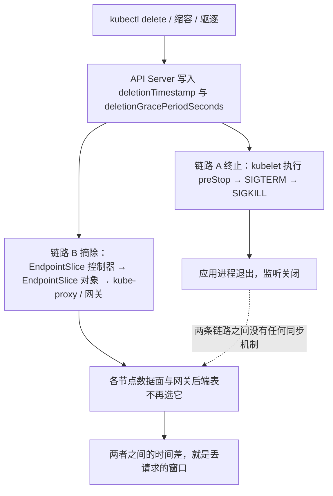
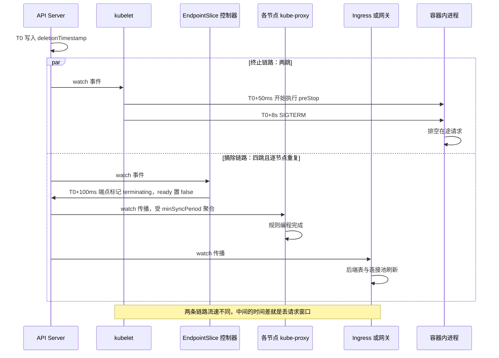
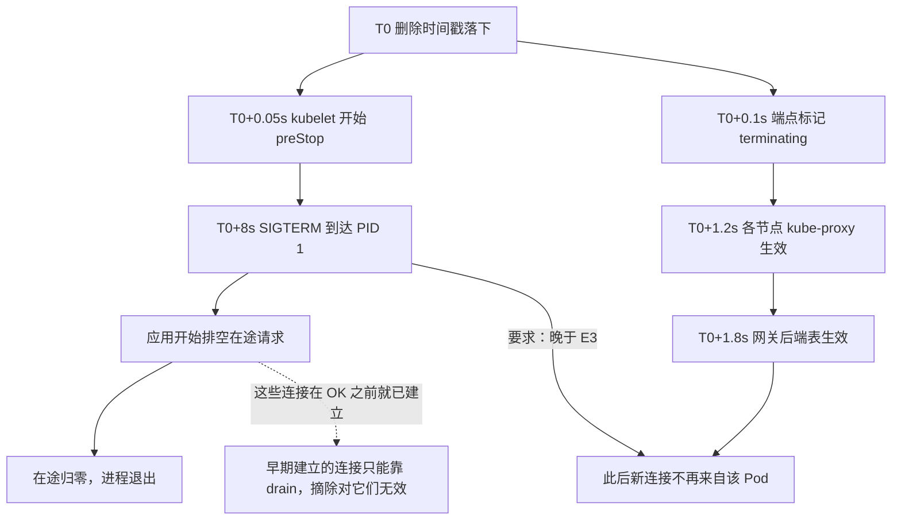
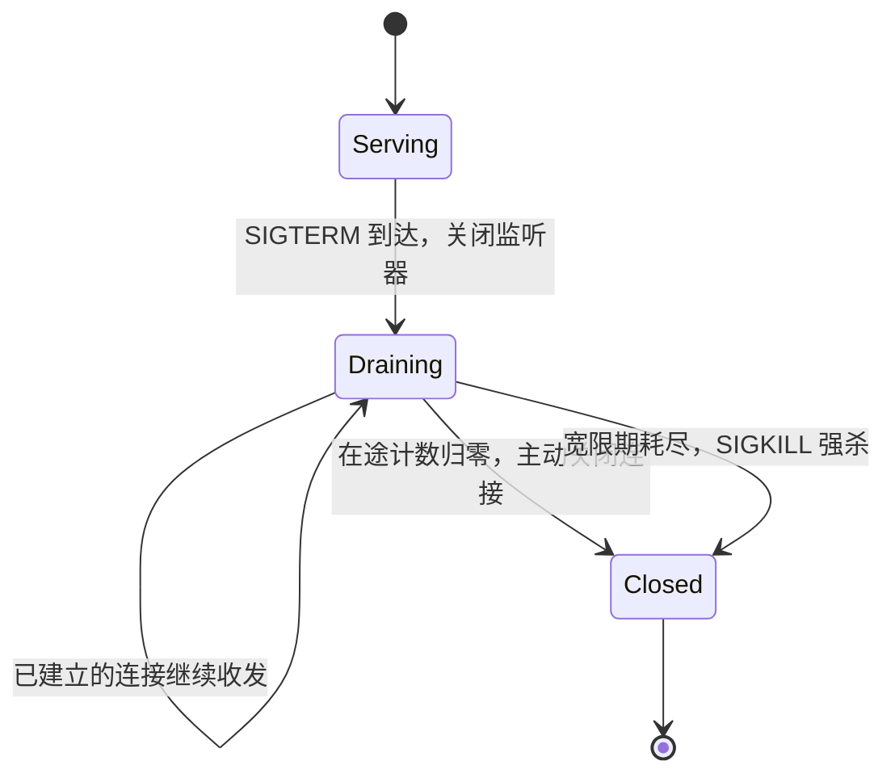
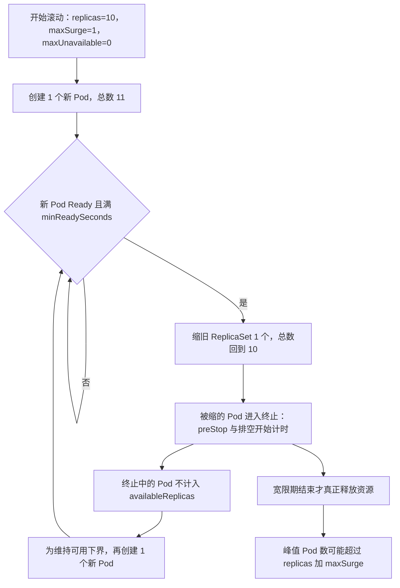
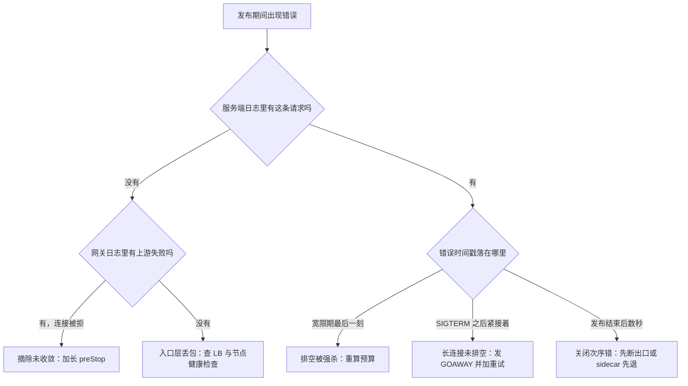

# 04 优雅停机与滚动更新的零停机

**摘要：**

滚动发布期间偶发的那几个 502，是运维日志里最难归因的一类错误：量不大，混在业务日志里，隔一两秒就消失，重放又不复现。它的根因很少是某个字段写错了，而是四个动作在时间轴上没有排好——删除时间戳落下、控制面把 Pod 从 EndpointSlice 里摘掉、kubelet 执行 preStop 与 SIGTERM、应用自己排空手上的请求。四条链路各有独立的传播路径：终止链路只有两跳，摘除链路至少四跳并且要在每个节点上重复一遍，所以「进程已经开始关闭、流量还在进来」不是运气不好的事故，而是结构性的必然。本文按四本账展开：顺序账，即谁先谁后、为什么必然如此；时间账，即 preStop、排空、宽限期三段怎么互相挤占、怎么算出取值；容量账，即 maxSurge 与 maxUnavailable 在「终止中的 Pod 不计入可用副本」之后意味着什么；证据账，即如何用固定到达率的压测证明真的没有丢请求。读完应当能对一个具体工作负载算出 terminationGracePeriodSeconds 与 preStop 的数值，也知道自己的流量走的是哪一条摘除路径、为什么直连 Pod IP 与消息队列消费者的停机语义与 Service 后端完全不同。

---

## 第 1 章 四个动作与一个时钟

先把范围限定清楚：本文所说的停机，指一个正在接流量的进程被要求终止之后、仍可能有请求落到它身上的那段过程；不讨论进程崩溃、节点断电这类没有机会善后的情形。在这个范围内，零停机不是某个开关，也不是某个字段的某个取值，它是四个动作排出的顺序，加上每一段各消耗的时长，恰好没有彼此重叠出错。

次序上略有反直觉：这四个动作由四个不同组件发起，彼此之间没有握手，也没有任何一方会等待另一方完成。把它们并排放在一条时间轴上，就会看到所谓「优雅停机」的全部工程量，都落在「谁比谁晚、晚多少」这一件事上。

### 1.1 三个旋钮各自只管一半

工程实践里最常见的误解，是把零停机当成一个配置项来买。三种典型买法各有各的盲区。

第一种是只配 `terminationGracePeriodSeconds`。这个字段定义的是宽限期上限，也就是 kubelet 最多肯等多久，它本身不产生任何顺序；把上限从 30 秒调到 120 秒，SIGTERM 依然在删除后的几十毫秒内到达进程，摘除却还在路上。

第二种是只配 `preStop` 的 sleep。它确实在终止链路上插入了延迟，能覆盖摘除传播的时间差，但它对已经建立的连接毫无作用——那些连接的 DNAT 决策早就做完了，摘除只影响新连接的选择。

第三种是只配 `maxUnavailable: 0`。这个字段约束的是滚动期间可用副本数的下界，它让旧 Pod 的删除发生在新 Pod 就绪之后，但单个 Pod 被删除时的那套竞态，一个字节都没有改变。

三个旋钮加起来仍然不是零停机：它们只管住三段时间，而四段之间的衔接、以及「谁在数」的问题，得靠另外两本账解决。

### 1.2 四个动作及各自的完成判据

下表把四个动作拆开，重点看第四列与第五列——前两个动作改的只是状态，没有进程会等它们收敛，后两个动作则在宽限期的账上计时。

| 动作 | 发起者 | 完成的判据 | 典型量级 | 有谁在等它 |
| :--- | :--- | :--- | :--- | :--- |
| 落下删除时间戳 | API Server（kubectl、Deployment 控制器缩容、驱逐管理器都可能触发） | `metadata.deletionTimestamp` 非空，`deletionGracePeriodSeconds` 已落盘 | 毫秒 | kubelet 与控制面各自的 watch |
| 从服务后端摘除 | EndpointSlice 控制器写对象，各节点 kube-proxy 与网关各自收敛 | 目标节点上不再产生指向该 Pod 的新连接 | 数百毫秒到数秒，随集群规模放大 | 没有任何进程在等 |
| preStop 与 SIGTERM | kubelet | hook 返回、PID 1 收到信号 | 由 preStop 的写法决定 | 应用的关闭逻辑 |
| 排空在途请求 | 应用自己 | 在途计数归零 | 由业务耗时决定 | kubelet 的宽限期 |

第二行最容易被低估。摘除不是一个动作，而是一次收敛：控制面写下「这个端点要走了」之后，每个节点的规则、每个网关的后端表都要各自跟上，而这中间没有回执，也没有人会告诉你「现在可以关端口了」。

### 1.3 一笔十二秒的账

笔者用一个贯穿全文的案例算一遍。一个 12 副本的订单服务 `order-api`，入口是 ingress-nginx，峰值约 2000 QPS，摊到每个副本约 170 QPS；preStop 配 8 秒，应用侧排空上限 20 秒，宽限期 40 秒。以下时间点全部是**示例推算**，用于说明各段的相对关系，不是实测值。

| 时刻 | 发生的事 | 这一段在买什么 |
| :--- | :--- | :--- |
| T0 | 缩容或发布触发删除，`deletionTimestamp` 落下 | 计时起点 |
| T0+0.05s | kubelet 收到 watch 事件，开始执行 preStop | 终止链路的第一跳 |
| T0+0.10s | EndpointSlice 控制器把该端点标为 terminating | 语义摘除开始 |
| T0+1.2s | 大部分节点的 kube-proxy 完成规则更新 | 数据面摘除开始收敛 |
| T0+1.8s | 网关后端表更新完毕 | 最后一道关 |
| T0+8.0s | preStop 结束，SIGTERM 到达 PID 1 | 用 8 秒覆盖上面 1.7 秒的窗口 |
| T0+13s | 最后一个在途请求处理完，进程退出 | 用 5 秒覆盖已建立的连接 |
| T0+40s | 若进程还没退，SIGKILL | 兜底，不是手段 |

这笔账里最关键的一行是 T0+8s。preStop 之所以写成 8 秒而不是 2 秒，不是因为优雅关闭需要 8 秒，而是因为「摘除完全收敛」最坏可能花到 1.8 秒，还要留几倍余量应对队列积压与网关版本差异。而应用排空的 5 秒，买的是另一批请求：在 T0+1.8s 之前就已经连上来的那些连接。两笔钱不能互相替代，这正是下一章要展开的两个竞态。

下图把四段动作按并发关系摆在一起，可以看出它们唯一的共同点是同一个起点。



---

## 第 2 章 删除请求发出之后

### 2.1 两个字段与一次记账

删除一个 Pod 从来不是立刻删对象。API Server 收到删除请求后，做的是记账：把 `metadata.deletionTimestamp` 写成当前时间，把 `metadata.deletionGracePeriodSeconds` 写成这次删除允许的宽限秒数——默认取 Pod 规格里的 `terminationGracePeriodSeconds`（不写就是 30 秒），`kubectl delete --grace-period=N` 可以覆盖这一次的值。对象进入 terminating 状态，但仍在 etcd 里；顺带说一句，`kubectl get pods` 里那列 `Terminating` 只是客户端推导出来的展示值，此时 `status.phase` 仍然是 `Running` 或 `Pending`，可靠判据只有 `deletionTimestamp` 非空，这一点在 [[02 Pod 生命周期深度解析|Pod 生命周期]] 里已经拆过。

这里有一个常被忽略的细节：**倒计时不是 API Server 在数**。它只是把秒数记录下来，真正的计时由 kubelet 用自己的时钟完成。这意味着节点时钟偏移不会改变「宽限期有多长」这个事实，却会让你事后对齐时间线时误判几秒——排查竞态时，日志里那些差一两秒的疑点，先确认时钟同步，再怀疑机制。

还有两个行为值得记住。其一，若 kubelet 或容器运行时在等待期间重启，集群会从头再走一遍完整的宽限期，不会接着剩下的时间算；这解释了「Pod 卡在 Terminating 上超过 `terminationGracePeriodSeconds`」的多数现场。其二，Pod 对象真正从 etcd 消失，是在宽限期结束、kubelet 以宽限期 0 强制删除之后；在此之前，你在 API 里看到的都是一具还在走流程的对象。

### 2.2 kubelet 侧的终止编排

kubelet 看到删除时间戳之后，按固定次序做六件事，次序本身就是规范的一部分。

1. 停止对该 Pod 的探针。此后 liveness 与 readiness 的结果不再影响任何判定，探针在停机阶段是彻底的旁观者。
2. 如果宽限期不为 0 且容器定义了 preStop，执行 hook。`exec` 型 hook 在容器的命名空间与 cgroup 内运行，消耗记在该容器账上；`httpGet`、`tcpSocket` 与较新的 `sleep` 型由 kubelet 自己执行，不依赖容器内容。
3. 若 hook 在宽限期到点时仍未返回，kubelet 会申请一次性的 2 秒延展。这 2 秒只救 hook 本身，救不了排在后面的应用排空。
4. 通过 CRI 让运行时向容器的 PID 1 发停止信号。containerd 与 CRI-O 的默认是 SIGTERM，镜像里的 `STOPSIGNAL` 可以覆盖；从 1.33 起还有一个 alpha 的 `lifecycle.stopSignal` 字段，允许在 Pod 规格里直接指定停止信号，需要 `spec.os.name` 配合。
5. 宽限期到点仍有进程存活，运行时发 SIGKILL。这一步没有商量余地，也不会因为有 preStop 而顺延。
6. 把 Pod 的 phase 转为 `Failed` 或 `Succeeded`，再以宽限期 0 触发对象删除。

第 2 步与第 5 步之间有一个时间关系需要说清：宽限期的倒计时在 preStop 执行之前就已经开始。所以 preStop 的 8 秒不是「额外赠送的 8 秒」，它是从总预算里先扣掉的 8 秒，剩下的才是应用排空能用的钱。文档里那句「hook 与容器正常停止共享同一个宽限期」说的就是这件事。

原生 sidecar 容器改写了这个次序的一个局部。这个特性在 1.28 引入、1.29 起默认开启、1.33 稳定；一旦 Pod 里有 `restartPolicy: Always` 的 init 容器，kubelet 会等最后一个主容器完全终止之后，才给 sidecar 发 TERM，且 sidecar 按规格中的逆序终止。这样日志采集、代理这类边车可以一直陪跑到主容器结束，不必再用 preStop 手工编排顺序；代价是主容器排空慢会连带推迟 sidecar，宽限期不够时整套容器一起被 SIGKILL。

### 2.3 控制面这一侧：语义摘除与数据面摘除

EndpointSlice 里每个端点带三个条件，从 1.26 起都已是稳定字段：`ready`、`serving`、`terminating`。Pod 一旦有了删除时间戳，端点就被标上 `terminating: true`，同时 `ready` 被强制置为 false——这是为了向后兼容老版本负载均衡器，让它们不去碰正在离开的端点；真正反映「还能不能服务」的是 `serving`，它映射到 Pod 的 Ready 条件。

这里必须分清两层「摘除」。**语义摘除**是控制面把 `ready` 翻成 false，发生在删除后的百毫秒级；**数据面摘除**是每个节点的规则、每个网关的后端表真正不再选它，发生在一到数秒之后。两者之间隔着一个收敛周期，而你的进程既看不到前者，也看不到后者。`kubectl get endpointslice -w` 能看到的只是语义摘除的时刻，这一点在做归因实验时非常容易搞混：地址从 EndpointSlice 里消失，并不意味着流量已经停止。

另有一个开关会彻底跳过这层过滤：`publishNotReadyAddresses: true` 的 Service。它让 DNS 与端点列表保留未就绪地址，常见于 headless Service 配合 StatefulSet 做集群内互相发现。这类服务的「摘除」语义被主动放弃，客户端只能自己处理成员进出。

### 2.4 一条摘除链路要跳四道

把摘除链路展开，会看到四段延迟串行叠加，每一段的量级都受不同因素左右。

| 跳 | 组件 | 延迟来源 | 典型量级 | 放大条件 |
| :--- | :--- | :--- | :--- | :--- |
| 1 | EndpointSlice 控制器 | watch 事件入队、计算新切片、写回 API Server | 数十到数百毫秒 | 端点数量、同步队列积压、API Server 负载 |
| 2 | API Server 到 kube-proxy | watch 事件传播，以及 `minSyncPeriod` 的聚合等待（默认 1 秒） | 0.几秒到 1 秒 | 集群里 Service 与端点规模、kube-proxy 队列深度 |
| 3 | kube-proxy 编程规则 | iptables 或 IPVS 写入内核 | 毫秒到秒级 | 规则条数上万时明显，节点 CPU 吃紧时更慢 |
| 4 | 网关或外部负载均衡器 | 自己的 watch、内部后端表刷新、健康检查周期 | 秒级到十几秒 | LB 健康检查间隔、是否走连接排空 |

第二跳的 1 秒来自 kube-proxy 的聚合设计，不是缺陷。`minSyncPeriod` 的默认值是 1 秒，它把短时间内的多个变更合并成一次规则更新：一个 100 副本的 Deployment 被整体删除时，如果不做聚合，kube-proxy 会做一百次规则更新；聚合之后可能只做五次，每次删二十个端点，总耗时反而更短。代价是单次变更最多要等一个完整周期才被处理。从 1.28 起，iptables 模式改成了增量更新，只针对真正变化的 Service 与端点做最小改动，这也是为什么新版本不建议再把 `minSyncPeriod` 调大。

第三跳之外还有一层与健康检查相关的机制：kube-proxy 暴露的 `healthz` 会在自身编程超时（定义为 2 倍 `syncPeriod`，默认 30 秒意味着 60 秒）时返回 503，节点因此被 LB 摘掉。这属于节点级排水，与 Pod 级摘除是两条独立的路径，混在一起排查，就会得出「端点删了但流量没停」的错觉。四跳里前两跳本质上是同一件事的两次复制——watch 事件先在控制面内传播一次，再在每个节点上传播一次；那套传播机制本身的代价在 [[06 List-Watch 与 Informer：K8s 的分布式神经系统]] 里有完整拆解，本文只关心它给停机时序留下的那几百毫秒。

下图按真实并发关系画出两条链路，注意它们唯一共享的东西是同一个起点。



---

## 第 3 章 第一个竞态：两条链路同时起跑，但里程不同

### 3.1 这不是运气问题，是结构问题

笔者读过的多数资料，把这件事描述成「kubelet 和 Endpoint 控制器并行执行，谁先谁后不确定」，读起来像掷骰子。真实情况比这确定得多：两条链路的跳数不一样长。

终止链路只需要两跳：API Server 到本节点 kubelet 的一次 watch，加一次对 CRI 的调用，链路终点就是那台机器上的进程。摘除链路至少四跳，而且第二跳与第三跳要在每一个可能转发到该 Pod 的节点上各做一遍。控制面写得再快，也追不上一个只在自己机器内完成两次函数调用的路径。

结论可以直接写死：在没有 preStop 的情况下，进程收到 SIGTERM 的时刻，**几乎必然早于**摘除完成。它不需要任何组件故障、任何网络抖动、任何异常负载来触发，健康的集群里照样发生。这也是为什么「我们集群没问题，为什么还有 502」这种辩解在机制上站不住脚。

### 3.2 两个必须分开算的问题

在窗口里丢掉的请求并不是同一类，不妨把它们分两批来看：混在一起想，就会得出「配了 preStop 就不用改应用」或者「应用做了优雅关闭就不需要 preStop」这两种同样有害的结论。

第一个问题是新连接被路由到正在关闭的进程。摘除尚未收敛时，kube-proxy 的规则、网关的后端表都还把它当可用后端；客户端发起的新连接被 DNAT 到它的 IP 上，而它的监听可能已经关了，于是连接被拒——在网关日志里表现为上游连接错误，在客户端表现为 502。这个窗口的长度等于摘除链路四跳之和，只能靠 preStop 在终止链路上插入延迟来覆盖。

第二个问题是已建立的连接不会因为摘除而断开。连接的 DNAT 决策早已完成，conntrack 条目还在，网关到后端的连接池里可能躺着几十条空闲连接，gRPC 客户端可能在一条 HTTP/2 连接上复用了上千个请求。摘除改变的是「以后新建连接选谁」，对存量连接一无所知。这一批只能靠应用主动发信号、主动关闭、并等客户端重连来处理。

所以 preStop 的 sleep 与应用侧排空不是「双保险」，它们对付的是**两批不同的请求**；缺任何一个，另一批就会漏出去。

### 3.3 sleep 到底在买哪一段时间

目标可以写得非常具体：让 preStop 结束的时刻，晚于「最后一个可能把这个 Pod 当后端的数据面完成更新」的时刻。这句话里有两个未知量，都需要从现场测出来，而不是从别人的博客里抄。

测量方法分三步。第一步，在应用日志里打印收到 SIGTERM 的时间戳，这是终止链路到达终点的证据。第二步，开一个 `kubectl get endpointslice -l kubernetes.io/service-name=<名称> -w` 窗口，记录该 Pod 地址消失（或 conditions 变化）的时间。第三步，在网关上打开上游变更的调试日志，记录它把该后端从表里删掉的时刻。三个时间点相减，就得到需要覆盖的窗口；再乘个两三倍的余量，就是 preStop 的最小取值。

经验起点供参考，不能替代测量：节点侧只有 kube-proxy 时 3 到 5 秒足够；链路上有 ingress 或网关时 5 到 10 秒；集群规模上千节点、端点数千时，规则编程的时间会被放大，10 秒以上并不夸张。集群外的负载均衡器要单独算——它的健康检查间隔常常是 10 秒到 30 秒，这段时间靠 preStop 去等，会把宽限期拖到不可接受，正确做法是让 LB 自己支持连接排空，而不是让 Pod 去等 LB。

上界同样要看着。preStop 每多一秒，排水时每个 Pod 的退出都要多等一秒；并行驱逐时排水窗口整体多出这一秒，而 PDB 把驱逐串行化成一次一个时，60 个 Pod 多 10 秒就是十分钟级别的差距。宽限期是公共预算，preStop 拿多了，应用排空就少了。

### 3.4 四种写法与它们各自的坑

同一个「等 8 秒」，有四种实现方式，代价完全不同。

| 实现方式 | 依赖 | 排空能力 | 失败时的表现 | 适用场景 |
| :--- | :--- | :--- | :--- | :--- |
| `exec: ["sleep", "8"]` | 镜像里必须有 sleep（busybox 或 coreutils） | 只买时间，不管连接 | `FailedPreStopHook` 事件，hook 失败即杀容器，缓冲归零 | 通用，镜像可控 |
| `lifecycle.preStop.sleep.seconds` | 1.30 起默认启用，1.32 稳定 | 只买时间，不管连接 | 不依赖镜像内容，几乎不会失败 | distroless、scratch 镜像 |
| `httpGet: /drain` | 应用需实现端点 | 可同时触发排空与阻塞 | 端点返回非 2xx 时 hook 失败，容器被杀 | 应用愿意承担排空逻辑 |
| 应用内延迟 | 无额外配置 | 可同时买时间与排空 | 依赖代码正确，容易漏配 | 单一团队维护的应用 |

第一种写法最常见的翻车点是镜像里根本没有 `sleep`。distroless 或 scratch 基础镜像里没有 shell，没有 coreutils，`exec` 型 hook 直接以 127 退出；kubelet 记一条 `FailedPreStopHook` 事件，而 hook 失败会导致容器被杀——你以为配了 8 秒缓冲，实际一秒都没买到。排查时 `kubectl describe pod` 里的这条事件很容易被当成噪音略过。

原生 `sleep` 动作正是为这个场景加的。它在 1.29 以 alpha 引入，1.30 默认启用，1.32 转为稳定；此后不需要镜像里有任何二进制，直接在 `lifecycle.preStop.sleep.seconds` 写秒数即可，具体支持情况以对应版本文档为准。

还有一条很少被提及的语义：hook 的投递是「至少一次」，kubelet 重启等少数情况下可能重复投递。对 sleep 来说重复无害，但如果 hook 里做的是「通知上游把我下线」这类有副作用的动作，就必须写成幂等的。

### 3.5 把窗口画出来

下图把两条链路并排放在时间轴上，preStop 的位置一目了然：它是一段被插在 SIGTERM 之前的空白，而这段空白的唯一用途，是等待另一条更长的链路走完。



---

## 第 4 章 第二个竞态：长连接不会自己走开

### 4.1 连接的三态与它们各自的命运

面对一次删除，连接可以处在三种状态，命运完全不同。空闲的 keep-alive 连接：客户端或网关的连接池里躺着，随时可能被下一次请求复用，而它指向的 IP 已经不被选路机制覆盖。活跃连接：正在传输请求或响应，删除动作一旦粗暴，它就会被 RST 打断。新建连接：受摘除机制保护，只要摘除收敛，就不会再落到这个 Pod 上。

只有第三种被 Kubernetes 的机制覆盖了。前两种都要应用自己处理，而它们的数量往往比第三种多得多——一个跑了六小时的 HTTP/2 连接上可能承载过几十万个请求。

### 4.2 HTTP keep-alive 的代价

连接复用的默认参数决定了这个问题的规模：譬如 Go 的 `http.Transport` 默认把空闲连接保留 90 秒，nginx 的 `keepalive_timeout` 默认 75 秒，ingress-nginx 还把 `keep-alive` 设为 75、`keep-alive-requests` 设为 1000，意味着一条客户端连接可以承载一千个请求才考虑重建。这些参数合起来的效果是：一个 Pod 从被摘除到它身上最后一条空闲连接消失，中间可能隔着几十秒甚至更久。

Go 标准库的 `Server.Shutdown` 行为值得单独说，因为它经常制造「明明做了优雅关闭还有 RST」的困惑。`Shutdown` 的第一件事是关闭所有监听器，第二件事是立刻关闭所有空闲连接，然后才开始等活跃连接返回空闲。那条被立刻关掉的空闲连接，如果客户端恰好在同一瞬间把新请求写到上面，客户端看到的就是连接被重置——请求其实没有丢，但它需要客户端重试才能成功。这恰好解释了为什么 preStop 的 sleep 要放在 SIGTERM 之前：在窗口期内保证没有新请求进来，`Shutdown` 关空闲连接时就不会撞上在途的写入。

### 4.3 HTTP/2 与 gRPC 的额外一层

HTTP/2 把多路复用推到了极致：一条 TCP 连接上可以并发跑上千个流，客户端只要连上就不再看后端表。这让「摘除」对 gRPC 几乎完全失效——删除完成后，长连接依然活着，流依然在跑，客户端丝毫没有察觉。

正确做法是服务端在关闭前发 GOAWAY 帧，告诉客户端「这条连接不要再开新流了，请换一条」。grpc-go 的 `GracefulStop` 做的就是这件事，但它会一直等到所有流结束，没有内置超时，所以在停机路径上必须自己加时限。客户端侧要配合：收到 GOAWAY 后停止在新连接上发流，把未完成的调用重试到其他连接上。如果客户端把连接钉死在一个 Pod IP 上（直连 Pod、DNS 缓存、自定义 resolver 不重解析），它会一直往同一个地址重连，直到超时。

还有一个与长连接寿命相关的参数思路：让连接定期重建，比让一条连接活到天荒地老更好排空。HTTP/2 的 `MAX_CONNECTION_AGE` 与 gRPC 的 `MaxConnectionAge` 都是这个用途，代价是连接重建的额外开销与冷启动。

### 4.4 应用侧的排空次序

排空的步骤本身不复杂，难的是次序，而次序错了比不做更糟。

1. 收到信号后停止接受新连接，关闭监听器。
2. 通知对端开始走开：HTTP/2 与 gRPC 发 GOAWAY，普通 HTTP 可以返回带 `Connection: close` 的响应或 `503` 加 `Retry-After`，让客户端尽早换目标。
3. 等在途请求结束，设一个明确上限，超时就放弃。
4. 关闭空闲连接，回收连接池。
5. 关闭出口资源：数据库连接池、消息客户端、缓存客户端。
6. 以退出码 0 退出。

第五步必须在第三、四步之后，这是最容易写反的地方。先关数据库连接池再等在途请求，等于让手上正在处理的请求全部撞上「连接已关闭」，错误率会瞬间冲到 100%——比不做优雅关闭还难看，因为不做的话进程被 SIGKILL 打断，至多是部分请求失败，而先关出口会让所有在途请求整齐地失败。

强制等待一个上限也是必要的。长连接可能持续数十分钟，无上限等待的结果是宽限期到点被 SIGKILL，前面做的排空全部作废，而且失败发生在最难解释的时刻。

下面这段 Go 代码把上面的次序落到实现上，注释只解释「为什么这个顺序」。

```go
srv := &http.Server{Addr: ":8080", Handler: mux}
go srv.ListenAndServe()

sig := make(chan os.Signal, 1)
signal.Notify(sig, syscall.SIGTERM, syscall.SIGINT)
<-sig

// 预算要小于 grace 减去 preStop：这里 preStop 8 秒 + grace 40 秒，留 20 秒排水
ctx, cancel := context.WithTimeout(context.Background(), 20*time.Second)
defer cancel()

// 第一步关监听、第二步立刻关空闲连接、第三步等在途返回空闲
// 空闲连接被立刻关闭不会丢请求，但会让客户端看到一次重置，所以 preStop 必须在前
if err := srv.Shutdown(ctx); err != nil {
    log.Printf("排水未在预算内完成，仍有连接未回收: %v", err)
}

// 入口彻底断干净之后才关出口，否则在途请求会撞上已关闭的连接池
db.Close()
```

### 4.5 一张状态图

排空过程可以描述成一台只有三个状态的小状态机，两个出口都通向关闭，区别在于一个是正常收尾，一个是预算耗尽。



两个出口在监控上的表现完全不同：正常收尾的那次发布，错误数为零；预算耗尽的那次，会在宽限期的最后一刻出现一批错误，时间戳整齐得反常——这个特征后面还会用到。

---

## 第 5 章 时间账：预算怎么算

### 5.1 一条不等式与它的三项

宽限期的取值有明确的不等式，难点不在式子，在每一项怎么估。

```
terminationGracePeriodSeconds ≥ preStop + 排空上限 + 余量
```

preStop 那一项来自第 3 章的实测：摘除链路四跳之和的倍数。排空上限那一项来自业务：无状态 HTTP 服务取请求耗时的 p99.9，流式服务取「愿意等一条流结束」的最长时间，消费者取「一批消息处理完加提交」的时间。余量那一项最容易被忽略，它要覆盖 kubelet 与运行时的调度抖动、SIGTERM 到实际执行的延迟、探针判定延迟，以及观测误差，一般给 3 到 5 秒；譬如节点当时正在拉取一个几百 MB 的镜像，kubelet 处理删除事件就可能晚个几百毫秒，这类抖动没有别的预算能吸收。

三项都估完之后还有一个取整习惯：往上取到常见档位（30、45、60、90 秒），而不是写一个精确到个位的数字。宽限期是兜底预算，写得太紧，下次负载稍高就要出事。

### 5.2 三个算例

不同工作负载的账差别很大，同一套参数照抄必然出问题。下表是**示例推算**，用于展示各项数量级。

| 工作负载 | preStop | 排空上限 | 余量 | 建议宽限期 | 说明 |
| :--- | :--- | :--- | :--- | :--- | :--- |
| 无状态 HTTP API | 8 秒 | 10 秒 | 5 秒 | 30 秒 | 默认值就够，前提是探针与排空都正确 |
| gRPC 流式服务 | 10 秒 | 30 秒 | 5 秒 | 45 到 60 秒 | 流的寿命决定上限，GOAWAY 后要等流结束 |
| Kafka 消费者 | 0 到 5 秒 | 60 秒 | 5 秒 | 90 秒 | 无流量入口，摘除无意义，重点是批次处理与提交 |
| 批处理 Job | 0 | 视任务而定 | 5 秒 | 与任务时长匹配 | 没有后端可摘，宽限期只是收尾时间 |

Kafka 那一行值得多说一句：消费者的 preStop 不是为了等摘除（它没有后端），而是为了争取一段「停止拉取但继续处理」的时间。这段逻辑放 preStop 还是放应用的信号处理里，取决于你更愿意把停机知识留在配置里还是代码里。

### 5.3 挤占关系

同样的宽限期，配上不同的 preStop，留给应用的空间可以差出十倍。下表是几种常见组合的结果。

| 宽限期 | preStop | 留给应用的排空时间 | 实际效果 |
| :--- | :--- | :--- | :--- |
| 30 秒 | 5 秒 | 25 秒 | 大多数 HTTP 服务够用 |
| 30 秒 | 25 秒 | 5 秒 | 慢请求被截断，日志里出现大量 context canceled |
| 30 秒 | 35 秒 | 负 5 秒 | preStop 超预算，2 秒延展后强杀，缓冲与排空同时失效 |
| 10 秒 | 8 秒 | 2 秒 | 看起来「配了 preStop」，实际应用只有 2 秒可用 |
| 0 秒 | 任何值 | 0 | preStop 根本不会执行，进程也来不及响应信号，直接进入强制清理 |

倒数第二行是现场最常见的隐性错误：有人为了加快发布速度把宽限期调到 10 秒，又保留了原来的 8 秒 preStop，账面上「优雅停机配置齐全」，实际上应用几乎没有排水时间，错误只会从「发布开头」挪到「发布结尾」。

最后一行要特别强调：宽限期为 0 时 preStop 不会被执行的规则写在文档里，不是实现细节。这意味着所有「配了 preStop 就安全」的假设，在宽限期为 0 的 Pod 上全部不成立。

### 5.4 宽限期的反向代价

把宽限期往大调同样有代价，只是代价出现在别的地方。

节点排水时，每个 Pod 都要等完自己的宽限期才被允许强杀；宽限期从 30 秒调到 90 秒，并行驱逐下排水窗口直接变成三倍，若 PDB 把驱逐串行化，六十个 Pod 的代价还要再乘一遍。排水窗口往往和内核升级、机器维修绑定，超时会直接阻塞变更。滚动发布同理：终止中的 Pod 不计入可用副本（下一章展开），宽限期越长，超出 `replicas + maxSurge` 的 Pod 越多，资源峰值持续得越久。

还有一层更隐蔽的代价：宽限期长会把「排空失败」掩盖起来。应用侧代码有 bug、排空永远超时，如果宽限期足够长，进程最后是被 SIGKILL 打断的，而不是报错退出——错误率可能只有千分之一，不容易被发现，问题就长期挂着。

### 5.5 三个容易踩错的边界

第一，Deployment 缩容与滚动更新删除 Pod 时，用的是 Pod 规格里的宽限期，没有单独的参数可以覆盖某一次操作。`kubectl delete --grace-period` 只对那一次手工删除生效。这意味着「这次发布临时缩短宽限期」这种做法并不存在，除非改规格或者强制删除，而后者更糟。

第二，PodDisruptionBudget 不约束滚动更新。`minAvailable` 与 `maxUnavailable` 只作用于 eviction API 发起的驱逐（典型是 `kubectl drain`），Deployment 控制器缩容走的是直接删除，根本不经过 PDB。把 PDB 当成滚动更新的保护，会在发布时发现它一次都没生效。

第三，`terminationGracePeriodSeconds` 可以设到很小但不建议设到 0。除了 preStop 不执行之外，0 还意味着进程没有任何机会把响应写完，任何正在处理的请求都会被硬切。

---

## 第 6 章 容量账：滚动更新的那一半

### 6.1 可用副本数的定义

前五章讨论的都是单个 Pod 怎么体面地离开，但零停机还有另一半：在旧 Pod 离开的同时，新 Pod 得顶得上。这一半的关键是一个定义——Kubernetes 说的「可用」，指 Pod 处于 Ready 状态并持续满足 `minReadySeconds`，而不是「Pod 存在」或者「容器在跑」。

这个定义有两处必须精确掌握的地方。其一，终止中的 Pod 不计入 `availableReplicas`，也就是一旦删除时间戳落下，它立刻从可用数里消失，但它占用的资源要等宽限期结束才释放。其二，`maxUnavailable` 与 `maxSurge` 的百分比取整方向不同：前者向下取整，后者向上取整，这是为了让约束更保守——可用的下界不能因为取整而被抬高，总数的上界不能因为取整而被压低。两个字段不能同时为 0，否则控制器没有可执行的扩容动作。

### 6.2 组合与它们的下界

以 10 副本为例，把常见的四组参数摊开看，容量与速度的取舍一目了然。

| maxSurge | maxUnavailable | 可用副本下界 | Pod 总数上界 | 发布速度 | 代价 |
| :--- | :--- | :--- | :--- | :--- | :--- |
| 25%（3） | 25%（2） | 8 | 13 | 快 | 发布过程中允许少两个副本 |
| 1 | 0 | 10 | 11 | 最慢 | 峰值资源只多一个副本，容量零波动 |
| 3 | 0 | 10 | 13 | 较快 | 峰值资源多三个副本，容量零波动 |
| 0 | 1 | 9 | 10 | 较慢 | 集群资源不允许超卖时用，发布期间少一个副本 |

`maxUnavailable: 0` 常被当成零停机的同义词，它保证的是「可用副本数不低于期望值」，**必要但不充分**：它不改变单个 Pod 被删除时的摘除竞态，也不保证 readiness 探针说的是真话。真正决定零停机的，是这个下界加上前面几章的时序——两者缺一，错误照旧出现。

### 6.3 发布总时长的算术

滚动更新的推进节奏由「新 Pod 变为可用」驱动，而不是由「旧 Pod 终止完成」驱动；控制器每一步怎么算伸缩、ReplicaSet 的账怎么记，在 [[02 Deployment 控制器深度解析|Deployment 控制器]] 里有完整推导，本章只算这笔节奏对发布时长与资源峰值的影响，下面两个结果都不太符合直觉。

第一个结果关于时长。10 副本、`maxSurge: 1`、`maxUnavailable: 0` 时，一次只能有一个新 Pod 处于创建中，且必须等它可用才继续。若一个新 Pod 从创建到可用需要 30 秒（调度 5 秒、拉镜像 10 秒、启动 5 秒、readiness 探针两个周期 10 秒，`minReadySeconds` 若不为 0 还得另加），整轮发布的下限就是 10 乘 30，即 300 秒上下——这是**示例推算**，实际取决于镜像大小与探针参数。把 surge 提到 3，同样的镜像可能只需要 100 到 130 秒，代价是峰值多三个副本。

第二个结果关于资源峰值。旧 Pod 在删除后进入终止流程，最快也要 preStop 加排空那么久才真正释放资源，而控制器在这段时间里已经继续往下推进了。于是集群里会短暂出现 Pod 总数超过 `replicas + maxSurge` 的情形——文档里对这一点有明确说明：**终止中的 Pod 不算可用**，所以为维持可用下界，控制器会多建 Pod，直到那些终止中的 Pod 的宽限期结束。这正是宽限期不能随便调大的原因之一。

下图把这个推进过程画出来，注意「缩旧」那一节点之后的分叉：控制器的下一步与旧 Pod 的实际释放并不同步。



### 6.4 探针决定这套算术成立与否

上面所有算术都建立在一个前提上：新 Pod 在「可用」的那一刻，确实能处理真实流量。这个前提由 readiness 探针提供，而探针说谎的方式远比想象的多。

最常见的是探针路径与业务路径不一致：`/ready` 只检查进程是否启动，不检查依赖的数据库连接是否可用，于是 Pod 在依赖还没就绪时就被标为可用，接进来一批注定失败的请求。反过来也有一类：探针依赖下游数据库，数据库抖动时所有副本同时 not-ready，端点被批量摘除，一个间歇性故障被放大成整体不可用——这种时候，摘除机制成了放大器。

`minReadySeconds` 是介于两者之间的缓冲，它要求新 Pod 在 Ready 之后继续保持一段时间才算可用，能吃掉「刚就绪就抖动」的一小段窗口。代价是发布总时长按副本数乘以这段观察期增加，把它当万能药调到 60 秒，会让发布慢到无法接受。探针本身的设计与失败模式，在 [[03 健康检查与就绪探针]] 里有完整讨论，这里只强调它和滚动更新的耦合点：可用副本数的每一次变化，背后都是探针在投票。

### 6.5 一个不该被忘记的入口方向

还有一类退化发生在入口一侧：网关或 Service 的端点表正确，也没有可用副本缺口，但因为流量集中，某些节点上的端点被过度使用。这不是停机问题，但症状与停机问题几乎一样——发布期间某个副本的错误率明显高于其他副本，看着像「这个 Pod 有问题」，实际是负载不均放大了摘除窗口的影响。判断方法是看错误是否跟随特定的 Pod 名而不是跟随时间：跟随 Pod 名的，是负载问题；跟随时间窗口（发布开始后的一到两秒）的，才是本节讲的摘除竞态。

---

## 第 7 章 载体账：谁在摘除，谁根本不摘除

前面所有推导都隐含一个前提：流量从 Service 后端进来，摘除链路对它是有效的。现实里这个前提经常不成立，而一旦不成立，preStop 与宽限期就只能救到一部分问题。下表把六种常见载体摊开。

| 载体 | 有没有摘除动作 | 延迟主要来自 | 应用必须自己做的事 |
| :--- | :--- | :--- | :--- |
| Service ClusterIP | 有 | EndpointSlice 更新与各节点规则收敛 | 排空在途请求 |
| NodePort 或 LB（`externalTrafficPolicy: Cluster`） | 有，且多一层节点健康检查 | LB 健康检查周期与节点 kube-proxy 编程 | 排空，必要时配合节点排水 |
| NodePort 或 LB（`externalTrafficPolicy: Local`） | 有，但终止中的端点仍可能收流量 | 规则收敛加 LB 摘节点的时间差 | 排空，且要接受「被强行塞流量」 |
| Ingress 或网关 | 有，多一跳后端表 | 网关 watch、后端表刷新、上游连接池 | 排空加主动发关闭信号 |
| 直连 Pod IP（headless、客户端缓存、网格直连） | 基本没有 | DNS TTL 与客户端缓存，通常远超宽限期 | 主动通知与客户端重试 |
| 消息队列消费者 | 没有 | 不适用 | 停止拉取、处理在途、提交位点 |

### 7.1 Service 后端：标准路径

这是前面五章描述的那条路径，kube-proxy 的 iptables 或 IPVS 模式在规则层做 DNAT，端点更新通过 watch 传播到每个节点；规则怎么写、几种数据面模式各自付什么代价，在 [[05 Service 与 kube-proxy 原理]] 与 [[14 Service 与 kube-proxy：iptables IPVS eBPF 数据面演进]] 里都有展开，本章只取它对终止时序的那一段影响。两种流量策略的区别值得单独提：`Cluster` 策略下外部流量可以先落在任意节点再转给 Pod，节点级健康检查决定这个节点是否留在 LB 后端池；`Local` 策略下节点只转发给自己节点上的 Pod，节点没有本地端点时直接丢弃。

`Local` 策略有一个与本章主题直接相关的行为，从 1.28 起稳定：当某节点上的本地端点全部处于终止状态时，kube-proxy 会继续把流量转给这些终止中的端点，而不是直接丢包。这个设计的理由是外部 LB 摘除节点存在延迟——滚动更新时某台机器上的副本数可能从 N 瞬间掉到 0，而 LB 还没做完健康检查，这段时间里如果直接丢包，错误会呈现为整台机器级别的突刺。这条规则恰好从反面证明了本文的论点：连控制面自己都不敢假设「摘除是瞬时的」，只能用「继续转发」来兜住时间差。

### 7.2 Ingress 与网关：多一跳，多一层连接池

网关比 kube-proxy 多一层自己的状态：它不只是转发，还要维护上游连接池、做负载均衡决策、在配置变化时刷新后端表。这带来两个额外的时间来源。

第一个是后端表刷新，它依赖网关自己的 watch 与内部同步，通常很快，但和 kube-proxy 一样有聚合与批处理，量级在秒以内。第二个是连接池，这一层常被完全忽略：网关到后端的长连接池里躺着的连接，不会因为后端被摘掉就断开；ingress-nginx 的 `keep-alive` 默认 75 秒、`keep-alive-requests` 默认 1000，意味着一条上游连接可以稳定服务很久。更麻烦的是 reload 场景：`worker-shutdown-timeout` 的默认值是 240 秒，旧 worker 可以在这段时间内继续服务手里已有的连接。这些机制都是性能优化，但它们共同保证了「摘除之后，存量连接还在跑」。

因此网关链路上的排空必须由应用侧推动：应用主动发 GOAWAY 或关闭连接，网关的连接池才会把那条连接标记失效。指望网关在几百毫秒内把所有指向被删 Pod 的连接收回，是把性能优化的代价错记在正确性账上。

### 7.3 直连 Pod IP：摘除机制完全不适用

有一类流量根本不经过 Service 的负载均衡，摘除链路对它一点作用都没有。

headless Service 配合 StatefulSet 是最典型的例子：客户端通过 DNS 查到 Pod IP 列表，自己决定连谁。DNS 记录只在端点变化时更新，而客户端通常还有自己的缓存与 TTL，所以「新连接不再指向被删 Pod」这件事，在这条路径上要等客户端主动重解析才成立，时间常数由客户端决定，可能是几十秒，也可能是几小时。如果这个 headless Service 还打开了 `publishNotReadyAddresses`，连就绪过滤都没有，终止中的 Pod 会一直留在解析结果里。

gRPC 直连加客户端负载均衡是另一个重灾区：resolver 解析一次、建立 subconn 后长期不重解析，摘除对它是无声的。服务网格的 sidecar 稍微好一点，它有自己的端点表，但它同样维护到上游的长连接，且它的收敛与 kube-proxy 是两个独立的循环，两者的时间差会叠加。

这类载体的正确处理方式只有一条：不要依赖摘除，主动通知。注册中心里主动下线、HTTP/2 发 GOAWAY、DNS 缩短 TTL、客户端实现重试与连接轮换——这些手段都比调宽限期有效，因为宽限期只是给进程留时间，改变不了客户端还往这里发请求的事实。

### 7.4 消息队列消费者：没有流量入口的停机

消费者是最容易被误用同一套参数的工作负载。它没有 Service 后端，没有端点可摘，preStop 的 sleep 在这里买不到任何东西——流量不是被推送过来的，是它自己主动去拉的。

它的停机语义要换成另一套：停止拉取新消息、处理完手上这批、提交位点、关闭连接、退出。这五步的失败方式与前面完全不同，而且损失的是数据一致性，不是请求成功率。

Kafka 的场景要盯住两个时间。一是处理一批消息的时长，它必须小于 `max.poll.interval.ms`（默认 300000 毫秒），超过就会触发 rebalance，这个消费者被踢出组，整批消息重新分配给别的消费者。二是关闭时的组退出：主动 `close()` 会让消费者立即离开消费组并触发 rebalance，比等 session 超时快得多；不主动关闭，其他消费者要等 `session.timeout.ms`（默认 45000 毫秒）才发现它走了，这段时间整个分区停滞。位点提交必须在处理完成之后、连接关闭之前完成，方向搞反的两种错法后果不同：不提交会**重复消费**，提前提交会**丢消息**。

RabbitMQ 的机制不同但结论类似：消费者取消后，那些已经投递但未 ack 的消息会在连接断开时重新入队，`prefetch` 设得越大，停机时被重投的消息越多。顺序敏感的消费者还要考虑重投打乱顺序的问题，这通常得靠分区独占或幂等消费来兜。

### 7.5 批处理与定时任务

Job 与 CronJob 没有后端可摘，也没有对端会感知到它下线，宽限期只是「收尾时间」——把中间结果落盘、把 checkpoint 写下去、把锁释放掉。它们的正确性靠的是幂等与可重入，而不是停机的时序。把宽限期调到很长来「保证任务跑完」，是把调度问题误当成停机问题：任务跑不完应该拆小，而不是让节点排水时干等。

---

## 第 8 章 证据账：怎么证明没丢请求

### 8.1 三个观测面与各自的盲区

配置看着都对，不代表真的零停机。判断有没有丢请求，需要同时看三个观测面，因为每一个都有结构性盲区。

| 观测面 | 能看到什么 | 结构盲区 |
| :--- | :--- | :--- |
| 客户端或压测器 | 连接错误、超时、重试次数、成功响应数 | 自动重试会把失败掩盖成延迟 |
| 网关访问日志 | 上游 5xx、上游连接被拒、上游耗时分布 | 从未到达网关的请求（入口层丢的） |
| 服务端指标与日志 | 已到达请求的处理结果与耗时 | 根本没到达的请求，这是最关键的盲区 |

最大的坑在第三行：服务端的错误率永远是「已到达请求」中的比例。当摘除还没收敛、新连接打到一个已经关闭监听器的 Pod 上时，这些请求根本没有进入任何业务进程，服务端指标一条都不会记——你在服务端看到的是**零错误**，而用户看到的是 502。只统计服务端指标来证明零停机，逻辑上就不可能成立。

### 8.2 用固定到达率压测

验证的正确姿势是控制到达率，而不是控制并发数。固定并发是闭环驱动：每个虚拟用户收到响应才发下一个请求，一次被拒的连接会消耗掉这段时间，总请求数因此变少；压测器手里没有「应该发多少」的基准，只能算「已发出的里面错多少」，分母自己会缩，错误占比于是被稀释。很多压测器还默认带重试，失败更是直接被抹平成延迟。问题就这样从「丢请求」被改写成「性能抖动」。

固定 QPS 的压测则不同：请求按固定速率发出，任何一次「被路由到已关闭进程」都会留下一个明确的失败计数。具体做法是：稳态压测若干分钟，期间触发若干次滚动发布，统计失败数与总请求数。

判定标准可以写成一个式子：

```
失败率 = 客户端失败数 / 总请求数
```

要求通常设在百万分之一以下。这个数量级不是苛刻，而是由窗口长度决定的：一次删除的丢请求窗口在 1 到 2 秒量级，2000 QPS 下最坏有两三千个请求落在窗口里，一次发布只要没兜住，失败率立刻就是千分之一级别——远高于百万分之一。所以「偶尔出现几个 502」这件事，在数字上暴露得比在直觉上明显得多。

**示例推算**：2000 QPS、每次发布 300 秒、连续发布 20 次，总请求数为 1200 万；若每次发布丢 3 个请求，总失败 60 个，失败率约百万分之五——已经超过百万分之一的门槛，说明这个配置没有真正兜住窗口，只是窗口很窄。

发布次数为什么要 20 次以上？因为窗口只有一到两秒，单次发布有相当概率恰好没踩中，尤其当流量没有命中那个正在退出的副本时。二十次是一个能在统计上稳定暴露问题的量级，实践中如果二十次都零错误，基本可以认为配置有效。

### 8.3 把三个时间点对齐

压测发现失败之后，归因需要把三个时间点对齐：应用日志里的 SIGTERM 时间戳、EndpointSlice 里该地址 conditions 变化的时刻、网关日志里上游变更的时刻。

```bash
# 盯住端点状态变化，注意这是语义摘除的时刻，不是数据面生效的时刻
kubectl get endpointslice -l kubernetes.io/service-name=order-api -w

# 应用侧打印收到信号的时间，drain 的开始与结束都要留痕
kubectl logs -f deploy/order-api | grep -E 'SIGTERM|drain_start|drain_done'

# 在节点上看还有没有到该进程的连接（进程退出后这些连接即失效）
ss -tanp 'dport = :8080'
```

三个时间点摆在一起，结论只有三种。SIGTERM 早于语义摘除：终止链路跑得比控制面快，属正常，靠 preStop 覆盖。语义摘除早于 SIGTERM 但数据面收敛晚于 SIGTERM：说明 kube-proxy 或网关那一跳慢，需要加长 preStop，或者检查 `minSyncPeriod`、网关的后端表刷新是否被配置改坏了。SIGTERM 之后仍有新建连接持续了几秒：说明客户端或网关在缓存地址，问题不在 Kubernetes 这一侧，去查 resolver、DNS TTL 与连接池。

### 8.4 症状与判据

失败的模样往往比日志更能说明根因。下表把常见症状与判据对应起来，其中「服务端有无记录」是最有区分度的一列。

| 症状 | 判据 | 根因 | 处置方向 |
| :--- | :--- | :--- | :--- |
| 网关 502，上游连接被拒 | 服务端日志无该请求 | 摘除未收敛，新连接打到已关闭的监听器 | 加长 preStop，或改为原生 sleep 动作 |
| 客户端 connection reset | 服务端有处理记录 | 宽限期到点 SIGKILL，或关闭了仍有请求的连接 | 加长宽限期，缩短排空上限 |
| 客户端 UNAVAILABLE 或 transport is closing | 服务端有 GOAWAY 日志，客户端未重试 | 长连接未排空，客户端不支持重连 | 应用发 GOAWAY 并给足时间，客户端加重试 |
| 错误集中在宽限期最后一刻 | 错误时间戳与宽限期结束时刻对齐 | 排空没做完就被强杀 | 重算预算，把排空上限压到预算内 |
| 请求总数少于期望，服务端与网关都无记录 | 只有负载生成器看到失败 | SYN 在 LB 或节点层被丢弃 | 查 LB 的连接排空设置与节点健康检查 |
| 发布结束后数秒出现错误 | 错误晚于 SIGTERM | 出口先断（数据库、缓存先关）或 sidecar 先退 | 调整关闭次序，用原生 sidecar |
| 消息重复而非请求失败 | 位点未提交 | 停机时未 commit | 停拉取、处理完在途、再提交 |

下图把这套判据画成决策树，起点固定是「发布期间出现错误」，第一刀切在「服务端有没有记录」上。



---

## 第 9 章 反例

配置清单容易抄，抄错的后果却各不相同。下面六种是现场反复出现的失配，每一种都能在文档里找到对应的机制解释。

### 9.1 只配宽限期，不配 preStop

宽限期决定「最多等多久」，preStop 决定「等之前先做什么」。只配前者，SIGTERM 在删除后几十毫秒就到了进程，而摘除还在路上，那段窗口里的新连接全部打空。宽限期在这里完全帮不上忙，因为它约束的是「进程退出」这一侧，不是「流量停止进来」那一侧。这个配置组合的危险之处在于它看起来很像做对了：字段名里有 grace，值也不小，评审时很容易放过。

### 9.2 preStop 里 sleep，应用却先退出了

更隐蔽的一种。preStop 确实跑了 8 秒，但应用的关闭逻辑并不在 SIGTERM 里，而是挂在别的路径上：entrypoint 脚本先 kill 了应用进程再等 sleep；健康检查在删除瞬间失败，触发了一次「自愈」；preStop 用 httpGet 通知应用，应用收到通知后直接退出，把剩下的 sleep 时间浪费在一个已经死掉的进程上。这时 preStop 变成给空容器计时，窗口一点没兜住，而所有配置看上去都是对的。判断方法是看日志时序：SIGTERM 之前有没有进程退出记录，进程退出时刻是不是明显早于 preStop 结束。

### 9.3 消费者的位点处理写错

停机路径上最容易写错的两个方向都在消费者侧。收到 SIGTERM 就立即退出，在途消息没处理完也没提交，broker 在会话超时后重投，结果是一批重复消息——而且因为消费者已经换了新 Pod，重复会出现在另一个实例上，追查时更难对上。另一个方向是处理完立刻提交，但在提交之后还有一段异步落库没完成，进程被杀时位点是新的、数据是旧的，结果是丢消息。两者的修法相同：把「停止拉取」与「处理完在途」分开，提交放在两者之后。

### 9.4 宽限期设成 0，或者强制删除

`terminationGracePeriodSeconds: 0` 的语义是「不给时间」：preStop 不会执行，进程也来不及对停止信号做任何处理，容器直接进入强制清理。任何基于 preStop 的缓冲、任何基于信号处理的排空，在这个取值下全部不存在。`kubectl delete --grace-period=0 --force` 更极端：对象立即从 API 消失，kubelet 只能在自己的节奏里清理本地进程，而 StatefulSet 这类工作负载可能立刻用同名重建，新进程与旧进程争抢同一块卷——这类事故的现场通常表现为文件损坏，而不是请求失败。

### 9.5 readiness 探针永远返回 200

这条反例的破坏力覆盖前面所有章节。探针不区分「进程活着」与「能处理真实流量」，新 Pod 一启动就被标为可用，滚动更新把流量切过去，请求撞上还没初始化完的应用；同时旧 Pod 的摘除照样发生，两个方向同时漏。这时调 preStop、调宽限期、调 maxUnavailable 都不会有效果，因为问题的位置在「可用的定义」上，不在时序上。修正方法是让探针的判据尽量接近「能不能正确返回一个业务响应」，并用 `minReadySeconds` 兜住刚就绪的那一小段。

### 9.6 配了 sleep，镜像里没有 sleep

前面提过，值得再单独列一次，因为它属于「配置完全正确但对象不存在」的类别。distroless、scratch、以及很多精简过的运行时镜像里没有 `sleep` 二进制，`exec` 型 preStop 以 127 退出；kubelet 记一条 `FailedPreStopHook` 事件，hook 失败后容器直接进入终止，缓冲归零。这类事故排查时的特征是：YAML 与别人的最佳实践一模一样，但事件列表里有一条从不被注意的 Warning。换用原生 `sleep` 动作，或者干脆用 `httpGet`，都可以绕开镜像内容的依赖。

---

## 第 10 章 结语

把全文收束到一句话：零停机是四个动作在时间轴上排出的顺序，加上四段时间的算术，任何一个旋钮单独调到最大都不够。

顺序上有三条不能颠倒的约束。摘除要先于关闭监听，而摘除是异步收敛的，因此终止链路上必须插入一段缓冲，这段缓冲就是 preStop 的 sleep。**关闭入口要先于关闭出口**，否则在途请求会整齐地撞上已关闭的资源。通知对端要先于等待排空，否则长连接会一直安静地待在网关的连接池里，直到宽限期把它们一起带走。

时长上有三个必须算清的项。preStop 覆盖的是摘除链路的收敛窗口，取值来自实测而不是经验；排空上限覆盖的是已建立连接的生命周期，取值来自业务的 p99.9 与流的寿命；宽限期是这两项的和再加余量，它是一个总预算，任何一项超支都由最后一刻的 SIGKILL 来结算。容量那一半靠 `maxUnavailable`、`maxSurge` 与探针三者配合，其中探针决定这套算术是否成立。

最后要承认边界。这套推导只适用于「流量从服务后端进来」的情形；直连 Pod IP 的工作负载没有摘除可用，只能靠主动通知与客户端重试；消息队列消费者根本没有流量入口，它的停机语义是停拉取、处理完在途、提交位点，与请求成功率无关。同一个 `terminationGracePeriodSeconds` 在不同载体上含义不同，把它当成一个可以跨工作负载复制的数字，是这类问题最常见的起点。

---

## 参考资料

1. Kubernetes Documentation - Termination of Pods：https://kubernetes.io/docs/concepts/workloads/pods/pod-termination/
2. Kubernetes Documentation - Container Lifecycle Hooks：https://kubernetes.io/docs/concepts/containers/container-lifecycle-hooks/
3. Kubernetes Documentation - EndpointSlices（serving、terminating、ready 三个条件）：https://kubernetes.io/docs/concepts/services-networking/endpoint-slices/
4. Kubernetes Tutorial - Explore Termination Behavior for Pods And Their Endpoints：https://kubernetes.io/docs/tutorials/services/pods-and-endpoint-termination-flow/
5. Kubernetes Documentation - Deployments（maxSurge、maxUnavailable 与 availableReplicas）：https://kubernetes.io/docs/concepts/workloads/controllers/deployment/
6. Kubernetes Documentation - Virtual IPs and Service Proxies（kube-proxy 的 minSyncPeriod、syncPeriod 与 terminating endpoints）：https://kubernetes.io/docs/reference/networking/virtual-ips/
7. Kubernetes Documentation - Sidecar Containers：https://kubernetes.io/docs/concepts/workloads/pods/sidecar-containers/
8. Kubernetes API Reference - kube-proxy Configuration（v1alpha1）：https://kubernetes.io/docs/reference/config-api/kube-proxy-config.v1alpha1/
9. ingress-nginx Documentation - ConfigMap（keep-alive、keep-alive-requests、worker-shutdown-timeout）：https://kubernetes.github.io/ingress-nginx/user-guide/nginx-configuration/configmap/
10. Go Package Documentation - net/http Server.Shutdown：https://pkg.go.dev/net/http#Server.Shutdown
11. gRPC Go Documentation - Server.GracefulStop：https://pkg.go.dev/google.golang.org/grpc#Server.GracefulStop

---

> [!note] 思考题
> 1. 如果 preStop 的 sleep 与应用的排空逻辑都写对了，宽限期也足够，但失败仍然出现在「宽限期最后一刻」，你会先怀疑哪一段预算算错了？
> 2. 一个 gRPC 服务把连接钉死在自己的 Pod IP 上，不经过 Service。此时把 preStop 从 5 秒调到 30 秒，能改善零停机吗，为什么？
> 3. Kafka 消费者的批次处理时长接近 `max.poll.interval.ms`，停机时应该先缩短批次还是先加长宽限期，两者的副作用分别是什么？
> 4. `maxUnavailable: 0` 配上 `maxSurge: 1` 与配上 `maxSurge: 3`，在零停机能力上有区别吗？如果没有，那这个选择实际在权衡什么？
> 5. 用固定并发而不是固定 QPS 做发布压测，会怎样掩盖丢请求的问题？请构造一个能说明这种掩盖的具体数字例子。