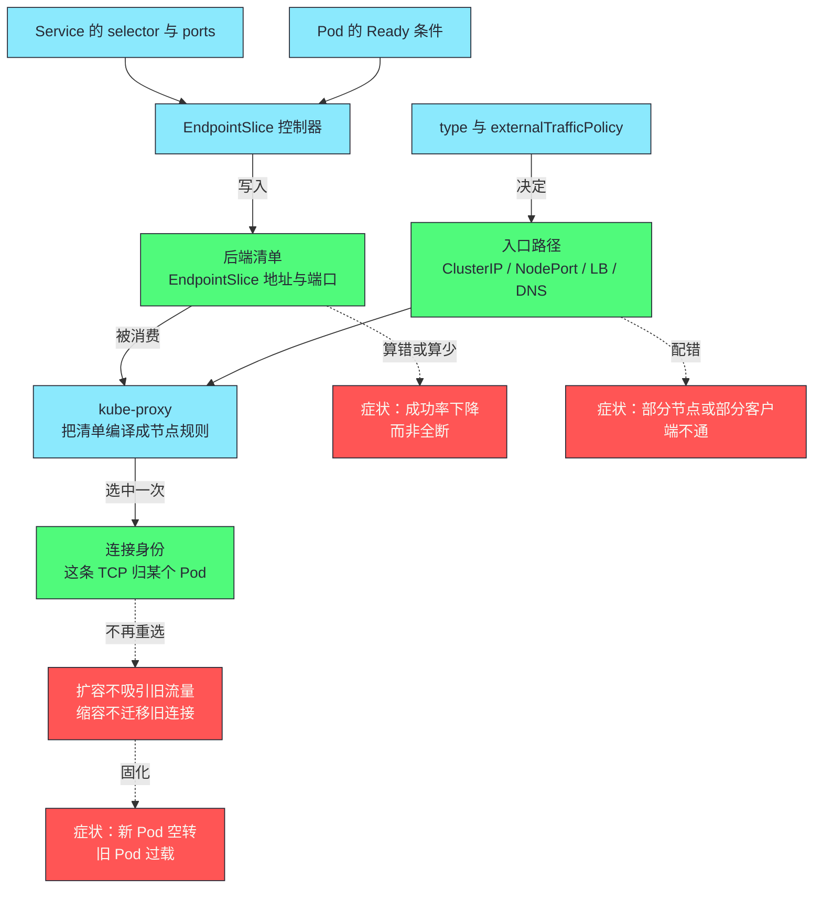
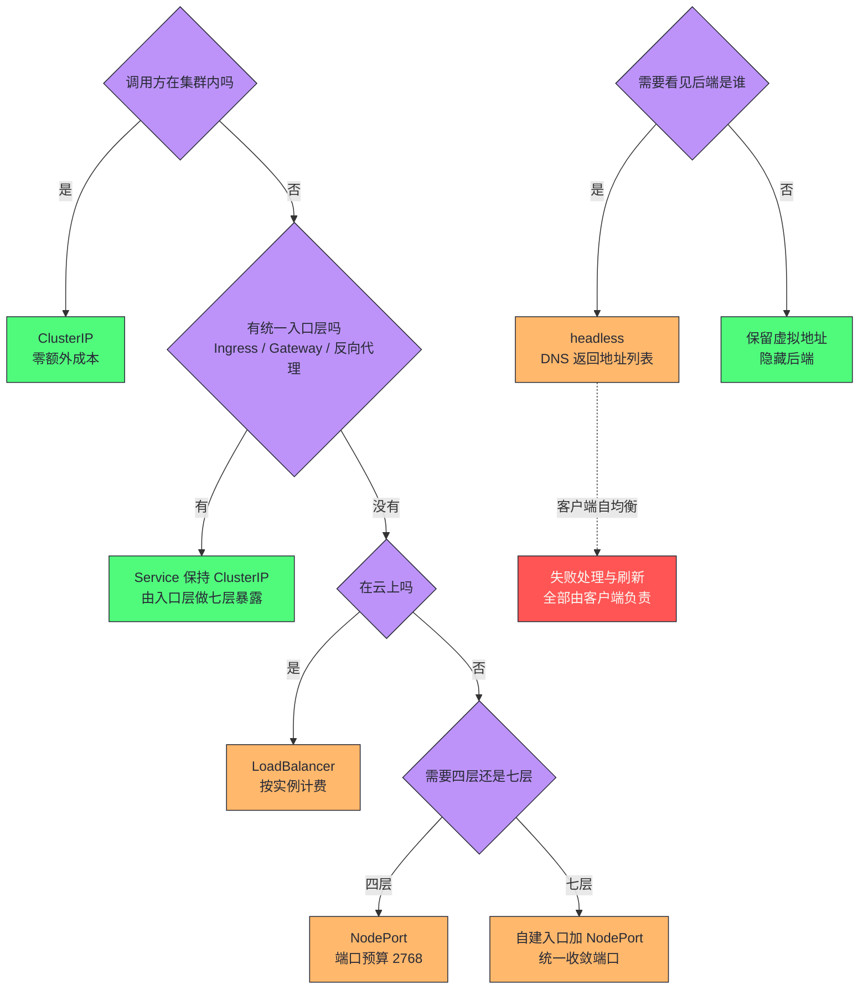
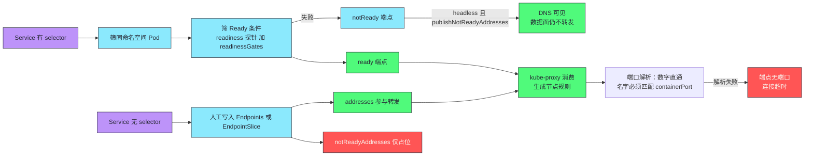
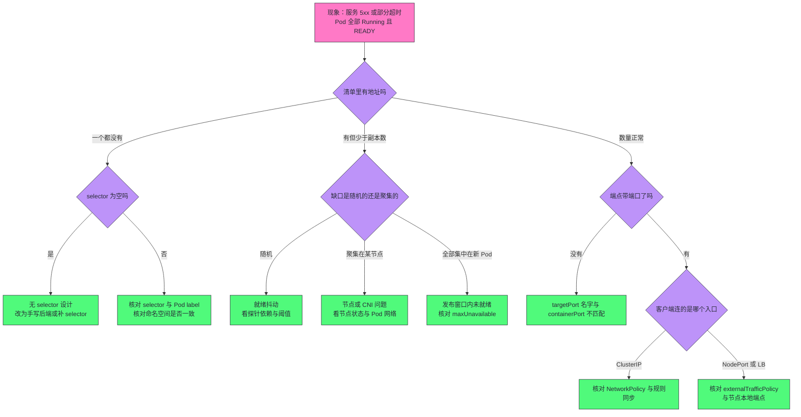
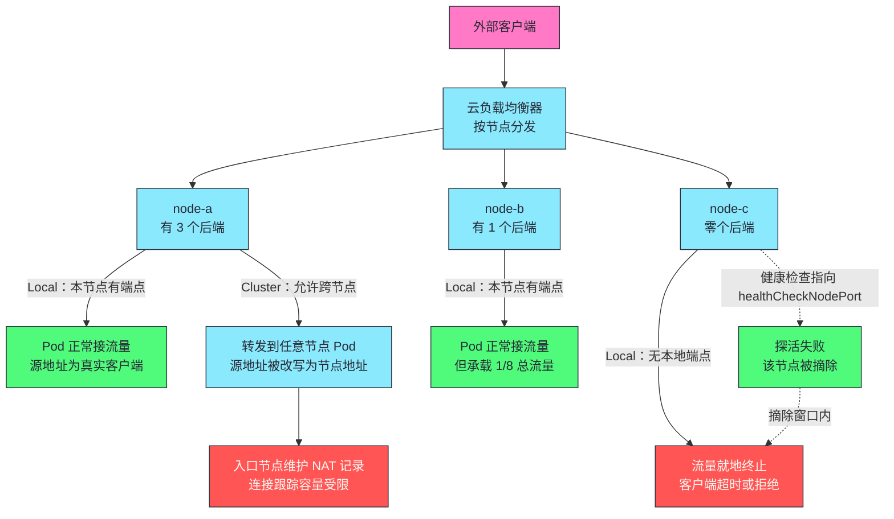

# 05 Service 与 kube-proxy 原理

**摘要：**

Service 的机制部分——规则怎么生成、包在哪一层被改写、conntrack 怎么还原回程——在架构深度剖析专栏里已经拆得很细，本文不再重复。值班时真正难住的，几乎都不是数据面原理，而是三份互相独立的事实对不上：后端清单里到底有谁、流量从哪个入口进来、一条连接被钉在哪个 Pod 上。这三份事实由不同组件写入、以不同节奏刷新，任何一份出错，症状都是同一句「服务不通」，判据却完全不同。本文按运维视角重写这个题目：四种类型与 headless 各自解决什么问题、标价多少，用什么规模与场景作为选择依据；endpoints 的三条来源以及「Pod 全健康而服务 5xx」最常见的成因；`externalTrafficPolicy` 在 Local 与 Cluster 两侧分别会怎样失败；会话保持与连接超时叠加出来的 502；headless 把负载均衡推给客户端之后留下的坑；跨命名空间的可见性边界。文末给出一张把 `curl` 不通拆到六种成因的判据表、一套按顺序执行的排查路径，以及四条在集群里反复出现的反例。全程用一个十二副本的 `order-api` 与两千 Pod 规模的中等集群贯穿，避免结论悬空。

---

## 第 1 章 三份事实：Pod 全健康而接口在报错

周四下午三点，网关侧的 5xx 比例从 0.1% 抬到 12%，持续六分钟后自行回落。值班的人先看最显眼的那一列：`kubectl get pods -l app=order-api` 十二个 Pod 的 STATUS 清一色 `Running`，重启次数全为 0，节点 CPU 与内存平稳；但 READY 列里有九个停在 `1/2`。`kubectl describe svc order-svc` 的 Endpoints 一行，只安静地躺着三个地址。

三个地址，对应十二个副本。STATUS 没坏、容器没退、进程也没反复重启，但能用的后端只剩四分之一；那 12% 的错误率，只是三个老 Pod 扛不住全部流量之后从缝里漏出来的一部分。这一刻最容易犯的误判，是把 STATUS 列当成健康结论——它只说明容器已被创建，而服务可用是一串独立的事实碰巧同时成立。

笔者把 Service 的可用性拆成三份事实，它们由不同组件写入，刷新频率与失效方式都不一样。

第一份是**后端清单**。`order-svc` 的后端不是 Pod 本身，而是 EndpointSlice 对象里的一串地址，由 EndpointSlice 控制器根据 selector 与就绪状态算出。Pod 健康只说明它够格进入候选，不代表它已经在清单里，更不代表清单已经被所有节点消费。第二份是**入口路径**，由 `type` 与 `externalTrafficPolicy` 决定：流量从集群内的虚拟地址进来、从每台节点的固定端口进来、还是从云厂商的外部地址进来，决定了它要经过多少跳、源地址会被改成谁、以及哪些节点根本接不了这个流量。第三份是**连接身份**，在数据面选中某个后端的那一瞬间定下来，此后一条 TCP 连接的所有请求都归那一个 Pod，清单再怎么变也不会把已有连接挪走。

这三份事实的失效形态，恰好长得完全不像。清单少了几个地址，表现为成功率下降而不是全断；入口配错，表现为「一部分人能连、一部分人连不上」；连接身份固化，表现为「扩容之后新 Pod 一点流量都没有」。而三者在监控上都会冒成同一种红：错误率。这就是 Service 排障真正难的地方——不是原理难，是症状的区分度太低。

下图把三份事实的写入者与它们各自会漏掉的东西放在一起。

规则怎么从清单编译出来、包在哪一层被改写、回程如何靠 conntrack 还原，这些机制细节属于数据面自身的课题，笔者在这里只留一句指路，不再展开：[[云原生/Kubernetes/Kubernetes架构深度剖析/14 Service 与 kube-proxy：iptables IPVS eBPF 数据面演进|架构深度剖析第 14 篇]] 把 iptables、IPVS 与 eBPF 三代数据面的同步过程与改写时序讲透了，本篇关心的是另一头——当这三份事实中的任何一份不成立时，运维要按什么顺序去看，才不至于在错误的层次上找答案。

本章开头那次故障的根因，后来查明是 `order-api` 的 readiness 探针路径被一次发布改错了：容器完全正常，只是探针在 `/healthz` 上拿到 404，于是九个新 Pod 永远进不了清单。滚动发布卡在中间，全部流量压在那三个还没被替换的老 Pod 上。整个过程没有异常日志，因为 Pod 没崩、容器没退，唯一的变化是清单从十二个地址缩到三个。错误率的量级也就能解释了：三个 Pod 扛全部流量，先是排队变长，随后出现超时，5xx 只占 12% 是因为它们仍在正常工作，只是处理不完。六分钟后发布被回滚，清单回升，错误率随之回落。

---

## 第 2 章 四种类型与 headless 的使用判据

`type` 字段经常被当成四种截然不同的机制来讲，实际不是。它能决定的只有一件事——入口地址是什么、谁来把流量送到这个入口；至于流量到了节点之后如何被转发、怎么选后端、源地址会被改成谁，四种类型共享同一套数据面。ExternalName 是唯一的例外，它根本不进数据面，只在 DNS 层返回一条 CNAME。日常选型要回答的问题因此只有两个：这个服务该从哪扇门进来，以及这扇门的维护成本由谁承担。

### 2.1 ClusterIP：默认值意味着零决策成本

不写 `type` 就是 ClusterIP，这是绝大多数服务该停留的位置。它解决的是集群内部的稳定寻址：Pod IP 会随重建、滚动发布、节点故障重调度而变化，客户端不可能跟着改配置，于是给一组 Pod 一个十年不变的虚拟地址与一个 DNS 名称，客户端只跟这个名字打交道。

判据很干脆：调用方在集群内，且不需要知道后端是谁，就用 ClusterIP。它的代价不在性能，而在边界。地址段由 kube-apiserver 的 `--service-cluster-ip-range` 划定，若与公司内网、VPN、容器网段重叠，会出现「本地能通、拨了 VPN 反而不通」这种反常，因为路由表把虚拟地址当内网主机解析。集群规划时把三个网段放在一张表里核对一遍，比事后排查便宜得多。

还有一处常被忽略：ClusterIP 只是**寻址**方案，不承担任何健康检查之外的流量管理能力。它不做重试、不做超时、不做熔断，也不感知应用层的错误——这些能力要么在客户端实现，要么交给七层代理。把它当成「服务治理设施」来用，是后面一连串误解的起点。

### 2.2 NodePort：端口是一种稀缺资源

NodePort 在 ClusterIP 之上，给每台节点开放同一个端口，客户端连任意节点的这个端口都能被转发到后端。它最容易被当成「非云环境下的 LoadBalancer 替代品」，而这个定位恰恰是它最危险的地方。

先看硬约束。默认端口范围是 `30000-32767`，由 kube-apiserver 的 `--service-node-port-range` 控制，一共 2768 个端口，这就是硬上限，超出之后新建会被拒绝。手动指定 `nodePort` 时端口被占用会创建失败；不指定则由服务端随机挑一个空闲的，但删掉重建通常拿到不同的端口——把 NodePort 写进防火墙白名单或上游 LB 配置的团队，会在某次重建后突然发现外部流量全断。

冲突面比想象中宽。NodePort 占用节点上所有地址的这个端口，若某进程以 hostNetwork 方式监听同一端口，两者互相干扰，表现成「有时通有时不通」；多网卡节点上的冲突更隐蔽，因为人只测了一张网卡。可以用 `--nodeport-addresses` 把监听收敛到指定网段，既缩小暴露面，也避开内网服务占用的端口。

NodePort 还有一个常被忽略的语义：它天然高可用，但客户端要自己处理失败。任一节点都能转发，单节点挂掉不影响其他入口；但客户端连的那台节点挂了，连接就断了，重连只能由客户端完成。把选节点这件事外包出去，正是 LoadBalancer 类型的做法。

### 2.3 LoadBalancer：把维护成本换成账单

LoadBalancer 由云控制器创建厂商的负载均衡器，把外部地址挂到 `status.loadBalancer.ingress`，删除 Service 时云资源随之回收。它的实现细节与厂商差异属于接入层课题，这里只留一条判据：只有在「需要集群外的四层入口，且没有现成的统一入口层」时才用它。

选择它的代价可以算出来。云厂商的负载均衡器按实例计费，一个 Service 一个实例；一个中等规模团队若有几十个需要对外暴露的服务，账单会先于架构问题出现。更要紧的是**后端是节点而非 Pod**：云 LB 在集群外的网络里，拿不到 Pod 网段的路由，只能把节点当作可达目标，于是流量路径变成「客户端 → 云 LB → 节点 NodePort → 规则集 → Pod」，多一跳，多一层探活。LB 探的是节点的 NodePort，节点挂掉或该端口无响应就被摘除；这也是为什么节点数少的时候，一次节点故障会明显削掉入口容量。

还有一层成本在迁移时才显现：均衡器类型、源地址保留能力、健康检查的路径、跨区计费，几乎全部通过厂商私有的 annotation 表达。把这些键值对沉淀进内部模板，等于把自己锁在一家云上。

### 2.4 ExternalName：只解决命名，不解决连通

ExternalName 把 Service 名映射成一个外部域名，CoreDNS 收到查询时返回一条 CNAME，客户端继续解析那个域名。它在数据面上什么都不做，因此开销最小，能力也最小。

适用面窄而明确：把集群外的一个依赖纳进集群内的命名体系。应用里写 `db.default.svc.cluster.local`，实际指向 `db.prod.example.com`，外部数据库迁移时只改 `externalName`，应用侧一行不动。混合云与渐进迁移的过渡期，这个解耦很实用。

它不解决的问题要逐条写清楚，因为这些正是误用发生的地方。第一，它不做转发，也不在本地监听端口——客户端连的是解析后的外部地址，中间没有代理，所以「用它给外部服务加一层超时与重试」是行不通的。第二，它不参与健康检查，外部服务挂了，Service 依然存在，DNS 依然返回，客户端拿到的是一个连不上的地址。第三，NetworkPolicy 按地址匹配，ExternalName 只是名字，策略只能落在解析后的外部 IP 上，外部地址一变策略就失效，于是「用它把外部流量纳入网络策略管控」也是一条死路。第四，证书与 SNI 会对不上——客户端用的是 Service 名，服务端证书签的是外部域名，除非关掉校验或额外配置，握手会失败。

还有一个版本行为要记下：ExternalName 类型的 Service 没有 endpoints，`kubectl describe svc` 的 Endpoints 一栏永远是空的。看到空 endpoints 就断定服务坏了，是新同学最容易踩的一脚——先看类型。

### 2.5 跨命名空间：能解析不等于能访问

Service 的 DNS 记录是 `<service>.<namespace>.svc.cluster.local`，这条记录在集群内全局唯一，从任何命名空间都能解析出来。于是「跨命名空间可见性」这件事，在 K8s 里其实分成两层，两层经常被混成一层。

第一层是**名字能不能解析**。短名 `order-svc` 只在同命名空间命中，因为 Pod 的 `/etc/resolv.conf` 里带的搜索域依次是 `<本命名空间>.svc.cluster.local`、`svc.cluster.local`、`cluster.local`。跨命名空间必须写 `order-svc.pay` 或完整域名，写错一个段，解析器会按搜索域拼出几个注定失败的名字，最后回落到公网 DNS——于是错误信息不是「不存在」，而是「超时」或「解析到某个奇怪的公网地址」。机制部分见 [[06 DNS 服务发现与 Ingress]]。

第二层是**访问能不能通**。DNS 能解析，不代表网络允许。K8s 没有命名空间级别的默认隔离，策略由 NetworkPolicy 施加；而 NetworkPolicy 的选择器默认只作用于本命名空间的 Pod，要跨命名空间必须显式写 `namespaceSelector`。策略的写法与生效条件见 [[云原生/Kubernetes/kubernetes生产实践与集群管理/03 多租户隔离与资源治理]]，这里只留一条运维判据：跨命名空间调用失败时，先确认名字写全了没有，再确认对方命名空间的入向策略是否放行了你所在的命名空间。

还有一条硬约束：Service 的 selector 只能选中**同一命名空间**内的 Pod，没法跨命名空间组后端。想在 `pay` 里暴露一个由 `order` 的 Pod 组成的服务，标准做法是在 `pay` 建 ExternalName 指向 `order-svc.order.svc.cluster.local`；次选是无 selector 的 Service 加手工 Endpoints，代价是 Pod IP 一变就手工改，几乎没有团队能长期维护正确。

### 2.6 headless：把负载均衡推给客户端

`clusterIP: None` 的 Service 退出数据面：没有虚拟地址，没有转发规则，kube-proxy 不为它工作，剩下的职责只有命名——DNS 查询返回后端全部就绪 Pod 的地址，而不是一个虚拟地址。

判据有三条，命中任意一条就该用它。其一，需要**逐 Pod 的稳定标识**：StatefulSet 用 `serviceName` 关联 headless 之后，每个 Pod 得到 `<pod-name>.<service-name>` 这样的名字，Pod 重建、IP 变化、名字不变，主从切换与成员发现全靠这一点（细节见 [[云原生/Kubernetes/kubernetes控制器和调度器/03 StatefulSet 控制器深度解析]]）。其二，客户端**自己会做负载均衡**：gRPC 客户端、消息队列客户端、数据库驱动需要拿到全部后端地址自行组建连接池，一个把后端藏起来的虚拟地址反而是障碍。其三，需要拿到**端口信息**：多端口 headless 支持 SRV 查询，客户端可以从记录里读出端口，普通 Service 只能给一个地址。

代价随之而来，且全部落在客户端侧。DNS 返回的是一串地址，谁先尝试、失败如何重试、多久刷新一次，全由客户端决定；客户端若只会取第一条记录，headless 就等于把负载均衡退化成了单点。DNS 缓存与 TTL 决定了「下线的 Pod 还会被解析多久」，这段窗口内的连接失败必须由客户端吞掉。后文第 7 章会专门展开这些坑。

顺带澄清一处常见误解：headless 上配 `sessionAffinity: ClientIP` 没有意义。亲和是在数据面选后端时生效的，headless 没有数据面，也没有「选择」这个动作，字段会被接受但不起作用——这与「配了没效果」的直觉一致，原因却常被归错。

### 2.7 判据表与决策路径

把四种类型与 headless 放在一张表里对照，选择依据就清楚了。表中「代价」一列写的是长期维护成本，不是一次性配置成本。

| 形态 | 解决的唯一问题 | 入口位置 | 主要代价 | 判据 |
| :--- | :--- | :--- | :--- | :--- |
| ClusterIP | 集群内稳定寻址 | 虚拟地址 | 无外部可达性，地址段需规划 | 默认选择，内部调用 |
| NodePort | 无外部 LB 时的四层暴露 | 每节点固定端口 | 2768 个端口的上限、无探活、源地址丢失 | 临时调试、外部 LB 的后端 |
| LoadBalancer | 云上四层入口 | 云厂商外部地址 | 每服务一个实例的账单、annotation 锁定 | 无统一入口层的对外服务 |
| ExternalName | 把外部依赖纳入集群命名 | DNS CNAME | 不转发、不探活、证书对不上 | 集群外依赖的过渡期映射 |
| headless | 暴露后端成员身份 | DNS 地址列表 | 负载均衡与失败处理转移给客户端 | StatefulSet、客户端自均衡 |

同一张判据表对应一条决策路径：先问调用方在不在集群内，在就用 ClusterIP 收工；不在则问有没有统一入口层（Ingress、Gateway API 或自建的反向代理集群），有就把暴露职责交给它，Service 依然留在 ClusterIP；没有统一入口层才考虑 NodePort 或 LoadBalancer，其中云上优先 LoadBalancer，裸金属优先自建入口加 NodePort。headless 不在这条路径上，它是一个正交的问题——不是「怎么进来」，而是「要不要让外面看见后端是谁」。

这张图的左上与右下是两条独立分支，正是最常见的两类误配：需要暴露服务的人直接跳到 NodePort，绕过了「有没有统一入口层」这一问，于是端口预算被一路消耗到上限；需要成员发现的人留在 ClusterIP，反复调试负载不均，却没意识到地址列表这个前提根本不存在。

---

## 第 3 章 endpoints 的三条来源

后端清单看起来像一个由系统自动维护的字段，实际有三条来源，各自的行为边界完全不同。分清来源，是排「服务有 Pod 却转发不到」这类故障的第一刀。

### 3.1 第一条：selector 加就绪状态

最常见的一条是自动推导：EndpointSlice 控制器 watch Service 与 Pod，按 `spec.selector` 筛出匹配的 Pod，再把其中被判定为就绪的地址写进切片。这条路径上有四个环节会掉链子，而它们外部表现一致。

第一环是 selector 匹配。selector 为空与 selector 不匹配是两回事：空 selector（压根没写）意味着这个 Service 由人工维护后端，控制器不会为它生成任何端点；写了但拼错一个 label 值，控制器会勤勤恳恳地算出零个端点，不报任何错。第二环是 Pod 是否落在同一命名空间，跨命名空间的 Pod 不会被选中。第三环是就绪判定，它由三部分合成：容器自己的 readiness 探针结果、`status.conditions` 里的 Ready、以及 `readinessGates` 指定、由外部控制器写入的额外条件。三者全真才算就绪，任何一个为假，地址都只会落到 `notReady` 里。第四环是端口解析：`targetPort` 写成数字时不需要 Pod 声明 `containerPort`（该字段是声明性的，不参与转发）；写成名字时 Pod 必须有一个同名端口，否则端点带不上端口，规则里没有可用的目标端口，连接表现为超时。

把第三环单独展开一点，因为它解释了第 1 章那次故障为什么没有告警。就绪是一个**滞后的快门**：探针失败要连续失败 `failureThreshold` 次才翻转，每次间隔 `periodSeconds` 秒，所以从应用真的不能服务，到 Pod 被标成未就绪，中间隔着 `failureThreshold × periodSeconds` 秒；反过来，端点从 `ready` 移到 `notReady`，再被每个节点的 kube-proxy 消费，还要叠上同步延迟。这段时间里，清单上写着「可用」的地址实际上已经不能服务。探针参数怎么定、失败之后该不该触发重启，属于探针本身的课题，见 [[03 健康检查与就绪探针]]。

### 3.2 第二条：无 selector 的手工后端

把 `spec.selector` 去掉，Service 就交出了自动维护权，后端由人工写在一个与服务同名的 Endpoints 对象里（也可以直接写 EndpointSlice）。这条路径的典型用途是三种：后端在集群外（自建机房的老数据库、托管中间件）、后端由另一个控制器管理、以及灰度期需要把流量按比例分给两个集群。

手工 Endpoints 的写法有一处必须遵守的约定：对象名必须与 Service 同名，且在同一命名空间。`addresses` 里的地址进入可用后端，`notReadyAddresses` 里的地址只出现在对象里、不参与转发。两者的区分在灰度与迁移时很有用：想先把某个后端挂上但不接流量，就写进 `notReadyAddresses`。

手工维护的代价是它不会被任何东西纠正。Pod 重建、机器下线、迁移换 IP，只要没人改这个对象，清单就一直是旧的，症状是「一部分请求超时」——坏地址还占着一份权重。手工 Endpoints 的失效率与维护周期成正比，半年没人动的对象基本已经没有正确的可能；真要用，就把写入动作交给一段幂等脚本，而不是写进运维手册靠人记。

EndpointSlice 也可以手写，但有两条准入约束：必须带 `kubernetes.io/service-name` 标签指向目标 Service，且 `managed-by` 标签不能写成控制器的值（否则会被当成自己该管的对象）；`addressType` 必填，取值受 API 校验约束。手写切片的好处是可以用上 `conditions` 与拓扑提示，代价是把自己绑在了这个 API 的字段演进上。

### 3.3 第三条：publishNotReadyAddresses

`spec.publishNotReadyAddresses: true` 让未就绪的地址也出现在清单里。

对 **headless Service**，这个字段直接改变 DNS 结果：未就绪 Pod 的地址也会出现在 A 记录里。它是引导阶段的必需品——StatefulSet 的 `pod-0` 启动时需要解析 `pod-1`、`pod-2` 的地址来组集群，而那时它们都还没就绪，若 DNS 只返回就绪地址，集群永远组不起来，形成死锁。所有主从、共识类有状态集群的 headless Service 基本都要开这个开关。

对**普通 ClusterIP Service**，这个字段几乎不改变任何外部可见行为：DNS 返回的始终是那个虚拟地址，不会因为多了几个未就绪后端就变化；数据面仍然只把流量转发给就绪端点。它唯一的效果是把未就绪地址写进 Endpoints 对象的 `notReadyAddresses` 字段，供人查看。

由此得到一条清晰的判据：判断某个地址为什么不在清单里，要先看它落在 `ready` 还是 `notReady`，再看这个 Service 是 headless 还是普通类型。落在 `notReady` 里、Service 是普通类型，那这个地址本来就不该接流量；落在 `notReady` 里、Service 是 headless 且没开这个开关，那 DNS 里就不会有它，客户端也就发现不了它。

### 3.4 三条来源的对照

三种来源在谁维护、出错后谁会纠正、适合什么场景三点上差别明显，混用是事故的常见起点。

| 来源 | 维护者 | 出错后的自我纠正 | 适合的场景 | 主要风险 |
| :--- | :--- | :--- | :--- | :--- |
| selector 加就绪 | EndpointSlice 控制器 | 会自动收敛回正确状态 | 后端是集群内 Pod，占绝大多数 | 探针与 selector 错配，症状隐蔽 |
| 无 selector 加手工 Endpoints | 人或自动化脚本 | 不会纠正，只会一直错 | 集群外后端、跨集群灰度 | 地址过期，部分请求超时 |
| publishNotReadyAddresses | 控制器，但放开就绪过滤 | 会，但结果依赖就绪判定 | headless 引导、有状态集群组建 | 把不能服务的地址暴露给客户端 |

下图把三条来源的写入路径与各自的过滤条件画在一起，可以看出「就绪」这个过滤只作用于第一条来源，另外两条的语义完全不同。

还有一个体量事实要在这一章记下：Endpoints 对象的所有子集里地址总数存在上限，超过部分会被截断，这个上限在千的量级。也就是说，把一个几千后端的服务交给 Endpoints API，清单本身就装不下，尾部地址会静默消失。EndpointSlice 用每片一百个端点的分片避开了这个天花板，这也是新集群应当只依赖 EndpointSlice 的实证理由，而不是「新 API 更好」这种说法。

---

## 第 4 章 endpoints 为空或不完整的排查

把第 1 章那次故障的排查顺序摊开看，会发现真正花时间的不是找根因，而是排除掉几个长得一样的候选。这一章把候选列全，并给出每个候选的判据。

### 4.1 空清单的六种成因

`kubectl get endpoints order-svc` 返回 `<none>` 时，下面六种成因覆盖了绝大多数现场。

第一种，「Service 没有 selector」。这是设计如此，不是故障。判据是 `kubectl get svc order-svc -o jsonpath='{.spec.selector}'` 返回空；此时要么补 selector，要么按第 3.2 节手写后端。第二种，「selector 拼错」。把 selector 与 Pod 的 label 并排看：`kubectl get pods -l app=order-api --show-labels`，一字之差（`app` 写成 `apps`、值多了个版本后缀）就会得到零个匹配，而集群不会报任何错。第三种，「命名空间错位」。Service 在 `pay`、Pod 在 `order`，selector 再对也选不到，判据是两组命令带上 `-n` 分别执行，确认落在同一个命名空间。

第四种，「Pod 全部未就绪」。判据是 `kubectl get pods` 的 READY 列，以及 `kubectl describe pod` 里 Conditions 段的 Ready 与 Readiness 探针失败事件。失败原因可以很细：路径写错、端口写错、`initialDelaySeconds` 不够导致启动期一直失败、探针检查了外部依赖导致抖动。第五种，「端口名对不上」。`targetPort` 写成名字而 Pod 里没有同名端口，端点能生成但没有端口可用，判据是 Service 与 Pod 的 `ports[].name` 对照。第六种，「Pod 已被判定为终止」。滚动发布、驱逐、缩容期间 `deletionTimestamp` 已设置，端点被移到 `notReady`，清单短暂少几个地址属正常行为。

还有一种不常见的：EndpointSlice 控制器本身不工作。这属于控制平面问题，判据是集群里所有 Service 的清单都不更新，且 `kube-controller-manager` 日志里有相关错误——影响面是全集群，与单个服务的配置问题容易区分。

### 4.2 清单不完整：比空清单更难判

端点数大于零、但明显少于副本数，是最容易误判的一类，因为监控上只表现为成功率轻微下降。五个常见原因值得过一遍。

其一是就绪抖动。探针依赖的某个外部条件时好时坏（数据库连接池打满、第三方接口偶发超时），Pod 就在就绪与未就绪之间来回跳，清单上的地址数随之浮动。判据是观察一段时间内 `kubectl get endpointslices` 的地址数变化，若在副本数的某个分数附近持续抖动，基本可以确定。其二是滚动发布期间的重叠窗口。`maxUnavailable` 控制不可用副本，发布过程中新旧 Pod 交替，清单会短暂低于期望值。其三是刚被摘除的地址还在缓存里。端点从 `ready` 移出到所有节点的规则更新完成之间有时间差，这段时间里流量仍会打到已摘除的 Pod 上，表现为「发布时抖一下」。

其四是节点级故障。某台节点失联，上面的 Pod 状态变成 `Unknown`，就绪条件随之失效，端点被摘除；但如果失联是网络分区而非节点真的死了，Pod 可能还在运行并接流量，只是清单里已经看不见它。其五是拓扑与分片。多可用区集群若用了拓扑提示，某个区的端点比例过低时提示会被整体清空，端点总数不变但流量走向突变，从「本地优先」退化成「全局随机」——这类变化在清单上看不出来，只能从流量分布上察觉。

排查时一条判据特别有用：把 `kubectl get endpointslices -l kubernetes.io/service-name=order-svc -o wide` 与 `kubectl get pods -l app=order-api -o wide` 逐行对齐，看缺的是「哪一个」而不是「几个」。缺得随机，多半是探针抖动；缺得集中在某台节点或某个可用区，方向就转到节点与 CNI。

### 4.3 判断链：服务 5xx 而 Pod 全健康

把前面几节的判据串起来，得到一条固定顺序的检查链。顺序按「证据离问题最近的先看」排列：先看清单（一秒看完，能排除六成可能），再看端口解析，再看就绪判定，最后才动数据面与网络。

这条链的有效性来自一个反直觉的事实：绝大多数 Service 故障的根因都在**清单这一层**，而不是在数据面。数据面出问题的概率与它被改动的频率成正比，而清单每天都在被 Pod 的生命周期改动。所以看到「服务不通」，第一件事不是去节点上抓包、也不是去翻 kube-proxy 的日志，而是把清单打印出来看清楚。抓包是可贵的证据，但要留到清单被排除之后。

还有一条判据能把范围再缩小一半：**失败是全部还是部分**。全部失败，问题在入口或清单整体（名字解析错、selector 空、VIP 规则缺失）；按比例部分失败，问题在清单的某几个地址或某几个节点上；按客户端身份失败（某些来源全错、其他来源全对），问题在网络策略或数据面的地址匹配。把这三个方向先分开，比对着日志逐行猜要快。

---

## 第 5 章 externalTrafficPolicy：两侧各有各的坏法

`externalTrafficPolicy` 只影响一件事：从节点外部进来的流量（NodePort 与 LoadBalancer）允许被转发到哪里。取值只有两个，但两侧的失败形态完全不同，而且都很难在测试环境复现——因为它们都依赖「节点与 Pod 的分布关系」，而这个关系在测试环境里往往恰好是均匀的。

### 5.1 两个收益，标价不同

选 `Local` 想换的东西有两个：源地址保留，以及少一跳跨节点转发。

源地址保留的价值取决于业务是否真的用到了客户端 IP。风控、限流、审计、地域分流、按 IP 的灰度，这五类逻辑一旦依赖 `X-Forwarded-For` 之外的真实地址，`Cluster` 策略就会让它们集体失真——后端看到的源地址是入口节点的地址，成千上万个客户端塌缩成几十个 IP，于是「按 IP 限流」变成了「按节点限流」，一次正常的突发流量会被误判成攻击。反过来，如果业务只把客户端 IP 用来打日志，那么这份收益的价值接近于零，为它付出的可用性代价就不划算。

少一跳的价值同样需要掂量。跨节点转发多出的一次跳转，同机架是微秒级，跨可用区是毫秒级；除非对延迟极度敏感，这一跳通常不是瓶颈。

### 5.2 Local 的失败形态：本节点没人接，流量就地消失

`Local` 把候选集裁剪成本节点上的端点，不做跨节点转发。这带来一个必须由外部负载均衡器配合才能成立的前提：外部流量是按节点分发的，而节点上的后端数量并不均匀，所以「这个节点现在能不能接流量」必须对外可见。

K8s 为此提供 `healthCheckNodePort`：当 Service 是 NodePort 或 LoadBalancer 且策略为 `Local` 时，服务端会分配一个专用端口，kube-proxy 在该端口上提供健康检查响应——本节点有可用端点时返回成功，没有则返回失败。云负载均衡器把这个端口配成健康检查目标，没有后端的节点被自动摘除。

由此得出第一种失败形态，也是最常见的一种：用了 Local 却让健康检查指向了业务端口。云 LB 默认探的是业务端口，而业务端口在「本节点无端点」时仍可能因为其他原因返回成功，或者探活本身不区分有没有后端。结果是负载均衡器把流量继续送到空节点上，那些连接在本节点找不到可跳转的目标就地终止，客户端表现为连接被拒或超时，而同一时刻其他节点上的请求全都正常。这种按入口节点分裂的症状，是 Local 策略最典型的指纹。

第二种失败形态：副本数少于节点数，且没有用 DaemonSet。十个节点、六个副本，至少有四个节点没有后端，健康检查把它们摘掉，容量只剩六个节点的入口带宽；若外部 LB 的容量按节点数规划，实际可用容量就少了一半。想在 Local 策略下做到「任一节点都能接流量」，后端必须是 DaemonSet，或副本数不少于节点数并有反亲和约束保证分散——两者都会改变容量模型：副本数不再由负载决定，而由节点数决定。

第三种失败形态：节点滚动维护时流量黑洞。排水（drain）过程中 Pod 被驱逐，端点先减少再归零，而节点还在 LB 的后端列表里，直到健康检查失败把它摘掉；这个窗口内的请求全部失败，长度取决于 `intervalSeconds × unhealthyThreshold`，通常十几秒到一分钟。

第四种最隐蔽：入口层自己做了 TCP 层的连接复用或代理。部分网关会在节点前再插一层代理，代理到节点的连接由代理建立，此时 `Local` 保留的是代理地址而非客户端地址，收益落空，代价照付。

### 5.3 Cluster 的失败形态：源地址丢失与连接跟踪压力

默认的 `Cluster` 策略把候选集放开到全部就绪端点，允许跨节点转发，跨节点时源地址被改写为入口节点的地址。它的问题不在可用性——各节点都能接流量，没有空节点的问题——而在两处。

第一处是源地址。所有依赖真实客户端 IP 的逻辑都会失真，而且失真得很安静：日志里是一堆节点 IP，按 IP 配的限流阈值形同虚设，审计无法回溯到人。这类问题往往上线数月后才被发现，发现时已有一批逻辑需要重构。

第二处是连接跟踪的压力。跨节点转发意味着每条连接在入口节点上都要维护一条 NAT 记录，连接数越大，节点上的连接跟踪表越吃紧；表满之后新连接建立失败，而**已有连接一切正常**——这个症状极易被误判为应用问题，因为它只影响新建连接（判据与容量上限见 [[云原生/Kubernetes/Kubernetes架构深度剖析/14 Service 与 kube-proxy：iptables IPVS eBPF 数据面演进|架构深度剖析第 14 篇]]）。高并发短连接的场景（网关、推送、爬虫入口）在 Cluster 策略下要特别留意这一点。

### 5.4 倾斜的算术：为什么 Local 会放大不均

Local 的负载不均来自两层叠加，值得用具体数字算一遍。以下为示例推算，不是实测数据。

假设十台节点、十二个副本，调度结果是：两台节点各三个 Pod，六台节点各一个 Pod，两台节点零个 Pod。外部 LB 按节点均分流量，健康检查摘掉了零 Pod 的两台，于是剩下八台节点各承接 1/8 = 12.5% 的总流量。

于是每台节点的入口量相同，但单 Pod 分到的量差了三倍：六台单 Pod 节点上的 Pod 各自承担 12.5%，两台三 Pod 节点上的 Pod 各自只承担约 4.2%。如果按单 Pod 的容量做规划，那六台节点上的 Pod 已经过载，另外六个还有七成余量。这个差值不是配置问题，是「按节点分发、按 Pod 承接」这个结构本身产生的结果，靠调参数消不掉；换成 `Cluster` 策略，候选集是全部十二个端点，连接按概率落到各端点，单 Pod 的期望负载几乎相同。

还有第二层倾斜：连接越长，倾斜越严重。入口按连接分发，长连接不会迁移，某个 Pod 先被连上就承担这条连接上的全部请求。上一段算的是连接均匀分布时的期望值，真实情况下这个方差还会再放大一截。

| 维度 | Local | Cluster |
| :--- | :--- | :--- |
| 候选端点 | 仅本节点 | 全部就绪端点 |
| 源地址 | 保留客户端真实地址 | 改写为入口节点地址 |
| 单 Pod 负载 | 按节点入口量摊分，倾斜明显 | 按端点均分，接近均匀 |
| 空节点 | 流量就地丢弃，必须靠健康检查摘除 | 不受影响 |
| 前置条件 | healthCheckNodePort 被 LB 正确探活 | 无 |
| 典型指纹 | 部分入口节点全错，其他全对 | 后端只看到节点 IP，或新建连接失败 |

下图把两侧的流向与各自的断点放在一张图上，断点位置就是故障时该去看的位置。

---

## 第 6 章 会话保持与连接超时：502 是怎么被制造出来的

会话保持与连接超时是两个独立的话题，但它们在同一处交汇：一条连接的归属在建立时确定，而这条连接活多久、什么时候被谁关掉，取决于两侧应用的超时配置。所有「偶发 502」的故事都发生在这个交汇点上。

### 6.1 sessionAffinity 的真实语义

`sessionAffinity: ClientIP` 让同一个客户端 IP 的新连接尽量落到同一个后端。真正被维护的不是「会话」，而是一张以客户端 IP 为键、以后端为值的表，表项有一个过期时间，由 `sessionAffinityConfig.clientIP.timeoutSeconds` 控制，默认 10800 秒，也就是三小时。

这张表有三处性质决定了它的实际效果，而三处都容易被忽略。

第一，表是节点本地的。客户端 Pod 在 node-a 上发起连接，用的是 node-a 的表项；迁移到 node-b 后看到的是一张完全不同的表，此前积累的亲和不复存在。所以亲和保证的是「同一节点上同一客户端 IP 的新连接尽量回到同一后端」，不是「永远回到同一后端」。

第二，表项指向的后端一旦被摘除，表项随之失效，下一次新建连接重新选择。亲和不能当成有状态服务的正确性保证：它只是基于地址的软粘性，后端仍然会换。

第三，键是客户端 IP。中间有任何一层 NAT、代理或网关，成千上万个客户端会折叠成少数几个源地址，全部被钉在同一个后端上。云环境的出口网关、企业办公网出口、运营商 NAT 都会触发这种情况；此时亲和从优化变成故障源，表现为「一个 Pod 打满、其余空转」，而清单完全正常。

### 6.2 亲和没开，连接照样「粘」

「我们没开 sessionAffinity，为什么流量还是不均？」这个问题的答案在第 1 章那张图的右半边：负载均衡的粒度是连接，不是请求。

一条 TCP 连接被选中某个后端之后，数据面只是在改写地址，不会也无权把这条连接中途挪走。客户端若用 HTTP keep-alive 或 gRPC 长连接，这条连接上的成千上万个请求全部落到同一个 Pod。十六副本的服务，前端只要维持十几条长连接，就可能出现三个 Pod 承担八成流量的分布，而它们被选中完全是因为先被连上。

这种事实上的粘性带来一个硬结论：**扩容对长连接无效**。副本从十六加到三十二，新增的十六个 Pod 在旧连接断开之前一条请求也收不到；旧连接何时断开取决于两侧空闲超时，可能是几分钟，也可能是几天。要让它生效只有三条路：缩短连接生命周期、在客户端侧做请求级均衡（headless 加轮询，或服务网格）、接受滞后并在容量规划里留余量。

### 6.3 timeoutSeconds 不是连接超时

`clientIP.timeoutSeconds` 常被误读成「连接空闲多久就断」。它管的是**亲和表项的存活时间**：表项没过期，新连接继续去同一个后端；过期了，新连接重新选。它完全不影响已建立的连接，也不影响任何一条连接的空闲回收——后者由内核与两侧应用的超时决定。

这个区别带来一个实操判断：如果症状是「同一用户被分到不同后端、会话状态丢了」，那是 `timeoutSeconds` 太短或亲和本身没生效；如果症状是「连接莫名其妙断了、偶发 502」，那和这个字段无关，去看 `keep-alive` 与空闲超时。把两者混为一谈，会反复调整一个无关的参数。

顺带记下一个反直觉的取值建议：默认的三小时对多数场景太长。办公网出口 IP 稳定，三小时意味着一个上午所有新连接都钉在同一个 Pod 上，扩容、发布、故障转移全部无效；调到十分钟量级反而更健康。只有当会话状态确实存于 Pod 内存、且切走会造成用户可感知的丢失时，才值得保留长窗口。

### 6.4 502 的算术

反向代理返回 502，意思是「我连后端时出了问题」。在 K8s 里，最常见的一类根因是**上游的空闲超时大于后端的空闲超时**：后端认为连接已经没用了，按自己的空闲阈值关掉；上游还把这连接当作可复用的活连接留在池子里；下一个请求复用这条已关闭的连接发出去，收到 RST，于是 502。

这套机制可以用一个具体配置算清楚。以下为示例推算。假设网关的上游空闲超时为 60 秒，后端应用的空闲超时为 15 秒。一条连接自上次请求后闲置超过 15 秒，后端就主动关闭；而网关要到 60 秒才回收同一连接。那么在 15 到 60 秒这段 45 秒的窗口里，网关池子里的连接全部是「后端已关闭」的死连接。若请求分布平稳，这段时间里新请求复用死连接的概率与窗口长度成正比——一分钟内约四分之三的时间处于危险窗口，表现为一阵一阵的 502，且**只在低峰期出现**，因为高峰期连接始终繁忙、从未闲置到 15 秒。

第一类的处置方向由此明确：让后端的空闲超时显著大于上游，差值要覆盖上游的健康检查周期与网络抖动；或者让上游在复用前探活（部分实现支持）；或者打开幂等请求的重试，把死连接造成的失败吞掉。把后端超时设得比上游短，是这类故障最常见的人为原因，而它往往来自两个团队各自按本地经验配置，谁也没看过对方的数。

第二类来自摘流滞后，与超时无关。Pod 被判定未就绪或被删除，端点从清单上移走，但客户端与网关的连接池还握着它的地址；此时容器可能已经收到 SIGTERM 并关闭了监听，新请求打到它身上就是 502。这类失败的窗口由「摘流延迟 + 优雅终止时长」决定，处置方式是让容器在收到 SIGTERM 后先继续服务一小段时间再关闭监听，把摘流的传播时间覆盖掉，时序与参数配合见 [[04 优雅停机与滚动更新的零停机]]。

第三类来自**端口与协议错配**：Service 的 `port` 与 `targetPort` 之间做了转换，而某一侧的协议配置不一致（例如 Service 声明 TCP，后端实际是 TLS 或 HTTP/2），握手阶段的失败同样以 502 的形式冒出来。判据是这类失败**稳定复现**，与时间、负载都无关，与前面两类的偶发性正好相反。

| 现象特征 | 最可能的原因 | 判据 | 处置方向 |
| :--- | :--- | :--- | :--- |
| 低峰偶发 502，高峰正常 | 上游空闲超时大于后端空闲超时 | 对比两侧 keep-alive 与 idle 配置 | 后端超时调大到覆盖上游窗口 |
| 发布或驱逐期间集中出现 | 摘流滞后，连接池仍握旧地址 | 与发布记录、Pod 事件时间对齐 | 延长优雅终止，先摘流再关监听 |
| 稳定复现，与负载无关 | 端口或协议错配 | 直接连 Pod IP 与端口验证 | 核对 targetPort 与协议声明 |
| 特定客户端持续 502，其他正常 | 客户端侧连接池或代理配置 | 按客户端来源分组看错误率 | 修客户端连接池或中间代理 |

---

## 第 7 章 headless 的用途与坑

headless 把负载均衡的职责从一个虚拟地址转移给了客户端。这个转移在机制上是干净的——DNS 返回全部就绪地址，客户端自己选——但运维上的后果是：Service 这一层不再有能力兜住客户端的错误，所有失败都会以「客户端偶发连不上」的形态冒出来。

### 7.1 稳定标识：名字比地址更值钱

StatefulSet 与 headless 的组合，交付的是逐 Pod 的稳定网络标识。Service 名为 `mysql` 时，Pod `mysql-0` 得到 `mysql-0.mysql` 这样一个名字，解析到它自己的地址；Pod 重建、换节点、换 IP，这个名字不变。集群成员的发现、主从角色的定位、副本之间的互相寻址，全部建立在这条性质上。

运维上要盯住三处。其一，`spec.serviceName` 必须指向一个真实存在的 headless Service，名字写错时 Pod 照常启动，但逐 Pod 的 DNS 记录不会出现，症状是「应用启动时报解析失败，Pod 却是 Running」。其二，这个 headless Service 必须开 `publishNotReadyAddresses`，否则集群组建阶段会陷入死锁——`mysql-0` 要解析 `mysql-1`，而 `mysql-1` 没就绪，就不在 DNS 里。其三，逐 Pod 记录的域名格式是 `<pod>.<service>`，它只在同一个命名空间内有效，跨命名空间访问必须写全 `<pod>.<service>.<namespace>.svc.cluster.local`。

### 7.2 客户端自均衡：三种实现与各自的假设

把后端列表交给客户端，前提是客户端真有能力用它。常见的三种实现差异很大。

第一种是**客户端库内建的解析器**。gRPC 的 DNS resolver 会定期重解析目标名，为每个返回的地址建立一个子连接，再按配置的策略（轮询、最少连接等）分发请求。这套机制有效，但它依赖两个假设：解析器真的做了周期刷新，且策略不是「取第一个可用」。第二种是**数据库驱动或消息队列客户端**，它们通常从 DNS 或 SRV 记录里取成员列表，自己组建连接池与故障转移逻辑；这类客户端对新成员的感知速度取决于重解析间隔，加入集群的新节点可能几分钟后才被看见。第三种是**应用自己写的发现逻辑**，最常见的形式是启动时解析一次、缓存到进程退出——这是把 headless 的语义彻底废掉，因为列表从此固定，扩缩容永远不生效。

判断客户端属于哪一种，是使用 headless 之前的功课。判据很直接：查库文档里 resolver 的重解析周期，或者做一次实验——扩一个副本，看新 Pod 多久收到流量。实验成本很低，结论比文档可靠。

### 7.3 五个坑

#### 坑一：DNS 缓存比想象中长

CoreDNS 的 kubernetes 插件为 Service 记录给出的 TTL 默认在秒级（常见配置为 5 秒），而 cache 插件的默认缓存时长是 30 秒量级，两个数字以对应版本的 ConfigMap 为准。客户端自身的缓存与操作系统的负缓存还会再叠一层。这意味着一个刚被删除的 Pod，其地址还会被解析出来的时间不是「几毫秒」，而是几十秒。这段时间里客户端拿到的是已经失效的地址，连接失败必须由它自己吞掉。

#### 坑二：客户端只取第一条

不少自研发现逻辑的实现是「解析域名，取返回列表的第一个 IP」。headless 返回的是无序列表，取第一条等于把所有流量压到一个 Pod 上，且这个选择还是随机的——每次都可能是不同的 Pod，看起来像负载均衡，实际是随机单点。判据是看后端连接数的分布：若只有一个 Pod 有连接，或分布随时间大幅漂移，基本可以确定。

#### 坑三：把「返回全部地址」当成「全部地址都能用」

DNS 返回的是就绪地址，但就绪与能服务之间隔着探针的滞后窗口，也隔着 DNS 缓存的窗口。客户端必须实现失败重试与地址剔除，否则一次后端抖动就会变成一批用户可见的错误。这与普通 Service 的差别在于：普通 Service 的转发在数据面完成，客户端感觉不到后端变更；headless 的变更直接暴露在客户端面前。

#### 坑四：SRV 记录与端口

需要端口的场景必须查 SRV 而不是 A 记录，且客户端要支持 SRV 解析；很多轻量客户端只查 A 记录，于是只拿到地址、拿不到端口，只好把端口写死在配置里——多端口 headless 的意义就此丧失。

#### 坑五：拿 headless 当「更轻量的 Service」

headless 不产生虚拟地址，也就意味着针对虚拟地址做的一切都不成立：基于 VIP 的网络策略无从匹配（策略只能按 Pod 地址写，范围随副本数变化）、按 VIP 抓包看不到任何东西、ClientIP 亲和无处生效。把这些能力带过去，会得到一堆「配置了但没有效果」的字段。

### 7.4 一句话判据

headless 与普通 Service 的选择可以压成一句话：**需要知道后端是谁，就用 headless；只需要一个能用的入口，就用虚拟地址。** 前者把复杂度交给客户端，换来成员发现与逐 Pod 标识；后者把复杂度留在数据面，代价是后端身份被隐藏。

| 场景 | 选择 | 依据 |
| :--- | :--- | :--- |
| 无状态 HTTP 服务被内部调用 | ClusterIP | 调用方不需要知道后端是谁 |
| StatefulSet 的成员发现 | headless | 需要逐 Pod 稳定名称 |
| gRPC 客户端自带负载均衡 | headless | 客户端要拿全部地址自建子连接 |
| 客户端只会取第一条地址 | ClusterIP | 自均衡能力不具备 |
| 需要按 VIP 做网络策略或抓包 | ClusterIP | headless 没有 VIP |
| 有状态集群的引导阶段 | headless 加 publishNotReadyAddresses | 未就绪成员也要能被解析 |

---

## 第 8 章 curl 不通的六种成因

`curl` 一个 Service 地址不通，现场能看到的只有三种结果：超时、连接被拒、解析失败。三者对应的根因集合并不重叠，先分开就能排除掉一半。下表按「从内到外」排列，越靠前的成因改起来越便宜，也越常见。

| 成因 | 症状指纹 | 一条判据 | 判读依据 |
| :--- | :--- | :--- | :--- |
| 清单为空或不完整 | 部分或全部超时，成功率下降 | `kubectl get endpointslices -l kubernetes.io/service-name=<svc> -o wide` | 地址数与副本数是否一致 |
| 就绪探针失败 | 部分 Pod 从清单消失，成功率随负载抬升而下降 | `kubectl describe pod <pod>` 看 Readiness 事件 | READY 列与 Ready 条件是否一致 |
| `targetPort` 错 | 连接超时，清单有地址 | `kubectl get svc -o yaml` 与 Pod 的 `ports[].name` 对照 | 命名端口是否存在同名声明 |
| NetworkPolicy 拦截 | 超时而非拒绝，按来源分裂 | 换一个同命名空间的 Pod 重试同一地址 | 同 ns 通、跨 ns 不通 |
| kube-proxy 未同步 | 连接被拒，规则缺失 | 节点上 `iptables-save` 或 `ipvsadm -Ln` 里查不到该 VIP | Service 已创建但规则不在 |
| 跨节点 CNI 异常 | 同节点通、跨节点不通 | 直连后端 Pod IP，分别在客户端所在节点与其他节点测 | 只有跨节点路径失败 |

清单为空或不完整排在第一位，因为它的判据最便宜：一条命令看完，能排除掉大半可能。这里要区分「空」与「少」——空意味着这个 Service 从来没有正确的后端，少意味着后端在某个时刻消失了，前者查配置，后者查生命周期。

就绪探针失败的判据在 Pod 的 Conditions 与事件里。要注意 `kubectl get pods` 的 READY 列显示 `1/1` 只说明容器就绪，若 Pod 有 `readinessGates`，Ready 条件可能仍是 False，而 READY 列不会体现——判据必须看 Conditions。

`targetPort` 错分两种，两种结果本身就是判据。数字写成别的端口，端点会带着那个端口，规则也照它转发，于是连接打到 Pod 上一个没人监听的口上，结果是连接被拒；名字写成 Pod 里不存在的名字，端口解析不出来，结果是超时。

NetworkPolicy 拦截的指纹是超时而不是拒绝，因为策略通常以丢弃实现。判据是换一个同命名空间的 Pod 重试同一地址：同命名空间通、跨命名空间不通，基本可以锁定策略；若要更确定，看目标命名空间的入向策略里有没有匹配来源命名空间的 `namespaceSelector`。

kube-proxy 未同步的判据必须到节点上做。`kubectl get svc` 显示 Service 存在，只是 API 层的事实；节点上有没有对应的转发规则是另一件事。iptables 模式下查 `iptables-save` 里有没有该 VIP 的链，IPVS 模式下查 `ipvsadm -Ln` 里有没有对应的虚拟服务。规则缺失有两种来源：同步还没发生（窗口，通常会自己好），或者 kube-proxy 根本不在工作（不会自己好，要看它的日志与 Pod 状态）。

跨节点 CNI 异常的判据是「同节点通、跨节点不通」，分辨力很强：直连后端 Pod IP，在客户端所在节点上测一次，在另一台节点上再测一次，若结果不同，问题就在节点间网络或 CNI 的隧道与路由上，与 Service 无关。这种故障在 Service 视角下表现为「一部分请求超时」，很容易被误判为清单问题，所以直连 Pod IP 这一步不该省。

> [!warning] 抓包的位置决定结论
> 客户端节点抓到的是改写前的地址，服务端节点抓到的是改写后的地址；抓错位置会把「规则没生成」误判成「后端没响应」。顺序是先确认规则，再确认包到了后端，最后才问后端为什么没回。

---

## 第 9 章 四条反例

### 9.1 用 NodePort 做生产入口

把 NodePort 当生产入口，是最常见的一处省事。它在三个地方要付账。

端口预算先耗尽。默认 2768 个端口听起来宽裕，但每个需要暴露的服务都占一个，且分配是集群级、跨团队共享的；用满之后所有团队都建不了新服务，只能停机回收旧服务来腾。

没有健康检查。NodePort 自身不探活，连到哪台节点由客户端决定，节点挂了连接就断。要获得摘除坏节点的能力，前面必须放一个负载均衡器——那正是 LoadBalancer 或自建入口层该做的事。换言之，用 NodePort 做生产入口，等于把负载均衡器该干的活手工分给了客户端。

源地址还得按策略取舍。默认 `Cluster` 下后端看到的是节点地址，风控与限流全部失真；改成 `Local` 又要承担第 5 章那些失败形态。一台前置代理能把这件事一次解决：七层入口能在头部带上真实地址，能按域名路由，还只占一个对外端口。

判据很直接：如果对外暴露的服务超过十个、或需要按域名/路径路由、或需要 TLS 终止与限流，NodePort 就不该出现在生产入口的位置。它适合的位置只有两个——调试时的临时暴露，以及外部负载均衡器的后端。

### 9.2 Service 名与 DNS 搜索域搞混

一个真实的写法是 `curl http://order-svc/api/orders`，在 `order` 命名空间的 Pod 里执行成功，在 `pay` 命名空间的 Pod 里执行就失败。失败的原因不是服务不通，而是这个短名被补上了 `pay` 的搜索域，解析到了 `order-svc.pay.svc.cluster.local`——那个名字不存在。

更麻烦的变体是「存在但指向错的服务」。如果 `pay` 命名空间里恰好也有一个同名 Service，短名会安静地解析到它，请求被送到了另一个团队的服务上。这类错误极少报错，只会表现成「数据不对」「接口返回 404」，排查时容易在应用层绕很久。

三种写法可以规避。跨命名空间一律写全名：`order-svc.order.svc.cluster.local`，或者至少写 `order-svc.order`。对外部域名用尾点形式 `api.example.com.`，让解析器跳过搜索域，避免为每个外部调用多付几次注定失败的查询。配置里不要依赖「短名能跨命名空间」这种印象——它从来就不能，只是同命名空间时恰好没暴露出来。

### 9.3 依赖 ClusterIP 做长连接负载均衡

这条反例的技术基础在第 6 章：负载均衡的粒度是连接。把它落到具体决策上，最常见的形态是「客户端维持一条长连接，指望扩容之后流量自动摊开」。

后果分两段。扩容段：新 Pod 在旧连接断开之前没有任何流量，监控上表现为「副本数翻倍、CPU 没变」，值班的人开始怀疑 HPA 或者调度。缩容段：被摘除的 Pod 上的长连接会断，客户端重连时重新选择，于是连接在某一刻集中涌向少数几个后端，形成一次小规模的惊群。

正确的做法取决于客户端能力。能做请求级均衡就走 headless 加客户端轮询，或引入服务网格把粒度下沉到请求；不能改客户端，就在入口层控制连接生命周期；两条都做不到，就在容量规划里写明「扩容生效时间等于最长连接生命周期」。

### 9.4 把 headless 当负载均衡器

把无状态服务的 Service 改成 headless，理由是「更直接、少一层转发」，几乎一定会踩到第 7 章那些坑。最常见的现场是：客户端取 DNS 返回列表的第一条，全部流量打到同一个 Pod，那个 Pod 出问题后客户端不重试，直接报错。改动之前服务是好的，改动之后开始偶发失败，而清单、探针、网络全都是对的——问题在客户端，不在集群。准入条件只能是「客户端具备自均衡能力」，事后才发现代价太大。

---

## 第 10 章 收束

Service 在运维层面的全部难点，可以归回第 1 章那三份事实：后端清单、入口路径、连接身份。清单由控制器算、入口由类型与策略定、连接身份在建立时锁定，三者由不同组件写入，以不同节奏刷新，出错时的症状却都会汇成同一句「服务不通」。

由此得到一条可执行的顺序：先打印清单，确认谁在、谁不在；再确认入口，弄清客户端从哪条路径进来；最后才谈连接，判断它注定落到哪里、能活多久。这个顺序按「证据获得的成本」排列——清单一条命令，入口一次配置比对，连接要抓包、要看两侧超时。反过来做，就在节点上抓了半天包，才发现清单里只有三个地址。

四种类型与 headless 的选择，实质是把复杂度放在三处之一：数据面（ClusterIP，客户端无感知）、入口层（LoadBalancer 或自建入口，成本换统一）、客户端（headless，能力换耦合）。三处都不免费，选型不是找最优，而是明确这份复杂度由谁承担、承担方有没有能力承担。第 9 章那四条反例的共同点，正是把复杂度放在了一个不具备承担能力的位置上。

| 决策 | 默认选择 | 改变默认值的前提 |
| :--- | :--- | :--- |
| 类型 | ClusterIP | 有集群外的调用方，且已有统一入口层 |
| 后端清单来源 | selector 加就绪 | 后端在集群外，或需要跨集群灰度 |
| 外部流量策略 | Cluster | 业务确实依赖真实客户端 IP，且后端覆盖全部节点 |
| 会话保持 | 不开，应用无状态 | 会话状态确实在 Pod 内存里，且短期无法外置 |
| headless | 不用 | 需要逐 Pod 标识，或客户端确有自均衡能力 |
| 连接池与超时 | 后端空闲超时大于上游 | 上游有探活或幂等重试可以兜底 |

Kubernetes 的网络模型把「稳定寻址」这件事做得足够好，好到容易让人忘记它只是一层地址翻译：它不保证后端可用、不保证负载均匀、不保证连接能迁移。把这些保证当成 Service 的默认能力，就会在第一次真实故障里重新学一遍。反过来说，一旦接受「Service 只负责翻译，其余要靠清单质量、入口策略与客户端能力共同保证」，那么每一次故障的判断都会落到具体的字段与命令上，而不再停留在「网络好像有问题」。

---

## 参考资料

1. Service 概念、类型与流量策略：https://kubernetes.io/docs/concepts/services-networking/service/
2. 无 selector 的 Service 与手工 Endpoints：https://kubernetes.io/docs/concepts/services-networking/service/#services-without-selectors
3. EndpointSlice 概念、分片与端点条件：https://kubernetes.io/docs/concepts/services-networking/endpoint-slices/
4. Service 与 Pod 的 DNS 记录、headless 与 SRV：https://kubernetes.io/docs/concepts/services-networking/dns-pod-service/
5. 会话亲和配置：https://kubernetes.io/docs/reference/networking/virtual-ips/#session-affinity
6. 源 IP 保留与 externalTrafficPolicy：https://kubernetes.io/docs/tasks/access-application-cluster/create-external-load-balancer/
7. kube-proxy 参数参考：https://kubernetes.io/docs/reference/command-line-tools-reference/kube-proxy/
8. CoreDNS 的 kubernetes 与 cache 插件：https://coredns.io/plugins/kubernetes/

---

> [!note] 思考题
> 1. 一个十六副本的服务在办公网出口 NAT 后面有上千名用户，开了 `sessionAffinity: ClientIP` 之后负载严重倾斜。除了关掉亲和，还有哪些处置方式，各自的代价是什么？
> 2. `externalTrafficPolicy: Local` 与 DaemonSet 部署经常一起出现。如果把一个原本用 Deployment 十二副本的服务改成 DaemonSet，容量模型的哪些假设会失效？
> 3. 手工维护的 Endpoints 在集群外数据库迁移场景里很常见。如果要求这份清单在数据库主从切换后一分钟内自动正确，你会把更新动作放在哪一层？
> 4. 502 的低峰偶发形态被归因于上游空闲超时大于后端。如果两侧的超时都由不同的团队维护，你会用什么机制让这个约束长期不被破坏？
> 5. 一个服务同时被集群内调用与集群外调用，集群内希望延迟最低、集群外希望源地址保留。`internalTrafficPolicy` 与 `externalTrafficPolicy` 该怎么组合，又需要哪些配套条件？