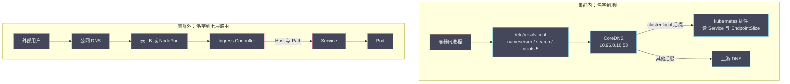
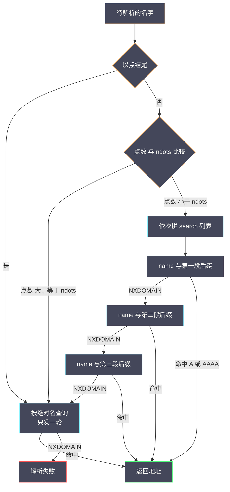
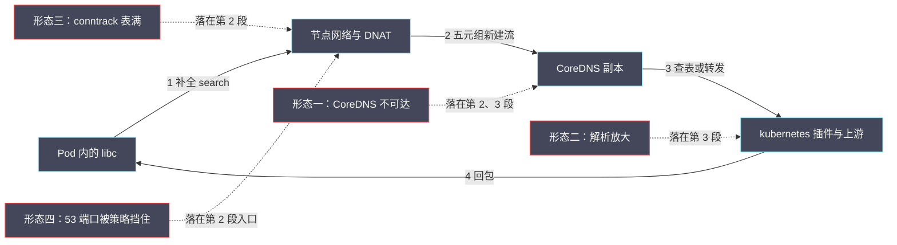
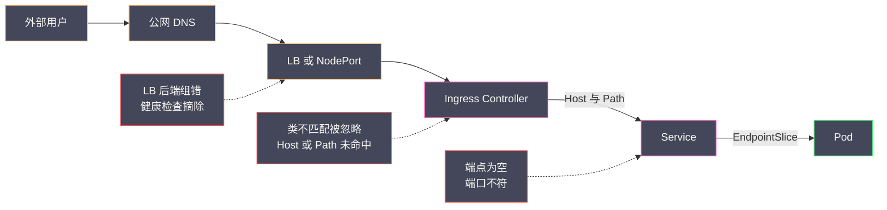
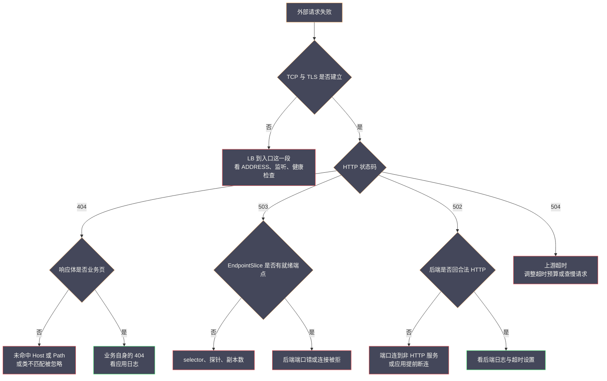

# 06 DNS 服务发现与 Ingress

**摘要：**

同一句「服务连不上」，在 DNS 层和在入口层的含义完全不同——前者是名字没能解析成地址，后者是地址收到了请求却没有被正确路由。运维里最常见的误判，就是把这两层合成一句话来排查：在 Pod 里反复 `dig`，或者在 Ingress 上反复改规则，而问题其实在另一层。本文把两层拆开写。DNS 侧从一个四十节点、两千多个 Pod 的集群出发，讲清 `/etc/resolv.conf` 里那五个字段分别由谁写入、`search` 列表如何补全名字、`ndots:5` 为什么让每一次外部解析多走几轮，以及由此产生的查询放大与延迟算术；再把 DNS 故障收敛成四类形态——CoreDNS 不可达、解析放大、`conntrack` 表满导致的 UDP 丢包、`NetworkPolicy` 挡住 53 端口，逐类给出判据与首查位置。入口侧沿 LB、Controller、Service、Pod 三段展开，讲 `ingressClassName` 在多 Controller 并存时的静默失败、TLS 终止位置如何改变判据、三种 `pathType` 的语义边界与优先级，最后用一张判定树把 404、502、503、504 分开。Gateway API 只谈它与 Ingress 的关系与运维差异，成熟度以对应版本文档为准。文末四个反例，都能在真实集群里找到对应的事故。

---

## 第 1 章 两层名字，两套失败

### 1.1 同一句「连不上」有两种含义

客户端的代码里写下一个名字，到请求真正落到某个进程上，中间要过两道完全不同的关卡。集群内的一道是**名字解析**：容器内的 libc 读 `/etc/resolv.conf`，把 `mysql.order` 这样的相对名补全成 `mysql.order.svc.cluster.local`，发给 CoreDNS，换回一个 ClusterIP 或者一组 Pod IP。集群外的一道是**入口路由**：浏览器解析 `api.example.com` 得到负载均衡器的公网地址，连接建立之后由 Ingress Controller 按 Host 与 Path 决定转发给哪个 Service。

两道关卡的所有权、可见信号、失败表现都不一样。DNS 这一道出错时，客户端拿到的是 `SERVFAIL`、`NXDOMAIN`，或者干脆在五秒之后超时，应用日志里写的是 `lookup mysql.order on 10.96.0.10:53: no such host` 或者 `i/o timeout`；入口这一道出错时，TCP 连接是通的，TLS 握手可能也成功了，回来的却是一个 HTTP 状态码。一个在传输层之前，一个在应用层之后，把两者混在一起看，就会在错误的位置反复用力。

笔者见过最典型的一次误判，是某个服务在滚动发布后大量报 `dial tcp: lookup pay-api on 10.96.0.10:53: server misbehaving`，值班人先去查 CoreDNS 的副本数与 `nginx` 入口规则，花掉四十分钟，最后发现是发布时新加的 `NetworkPolicy` 只放行了业务端口的出向流量，53 端口被默认拒绝掉了。反过来也有过：入口返回 502，负责人先去 `exec` 进业务 Pod 里 `dig` 自己的 Service 名，解析一切正常——因为问题根本不在解析，而在控制器到后端之间的那一段。

### 1.2 贯穿案例与集群口径

后文用一个中等规模集群贯穿：四十个节点，约两千六百个 Pod，业务命名空间 `order`、`pay`、`infra` 三块；`order-api` 是十二副本的 Deployment，数据库 `mysql` 是 `order` 命名空间下三副本的 StatefulSet，用 headless Service 暴露；入口有两个控制器并存，公网流量走 ingress-nginx，内网流量走一套基于 Envoy 的实现，对外域名 `api.example.com`。这个规模不算大，但它同时具备三件让问题变复杂的东西：多命名空间、多控制器、以及一套已经上线的默认拒绝网络策略。

### 1.3 两张故障面的分界

把两层的差异先摆成一张表，后文的判据都可以回到这张表上找位置。

| 维度 | DNS 侧（集群内解析） | 入口侧（集群外进入） |
| :--- | :--- | :--- |
| 谁在服务 | CoreDNS，通常两个以上副本，Service 名 `kube-dns` | 云 LB、Ingress Controller、目标 Service |
| 输入是什么 | 一个待补全的名字（相对名或 FQDN） | 一条已建立的 TCP/TLS 连接加 HTTP 请求 |
| 失败可见信号 | `NXDOMAIN`、`SERVFAIL`、五秒超时、`no such host` | 404、502、503、504，或 TLS 握手失败 |
| 失败范围 | 常与节点、命名空间、Pod 代际相关 | 常与 Host、Path、后端端点有关 |
| 首查位置 | 容器内 `/etc/resolv.conf`，再看 CoreDNS 与网络策略 | Ingress 对象与 Controller 日志，再看 EndpointSlice |
| 成功判据 | 名字解析出预期地址，且延迟在预算内 | 请求带着正确 Host 抵达目标 Pod 并返回预期响应 |

下图把两层放在同一张图上，左边是「名字到地址」，右边是「名字到路由」，两条路径在 Service 处才交汇。



---

## 第 2 章 resolv.conf 是谁写的

### 2.1 dnsPolicy 决定基底

容器里的 `/etc/resolv.conf` 不是镜像里带的，是 kubelet 在创建容器时按 Pod 的 `spec.dnsPolicy` 生成并挂进去的。默认值是 `ClusterFirst`，它给出的基底就是指向 CoreDNS：`nameserver` 写 `kube-dns` 这个 Service 的 ClusterIP，`search` 写三段——`<本 Pod 的命名空间>.svc.cluster.local`、`svc.cluster.local`、`cluster.local`，再附一行 `options ndots:5`。所谓「ClusterFirst」，指的是集群内的域名优先由集群 DNS 解析，不匹配集群域后缀的查询由 CoreDNS 的 `forward` 转给上游，并不表示 Pod 一定能访问公网 DNS。

另外三个取值的差别，直接决定了排障时第一眼看哪里。`Default` 让 Pod 继承节点上的解析配置，等于把这个 Pod 的解析行为交给节点操作系统——节点换了发行版，行为就变。`None` 表示完全不用 kubelet 生成的配置，必须由 `dnsConfig` 显式给出 nameserver，否则 Pod 起来之后什么都解析不了。`ClusterFirstWithHostNet` 是给 `hostNetwork: true` 的 Pod 准备的：这类 Pod 用的是节点的网络命名空间，若仍写 `ClusterFirst`，kubelet 会退化成 `Default`，于是集群内的 Service 名解析不了——这个坑在日志采集、监控代理这类 DaemonSet 上反复出现，因为它们的镜像往往来自上游，默认配置不一定对。

### 2.2 五个字段的来源与上限

`resolv.conf` 的有效字段不多，但每个都有来源与上限，超出上限时的行为还各不相同。

| 字段 | 内容 | 来源 | 上限与超出后的行为 |
| :--- | :--- | :--- | :--- |
| `nameserver` | DNS 服务器地址，可多行 | 由 `dnsPolicy` 生成，`dnsConfig.nameservers` 追加 | 最多三个；`dnsConfig` 里最多写三个地址 |
| `search` | 补全用的搜索域，按序尝试 | `<namespace>.svc.cluster.local`、`svc.`、`cluster.` 三段，`dnsConfig.searches` 合并 | 现行限制为 32 个搜索域、总长 2048 字符；早期版本更严，超出部分被丢弃 |
| `ndots` | 决定「先绝对还是先搜索」的点数阈值 | kubelet 默认写 `ndots:5`，可被 `dnsConfig.options` 覆盖 | 超过 15 按 15 处理；非法值回落到 1 |
| `options timeout` / `attempts` | 单次查询超时与重试次数 | 默认不写，取 libc 内置值；可由 `dnsConfig.options` 追加 | 属 `options` 行，多个选项合并去重 |
| `options single-request` / `single-request-reopen` | 把 A 与 AAAA 查询串行化或换 socket 重发 | 需显式在 `dnsConfig.options` 中声明 | 同样属 `options` 行，某些 libc 实现不识别 |

`search` 那一行的历史需要单独交代。1.28 之前的版本里，kubelet 对搜索域数量与总字符数有更紧的限制，超出部分会被静默丢弃，并在 Pod 事件里留下 `Search Line limits were exceeded, some search paths have been omitted` 这样的记录。丢弃的后果不是报错，而是某些相对名突然解析不了——事件早就被滚动清掉了，现场只剩一个「在别的命名空间能解析、在这里不行」的怪现象。具体的阈值随版本变化，以对应版本文档为准。

### 2.3 dnsConfig 的合并规则

`dnsConfig` 不是覆盖而是合并：`nameservers` 与 `searches` 追加到策略生成的列表后面并去重，`options` 按名字合并。这个「合并」语义有一个直接后果——想把 `ndots` 调小，写 `options: [{name: ndots, value: "2"}]` 是有效的，因为同名选项后者生效；但想把 search 列表整个换成自己的，光写 `searches` 是做不到的，那三段集群搜索域仍然在，只是排在你的搜索域后面。

合并顺序也解释了另一个现象：给某个需要访问外网的 Pod 加 `nameservers: [1.1.1.1]`，得到的是「CoreDNS 在前、1.1.1.1 在后」的列表，libc 只在前面超时或 `SERVFAIL` 时才会问后者，NXDOMAIN 不会触发下一个服务器。想让公网域名绕开 CoreDNS，只有一个可靠办法——让它以 FQDN 形式出现并且不要落进集群域，或者用 `dnsPolicy: None` 完全接管配置。

再看一眼 `options single-request-reopen` 这个看起来与 Kubernetes 无关的选项，它在集群里出现的频率并不低。glibc 解析一个名字时会同时发出 A 与 AAAA 两条查询，默认复用同一个 socket；在 DNAT、连接跟踪与安全策略都参与的环境里，其中一条被丢掉时另一条已经拿到答案，客户端却仍要等满超时才重试。把两条查询串行化（`single-request`）或者换 socket 重发（`single-request-reopen`），牺牲的是一点并行度，换回的是稳定的解析延迟。

### 2.4 写不进去的时候

`resolv.conf` 是被挂载进容器的，所以「改不了」这件事本身就是一个有意义的信号。容器里手改这个文件不会持久，Pod 重建即还原；它能被改动的唯一入口是 `spec.dnsConfig` 加上一次滚动更新。有些团队用 init 容器在启动时覆盖它，效果取决于挂载方式与是否以 root 运行，并且绕开了 API 层的校验，属于不该在长期运行的负载上使用的做法。

排查时可以按这个顺序取证据：先在容器里 `cat /etc/resolv.conf` 确认三行内容与预期一致，再用 `getent hosts` 走一遍真实的 libc 路径，最后用 `dig` 直接打 CoreDNS 的地址。三者的差别本身就定位了层次——`getent` 失败而 `dig` 成功，问题在补全或 Pod 侧配置；两者都失败，问题在 CoreDNS 或网络；`getent` 成功但应用报错，去看应用自己的解析器实现，有些语言运行时自带的解析逻辑并不完全遵循 `resolv.conf`。

### 2.5 headless 返回多 A 记录之后

普通 Service 的 A 记录只有一条，解析结果就是那个固定不动的 ClusterIP；headless Service（`spec.clusterIP: None`）的 A 记录是一组 Pod IP，每次解析返回当前端点的地址集合。这个差别看起来只是「一条还是多条」，实际上把负载均衡的责任从 kube-proxy 转移到了客户端：headless 没有虚拟 IP 可拦截，客户端拿到 N 个地址之后必须自己挑、自己重试、自己感知端点变化。

**多 A 记录**带来的第一个问题是没有 TTL 意识。CoreDNS 的 `kubernetes` 插件为记录设置的 TTL 通常是三十秒量级，端点变化在这个窗口之后才会反映到解析结果上；而很多语言运行时在进程内还有一层自己的解析缓存，这一层不一定会遵从返回的 TTL。于是「缩容之后客户端仍然往已经删掉的 Pod 发请求」成了一个常见现象——连接池里存着旧地址，DNS 缓存还没过期，服务端那边早已没有这个 IP。处置要分两侧：服务端在终止流程里先把端点摘掉再等连接排空（时序见 [[04 优雅停机与滚动更新的零停机]]），客户端侧缩短缓存、加上重试与连接重建。

第二个问题是均衡。记录顺序会被 CoreDNS 的 `loadbalance` 插件打乱，但打乱只对「每次都重新解析并按顺序取用」的客户端有效。只取第一条地址并长期持有连接的客户端，实际上把全部流量压到了其中一个 Pod 上，`kubectl top pods` 会显示某个副本的 CPU 明显高于同组其他副本。这类不均衡不是 kube-proxy 的负载算法问题，因为这条路径根本不经过 kube-proxy。

headless 最有价值的用法是给有状态负载提供**稳定网络标识**。StatefulSet 里每个 Pod 都能拿到形如 `<pod>.<headless 名字>.<命名空间>.svc.cluster.local` 的记录，这条记录由 Pod 的 `hostname` 与 `subdomain` 决定，StatefulSet 会自动设置这两个字段。换句话说，有状态服务的成员发现靠的是 DNS 记录而不是 Service 转发，这也解释了为什么这类工作负载的 Service 必须是 headless——有 ClusterIP 时，成员之间互相连接会被随机转发到任意一个 Pod。

SRV 记录是同一组信息的另一种表达：`_<端口名>._<协议>.<服务>.<命名空间>.svc.cluster.local` 返回端口与目标主机名，适合那些需要从 DNS 里同时拿到「在哪」与「哪个端口」的客户端。它要求 Service 的端口有名字，未命名端口不会生成 SRV 记录，这是配置时容易漏掉的一步。

还有一个与 headless 配套的开关值得记住：`publishNotReadyAddresses: true`。它让未就绪的端点也进入 DNS 记录，用途是集群启动期的互相发现——第一个成员还没通过探针时，其他成员需要能找到它才能组成集群，etcd、ZooKeeper 这类组件的 bootstrap 依赖这个行为。代价是「就绪」这个语义在 DNS 层失效了，客户端可能连到一个尚未完成初始化的成员上，因此只应在确实需要 bootstrap 发现的服务上开启，而不是当成默认选项。

---

## 第 3 章 ndots:5 的算术

### 3.1 补全规则：先 search 还是先绝对

`ndots` 的语义只有一句话：名字里的点数达到阈值时，先按绝对名查询；不足阈值时，先把 `search` 列表里的每一个后缀依次拼上去，全都不中再按绝对名查询。名字以点结尾（`mysql.order.svc.cluster.local.`）时直接按绝对名处理，完全跳过搜索列表。这条规则来自 libc 的解析器实现，与 Kubernetes 无关，Kubernetes 只是把阈值设成了 5。把语义压缩成一句：**阈值只决定查询顺序，不决定能不能解析**，任何顺序最终都会试到绝对名。

下图是 `ndots` 决定展开顺序的分叉，以及每一轮失败后如何继续。



Kubernetes 对名字的作用域还有一层约束：不带命名空间的查询只在 Pod 自己的命名空间里找。`order` 命名空间里的 Pod 查询 `mysql` 得到的是 `mysql.order.svc.cluster.local`；查询 `mysql.pay` 得到的是 `mysql.pay.svc.cluster.local`，与 `mysql` 是否存在无关。这就是「同一份配置在不同命名空间表现不同」的机制来源，也是把 `order-api` 从 `order` 挪到 `pay` 之后连接串必须一起改的原因。

### 3.2 一次外部解析的真实代价

把 `api.example.com` 放进这个模型：它有两个点，小于 `ndots:5`，于是先拼搜索域，得到 `api.example.com.order.svc.cluster.local`、`api.example.com.svc.cluster.local`、`api.example.com.cluster.local` 三个必然不存在的名字，各返回一次 NXDOMAIN，最后一轮才拿绝对名去问上游。每一轮都是一次完整的 UDP 往返：从节点出发、经 Service 的 DNAT 到某个 CoreDNS 副本、查表、回包。三次无效往返就是三次 RTT 加上三次 CoreDNS 的处理开销。

更细的一层在记录类型上。一次名字解析在 glibc 里通常对应 A 与 AAAA 两条查询，两者默认并行发出。于是「多查三轮」在抓包里看到的是六条无效查询，加上最后一轮的 A/AAAA 两条，一次外部解析最多产生八条 UDP 报文。这个数字与团队规模无关，只与名字的点数、搜索域条数、是否双栈有关。

延迟可以用一个粗略的算术估出来，以下数字属示例推算：同节点访问 CoreDNS 约 0.5 毫秒，跨节点约 1 毫秒；返回 NXDOMAIN 的那几轮由 CoreDNS 自己应答，不必问上游，真正的上游查询只发生在最后一轮的绝对名上。按三轮无效、每轮 1 毫秒算，首次解析比理想情况多出三毫秒；如果 CoreDNS 本身处于高负载或排队状态，这三次多余请求会把排队时间放大三倍。对一个每次请求都要解析一次外部域名的应用，这个放大是持续的，而不是只在冷启动时出现。

这里有一个容易被忽略的放大器：`search` 列表越长，无效轮次越多。有人在 `dnsConfig.searches` 里追加了四五个企业内网域，本意是让内部域名能解析，代价是所有外部域名的首次解析都要在前面多扫一遍。列表顺序也有讲究——把最常用的域放前面，命中就停；把几乎不用的域放前面，等于给每次解析加一轮固定成本。

### 3.3 缓存救不了第一次

CoreDNS 的 `cache` 插件会缓存正向结果，也会缓存 NXDOMAIN 这类否定结果，缓存时长受 TTL 与插件配置约束。kubeadm 生成的默认 Corefile 里通常有 `cache 30` 与 `ttl 30`，意思是记录与否定结果都按三十秒量级缓存。这个缓存能挡住「同一个外部域名每秒被解析上千次」的压力，但挡不住三件事：每次冷启动的第一个请求、超过缓存时长的周期性刷新、以及不同名字带来的缓存不命中。

对 `api.example.com` 这类外部名字，否定缓存命中意味着后续请求不再打上游，但那次 UDP 往返依然存在——请求还是要从 Pod 发到 CoreDNS，只是 CoreDNS 直接回 NXDOMAIN 而不转发。于是「多查三轮」的成本从「三轮上游查询」降级为「三轮本地往返」，延迟下降明显，QPS 却没有下降：CoreDNS 仍然要处理这三次请求。集群 DNS 的容量规划如果只看上游查询数，会漏掉这一块。

### 3.4 为什么把 ndots 调成 1 不是答案

既然 `ndots:5` 让外部名多查三轮，把它调到 1 或 2 似乎就解决了。笔者在三个集群里见过这样的调整，效果都取决于集群里名字的写法，而这个写法往往不受单个团队控制。

第一，短名不受影响。`mysql` 没有点，点数 0 永远小于任何合法的 `ndots` 取值，它照样要走完整轮搜索域。调小 `ndots` 不会让集群内的短名解析变快，也不会让它失效。

第二，含一个点的相对名会改变顺序。`mysql.order` 有一个点，`ndots:1` 之下它先被当成绝对名去问上游；上游返回 NXDOMAIN 之后，再走搜索域拼成 `mysql.order.svc.cluster.local` 并命中。结果是多了一次上游往返，而不是少了一次。

第三，也是最危险的一条：绝对名先行意味着解析结果取决于公网，这就是**同名污染**。若公网恰好存在 `mysql.order` 或某个团队的内网域能解析到同名记录，客户端会拿到一个错误的地址并且不报错。这种污染在小集群里几乎不会遇到，在域名资产多的组织里出现过不止一次。

所以 `ndots` 的调整必须与命名约定一起动：要么把阈值降到 2 左右并接受含点相对名多一次上游查询，要么保持 5 而要求所有外部域名以 FQDN 形式书写、在代码里补尾点。两条路都要改应用，选哪条取决于能推动多少团队改代码。

### 3.5 三条正解的代价

| 做法 | 机制 | 代价 | 适用条件 |
| :--- | :--- | :--- | :--- |
| 外部域名写 FQDN 并补尾点 | 跳过 search 展开，只发一轮 | 需要改代码或配置模板，尾点容易被格式化工具吃掉 | 应用侧可控，外部依赖域名固定 |
| 调小 `ndots` | 含点名字先走绝对名 | 含点相对名多一轮上游查询，存在同名污染风险 | 集群内命名规范统一，以短名与 FQDN 为主 |
| 部署 NodeLocal DNSCache | 节点本地缓存代理，跳过 DNAT 与连接跟踪 | 多一个 DaemonSet，节点资源与升级维护成本 | 节点数多、DNS QPS 高、conntrack 压力大 |

NodeLocal DNSCache 值得单独说一句，因为它同时缓解三个问题：本地缓存降低往返延迟与 CoreDNS 压力，跳过 Service 的 DNAT 减少连接跟踪表项，与 CoreDNS 之间可以升级为 TCP 从而避免 UDP 表项长时间占用。它的代价不在资源，而在运维面——每个节点多一个需要跟随集群升级的组件，监听地址（通常取链路本地段如 `169.254.20.10`）不能与现有地址冲突，且它本身失效时会让该节点上所有 Pod 的解析同时变慢。

---

## 第 4 章 DNS 故障的四种形态

一次从 Pod 发出的 DNS 查询要经过四段路：libc 完成补全、报文经节点网络到达 CoreDNS、CoreDNS 查表或转发、回包返回。四类故障恰好落在这四段的不同位置上，判据也因此不同。



### 4.1 形态一：CoreDNS 不可达

所有 Pod 的解析都失败，报错集中在超时而不是 NXDOMAIN，概率上接近百分之百。这是最好认的一类，判据也最直接：`kubectl -n kube-system get pods -l k8s-app=kube-dns` 看副本是否就绪，`kubectl -n kube-system get endpointslice -l kubernetes.io/service-name=kube-dns` 看端点是否为空，`kubectl -n kube-system get svc kube-dns` 看端口是否还是 53。

端点为空有三种常见来源：CoreDNS 副本因资源限制被反复 OOMKilled；节点扩容后新节点上的 kube-proxy 规则尚未同步，恰好该节点的 Pod 全部解析失败；以及误改了 `kube-dns` Service 的 selector 或端口。第三种最隐蔽，因为 CoreDNS 本身跑得好好的，`kubectl logs` 里一片正常，只有端点列表是空的。

还有一种只影响部分节点的变体：CoreDNS 副本分布在少数节点上，某些节点到这些节点的 overlay 网络不通，或者这些节点上的 conntrack 已满。表现是「同一个 Deployment 的副本，一部分能解析、一部分不能」，而 `kubectl get pods` 里的 CoreDNS 全是 Running。这类问题的判据不在控制面，在节点侧——`kubectl get pods -o wide` 看 CoreDNS 落在哪些节点，再从故障 Pod 所在节点去连这些地址。

### 4.2 形态二：解析放大

这不是「坏掉」，而是「被压垮」。CoreDNS 的 QPS 随 Pod 数量、解析频率与搜索域长度线性增长，而每次外部解析带来的无效轮次是常数倍的放大。容量估算如果只按「每个 Pod 每秒一次解析」算，在多搜索域的集群里低估三到四倍并不罕见。

判据是 CoreDNS 的自身指标而不是客户端报错：`coredns_dns_requests_total` 的增速、`coredns_dns_responses_total{rcode="NXDOMAIN"}` 在总响应里的占比、`coredns_cache_hits_total` 与 `coredns_cache_misses_total` 的比值，以及 `coredns_dns_request_duration_seconds` 的高分位。NXDOMAIN 在总响应里的占比异常高，基本可以断定存在大量无效展开，接下来要做的是按名字归类，找出那些点数不足却频繁被解析的外部域名。

处置分两侧。集群侧扩容 CoreDNS（副本数、资源限制、拓扑分布约束），按节点数与核心数做线性扩缩是一种常见做法，常见配置是每十六个节点或每二百五十六个核心增加一个副本，具体参数因发行版而异；应用侧把外部域名改成 FQDN、把 `searches` 收敛到真正需要的域、把解析结果缓存到进程内。两侧的顺序不该颠倒——先扩容量能把事故压住，但成本会随 Pod 数一直涨。

### 4.3 形态三：conntrack 表满

在笔者处理过的现场里，这是四类中最难认的一类，因为它长得像「随机解析失败」：同一个 Pod 的同一个域名，这一秒超时，下一秒成功；换一个 Pod 失败，再换一个又正常。现象上没有规律，时间上又集中在业务高峰。

机制不复杂。kube-proxy 为 Service 做的 DNAT 依赖连接跟踪，每一条经过 NAT 的流在节点上占一个 `conntrack` 表项；UDP 是没有连接的协议，但内核照样为每条「源地址、源端口、目的地址、目的端口」组合建表项，并按 UDP 超时回收（`nf_conntrack_udp_timeout` 默认为三十秒）。当节点的表被占满，内核丢的是新流，日志里只有一行 `nf_conntrack: table full, dropping packet`，应用侧看到的就是超时。DNS 的 UDP 查询恰好全是新流，因此最先被感知。

判据有四个，要一起看：节点上 `/proc/sys/net/netfilter/nf_conntrack_count` 与 `nf_conntrack_max` 的比值接近上限；`conntrack -S` 输出里的 `insert_failed` 持续增长；`dmesg` 里出现上述丢包日志；同节点上非 DNS 的短连接也开始偶发失败。只看最后一条会误判成「网络抖动」，四条对齐才能定性。

容量上限由 kube-proxy 的几个参数共同决定：`--conntrack-max-per-core` 默认为每核 32768 条，`--conntrack-min` 默认为 131072 条，写入的 `nf_conntrack_max` 由两者推导（每核值乘以核数，再与下限取大者）；UDP 与 TCP 的回收时间另有 `--conntrack-udp-timeout`、`--conntrack-udp-timeout-stream`、`--conntrack-tcp-timeout-established` 三个参数，后者默认是二十四小时。二十四小时这个数字解释了很多现场：一条异常断开、没有正常四次挥手的 TCP 流，会在表里占到内核空闲超时才释放，而 UDP 的 DNS 流项只占三十秒——表满时，很可能是一堆僵尸 TCP 表项挤掉了 DNS。以十六核节点为例，`nf_conntrack_max` 约为 524288 条，只做示例推算的话，全部被 UDP DNS 流占满需要每秒一万七千条新建流，而同样的表被滞留的 TCP 表项占满则容易得多。

处置从两头做。降表项生成：给 DNS 流量打上不跟踪的标记（在 raw 表里对 53 端口做 `NOTRACK`），让解析不再占表；部署 NodeLocal DNSCache，把 Pod 到 CoreDNS 的 DNAT 这一跳省掉。提上限：调大 `nf_conntrack_max`，同时确认内存足够——表项本身要占内存，一味的调大会把节点推向另一种不稳定。查根因：表满通常是症状，真正的起因可能是某处短连接风暴、探针间隔过密、或日志组件在上报时反复重连。

### 4.4 形态四：53 端口被策略挡住

只有某几个命名空间或某几个 Pod 解析不了，集群其他部分完全正常，`dig` 直接打 CoreDNS 的地址也超时。这一类在上了默认拒绝策略的集群里非常常见，因为策略是「默认拒绝一切出向」，而 53 端口需要单独放行。

它的判据与前三类最容易区分：失败是超时而不是 NXDOMAIN，且范围精确地落在被策略选中的 Pod 上。`kubectl get networkpolicy -n order` 里如果存在 `policyTypes` 含 `Egress` 且 `egress` 为空或未包含 53 规则，基本可以确定。

一个放行 DNS 的最小规则如下，注意 UDP 与 TCP 都要放行——响应过大被截断时，解析器会重试 TCP。

```yaml
apiVersion: networking.k8s.io/v1
kind: NetworkPolicy
metadata:
  name: allow-dns-egress
  namespace: order
spec:
  podSelector: {}
  policyTypes: [Egress]
  egress:
    - to:
        - namespaceSelector:
            matchLabels:
              kubernetes.io/metadata.name: kube-system
      ports:
        - protocol: UDP
          port: 53
        - protocol: TCP
          port: 53
```

`kubernetes.io/metadata.name` 这个标签由控制面自动写入每个命名空间，可以放心用于选择 `kube-system`，不必依赖团队自己打的标签。另外要注意策略的方向性：DNS 查询是 Pod 的**出向**流量，CoreDNS 的回包在连接跟踪里被视为已建立连接的回复，因此不需要为 `kube-system` 额外写一条入向规则；但若集群启用了双向隔离且 CoreDNS 自身也被默认拒绝选中，就要在 `kube-system` 一侧放行来自业务网段的 53。

### 4.5 判据总表与验证顺序

| 形态 | 范围特征 | 关键证据 | 首查位置 | 处置方向 |
| :--- | :--- | :--- | :--- | :--- |
| CoreDNS 不可达 | 全集群或整节点 | 端点为空、副本未就绪、到 CoreDNS 全超时 | `kube-dns` 的 EndpointSlice 与副本状态 | 恢复副本、修 selector、查 overlay |
| 解析放大 | 全集群，伴随 CoreDNS 高负载 | NXDOMAIN 占比高、请求量随 Pod 数线性涨 | CoreDNS 指标与解析延迟分位 | 扩副本、改 FQDN、收敛 searches |
| conntrack 表满 | 单节点，随机失败 | 表项接近上限、`insert_failed` 增长、内核丢包日志 | 节点内核计数与 `dmesg` | NOTRACK、NodeLocal、调上限 |
| 53 被策略挡住 | 特定命名空间或带标签的 Pod | 超时而非 NXDOMAIN，`dig` 直连也超时 | NetworkPolicy 的 egress 规则 | 放行 UDP 与 TCP 53 |

验证顺序建议固定下来，避免每次从零推演：先在故障 Pod 内 `cat /etc/resolv.conf` 排除 Pod 侧配置，再 `getent hosts <名字>` 走 libc 路径，再 `dig @10.96.0.10 <名字>` 直连 CoreDNS，最后从节点侧确认表项与策略。四条命令的输出组合，能把这四类形态唯一地分开。

---

## 第 5 章 入口链的三段

### 5.1 谁拥有哪一段

从外部用户到 Pod，入口这一段可以切三刀：负载均衡器把公网地址映射到集群内的某个入口，Controller 把 HTTP 请求按 Host 与 Path 路由到某个 Service，Service 通过端点把连接落到某个 Pod。每一刀的所有者不同，因此失败时能改的权限也不同。

| 段 | 典型实现 | 所有者 | 失败表现 | 首查位置 |
| :--- | :--- | :--- | :--- | :--- |
| LB 到入口 | 云 LB、NodePort、宿主机的 hostPort、BGP 宣告 | 基础设施团队或云平台 | 连接超时、连接被拒、健康检查摘除 | LB 监听与后端组、节点的端口监听 |
| Controller 路由 | ingress-nginx、Envoy 系实现 | 平台团队 | 404、421、TLS 握手失败、规则不生效 | Ingress 对象、Controller 日志与配置 |
| Service 到端点 | kube-proxy 与 EndpointSlice | 应用团队与平台团队共管 | 503、502、连接重置 | EndpointSlice 的 ready 端点 |

第三段之所以能成立，靠的是 Service 把 ClusterIP 翻译成一组端点、再由节点上的转发规则落到 Pod，四层转发的实现细节见 [[05 Service 与 kube-proxy 原理]]，三种数据面实现（iptables、IPVS、eBPF）的差异见 [[14 Service 与 kube-proxy：iptables IPVS eBPF 数据面演进]]；这里只关心它在故障中呈现出来的样子。

三段的划分在事故里最有用的一句话是：能连上就说明前两段通，跑到 4xx 说明路由有结论，5xx 才是后端问题。反过来，如果连 TCP 都建不起来，去看 `kubectl get ingress` 的 ADDRESS 列与 LB 的健康检查，而不是翻 Ingress 规则。



### 5.2 ingressClassName 与多 Controller 并存

Ingress 对象本身不绑定任何实现，它靠 `spec.ingressClassName` 指向一个 `IngressClass` 资源，后者再声明由哪个控制器实现。三个环节里任何一环错位，结果都是「Ingress 创建成功，但没有任何控制器处理它」。这种**静默失败**没有事件、没有报错，只有 ADDRESS 列一直空着。

第一环是 `IngressClass` 是否存在且 `spec.controller` 与控制器启动参数一致。第二环是 Ingress 是否写了 `ingressClassName`。第三环是当 Ingress 不写这个字段时，集群里是否恰好只有一个被标记为默认的 `IngressClass`。

第二环与第三环的组合有几个必须记住的行为：不写 `ingressClassName` 且存在唯一默认类时，准入阶段会把默认类的名字写进该字段，事后 `kubectl get ingress -o yaml` 能看到它；集群里存在多个默认类时，创建不带类名的 Ingress 会被直接拒绝；一个类都没有时，有的控制器仍然会接管，但这依赖实现细节，官方建议始终显式定义默认类。

不过在多控制器并存的集群里，还有一条更要紧的规则：控制器只处理属于自己的类，多余的 Ingress 对它而言不存在。`nginx-public` 与 `envoy-internal` 并存时，把公网域名的规则误挂到内网类上，表现不是报错，而是公网访问 404——因为公网控制器眼里根本没有这条规则，请求落到它自己的默认后端。

`kubernetes.io/ingress.class` 注解是这个字段的前身，在 1.18 引入 `ingressClassName` 之前被广泛使用，从未进入正式 API。两者不是等价替换：注解写的是控制器的名字，字段指向的是 `IngressClass` 资源，后者还能携带 `parameters` 之类的实现参数。老集群里两者混用时，不同控制器的取舍顺序不一致，这类歧义只能靠统一写法消除。

### 5.3 TLS 终止在哪一段

TLS 在哪一段终止，决定了你手上能看到什么，以及后端要做什么。

最常见的是在 Controller 终止：证书以 Secret 形式存在，`spec.tls[].secretName` 引用它，请求到后端时已经是明文 HTTP。此时证书与 Ingress 必须在同一命名空间——`secretName` 只是名字，不含命名空间，跨命名空间引用是不支持的；证书管理由 cert-manager 这类控制器完成，它按 Ingress 上的注解签发并续期，机制层面属于 [[06 Operator 模式与自定义控制器]] 的话题。

第二种是在 Controller 之前终止，典型是云 LB 卸载 TLS，Controller 只见 HTTP。此时 4xx 与 5xx 的归属要往前挪一段：TLS 握手失败与 LB 的证书有关，与 Ingress 无关。第三种是透传到后端，Controller 只做 TCP 转发，路由不再基于 Host 与 Path——这种模式已经离开了 Ingress 的能力范围，属于控制器自己的扩展，配置写法因实现而异。

与 TLS 位置相关的判据里，最常被忽略的是 SNI 与默认证书。客户端的 SNI 与任何 `spec.tls[].hosts` 都不匹配时，Controller 会退回它自己的默认证书，浏览器于是报证书名不符；这类错误在 `curl -v` 里表现为证书主题与预期不一致，而请求根本没到 Ingress 的规则匹配阶段。同样的道理，`spec.tls` 里列出的 hosts 与 `spec.rules` 里的 host 不一致时，会出现「HTTP 能访问、HTTPS 证书不对」的组合。

### 5.4 状态字段告诉你卡在哪

Ingress 的 `status` 子资源信息很少，但足够区分「没人管」和「管了但没就绪」。`status.loadBalancer.ingress` 为空意味着还没有任何控制器为它分配入口地址；有地址但访问不通，问题在 LB 到 Controller 这一段或 Controller 自身；地址正常、能连上但返回 404，才轮到规则匹配。

需要注意的是，这个字段由控制器写入，不同实现写入的时机与内容不同：有的在 Service 类型为 LoadBalancer 且外部地址分配完成后才写，有的在配置下发后立刻写。因此「ADDRESS 有值」只能证明控制器认领了这条 Ingress，不能证明配置已经生效。判断配置是否生效，要看控制器自身的就绪状态与日志，而不是 Ingress 的状态字段。

---

## 第 6 章 路径匹配的三种语义

### 6.1 Prefix 是按元素，不是按字符串

`pathType` 是必填字段，不写会导致创建失败——这一条在 1.19 之后对所有客户端生效，也是老清单迁移时最常见的校验错误。三个取值里，`Prefix` 的语义最容易被想当然：它按 `/` 切分路径元素、逐元素做前缀匹配，因此 `/foo/bar` 匹配 `/foo/bar/baz`，但不匹配 `/foo/barbaz`。「前缀」是**路径元素级别**的前缀，**不是字符串级别**的前缀。

尾巴上的斜杠有额外规则：`/aaa/bbb/` 能匹配 `/aaa/bbb`（尾部斜杠被忽略），`/aaa/bbb` 也能匹配 `/aaa/bbb/`，两者在请求带不带尾斜杠时都成立。这个宽松处理让一部分客户端行为差异被抹平，但也意味着不能靠尾斜杠区分两个路由。

### 6.2 Exact 的边界与优先级

`Exact` 是精确匹配且区分大小写：`/foo` 不匹配 `/foo/`，`/foo/` 也不匹配 `/foo`。这个严格性在健康检查、回调地址这类需要精确落点的场景里有用，在普通业务路由里则容易造成「差一个斜杠就 404」。

当多条路径同时匹配时，优先级由 API 规定而非实现自定：先取最长匹配的路径，长度相同再让 `Exact` 优先于 `Prefix`。这条规则解释了为什么 `/` 与 `/api` 同时存在时，`/api/users` 走 `/api` 那条规则；也解释了为什么有人把 `/api` 改成 `/api/` 之后行为变了——长度变了，优先级也跟着变。

| pathType | 语义 | 示例（路径） | 请求 | 是否匹配 |
| :--- | :--- | :--- | :--- | :--- |
| `Prefix` | 按路径元素逐段前缀匹配 | `/foo` | `/foo/bar` | 是 |
| `Prefix` | 同上，不做字符串前缀 | `/foo/bar` | `/foo/barbaz` | 否 |
| `Prefix` | 尾部斜杠被忽略 | `/aaa/bbb/` | `/aaa/bbb` | 是 |
| `Exact` | 精确且区分大小写 | `/foo` | `/foo/` | 否 |
| `Exact` | 精确且区分大小写 | `/foo` | `/Foo` | 否 |
| `ImplementationSpecific` | 语义交给控制器 | `/v[0-9]+/api` | `/v1/api` | 取决于实现 |
| 组合 | 最长优先，其次 Exact 优先 | `/foo` 两类并存 | `/foo` | 命中 `Exact` |

### 6.3 ImplementationSpecific 的账

`ImplementationSpecific` 在 API 层不做任何承诺，控制器可以把它当作独立的匹配类型，也可以等价于 `Prefix` 或 `Exact`。以 ingress-nginx 为例，开启 `use-regex` 时这个类型让路径按正则解释，未开启时按前缀处理；换成另一套控制器，同样的写法可能被当成纯前缀。这就是把可移植性换成表达力的交易——用正则写路由很方便，代价是这份 Ingress 从此只能在这一套控制器上工作。

与之相邻的一组注解也要一并记账：重写目标（`rewrite-target`）、请求体大小限制、超时、重试次数，这些都是控制器以注解形式提供的扩展，API 层没有对应字段。它们的问题不在功能，而在两个层面：不同控制器对同名注解的语义理解不同，迁移时无从对齐；注解写错不会导致校验失败，只会让行为与预期不同。判断一条 Ingress 是否可移植，看它用了多少条实现相关的注解比看它用了什么 `pathType` 更准。

### 6.4 默认后端不是可有可无

Ingress 没有匹配任何规则的请求，最终落到哪里由两处共同决定。一处在 Ingress 对象里：`spec.defaultBackend` 指定「这条 Ingress 的兜底后端」，且当 `spec.rules` 为空时必须指定，否则创建被拒绝。另一处在控制器里：控制器自身有一个默认后端，用于处理所有没有 Ingress 声明的 Host 与 Path。

后一处才是真正常见的 404 来源。ingress-nginx 的默认后端只提供两个响应：`/healthz` 返回 200，其余路径返回 404。也就是说，请求打到了一个没有规则覆盖的 Host，得到的是控制器默认后端的 404，页面与业务无关，日志里也不会有后端的访问记录。把这个 404 当成业务返回的 404 去查应用，是入口排障里最常见的浪费。

还有一类用法需要留意：只用 `defaultBackend` 而完全不写规则，等于把这个 Ingress 对应的全部流量都指到一个后端。它在「把整个域名临时切到某个服务」时很方便，也很容易在切回时忘记删除，于是几个月后有人在 `kubectl get ingress` 里看到一条没有规则的记录，不清楚它为什么还在生效。

---

## 第 7 章 4xx 与 5xx 的分辨

### 7.1 先看谁生成的响应

这几个状态码分属两类来源：404 与 421 多半出自 Controller 自身，502 与 503 多半出自 Controller 对后端的判断，504 出自 Controller 与后端之间的超时。分辨「谁生成的响应」有一个低成本办法——看响应头与响应体。控制器默认后端的 404 页面通常带有实现自己的标识（`Server` 头、特定 HTML 片段、或干脆是空体），而业务应用返回的 404 会带上应用自己的框架痕迹。把两类响应各存一份样本，下次扫一眼就能分流。

下图把入口侧的状态码判定路径画成树，每一步对应一个可以单独验证的判据。



### 7.2 503：规则命中了，后端没有了

503 在入口层的含义高度集中：控制器找到了匹配的规则，也知道该转发给哪个 Service，但这个 Service 没有任何可用的端点，或者连接被直接拒绝。前者是**端点问题**，后者是**端口问题**，两者的判据完全不同。

端点问题的责任链很长，但检查顺序是确定的：`kubectl get endpointslice -l kubernetes.io/service-name=<名字> -n <命名空间>` 看有没有端点；有端点则看 `conditions.ready` 是否为 true，这一步把探针问题与网络问题分开；没有端点则回头查 Service 的 selector 是否与 Pod 标签匹配、Pod 是否 Ready。探针配置不当导致的 503，在滚动发布期间最密集——这正是 [[03 健康检查与就绪探针]] 与 [[04 优雅停机与滚动更新的零停机]] 讨论过的时序问题在入口层的表现。

端口问题更简单也更常见：Ingress 的 `backend.service.port.number` 写了一个 Service 没有暴露的端口，或者写的是容器端口而不是 Service 端口。这类错误的判据是控制器日志里出现连接被拒的记录，而不是端点列表为空。用命名端口（`port.name`）替代数字端口能避开一类错误：Service 改名端口时 Ingress 会跟着失效，而不是静默指向一个错端口。

### 7.3 502：连上了，谈崩了

502 表示控制器与后端建立了连接，但没有得到一份合法的 HTTP 响应。典型形态有三种：后端端口上跑的不是 HTTP 服务（譬如把 Ingress 指向了一个 gRPC 端口或者数据库端口），应用在响应过程中崩溃导致连接被重置，以及 TLS 配置不一致——后端要求 HTTPS 而控制器用 HTTP 去连，或者反过来。

第二种形态在滚动发布时最常见，且会被控制器的重试机制部分掩盖。以 ingress-nginx 为例，`proxy-next-upstream` 默认为 `error timeout`、重试次数默认为 3，也就是说后端返回连接错误或超时时，控制器会自动换一个后端重试。效果是故障被稀释：十二个副本里坏了两个，用户可能只看到偶发的 502。诊断时要看的是「哪些后端在反复失败」，而不是「有没有 502」——后者的数量与故障严重程度不成比例。

同一个机制还有一个与业务相关的边界：**幂等性**。默认配置下非幂等请求（POST、PATCH 等）不会被重试，避免重复写入；这意味着同样一个坏后端，GET 请求被重试掩盖，POST 请求直接暴露 502。发布期间「查询正常、下单偶发失败」的组合，多数要往这个方向想。

### 7.4 504 与超时预算

504 是控制器等后端响应超时。它经常与 502 同时出现，因为两者的触发条件在时间轴上相邻：先等、等不到就超时（504），连接在等待中被对端关闭就变成 502。区分它们看的是「等了多久」——控制器日志里的上游耗时字段，以及后端日志里有没有对应时间点的记录。后端完全没有记录，说明请求根本没到应用；有记录但耗时很长，说明问题在应用内部。

超时预算要整条链路一起算：客户端超时、LB 空闲超时、控制器连接与读取超时、应用自身的上游超时。链路上任何一环比上上游短，都会在上游还没返回时先切断，制造出一批「后端说成功、客户端说失败」的请求。这类不一致在重试存在时更危险——后端已经处理完成，客户端重试导致重复写入。

### 7.5 判据总表

| 现象 | 判据 | 首查位置 | 常见根因 |
| :--- | :--- | :--- | :--- |
| 404 且响应体非业务页 | 控制器默认后端生成的页面 | Ingress 的 host 与 path、`ingressClassName` | Host 写错、类不匹配、路径优先级 |
| 404 且响应体是业务页 | 应用自己返回 | 应用路由与应用日志 | 应用内路由缺失 |
| 503 且端点为空 | EndpointSlice 无端点 | Service selector、Pod 就绪状态 | 标签不匹配、探针未通过、副本为 0 |
| 503 且端点正常 | 控制器日志显示连接被拒 | Ingress 的端口号与 Service 端口名 | 端口写错、Service 端口未暴露 |
| 502 | 后端未返回合法 HTTP | 控制器日志的上游错误、后端日志 | 端口协议不符、应用崩溃、TLS 不一致 |
| 504 | 上游耗时超过阈值 | 控制器超时配置、应用处理耗时 | 慢查询、连接池耗尽、超时预算不匹配 |
| TLS 握手失败 | 证书主题与 SNI 不符 | `spec.tls` 的 hosts 与证书内容 | 证书覆盖域名不全、默认证书兜底 |

---

## 第 8 章 Ingress 与 Gateway API 的边界

### 8.1 关系不是替代，是分层

Gateway API 常被描述成「Ingress 的下一代」，这个说法容易让人以为它是一次 API 版本升级。更准确的描述是：它把 Ingress 一个对象承担的三种职责拆成三类资源，并把扩展点从注解改成类型化字段。

一个 Ingress 里同时写着「用哪个控制器」（类）、「监听哪个域名与端口、用什么证书」（TLS 与 hosts）、「Host 与 Path 怎么落到哪个 Service」（规则）。这三件事的所有者通常是三拨人：平台团队、基础设施团队、应用团队。Gateway API 把第一件交给 `GatewayClass`，第二件交给 `Gateway`，第三件交给 `HTTPRoute`，并允许把监听器、证书、路由挂载的权限分别授予不同角色。扩展点也从注解变成了 `filter`、`backendRefs` 里的权重、重试与超时这类字段，因此可移植性更好，但对象数量也更多。

| 对照项 | Ingress | Gateway API |
| :--- | :--- | :--- |
| 实现选择 | `ingressClassName` 指向 `IngressClass` | `Gateway` 引用 `GatewayClass` |
| 监听与证书 | 与路由规则混在同一对象 | `Gateway` 的 listeners 独立声明 |
| 路由规则 | `spec.rules` 下的 host 与 path | `HTTPRoute` 的 matches 与 filters |
| 高级能力 | 依赖控制器注解，不可移植 | 类型化字段，标准通道内可移植 |
| 权限边界 | 单对象，难以按角色拆分 | 按资源拆分，可配合引用授权 |
| 跨命名空间引用 | 基本不支持 | 通过授权对象显式允许 |
| 失败可见性 | 多半是静默不生效 | 资源上带条件与原因 |

### 8.2 成熟度与版本口径

按当前 Kubernetes 文档的说法，Gateway API 有四个稳定（stable）的 API 类型：`GatewayClass`、`Gateway`、`HTTPRoute`、`GRPCRoute`。项目本身按标准通道（Standard Channel）与实验通道（Experimental Channel）分发，标准通道里的资源有兼容性承诺，实验通道里的资源随时可能改动。截至本文写作时 Gateway API 已发布到 v1.7 系列，同一版本里仍有资源停留在实验通道，不同 Route 类型的成熟度并不齐平。

这意味着两件事。第一，「用 Gateway API」不是一个二值决定，而是一组决定——只用 `HTTPRoute` 与同时使用实验通道的 `TLSRoute`，风险完全不同。第二，版本矩阵变化很快，具体某个 Route 在哪个版本进入标准通道，应当以对应版本的官方文档与发行说明为准，不要以某篇文章的结论当依据。

还有一条与版本相关的运维事实要一并记住：Gateway API 的 CRD 不随 Kubernetes 核心组件捆绑，需要单独安装与升级。把集群升到 1.37 不会自动带来新的 Route 类型，反过来 CRD 的版本也可能与控制器支持的版本错位——错位的典型表现是字段被静默丢弃，或者控制器报出无法识别的字段，而这类排查往往从「为什么规则不生效」开始，绕一大圈才回到版本表。

### 8.3 运维视角的差异

对排障的人来说，两者最大的差异不在功能，而在**失败时是否留下痕迹**。Ingress 的典型失败是静默的：类不匹配、控制器没认领、宿主域名写错，都没有事件，只有 ADDRESS 列为空或者一个 404。Gateway API 的对应资源上有条件（conditions）与原因，`Accepted`、`Programmed`、`ResolvedRefs` 分别回答「这条路由被接受了吗」「配置下发到数据面了吗」「引用的后端与证书找到了吗」，可以直接作为判据写进巡检脚本。这是它在运维上真正划算的地方。

第二个差异是跨命名空间引用。Ingress 的证书必须与对象同命名空间，这条限制在多团队环境里经常逼出「证书复制到每个命名空间」的做法。Gateway API 用显式的授权对象允许跨命名空间引用证书与后端，权限模型更细，代价是多一层对象要管——忘写授权时，路由会停在「引用未解析」的状态，而不是报错退出。

第三个差异是配置下发的时机。Ingress 控制器通常通过 watch 加配置重载来生效，重载期间可能丢弃连接；Gateway API 的实现多数按数据面编程模型下发，理论上更平滑，但这也取决于实现。这部分属实现质量，不属于 API 承诺。

### 8.4 迁移的判据

| 集群特征 | 建议 | 理由 |
| :--- | :--- | :--- |
| 单控制器、单团队、纯 HTTP | 继续用 Ingress | 一个对象能说清，迁移只增加对象数与学习成本 |
| 多控制器并存、需要严格权限边界 | 迁移到 Gateway API | 角色拆分与引用授权能减少误配 |
| 需要灰度权重、Header 级路由 | 迁移到 Gateway API | 类型化字段替代不可移植的注解 |
| 已经深度使用控制器专有注解 | 暂缓迁移 | 注解语义没有标准对应物，需要重写路由逻辑 |
| 需要 TCP/UDP 等非 HTTP 入口 | 评估实验通道风险 | 相关资源仍在演进，以版本矩阵为准 |

迁移的真实成本不在写新对象，而在两件事：一是存量注解的语义需要逐条重新表达，二是流量切换期间两套入口并存，需要能区分「这次请求走的是哪一套」。后者如果没有在响应头或日志里留下标识，事故复盘时会分不清故障归属。

---

## 第 9 章 四个反例

### 9.1 用 ClusterIP 访问外部服务

外部数据库、外部缓存、第三方 API，有些团队会给它们建一个 `ClusterIP` 类型的 Service，只写端口不写 selector，期望「像访问集群内服务一样访问外部服务」。这个对象能创建成功，因为它语法合法；但它没有端点，kube-proxy 照样会为这个 ClusterIP 写上转发规则，却没有目的地可转发，客户端得到的是连接超时或者连接被拒。更糟的是它看起来完全正常——`kubectl get svc` 有 ClusterIP，`kubectl describe` 无异常。

正确做法有两条。若要保留「用一个名字访问外部服务」的抽象，用 `ExternalName`：它返回一条 CNAME，客户端拿到外部域名后自行解析，全程不经过 kube-proxy。代价是 TLS 校验要做在外部域名上，且部分客户端对 CNAME 链的处理有差异；若外部目标本身是集群内的另一个 Service，就会叠加两层解析。若不需要这层抽象，直接在配置里写外部域名，配合 `NetworkPolicy` 放行出向流量即可——此时名字解析走 CoreDNS 的 `forward`，与集群内服务是两条不同的路径，排障时不要混着看。

还有一种少见的做法是手工维护 EndpointSlice，让没有 selector 的 Service 指向外部 IP。它能工作，但把「谁在维护这份地址列表」变成了长期负担，外部地址一变就要有人记得改。

### 9.2 Ingress 与 Service 名字搞混

Ingress 的 `backend.service.name` 必须指向同命名空间的一个 Service，这是硬约束。现场常见三种错法：写成 Ingress 自己的名字，写成控制器的 Service 名，写成另一个命名空间的 Service 名。三种错法的表现都是「规则命中了，返回 503」，因为控制器找不到后端，只能按无端点处理。

判据很直接：`kubectl describe ingress` 的规则段落会列出后端的 Service 与端口，拿它与 `kubectl get svc -n <命名空间>` 的输出对一遍；再按 Ingress 里写的名字查一次 EndpointSlice。按写的名字查不到端点、按真实名字能查到，就是名字错了；端点存在而请求仍返回 503，则回到端口——Service 是否真的暴露了那个端口。

端口这一层还有个小陷阱：`port.name` 与 `port.number` 二选一，用名字时这个名字必须是 Service 里某个端口的 `name`，不是容器端口的 `name`，也不是协议名。用数字时写的是 Service 端口而不是容器端口——当 Service 端口与容器端口不同（做了端口映射）时，写容器端口不会报错，只会连不上。

### 9.3 把 ndots 调到 1 却不看短名

`ndots` 调小能减少外部域名的无效展开，于是有人直接在 `dnsConfig` 里写 `value: "1"`，发布之后外部调用变快了，几周后开始出现零星的「解析到错误地址」。原因在第 3 章已经拆开：含一个点的相对名在 `ndots:1` 下先被当成绝对名去问上游，若公网或上游恰好能解析同名记录，客户端会安静地拿到一个错误地址。

这个反例的教训不在 `ndots` 本身，而在调整的粒度。`ndots` 是 Pod 级配置，作用范围是整个 Pod 的解析行为，它无法区分「这次解析的是集群内名字还是外部名字」。不妨把区分做在名字的写法上：集群内用短名或 FQDN，外部一律 FQDN 加尾点，这样 `ndots` 取什么值都不会改变结果。反过来，如果命名写法无法统一，就不要动 `ndots`，把优化放到 NodeLocal DNSCache 与缓存层。

### 9.4 忽略默认后端

默认后端之所以容易被忽略，是因为它在正常路径上完全不出现。只有当请求没有匹配任何规则时它才登场，而那一刻的表现是一个 404——最容易被当成「应用没有这个路由」的响应。

两个具体的坑。其一，把控制器默认后端的 404 当成业务 404，去翻应用日志找一条不存在的请求记录，翻半小时后才想到看响应体。其二，用空规则的 Ingress 做过一次流量切换，切换完成后忘记删除，此后该域名下所有未声明的路径都被这条规则兜住，指向一个早已下线的服务。后者在 `kubectl get ingress` 里只是一条看起来无害的记录，直到某天有人加了一条新规则却发现不生效——因为请求先被那条旧规则的默认后端接住了。

判断一个 404 来自哪一侧，最快的办法是拿同一个 Host 去请求一个确定存在的路径：存在路径通、其他路径 404 且响应体一致，说明是应用行为；所有路径都 404 且响应体带控制器特征，说明是路由没匹配上。

---

## 第 10 章 划界与收束

两层名字的分界可以用一句话记住：DNS 决定**能不能找到地址**，入口决定**地址收到请求之后怎么走**。前者失败在传输层之前，后者失败在应用层之后；前者的证据在 `/etc/resolv.conf`、CoreDNS 指标与节点内核计数里，后者的证据在 Ingress 对象、控制器日志与 EndpointSlice 里。排障时先分层、再分段，比背下任何一张状态码表都有效。

四类 DNS 故障里，只有第一类是真故障，其余三类都是「配置与容量在特定条件下失效」：解析放大是命名写法与搜索域共同制造的常数倍开销，conntrack 表满是共享内核资源被别的流量挤占，53 端口被挡是安全策略与业务需求没有对齐。它们的共同点是都不会在变更时立刻报错，而是等到某个规模或某个流量模式才显形。

入口侧的三段划分与三种路径语义，本质上是在回答同一个问题：这条请求应该在哪个层次上有结论。能连上说明前两段通；4xx 说明路由已有结论，该去看 Host、Path 与默认后端；5xx 说明结论是「转发给后端」，问题在后端与端点之间。这个顺序的价值在于它把「改哪里」变成了「先证明哪一段是通的」。

至于 Ingress 与 Gateway API 之间的选择，与其说是技术选型，不如说是组织结构的映射。单团队、单控制器、纯 HTTP 的集群，Ingress 的一个对象比三个资源更省心；多团队、多控制器、需要灰度与多协议的场景，Gateway API 用更多的对象换来了权限边界与可移植性。复杂性不会消失，只会从「注解约定」转移到「资源关系」，从「一个对象的隐式行为」转移到「多个对象的显式授权」。选择哪一种，取决于团队愿意把复杂性放在哪一侧，以及出故障时希望从哪里开始查。

---

## 参考资料

1. Kubernetes Documentation - DNS for Services and Pods：https://kubernetes.io/docs/concepts/services-networking/dns-pod-service/
2. Kubernetes Documentation - Ingress：https://kubernetes.io/docs/concepts/services-networking/ingress/
3. Kubernetes Documentation - Gateway API：https://kubernetes.io/docs/concepts/services-networking/gateway/
4. Kubernetes Documentation - Network Policies：https://kubernetes.io/docs/concepts/services-networking/network-policies/
5. Kubernetes Documentation - Using NodeLocal DNSCache：https://kubernetes.io/docs/tasks/administer-cluster/nodelocaldns/
6. Kubernetes Documentation - Debugging DNS Resolution：https://kubernetes.io/docs/tasks/administer-cluster/dns-debugging-resolution/
7. Kubernetes Documentation - kube-proxy reference：https://kubernetes.io/docs/reference/command-line-tools-reference/kube-proxy/
8. Gateway API 项目发布说明（版本矩阵以对应版本为准）：https://github.com/kubernetes-sigs/gateway-api/releases
9. ingress-nginx documentation - Default backend：https://kubernetes.github.io/ingress-nginx/user-guide/default-backend/
10. ingress-nginx documentation - ConfigMap：https://kubernetes.github.io/ingress-nginx/user-guide/nginx-configuration/configmap/
11. resolv.conf 手册页（ndots 与 search 语义）：https://man7.org/linux/man-pages/man5/resolv.conf.5.html
12. Kubernetes DNS-Based Service Discovery 规范：https://github.com/kubernetes/dns/blob/master/docs/specification.md

---

> [!note] 思考题
> 1. `ndots:5` 让 `api.example.com` 多查三轮，但如果把 `ndots` 调到 1，含一个点的相对名反而多查一轮。在这个约束下，你会把优化做在客户端写法上还是做在集群 DNS 架构上，判断依据是什么？
> 2. conntrack 表满表现为「随机解析失败」，而同节点的其他短连接也会偶发失败。如果只能保留一个证据来区分它与 NetworkPolicy 拦截，你会选哪个，为什么？
> 3. 一个 Ingress 的 ADDRESS 列有地址，访问却稳定返回 404，而同一 Host 下另一个路径能通。请列出你会依次检查的三处，并说明每一步排除了什么。
> 4. 控制器默认对 `error timeout` 重试三次且不重试 POST。这个默认值在滚动发布期间分别掩盖了什么故障、暴露了什么故障？
> 5. Gateway API 用显式授权解决了 Ingress 的跨命名空间限制。如果团队规模不足以维护这套授权对象，迁移得到的收益还剩哪些？
