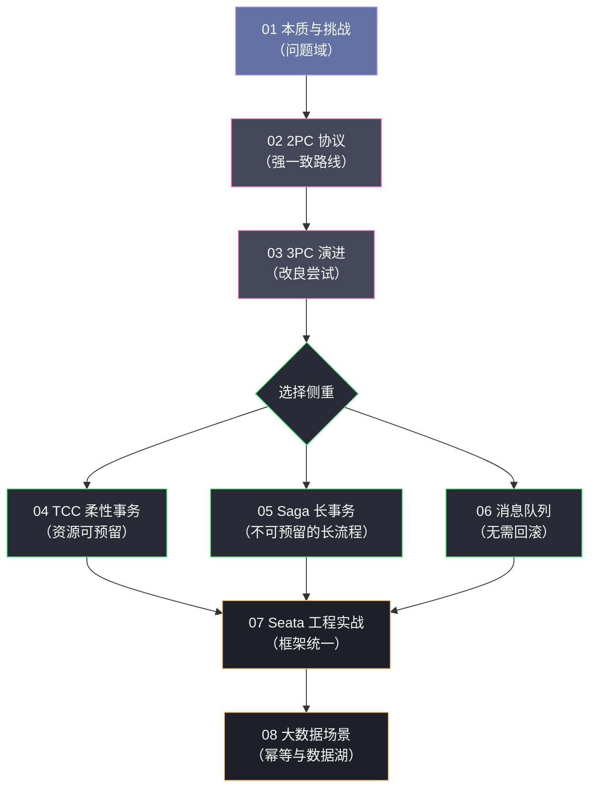

# 分布式事务专栏导览

> [!quote] 专栏定位
> 本专栏从单机事务的 ACID 本质出发，系统性地剖析分布式场景下事务一致性面临的根本挑战，逐层深入讲解各类分布式事务协议与模式的设计哲学、工程实现与生产边界。目标读者是有一定分布式系统基础、希望彻底搞懂分布式事务"为什么这样设计"的后端工程师与架构师。本专栏不追求罗列方案，而是力求讲清每一条技术路线"从哪来、解决什么、代价在哪"。

## 专栏主线

分布式事务的全部内容，可以收敛为一条主线：**当"用锁保证原子性"这件事在分布式环境下不再可行时，系统应当如何取舍？**

沿着这条主线，专栏按照"理论约束 → 强一致协议 → 柔性事务 → 框架与场景"的顺序展开：

- **第 1 部分（01）** 建立问题域：ACID 的边界在哪里断裂，CAP 与 BASE 给出了怎样的取舍框架。
- **第 2 部分（02-03）** 强一致路线：2PC 如何在跨节点重建原子性，又为什么必然阻塞；3PC 的改良为何最终未能落地。
- **第 3 部分（04-06）** 柔性事务路线：TCC、Saga、消息队列三条支路，分别用"资源预留""提交后补偿""异步可靠投递"来处理一致性。
- **第 4 部分（07）** 框架统一：Seata 如何把多种模式收进一套架构。
- **第 5 部分（08）** 场景延伸：大数据场景下，一致性问题的形态如何从"原子性"转向"幂等性"。

## 专栏目录

| 序号 | 文章标题 | 核心议题 |
| :--- | :--- | :--- |
| 01 | [[01 分布式事务的本质与挑战]] | ACID 的边界、CAP 与 BASE、分布式事务问题空间的完整定义 |
| 02 | [[02 2PC 两阶段提交协议深度解析]] | 协议状态机、阻塞根因、脑裂场景、MySQL XA 工程实现 |
| 03 | [[03 3PC 三阶段提交与协议演进]] | 3PC 如何缓解 2PC 阻塞、网络分区下仍存在的不一致问题 |
| 04 | [[04 TCC 柔性事务模型原理与实践]] | Try-Confirm-Cancel 语义、幂等性设计、空回滚与悬挂的工程解法 |
| 05 | [[05 Saga 长事务编排模式深度解析]] | 编排与协调两种模式、补偿事务设计原则、与 TCC 的本质差异 |
| 06 | [[06 基于消息队列的最终一致性方案]] | 本地消息表、RocketMQ 事务消息的 Half Message 机制与适用边界 |
| 07 | [[07 Seata 框架原理与工程实战]] | AT/TCC/Saga/XA 四种模式底层实现，AT 模式 undo_log 与全局锁深度解析 |
| 08 | [[08 分布式事务在大数据场景下的实践]] | Flink Checkpoint exactly-once、Delta Lake/Iceberg 事务语义的工程落地 |

## 阅读路径建议

**理论优先**（想先建立完整认知）：`01 → 02 → 03 → 04 → 05 → 06 → 07 → 08`，顺序阅读，每一篇都为下一篇埋下伏笔。

**工程选型优先**（时间有限，先看结论）：`01（第 6 章选型框架）→ 07（第 8 章模式选型）→ 04/05/06（按业务选一支）`。

**只想搞懂 2PC 为什么慢**：`01（第 2、3 章）→ 02（第 4 章阻塞本质）`。

## 核心概念速查

| 概念 | 一句话定义 |
| :--- | :--- |
| **ACID** | 单机数据库事务的四个基本属性：原子性、一致性、隔离性、持久性 |
| **CAP 定理** | 分布式系统在网络分区时无法同时满足一致性与可用性 |
| **BASE 理论** | 对 AP 系统的实践总结：基本可用、软状态、最终一致性 |
| **2PC** | 两阶段提交，强一致性协议，存在同步阻塞与协调者单点问题 |
| **3PC** | 三阶段提交，引入超时机制缓解阻塞，但网络分区下仍可能不一致 |
| **TCC** | Try-Confirm-Cancel，业务层面的补偿型柔性事务，靠资源预留实现隔离 |
| **Saga** | 把长事务拆分为一系列本地事务，通过补偿事务实现回滚 |
| **本地消息表** | 把"发消息"转化为"写数据库记录"，用本地事务保证原子性 |
| **事务消息** | RocketMQ 的半消息机制，把原子性下沉到消息中间件 |
| **Seata** | 阿里开源的分布式事务框架，支持 AT/TCC/Saga/XA 四种模式 |
| **全局锁** | AT 模式在 TC 侧维护的行级锁，用于保证全局事务之间的写隔离 |
| **Exactly-Once** | 流处理语义：每条输入消息对输出的影响恰好等同于被处理一次 |

## 贯穿全专栏的四条判断

本专栏反复出现的四条判断，建议在读每一篇时对照体会：

1. **没有银弹，架构即权衡**。刚性事务与柔性事务不是优劣之分，而是取舍之别。
2. **复杂性不会消失，只会转移**。柔性事务把复杂度从"协议层"转移到了"业务层与运维层"。
3. **幂等是柔性事务的入场券**。任何依赖重试的机制，都必须先解决幂等。
4. **框架降低的是使用门槛，不是复杂度本身**。越是"零侵入"的工具，越需要理解其机制。

---

## 关联专栏

- [[分布式架构/分布式系统原理与协议/00 专栏导览|分布式系统原理与协议]]：CAP、FLP、Paxos/Raft 等理论基础
- [[分布式架构/分布式锁/00 专栏导览|分布式锁]]：分布式互斥的实现与边界，与分布式事务共享"用超时换活性"的取舍
- [[分布式架构/数据密集型系统架构实战/00 专栏导览|数据密集型系统架构实战]]：事务、一致性与分布式系统的工程权衡
- [[中间件/MySQL/MySQL架构与底层原理/00 专栏导览|MySQL 底层原理]]：MySQL XA 事务、InnoDB MVCC 与本地事务
- [[中间件/MySQL/MySQL进阶使用/00 专栏导览|MySQL 进阶]]：分库分表场景下的分布式事务实践
- [[中间件/Kafka/00 专栏导览|Kafka]]：基于消息队列的最终一致性方案
- [[Java/SpringCore/00 专栏导览|Spring]]：Spring 事务管理与分布式事务的整合

---

*创作于 2026-03-03，2026-10-10 全文重写 | 分布式事务专栏*
