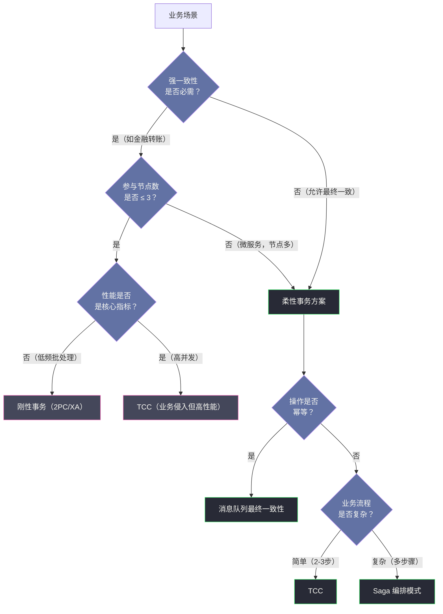

# 01 分布式事务的本质与挑战

**摘要：**

本文是分布式事务专栏的开篇，目标是为后续所有协议与框架的学习构建清晰的"问题域"认知。文章从单机数据库事务的 ACID 属性出发，逐一拆解每个属性的语义边界与实现代价，然后回答一个关键问题：为什么把一套在单机上运转了数十年的机制搬到分布式环境中，会遭遇根本性的困难？围绕这个问题，文章依次讨论网络不可靠带来的原子性困境、全局时钟缺失带来的隔离性困境，以及 FLP 不可能定理对共识问题的判决；进而引出 CAP 定理的严格含义与常见误读、BASE 理论的工程哲学，最终建立起"刚性事务与柔性事务"这条贯穿全专栏的认知主线。读完本文，你应当能回答两个问题：分布式事务的困难究竟难在哪里，以及后续每一篇文章分别在解决哪个子问题。

---

## 第 1 章 从一次转账说起：事务到底在解决什么

### 1.1 一个跨越半个世纪的问题

分布式事务并不是一个新鲜的话题。早在 1978 年，Jim Gray 在《Notes on Data Base Operating Systems》这篇如今被奉为数据库系统奠基文献之一的论文中，就系统性地讨论了原子提交（Atomic Commitment）问题，并给出了两阶段提交协议的最初形态。此后近半个世纪，从 1981 年 Skeen 的三阶段提交，到 1987 年 Garcia-Molina 的 Saga，从 1989 年 Lamport 的 Paxos，到 2014 年 Ongaro 的 Raft，一代代研究者与工程师围绕着"如何让分布在不同机器上的操作保持一致"这个命题，反复在安全性与可用性之间寻找平衡点。

有意思的是，这些方案看起来花样繁多，但它们的核心分歧始终只有一条：当网络分区、节点故障这些不可回避的现实发生时，系统应当优先保住一致性，还是优先保住可用性。看清了这条主线，后续每一篇文章的位置就都清楚了——它们不过是这条主线上的不同站点。

### 1.2 转账的两条 SQL

在思考分布式事务之前，不妨先回到最原始的问题：事务（Transaction）到底是什么，它解决了什么问题？

设想一个最经典的银行转账场景：用户 A 向用户 B 转账 100 元。从数据库的视角看，这个操作被拆解为两条 SQL：

```sql
UPDATE account SET balance = balance - 100 WHERE user_id = 'A';
UPDATE account SET balance = balance + 100 WHERE user_id = 'B';
```

这两条语句必须**要么全部成功，要么全部失败**。倘若第一条执行成功，而第二条恰好在系统崩溃时未能执行，那么 A 的钱就凭空消失了，账目上出现了一个无法解释的窟窿。这类错误在会计学上有一个专门的说法——账不平，而账不平是所有业务系统都无法接受的。

这个场景描述的恰好是事务要解决的核心问题：如何把多个操作绑定为一个不可分割的逻辑单元，使得无论中途发生什么异常，数据始终处于一个可以被解释的状态。

单机数据库用 ACID 模型给出了答案。在单机世界里，所有操作都发生在同一个进程、同一块内存、同一块磁盘上，数据库可以通过预写日志（WAL，Write-Ahead Log）、多版本并发控制（MVCC，Multi-Version Concurrency Control）、锁机制等手段精确地控制事务的执行与回滚。这套机制自上世纪七十年代 Jim Gray 等人奠定基础以来，已经运转了数十年，成熟而可靠。

不过，一旦业务规模超过单机极限，系统被迫拆分为多个微服务、数据被分散到多个独立数据库时，原本在单机内部可以精确控制的事务边界就被打破了——参与事务的各方不再共享同一个进程、同一块内存，它们之间只能通过网络通信来协调。而网络，是不可靠的。

> [!info] 事务边界的三种形态
> 理解分布式事务，先要理解"事务边界"这个概念。边界之内，一致性由本地机制保证；边界之外，一致性只能靠协议协商。单机事务的边界是进程与磁盘；分布式事务的边界是网络。边界一旦跨越网络，所有在单机内被"物理确定性"掩盖的问题——延迟、丢包、乱序、时钟偏差——都会立刻浮出水面。分布式事务的全部困难，都源于这条边界的位移。

这就是分布式事务问题的起点。它不是单机事务的简单放大，而是一次范式层面的断裂。

---

## 第 2 章 ACID 的本质：四个属性背后的代价

在深入分布式的困难之前，必须把 ACID 的每一个字母真正理解透彻。很多人背过 ACID 的定义，但对于每个属性"为什么需要这样""不满足会怎样"却未必清晰。更麻烦的是，ACID 的四个属性并非平级——它们的实现代价差异极大，而正是这种代价差异，决定了分布式事务方案的分化方向。

### 2.1 原子性：事务是最小的执行单元

**原子性（Atomicity）**要求事务中的所有操作，要么全部提交成功，要么全部回滚，不允许出现部分成功的中间状态。

原子性解决的是故障场景下的一致性。它的实现依赖两个核心机制：

其一是**回滚日志（Undo Log）**。在执行数据修改之前，先把修改前的旧值记入 Undo Log。一旦事务失败或被回滚，数据库便依据 Undo Log 把数据恢复到事务开始前的样子。

其二是**预写日志（WAL）**。所有修改在真正落盘到数据文件之前，必须先写入重做日志（Redo Log）。这保证了即使系统在数据落盘前崩溃，重启后也能通过 Redo Log 重放已提交的操作，或依据 Undo Log 回滚未提交的事务。

> [!note] 原子性不等于瞬间完成
> 原子性并不意味着事务的所有操作在物理时间上是同时发生的。它的真实含义是：从外部观察者的角度看，事务的中间状态不可见。数据库用隔离机制把中间状态屏蔽掉了，观察者看到的只有"开始之前"和"结束之后"两个稳定状态。把原子性误读为"瞬时完成"，是理解两阶段提交时最常见的一个思维陷阱。

原子性在单机上的实现成本相对可控，因为 Undo Log 与 Redo Log 都在同一台机器的磁盘上，崩溃恢复是一个单机问题。但在分布式场景下，"回滚"意味着要通知所有参与节点撤销各自的操作——如果某个节点在收到回滚通知之前就已经崩溃，或者回滚通知本身在网络中丢失，原子性便无从保证。这是后文要反复回到的主题。

### 2.2 一致性：一个被严重混淆的字母

ACID 的一致性（Consistency）是四个属性中最容易被误解的一个，尤其是它与 CAP 定理中的"一致性"含义完全不同。

**ACID 的 C**：事务执行前后，数据库必须从一个合法状态转变到另一个合法状态。这里的合法性由完整性约束定义，包括主键约束、外键约束、CHECK 约束，以及"账户余额不能为负"这类业务规则。

**CAP 的 C**：在分布式系统中，所有节点在同一时刻看到的数据是相同的，即线性一致性（Linearizability）——写操作一旦完成，后续所有读操作都必须能看到这次写入的结果。

这是两个截然不同的语义。前者是**语义层面**的约束，描述"数据是否满足业务规则"，由应用逻辑保证；后者是**时序层面**的约束，描述"多副本之间的写可见性"，由分布式协议保证。把两者混为一谈，是许多技术讨论产生歧义的根源。

值得注意的是，在 ACID 模型内部，一致性在某种意义上是其他三个属性（AID）共同作用的目标而非独立机制——正是通过原子性、隔离性和持久性的协同，数据库才得以维持一致的状态。这也是为什么在讨论分布式事务时，真正需要额外设计的是 A、I、D 三者在跨节点场景下的扩展，而 C 更多是前三者的结果。

### 2.3 隔离性：并发事务互不干扰

**隔离性（Isolation）**处理的是多个事务并发执行时的相互影响。在没有隔离保障的情况下，并发事务会产生四类经典问题：

| 问题 | 描述 | 举例 |
| :--- | :--- | :--- |
| **脏读（Dirty Read）** | 读取到其他事务未提交的修改 | 事务 B 读取了事务 A 修改但未提交的余额 |
| **不可重复读（Non-Repeatable Read）** | 同一事务内两次读取同一行，结果不同 | 事务 A 两次读取余额，期间事务 B 完成了转账 |
| **幻读（Phantom Read）** | 同一事务内两次范围查询，结果集不同 | 事务 A 两次统计账户数量，期间事务 B 新增了账户 |
| **丢失更新（Lost Update）** | 两个事务同时修改同一行，后者覆盖前者 | 事务 A 和 B 同时对余额加 100，最终只加了 100 |

SQL 标准定义了四个隔离级别，用不同的权衡来处理这些问题：

| 隔离级别 | 脏读 | 不可重复读 | 幻读 | 实现机制 |
| :--- | :--- | :--- | :--- | :--- |
| **读未提交（Read Uncommitted）** | 可能 | 可能 | 可能 | 无锁 |
| **读已提交（Read Committed）** | 不可能 | 可能 | 可能 | 读时获取行共享锁 |
| **可重复读（Repeatable Read）** | 不可能 | 不可能 | 可能（InnoDB 已解决）| MVCC + 间隙锁 |
| **可串行化（Serializable）** | 不可能 | 不可能 | 不可能 | 全表锁或 SSI |

隔离性的实现代价随级别升高而显著增加。MySQL InnoDB 的默认隔离级别是"可重复读"，通过 MVCC 解决了大部分并发问题，同时在性能与正确性之间取得了较好的平衡。

在分布式场景下，隔离性面临的挑战更为严峻：要保证跨节点事务的隔离性，要么需要一把全局锁（严重影响性能），要么需要一套复杂的分布式 MVCC 协议（实现代价极高）。这正是 Google Spanner、TiDB 这类分布式数据库在工程上极为复杂的原因之一——它们不得不在全局时钟、事务管理器、副本共识等多个层面同时下功夫，才能让"跨节点可串行化"这件事勉强成立。

### 2.4 持久性：已提交的数据永不丢失

**持久性（Durability）**保证：事务一旦提交，其结果就是永久性的，即使系统随后发生崩溃，已提交的数据也不会丢失。

持久性同样依赖 WAL：事务提交时，必须确保对应的 Redo Log 已经刷入持久化存储。只要 Redo Log 存在，系统重启后就能重放日志，恢复已提交事务的结果。

在分布式场景下，持久性的含义被扩展为：已提交的事务结果必须在**足够多的副本**上持久化，以防止单点故障导致数据丢失。这引出了"写入多数派（Quorum Write）"的设计理念——一份数据写到超过半数的副本上，才被认为真正持久，因为此时最多只有一个少数派副本可能丢失。这个理念是 Paxos 与 Raft 等共识算法的重要基础，也是分布式系统里"持久"一词含义发生迁移的典型例证：在单机上，持久意味着"写进了磁盘"；在分布式里，持久意味着"写进了多数派"。

### 2.5 四个属性的代价排序

把四个属性放在一起比较，会发现它们的实现代价并不对等，这个代价排序直接决定了分布式事务方案的设计空间。

**持久性最贵**。它要求每次提交都执行一次 fsync，把日志刷入物理磁盘，这是一次同步 I/O，耗时通常在毫秒量级。在高并发系统中，fsync 往往就是整个事务链路最慢的一环。

**隔离性次之**。它要么依赖锁（写时阻塞，读时也阻塞），要么依赖 MVCC（写时维护多版本，读时判断可见性），两者都在吞吐量与内存上付出成本。

**原子性在单机相对便宜**。因为 Undo Log 与 Redo Log 都在本地，回滚与恢复是纯粹的本地操作，不涉及网络协调。

**一致性则是结果而非机制**，它由前三个属性共同支撑。

这个排序的意义在于：既然持久性与原子性都难以放松，那么分布式事务方案的腾挪空间，几乎全部集中在隔离性上。刚性事务试图在分布式环境下重建隔离性（用全局锁或全局 MVCC），代价是阻塞；柔性事务则主动放弃隔离性，把并发控制的责任下推给业务逻辑——TCC 的冻结字段、Saga 的语义锁，本质上都是把"隔离"从数据库层搬到了应用层。理解了这一点，你就能看穿所有柔性事务方案背后那条共同的设计思路。

---

## 第 3 章 从单机到分布式：ACID 在哪里断裂

至此，ACID 的每个属性及其实现机制都已清楚。接下来的关键问题是：当系统从单机扩展到分布式时，ACID 的哪些假设被打破了？笔者的经验是，把这个问题回答清楚，比记住任何一个具体协议都更有价值，因为它决定了你面对一个新协议时，能否一眼看出它在跟哪个困难作斗争。

### 3.1 网络的不可靠性：分布式系统的第一性原理

在单机数据库中，所有操作都发生在同一个进程内，组件之间通过函数调用或共享内存通信。这种通信方式有一个重要特性：要么成功，要么明确失败——你不会遇到"不知道是否成功"的情况。函数调用返回了，就是成功；抛异常了，就是失败；中间没有灰色地带。

但在分布式系统中，节点之间只能通过网络通信，而网络具备三种根本性的不确定性：

其一是**消息延迟**。网络延迟不可预测，消息可能在几毫秒内到达，也可能延迟数秒。你无法区分"消息还在路上"和"对方节点已崩溃"——这两种情况在调用方的视角里完全一样，都是"还没收到回复"。

其二是**消息丢失**。网络包可能在传输过程中丢失，或被中间设备丢弃。

其三是**消息乱序**。即使消息都到达了，也不保证按发送顺序到达，先发出的消息可能后收到。

这三种不确定性共同导致了一个经典难题，学术上称为**两将军问题（Two Generals Problem）**。

> [!info] 两将军问题
> 两支军队的将军要通过信使协调同时进攻敌军，而信使必须穿越敌军阵地，可能被截获。将军 A 发出进攻信号后，无法确认将军 B 是否收到；将军 B 回复确认后，也无法确认将军 A 是否收到了确认。无论增加多少轮通信，总有最后一条消息的送达状态无法被确认。
>
> 这个问题已被数学证明无解——在不可靠的网络上，两个节点无法通过有限次通信达成百分之百确定的共识。

两将军问题揭示了分布式系统的本质困境：**确认本身需要再次确认，形成无限递归**。现实中的分布式协议（2PC、Paxos）并非解决了这个问题，而是通过引入额外约束（协调者、超时机制、多数派决策）来在实际场景中规避它的影响。这一点在后文讨论 FLP 定理时会再次出现——所有实用的共识协议，本质上都是在给一个不可能问题补充假设，把它降格为一个可以求解的问题。

### 3.2 原子性的困难：跨节点回滚谁来保证

假设一个分布式转账场景：服务 A 的账户在数据库节点 DB1 上，服务 B 的账户在数据库节点 DB2 上。转账需要在 DB1 上扣款，在 DB2 上入账。

```
转账服务
    ↓
 DB1（扣款 -100）    DB2（入账 +100）
```

要保证这个操作的原子性，至少需要解决以下问题：

- **DB1 扣款成功，但转账服务在通知 DB2 之前崩溃**：DB2 的入账永远不会执行，钱凭空消失。
- **DB1 扣款成功，DB2 入账也成功，但 DB2 的确认消息在网络中丢失**：转账服务以为事务失败而尝试回滚，结果 DB1 扣款被撤销，DB2 的入账却无法撤销——钱凭空多出来。
- **DB1 在执行扣款时崩溃，状态未知**：扣款究竟有没有成功？回滚指令该不该发出？

这些场景都无法通过单节点的 Undo Log 和 WAL 解决，因为这两个机制只在本地节点有效。**在分布式环境中保证原子性，需要一个专门的跨节点协调协议——这正是两阶段提交被发明的原因**。

### 3.3 隔离性的困难：全局时序如何定义

在单机数据库中，"时序"是明确的——所有操作都发生在同一台机器上，CPU 时钟就是全局时序基准，MVCC 可以利用这个确定性时序为每个事务打上时间戳，实现高效的并发控制。

但在分布式系统中，不同节点的时钟并不完全同步。即便使用 NTP（Network Time Protocol）校准，节点间的时钟偏差（Clock Skew）仍可能达到数百毫秒。这意味着：

- 节点 A 上时间戳为 T 的事件，与节点 B 上时间戳为 T+1 的事件，在物理时间上谁先谁后是不确定的。
- 全局事务的快照隔离需要一个全局一致的"快照时间点"，在缺乏精确全局时钟的情况下，这非常难以实现。

Google 为此专门研发了 TrueTime API——通过 GPS 与原子钟的组合，把全局时钟的不确定性压缩到 7ms 以内，并在 Spanner 中以此实现了全球范围的外部一致性（External Consistency）。但这套方案的硬件成本极高，普通企业难以复制。

这里可以打一个比方：全局时钟之于分布式事务，就像一把刻度精确的尺子之于测量。单机世界自带这把尺子，分布式世界则没有——你能做的要么是造一把昂贵的尺子（TrueTime），要么放弃对绝对时刻的依赖，改用"因果顺序"这类相对关系（逻辑时钟、向量时钟）。这两条路，后文都会展开。

### 3.4 一个不可能定理：FLP 与分布式共识的边界

1985 年，Fischer、Lynch 和 Paterson 三位计算机科学家发表了一篇影响深远的论文，证明了著名的 **FLP 不可能定理（FLP Impossibility）**：

> [!info] FLP 不可能定理
> 在完全异步的分布式系统中，即使只有一个进程可能发生故障（Crash Failure），也不存在一个确定性算法能够保证所有进程最终达成共识。
>
> 原文：Fischer, M. J., Lynch, N. A., & Paterson, M. S. (1985). Impossibility of distributed consensus with one faulty process. *Journal of the ACM, 32*(2), 374–382.

这个定理的影响是深远的：它告诉我们，在异步网络模型下，分布式共识问题是不可解的。任何分布式事务协议，都不可能同时满足"安全性（Safety）""活性（Liveness）"和"容错性"三者。

实际工程中的所有协议都是通过引入额外假设来绕过这个定理的：

- 2PC 假设协调者最终可达。若协调者崩溃，协议阻塞，牺牲活性。
- Paxos/Raft 假设"多数派节点可用"，牺牲部分可用性以换取安全推进。
- 引入超时机制，假设网络延迟有上界，把问题从纯异步模型降格为部分同步模型。

理解这一点非常重要：**分布式协议不是"解决"了 FLP，而是"绕过"了它**。每个协议的设计文档里，都藏着一句没有明写的假设。找不出这句话，就没真正读懂这个协议。

### 3.5 失败检测：如何区分"慢"与"死"

在展开 CAP 之前，还有一个贯穿所有分布式协议的基础问题值得单独说明：系统如何判断一个节点是"变慢了"还是"已经死了"？

这个问题的学术名称是**失败检测器（Failure Detector）**。在异步网络模型中，它无法被完美解决——因为不存在一个有限的超时阈值，能同时保证"不会把慢节点误判为死节点"和"不会无限期等待真正的死节点"。超时设得短，误判就多；超时设得长，故障恢复就慢。这与两将军问题同源，都是"不确定性无法被有限信息消除"的体现。

工程上的应对是引入**部分同步（Partial Synchrony）**假设：网络大部分时间正常工作，延迟存在上界，只是偶尔违反。在此假设下，心跳（Heartbeat）加超时成为事实上的标准做法。更进一步的做法是**租约（Lease）**——一种带过期时间的所有权承诺：持有租约的节点在一段确定的时间内独占某项权利，其他节点必须等到租约过期才能主张同一权利。租约用"时间"这个本来不可靠的东西，换来了"确定性"这个宝贵的东西，代价是必须容忍时钟偏差。

这里可以打一个比方：失败检测就像判断电话那头的人是不是还在听。你只能通过"对方有没有回应"来推断，而沉默既可能是对方在思考，也可能是对方已经挂断——在没有额外信息之前，这两者不可区分。所有分布式协议都必须先选定一种"沉默多久就当作挂断"的策略，而每一种选择都对应着一组具体的故障行为。后文讨论分布式锁时会再次遇到租约，讨论 Raft 时会再次遇到心跳超时，它们都是这个基础问题的具体解法。

---

## 第 4 章 CAP 定理：分布式系统设计的基础公理

理解了分布式系统面临的根本困难之后，CAP 定理就是把这些困难形式化为一个简洁命题的尝试。

### 4.1 CAP 定理的严格含义

**CAP 定理**由 Eric Brewer 在 2000 年的 PODC 会议上提出，当时还只是一个猜想，称为"Brewer 猜想"。2002 年，Gilbert 与 Lynch 给出了正式证明，猜想才成为定理：

> 对于一个分布式数据系统，以下三个性质不可能同时满足：
>
> - **C（Consistency，一致性）**：特指线性一致性——所有操作按实时顺序线性化，写操作完成后，后续所有读操作都能看到这次写入的最新值。
> - **A（Availability，可用性）**：每个非故障节点必须对收到的请求给出响应（不讨论响应速度）。
> - **P（Partition Tolerance，分区容错性）**：系统在发生网络分区时仍能继续运行。

> [!warning] "三选二"是误导性的表述
> CAP 定理并不是"三个属性任意选两个"的自由组合。在真实的分布式系统中，网络分区（P）是客观存在的物理现象，不是一个可以选择放弃的属性。真正的权衡是：**当网络分区发生时，你必须在 C 和 A 之间做选择**。把 CAP 说成"三选二"，会让人误以为存在一种"放弃 P、保住 CA"的选项，而这个选项在分布式语境下并不存在。

### 4.2 为什么 CA 不可能并存

有人可能会问：如果我选择牺牲 P，不容忍网络分区，不就能同时保证 C 和 A 了吗？

从表面上看似乎可以，但"不容忍网络分区"在分布式系统中意味着：一旦发生分区，系统要么停止服务（失去 A），要么允许节点间数据不一致（失去 C）。而网络分区在任何真实的多节点系统中都无法完全避免——光纤会被挖断，交换机可能宕机，机房之间可能因为路由震荡而暂时失联。

因此，**唯一真正能同时满足 CA 的系统是单机系统**——它只有一个节点，既不存在分区问题，也没有副本同步的问题。这也解释了为什么 CAP 常常被表述为"分布式系统在分区时必须二选一"：因为一旦你选择了分布式，P 就已经是一个既定前提。

### 4.3 CP 与 AP 的工程权衡

当网络分区发生时，系统只能二选一：

**选择 CP（一致性优先）**：分区发生时，系统拒绝处理可能导致数据不一致的请求，或等待分区恢复后再继续服务。典型代表有：

- ZooKeeper：当集群中少数派节点无法与 Leader 通信时，少数派节点拒绝写请求和部分读请求，宁可不可用也要保证数据一致。
- HBase：RegionServer 在无法与 Master 通信时会停止写服务。
- Google Spanner：通过 Paxos 多数派写入保证强一致，少数派节点不可用时系统等待。

**选择 AP（可用性优先）**：分区发生时，系统允许不同节点返回可能不一致的数据，但所有节点都保持可用。典型代表有：

- Cassandra：允许多个节点同时接受写请求，通过反熵（Anti-Entropy）机制在分区恢复后合并数据。
- Eureka：各节点保存本地服务注册表副本，即使部分节点不可达，剩余节点仍继续提供服务注册与发现。
- DNS 系统：允许短期内不同节点解析结果不一致，但所有节点都会响应查询。

> [!note] PACELC：CAP 之外的延迟权衡
> CAP 只讨论了"分区发生时"的权衡。Daniel J. Abadi 在 2012 年提出了 PACELC 理论，把讨论扩展到"无分区时"的场景：即使没有网络分区，分布式系统仍要在**延迟（Latency）**与**一致性（Consistency）**之间权衡。
>
> 例如，MySQL 的主从复制可以选择异步复制（低延迟，但主从可能不一致）或半同步复制（等待从库确认，高一致但高延迟）。这类权衡在 CAP 框架内无法描述，却在系统设计中同样重要。PACELC 的贡献在于提醒我们：一致性不是一个"只在故障时才需要面对"的问题，它是一个日常的、持续存在的成本项。

### 4.4 分布式事务语境下 CAP 意味着什么

在分布式事务的具体语境中，CAP 的含义可以这样理解：

- 一个**强一致的分布式事务系统（CP 倾向）**：在所有参与节点确认提交之前，事务不算成功。若某个节点不可达，事务必须等待或回滚。这正是两阶段提交的本质——它优先保证数据一致性，但在协调者崩溃或网络分区时会阻塞。
- 一个**高可用的分布式事务系统（AP 倾向）**：允许事务在部分节点确认前就返回成功，通过后续的补偿机制（回滚、重试）最终达到一致状态。这正是 TCC、Saga、消息队列等柔性事务方案的设计哲学。

### 4.5 不足与争议：CAP 是否被过度简化

CAP 是分布式领域流传最广的定理之一，也是被误用最多的定理之一。这里有必要专门澄清它受到的批评。

第一重批评来自术语层面。CAP 中的 C 严格指线性一致性，而现实中大量系统提供的并非线性一致性，而是因果一致性、读己之写等更弱但更实用的模型。用"CP 还是 AP"给系统贴标签，会掩盖这些真正影响业务行为的差异。Martin Kleppmann 在 2015 年撰文《Please stop calling databases CP or AP》，正是针对这种标签化的滥用。

第二重批评来自 Brewer 本人。他在 2012 年的回顾文章《CAP Twelve Years Later》中承认，CAP 在传播过程中被过度简化了：分区发生时的选择并非"全有全无"，系统完全可以在更细的粒度上做权衡——例如，对用户余额这类关键数据选择 C，对商品浏览量这类非关键数据选择 A。真实的系统设计，往往是在同一套架构里对不同数据施加不同的一致性策略。

因此，对 CAP 的正确态度是把它当作一个**思考工具**而非分类标签：它提醒你，分区是必须正视的现实，一致性是有价格的商品，而你的任务是在具体的业务约束下，为每一类数据找到合适的价格点。这也正是本专栏反复强调的立场——没有银弹，架构即权衡。

---

## 第 5 章 BASE 理论：AP 系统的工程实践哲学

如果说 CAP 定理告诉我们"鱼与熊掌不可兼得"，那么 **BASE 理论**就是告诉选择了 AP 的系统，应该如何有纪律地牺牲一致性。这里的关键词是"有纪律"——牺牲一致性并不等于放任不一致，而是要建立一套可预期、可收敛的机制。

### 5.1 BASE 的由来

BASE 理论由 eBay 的架构师 Dan Pritchett 于 2008 年在 ACM 发表的论文《Base: An ACID Alternative》中提出。它的名称本身就是一种对 ACID 的调侃——在化学上，BASE 是碱，是酸（ACID）的对立面；而它代表的三个要素，也恰好是对 ACID 强约束的逐步放松。

BASE 三要素为：**基本可用（Basically Available）**、**软状态（Soft State）**、**最终一致性（Eventually Consistent）**。

### 5.2 基本可用

基本可用并不是说系统随时都处于"部分可用"的状态，而是说：在出现故障时，系统被允许通过有损降级来维持核心功能的可用性，而不是选择完全停机等待恢复。

这种降级通常有两种形式：

其一是**响应时间降级**。正常情况下，用户请求在 100ms 内返回；系统过载或故障时，允许响应时间延长到 1s 甚至更久，只要最终能给出响应即可。

其二是**功能降级**。大促期间，电商系统可以临时关闭"查看历史订单"等非核心功能，集中资源保障"下单"和"支付"核心链路。

> [!warning] 基本可用不等于可以随意降级
> "基本可用"是有边界的——它允许的降级必须是可控的、有预案的、可恢复的。随意的无计划降级不是 BASE，而是系统缺乏韧性的表现。生产中的限流、熔断、降级策略，都是"基本可用"原则的工程化落地；而一个连降级预案都没有的系统，只是在碰运气。

### 5.3 软状态

**软状态**的含义是：系统被允许在某一时刻存在数据不一致的中间状态，前提是这个中间状态是临时的、有界的、可以被最终消除的。

这与 ACID 的原子性形成鲜明对比。ACID 要求事务从一个一致状态直接到另一个一致状态，不允许外部观察中间态；BASE 则承认中间态是分布式系统的客观存在，甚至主动设计能够容纳中间态的架构。

以电商下单流程为例：

```
T0：用户点击"下单"
T1：库存服务——库存 -1（中间态：库存已减，订单未创建）
T2：订单服务——创建订单记录（中间态：订单已创建，支付未发起）
T3：支付服务——扣减余额（终态：事务完成）
```

在 T1 到 T3 的时间窗口内，数据处于软状态。用户若在这段时间内查询，可能看到"库存已减但订单不存在"的中间状态。BASE 理论认为这是可以接受的，只要系统最终能消除这个不一致。

软状态设计的关键工程问题是：这个中间状态会持续多久？如果中间态无法被消除（例如补偿服务也失败了），又该如何处理？这引出了超时、重试、死信队列、人工对账等一系列工程实践。可以把软状态想象成一个"正在结算中的账单"——它不要求你每一秒都账实相符，但要求你在约定时间内必须结清；结不清的账单，必须进入专门的挂账流程，而不是无限期地悬着。

### 5.4 最终一致性

**最终一致性**是 BASE 三要素中最重要的一个，也是柔性事务方案的理论基础。

其含义是：如果系统在某段时间内没有新的更新操作，那么最终所有数据副本都会收敛到相同的状态。这个"最终"可以是毫秒级（局域网内），也可以是分钟甚至小时级（跨地域复制）。

在分布式事务的语境下，最终一致性有更具体的含义：一个跨多个服务的业务操作（如转账），允许在一段时间内存在中间状态（A 扣款了但 B 尚未到账），但系统必须保证最终达到一个明确的终态——要么全部成功，要么全部回滚，不能永远停留在中间态。

实现最终一致性的核心手段有以下几种：

| 手段 | 原理 | 适用场景 |
| :--- | :--- | :--- |
| **重试（Retry）** | 对失败的操作进行有限次重试，直到成功 | 幂等的操作 |
| **补偿（Compensation）** | 对已执行的操作执行语义相反的补偿操作 | TCC、Saga 模式 |
| **对账（Reconciliation）** | 定期比对多个系统的数据，发现并修复不一致 | 金融、支付系统 |
| **消息队列（MQ）** | 通过可靠消息传递保证操作最终被执行 | 跨服务异步调用 |

> [!warning] 最终一致性不等于"随便不一致"
> 最终一致性有一个隐含承诺：不一致的状态最终一定会被消除。这需要系统具备故障检测、自动恢复、数据对账等能力。一个只有"写入失败不处理"策略的系统，不是最终一致性，而是数据丢失。两者的区别，恰恰在于前者设计了收敛路径，后者只是把问题留给了未来。

### 5.5 收敛机制：最终一致性靠什么兜底

既然"最终"不会自己到来，就必须有机制去驱动它。工程上常见的收敛机制有三类，理解它们的差异，比记住"最终一致性"这个名词重要得多。

第一类是**写时收敛**。写入时若发现失败，立即同步重试，直到成功或达到重试上限。这类收敛延迟最低，但会拉长写入路径，且无法应对重试期间调用方本身崩溃的情况。

第二类是**后台异步收敛**。把失败的操作写入消息表或死信队列，由后台任务定期扫描、重试。这类收敛与业务写入解耦，可靠性更高，代价是存在一个可观测的延迟窗口。

第三类是**读时收敛**。读请求时顺带修复不一致（如 Cassandra 的 Read Repair）。这类收敛把修复成本分摊到读路径上，适合读多写少的场景，但无法保证未被读取的数据被修复。

需要清醒认识到的是，这三类机制都可能失败。当自动收敛穷尽之后，必须有一个最终的兜底：把无法自动收敛的差异记入待处理队列，交由人工对账处理。金融系统里"日终对账"这个环节，本质上就是这个兜底。**最终一致性的可靠性，等于收敛机制的可靠性**；把"最终一致"当成一个不需要兑现的承诺，是分布式系统里代价最昂贵的幻觉之一。

---

## 第 6 章 刚性事务与柔性事务：分布式事务的两条路

基于以上对 ACID 边界、CAP 困境与 BASE 理论的理解，可以把分布式事务的解决方案归为两大类。这条分界线，贯穿了整个专栏的后续所有文章。

### 6.1 刚性事务：追求分布式场景下的 ACID

**刚性事务**是指试图在分布式环境中保持 ACID 级别强一致性的事务方案。

> [!info] 核心思路
> 通过一个**协调者（Coordinator）**统一调度所有参与节点的事务提交与回滚：在所有参与者都确认可以提交之前，不允许任何参与者单独提交；一旦任何参与者表示无法提交，所有参与者都必须回滚。

典型代表是两阶段提交（2PC，Two-Phase Commit）、三阶段提交（3PC，Three-Phase Commit），以及数据库原生的 XA 协议。

刚性事务的特点与代价：

| 优点 | 代价 |
| :--- | :--- |
| 提供 ACID 级别的强一致性保证 | 同步阻塞：所有参与者必须等待协调者指令 |
| 对业务代码透明，无需业务感知 | 单点故障：协调者崩溃导致事务无限阻塞 |
| 与数据库原生支持（XA）结合好 | 性能差：锁持有时间长，吞吐量低 |
| | 不适合微服务：要求参与者支持 XA 协议 |

刚性事务适合的场景是：强一致性要求极高、参与节点数量少（2 到 3 个）、对性能要求不极端。例如单库跨实例的分布式事务、传统金融系统的批处理业务。

### 6.2 柔性事务：用最终一致性换取高可用

**柔性事务**是指放弃强 ACID 保证、基于 BASE 理论设计的分布式事务方案。它的核心思路是：允许系统在一段时间内处于不一致状态，但通过补偿机制保证最终达到一致。

柔性事务不试图用一把全局锁锁住所有参与者，而是让每个参与者独立执行本地事务，然后通过两类手段收敛：

1. **业务补偿**：如果某一步失败，通过逆向操作撤销已完成的步骤（TCC、Saga）。
2. **可靠消息传递**：通过消息队列保证操作最终被执行，即使中途失败也会重试（事务消息、本地消息表）。

典型代表如下表所示：

| 方案 | 核心机制 | 一致性级别 |
| :--- | :--- | :--- |
| **TCC** | Try/Confirm/Cancel 三阶段业务补偿 | 最终一致（有短暂不一致窗口）|
| **Saga** | 本地事务序列 + 补偿事务 | 最终一致（允许软状态）|
| **本地消息表** | 本地 DB 存消息 + 轮询发送 | 最终一致（异步）|
| **事务消息（RocketMQ）** | Half Message + 事务回查 | 最终一致（异步）|

柔性事务的特点与代价：

| 优点 | 代价 |
| :--- | :--- |
| 高可用：无单点阻塞 | 需要业务代码感知事务逻辑 |
| 高性能：无长时间持锁 | 补偿逻辑实现复杂 |
| 适合微服务架构 | 存在短暂的数据不一致窗口 |
| 支持跨语言、跨技术栈 | 幂等性设计要求高 |

### 6.3 如何选择：一个决策框架

面对具体业务场景时，如何选择刚性还是柔性事务？可以从强一致性是否必需、参与节点数量、性能要求等维度逐步判断。下面这张决策树，是后续各篇反复引用的选型骨架：



需要提醒的是，这张决策树描述的是"技术可行性"层面的取舍，而不是"业务最优"层面的取舍。实际选型时还要叠加组织能力、团队熟悉度、运维成本等因素——一个团队能熟练维护的方案，往往胜过理论上更优雅但没人懂的方案。这正是架构决策的常态：没有最优解，只有最合适的解。

### 6.4 刚性事务真的过时了吗

柔性事务近十年风头正盛，容易让人产生一种印象：刚性事务已是明日黄花。这个判断并不准确。

一方面，在金融核心系统、跨库批量对账这类"一致性高于一切"的场景，2PC/XA 依然是不可替代的选择。这些场景的并发量本就不高，2PC 的吞吐量劣势不构成瓶颈，而它对业务代码的透明性反而是优点——业务开发者不需要为事务单独设计补偿逻辑。

另一方面，现代分布式数据库重新激活了刚性事务路线，但方式与过去不同。它们不再试图修补传统 2PC 的协调者单点，而是用 Paxos/Raft 把"协调者"本身变成一个高可用集群，从而在保留强一致语义的同时消除了大部分阻塞风险。Spanner、TiDB、CockroachDB 都是这条路线的产物，它们把 2PC 与共识协议组合起来，让"分布式强一致"第一次具备了大规模商用的可行性。

由此可见，刚性事务与柔性事务并非取代关系，而是分工关系：前者适合"少而重"的事务，后者适合"多而轻"的事务。真正成熟的架构，往往同时使用两者——核心资金链路走刚性，外围业务链路走柔性。这一认知，也是理解本专栏后续各篇的前提。

---

## 第 7 章 分布式事务的全局问题空间

在进入后续各篇之前，先俯瞰一下这个问题域的全貌，明确每篇文章分别解决哪个子问题。

### 7.1 三类核心难题

分布式事务的所有挑战，可以归纳为三类核心难题：

其一是**跨节点原子性**。如何保证多个独立节点上的操作要么全部成功、要么全部失败？这是 2PC、3PC 解决的核心问题。

其二是**跨服务补偿**。当部分操作已经成功提交、无法物理回滚时，如何通过业务层的补偿操作恢复一致性？这是 TCC 与 Saga 解决的核心问题。

其三是**异步可靠性**。如何在不阻塞调用方的前提下，保证操作最终被执行？这是消息队列事务方案解决的核心问题。

### 7.2 三个贯穿始终的工程挑战

无论选择哪种方案，都会面临三个贯穿始终的工程挑战：

其一是**幂等性（Idempotency）**。由于重试是保证最终一致性的核心手段，所有参与操作都必须是幂等的——同一操作执行一次与执行多次的结果必须相同。

其二是**空回滚与悬挂（Empty Rollback & Suspension）**。这两个问题是 TCC 模式特有的：

- **空回滚**：Cancel 在 Try 从未执行的情况下被调用（网络分区导致 Try 超时后，协调者发出 Cancel，而此时 Try 可能根本没到达目标服务）。
- **悬挂**：Try 在 Cancel 执行之后才到达目标服务（Cancel 先执行，后来迟到的 Try 不应再执行，否则资源将被永久锁定）。

其三是**事务隔离性**。柔性事务方案通常不提供完整的事务隔离性。在事务执行过程中，中间状态可能对外可见，导致其他业务逻辑读取到"脏数据"。如何在业务层面实现适当的隔离，是柔性事务方案设计的重要课题。

### 7.3 一个前置判断：能否用架构手段避免分布式事务

在讨论各种分布式事务方案之前，有一个更根本的问题值得先问：这个分布式事务，是否真的必须存在？

分布式事务之所以昂贵，根源在于它把两个本可以独立演化的服务强行绑定在一个原子操作里。如果业务本身允许把它们拆开，那么复杂度根本不会出现。例如，"下单"与"扣库存"是否必须在同一个事务中完成？若业务能接受"先创建订单、再异步扣减库存，扣减失败则取消订单"的流程，那么这里需要的就不是分布式事务，而是一段事件驱动的最终一致流程——它的实现远比 TCC 简单，故障面也小得多。

类似的思路还有若干：把强相关的数据收敛到同一个服务，让事务退化为本地事务（数据本地化）；把同步调用改为事件驱动的异步流程，让一致性目标从"强一致"降级为"最终一致"（事件驱动架构）；用状态机把一次长流程拆成若干可独立推进的状态迁移，让每一步都只涉及单个服务的本地事务。

这些手段并不能解决所有问题——资金划转、库存超卖这类场景，业务上确实无法容忍中间状态，分布式事务依然不可避免。但**在多数被"顺手"加上分布式事务的地方，先问一句"能不能不这么做"，往往能省掉整套补偿框架的维护成本**。架构者的第一职责是做决策权衡，而避免引入不必要的复杂度，本身就是最重要的一种权衡。

### 7.4 专栏后续内容预告

基于以上对问题空间的梳理，专栏后续各篇将深入各个解决方案：

- **02 两阶段提交协议深度解析**：深入 2PC 的状态机模型，剖析协议阻塞的根因，分析 MySQL XA 的工程实现细节与生产踩坑。
- **03 三阶段提交与协议演进**：理解 3PC 在 2PC 基础上的改进思路，以及它仍然无法解决的根本问题。
- **04 TCC 柔性事务模型原理与实践**：从业务层面重新定义"事务边界"，深入 Try/Confirm/Cancel 的语义设计，以及幂等、空回滚、悬挂的完整工程解法。
- **05 Saga 长事务编排模式深度解析**：面向复杂业务流程的长事务解决方案，对比编排与协调两种实现模式。
- **06 基于消息队列的最终一致性方案**：利用消息队列的可靠传递特性实现异步最终一致性，深入 RocketMQ 事务消息的 Half Message 机制。
- **07 Seata 框架原理与工程实战**：工业级分布式事务框架的完整解析，重点剖析 AT 模式的 undo_log 机制与全局锁实现。
- **08 分布式事务在大数据场景下的实践**：Flink Checkpoint 的 exactly-once 语义与 Hudi/Iceberg 数据湖事务的工程落地。

---

## 参考资料

1. Brewer, E. A. (2000). Towards robust distributed systems. *PODC 2000 Keynote*.
2. Gilbert, S., & Lynch, N. (2002). Brewer's conjecture and the feasibility of consistent, available, partition-tolerant web services. *ACM SIGACT News, 33*(2), 51–59.
3. Fischer, M. J., Lynch, N. A., & Paterson, M. S. (1985). Impossibility of distributed consensus with one faulty process. *Journal of the ACM, 32*(2), 374–382.
4. Pritchett, D. (2008). Base: an acid alternative. *ACM Queue, 6*(3), 48–55.
5. Gray, J. (1978). Notes on data base operating systems. *Operating Systems: An Advanced Course*, LNCS 60, 393–481.
6. Abadi, D. J. (2012). Consistency tradeoffs in modern distributed database system design. *IEEE Computer, 45*(2), 37–42.
7. Bernstein, P. A., Hadzilacos, V., & Goodman, N. (1987). *Concurrency Control and Recovery in Database Systems*. Addison-Wesley.

---

> [!note] 思考题
> 1. ACID 的 C 与 CAP 的 C 是两个截然不同的概念，前者描述"数据满足业务规则"，后者描述"多副本的写可见性"。在微服务架构中，业务规则往往跨越多个服务，此时"ACID 的 C"由谁来保证？如果由应用层保证，它与分布式事务的关系是什么？
> 2. 两将军问题证明了"确认本身需要再确认"的无限递归。实际的分布式协议通过引入超时、多数派等假设来规避它。请举例说明：一个协议引入的假设一旦不成立（例如网络延迟超过超时阈值），会产生什么样的错误后果？
> 3. BASE 理论要求最终一致性必须"可收敛"。在设计一个跨服务的最终一致性方案时，你如何保证收敛路径一定存在？如果补偿操作本身也会失败，系统的兜底策略应该是什么？
