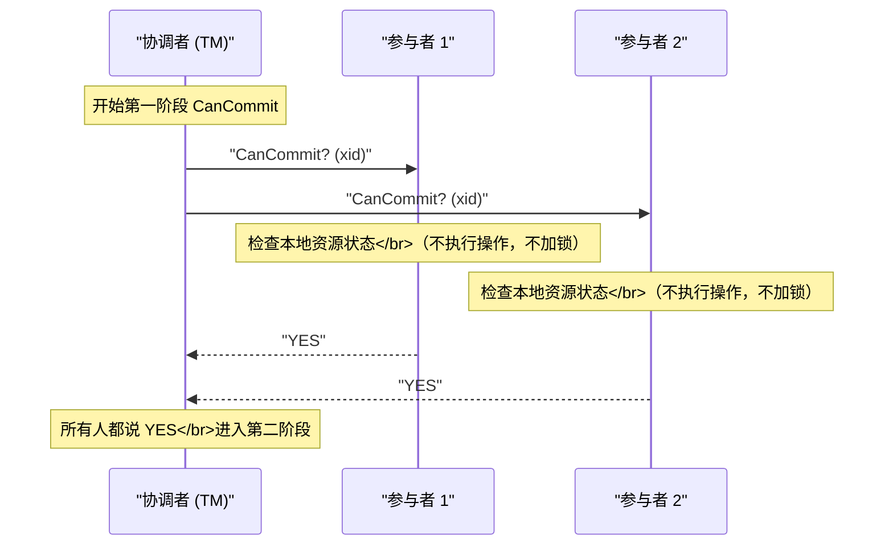
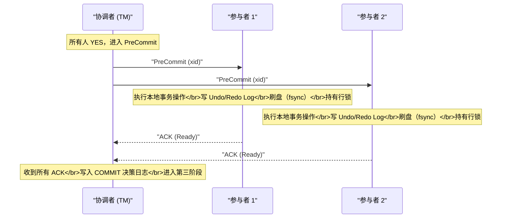
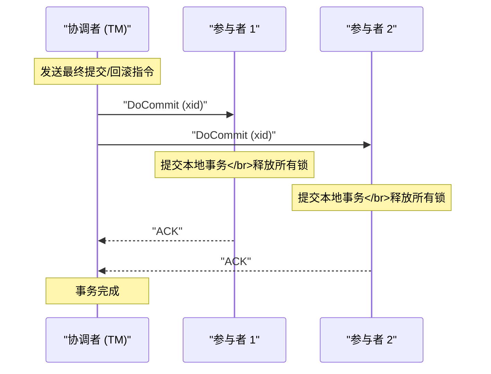
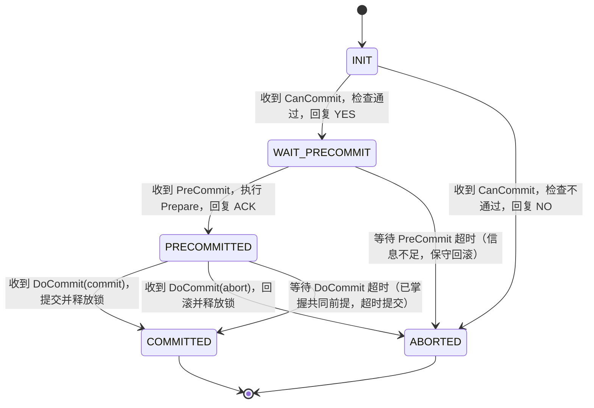
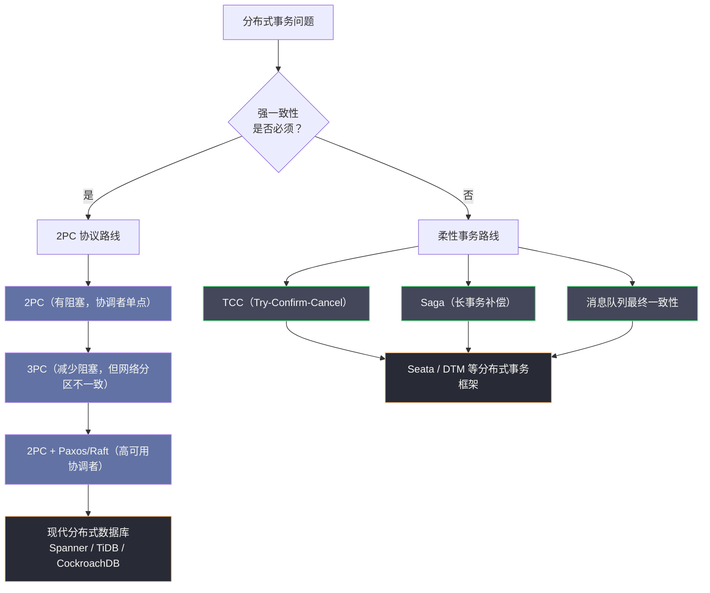

# 03 3PC 三阶段提交与协议演进

**摘要：**

三阶段提交（Three-Phase Commit，3PC）是对 2PC 阻塞问题的第一次严肃改良尝试。本文从 2PC 的阻塞根因切入，推导出 3PC 为何要引入第三个阶段 CanCommit，以及超时自决机制的设计逻辑；随后以同样的"故障注入"视角分析 3PC 在各类故障场景下的表现，揭示它虽然消除了大部分阻塞，却在网络分区场景下引入了新的数据不一致风险；进而辨析原子提交协议与分布式共识协议的本质区别，梳理从 2PC 到 3PC 再到 Paxos/Raft 的演进脉络；最后解释为什么实际工程中 3PC 几乎没有落地，以及现代分布式系统选择了怎样的替代路径。读完本文，你应当能回答两个问题：3PC 用超时自决换来了什么、又付出了什么，以及为什么"给参与者更多信息"并不能彻底解决阻塞问题。

---

## 第 1 章 回顾：2PC 的阻塞问题究竟卡在哪里

在深入 3PC 之前，必须把 2PC 阻塞问题的根因精确地钉住——因为 3PC 的每一个设计决策，都是针对这个根因的直接回应。1981 年，Dale Skeen 在论文《Nonblocking Commit Protocols》中第一次系统分析了这个问题，并给出了"非阻塞提交协议"是否可能的形式化讨论。这篇论文是 3PC 的理论源头，也是理解整个改进思路的钥匙。

### 1.1 参与者的困境：被剥夺的决策权

在 02 两阶段提交协议深度解析中，我们详细分析了 2PC 的各类故障场景。其中最棘手的是这个：

> 参与者回复了 YES（进入 PREPARED 状态）后，协调者在发送 COMMIT/ABORT 指令过程中崩溃。此时参与者既不能单方面提交（万一协调者的决策是 ABORT），也不能单方面回滚（万一协调者的决策是 COMMIT，其他参与者已经提交了），只能死等。

这里的关键矛盾是：**参与者在回复 YES 的那一刻，就永久性地放弃了自主决策的权利，但获得最终决策的途径（协调者）却可能永久失联**。

用更形象的比喻：参与者就像一个已经签下"我同意"的当事人，但协议书的最终内容要等另一方（协调者）填写。如果另一方失踪了，这个当事人被永远卡在"已同意但不知道具体结果"的状态，既不能撕毁协议，也不能确认协议。这个困境的荒诞之处在于：参与者明明掌握着自己的资源，却因为缺少一条关键信息，失去了对资源的所有处置权。

### 1.2 根因分析：为什么不能超时自决

有人会问：为什么不给参与者加一个超时机制——等待协调者一段时间后，自行决定提交或回滚？

问题在于：**参与者在 PREPARED 状态下，无论选择超时提交还是超时回滚，都可能造成数据不一致**。

**如果超时后自行提交**：假设协调者的实际决策是 ABORT，另一个参与者已经根据 ABORT 指令回滚了。这时候这个参与者自行提交，就出现了"一个提交、一个回滚"的不一致。

**如果超时后自行回滚**：假设协调者的实际决策是 COMMIT，另一个参与者已经成功提交了。这时候这个参与者自行回滚，同样不一致。

参与者无法做出安全的自主决策，原因是它对全局状态一无所知——它不知道协调者究竟有没有做出决策，更不知道其他参与者的状态如何。**它的困境不是"该选哪个"，而是"信息不足以判断选哪个"**。这一点是理解 3PC 全部设计的枢纽。

### 1.3 破局的关键洞察：让参与者能够互相询问

Skeen 的设计思路是：通过引入额外的协议阶段，让参与者在需要自主决策时，能够从两个维度获得足够信息：

1. **协调者是否已经做出了最终决策？**（如果协调者已决策但消息未送达，可以从其他参与者处查询）
2. **所有参与者是否都已经准备好提交？**（如果有任何参与者未准备好，则安全决策是回滚）

基于这两点洞察，3PC 的设计思路逐渐清晰：**在 PREPARE 阶段之前增加一个"预备"阶段，使参与者能够在不锁定资源的情况下先探测所有参与者的意愿；同时引入超时机制，让参与者在协调者失联时能做出有依据的自主判断。**

这里有一个值得玩味的点：3PC 并没有给参与者"更多的权力"，而是给它"更多的信息"。它让参与者在超时之前，就先通过 CanCommit 阶段知道"其他人都同意了"。有了这条信息，参与者才有底气在超时后自行决定提交。**信息决定决策，这是分布式协议设计的一条基本规律**。

### 1.4 阻塞性的三种程度

在展开 3PC 的协议细节之前，有必要先厘清一个概念：什么叫"阻塞"？Skeen 的论文给出了一个至今仍被沿用的三级分类，理解它有助于看清 3PC 到底改进到了哪一步。

**第一级是阻塞（Blocking）**。协议在故障发生时停止推进，且参与者必须一直等待外部干预（通常是故障节点的恢复）才能继续。2PC 在协调者崩溃后正是这种状态：参与者持有锁、无法决策、只能干等，等待的时间取决于协调者的恢复时间，完全不可控。

**第二级是非阻塞（Non-Blocking）**。协议在故障发生时不再无限等待，参与者能够根据本地状态与已获得的信息做出自主决策，最终所有参与者都能达到一致状态。3PC 试图达到的就是这一级——在绝大多数场景下，参与者超时后能自行决策，协议继续推进。

**第三级是独立恢复（Independent Recovery）**。这是一个更强的性质：在任意单点故障下，每个幸存的参与者仅凭自己的本地状态，就能判断出全局的最终决策，无需与其他节点协商。这是分布式提交协议的理想目标，但 Skeen 的研究表明，在异步网络模型下，同时满足"独立恢复"与"安全性"的协议并不存在。

这个分类的意义在于：它把"阻塞"从一个模糊的直觉，变成了一个可以逐级讨论的性质。3PC 的贡献是清楚地说明——从"阻塞"走到"非阻塞"是可能的，但从"非阻塞"走到"独立恢复"是做不到的。这一认知边界，恰好划定了 2PC 与 Paxos 之间的分水岭。

---

## 第 2 章 3PC 协议的完整设计

### 2.1 三个阶段的定义

3PC 把 2PC 的两个阶段扩展为三个阶段：

| 阶段 | 名称 | 目的 |
| :--- | :--- | :--- |
| **Phase 1** | CanCommit | 询问参与者"你能提交吗"，但**不要求参与者锁定资源** |
| **Phase 2** | PreCommit | 通知参与者"准备提交"，参与者正式锁定资源并执行 Prepare 操作 |
| **Phase 3** | DoCommit | 通知参与者执行最终提交或回滚 |

与 2PC 的对比：

```
2PC：
  [Phase 1: Prepare]   → 锁资源 + 问能不能提交（合并在一步）
  [Phase 2: Commit]    → 执行提交/回滚

3PC：
  [Phase 1: CanCommit] → 只问能不能提交，不锁资源
  [Phase 2: PreCommit] → 确认所有人都能提交后，再锁资源 + Prepare
  [Phase 3: DoCommit]  → 执行提交/回滚
```

这个拆分的核心意图是：**在锁定任何资源之前，先确认所有参与者都有意愿提交**。如果有任何参与者在 CanCommit 阶段拒绝，协调者可以直接 ABORT，完全不需要锁定任何资源，也不会出现"部分参与者已锁资源"的麻烦状态。

### 2.2 第一阶段：CanCommit



**参与者在 CanCommit 阶段做什么？**

关键在于：**参与者在这个阶段只做意愿检查，不执行任何会改变状态的操作**。它可以检查：

- 当前是否有足够的系统资源（磁盘空间、内存）来执行这个事务
- 当前的系统负载是否允许接受新的事务
- 业务规则层面，这个事务有没有明显的冲突

检查通过，回复 YES；否则回复 NO。如果协调者收到任何 NO，或者等待超时（有参与者没有响应），直接 ABORT——此时什么资源都没有锁定，代价极低。

> [!note] CanCommit 的代价与价值
> CanCommit 阶段增加了一次网络往返（RTT），这看起来是额外的开销。但它带来的好处是：把"发现事务无法提交"的时机提前到资源锁定之前，避免了 2PC 中"先锁资源、后发现无法提交、再解锁"的浪费。在参与者本地检查失败率较高的场景，这个提前探测可以显著减少无效的资源锁定。

### 2.3 第二阶段：PreCommit

当协调者收到所有参与者的 YES 后，进入 PreCommit 阶段：



PreCommit 阶段与 2PC 的 Prepare 阶段在本地操作上基本相同：执行 SQL、写 Undo/Redo Log、fsync、持锁。本质区别在于：**PreCommit 是在"已知所有参与者都愿意提交"的前提下才发出的**——这个前提信息将在后续的超时自决中发挥关键作用。

> [!warning] 3PC 与 2PC 的重要区别：超时行为
> 在 2PC 中，参与者进入 PREPARED 状态后如果超时，**无法安全自决**；
> 在 3PC 中，参与者进入 PreCommit 状态（收到 PreCommit 指令）后如果超时，可以**安全地选择超时提交**——因为它知道所有参与者都已经通过了 CanCommit 检查，协调者在发出 PreCommit 时已经知晓所有人都同意提交，所以协调者的决策大概率是 COMMIT。

### 2.4 第三阶段：DoCommit



DoCommit 阶段与 2PC 的 Commit 阶段完全相同，不再赘述。

### 2.5 3PC 的超时自决规则

3PC 引入超时机制的核心在于：**在不同阶段设计不同的超时行为**，使参与者在协调者失联时能够基于自己所处的状态做出有依据的自主决策：

| 参与者当前状态 | 超时行为 | 理由 |
| :--- | :--- | :--- |
| **等待 PreCommit 指令**（刚回复了 CanCommit YES） | 超时后**回滚** | 不知道协调者是否收到了所有 YES；协调者可能已决定 ABORT |
| **已收到 PreCommit，等待 DoCommit 指令** | 超时后**提交** | 协调者在发出 PreCommit 时已确认所有参与者同意；大概率决策是 COMMIT |
| **等待 DoCommit 的 ACK**（这是协调者的等待） | 协调者持续重试 | — |

这套超时规则是 3PC 的核心创新，也是它与 2PC 最本质的区别。它的逻辑是：**把"参与者掌握的信息"与"超时后的默认决策"绑定起来**——信息越充分，超时后越敢做决定；信息越不足，超时后越倾向于保守回滚。

### 2.6 超时提交还是超时中止：一个被忽视的设计选择

细心的读者可能会发现，第 2.5 节的超时规则里，处在"已收到 PreCommit、等待 DoCommit"状态的参与者，超时后选择的是**提交**。这个选择并非唯一，它其实是 3PC 设计中的一个关键分歧点。

设想另一种设计：参与者无论处于哪个阶段，超时后一律选择**回滚**。这样做的直觉是"没有明确指令就不提交"，听起来更安全。但它立刻带来一个问题：如果协调者已经写入了提交决策、并且其他参与者已经提交，那么这些超时回滚的参与者就与它们产生了不一致。可见，"一律回滚"同样不安全。

反过来，"在 PreCommit 之后一律提交"这个选择，安全性来自 CanCommit 阶段提供的共同前提：所有参与者都同意了，协调者也因此才发出 PreCommit。在这个前提下，协调者的决策是提交的概率远高于中止，于是超时提交的"期望损失"更小。

这里就暴露了 3PC 的一个本质弱点：**它的安全性建立在"概率"之上，而不是"确定性"之上**。只要存在一种时序——协调者在发出 PreCommit 之后、写入提交决策之前崩溃——这个"大概率"就会落空，超时提交的参与者就与最终决策背离。3PC 的设计者试图用信息的不对称程度来近似确定性，但近似终究只是近似。这个弱点在第 3 章的网络分区场景里会被完整地暴露出来。

### 2.7 参与者视角的状态机

把前面几节的内容收敛到参与者的视角，可以得到一个清晰的状态机。理解它，比记住三个阶段的名称更有价值，因为超时自决的全部逻辑都藏在这张状态图里。



图中两条标注"超时"的迁移，正是 3PC 与 2PC 的分水岭：2PC 的参与者在 PREPARED 状态下没有出边，只能停留在原地等待；3PC 则给了它两条出边，分别指向提交与回滚，具体走哪条，取决于它此刻掌握的信息。**状态机里的"出边"，本质上就是参与者自主决策能力的可视化**。

---

## 第 3 章 故障分析：3PC 在各类场景下的表现

### 3.1 协调者在 CanCommit 后崩溃

**场景**：协调者发出 CanCommit 后崩溃，参与者等待 PreCommit 指令超时。

**协议行为**：

- 参与者处于"已回复 YES，等待 PreCommit"状态
- 超时触发，参与者根据超时规则执行**回滚**
- 协调者重启后，发现事务处于取消状态，向所有参与者发送 ABORT（参与者已回滚，无害）

**结论**：**安全，无阻塞**。相比 2PC，这个场景不再阻塞——参与者能够自主超时回滚，无需等待协调者恢复。

### 3.2 协调者在 PreCommit 后崩溃

**场景**：协调者发出 PreCommit，所有参与者回复了 ACK，协调者写入 COMMIT 日志后崩溃，没有发出 DoCommit 指令。

**协议行为**：

- 参与者处于"已收到 PreCommit、等待 DoCommit"状态
- 超时触发，参与者根据超时规则执行**提交**

**结论**：**安全，无阻塞**。参与者超时自提交，事务最终完成。协调者重启后发现事务已被参与者提交，无需额外操作。

### 3.3 参与者在 PreCommit 后崩溃

**场景**：参与者 P2 在收到 PreCommit、执行 Prepare 操作过程中崩溃，没有回复 ACK。

**协议行为**：

- 协调者等待 P2 的 ACK 超时
- 协调者发出 ABORT 指令
- P1 收到 ABORT，回滚
- P2 重启后，发现有处于 PREPARED 状态的事务，通过 xa_recover 查询协调者，得知决策是 ABORT，执行回滚

**结论**：**安全**。

### 3.4 网络分区场景：3PC 的致命弱点

这是 3PC 最重要也最复杂的故障场景，也是它几乎无法在生产采用的根本原因。

**场景一：分区后都收到了 DoCommit**

所有参与者都收到了 PreCommit 并回复了 ACK。协调者写入 COMMIT 日志，向 P1 和 P2 发出 DoCommit。此时发生网络分区：

```
时间线：
[P1] 收到 DoCommit → 提交事务 ✓
[网络分区发生]
[P2] 等待 DoCommit 超时...
[P2] 根据 3PC 规则：已收到 PreCommit → 超时后自行提交 ✓
```

这个场景下，**3PC 表现良好**——两个参与者都提交了，结果一致。

**场景二：分区发生在 PreCommit 之前**

协调者收到了所有 CanCommit 的 YES。此时网络分区发生，协调者被隔离：

```
时间线：
[协调者] 准备发 PreCommit，被分区阻断
[P1, P2] 等待 PreCommit 超时...
[P1, P2] 根据 3PC 规则：处于"已回复 YES，等待 PreCommit"状态 → 超时回滚
```

分区恢复后，协调者重试发送 PreCommit，但参与者已经回滚了。协调者最终只能 ABORT。这个场景也是安全的。

**真正危险的场景：分区把参与者切成不同阶段**

问题出在分区恰好把不同参与者"冻结"在协议的不同阶段时：

```
分区发生时刻：PreCommit 只发到了 P1，P2 尚未收到

[P1] 状态：已收到 PreCommit，等待 DoCommit → 超时后会自行提交
[P2] 状态：已回复 CanCommit YES，等待 PreCommit → 超时后会自行回滚

结果：P1 提交，P2 回滚 → 数据不一致。
```

> [!warning] 3PC 在网络分区下的不一致风险
> 上面这个场景揭示了 3PC 的根本缺陷：**当网络分区导致不同参与者处于不同的协议阶段时，它们各自的超时规则可能指向相反的决策方向——P1 超时提交，P2 超时回滚——从而造成全局数据不一致。**
>
> 2PC 通过"永远阻塞"避免了这个问题；3PC 通过"允许超时自决"消除了阻塞，但付出的代价是在特定网络分区场景下可能出现数据不一致。
>
> 这是一个典型的 CAP 权衡：2PC 选择了 CP（一致性优先，牺牲可用性）；3PC 试图同时拥有 CA（既不阻塞，又保持一致），但在 P（网络分区）存在的情况下，这是做不到的。

### 3.5 为什么"信息"没能彻底解决问题

回顾第 1 章提出的破局思路：让参与者掌握更多信息，它就能做出更安全的自主决策。3PC 确实给了参与者更多信息，但为什么还是失败了？

原因在于：**3PC 给参与者的信息是"有条件的"，而条件本身可能被分区破坏**。参与者知道"协调者发出 PreCommit 时，所有人都同意了"，于是它推断"协调者大概率会提交"。但"大概率"不是"一定"——一旦协调者恰好在 PreCommit 之后、DoCommit 之前崩溃，且它尚未写入提交决策，那么参与者的推断就落空了。

更本质地说，3PC 试图用一个"统计上的多数情况"来替代"逻辑上的确定性"。在无分区的理想环境下，这个替代成立；一旦分区把参与者切到不同阶段，统计推断就失去了共同前提，超时规则之间便产生了矛盾。**要让参与者做出绝对安全的自主决策，它需要的信息不是"大概率"，而是"确定"，而确定性只能来自共识**——这正是 Paxos/Raft 出场的地方。

### 3.6 完整时序推演：一次分区如何制造不一致

前面的分析是定性的，不妨用一个逐步的时间线，把 3PC 制造不一致的全过程完整走一遍。假设事务有两个参与者 P1、P2，协调者为 C，全部处于一个没有故障的起点。

```
时刻 T0：C 向 P1、P2 发出 CanCommit
时刻 T1：P1、P2 各自检查本地资源，均回复 YES，C 全部收到
时刻 T2：C 决定进入 PreCommit，向 P1、P2 发出 PreCommit

时刻 T3：P1 收到 PreCommit，执行 Prepare，回复 ACK
时刻 T4：C 收到 P1 的 ACK，但发往 P2 的 PreCommit 在网络中严重延迟
时刻 T5：C 等待 P2 的 ACK，未超时，继续等待
时刻 T6：网络发生分区，C 与 P1 在一侧，P2 在另一侧

时刻 T7：P2 等待 PreCommit 超时
        ——P2 处于"已回复 CanCommit YES、等待 PreCommit"状态
        ——按 3PC 规则，P2 超时回滚

时刻 T8：C 侧分区内，C 等待 P2 的 ACK 最终超时
        ——C 决定 ABORT，向 P1 发送 ABORT
        ——P1 回滚

此刻：P1 回滚、P2 回滚，一致，安全。
```

上面这个时序恰好是安全的。但只需把 T3 与 T4 的顺序对调，结局就完全反转：

```
时刻 T3'：C 收到 P1、P2 的全部 ACK
时刻 T4'：C 写入 COMMIT 决策日志，向 P1、P2 发出 DoCommit
时刻 T5'：P1 收到 DoCommit，提交事务
时刻 T6'：网络发生分区，C 与 P1 在一侧，P2 在另一侧
         ——P2 尚未收到 DoCommit

时刻 T7'：P2 等待 DoCommit 超时
         ——P2 处于"已收到 PreCommit、等待 DoCommit"状态
         ——按 3PC 规则，P2 超时提交

此刻：P1 提交、P2 提交，一致，安全。
```

真正致命的时序，是分区恰好落在"PreCommit 已到达 P1、尚未到达 P2"这个瞬间，并且随后协调者崩溃：

```
时刻 T3''：P1 收到 PreCommit，回复 ACK
时刻 T4''：发往 P2 的 PreCommit 丢失或被分区阻断
时刻 T5''：C 在等待 P2 的 ACK 期间崩溃（永久故障，日志未写入决策）

时刻 T6''：分区恢复，P1 与 P2 重新可见
         ——P1 处于"已收到 PreCommit、等待 DoCommit"状态
         ——P2 处于"已回复 CanCommit YES、等待 PreCommit"状态

时刻 T7''：P1 超时 → 按规则提交
时刻 T8''：P2 超时 → 按规则回滚

结果：P1 提交、P2 回滚 → 全局不一致，且没有任何自动机制能够修复。
```

这个推演的结论很清晰：3PC 的不一致风险，不是某个实现的 bug，而是协议在"参与者处于不同阶段"这一条件下无法回避的必然结果。**只要不同参与者对"协调者是否已决策"的认知不一致，它们的超时规则就会指向相反方向**。要消除这个不一致，唯一办法是让所有参与者对"是否已决策"这件事达成共识——而这已经超出了原子提交协议的范畴，进入了共识协议的领域。

### 3.7 一个常见的误解：CanCommit 通过是否意味着一定能提交

3PC 的 CanCommit 阶段容易被误解为一个"资源检查"阶段，进而产生一个错误的推论：既然所有参与者都在 CanCommit 阶段确认过资源充足，那么后续提交就万无一失了。这个推论并不成立，原因藏在协议的一个隐含约束里。

CanCommit 阶段只做意愿检查，不锁定任何资源。这意味着在 CanCommit 与 PreCommit 之间，参与者本地的资源完全可能被其他并发事务抢占——一个参与者在 CanCommit 时回复了 YES，等到 PreCommit 真正执行时，资源可能已经不够了。按 3PC 的设计，参与者一旦在 CanCommit 阶段投了 YES，就不能在 PreCommit 阶段因为资源不足而反悔——否则"所有参与者都同意了"这个共同前提就失去了意义，超时提交的安全性也无从谈起。

于是 3PC 对参与者提出了一个不轻的要求：**它在 CanCommit 阶段投 YES 时，必须确信自己到 PreCommit 阶段一定有能力完成提交**。这就要求参与者要么把 CanCommit 的检查做得足够保守（预留出余量），要么在本地引入某种轻量的资源保护机制。无论哪种做法，都增加了实现的复杂度，也削弱了 CanCommit"不锁资源"这一设计初衷。

这个细节再次印证了前文的判断：3PC 试图用"信息共享"来替代"资源锁定"，但信息共享无法阻止资源被抢占，于是它不得不又用隐含约束把一部分锁定成本偷偷加了回来。协议设计里没有免费的午餐——你想省掉哪一步的代价，通常就要在别处把它补回来。

### 3.8 故障的组合：当不止一个节点出问题

前面所有分析都建立在"单点故障"的假设之上——要么协调者崩溃，要么某个参与者崩溃，一次只坏一个。3PC 的安全性分析也确实只覆盖了单点故障。但真实的生产环境里，故障常常是成群出现的，理解这一点能帮我们看清 3PC 保证的边界。

考虑一个组合场景：协调者在发出 PreCommit 后崩溃，与此同时，已经收到 PreCommit 的参与者 P1 也因机器故障而宕机。此时集群里只剩 P2 还活着，而 P2 尚未收到 PreCommit。

```
时刻 T0：C 发出 PreCommit，P1 收到并回复 ACK，P2 尚未收到
时刻 T1：C 崩溃；P1 也崩溃
时刻 T2：P2 等待 PreCommit 超时 → 按规则回滚

时刻 T3：C 重启，日志中无决策记录 → 决定 ABORT
时刻 T4：P1 重启，发现自己处于 PRECOMMITTED 状态，向 C 查询
        ——C 告知决策为 ABORT，P1 回滚

结果：P1 回滚、P2 回滚，一致，安全。
```

这一次恰好又安全了，因为两个"超时者"的默认方向都是回滚。但只要把 P1 的状态换成"已收到 DoCommit"，组合故障就会立刻制造不一致：P1 会超时提交，P2 会超时回滚。更麻烦的是，当协调者与多个参与者同时故障时，"谁是多数""谁的状态可信"这类判断本身都失去了依据——**3PC 的单点故障保证，无法通过简单叠加推广到多点故障**。

这引出了一个更普遍的原则：**分布式协议的正确性保证，通常都有明确的故障模型边界**。读一个协议的规格说明时，第一件事应该是找到它声明的故障模型——是只能容忍单点故障，还是能容忍任意少数派故障？是崩溃故障，还是包含拜占庭故障？越过这个边界去使用它，再精巧的协议也会失效。3PC 的故障模型是"至多一个节点故障"，而 Paxos/Raft 的故障模型是"任意少数派节点故障"，后者才更贴近真实生产对容错的要求。

---

## 第 4 章 2PC vs 3PC：一个清醒的横向比较

### 4.1 协议特性对比

| 维度 | 2PC | 3PC |
| :--- | :--- | :--- |
| **协议阶段数** | 2 | 3 |
| **网络往返次数** | 2 RTT | 3 RTT |
| **协调者崩溃后阻塞** | 是（参与者永久阻塞）| 否（参与者超时自决）|
| **参与者超时自决** | 不支持（会导致不一致）| 支持（基于阶段判断方向）|
| **网络分区下的一致性** | 保证（代价是阻塞）| 不保证（特定场景下不一致）|
| **消息复杂度** | O(n) 每阶段 | O(n) 每阶段（但多一个阶段）|
| **性能** | 较低（2 RTT + 强制 fsync）| 更低（3 RTT + 强制 fsync）|
| **工程落地** | 广泛（XA 标准、各类中间件）| 极少（几乎无生产落地）|

### 4.2 3PC 解决了什么，没解决什么

**3PC 解决了**：

- 协调者崩溃后参与者的无限阻塞问题（通过超时自决）
- "参与者不知道协调者是否已决策"的信息不对称问题（通过 CanCommit 阶段的信息共享）

**3PC 没有解决**：

- 网络分区下的数据一致性问题（这是 CAP 定理决定的，无法在保持 AP 的同时保证 C）
- 协调者单点问题（仍然依赖协调者做最终决策）
- 性能问题（增加了一个阶段，消息往返更多）
- XA 规范的约束（工业界没有广泛采用 3PC 的标准接口）

### 4.3 为什么 3PC 在工程界几乎没有落地

3PC 在理论上是 2PC 的改进，但在实际工程中几乎找不到真正的生产落地案例，原因是多方面的：

**其一，代价高于收益**。多一个阶段意味着多一次网络往返，对于已经很昂贵的分布式事务，这个额外开销在大多数场景下超过了"减少阻塞"带来的收益。

**其二，网络分区的不一致风险难以接受**。在金融等强一致场景，"宁可阻塞也不要不一致"是无条件的工程准则。3PC 的超时提交在网络分区场景下可能导致的不一致，让这类场景的工程师完全无法接受。

**其三，更好的替代方案出现了**。在 3PC 被提出后不久，Paxos 算法（1989 年提出）给出了一个更彻底的解决方案——通过让协调者角色本身也分布化（多数派决策）来根本解决单点问题，同时在保证安全性的前提下提供比 2PC 更好的可用性。

**其四，没有形成标准**。XA 规范只定义了 2PC 的接口，没有 3PC 的对应标准。各数据库厂商也没有动力实现一个复杂度更高、性能更差、且有一致性风险的协议。

> [!note] 3PC 的历史价值
> 尽管 3PC 在工程上几乎没有落地，但它的理论价值不可低估。Skeen 的论文首次从信息论角度严格分析了分布式提交协议的阻塞性，证明了"完全非阻塞的原子提交协议"在异步网络下不可能同时保证安全性，为后续的 Paxos、Raft 等协议设计提供了重要的理论基础。3PC 的失败不是因为它想错了方向，而是因为它想在错误的模型里解决问题。

### 4.4 3PC 的"理论上正确"陷阱

3PC 的遭遇，揭示了一个在技术选型中反复出现的陷阱：**一个方案在理论上更优，不等于它在工程上更可取**。

从纸面上看，3PC 在几乎每一项"协议性质"上都优于 2PC：它减少了阻塞、引入了超时自决、明确了各阶段的语义。如果只比较协议规格表，选择 3PC 似乎是理所当然的。但现实是，全世界的生产系统几乎一致地选择了 2PC（及其变体），而不是 3PC。

造成这个反差的原因有三层。第一层是**代价的方向**：3PC 增加的一次往返是确定的成本，而它换来的"减少阻塞"是概率性的收益；在绝大多数时间里网络是健康的，阻塞根本不会发生，于是这次往返就成了纯粹的浪费。第二层是**风险的分布**：2PC 的失败模式是"阻塞"，这是一种可观测、可干预、可通过运维手段缓解的失败；3PC 的失败模式是"数据不一致"，这是一种隐蔽、难以察觉、且后果严重得多的失败。工程师普遍愿意用"确定的麻烦"去换"不确定的灾难"。第三层是**标准的惯性**：XA 只定义了 2PC，生态、工具、运维经验都围绕 2PC 积累，切换到一个没有标准支撑的协议，成本远高于其理论收益。

这三层原因合起来，构成了一个超越具体协议的判断原则：**评估一个方案，不能只看它"能做什么"，还要看它"在什么时候会失败、失败得有多隐蔽、以及修复它的代价有多大"**。3PC 是一个绝佳的反面教材，它提醒我们，工程决策的权重从来不是均匀地分布在所有维度上的——可靠性的下限，往往比性能或优雅度的上限重要得多。

---

## 第 5 章 协议演进的视角：从 2PC 到现代分布式共识

### 5.1 2PC 与分布式共识的关系

从更高的视角看，2PC 本质上是一个**原子提交协议（Atomic Commitment Protocol）**，而不是一个**分布式共识协议（Distributed Consensus Protocol）**。

这两者的目标看起来相似，但有一个关键区别：

- **原子提交协议**：所有参与者必须对事务的提交/回滚达成一致，且如果任何参与者投票 NO，最终决策必须是 ABORT。**参与者有否决权。**
- **分布式共识协议**：一组节点对某个值达成一致，任何节点都可以提出值，最终只要多数派同意即可。**没有否决权，少数服从多数。**

这个区别导致了 2PC 无法用 Paxos 直接替换——因为 2PC 需要保证"任何一个参与者的 NO 都能导致 ABORT"，而 Paxos 是多数派决策。

不过，2PC 中的协调者单点问题，可以通过在协调者层面引入 Paxos/Raft 来解决——即让"协调者"本身变成一个高可用的 Paxos/Raft 集群，这正是 Google Spanner 等现代分布式数据库的设计思路。

### 5.2 Paxos：解决协调者单点的正确路径

Paxos 算法由 Leslie Lamport 于 1989 年提出（论文 1998 年正式发表），它解决的问题是：**在一个可能有节点故障和消息丢失的异步网络中，如何让多个节点对一个值达成一致？**

Paxos 的核心思想是**多数派（Quorum）**：只要参与共识的节点中有多数派（超过半数）能够通信，共识就能达成。少数节点的故障不会阻塞协议的推进。

这直接解决了 2PC 的协调者单点问题：把协调者替换为一个 Paxos 集群（通常 3 或 5 个节点），只要多数派节点存活，协调者就不会失去决策能力，也就不会导致参与者无限阻塞。

### 5.3 Raft：Paxos 的工程化实现

Raft 由 Diego Ongaro 和 John Ousterhout 于 2014 年提出，目标是提供一个与 Paxos 等价但更易理解和实现的共识算法。

Raft 把共识问题拆分为三个相对独立的子问题：

1. **Leader 选举**：集群中始终只有一个 Leader，处理所有写请求
2. **日志复制**：Leader 把日志复制到所有 Follower，多数派确认后即提交
3. **安全性**：保证任意时刻所有节点的日志都保持一致

Raft 在工程实践中被广泛采用：etcd、TiKV、CockroachDB 等分布式系统都以 Raft 为底层一致性保障。

### 5.4 现代分布式数据库的协议选择

下表梳理了不同现代分布式数据库的事务协议选型：

| 系统 | 分布式事务协议 | 一致性保证 | 特点 |
| :--- | :--- | :--- | :--- |
| **Google Spanner** | 2PC + Paxos（协调者高可用）| 外部一致性 | TrueTime API 提供全球时钟，全球强一致 |
| **TiDB** | 2PC + Raft（TiKV 层）| 快照隔离（SI）| Percolator 模型，乐观锁 |
| **CockroachDB** | 2PC + Raft | 可串行化（SSI）| 无中心协调者，每个 Range 有 Raft 组 |
| **YugabyteDB** | 2PC + Raft | 可串行化 | 基于 DocDB，支持 PostgreSQL 协议 |
| **OceanBase** | 2PC + Paxos（Paxos 日志同步）| 强一致 | Multi-Paxos，分布式日志 |

这些现代系统都没有采用 3PC，而是选择了**2PC + 分布式共识（Paxos/Raft）**的组合：用 2PC 保证跨节点事务的原子性，用 Paxos/Raft 保证参与节点（特别是协调者）本身的高可用性。这是目前工程界解决分布式事务问题的主流路径。

这里可以打一个比方：2PC 的问题像一个只有一位主席的委员会——主席一旦住院，所有决议停摆。3PC 的改进是让委员们学会"主席沉默够久就自己拍板"，但委员们互相之间可能已经分裂成两派，各自拍出相反的板。真正成熟的方案是让"主席"这个职位本身由一个小型委员会共同担任——只要这个小组的多数派还在，就永远有一位能主持大局的主席。这就是 Paxos/Raft 的思路。

### 5.5 从强一致到柔性事务：另一条演进路线

与"让 2PC 变得更高可用"的路线并行，还有另一条演进路线：**从根本上放弃强一致性，转向柔性事务**。

这条路线的核心逻辑是：对于大量互联网业务场景，强一致性的代价（持锁、阻塞、低吞吐）远超业务实际需要。很多业务场景只需要最终一致性——允许短暂的不一致窗口，但最终必须收敛到正确状态。

这条路线催生了 TCC、Saga、消息队列事务等柔性事务方案，我们将在后续文章中逐一深入探讨。



### 5.6 共识协议如何同时做到非阻塞与安全

3PC 没能在"非阻塞"与"安全"之间两全，Paxos/Raft 却做到了。这里有必要说清楚它们凭什么能做到，因为理解这一点，也就理解了整个分布式事务演进的技术主轴。

关键在于**决策权的归属**。3PC 的决策权始终在单个协调者手里，参与者只能猜测这个决策；一旦协调者失联，参与者的猜测就可能落空。Paxos/Raft 则把决策权交给了一个**多数派**：任何一项决策，都必须获得超过半数节点的确认才算成立。这个"多数派"设计带来了两个直接后果。

其一，**决策不再依赖单个节点**。只要多数派节点存活且能通信，决策就能推进，单个节点（哪怕是当前的 Leader）的崩溃都不会让协议停摆。Leader 的角色在 Paxos/Raft 里是可替换的：它只是一个"临时的发言人"，而不是"唯一的决策者"。

其二，**任意两个多数派必然相交**。这是多数派设计最精妙的地方——在 N 个节点的集群里，任意两个超过半数的集合，必然至少有一个共同的节点。这个相交性保证了：任何一项已被多数派确认的决策，都会被后续的多数派"看到"，从而不可能被推翻。于是，安全性与活性第一次得以并存：少数派节点即使失联，多数派依然能安全推进；而当失联节点回归，它们只需从多数派同步最新的决策即可。

这里可以打一个比方：3PC 像一家只有一位签字人的公司，签字人一离职，所有合同都悬在半空；Paxos/Raft 则像一家要求"半数以上董事共同签字"的公司，个别董事缺席不影响决议，而任意两份已签署的决议，必然至少有一位董事同时参与过，从而保证了决议之间不会自相矛盾。多数派的相交性，就是这家公司防止"双重决议"的制度保障。

由此可见，3PC 与 Paxos/Raft 的分野，不在于谁的阶段更多、谁的超时更巧妙，而在于**决策权是集中还是分散**。3PC 在集中的框架里修补参与者的信息，Paxos/Raft 则干脆把集中本身拆解掉。这也解释了为什么现代分布式数据库无一例外地选择了"共识协议 + 2PC"的组合：用共识协议保证决策的高可用与安全，用 2PC 完成跨节点事务的原子提交，各司其职。

### 5.7 2PC + 共识：一个组合的代价

"2PC + Paxos/Raft"这个组合解决了 2PC 的单点问题，但它并非没有代价，认清这些代价，才不至于把现代分布式数据库想象成"免费的强一致"。

第一处代价是**延迟的叠加**。传统 2PC 的一次提交，成本是"一次网络往返 + 一次 fsync"；引入共识之后，每一次对事务状态的读写都要经过多数派复制，成本变成"多数派复制 + 多次 fsync"。跨分片事务尤其昂贵，因为它需要在多个分片各自的共识组之间协调，复杂度是叠加而非相加的。

第二处代价是**可用性的重新定义**。共识协议要求多数派可用，这意味着系统从"少数派也能服务"退回到"多数派才能推进"。这是为了保证安全而付出的必然代价——只不过相比 2PC 的"单点故障即全局阻塞"，多数派的容错能力已经好得多。

第三处代价是**全局时钟的依赖**。要保证跨分片事务的可串行化，往往需要一个全局一致的时序。Spanner 用 TrueTime（GPS 加原子钟）把时钟不确定性压到 7ms 并显式等待，TiDB 则用 TSO（Timestamp Oracle）集中分配时间戳。这些机制都引入了额外的组件或硬件，构成了新的运维负担。

由此可见，现代分布式数据库的强一致，是用延迟、可用性下限与运维复杂度共同换来的，而不是凭空得到的。**共识不是免费的午餐，它只是把"单点故障"这道难题，转换成了一道"多数派复制开销"的工程题**。至于这道题值不值得做，取决于业务对强一致的真实需求——这正是后续柔性事务篇章要回答的问题。

### 5.8 从 3PC 到 Raft：可理解性的转向

梳理完协议的技术脉络，还有一个容易被忽视的维度值得单独一提：**可理解性（Understandability）本身，也是一种工程属性**。

3PC 的超时规则、Paxos 的证明过程，都以晦涩著称。Paxos 从 1989 年提出到被广泛理解，中间隔了将近十年，甚至有专门的论文试图用更平实的方式重新解释它。3PC 同样如此——它的阶段语义与超时规则看似简单，但要在真实系统中正确实现，需要开发者对每种时序的后果都了然于胸，稍有疏漏就会引入不一致。

Raft 在 2014 年的出现，正是对这种晦涩的一次自觉反叛。它的设计目标里明确写入了"可理解性"，并为此做了几件事：把共识问题拆解为领导者选举、日志复制、安全性三个相对独立的子问题；用"强领导者"简化了流程；用随机化超时避免了选票分裂。这些做法在理论上并不比 Paxos 更优，但它们让一个普通的工程团队能够真正读懂、实现并运维这套协议。

这个转向的意义超出了共识算法本身。它提醒我们：**一个只有发明者才能理解的协议，在工程上是不可靠的**——因为它的正确性无法被维护者独立验证，它的故障无法被运维者独立定位。协议设计的最高目标，不是把理论指标推到极致，而是让正确的实现尽可能容易、错误的实现尽可能困难。3PC 在这条标准上，恰恰是不合格的：它太容易被误用，而误用的代价是数据不一致。这一点，比它的任何理论缺陷都更致命。

### 5.9 一张坐标图：三个协议的位置

把 2PC、3PC、Paxos/Raft 放进同一个坐标系，可以更清楚地看出它们各自的定位。下表按五个维度做对照：

| 维度 | 2PC | 3PC | Paxos/Raft |
| :--- | :--- | :--- | :--- |
| **决策权归属** | 单一协调者 | 单一协调者 | 多数派 |
| **故障模型** | 单点故障（协调者） | 至多一个节点故障 | 任意少数派故障 |
| **协调者故障后行为** | 阻塞，等待恢复 | 参与者超时自决 | 重新选主，继续推进 |
| **分区下安全性** | 保证（代价是阻塞） | 不保证 | 保证（代价是少数派不可用） |
| **工程落地程度** | 广泛（XA 标准） | 几乎没有 | 广泛（etcd/TiKV 等） |

这张表把前面所有讨论收敛成一句话：**2PC 用阻塞换安全，3PC 用安全换非阻塞，Paxos/Raft 用多数派换"安全且非阻塞"**。三者不是同一维度的优劣排序，而是三条不同取舍的路径。理解了取舍的坐标，也就理解了为什么工程界最终走向了 Paxos/Raft——它是唯一同时守住了安全与活性的那一条路径，代价则是必须接受"多数派可用"这一前提，以及随之而来的复制开销。

---

## 第 6 章 小结：3PC 告诉我们什么

3PC 在学术上是一次有意义的尝试，它的价值可以归结为四点：

**其一，明确了 2PC 阻塞的根因**——信息不对称，而非协议本身的设计失误。这个洞察是后续所有改进方案的基础。

**其二，证明了"部分非阻塞"是可能的**——通过引入 CanCommit 阶段，3PC 确实在大多数非网络分区场景下消除了阻塞。

**其三，揭示了 CAP 的工程现实**——3PC 在网络分区场景下引入的不一致风险，是对 CAP 定理的一次具体诠释：你不可能在保持 AP 的同时，在所有场景下都保证 C。

**其四，指明了正确的演进方向**——强一致性的正确路径不是修补 2PC，而是解决协调者单点。这个认知直接导向了 Paxos/Raft 等分布式共识算法的实用化。

从 2PC 到 3PC 的演进，是分布式系统研究史上一次经典的"发现问题 → 提出改进 → 发现新问题 → 寻找更根本的解法"的迭代过程。理解这个过程，比记住 3PC 的协议细节更有工程价值：它教给我们的，是如何判断一个改进是在"治标"还是在"治本"。

### 6.1 一个可迁移的判断框架

把这个案例抽象一下，可以得到一个评估任何"协议改进"的通用框架，它由三个追问组成。

第一个追问是：**这个改进是否触及了问题的根因**？3PC 的根因是"参与者缺少协调者决策的信息"，3PC 的改进是"给参与者更多信息"，方向是对的；但它给出的信息是"有条件的、概率性的"，并未触及"信息必须确定"这一更深的根因。触及根因的改进，往往意味着范式的改变；而未触及根因的改进，只是让问题以另一种形式重现。

第二个追问是：**这个改进的代价落在哪个维度上**？任何协议改进都不是免费的。3PC 省掉了阻塞，却把代价转移到了"网络分区下的安全性"上。判断一个改进是否值得，关键要看它把代价转移到了哪个维度——如果代价落在可用性或安全性这些"硬约束"上，那么它很可能得不偿失；如果代价落在延迟或资源这些"软约束"上，则通常可以接受。

第三个追问是：**这个改进是否被生态接纳**？协议不是孤立存在的，它需要标准、工具、运维经验的支撑。3PC 因为缺少 XA 级别的标准支撑，最终没能进入工程主流。一个再优雅的协议，如果没有生态，也只能停留在论文里。

这三个追问——触及根因、代价归属、生态接纳——构成了评估协议改进的一把尺子。它不仅适用于 3PC，也适用于后续每一篇文章里讨论的每一个方案。带着这把尺子去读，你会发现很多看似复杂的技术选择，背后都有一条清晰的逻辑主线。

在下一篇文章 04 TCC 柔性事务模型原理与实践 中，我们将转换视角，离开"强一致性"的路线，进入柔性事务的领域，看看 TCC 如何通过重新定义"事务边界"来绕过 2PC 的所有困难。

### 7.4 一个延伸：3PC 为什么"未被采用"

3PC 在理论上"解决了 2PC 的阻塞问题"，但在工业界几乎无人使用——这个反差值得解释。

**原因一，"它用'不一致风险'换'非阻塞'"**。**3PC 在"网络分区加超时"的组合下，可能出现"部分参与者提交、部分回滚"**——**这是比"阻塞"更严重的问题**。**因此，它"解决了小问题，引入了大问题"**。

**原因二，"它增加了'一轮'开销"**。**3PC 比 2PC 多一轮通信，延迟更高**——**而在"绝大多数时候不分区"的现实里，这多出的一轮是"纯成本"**。

**原因三，"它没有解决'协调者高可用'"**。**3PC 假设"参与者超时后能自主决策"，但这依赖"网络超时可靠"**——**而如 01 篇所述，超时不可靠**。**因此，它的"非阻塞"是"有条件"的**。

**原因四，"有更好的替代"**。**与其用 3PC，不如用"Paxos/Raft 保证协调者高可用"**——**这样既避免了阻塞，又不引入不一致风险**。**这正是现代系统的做法**。

**这条延伸的启示是**：**"理论上的改进"不一定"工程上被采用"**。**3PC 的"未被采用"，不是因为它"不好"，而是因为它"用错了代价"（用不一致换非阻塞）**。**评估一个方案时，要问"它付出的代价，是不是我能接受的"**——**这与本专栏"按场景选方案"的一贯立场一致**。

---

## 参考资料

1. Skeen, D. (1981). Nonblocking Commit Protocols. *Proceedings of the 1981 ACM SIGMOD International Conference on Management of Data*, 133–142.
2. Gray, J., & Lamport, L. (2006). Consensus on Transaction Commit. *ACM TODS, 31*(1), 133–160.
3. Fischer, M. J., Lynch, N. A., & Paterson, M. S. (1985). Impossibility of distributed consensus with one faulty process. *Journal of the ACM, 32*(2), 374–382.
4. Lamport, L. (1998). The Part-Time Parliament. *ACM TODS, 16*(2), 133–169.
5. Ongaro, D., & Ousterhout, J. (2014). In Search of an Understandable Consensus Algorithm. *USENIX ATC 2014*, 305–319.
6. Corbett, J. C., et al. (2012). Spanner: Google's Globally Distributed Database. *OSDI 2012*.
7. Bernstein, P. A., Hadzilacos, V., & Goodman, N. (1987). *Concurrency Control and Recovery in Database Systems*. Addison-Wesley.

---

> [!note] 思考题
> 1. 3PC 通过 CanCommit 阶段给参与者"更多信息"，让它在超时后能自主决策。但第 3.5 节指出，这些信息是"有条件的"，条件本身可能被分区破坏。请设计一个反例：说明在什么网络分区时序下，3PC 的两个参与者会得出相反的决策。
> 2. 原子提交协议与分布式共识协议的关键区别是"参与者是否有否决权"。这个区别对系统语义有什么影响？为什么现代分布式数据库选择"2PC 负责原子提交、共识协议负责协调者高可用"的组合，而不是用共识协议直接替代 2PC？
> 3. 3PC 在网络分区下的不一致风险，与分布式锁的租约超时问题（后文将讨论）有相似的结构。请比较这两个问题，说明"用超时换取活性"这一手段在什么条件下是安全的、什么条件下是危险的。
