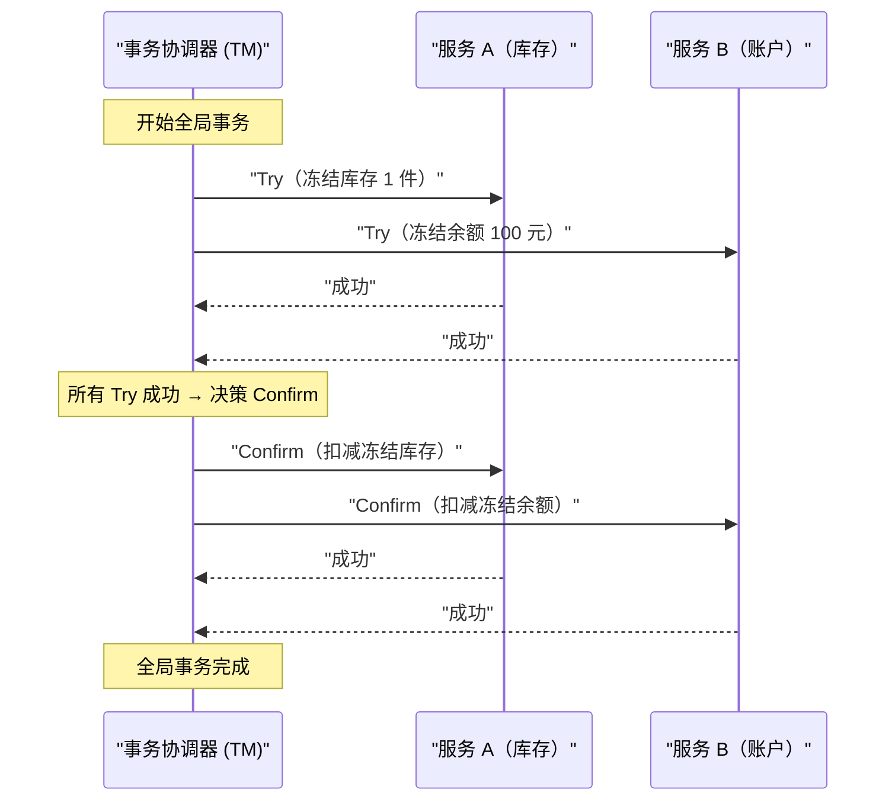
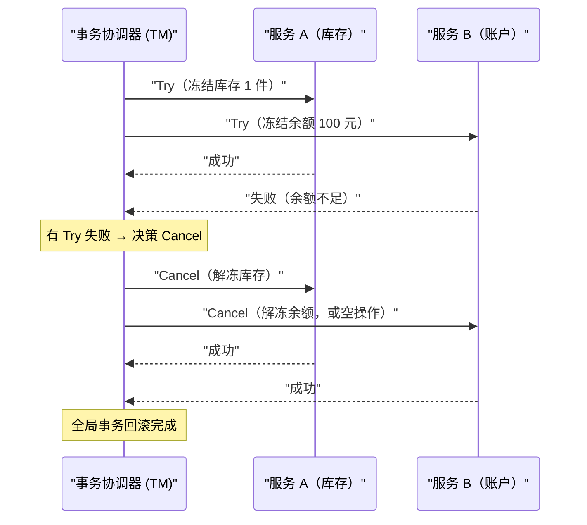

# 04 TCC 柔性事务模型原理与实践

**摘要：**

TCC（Try-Confirm-Cancel）是目前互联网业务中应用最广泛的分布式事务解决方案之一。它不依赖数据库的 XA 协议，而是把事务的提交与回滚语义下沉到业务代码层面，通过"资源预留 → 确认执行 → 取消回滚"三个阶段实现分布式事务的最终一致性。本文从 TCC 被发明的动机切入，深入剖析 Try/Confirm/Cancel 三个阶段的语义边界与设计原则；重点解析 TCC 实践中最棘手的三类工程问题——幂等性设计、空回滚与悬挂；通过电商库存扣减的完整案例，展示 TCC 在生产环境中的落地要点；最后对比 TCC 与 2PC 的本质差异，辨析 TCC 的隔离性弱点与适用边界。读完本文，你应当能回答两个问题：TCC 为什么能把"锁"从数据库搬到业务层，以及它为此付出了哪些工程代价。

---

## 第 1 章 TCC 的诞生：从 2PC 的困境寻找出路

### 1.1 2PC 的三个核心痛点在微服务时代被放大

在讲 TCC 之前，先回顾一下促使 TCC 被发明的历史背景。02 与 03 两篇已经说明，2PC 在设计上有三个根本性的约束，在传统单体应用时代或许尚可接受，但在微服务架构爆发之后，这三个约束变成了难以忍受的障碍。

**约束一：所有参与者必须支持 XA 协议。** XA 规范主要面向关系型数据库，而微服务架构中，一个分布式事务的参与者可能包括 MySQL 数据库、Redis 缓存、Kafka 消息队列，甚至是另一个微服务的 HTTP 接口。Redis 不支持 XA，Kafka 不支持 XA，HTTP 接口更不支持 XA。2PC 在这种异构环境下根本无从施展。

**约束二：持锁时间长，高并发场景吞吐量低。** 2PC 从 Prepare 阶段开始到 Commit 阶段结束，参与者必须持有行锁。整个流程包含至少两次网络往返，在微服务化的系统中，这个往返延迟通常在几十毫秒量级——意味着热点数据的锁竞争会严重限制吞吐量。

**约束三：业务逻辑与事务协议强耦合。** 在 XA 事务中，应用程序需要直接参与协议状态的管理（`XA START`、`XA PREPARE`、`XA COMMIT`）。这要求业务代码对数据库连接和事务状态有精细的控制，与通常的 ORM 框架（Hibernate、MyBatis）的抽象层次不兼容，实际开发体验极差。

这三个约束合起来，把 2PC 排除在了微服务主流之外。但分布式事务的需求并未消失，反而因为服务的拆分而更加普遍——于是，一条"绕开数据库、在业务层重建事务语义"的新路径开始浮现。

### 1.2 TCC 的核心洞察：把事务语义交还给业务

2007 年，Pat Helland 在微软发表了一篇名为《Life beyond Distributed Transactions: an Apostate's Opinion》的论文，在分布式事务领域被戏称为"异教徒的意见"。这篇论文影响深远，核心观点是：

> 对于大规模分布式系统，我们不应该试图用事务来"掩盖"分布式的复杂性，而应该让业务逻辑本身具备处理不一致状态的能力。

这个思想与 2008 年 eBay 架构师 Dan Pritchett 提出的 BASE 理论高度吻合。在这个背景下，TCC 模式逐渐从实践中浮现——它不是某一篇论文的产物，而是业界工程师在解决实际问题过程中总结出来的模式，后来被中间件厂商与学术界正式化为"TCC"这个术语。

TCC 的核心洞察是：**数据库级别的原子性（通过 XA 锁定资源）可以被业务级别的原子性（通过资源预留加补偿操作）所替代**。这两者的语义不完全相同，但对大量业务场景而言，业务级别的原子性已经足够。

这里可以打一个比方：2PC 像在图书馆借书时，管理员用一把锁把书"物理扣下"，谁也不能碰，直到借阅流程走完；TCC 则像把书从"可借书架"移到"预约架"——书还在馆里，别人能看到它的存在，只是暂时借不走。前者用"锁"制造排他性，后者用"状态迁移"制造排他性。两者都实现了"这本书被我占住"的效果，但后者的粒度更粗、代价更低，代价则是引入了新的状态需要维护。

---

## 第 2 章 TCC 的三阶段语义：精确定义每个阶段的职责

### 2.1 整体流程概览

TCC 把一个分布式事务拆分为三个阶段，每个阶段对应业务层的一个接口：



如果任何一个 Try 失败：



从这两张图可以读出一个关键特征：TCC 的协调器**只在两个阶段之间做一次决策**——所有 Try 成功则 Confirm，任一 Try 失败则 Cancel。这与 2PC 的协调者在收集完投票后做决策的结构是类似的，区别在于"Try/Confirm/Cancel"操作的是业务语义，而非数据库的 Prepare/Commit。

### 2.2 Try 阶段：资源预留，而非直接提交

Try 阶段是 TCC 最核心、也是设计难度最高的阶段。

**Try 阶段的本质语义**：检查业务约束是否满足，并对后续操作需要的资源进行**预留（Reserve）**，但不做最终的业务操作。

这里的"资源预留"是理解 TCC 的关键。与 2PC 的 Prepare 阶段通过数据库行锁锁定资源不同，TCC 的 Try 阶段通过**业务语义上的冻结**来预留资源——这需要业务数据模型的配合。

以电商库存扣减为例。

**2PC 的做法（数据库层面锁定）**：

```sql
-- Prepare 阶段：直接扣减，依赖数据库行锁
UPDATE inventory SET stock = stock - 1 WHERE product_id = 'P001';
-- 数据库在此期间持有行锁，直到 COMMIT
```

**TCC 的做法（业务层面预留）**：

```sql
-- Try 阶段：不直接扣减，而是将库存从"可用"移入"冻结"
UPDATE inventory
SET available_stock = available_stock - 1,
    frozen_stock = frozen_stock + 1
WHERE product_id = 'P001'
  AND available_stock >= 1;  -- 检查资源是否充足

-- 此时：available_stock 减少了，但 total_stock 不变
-- frozen_stock 代表"已预留给某个进行中事务的库存"
```

这个设计把"资源锁定"从数据库层面的行锁，转移到了业务层面的字段状态——`frozen_stock` 字段代替了数据库行锁，扮演了"已预留"的语义。

> [!note] 业务字段冻结与数据库行锁的关键区别
> 数据库行锁会阻塞其他事务的读写，且会随持有时间增长而拖累系统性能；而业务字段冻结（`frozen_stock`）不阻塞任何操作，其他事务可以读取库存状态，只是需要判断 `available_stock` 而不是 `total_stock`。这是 TCC 高并发性能的来源之一。

**Try 阶段必须做到的事情**：

1. **完整性检查（Feasibility Check）**：验证所有业务约束（余额是否充足、库存是否足够、权限是否满足）
2. **资源预留（Resource Reservation）**：把资源从"可用"状态转为"预留"状态
3. **幂等性保证**：如果同一 Try 被重复调用（网络重试），结果必须一致

**Try 阶段不能做的事情**：

- 不能直接执行不可逆的最终业务操作（如发送短信通知、调用外部支付接口）
- 不能在 Try 阶段就修改用户可见的核心数据状态（如直接扣减可用余额）

### 2.3 Confirm 阶段：执行真正的业务操作

当所有参与服务的 Try 都成功后，协调器发出 Confirm 指令。

**Confirm 阶段的本质语义**：基于 Try 阶段已预留的资源，执行真正的业务操作，**完成资源的最终转移**。

继续库存扣减的例子：

```sql
-- Confirm 阶段：将冻结的库存正式扣减
UPDATE inventory
SET frozen_stock = frozen_stock - 1,
    total_stock = total_stock - 1
WHERE product_id = 'P001'
  AND frozen_stock >= 1;

-- 此时：total_stock 真正减少，frozen_stock 归还为 0
-- 库存已被最终扣减，事务完成
```

**Confirm 阶段的设计要点**：

其一，**Confirm 操作必须是幂等的**。协调器会在 Confirm 失败时持续重试，直到成功。因此 Confirm 操作必须能够被安全地重复执行。

其二，**Confirm 操作不应该失败**。如果 Try 阶段已经验证了所有约束并预留了资源，Confirm 阶段在正常情况下不应该失败——因为资源已经被预留，不会被其他事务占用。Confirm 阶段的失败通常只来自技术原因（网络超时、服务宕机），而非业务逻辑失败。这是 TCC 区别于 2PC 的一个重要隐含假设：**Try 成功就意味着 Confirm 一定能成功**，这个假设是 TCC 全部正确性的基石，也是它最容易被违反的地方。

其三，**Confirm 操作是最终不可逆的**。Confirm 完成后，事务就彻底提交了，无法再通过业务手段撤销（只能通过新的业务操作，如退款、退货来弥补）。

### 2.4 Cancel 阶段：通过业务补偿实现回滚

当任何参与服务的 Try 失败，或者事务协调器决定回滚时，向所有已成功执行 Try 的服务发出 Cancel 指令。

**Cancel 阶段的本质语义**：释放 Try 阶段预留的资源，把资源从"预留"状态恢复到"可用"状态。

```sql
-- Cancel 阶段：将冻结的库存解冻，归还给可用库存
UPDATE inventory
SET available_stock = available_stock + 1,
    frozen_stock = frozen_stock - 1
WHERE product_id = 'P001'
  AND frozen_stock >= 1;
```

**Cancel 阶段的设计要点**：

其一，**Cancel 操作必须是幂等的**。与 Confirm 一样，协调器会重试直到成功，因此必须支持幂等。

其二，**Cancel 操作必须处理"空回滚"场景**。Cancel 可能在 Try 根本没有执行的情况下被调用（原因后文详述），此时 Cancel 必须能够安全地处理这种情况而不报错。

其三，**Cancel 是"业务级补偿"而非"数据库级回滚"**。数据库 ROLLBACK 是物理撤销，好像那些操作从未发生；TCC 的 Cancel 是语义补偿，是一个新的业务操作，它的执行记录会留在数据库中（有 Cancel 操作的日志）。

### 2.5 三个阶段的语义对照

把三个阶段放在一起对照，可以更清楚地看出它们的职责划分：

| 阶段 | 核心动作 | 是否改变业务终态 | 是否可重复执行 | 失败后的处理 |
| :--- | :--- | :--- | :--- | :--- |
| **Try** | 检查并预留资源 | 否（只改中间态） | 必须幂等 | 失败则触发全局 Cancel |
| **Confirm** | 消耗预留资源，落地终态 | 是 | 必须幂等 | 持续重试直到成功 |
| **Cancel** | 释放预留资源 | 否（回到初始态） | 必须幂等 | 持续重试直到成功 |

这张表揭示了 TCC 的一个设计哲学：**把"可能失败"的操作放在 Try 阶段，把"不允许失败"的操作放在 Confirm 阶段**。Try 阶段承担了所有的业务校验与资源预留，因此它是唯一允许失败的业务操作；一旦所有 Try 通过，Confirm 与 Cancel 都只是"把已经确定的结果落地"，从设计上就应当是不可失败的。理解了这条哲学，后面的幂等、空回滚、悬挂三大难题，就都是"当这条哲学被现实打破时"的补丁。

### 2.6 Try 阶段资源预留的三种实现模式

"资源预留"是 TCC 的灵魂，但它的具体实现方式并非只有一种。工程上常见的有三种模式，理解它们的差异，有助于针对不同业务选择合适的预留语义。

**第一种是冻结模式（Freeze）**。这是最直观的做法，也是前文库存例子采用的方式：在业务表上增加一个 `frozen` 字段，Try 阶段把资源从"可用"移入"冻结"，Confirm 时消耗冻结量，Cancel 时归还。它的优点是语义清晰、可审计；缺点是需要修改业务表结构，且每个可预留的资源都要有对应的冻结字段。

**第二种是预扣模式（Pre-deduct）**。Try 阶段直接扣减，但在同一次操作里记录一条"待确认流水"；Confirm 时把流水标记为"已确认"，Cancel 时依据流水把扣减加回来。它不修改业务表的语义，而是用流水表来承载"预留"信息，适合无法在业务表上加字段的遗留系统。

**第三种是额度模式（Quota / Token）**。把资源预先切成若干"额度"或"令牌"，Try 阶段占用一个令牌，Confirm 时核销，Cancel 时释放。这种方式适合资源本身是连续量、难以用单个字段表示的场景，例如按流量、按次数计费的资源。

三种模式的选择依据是**资源的形态与业务的约束**：离散且可加字段的资源用冻结模式；不便改表的遗留资源用预扣模式；连续量或配额型资源用额度模式。无论哪种模式，核心目标都是一致的——**让"已预留"这件事在业务数据上留下一个可被查询的痕迹**，从而支撑后续的 Confirm、Cancel 与幂等判断。

---

## 第 3 章 TCC 的三大工程难题：幂等、空回滚、悬挂

TCC 的概念看起来简单，但在工程落地时，有三个问题如果处理不好，会导致数据错乱，是 TCC 实践中最容易踩的坑。这三个问题有一个共同根源：**网络的不确定性打破了"操作只执行一次"的假设**。

### 3.1 幂等性：网络重试的必然要求

**什么是幂等性**

在分布式系统中，由于网络不可靠，消息可能丢失，调用方通常会在超时后进行重试。幂等性（Idempotency）要求：**同一个操作，无论执行一次还是执行多次，最终结果与执行一次相同**。

**为什么 TCC 的三个阶段都必须幂等**

TCC 的协调器在以下情况会发出重试：

- Try 请求网络超时，无法确认是否成功 → 重试 Try
- Confirm 请求网络超时 → 重试 Confirm
- Cancel 请求网络超时 → 重试 Cancel

对于 Confirm 阶段，重复执行的危险是显而易见的：

```sql
-- 如果 Confirm 不幂等，重复执行会造成超额扣减
-- 第一次执行 Confirm：total_stock = 100 → 99
-- 第二次执行 Confirm（重试）：total_stock = 99 → 98  ← 错误。
UPDATE inventory
SET total_stock = total_stock - 1
WHERE product_id = 'P001';
```

**幂等性的实现方案**

最常见的幂等性实现方案是**幂等控制表（Idempotency Table）**。

**方案一：事务记录表加唯一约束**

```sql
-- 创建 TCC 事务记录表
CREATE TABLE tcc_transaction_record (
    xid          VARCHAR(64) NOT NULL COMMENT '全局事务 ID',
    branch_id    VARCHAR(64) NOT NULL COMMENT '分支事务 ID',
    action       VARCHAR(16) NOT NULL COMMENT 'TRY/CONFIRM/CANCEL',
    status       VARCHAR(16) NOT NULL COMMENT 'PROCESSING/SUCCESS/FAILED',
    created_at   DATETIME    NOT NULL,
    updated_at   DATETIME    NOT NULL,
    PRIMARY KEY (xid, branch_id, action),  -- 唯一约束，重复执行会失败
    INDEX idx_xid (xid)
);
```

执行 Confirm 前，先插入一条记录（利用唯一约束保证幂等）：

```java
// 伪代码：幂等 Confirm 执行逻辑
public boolean confirm(String xid, String branchId) {
    try {
        // 1. 尝试插入事务记录（利用唯一约束）
        insertRecord(xid, branchId, "CONFIRM", "PROCESSING");
    } catch (DuplicateKeyException e) {
        // 已存在记录，说明这是重复调用
        String existingStatus = queryStatus(xid, branchId, "CONFIRM");
        if ("SUCCESS".equals(existingStatus)) {
            return true;  // 之前已经成功了，直接返回成功
        }
        // 如果是 PROCESSING，说明上次执行还没完成，继续执行
    }

    // 2. 执行业务操作
    deductFrozenStock(xid, branchId);

    // 3. 更新状态为成功
    updateStatus(xid, branchId, "CONFIRM", "SUCCESS");
    return true;
}
```

**方案二：状态机约束**

通过检查当前业务数据的状态来判断是否已经执行过：

```sql
-- Confirm 时检查状态，只有处于 FROZEN 状态才执行
UPDATE inventory
SET status = 'DEDUCTED',
    frozen_stock = frozen_stock - 1,
    total_stock = total_stock - 1
WHERE product_id = 'P001'
  AND reservation_id = 'xid_001'  -- 使用预留时的 xid 关联
  AND status = 'FROZEN';           -- 只有 FROZEN 状态才执行，防止重复扣减
-- affected_rows = 0 说明已经执行过，安全忽略
```

这个方案利用了库存行本身的 `status` 字段作为幂等控制，不需要额外的幂等表，但要求业务数据模型支持状态机设计。

> [!warning] 幂等性的重要性无论怎么强调都不为过
> 在笔者的工程经验中，TCC 生产事故中超过六成都与幂等性设计不完善有关。尤其是以下两种情况：其一，Confirm 接口没有幂等，协调器重试导致库存超额扣减；其二，Cancel 接口没有幂等，重复解冻导致可用库存超过原始值。这两类问题都不会立即报错，而是悄悄地破坏数据完整性，往往在对账时才被发现。它们的共同特点是：错误是"沉默"的，直到累积到某个量级才以业务异常的形式爆发。

### 3.2 空回滚：Try 未执行时的 Cancel

**什么是空回滚**

空回滚是指：**Cancel 接口被调用了，但对应的 Try 操作根本没有执行**。

这种情况的发生路径如下：

```
场景：全局事务包含服务 A 和服务 B 的 Try

[协调器] 向服务 A 发送 Try → 服务 A 网络超时，无响应
[协调器] 向服务 B 发送 Try → 服务 B 执行成功
[协调器] 等待服务 A 的 Try 超时 → 决定 Cancel
[协调器] 向服务 A 发送 Cancel 指令
[服务 A] 收到 Cancel，但本地没有任何 Try 的记录 ← 空回滚场景
[服务 A] 此时 Cancel 应该怎么办？
```

注意：服务 A 没有响应 Try，不代表 Try 没有被执行。可能的情况有两种：

1. Try 请求在网络中丢失，服务 A 根本没收到 → Try 确实没有执行
2. Try 请求到达服务 A，服务 A 执行了，但响应在网络中丢失 → Try 已经执行了

如果是第二种情况，Cancel 应该正常执行解冻；如果是第一种情况，Cancel 什么都不应该做。**问题在于，服务 A 无法从"没收到 Try 请求"这一事实，推断出"Try 是否执行过"**——这正是两将军问题在业务层的又一次现身。

**为什么空回滚是危险的**

如果 Cancel 接口没有处理空回滚，而是直接执行解冻操作：

```sql
-- 未处理空回滚的 Cancel（危险）
UPDATE inventory
SET available_stock = available_stock + 1,
    frozen_stock = frozen_stock - 1
WHERE product_id = 'P001';
-- 如果 Try 从未执行，frozen_stock 可能没有对应的冻结记录
-- available_stock 凭空增加了 1。
```

这会导致库存数据失真——`available_stock` 比实际值多了，后续可能出现超卖。

**正确处理空回滚的方案**

核心思路是：**在 Cancel 执行前，先查询这个 xid 是否有对应的 Try 记录。如果没有，说明是空回滚，直接返回成功（忽略这次 Cancel），同时记录一条"空回滚"标记，防止后续迟到的 Try 执行**。

```java
// 伪代码：正确处理空回滚的 Cancel 逻辑
public boolean cancel(String xid, String branchId) {
    // 1. 查询 Try 是否执行过
    TryRecord tryRecord = queryTryRecord(xid, branchId);

    if (tryRecord == null) {
        // Try 从未执行（空回滚场景）
        // 记录一条空回滚标记，防止后续迟到的 Try 执行（防悬挂）
        insertEmptyRollbackMark(xid, branchId);
        return true;  // 直接返回成功，不做任何业务操作
    }

    if ("CANCELLED".equals(tryRecord.getStatus())) {
        return true;  // 已经 Cancel 过了（幂等）
    }

    // 2. 正常执行 Cancel：解冻预留资源
    releaseFrozenStock(xid, branchId);

    // 3. 更新 Try 记录状态为 CANCELLED
    updateTryStatus(xid, branchId, "CANCELLED");
    return true;
}
```

### 3.3 悬挂：Try 在 Cancel 之后才到达

**什么是悬挂**

悬挂是比空回滚更隐蔽、更危险的问题。它的发生路径是：

```
[协调器] 向服务 A 发送 Try，请求在网络中严重延迟
[协调器] 等待超时，决定 Cancel
[协调器] 向服务 A 发送 Cancel → 服务 A 执行 Cancel（空回滚）
[此时，之前延迟的 Try 请求终于到达了服务 A]
[服务 A] Try 执行，冻结了资源
--- 问题：此时没有 Confirm 也没有 Cancel 会再来了 ---
--- 服务 A 的资源被永久冻结（悬挂）。 ---
```

悬挂的危害在于：**资源被 Try 阶段预留冻结，但既不会被 Confirm 消耗，也不会被 Cancel 释放，造成资源永久泄漏**。在库存场景下，就是 `frozen_stock` 一直不归零，`available_stock` 永远少了几件，业务永远无法卖出这些"幽灵库存"。

> [!warning] 悬挂问题的严重性
> 悬挂问题往往很难被立即发现，因为它不会触发任何异常。从外部看，Try 请求成功了，只是后续没有 Confirm 或 Cancel。被悬挂的资源可能在某次对账时才被发现。在高并发场景下，如果 Try 请求的延迟比较频繁，悬挂积累的量可能非常大，导致大量库存无法正常销售。它和空回滚是一对孪生问题：空回滚是"Cancel 找不到 Try"，悬挂是"Try 晚于 Cancel 到达"，两者都必须用同一张状态表来协同处理。

**防悬挂的解决方案**

防悬挂的关键是：**Try 接口在执行之前，必须先检查是否已经有对应的 Cancel（空回滚标记）记录。如果有，说明 Cancel 已经先执行了，这次 Try 是"迟到的"，必须拒绝执行**。

```java
// 伪代码：防悬挂的 Try 逻辑
public boolean tryReserve(String xid, String branchId, int quantity) {
    // 1. 检查是否已经有空回滚标记（防悬挂核心检查）
    if (hasEmptyRollbackMark(xid, branchId)) {
        // Cancel 已经先执行了，这是一个"迟到的 Try"
        // 必须拒绝，否则资源会被永久冻结（悬挂）
        return false;  // 或者抛出异常
    }

    // 2. 检查幂等：如果 Try 已经执行过
    TryRecord existingRecord = queryTryRecord(xid, branchId);
    if (existingRecord != null) {
        return "SUCCESS".equals(existingRecord.getStatus());
    }

    // 3. 执行资源预留
    int affected = updateAvailableStock(xid, branchId, quantity);
    if (affected == 0) {
        return false;  // 库存不足
    }

    // 4. 记录 Try 执行记录
    insertTryRecord(xid, branchId, quantity, "SUCCESS");
    return true;
}
```

**空回滚与防悬挂的统一方案**

在实际工程中，通常把空回滚标记和 Try 记录合并到同一张表中，通过一张 TCC 事务状态表统一管理：

```sql
CREATE TABLE tcc_branch_record (
    xid          VARCHAR(64)  NOT NULL COMMENT '全局事务 ID',
    branch_id    VARCHAR(64)  NOT NULL COMMENT '分支事务 ID',
    service_name VARCHAR(128) NOT NULL COMMENT '服务名',
    try_status   VARCHAR(16)  NOT NULL DEFAULT 'INIT' COMMENT 'INIT/SUCCESS/EMPTY_ROLLBACK',
    final_status VARCHAR(16)           COMMENT 'CONFIRMED/CANCELLED',
    try_data     TEXT                  COMMENT 'Try 阶段的业务数据快照（用于 Cancel 时参考）',
    created_at   DATETIME     NOT NULL,
    updated_at   DATETIME     NOT NULL,
    PRIMARY KEY (xid, branch_id)
);
```

状态流转为：`try_status = INIT`（记录已创建但 Try 尚未执行，用于防悬挂标记）→ `try_status = SUCCESS`（Try 成功）；`final_status = CONFIRMED`（Confirm 完成）或 `final_status = CANCELLED`（Cancel 完成）。

> [!info] 三个问题的关联性
> 幂等、空回滚、悬挂三个问题是相互关联的：
> - **幂等** 是 Try/Confirm/Cancel 三个接口的通用要求
> - **空回滚** 是 Cancel 接口需要处理的特殊情况
> - **悬挂** 需要 Try 接口检查"Cancel 是否先于 Try 执行"
>
> 这三个问题的解决方案都指向同一个工程实践：**用一张事务状态表追踪每个分支事务的执行状态**，通过状态查询来做幂等判断、空回滚识别和悬挂防护。

### 3.4 三个难题的共同根源

把这三个问题抽象一下，会发现它们共享同一个根源：**在分布式环境中，"某个操作是否已经执行"这个信息，无法被可靠地获知**。

- 幂等性问题来自"我发出了 Confirm，但不知道对方执行了几次"。
- 空回滚问题来自"我收到了 Cancel，但不知道对应的 Try 是否执行过"。
- 悬挂问题来自"我收到了一个迟到的 Try，但不知道 Cancel 是否已经先执行"。

这三个"不知道"，本质上都是两将军问题在业务层的投影——确认本身需要再确认，而网络无法给出确定的答案。TCC 的应对方式不是消除这种不确定性（那是不可能的），而是**用一个持久化的状态表，把"是否执行过"这个事实记录下来**，让每个参与者都能通过查询本地状态来回答这个问题。这也是为什么 TCC 的工程实现总是绕不开一张事务状态表——它是把"不确定的网络"转化为"确定的本地事实"的唯一手段。

### 3.5 一个真实的空回滚与悬挂排查

理论讲完，不妨看一个笔者在真实环境中处理过的案例，它把空回滚与悬挂这两个问题同时串了起来。

某电商系统在大促期间，运营反馈"部分商品的可用库存比实际库存少了几十件，但订单量对不上"。初步排查发现，这些商品的 `frozen_stock` 字段长期不为零，且对应的全局事务早已不在进行中。换句话说，有相当一批库存被"永久冻结"了——这正是悬挂的典型特征。

进一步排查事务状态表，发现这些 xid 的分支记录里，`try_status` 为 `SUCCESS`，但 `final_status` 既不是 `CONFIRMED` 也不是 `CANCELLED`，而是空。同时，这些 xid 在协调器侧早已被判定为"超时回滚"。

还原时间线后，根因清楚了：大促期间网络抖动频繁，部分 Try 请求的响应严重延迟。协调器等待 Try 超时后触发了 Cancel；但 Cancel 到达时，对应的 Try 尚未执行，服务端按"空回滚"逻辑记录了一条标记并返回成功。问题是，这个服务端的 Cancel 实现**只处理了"Try 记录不存在时插入空回滚标记"，却没有在 Try 接口里检查这个标记**——也就是说，防悬挂的检查缺失了。于是，当延迟的 Try 终于到达时，它照常执行、冻结了库存，而此后再无 Confirm 或 Cancel 会来认领，库存就此被永久冻结。

修复分两步：其一，为 Try 接口补上防悬挂检查（执行前先查是否存在空回滚标记，存在则拒绝）；其二，写一个对账任务，扫描"长期停留在中间态"的分支记录，对确认悬挂的记录发起人工或自动的补偿。

这个案例的教训有两个层次。表层是：**空回滚与防悬挂必须成对实现，缺一不可**——只做空回滚不做防悬挂，等于给悬挂问题留了一扇门。深层是：**这类问题不会立刻报错，只会在数据上缓慢积累，直到某个业务指标异常时才被发现**。因此，TCC 系统必须配套"中间态对账"机制，主动发现那些"永远等不到最终指令"的分支，而不是被动等待业务异常。

---

## 第 4 章 完整案例：电商订单创建的 TCC 实践

### 4.1 业务场景描述

以一个典型的电商下单流程为例：用户购买 1 件商品，需要同时完成三个操作：

1. **库存服务**：扣减商品库存 1 件
2. **账户服务**：扣减用户余额 100 元
3. **订单服务**：创建订单记录

这三个操作分属不同的微服务，需要通过 TCC 保证它们的原子性。

### 4.2 数据模型设计

**库存表（增加冻结字段）**：

```sql
CREATE TABLE inventory (
    product_id       VARCHAR(64)  NOT NULL,
    total_stock      INT          NOT NULL DEFAULT 0 COMMENT '总库存',
    available_stock  INT          NOT NULL DEFAULT 0 COMMENT '可用库存（total - frozen）',
    frozen_stock     INT          NOT NULL DEFAULT 0 COMMENT '冻结库存（被 TCC Try 预留的）',
    version          INT          NOT NULL DEFAULT 0 COMMENT '乐观锁版本号',
    PRIMARY KEY (product_id)
);
```

**账户表（增加冻结字段）**：

```sql
CREATE TABLE account (
    user_id           VARCHAR(64)   NOT NULL,
    total_balance     DECIMAL(12,2) NOT NULL DEFAULT 0 COMMENT '总余额',
    available_balance DECIMAL(12,2) NOT NULL DEFAULT 0 COMMENT '可用余额',
    frozen_balance    DECIMAL(12,2) NOT NULL DEFAULT 0 COMMENT '冻结余额',
    PRIMARY KEY (user_id)
);
```

**冻结预留表（记录每次 Try 的预留明细，用于 Cancel 时精确解冻）**：

```sql
CREATE TABLE tcc_reservation (
    reservation_id   VARCHAR(64)   NOT NULL COMMENT '预留 ID（= xid + branch_id）',
    xid              VARCHAR(64)   NOT NULL COMMENT '全局事务 ID',
    resource_type    VARCHAR(32)   NOT NULL COMMENT 'INVENTORY / ACCOUNT',
    resource_id      VARCHAR(64)   NOT NULL COMMENT '资源 ID（product_id / user_id）',
    quantity         DECIMAL(12,2) NOT NULL COMMENT '预留数量',
    status           VARCHAR(16)   NOT NULL DEFAULT 'RESERVED' COMMENT 'RESERVED/CONFIRMED/CANCELLED',
    created_at       DATETIME      NOT NULL,
    PRIMARY KEY (reservation_id),
    INDEX idx_xid (xid)
);
```

这三张表的设计体现了一个原则：**业务表只增加"冻结"字段，预留明细单独成表**。业务表保持简洁，冻结字段让业务查询可以区分"可用"与"预留"；预留明细表则承担了幂等、空回滚、悬挂的全部状态管理职责，两者分离，职责清晰。

### 4.3 三个阶段的完整实现逻辑

**库存服务 - Try（冻结库存）**：

```java
@Transactional
public boolean tryDeductStock(String xid, String productId, int quantity) {
    // 防悬挂检查
    if (reservationRepo.existsCancelledReservation(xid, "INVENTORY", productId)) {
        log.warn("悬挂防护：xid={} 已有 Cancel 记录，拒绝 Try", xid);
        return false;
    }

    // 幂等检查
    TccReservation existing = reservationRepo.findByXidAndResource(xid, "INVENTORY", productId);
    if (existing != null) {
        return "RESERVED".equals(existing.getStatus()) || "CONFIRMED".equals(existing.getStatus());
    }

    // 执行库存冻结（使用乐观锁防并发冲突）
    int affected = inventoryRepo.freezeStock(productId, quantity);
    if (affected == 0) {
        log.warn("库存不足：productId={}, requested={}", productId, quantity);
        return false;
    }

    // 记录预留明细
    reservationRepo.insertReservation(xid, "INVENTORY", productId, quantity, "RESERVED");
    return true;
}
```

**库存服务 - Confirm（正式扣减冻结库存）**：

```java
@Transactional
public boolean confirmDeductStock(String xid, String productId) {
    TccReservation reservation = reservationRepo.findByXidAndResource(xid, "INVENTORY", productId);

    if (reservation == null) {
        log.error("Confirm 异常：找不到 Try 记录，xid={}", xid);
        return false;  // 理论上不应该发生
    }

    if ("CONFIRMED".equals(reservation.getStatus())) {
        return true;  // 幂等：已经 Confirm 过了
    }

    // 将冻结库存转为正式扣减（total_stock 减少，frozen_stock 归零）
    inventoryRepo.commitFrozenStock(productId, reservation.getQuantity().intValue());

    // 更新预留记录状态
    reservationRepo.updateStatus(xid, "INVENTORY", productId, "CONFIRMED");
    return true;
}
```

**库存服务 - Cancel（解冻库存）**：

```java
@Transactional
public boolean cancelDeductStock(String xid, String productId) {
    TccReservation reservation = reservationRepo.findByXidAndResource(xid, "INVENTORY", productId);

    if (reservation == null) {
        // 空回滚场景：Try 从未执行，记录空回滚标记（同时防止后续的悬挂）
        log.info("空回滚：xid={} 的 Try 记录不存在，记录空回滚标记", xid);
        reservationRepo.insertEmptyRollbackMark(xid, "INVENTORY", productId);
        return true;
    }

    if ("CANCELLED".equals(reservation.getStatus())) {
        return true;  // 幂等：已经 Cancel 过了
    }

    // 解冻：将 frozen_stock 归还给 available_stock
    inventoryRepo.releaseFrozenStock(productId, reservation.getQuantity().intValue());

    // 更新预留记录状态
    reservationRepo.updateStatus(xid, "INVENTORY", productId, "CANCELLED");
    return true;
}
```

### 4.4 TCC 协调器的职责

在实际工程中，TCC 协调器通常由框架（如 Seata、Hmily、ByteTCC）提供，其核心职责是：

1. **生成全局事务 ID（xid）**：确保全局唯一
2. **协调 Try 的并发执行**：向所有参与服务发送 Try，等待响应
3. **决策 Confirm 或 Cancel**：基于所有 Try 的结果做决策
4. **持久化事务状态**：把全局事务状态（Try 中、已提交、已回滚）持久化到事务日志
5. **重试直到成功**：对 Confirm 和 Cancel 持续重试，直到所有参与服务确认完成
6. **超时事务的处理**：对长时间未完成的事务触发 Cancel 流程

协调器的这些职责里，最容易被低估的是第 5 条——**重试直到成功**。它意味着协调器必须是一个"有记忆、会坚持"的角色：它要记住每个分支的状态，在失败时不断重试，直到成功为止。协调器一旦"忘记"某个分支（如协调器自身崩溃且状态未持久化），这个分支就会永远停留在中间态。因此，协调器自身的状态持久化与高可用，是 TCC 落地的另一个关键点。

---

## 第 5 章 TCC 的性能特征与适用边界

### 5.1 TCC 与 2PC 的本质差异

| 维度 | 2PC/XA | TCC |
| :--- | :--- | :--- |
| **锁的类型** | 数据库行锁（DB 层面） | 业务语义冻结（应用层面）|
| **锁持有时间** | Prepare 到 Commit/Rollback（1~2 RTT）| Try 到 Confirm/Cancel（1~2 RTT，类似）|
| **锁的可见性** | 对其他 DB 事务不可见（阻塞） | 通过业务字段可见（不阻塞其他读写） |
| **对资源的要求** | 资源必须支持 XA 协议 | 资源只需支持普通读写（Redis、HTTP 均可） |
| **业务侵入性** | 低（对业务代码透明）| 高（需要设计 Try/Confirm/Cancel 三个接口） |
| **一致性级别** | 强一致（ACID）| 最终一致（允许短暂不一致窗口） |
| **性能** | 较低（阻塞其他 DB 事务）| 较高（不阻塞，冻结字段并发友好） |
| **异构支持** | 差（只支持 XA 兼容资源）| 好（支持任意资源，包括 HTTP 服务） |

这张表的核心信息是：**TCC 用"业务侵入性"换取了"异构支持"与"并发性能"**。它把 2PC 在数据库层的排他性，转移到了业务层；代价是业务开发者必须自己设计三个接口、处理三大难题。

### 5.2 TCC 的隔离性问题

TCC 相比 2PC 有一个明显的弱点：**隔离性较弱**。

在 2PC 中，事务未提交之前，修改的数据对其他事务不可见（数据库行锁保证）。但在 TCC 中，Try 阶段对业务字段的修改（如 `available_stock` 减少）是立即可见的——其他并发查询可以看到 `available_stock` 已经减少，但事务还未最终提交。

这带来了一个业务问题：用户可能看到"可用库存等于 0，但商品实际上还有冻结库存未释放"的状态，即使最终事务回滚、库存被解冻。这种中间状态在用户体验上可能造成困惑。

应对方案有三：

其一，**业务层面的展示逻辑**。前端或查询接口展示库存时，使用 `available_stock + frozen_stock` 或 `total_stock`，而非单独的 `available_stock`。

其二，**适当的超时控制**。给 Try 阶段设置合理的超时时间（通常 30 秒内），避免冻结状态持续时间过长。

其三，**接受一定程度的中间状态可见**。明确这是 TCC 的设计取舍，从业务角度评估是否可接受。

> [!note] 隔离性弱是"设计取舍"而非"实现缺陷"
> 需要澄清的是，TCC 隔离性弱不是它的 bug，而是它"用业务字段替代数据库锁"这一设计选择的必然后果。数据库锁天然带有隔离语义，而业务字段没有——你在用 `frozen_stock` 替代行锁的同时，也就放弃了行锁附带的隔离保证。理解这一点，就不会指望通过某个配置或补丁来"修复"TCC 的隔离性；正确的做法是接受它，并在业务层做相应的展示与容错设计。

### 5.3 TCC 的适用场景

TCC 是高并发、强业务语义的分布式事务场景的最佳选择，特别适合以下三类场景。

其一，**高并发订单与支付类场景**。需要同时扣减库存、余额、积分等多个资源，各资源在不同微服务中，且需要高吞吐量。2PC 的阻塞问题在这类场景中无法接受，TCC 是最合适的方案。

其二，**跨异构资源的事务**。参与者包含 MySQL、Redis、第三方 HTTP 服务等不支持 XA 的资源。TCC 不依赖 XA，只需业务实现三个接口即可。

其三，**微服务架构下的跨服务事务**。服务间通过 HTTP/RPC 调用，无法使用数据库级别的 XA。TCC 天然适合服务间的事务协调。

**TCC 不适合的场景**：

- **Try 阶段无法实现资源预留的场景**：某些操作本质上不可分（如向外部系统发送一条无法撤销的短信），无法实现 TCC 三阶段。
- **业务逻辑极其复杂、补偿成本极高的场景**：如果 Cancel 的补偿逻辑非常复杂，甚至比业务本身还难实现，此时需要考虑 Saga 模式。
- **严格要求快照隔离的场景**：如果业务要求事务期间的中间状态完全不可见，TCC 的业务字段暴露方式无法满足。

### 5.4 一个量化视角：TCC 到底快在哪里

TCC 的性能优势常被概括为"不阻塞"，但这个说法过于笼统。更精确地说，TCC 的性能优势来自两点。

第一，**它把串行点从数据库行锁转移到了业务字段更新**。数据库行锁的粒度细、竞争激烈，且锁等待会占用连接资源；而业务字段的更新是普通的行更新，配合乐观锁（版本号）可以做到无阻塞冲突检测，冲突时快速失败而非排队等待。在高并发下，"快速失败加重试"往往比"排队等待"吞吐更高。

第二，**它的持锁时间不再包含业务处理时间**。在 2PC 中，Prepare 到 Commit 之间不能做任何耗时操作，否则锁被长期持有；而在 TCC 中，Try 完成之后资源就已经"预留"好了，Confirm 阶段只是一个快速的字段更新，业务处理（如调用外部接口）可以放在 Try 之前完成。这让 TCC 的"临界区"更短、更可控。

不过，这两点优势都有前提：**业务数据模型必须支持"冻结"语义**。如果某项资源无法用字段表示"已预留"（如外部系统的一个物理座位），TCC 的性能优势就无从谈起。这也再次说明，TCC 的适用性取决于业务能否配合，而不只取决于技术框架。

### 5.5 选型清单：三个量化判据

把前面的讨论收敛为可操作的判据，可以在选型时逐项自问。以下三条是笔者在实践中总结的核心判据。

**判据一：资源是否可预留？** 这是 TCC 的入场券。若某项操作涉及的资源无法用"冻结字段"或"预扣流水"表示"已预留"（典型如调用一个无法撤销的外部接口），那么 TCC 从根上就不适用，应转向 Saga。判断方法是问一句：这个操作能否拆成"预留"与"确认"两步，且预留阶段不产生不可逆的外部副作用？

**判据二：并发量是否需要"不阻塞"？** 如果系统的并发量很低（如每天几百笔的批处理），2PC 的阻塞代价可以忽略，那么使用 2PC 反而更省心——它对业务代码透明，无需设计三个接口。只有当并发量确实高、热点资源竞争激烈时，TCC 的"不阻塞"优势才值得它带来的复杂度。一个粗略的经验值是：热点资源的单行 TPS 需求超过几百时，行锁方案会开始成为瓶颈，此时才值得考虑 TCC。

**判据三：补偿逻辑是否可控？** 这是最容易被忽视的一条。如果 Cancel 的补偿逻辑比正向逻辑还复杂（例如订单里叠加了优惠券、积分、满减、跨店等规则，退款时还要按比例回退这些权益），那么实现 TCC 的工程风险会很高。判断方法是问一句：我能否用一个"语义清晰、逻辑简单"的操作来撤销 Try 的效果？如果答案是否定的，应谨慎使用 TCC。

三条判据全部满足时，TCC 是很好的选择；任一条明显不满足时，都应重新评估是否改用 Saga、消息队列或干脆用 2PC。**选型的关键不是"TCC 好不好"，而是"我的业务适不适合 TCC"**——这也是本专栏反复强调的立场：没有最好的方案，只有最合适的方案。

### 5.6 与消息队列方案的边界

柔性事务里还有一条与 TCC 平行的支路：基于消息队列的最终一致性（详见 06 篇）。两者都追求最终一致，但适用场景有明确分野，混淆它们会导致选型错误。

消息队列方案的本质是"异步、单向、靠重试"：业务操作完成后，把一条消息投递给下游，由下游异步处理，失败则重试，直到成功。它的前提是**操作本身幂等、且不需要回滚**——例如发送通知、更新统计数据、同步缓存。

TCC 的本质是"同步预留、双向、可回滚"：它在操作真正生效之前先占用资源，并且保留了"撤销"的能力。它针对的是**需要抢占资源、且可能失败回退**的场景——例如扣库存、扣余额。

判断用哪个，可以问一个简单的问题：**这个操作失败时，我需要"撤销已经做的部分"吗？** 如果需要撤销，用 TCC；如果只需要"最终把它做成功"，用消息队列。这个分野也解释了为什么"下单扣库存"几乎总是用 TCC 而不是消息队列——因为库存一旦被扣，若后续失败，必须能还回去，而消息队列的"重试直到成功"语义并不能表达"回滚"。

---

## 第 6 章 TCC 的工程演化：从手写到框架支持

### 6.1 手写 TCC 的痛点

在没有框架支持的情况下，手写 TCC 需要：

- 手动生成和管理全局事务 ID（xid）
- 手动协调各服务的 Try 调用，处理部分失败
- 手动实现重试逻辑，直到所有 Confirm/Cancel 成功
- 手动设计和维护事务状态表
- 处理协调器自身的高可用问题

这些工作量非常大，且容易出错。尤其是"重试直到成功"与"协调器高可用"这两项，手写实现的难度与风险都很高。

### 6.2 TCC 框架的核心能力

业界主流的 TCC 框架（Seata TCC 模式、Hmily、ByteTCC）抽象了以下核心能力。

**其一，注解驱动的接口声明**。通过注解标记 Try/Confirm/Cancel 接口，框架自动拦截并加入事务管理：

```java
@TwoPhaseBusinessAction(
    name = "inventoryTccAction",    // 参与者名称
    commitMethod = "confirm",        // Confirm 接口方法名
    rollbackMethod = "cancel"        // Cancel 接口方法名
)
public interface InventoryTccAction {
    boolean tryDeductStock(BusinessActionContext context,
                           @BusinessActionContextParameter(paramName = "productId") String productId,
                           @BusinessActionContextParameter(paramName = "quantity") int quantity);
    boolean confirm(BusinessActionContext context);
    boolean cancel(BusinessActionContext context);
}
```

**其二，全局事务 ID 的自动传播**。通过 ThreadLocal 加 RPC 拦截器，把 xid 自动传播到所有下游服务，开发者无需手动传递。

**其三，持久化与重试**。框架负责把事务状态持久化到 TC（Transaction Coordinator）的存储中，并在 Confirm/Cancel 失败时自动重试，直到成功。

**其四，超时与回滚**。框架监控全局事务的超时时间，超时后自动触发 Cancel 流程。

我们将在 07 Seata 框架原理与工程实战 中详细剖析 Seata TCC 模式的底层实现。

### 6.3 框架不能替你做的事

需要清醒认识到的是，TCC 框架能替你处理协议层面的复杂性，但有三件事必须由业务开发者自己完成。

其一，**设计"冻结"语义**。框架不知道你的业务里"库存"该如何预留，这需要你设计 `frozen_stock` 这样的字段与相应的更新逻辑。

其二，**实现幂等、空回滚、悬挂的处理**。虽然框架提供了状态表的模板，但具体到每个业务接口，如何判断幂等、如何识别空回滚、如何拒绝悬挂的 Try，都需要你按业务语义编写。

其三，**保证 Cancel 的业务正确性**。框架只能保证 Cancel 被调用，但"Cancel 操作在业务上是否正确"（如解冻的库存数是否与冻结的一致）完全取决于你的实现。框架无法替你验证业务补偿的语义正确性。

**框架解决的是"协议问题"，业务开发者解决的是"语义问题"**。这两类问题的边界，是使用 TCC 时必须划清的。

### 6.4 TCC 的可观测性：三个必须监控的指标

TCC 的故障大多是"沉默"的——不会抛异常，只会在数据上缓慢积累。因此，可观测性不是可选项，而是必需项。以下三个指标，是笔者建议必须纳入监控与告警的。

**指标一：中间态分支的数量与年龄。** 统计"`try_status` 为 `SUCCESS` 但 `final_status` 为空"的分支记录，并记录它们已存在的时间。正常的分支应该很快被 Confirm 或 Cancel；如果一个分支停留在中间态超过数分钟，几乎可以确定它出了问题。按年龄分桶（如 5 分钟、1 小时、1 天）展示，可以直观看出问题是在"正常处理中"还是"已经卡死"。

**指标二：Confirm 与 Cancel 的重试次数与成功率。** 这两个操作在设计上"不应该失败"，一旦出现持续重试，说明业务或基础设施有问题（如冻结库存被旁路操作改掉了）。持续增长的重试次数，是系统即将陷入异常的先行指标。

**指标三：空回滚与悬挂标记的计数。** 空回滚标记的数量反映了网络异常导致 Try 超时的频率；如果悬挂防护生效（拒绝了迟到的 Try），也应记录计数。这两个数字的异常增长，往往预示着网络质量下降或协调器超时配置不合理。

有了这三个指标，再配合定期的"中间态对账"任务，就能把 TCC 那些"沉默的错误"变成"可见的告警"。**对柔性事务系统而言，可观测性的重要程度不低于正确性本身**——因为一个没有监控的最终一致性系统，等价于一个不知道何时会不一致的系统。

### 6.5 半自研：一个常见的中间形态

在"全手写"与"全框架"之间，还有一个被大量团队采用的中间形态：**用框架处理 xid 传播与状态持久化，但三个接口的业务逻辑全部自研**。这种形态之所以流行，是因为它精准地避开了两类工作里最枯燥、最容易出错的部分。

xid 的生成与跨服务传播、事务状态的持久化与重试调度，这些是纯粹的"协议脚手架"，与业务无关，重复造轮子的价值很低；而 Try/Confirm/Cancel 的业务语义、冻结字段的设计、幂等与防悬挂的判断，这些是纯粹的"业务逻辑"，框架无法代劳。于是，一个理性的分工是：脚手架交给框架，业务逻辑留给自己。

需要警惕的是这种形态的一个常见误区：**把"框架处理了重试"误认为"业务可以不管幂等"**。框架确实会重试 Confirm/Cancel，但重试意味着你的业务接口会被调用多次——幂等依然必须由你自己保证。框架能保证"消息送达"，但保证不了"重复送达不产生副作用"。把这两件事分清，是采用半自研形态时的关键认知。

### 6.6 什么时候该放弃 TCC

在推进 TCC 的过程中，如果出现以下信号，就需要认真考虑"是不是选错了方案"，而不是"再优化一下就能扛过去"。

信号一：**冻结字段开始到处蔓延**。如果为了支持 TCC，越来越多的业务表被迫增加 `frozen_xxx` 字段，甚至连本不该参与事务的字段也要"冻结"，说明业务的数据模型与 TCC 的"可预留"假设不匹配。

信号二：**补偿逻辑越写越像正向逻辑**。如果 Cancel 的逻辑复杂度逼近甚至超过正向操作，说明业务操作本身不具备"易补偿"的性质，Saga 或人工兜底可能更合适。

信号三：**幂等表成了每个接口的标配**。虽然幂等是必需的，但如果每个接口都要为幂等单独建表、写一套去重逻辑，说明重试的频次或场景远超预期，也许是时候审视一下超时与重试的配置，或者换用对幂等要求更低的方案。

出现这些信号时，正确的反应不是"加人加时间硬扛"，而是回到选型判据（第 5.5 节）重新评估。**很多 TCC 的失败，不是技术没做好，而是业务本不该用 TCC**。把这个问题在早期识别出来，比在后期用工程手段去弥补，代价小得多。

---

## 第 7 章 不足与争议：TCC 的代价清单

TCC 被广泛采用，但它并非没有代价。把它的问题逐项列出，有助于在选型时保持清醒。

**第一，业务侵入性高**。这是 TCC 最常被诟病的一点。一个原本简单的业务操作，为了支持 TCC，需要拆成三个接口，还要设计冻结字段、状态表、幂等逻辑。对于业务逻辑本身就很复杂的场景，这个改造成本可能远超收益。

**第二，补偿逻辑可能比正向逻辑更难写**。正向操作往往是"加法"（扣库存、扣余额），而补偿操作要考虑各种边界：解冻多少、什么时候解冻、解冻后如何避免重复。在业务规则复杂的场景（如带优惠券、积分的订单），补偿逻辑的复杂度可能指数级上升。

**第三，隔离性弱带来的展示问题**。如第 5.2 节所述，中间状态对外可见，需要在展示层做额外处理。

**第四，对"Try 成功即 Confirm 必成功"的强依赖**。TCC 的正确性建立在"Try 预留的资源，Confirm 一定能消耗"这个假设上。如果这个假设被打破（如 Confirm 时发现冻结库存不翼而飞），系统会陷入需要人工介入的异常态。这个假设在业务系统有"旁路操作"（如运营手动改库存）时尤其脆弱。

**第五，三大难题的工程门槛**。幂等、空回滚、悬挂，任何一个处理不当都会导致数据错乱，且错误往往是"沉默"的，直到对账时才暴露。

把这些代价放在一起看，可以得出一个判断：**TCC 适合"业务语义清晰、资源可预留、并发要求高"的场景，而不适合"业务逻辑复杂、资源不可预留、并发要求低"的场景**。前者用 TCC 能获得显著收益，后者用 TCC 则可能得不偿失——用一句更通俗的话说：TCC 是一把好锤子，但前提是你面对的是钉子，而不是螺丝。

---

## 第 8 章 小结：TCC 的位置与去向

TCC 在分布式事务谱系中的位置，可以这样概括：**它是在"放弃强一致"这条路线上的第一个成熟方案，用业务层的资源预留与补偿，换取了 2PC 无法企及的异构支持与并发性能**。

它留给我们的几条判断，值得在后续篇章里反复回味。

其一，**事务的原子性可以由业务语义实现，而不必依赖数据库**。这是 TCC 最根本的洞察，也是后续所有柔性事务方案的共同前提。

其二，**把"锁"从数据库搬到业务层，代价是隔离性的丧失**。这是一个必然的交换，没有免费的午餐。

其三，**工程难题的根源往往是"信息不确定"**。幂等、空回滚、悬挂三个问题，本质上都是"无法确认操作是否已执行"，解决它们的通用手段是用持久化状态表把不确定转化为确定。

其四，**框架能解决协议问题，但解决不了语义问题**。TCC 的落地质量，最终取决于业务开发者对补偿语义的理解深度。

在下一篇文章 05 Saga 长事务编排模式深度解析 中，我们将面对一类 TCC 无法处理的场景——那些"资源无法预留、流程长达十几步"的长事务，看看 Saga 如何用"先提交、后补偿"的另一种思路来应对。

---

## 参考资料

1. Helland, P. (2007). Life beyond Distributed Transactions: an Apostate's Opinion. *CIDR 2007*, 132–141.
2. Pritchett, D. (2008). Base: An Acid Alternative. *ACM Queue, 6*(3), 48–55.
3. Garcia-Molina, H., & Salem, K. (1987). Sagas. *ACM SIGMOD Record, 16*(3), 249–259.
4. Seata 官方文档：TCC 模式. https://seata.apache.org/zh-cn/docs/dev/mode/tcc-mode
5. Atomikos 官方文档：TCC Transactions. https://www.atomikos.com/Documentation/TccTransactions
6. 阿里云文档：分布式事务 TCC 最佳实践. https://help.aliyun.com/document_detail/159312.html

---

> [!note] 思考题
> 1. TCC 把"锁"从数据库行锁转移到了业务冻结字段。请比较这两种"锁"在"阻塞性"与"可见性"上的差异，并说明为什么冻结字段能在不阻塞读写的前提下实现互斥。
> 2. 空回滚与悬挂是"Cancel 找不到 Try"与"Try 晚于 Cancel 到达"的一对孪生问题。请说明为什么必须用同一张状态表来协同处理它们，如果只用一张"Try 记录表"会漏掉哪种情况。
> 3. TCC 的正确性依赖"Try 成功即 Confirm 必成功"这一假设。请设计一个打破该假设的业务场景（提示：考虑运营手动干预），并说明系统应当如何检测与兜底。
