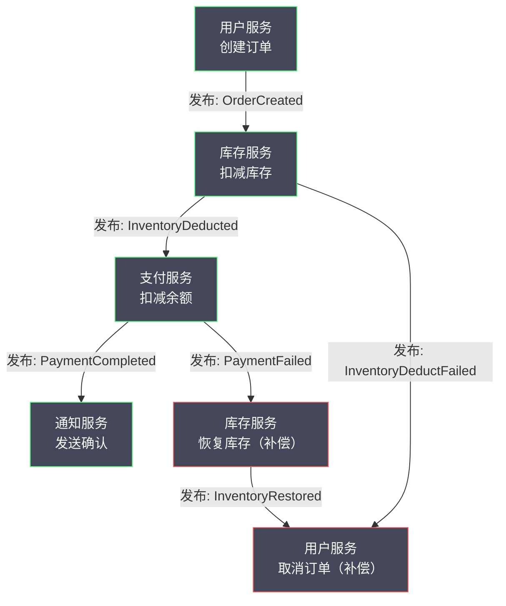
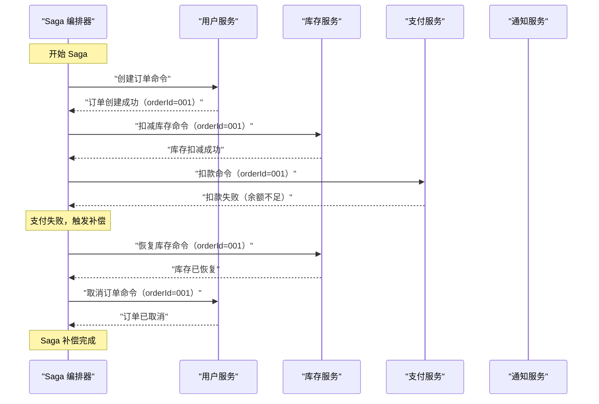
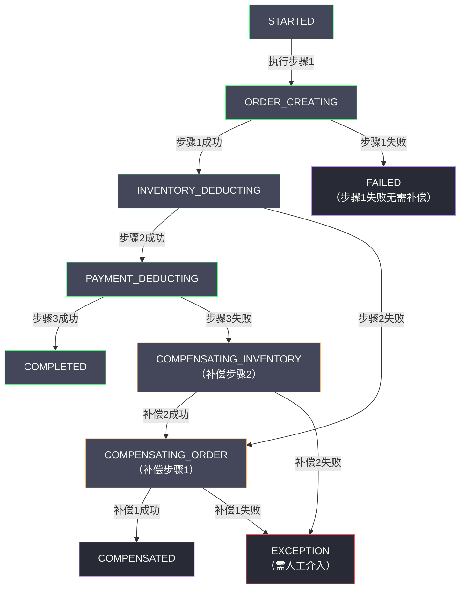
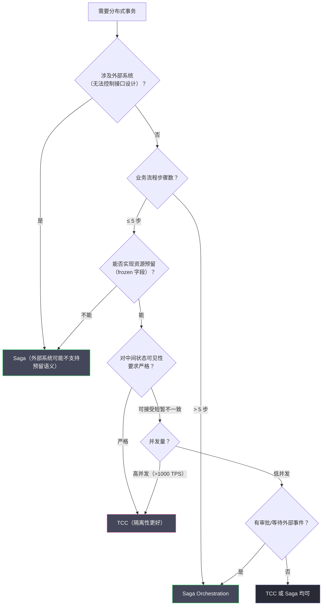

# 05 Saga 长事务编排模式深度解析

**摘要：**

Saga 模式是专为"长事务"场景设计的分布式事务解决方案。与 TCC 不同，Saga 不要求服务提供资源预留接口，而是把一个长事务拆分为一系列按顺序执行的本地事务，每个本地事务都直接提交，一旦某步骤失败，通过执行已完成步骤的"补偿事务"来实现回滚。本文从 Saga 被提出的历史背景切入，深入剖析补偿事务的设计原则及其与 TCC Cancel 的本质区别；详细分析编排与协调两种实现模式的架构差异与权衡；以旅行预订这一经典案例展示 Saga 的完整落地逻辑；进而讨论 Saga 最薄弱的隔离性问题及四种应对策略；最后对比 Saga 与 TCC 的适用边界，给出选型决策框架。读完本文，你应当能回答两个问题：为什么有些长事务无法用 TCC 处理，以及 Saga 的"先提交后补偿"为此付出了什么代价。

---

## 第 1 章 Saga 的起源：长事务问题的历史背景

### 1.1 什么是长事务，为什么它是一个问题

在数据库领域，一个事务的"长短"通常以它持有数据库锁的时间来衡量。典型的短事务在毫秒级完成；而**长事务（Long-Running Transaction）**则可能持续数秒、数分钟，甚至更长。

长事务的出现，往往不是技术设计的失误，而是业务本身的复杂性决定的。想象一个旅行预订场景：

```
用户发起旅行预订：
  步骤 1：预订机票（需要调用航空公司 API，响应时间 1~5 秒）
  步骤 2：预订酒店（需要调用酒店系统，响应时间 2~8 秒）
  步骤 3：预订租车（需要调用租车系统，响应时间 1~3 秒）
  步骤 4：完成支付（需要调用支付网关，响应时间 0.5~2 秒）

总时长：可能长达 15~20 秒
```

如果用传统的 2PC 来处理这个场景：

- Prepare 阶段：4 个系统同时锁定资源，持续等待
- 在这 15 到 20 秒内，航空公司系统中对应的座位被锁定，无法被其他用户预订
- 酒店系统中对应的房间被锁定，无法被其他查询正确显示

这种对外部系统（航空公司、酒店系统）施加长时间锁的做法在技术上不可行——外部系统根本不支持你持有它们的资源锁，而且你的锁会严重影响其他用户的正常使用。换句话说，长事务问题的本质，不是"锁太慢"，而是**事务的参与者根本不允许你锁这么久**。

这里可以打一个比方：TCC 与 2PC 处理的事务，像在超市结账——商品先被"占住"（预留或加锁），几分钟内完成结算；而 Saga 处理的长事务，像一次跨越多日的旅行预订——你不可能把机票、酒店、租车"占住"二十秒，只能在每一步都真正下单，若后续失败，再逐一去退。**当"占住"这个动作本身不被允许时，事务的实现方式就必须改变**。

### 1.2 Saga 的诞生：1987 年的一篇论文

**Saga 模式**由 Hector Garcia-Molina 和 Kenneth Salem 在 1987 年发表的论文《Sagas》中正式提出。这篇论文发表于 ACM SIGMOD 大会，距今将近四十年，但它所解决的问题在今天的微服务时代比以往任何时候都更加普遍。

论文的核心观察非常简单：**对于那些必然要"很长"的事务，与其试图把整个过程锁在一个单一的 ACID 事务中，不如把它拆分为一系列更短的本地事务，同时为每个本地事务设计一个对应的"补偿事务（Compensating Transaction）"，用于在发生失败时撤销已经完成的操作。**

Garcia-Molina 在论文中给出了 Saga 的形式化定义：

> 一个 Saga 是一个长事务 LT，它可以被拆分为一系列子事务 T₁, T₂, ..., Tₙ，其中每个子事务都是一个真实的 ACID 事务（即会立即提交）。对应地，存在一组补偿事务 C₁, C₂, ..., Cₙ₋₁（最后一个事务 Tₙ 不需要补偿，因为如果 Tₙ 失败说明什么都不需要撤销）。
>
> Saga 保证以下两种结果之一：
> 1. T₁, T₂, ..., Tₙ 全部成功（正向路径）
> 2. T₁, T₂, ..., Tⱼ, Cⱼ, Cⱼ₋₁, ..., C₁ 对某个 j（0 ≤ j < n）成立（补偿路径）

用人话说：Saga 保证最终要么所有步骤都成功，要么所有已成功的步骤都被补偿（撤销），不会有"部分成功、无法撤销"的中间状态永久存在。

### 1.3 Saga 在微服务时代的复兴

Saga 模式在提出后，长期停留在学术界，在工业界的应用并不广泛。直到 2010 年代微服务架构的兴起，Saga 才重新获得了大量关注。

原因是：微服务架构把一个大型单体应用拆分为数十甚至数百个独立服务，每个服务管理自己的数据库。跨服务的业务操作（如下单、支付、发货）天然就是"长事务"——它们跨越多个服务边界，每个服务独立部署，无法共享数据库事务。

TCC 虽然适合高并发场景，但它要求每个参与服务实现三个接口（Try/Confirm/Cancel），而且 Try 阶段必须能够实现资源预留。对于某些业务场景（如旅行预订、报销审批），资源预留这个概念本身就很难实现——你无法在"Try 阶段预留一个酒店房间 15 分钟，等 Confirm 再正式下单"，因为外部酒店系统不支持这样的预留语义。

Saga 不要求资源预留，每个步骤直接提交，这使得它在无法实现 TCC Try 的场景下成为唯一可行的柔性事务方案。**Saga 的复兴，本质上是"无法预留"这一约束在微服务时代被普遍化的结果**。

### 1.4 从 2PC 到 Saga 的三次视角转换

回顾前四篇的内容，从 2PC 到 Saga，分布式事务方案经历了一次视角的逐步转换，值得单独梳理，因为它揭示了整个领域的思想演进。

第一次转换是**从"物理锁"到"业务锁"**。2PC 用数据库行锁制造排他性，TCC 用业务字段冻结制造排他性。这次转换把锁从基础设施层搬到了应用层，代价是业务侵入性。

第二次转换是**从"先锁后提交"到"先提交后补偿"**。TCC 仍然是"先占住、再确认"，而 Saga 放弃了"占住"这一步，每一步都直接提交，失败时用补偿撤销。这次转换把"原子性"从"事前预防"变成了"事后补救"。

第三次转换是**从"补偿预留"到"补偿已生效的操作"**。TCC 的 Cancel 撤销的是"预留"，几乎没有副作用；Saga 的补偿撤销的是"已经生效的操作"，会产生真实的业务副作用（如退款、取消订单）。这次转换让 Saga 的补偿更难写、更难保证正确性，却换来了对"无法预留"场景的覆盖能力。

三次转换的共同方向，是**一步步放弃数据库提供的确定性，换回业务层面的灵活性**。理解了这条方向线，就能理解为什么 Saga 的隔离性最弱、补偿最复杂——它是这条方向上走得最远的一个方案。

### 1.5 长事务的三种技术路线对照

在深入 Saga 的机制之前，先把"处理长事务"这个问题上的三条技术路线摆在一起对照，有助于看清 Saga 的位置。

第一条路线是**缩短事务**。把长事务拆成若干个短事务，每个短事务内部用数据库的 ACID 保证，短事务之间则不做强一致要求。这是很多"最终一致"方案的共同底色，Saga 属于这一路线。

第二条路线是**异步解耦**。把原本同步的长调用链改为事件驱动的异步流程，让每一步都由事件触发，从而避免"一个调用链长时间占用资源"。这条路线与 Saga 的编排模式高度相关，但它的重点在解耦而非补偿。

第三条路线是**接受长事务并优化它**。例如让数据库支持更长的锁持有时间，或者用分布式锁显式地保护关键资源。这条路线在长事务不可避免、且必须强一致的场景下偶有使用，但它的代价（阻塞、性能）往往很高。

Saga 在三条路线中的定位很清楚：它属于第一条路线（缩短事务），但额外提供了第二条路线的编排能力（协调模式的编排器），并明确回答了"缩短之后如何保证一致性"这个问题——答案是补偿。**Saga 的独特之处，不在于"拆"，而在于"拆完之后怎么收场"**。

---

## 第 2 章 补偿事务：Saga 的核心机制

### 2.1 补偿事务不是数据库回滚

理解 Saga，必须首先理解**补偿事务（Compensating Transaction）**这个概念，以及它与数据库 ROLLBACK 的本质区别。

**数据库 ROLLBACK**：物理撤销，好像操作从未发生。执行 ROLLBACK 后，数据库的状态完全恢复到事务开始前，没有任何痕迹留下。

**Saga 补偿事务**：语义撤销，是一个新的正向业务操作，用于在语义上"中和"之前的操作效果。执行补偿事务后，数据库中会留下原始操作和补偿操作的双重痕迹。

以旅行预订为例：

- **正向操作**：调用航空公司 API，创建一张机票订单（订单号 TK001）
- **数据库 ROLLBACK**：如果这是一个 DB 事务，ROLLBACK 会让这条订单记录消失，好像从未创建
- **补偿事务**：调用航空公司 API，取消订单 TK001。数据库中仍然存在这条订单记录，但状态变为"已取消"，并且有一条取消记录

这个区别非常重要：**Saga 补偿事务是业务操作，会有审计日志、会通知相关方、会产生业务副作用**。它不能做到数据库 ROLLBACK 那样的"如同从未发生"。这也意味着，Saga 的"回滚"是一个业务概念，而不是一个技术概念——它需要业务方认可"取消订单"这件事本身是合理的、可被用户接受的。

### 2.2 补偿事务的设计原则

设计一个好的补偿事务，需要遵循以下原则。

**原则一：语义逆向，而非物理撤销。** 补偿事务应该在业务语义上逆转原始操作的效果，而不是试图物理删除原始数据。

| 正向操作 | 补偿操作 |
| :--- | :--- |
| 创建订单（状态 = 待支付）| 取消订单（状态 = 已取消）|
| 扣减余额 100 元 | 退款 100 元（或充值 100 元）|
| 锁定库存 1 件 | 释放锁定的 1 件库存 |
| 发送短信通知 | 不可补偿（已发出无法撤回）|

**原则二：补偿操作必须是幂等的。** 与 TCC 的 Cancel 一样，Saga 的补偿事务也可能被重复执行（因为 Saga 协调器会在失败时重试补偿）。因此补偿操作必须是幂等的——重复执行多次的结果与执行一次相同。

```java
// 非幂等的补偿（危险）
public void compensateDeductBalance(String orderId, BigDecimal amount) {
    // 每次调用都会加钱，重复调用导致余额超额增加
    accountService.addBalance(userId, amount);
}

// 幂等的补偿
public void compensateDeductBalance(String compensationId, String orderId, BigDecimal amount) {
    // 检查此次补偿是否已经执行过
    if (compensationRepo.exists(compensationId)) {
        return;  // 已经补偿过，幂等返回
    }
    accountService.addBalance(userId, amount);
    compensationRepo.record(compensationId, orderId, amount);
}
```

**原则三：识别并处理不可补偿操作。** 有些操作在执行后无法通过业务手段撤销：

- 发送电子邮件（已发出无法撤回）
- 外部支付扣款已到账（只能退款，但退款是新操作，有时间窗口限制）
- 短信通知（已发出无法撤回）
- 向监管机构提交的报告

对于不可补偿操作，设计 Saga 时有两种策略：

**策略一：把不可补偿操作放到 Saga 的最后一步。** 如果最后一步失败，Saga 直接结束（不需要补偿最后一步），前面的步骤可以正常补偿。

**策略二：把不可补偿操作之前的所有步骤设计为可补偿的，并在执行不可补偿操作之前完成所有验证。** 一旦不可补偿操作开始执行，整个 Saga 就进入了"只能前进、不能后退"的阶段。

> [!warning] 不可补偿操作是 Saga 设计的最大挑战
> 当 Saga 流程中包含不可补偿操作时，必须非常谨慎地设计执行顺序和错误处理策略。一旦不可补偿操作已经执行，而后续步骤失败，系统需要通过人工干预、客服处理等方式来弥补，而不是通过自动补偿。这是 Saga 在金融场景中使用时需要特别关注的问题。一个实用的做法是：把整个 Saga 划分为"可回退段"与"不可回退段"，前者自动补偿，后者在进入之前完成所有可能失败的前置校验。

### 2.3 补偿事务与 TCC Cancel 的本质区别

Saga 的补偿事务与 TCC 的 Cancel 操作看起来相似，但有一个根本区别：

| 维度 | TCC Cancel | Saga 补偿事务 |
| :--- | :--- | :--- |
| **执行时机** | Try 未提交，撤销预留的资源 | 事务已提交，补偿已生效的操作 |
| **数据可见性** | Cancel 后，中间状态消失 | 补偿后，原操作加补偿操作都留有记录 |
| **业务副作用** | 无（资源只是被预留，未真正生效）| 有（原操作已对外生效，补偿本身也是业务操作）|
| **原子性粒度** | 业务层的资源预留，接近数据库回滚语义 | 完全的业务语义层面 |
| **适用场景** | 有明确预留/解冻语义的资源操作 | 无法预留的外部系统调用、长流程 |

用一句话概括这个区别：**TCC 是"先预留、再确认或撤销"，中间状态对外不完全可见；Saga 是"先提交、后补偿"，每一步都立即生效，补偿是事后追加的新操作**。这个区别决定了 Saga 的补偿更难写，也决定了 Saga 的隔离性更弱——因为每一步都已提交，中间状态对其他事务完全可见。

### 2.4 补偿的语义鸿沟

理解了补偿是"业务操作"而非"物理回滚"，就不得不面对一个更棘手的问题：**补偿未必能完全恢复原状**。

以退款为例。用户支付了 100 元，Saga 后续步骤失败，触发退款补偿。退款后，用户的余额确实回到了支付前，但有两件事无法完全恢复：其一，如果用户当时用的是信用卡，这笔"支付加退款"在银行侧会产生两条流水，可能影响用户的账单周期；其二，如果支付时用了优惠券，退款往往只退现金部分，优惠券是否返还、如何返还，是业务规则问题，技术无法自动决定。

这类"补偿不能完全等价于未发生"的情况，构成了 Saga 的**语义鸿沟（Semantic Gap）**。它是 Saga 的固有属性，无法通过技术手段消除。工程上的应对是：**在设计阶段就明确哪些操作的补偿是"等价的"、哪些是"近似的"**，对后者要么调整业务规则（如约定优惠券不返还），要么在补偿之外补充人工流程。

这个认知很重要，因为它划定了 Saga 的能力边界：**Saga 保证的是"业务语义上的最终一致"，而不是"物理状态上的完全还原"**。把这两者混为一谈，就会对 Saga 产生不切实际的期待。

### 2.5 补偿的可逆性分级

既然补偿的"等价程度"各不相同，一个实用的做法是在设计阶段就把每个操作按可逆性分级，据此决定它在 Saga 中的位置与保护方式。工程上通常分为三级。

**第一级：完全可逆**。补偿能精确还原原状态，不留任何副作用。例如"扣减可用库存"可以由"增加可用库存"精确补偿；"锁定状态位"可以由"解锁"精确补偿。这类操作可以放心地放在 Saga 的任意位置。

**第二级：近似可逆**。补偿在语义上还原了效果，但会留下痕迹或产生额外副作用。例如退款会留下两条银行流水、取消订单会留下一条取消记录。这类操作可以放在 Saga 的中间步骤，但设计时要意识到"补偿不是清零"。

**第三级：不可逆**。补偿在业务上无法执行，或只能依赖人工。例如发送短信、提交监管报告、对外部系统发起的不可撤销调用。这类操作必须被推到 Saga 的最后一步，或者被"语义锁"保护起来，在其之前完成所有可能失败的前置校验。

这个分级的意义在于：**它把"补偿能不能做"这个模糊的问题，转化为"这个操作属于哪一级、该放在哪里"的可操作问题**。很多 Saga 设计事故，根源就是把第三级的操作错误地放在了中间步骤，导致后续失败时无法自动收场。在设计流程时先做一遍分级，是成本极低、收益极高的一步。

---

## 第 3 章 Saga 的两种实现模式

Saga 模式有两种截然不同的实现架构，对应不同的系统设计哲学。理解它们的差异，是选型与落地的关键。

### 3.1 模式一：编排（Choreography）——去中心化

**编排模式的核心思想**：没有中央协调器，每个服务在完成自己的操作后，通过发布领域事件（Domain Event）来驱动下一个服务的执行。整个 Saga 的流程由各服务之间的事件驱动链条隐式编排。



**编排模式的工作流程**（以下单失败场景为例）：

```
1. 用户服务：创建订单（状态=待处理），发布 OrderCreated 事件
2. 库存服务：监听 OrderCreated，扣减库存，发布 InventoryDeducted 事件
3. 支付服务：监听 InventoryDeducted，尝试扣款，失败，发布 PaymentFailed 事件
4. 库存服务：监听 PaymentFailed，执行补偿——恢复库存，发布 InventoryRestored 事件
5. 用户服务：监听 InventoryRestored，执行补偿——取消订单（状态=已取消）
```

**编排模式的优点**：

- **松耦合**：每个服务只需关注自己的输入事件和输出事件，不需要知道全局流程
- **无中心单点**：没有协调器，去中心化设计，没有单点故障风险
- **易于扩展**：新增服务只需订阅相关事件，不影响其他服务

**编排模式的缺点**：

其一，**全局流程难以追踪**。Saga 的整体流程被分散在各个服务的事件处理逻辑中，没有一个地方可以看到"整个 Saga 的执行状态是什么"。当出现问题时，需要关联多个服务的日志才能还原完整的执行路径，调试难度极高。

其二，**循环依赖风险**。随着业务复杂度增加，事件之间的依赖关系可能形成隐式的循环，且难以通过代码审查发现。

其三，**补偿逻辑分散**。每个服务自己负责监听失败事件并执行补偿，补偿逻辑散落在各服务中，整体可维护性较差。

其四，**事件风暴（Event Storm）**。在复杂流程中，每个步骤都有成功和失败两个事件，N 个步骤可能产生 2N 个事件类型，事件数量急剧膨胀，消息总线压力增大，事件追踪复杂度也随之增加。

> [!note] 编排模式适合的场景
> 编排模式在**步骤数量少（3 到 5 步）、流程相对固定、团队服务边界清晰**的场景下表现良好。典型案例是发帖流程（发帖 → 更新 Feed 流 → 推送通知），步骤明确，补偿路径简单。一旦流程变长、分支变多，事件的数量与复杂度会迅速失控。

### 3.2 模式二：协调（Orchestration）——中心化

**协调模式的核心思想**：引入一个中央**编排器（Orchestrator / Saga Coordinator）**，由它显式地定义和控制 Saga 的执行流程。编排器向各参与服务发出命令，等待响应，并根据响应决定下一步执行什么或触发补偿。



**协调模式的优点**：

其一，**全局流程清晰可见**。Saga 的执行流程集中在编排器中，一目了然。任何时刻都可以查询编排器，了解当前 Saga 执行到哪一步、整体状态是什么。

其二，**调试和运维友好**。出现问题时，只需查看编排器的状态日志，就能还原整个 Saga 的执行历史，不需要关联多个服务的日志。

其三，**复杂流程的精确控制**。对于包含条件分支、并发子任务、等待外部事件等复杂逻辑的 Saga，编排器可以精确控制执行顺序和分支逻辑，而这在编排模式中极难实现。

其四，**补偿逻辑集中管理**。补偿的触发和执行顺序由编排器统一管理，不依赖各服务自行监听失败事件。

**协调模式的缺点**：

其一，**编排器成为业务逻辑的聚合点**。编排器需要了解各参与服务的接口细节，随着业务增长，编排器可能变成一个"上帝对象（God Object）"，引发关注点混乱。

其二，**编排器是中心节点，需要高可用保护**。编排器本身需要持久化状态（Saga 执行进度），并部署高可用，否则编排器崩溃会导致所有进行中的 Saga 无法推进。

其三，**服务间的耦合通过编排器间接耦合**。虽然参与服务之间不直接耦合，但它们都与编排器耦合，编排器的修改可能影响所有参与服务的接口协议。

### 3.3 两种模式的选型指南

| 场景特征 | 推荐模式 | 理由 |
| :--- | :--- | :--- |
| **步骤 ≤ 3，流程固定** | 编排（Choreography）| 简单场景无需引入编排器的复杂性 |
| **步骤 > 5，流程复杂** | 协调（Orchestration）| 编排器使复杂流程可维护 |
| **需要可视化监控事务进度** | 协调（Orchestration）| 编排器天然提供中心状态查询 |
| **包含条件分支、并发子任务** | 协调（Orchestration）| 编排模式很难清晰表达复杂控制流 |
| **服务完全自治，不想引入中心依赖** | 编排（Choreography）| 去中心化，无中心单点 |
| **团队规模小，跨团队协作少** | 编排（Choreography）| 协调模式的编排器跨越服务边界，需要多团队协作 |
| **有审计合规要求，需要追踪完整流程** | 协调（Orchestration）| 编排器提供完整的执行历史记录 |

实际工程中，**协调模式（Orchestration）应用更为广泛**，尤其是在复杂的企业级业务流程中。阿里的 Seata Saga 模式、Apache Camel、Netflix Conductor 等框架都采用了协调模式的设计。

### 3.4 一个常被忽视的中间形态：分层编排

把两种模式看成非此即彼的对立，是一种常见的思维简化。真实的复杂系统里，更常见的是**分层编排**：在子域内部用编排模式（步骤少、事件清晰），在跨子域的全局流程上用协调模式（步骤多、需要集中状态）。

例如，一个电商系统的"下单"全局流程可能包含"创建订单、扣库存、扣款、发通知"四个步骤，用协调器管理；而其中"扣库存"这一步，在库存子域内部又可能分解为"锁定、校验、扣减"三个步骤，用事件编排。这样，全局流程的可见性由协调器保证，子域内部的松耦合由编排保证，两种模式各取所长。

这个中间形态的存在，说明了一个更普遍的原则：**架构模式的选择很少是"全有或全无"，更多时候是"在哪个层级用哪个模式"**。把它当作一个分层的工具箱，而不是一个二选一的开关，是更成熟的用法。

---

## 第 4 章 Saga 的状态机：编排器的核心数据结构

协调模式的编排器本质上是一个**持久化状态机（Persistent State Machine）**。理解状态机的设计，是深入理解 Saga 的关键。

### 4.1 状态机的定义

一个 Saga 实例的状态机包含以下要素。

**状态（State）**：Saga 当前所处的阶段，例如：

- `STARTED`：Saga 已启动，尚未执行任何步骤
- `STEP_1_EXECUTING`：正在执行第 1 步
- `STEP_1_COMPLETED`：第 1 步执行完成
- `COMPENSATING`：正在执行补偿
- `STEP_1_COMPENSATING`：正在补偿第 1 步
- `COMPLETED`：Saga 正向完成
- `COMPENSATED`：Saga 补偿完成（事务回滚）
- `FAILED`：Saga 遇到无法补偿的错误，需要人工干预

**事件（Event）**：驱动状态迁移的触发器，例如：

- `STEP_1_SUCCEEDED`：第 1 步执行成功
- `STEP_1_FAILED`：第 1 步执行失败
- `COMPENSATION_SUCCEEDED`：当前补偿步骤成功
- `COMPENSATION_FAILED`：补偿步骤也失败了（极端情况）

**转换（Transition）**：状态加事件，映射到下一个状态与动作。

### 4.2 一个三步 Saga 的完整状态机

以"创建订单 → 扣减库存 → 扣减余额"为例：



### 4.3 编排器的持久化要求

编排器必须把 Saga 实例的状态持久化到数据库中，原因有两个。

其一，**崩溃恢复**。编排器可能崩溃，重启后必须能够从数据库中恢复所有进行中的 Saga 实例，并继续驱动它们向前推进。

其二，**幂等重试**。编排器向参与服务发送命令后，可能因网络超时收不到响应。重试时，编排器必须基于持久化的状态来判断是否需要重试，以及重试的正确步骤。

典型的 Saga 实例持久化数据模型：

```sql
CREATE TABLE saga_instance (
    saga_id       VARCHAR(64)   NOT NULL COMMENT '全局唯一 Saga ID',
    saga_type     VARCHAR(128)  NOT NULL COMMENT 'Saga 类型（如 CreateOrderSaga）',
    state         VARCHAR(64)   NOT NULL COMMENT '当前状态',
    saga_data     TEXT          NOT NULL COMMENT 'Saga 上下文数据（JSON 格式）',
    last_error    TEXT                   COMMENT '最后一次错误信息',
    created_at    DATETIME      NOT NULL,
    updated_at    DATETIME      NOT NULL,
    PRIMARY KEY (saga_id),
    INDEX idx_state (state),
    INDEX idx_type_state (saga_type, state)
);

CREATE TABLE saga_step_log (
    log_id        BIGINT        NOT NULL AUTO_INCREMENT,
    saga_id       VARCHAR(64)   NOT NULL,
    step_name     VARCHAR(64)   NOT NULL COMMENT '步骤名称',
    step_type     VARCHAR(16)   NOT NULL COMMENT 'FORWARD / COMPENSATE',
    status        VARCHAR(16)   NOT NULL COMMENT 'EXECUTING/SUCCESS/FAILED',
    request_data  TEXT                   COMMENT '请求参数',
    response_data TEXT                   COMMENT '响应结果',
    executed_at   DATETIME      NOT NULL,
    PRIMARY KEY (log_id),
    INDEX idx_saga_id (saga_id)
);
```

`saga_instance` 表保存当前状态，`saga_step_log` 表保存完整的历史。前者用于驱动状态机前进，后者用于审计与问题排查。两张表分工明确，这也是 Saga 编排器"可观测"这一优点的技术基础。

### 4.4 状态机的本质：把"进度"变成数据

值得强调的是，Saga 状态机的本质，是**把"执行进度"这个原本存在于内存中的概念，变成了可以被持久化、被查询、被恢复的数据**。

这个转变的意义，怎么强调都不过分。在传统的过程式实现里，"流程执行到哪一步"只是程序计数器里的一个位置，一旦进程崩溃，这个信息就丢失了，流程无法恢复。而一旦把进度变成数据库里的一行状态，流程就获得了"可恢复性"——崩溃后，编排器重新读取状态，就能知道该从哪里继续。

这其实是所有"可靠工作流"系统的共同思路，从 Saga 编排器到 Flink 的 Checkpoint，从工作流引擎到事件溯源，本质上都是在做同一件事：**把不可靠的"过程"转化为可靠的"数据"**。理解了这一点，也就理解了为什么 Saga 必须持久化、为什么状态机是它的核心数据结构。

### 4.5 编排器的实现选择：专用引擎还是自研

明确了编排器是一个持久化状态机之后，落地的下一个问题就是：用现成的专用引擎，还是自研一个轻量编排器？

**专用引擎**（如 Netflix Conductor、Temporal、Seata Saga）提供了完整的状态机定义、持久化、重试调度、可视化监控。它们的优点是开箱即用、经过大规模验证；缺点是引入了新的基础设施依赖，且需要学习其流程定义语言（通常是 JSON 或 DSL），团队的调试与排障会多一层黑盒。

**自研编排器**的优点是轻量、可控、无外部依赖；缺点是必须自己实现状态持久化、崩溃恢复、重试调度、幂等判断——而这些正是最容易出错的"脚手架"。笔者见过不少自研编排器，最终都退化成了"一个会重试的定时任务加一张状态表"，在流程复杂度上升后难以为继。

一个实用的判据是**看流程的数量与稳定性**：如果 Saga 流程只有少数几个、且相对稳定，自研一个轻量编排器是合理的；如果流程数量多、经常变化、需要可视化监控，专用引擎的投入就更划算。这个判据背后的逻辑，与所有"自建还是采购"的决策一样——**当通用能力的需求变得频繁且多变时，专用基础设施的价值才会超过它的引入成本**。

---

## 第 5 章 完整案例：旅行预订 Saga 的落地实践

### 5.1 业务场景与步骤定义

以旅行预订为例，Saga 包含以下 4 个步骤，每个步骤对应一个独立的微服务调用：

| 步骤 | 正向操作 | 补偿操作 | 是否可补偿 |
| :--- | :--- | :--- | :--- |
| 1. 创建旅行订单 | `OrderService.createOrder()` | `OrderService.cancelOrder()` | 是 |
| 2. 预订机票 | `FlightService.bookFlight()` | `FlightService.cancelFlight()` | 是（在起飞前）|
| 3. 预订酒店 | `HotelService.bookHotel()` | `HotelService.cancelHotel()` | 是（在入住前）|
| 4. 完成支付 | `PaymentService.processPayment()` | `PaymentService.refund()` | 是（有时间窗口）|

### 5.2 正向执行路径

```
[Saga 编排器] 创建 Saga 实例，state = STARTED

步骤 1：
  [编排器] → OrderService.createOrder({userId, travelPlan})
  [OrderService] 在本地 DB 创建订单记录（status = PENDING），立即提交
  [OrderService] → 编排器：{orderId = "ORDER-001", success = true}
  [编排器] 更新 state = FLIGHT_BOOKING

步骤 2：
  [编排器] → FlightService.bookFlight({orderId, flightId, passengerId})
  [FlightService] 调用航空公司 API 预订机票，本地记录（ticketId = "TK-001"），立即提交
  [FlightService] → 编排器：{ticketId = "TK-001", success = true}
  [编排器] 更新 state = HOTEL_BOOKING

步骤 3：
  [编排器] → HotelService.bookHotel({orderId, hotelId, checkIn, checkOut})
  [HotelService] 调用酒店 API 预订房间，本地记录（roomReservationId = "HR-001"），立即提交
  [HotelService] → 编排器：{reservationId = "HR-001", success = true}
  [编排器] 更新 state = PAYMENT_PROCESSING

步骤 4：
  [编排器] → PaymentService.processPayment({orderId, amount = 3500})
  [PaymentService] 扣减用户余额，记录支付流水，立即提交
  [PaymentService] → 编排器：{paymentId = "PAY-001", success = true}
  [编排器] 更新 state = COMPLETED

[Saga 完成，用户预订成功]
```

### 5.3 补偿执行路径（支付失败）

```
...（步骤 1、2、3 同上，都已成功并提交）...

步骤 4：
  [编排器] → PaymentService.processPayment({orderId, amount = 3500})
  [PaymentService] 检查用户余额：2000 < 3500，余额不足
  [PaymentService] → 编排器：{success = false, error = "INSUFFICIENT_BALANCE"}
  [编排器] 更新 state = COMPENSATING（进入补偿阶段）

补偿步骤 3（补偿酒店预订）：
  [编排器] → HotelService.cancelHotel({orderId, reservationId = "HR-001"})
  [HotelService] 调用酒店 API 取消预订，更新本地状态为 CANCELLED，立即提交
  [HotelService] → 编排器：{success = true}

补偿步骤 2（补偿机票预订）：
  [编排器] → FlightService.cancelFlight({orderId, ticketId = "TK-001"})
  [FlightService] 调用航空公司 API 取消机票，更新本地状态为 CANCELLED，立即提交
  [FlightService] → 编排器：{success = true}

补偿步骤 1（补偿订单创建）：
  [编排器] → OrderService.cancelOrder({orderId = "ORDER-001"})
  [OrderService] 更新订单状态为 CANCELLED，立即提交
  [OrderService] → 编排器：{success = true}

[编排器] 更新 state = COMPENSATED
[Saga 补偿完成，用户预订失败，所有资源已释放]
```

### 5.4 补偿顺序的重要性

注意补偿的顺序是**逆序**的：先补偿最后成功的步骤，再依次向前补偿。

这不是巧合，而是必须遵守的设计原则。原因如下。

假设补偿顺序是正序（先补偿步骤 1，再补偿步骤 2）：

- 补偿步骤 1（取消订单）：成功
- 补偿步骤 2（取消机票）：调用航空公司 API，对方系统要求验证 orderId，但订单已被步骤 1 删除 → 补偿失败

逆序补偿保证了：**在补偿某个步骤时，它所依赖的上下文数据（如 orderId）仍然有效**，不会因为上游步骤的补偿已经删除了依赖数据而导致补偿失败。

这条规则可以进一步抽象为一条通用原则：**补偿的执行顺序，必须与正向执行顺序相反，且必须保证补偿所需的上下文在补偿时仍然可用**。在设计 Saga 时，如果某个补偿依赖于另一个尚未补偿的步骤的数据，就说明步骤之间的依赖关系需要重新梳理。

### 5.5 补偿失败的处理

现实中的补偿并不总是一次成功。航空公司系统可能暂时不可用，酒店 API 可能超时。当补偿本身失败时，Saga 必须有一套处理策略。

常见的做法是**分级重试加升级**：补偿失败后先进行有限次数的自动重试（如 3 次，间隔递增）；若仍失败，把该 Saga 实例标记为 `EXCEPTION`，推入死信队列，交由人工或专门的补偿任务处理。这个过程必须是可观测的——正如 04 篇强调的，柔性事务的"沉默错误"必须被转化为"可见告警"。

还有一类更棘手的情况：补偿在语义上无法完成。例如退款时发现原支付渠道已下线，或者用户已注销。这类情况没有技术上的自动解法，只能通过业务规则约定（如转为人工转账）来兜底。设计 Saga 时，必须把这些"不可自动补偿"的边界提前识别出来，并在流程设计上尽量避免让 Saga 走到那一步。

---

## 第 6 章 Saga 的隔离性问题与应对策略

### 6.1 Saga 的隔离性弱点

在所有柔性事务方案中，Saga 的隔离性是最弱的。每个步骤在执行后立即提交，数据变更立即对外可见，其他并发的 Saga 或事务可以读取到这些中间状态。

以旅行预订为例，在步骤 2（机票预订完成）、步骤 3（酒店预订）执行期间，如果另一个用户查询航班座位余量，他会看到座位已减少（因为步骤 2 已提交），但如果步骤 3 或 4 最终失败，这个座位又会被释放——用户看到的座位信息是"中间状态"，在最终结果确定之前可能随时变化。

这被称为**脏读问题**：并发请求读取到了一个最终会被补偿（撤销）的中间状态。

### 6.2 隔离性问题的分类

Saga 的隔离性问题有三种主要形式：

其一，**脏读（Dirty Reads）**。事务 A 读取了事务 B 已提交但最终会被 Saga 补偿的数据，基于这个脏数据做出了错误决策。

其二，**不可重复读（Non-Repeatable Reads）**。Saga 执行期间，同一个查询在不同时刻返回不同结果，因为期间有其他 Saga 的步骤提交了数据。

其三，**丢失更新（Lost Updates）**。两个并发的 Saga 都在修改同一个资源，其中一个 Saga 的中间状态被另一个 Saga 覆盖，最终补偿时产生错误的回滚结果。

### 6.3 应对策略

**策略一：语义锁（Semantic Lock）**

在 Saga 的正向操作中，给数据记录加一个业务层面的"处理中"标记，其他事务在读取时检查这个标记，并做相应处理（等待、拒绝，或返回标记信息）。

```sql
-- 步骤 2 执行时，为订单记录加语义锁
UPDATE travel_order
SET status = 'PROCESSING'  -- 标记为处理中
WHERE order_id = 'ORDER-001';

-- 其他查询检查语义锁
SELECT * FROM travel_order
WHERE order_id = 'ORDER-001';
-- 如果 status = 'PROCESSING'，业务层决定：等待 or 提示用户"订单处理中"
```

语义锁不是数据库锁，不会阻塞其他操作，而是通过业务状态字段来表达"这条数据正在被一个 Saga 处理"的语义。

**策略二：乐观并发控制（Optimistic Concurrency Control）**

使用版本号或时间戳，在 Saga 的补偿阶段检查数据是否已被其他事务修改，如果已被修改则拒绝补偿：

```sql
-- 记录步骤执行时的版本号
saga_data.inventory_version = 42  -- 执行步骤时的快照

-- 补偿时检查版本号
UPDATE inventory
SET available_stock = available_stock + 1, version = version + 1
WHERE product_id = 'P001'
  AND version = 42;  -- 如果版本号已变，说明中间被其他事务修改过
-- affected_rows = 0 时，触发告警并人工介入
```

**策略三：重排步骤顺序（Reordering Steps）**

通过调整 Saga 步骤的执行顺序，把最容易产生并发冲突的步骤放到最后，减少中间状态暴露的时间窗口。

**策略四：接受并设计业务语义**

在很多业务场景中，中间状态的短暂可见是可以接受的，甚至是合理的业务设计。例如，电商下单后"库存显示减少但订单未最终确认"，对用户展示"库存紧张，请尽快完成支付"的提示，这本身就是合理的业务行为。

### 6.4 隔离性弱的价值判断

面对 Saga 的隔离性弱点，工程师常有两种极端态度：一种是认为"既然隔离性弱，Saga 就不能用于任何关键业务"；另一种是认为"最终一致就行，中间状态无所谓"。这两种态度都不准确。

正确的判断方式是回到业务本身：**中间状态的可见，是否会导致业务决策出错？** 如果只是展示层面的短暂波动（如库存数字跳动），通常可以接受；如果会引发真实的错误决策（如基于脏读的余额做了转账），则必须用语义锁或乐观锁加以约束。

这个判断无法用技术手段代劳，因为它取决于业务对"一致性"的真实容忍度。**隔离性强弱的取舍，最终是一个业务问题，而不是一个技术问题**——这也再次印证了本专栏的核心立场：分布式事务的每一个选择，最终都要回到业务约束上去找答案。

### 6.5 语义锁的实现细节与代价

语义锁是 Saga 隔离性应对策略里最常用的一种，但它的实现并不像"加个状态字段"那么简单，落地时有几处必须想清楚。

**实现方式有三种。** 其一，**状态字段标记**：在业务表上加一个 `status` 或 `processing` 字段，标记"该记录正被某个 Saga 处理"。它最轻量，但要求业务表本身有合适的状态位。其二，**附加锁表**：单独建一张"语义锁表"，记录被锁定的资源 ID 与持有者 Saga ID。它不侵入业务表，但多了一次查询。其三，**事件溯源**：不显式加锁，而是通过事件流判断某资源是否处于"进行中"状态。它最优雅，但对架构的要求最高。

**代价有三处。** 第一处是**读方的耦合**：语义锁不会自动阻止读操作，它要求所有读取方都主动检查锁标记并做相应处理。这意味着隔离的责任被转移给了读方，一旦有读方"忘记"检查，隔离就形同虚设。第二处是**锁的清理**：如果持有语义锁的 Saga 异常终止且未清理标记，锁会残留，导致资源被永久标记为"处理中"。因此必须有超时清理或对账机制。第三处是**边界模糊**：当 `status = PROCESSING` 既是"业务状态"又是"语义锁"时，两者的语义会混在一起，增加理解成本。

把这些代价讲清楚，是为了说明一个容易被忽略的事实：**语义锁不是"免费的隔离"，它是一份"读方必须遵守的契约"**。它的有效性不取决于写方加锁多规范，而取决于读方是否都认真履行了检查义务。在一个读方众多、且不受同一团队控制的系统里，这份契约的履约率本身就是风险。设计时要么确保读方都在控制范围内，要么干脆接受中间状态的可见，而不要指望语义锁能提供数据库锁那样"自动生效"的隔离。

### 6.6 一个反例：语义锁缺失导致的双重预订

语义锁的价值，在一个具体反例里会显得格外清晰。

设想一个旅行预订场景：用户 A 发起一笔 Saga，预订了某航班最后一张座位（步骤 2 已完成并提交）。此时用户 B 查询该航班余量，由于没有语义锁，他看到的是"余量已减少"（因为 A 的步骤 2 已提交），于是 B 认为还有别的座位可订，继续下单——但实际上这个航班的最后一张已被 A 占用。若 A 的 Saga 后续步骤失败，A 会取消这张座位，座位重新放出，B 的订单可能又会遇到"无座"的冲突；若 A 的 Saga 成功，则 B 的订单在下单时才发现无座，只能失败。无论哪种情况，B 都经历了一次"看似可行、实际不可行"的下单，用户体验受损。

如果给航班座位加上语义锁（标记为"处理中"），B 在查询时就会看到"该座位正在处理中"，从而被引导去选择其他航班，避免了这次无效下单。这个反例说明：**语义锁的价值不在于"防止数据出错"，而在于"避免用户基于中间状态做出注定失败的决策"**。它的收益是体验层面的，而非正确性层面的——这也解释了为什么它常常被忽视，却又常常被需要。

---

## 第 7 章 Saga vs TCC：选型决策框架

### 7.1 核心差异对比

| 维度 | TCC | Saga |
| :--- | :--- | :--- |
| **事务粒度** | 业务操作加资源预留（3 步） | 多个独立本地事务的序列（N 步）|
| **数据一致性窗口** | Try 到 Confirm/Cancel（较短）| 整个 Saga 执行期间（较长）|
| **隔离性** | 较好（资源预留期间不会被其他事务"真正"使用）| 较弱（每步立即提交，中间状态可见）|
| **业务侵入性** | 高（需要实现 Try/Confirm/Cancel 三个接口）| 中（需要实现正向操作加补偿操作）|
| **资源预留要求** | 必须（Try 阶段必须能实现资源预留）| 不需要（每步直接提交）|
| **适合步骤数** | 少（通常 2 到 5 步）| 多（可以处理 10 步以上的长流程）|
| **外部系统支持** | 需要支持预留语义 | 只需支持正向操作和补偿操作 |
| **补偿的业务可见性** | Cancel 后，中间状态消失 | 补偿后，留有操作记录 |
| **典型场景** | 库存扣减、余额扣减等高并发资源操作 | 旅行预订、报销审批等长流程 |

### 7.2 选型决策树



### 7.3 两种方案的生产建议

**TCC 生产建议**：

1. 严格实现幂等性（事务控制表加唯一约束）
2. 必须处理空回滚和悬挂问题（统一的 TCC 状态表）
3. 业务数据模型需要增加冻结字段（`frozen_stock`、`frozen_balance`）
4. Try 超时时间设置合理，避免冻结资源长时间无法释放
5. 使用成熟框架（Seata TCC 模式、Hmily）而非手写

**Saga 生产建议**：

1. 优先使用协调（Orchestration）模式，复杂流程更易于维护
2. 编排器必须持久化 Saga 状态，支持崩溃恢复
3. 所有正向操作和补偿操作都必须是幂等的
4. 为每个 Saga 实例设置超时时间，超时后自动触发补偿
5. 设计好补偿失败的处理策略（人工介入、死信队列）
6. 把不可补偿操作放到 Saga 的最后一步，或使用语义锁保护

### 7.4 一个共同的前提：幂等是入场券

无论是 TCC 还是 Saga，都把"幂等性"列为生产建议的第一条。这不是巧合——**幂等是柔性事务的入场券，没有它，任何重试机制都会变成数据破坏机制**。

原因在于，柔性事务的全部可靠性都建立在"重试"之上：Try 失败要重试，Confirm 失败要重试，Cancel 失败要重试，Saga 的每一步失败也要重试。而重试的前提，就是被重试的操作必须幂等。一个不幂等的操作，在第一次重试时就已经破坏了数据，后续的一切协调都失去了意义。

因此，在选型阶段就应该问一个问题：**参与事务的每一个操作，能否被改造为幂等的？** 如果某个操作本质上无法幂等（例如"每次调用都追加一条流水"），那么它就必须被排除在自动重试的范围之外，改由其他机制处理。这个前置判断，往往比选择 TCC 还是 Saga 更关键。

### 7.5 一个混合场景：TCC 与 Saga 在同一系统共存

把 TCC 与 Saga 看成二选一，是一种常见的简化。真实的电商系统里，两者往往同时存在，各管一段。

设想一个典型的订单系统：核心链路是"扣库存、扣余额、创建订单"，这三个操作资源可预留、并发要求高，用 TCC；而订单完成后的外围流程是"发短信、更新积分、同步到数据仓库、推送物流"，这些操作不可预留、也不需要回滚，用消息队列的最终一致性；至于"预售订单"这类跨越数天、包含多个审批与外部系统交互的长流程，则用 Saga 编排。

在这个系统里，三种方案并存，各自服务于不同的子问题。它们共享同一套基础设施：一个全局事务 ID 的生成与传播机制、一套幂等与状态表的约定、一套可观测性指标。**方案的边界不是系统的边界，而是子问题的边界**——同一笔业务的不同阶段，完全可以用不同的方案。

这个视角的意义在于，它把"选型"从一个"全局单选题"变成了一个"局部多选题"。工程师不必纠结"我们公司到底该用 TCC 还是 Saga"，而应该问"我们这笔业务的这一段，适合用哪种方案"。把问题切小，答案往往就清晰了。

---

## 第 8 章 小结：Saga 的位置与边界

Saga 在分布式事务谱系中的位置，可以这样概括：**它是柔性事务路线上"放弃资源预留"的那一支，用"每步直接提交、失败后补偿"的方式，覆盖了 TCC 无法处理的长流程与外部系统场景**。

它留给我们的几条判断，值得在后续篇章里回味。

其一，**当"预留"不可行时，补偿是唯一的选择**。Saga 的存在本身就是对"资源预留"这一前提的补充——它处理的是那些无法被预留的资源。

其二，**补偿不等于回滚，它是一次新的业务操作**。这个区别决定了 Saga 的补偿更难写、更难保证正确性，也决定了它的隔离性最弱。

其三，**编排与协调不是对立的，而是可以分层的**。在复杂系统中，往往是子域内编排、跨子域协调，模式的选择是一个层级问题。

其四，**持久化状态机是可靠流程的通用范式**。把"进度"变成"数据"，是所有可靠工作流系统的共同思路。

其五，**幂等是柔性事务的入场券**。没有幂等，重试就会变成数据破坏。

在下一篇文章 06 基于消息队列的最终一致性方案 中，我们将转向另一条与 TCC、Saga 平行的支路——利用消息队列的可靠传递特性，实现"异步、单向、靠重试"的最终一致性。它不处理"回滚"，却能以极低的成本解决大量"只需最终执行"的场景。

---

## 参考资料

1. Garcia-Molina, H., & Salem, K. (1987). Sagas. *ACM SIGMOD Record, 16*(3), 249–259.
2. Richardson, C. (2018). *Microservices Patterns: With Examples in Java*. Manning Publications. Chapter 4: Managing transactions with sagas.
3. Helland, P. (2007). Life beyond Distributed Transactions: an Apostate's Opinion. *CIDR 2007*.
4. Seata Saga 官方文档. https://seata.apache.org/zh-cn/docs/user/saga
5. Netflix Conductor: Workflow Orchestration Engine. https://github.com/Netflix/conductor
6. Kleppmann, M. (2017). *Designing Data-Intensive Applications*. O'Reilly Media. Chapter 7: Transactions.

---

> [!note] 思考题
> 1. Saga 的补偿是"业务操作"而非"物理回滚"，这带来了"语义鸿沟"。请举一个业务例子，说明某次补偿无法完全等价于"未发生"，并给出业务层面的应对方式。
> 2. 编排模式与协调模式各有优劣，第 3.4 节提出了"分层编排"的中间形态。请设计一个具体场景，说明为什么在子域内用编排、在跨子域用协调会比"全局统一用一种模式"更合理。
> 3. Saga 的隔离性弱，中间状态对外可见。请区分"可接受的中间状态"与"必须隔离的中间状态"，并说明区分它们的依据为什么是业务约束而非技术约束。
