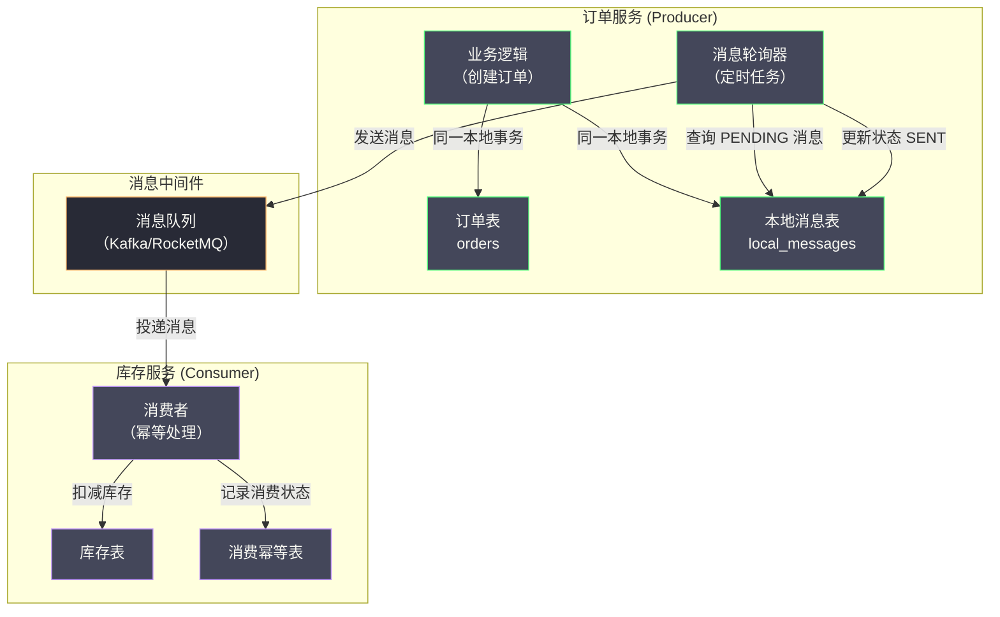
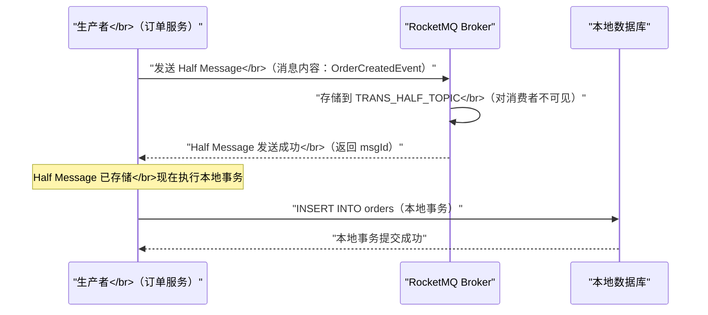
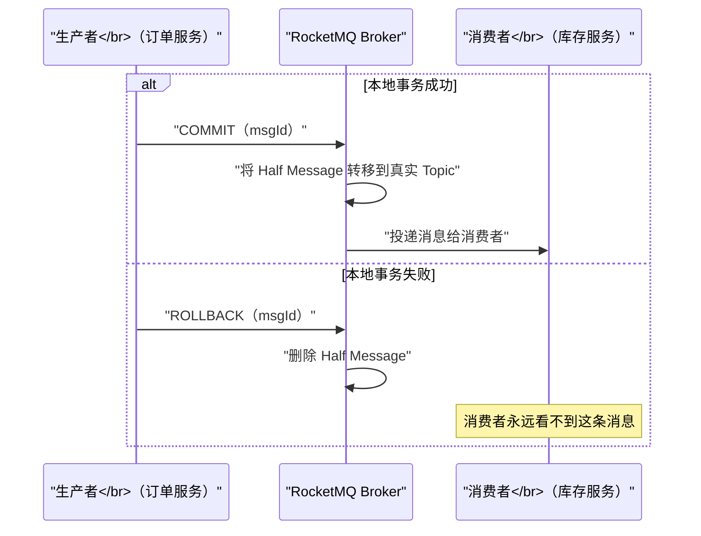
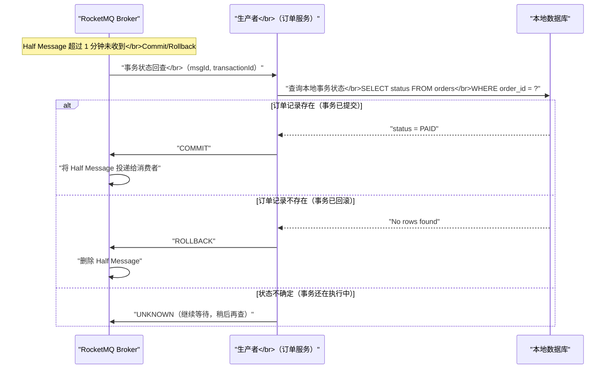
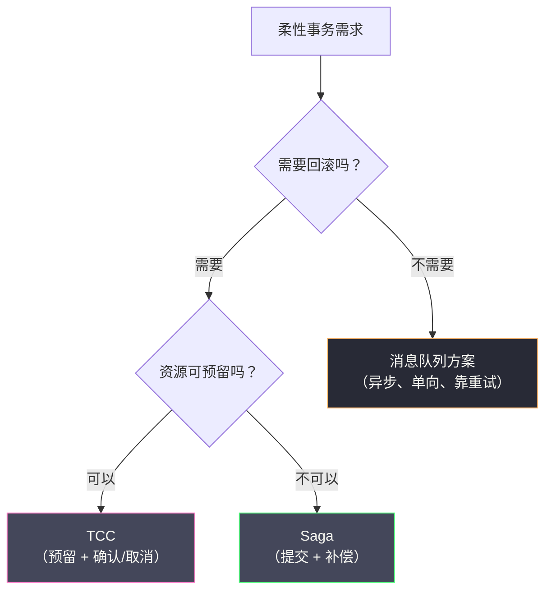

# 06 基于消息队列的最终一致性方案

**摘要：**

基于消息队列的最终一致性方案，是分布式事务家族中最"轻量"的一类。它不需要复杂的协调协议，不要求参与方实现特殊接口，而是把"本地数据库操作"与"发送消息"这两件事绑定为一个原子单元，利用消息队列的可靠传递能力最终驱动所有参与方到达一致状态。本文深入剖析两种主流实现路径：基于本地消息表的经典方案与 RocketMQ 事务消息的工业级实现；重点分析两种方案在"写本地 DB 与发消息的原子性"这一核心问题上的不同解法，以及各自面临的消费幂等、消息积压、消息丢失等工程挑战；并辨析这条支路与 TCC、Saga 的分工边界。读完本文，你应当能回答两个问题：为什么"先写库再发消息"看似简单却不可靠，以及事务消息的"回查"机制究竟在解决什么根本问题。

---

## 第 1 章 为什么需要消息队列方案：TCC 与 Saga 的适用边界

### 1.1 从同步到异步：一类被忽视的场景

在前面的文章中，我们分析了 2PC、TCC 和 Saga 这三类分布式事务解决方案。它们有一个共同特征：**事务的发起方需要等待所有参与方完成操作后，才能确认事务的最终结果**——这是一种同步的协调模型。

但在实际业务中，有大量场景并不需要同步等待所有参与方完成操作：

- 用户下单成功后，订单服务需要通知库存服务扣减库存，但订单服务不需要等待库存服务完成扣减后才向用户返回"下单成功"
- 支付成功后，支付服务需要通知积分服务增加积分，但支付的核心流程已经完成，积分增加是后续操作，晚几秒完成用户也不在乎
- 用户注册后，需要触发欢迎邮件发送、初始化用户偏好、创建默认设置等多个后续操作，这些后续操作不影响注册流程的成功与否

这类场景的特点是：**主操作（写本地数据库）和后续操作（通知其他服务）之间存在天然的先后依赖，但后续操作可以异步执行，只要最终能够被可靠地触发即可。**

对于这类场景，如果使用 TCC，需要为每个后续操作实现 Try/Confirm/Cancel 三个接口，主操作还要等待所有后续操作的 Try 成功才能确认——实现成本高，而且把本来就应该异步的操作硬变成了同步，反而降低了系统响应速度。如果使用 Saga，需要构建编排器，把后续操作编排成 Saga 步骤，对于"主操作已完成、后续操作逐步异步触发"的简单流程，Saga 又过于重量级。

换句话说，TCC 与 Saga 都假设"后续操作需要回滚能力"，而上面这类场景**根本不需要回滚**——它只需要"最终被执行"。为不需要回滚的场景强加回滚机制，是典型的过度设计。

### 1.2 最朴素的解决思路：先写 DB，再发消息

对于异步驱动型的最终一致性场景，最直觉的做法是：

```java
// 伪代码：最朴素的尝试
@Transactional
public void createOrder(Order order) {
    // 步骤 1：写本地数据库
    orderRepository.save(order);

    // 步骤 2：发送消息通知库存服务
    messageQueue.send(new OrderCreatedMessage(order.getId()));
}
```

这个做法看似简单，却存在一个根本性问题：**步骤 1 和步骤 2 不是原子操作**。会出现以下两种故障。

**故障一：数据库写成功，但发消息失败**

```
[数据库] INSERT INTO orders → 成功，事务提交
[网络] 发送消息到 MQ → 连接超时，失败
[结果] 订单存在，但库存服务永远收不到通知 → 库存不一致
```

**故障二：消息发出，但数据库事务最终回滚**

```
[数据库] INSERT INTO orders → 写入内存，事务尚未提交
[MQ] 消息发送成功，库存服务开始扣减库存
[数据库] 后续代码抛出异常，事务回滚，订单不存在
[结果] 库存被扣减，但订单不存在 → 库存不一致（超卖）
```

这两个故障揭示了核心问题：**数据库事务的提交与消息发送是两个独立的操作，两者之间没有原子性保证**。

这里可以打一个比方：这就像"写信"与"寄信"是两件事——你写好了信（数据库提交），却在去邮局的路上把信弄丢了（发消息失败），收信人永远不知道这封信存在；反过来，信寄出去了（消息发出），你却发现信的内容有误要作废（事务回滚），可收信人已经照着错误的内容行动了。要解决这个问题，必须让"写信"与"寄信"成为一个不可分割的动作。

解决它，需要一种机制让"写本地 DB"与"发送消息"成为一个原子操作。本地消息表方案与 RocketMQ 事务消息是目前最主流的两种解法，它们分别代表了"在业务侧解决"与"在消息中间件侧解决"两种思路。

### 1.3 两条解法路线的哲学分野

在展开具体方案之前，先点明两条路线的哲学分野，这有助于理解它们各自的代价落在哪里。

**本地消息表**的思路是"把发消息降格为写数据库"：既然数据库事务是原子的，那就把"要发的消息"先写进数据库的一张表，让它与业务数据同生共死；至于"真正把消息投出去"，交给一个后台轮询任务慢慢做。它把分布式问题（原子写库加发消息）转化为了单机问题（原子写两张表）加一个可靠投递问题。代价是：多了一张表、多了一个轮询器、多了一段投递延迟。

**RocketMQ 事务消息**的思路是"把原子性下沉到消息中间件"：由 Broker 先把消息"预登记"（半消息），等生产者执行完本地事务再决定"转正"或"撤销"；若生产者失联，Broker 主动回查。它把本地消息表的那套逻辑内置到了 MQ 里，代价是：强绑定 RocketMQ、Broker 侧承压、以及回查接口的设计约束。

两条路线的共同目标一致——**让"写库"与"发消息"要么都发生、要么都不发生**——但一个把复杂度留在业务侧，一个把复杂度推到中间件侧。选哪条，取决于你更愿意在哪个位置承担复杂度。

### 1.4 第三条路线：事务性发件箱与 CDC

除了"业务侧解决"与"中间件侧解决"这两条路线，还有第三条常被提及的路线：**事务性发件箱（Transactional Outbox）配合变更数据捕获（CDC，Change Data Capture）**。

事务性发件箱其实是本地消息表的"通用名"——它强调的是"把待发送的消息作为一个 outbox 记录，与业务数据同事务写入"这一模式。而 CDC 则为它提供了一种更优雅的投递方式：不再用定时任务轮询 outbox 表，而是用 CDC 工具（如 Debezium）订阅数据库的 binlog，一旦发现 outbox 表有新记录，就立刻捕获并投递到消息队列。

相比轮询，CDC 有两个明显优势：其一，**延迟低**，消息在 outbox 写入后几乎立即被捕获，没有轮询间隔；其二，**不侵入应用**，投递逻辑完全在数据库外部，应用只负责写 outbox 表。代价则是：引入了 CDC 这一层基础设施，且它依赖数据库的 binlog（意味着需要开启 binlog、处理 binlog 格式变更、以及保证 CDC 组件自身的高可用）。

三条路线的关系可以这样理解：**事务性发件箱是一种"模式"，本地消息表是它最朴素的实现，CDC 是它更现代的实现，RocketMQ 事务消息则是把这一模式内置进 MQ 的另一种形态**。它们解决的是同一个问题——"写库与发消息的原子性"——只是在"把复杂度放在哪里"这个问题上做出了不同选择。

---

## 第 2 章 本地消息表方案：eBay 2008 年的经典工程实践

### 2.1 方案的起源与核心思想

本地消息表（Local Message Table）方案最早由 eBay 工程师 Dan Pritchett 在 2008 年的论文《Base: An ACID Alternative》中提出，与 BASE 理论同期出现。

**核心思想**：把"发送消息"这个操作转化为"写本地数据库记录"。由于写消息记录和写业务数据都在同一个本地数据库事务中，它们天然具有原子性——要么都成功，要么都失败。随后，由一个后台任务轮询这张本地消息表，把待发送的消息可靠地投递到消息队列。

这个转换的巧妙之处在于：它没有试图去解决"跨系统的原子性"，而是**把跨系统的操作拉回到单个系统内，用单机事务的原子性来覆盖它**。发消息这个动作被推迟了，推迟到"不再需要与业务写操作保持原子"的时刻。

### 2.2 方案的完整架构



### 2.3 本地消息表的数据模型

```sql
CREATE TABLE local_messages (
    msg_id          VARCHAR(64)   NOT NULL COMMENT '消息唯一 ID',
    topic           VARCHAR(128)  NOT NULL COMMENT '消息主题（对应 MQ 的 Topic）',
    payload         TEXT          NOT NULL COMMENT '消息内容（JSON 格式）',
    status          VARCHAR(16)   NOT NULL DEFAULT 'PENDING'
                                  COMMENT 'PENDING/SENT/CONSUMED/FAILED',
    retry_count     INT           NOT NULL DEFAULT 0 COMMENT '已重试次数',
    max_retry       INT           NOT NULL DEFAULT 5 COMMENT '最大重试次数',
    next_retry_at   DATETIME               COMMENT '下次重试时间（指数退避）',
    business_key    VARCHAR(128)           COMMENT '业务主键（用于幂等查询）',
    created_at      DATETIME      NOT NULL,
    updated_at      DATETIME      NOT NULL,
    PRIMARY KEY (msg_id),
    INDEX idx_status_retry (status, next_retry_at),  -- 轮询查询优化
    INDEX idx_business_key (business_key)             -- 幂等查询优化
);
```

### 2.4 生产者端：原子写入业务数据与消息记录

```java
@Transactional  // 本地数据库事务
public void createOrder(CreateOrderRequest request) {
    // 步骤 1：写业务数据（订单）
    Order order = new Order(request);
    orderRepository.save(order);  // INSERT INTO orders

    // 步骤 2：在同一事务内写消息记录（与步骤 1 原子）
    LocalMessage message = LocalMessage.builder()
        .msgId(UUID.randomUUID().toString())
        .topic("order.created")
        .payload(JSON.toJSONString(new OrderCreatedEvent(order.getId(), order.getProductId(), order.getQuantity())))
        .status("PENDING")
        .businessKey(order.getId())
        .nextRetryAt(LocalDateTime.now())  // 立即可被轮询
        .build();
    localMessageRepository.save(message);  // INSERT INTO local_messages

    // 事务提交时，orders 和 local_messages 两张表同时写入成功
    // 如果这里抛出异常，两张表都回滚，不会有任何消息记录
}
```

### 2.5 消息轮询器：可靠投递

消息轮询器是一个定时任务（通常每隔 1 到 5 秒执行一次），负责把本地消息表中 `PENDING` 状态的消息投递到消息队列：

```java
@Scheduled(fixedDelay = 2000)  // 每 2 秒执行一次
public void pollAndSendMessages() {
    // 查询待发送的消息（考虑重试时间）
    List<LocalMessage> pendingMessages = localMessageRepository
        .findPendingMessages(LocalDateTime.now(), 100);  // 每批最多 100 条

    for (LocalMessage message : pendingMessages) {
        try {
            // 投递到消息队列
            mqProducer.send(message.getTopic(), message.getPayload());

            // 更新状态为已发送
            localMessageRepository.updateStatus(message.getMsgId(), "SENT");

        } catch (Exception e) {
            // 发送失败，增加重试次数，设置下次重试时间（指数退避）
            int retryCount = message.getRetryCount() + 1;
            if (retryCount >= message.getMaxRetry()) {
                // 超过最大重试次数，标记为 FAILED，人工介入
                localMessageRepository.updateStatusWithRetry(
                    message.getMsgId(), "FAILED", retryCount, null);
                alertService.sendAlert("本地消息投递彻底失败，需人工干预: " + message.getMsgId());
            } else {
                // 指数退避：1s, 2s, 4s, 8s, 16s...
                LocalDateTime nextRetry = LocalDateTime.now()
                    .plusSeconds((long) Math.pow(2, retryCount));
                localMessageRepository.updateStatusWithRetry(
                    message.getMsgId(), "PENDING", retryCount, nextRetry);
            }
        }
    }
}
```

> [!note] 指数退避的重要性
> 消息投递失败通常源于 MQ 服务暂时不可用或网络抖动。如果使用固定间隔重试，大量失败消息会在短时间内产生大量重试请求，可能进一步加剧 MQ 的压力。指数退避（每次重试间隔翻倍）可以有效减轻这种"雪上加霜"效应，给 MQ 服务留出恢复时间。这个策略与限流中的令牌桶、熔断中的退避是同一类思想：**在系统已经脆弱时，减少对它的压力，而不是加大它**。

### 2.6 消费者端：幂等消费

由于消息可能被重复投递（轮询器在确认发送前崩溃，重启后会重新投递），消费者必须实现幂等消费。消费幂等的标准实现是在消费者数据库中维护一张消费记录表：

```sql
CREATE TABLE consumed_messages (
    msg_id      VARCHAR(64) NOT NULL COMMENT '消息唯一 ID',
    topic       VARCHAR(128) NOT NULL,
    consumed_at DATETIME     NOT NULL,
    PRIMARY KEY (msg_id)
);
```

消费逻辑：

```java
@RocketMQMessageListener(topic = "order.created", consumerGroup = "inventory-group")
public class OrderCreatedConsumer implements RocketMQListener<OrderCreatedEvent> {

    @Override
    @Transactional
    public void onMessage(OrderCreatedEvent event) {
        String msgId = RocketMQHeaders.getMessageId();  // 获取消息 ID

        // 1. 幂等检查：是否已经消费过
        if (consumedMessageRepo.exists(msgId)) {
            log.info("消息已消费，幂等跳过: msgId={}", msgId);
            return;
        }

        // 2. 执行业务操作
        inventoryService.deductStock(event.getProductId(), event.getQuantity());

        // 3. 记录消费状态（与步骤 2 在同一本地事务中）
        consumedMessageRepo.save(new ConsumedMessage(msgId, event.getTopic()));

        // 事务提交：业务操作 + 消费记录 原子完成
    }
}
```

> [!warning] 消费幂等的事务边界
> 消费记录的写入必须与业务操作在同一个本地事务中。如果先执行业务操作（扣减库存）再写消费记录，在两者之间崩溃时：库存已扣，但消费记录未写，重试时库存会被重复扣减。只有把两者放在同一事务中，才能保证幂等性的可靠性。这与第 2.4 节生产者端的"业务数据与消息记录同事务"是同一个套路——**凡是需要原子的一对操作，都想办法把它们塞进同一个本地事务**。

### 2.7 方案的优缺点分析

**优点**：

- **实现简单**：无需引入任何特殊的 MQ 特性，适用于任何消息队列（Kafka、RabbitMQ、RocketMQ 均可）
- **技术栈无侵入**：对现有代码改动最小，只需增加一张本地消息表和一个定时任务
- **可靠性高**：消息记录持久化在数据库中，不受 MQ 故障影响，MQ 恢复后可自动重发

**缺点**：

- **数据库压力增加**：每次业务写操作都会额外写一条消息记录，高并发场景下本地消息表可能成为写入热点
- **消息延迟**：从业务数据写入到消息被实际投递，存在轮询间隔的延迟（通常 1 到 5 秒）
- **消息表的存储膨胀**：如果消费确认机制不完善，消息表会持续增大，需要定期归档清理
- **需要维护定时任务**：轮询器本身也是一个服务组件，需要处理其高可用

> [!warning] 轮询器的高可用问题
> 如果同一个应用部署了多个实例，每个实例都运行轮询器，同一条消息记录可能被多个实例同时扫到并投递，导致消息重复。解决方案：
> 1. 使用分布式锁确保同一时刻只有一个实例运行轮询器
> 2. 在更新消息状态时使用乐观锁（CAS：只有 status = 'PENDING' 时才更新为 'SENDING'，防止并发处理）
> 3. 依赖消费者端的幂等消费来容忍少量重复（最终一致性场景下这通常是可接受的）
>
> 这三条从强到弱，分别对应"预防重复""减少重复""容忍重复"三种态度。工程上通常三者结合：用分布式锁做到大体不重复，用 CAS 兜住边界，用消费幂等保底。

### 2.8 消息表的清理与归档

本地消息表有一个容易被忽视的运维问题：**它会持续增长**。每笔业务都写入一条消息记录，如果从不清理，表会越来越大，索引变慢，最终拖垮写入性能。

清理策略需要按状态区分对待。`PENDING` 状态的消息不能删——它还没投递成功，删了就丢了。`SENT` 状态的消息，在消费者确认之后可以标记为 `CONSUMED`（这需要消费者回写确认，或者在消息表侧不做确认、只依赖 MQ 的投递保证）。`FAILED` 状态的消息应当保留，供人工排查。因此，可安全清理的是那些"已确认消费"或"已超过保留期"的记录。

常见的清理实现有三种：其一，**定时删除**，用定时任务删除 N 天前的已消费记录；其二，**分区表**，按时间分区，直接 drop 掉旧分区，避免逐行删除的开销；其三，**历史表迁移**，把旧记录搬到归档表。三种方式的取舍与日志清理、审计表清理是同一类问题——**在高写入场景下，按分区整块删除通常远优于逐行删除**。

配套的监控也必不可少：监控消息表的总行数、`PENDING` 状态的行数与最老一条的年龄。`PENDING` 堆积意味着投递环节出了问题，这是比表大小更重要的先行指标。

### 2.9 一个变体：让业务表本身充当消息表

本地消息表需要额外一张表，这在某些团队里会被视为"不够优雅"。于是出现了一个变体：**不单独建消息表，而是让业务表本身充当 outbox**——业务数据写入时带一个"待通知"标记，由后台任务扫描这些标记并投递消息，投递后清除标记。

这个变体的优点是省掉了一张表，业务语义更直观。但它的缺点也很明显。其一，**扫描范围是整张业务表**，为了找出少量"待通知"的行，可能要扫描大量无关数据，或者被迫在业务表上建一个低选择性的索引。其二，**"待通知"标记与业务状态混在一起**，当业务本身也有状态字段时，两者的语义容易纠缠。其三，**一笔业务可能需要通知多个下游**，单一标记无法表达"通知了 A、还没通知 B"这种多目标状态。

因此，这个变体只适合"通知目标单一、业务表本就有合适状态位、且待通知数据量不大"的场景。一旦通知目标变多或数据量变大，独立的消息表反而更清晰。**这个取舍揭示了一个通用原则：把"业务状态"与"流程状态"分开存放，通常比混在一起更可持续**——因为它们的变化频率、生命周期、查询模式都不一样。

---

## 第 3 章 RocketMQ 事务消息：Half Message 机制深度解析

### 3.1 为什么需要 RocketMQ 的事务消息

本地消息表方案有效，但有一个明显的工程成本：需要为每个业务场景维护一张本地消息表，并运维一个轮询定时任务。随着业务场景增多，这些"基础设施代码"会越来越多，且在不同服务中重复出现。

RocketMQ 从 4.3.0 版本开始提供了**事务消息（Transaction Message）**功能，把本地消息表的核心逻辑内置到消息队列中，使得"原子性写本地 DB 加发消息"的问题可以在框架层面得到统一解决，而无需在业务代码中维护本地消息表。

### 3.2 Half Message 的核心概念

RocketMQ 事务消息的实现基于一个称为 **Half Message（半消息）**的中间状态。

**Half Message** 是指：**已经被 RocketMQ Broker 接收并存储，但对消费者不可见的消息**。它被暂存在一个特殊的内部 Topic（`RMQ_SYS_TRANS_HALF_TOPIC`）中，不会被路由到任何消费者队列。

Half Message 就像一个"预登记的消息"——Broker 已经知道它的存在，但在生产者确认之前，它不会对任何消费者产生影响。这个设计的关键洞察是：**把"消息可见"这件事，推迟到"本地事务已确定结果"之后**。

### 3.3 事务消息的完整流程

RocketMQ 事务消息把整个流程分为三个阶段。

**阶段一：发送 Half Message**



**阶段二：本地事务执行后发送 Commit/Rollback**



**阶段三：事务状态回查（应对生产者崩溃）**

这是 RocketMQ 事务消息最精妙的设计——当生产者在发送 Commit/Rollback 之前崩溃，导致 Broker 收不到最终状态时，Broker 会主动发起**事务状态回查（Transaction Status Check）**：



回查机制解决的根本问题是：**生产者在"执行完本地事务"与"通知 Broker"之间崩溃时，Broker 无法知道该提交还是回滚**。这与 2PC 中"协调者崩溃后参与者无法决策"的困境同构——都是"关键信息丢失"。区别在于，RocketMQ 的解法是让 Broker 主动"回头去问"，而生产者只需要能从本地数据中查出一个确定的答案。这实际上是把"事务状态"这个信息，持久化在了生产者的业务数据里——**只要订单记录存在，就说明本地事务提交了**。

### 3.4 事务回查接口的实现

生产者需要实现 RocketMQ 的 `TransactionListener` 接口，包含两个方法：

```java
@Component
public class OrderTransactionListener implements TransactionListener {

    @Autowired
    private OrderRepository orderRepository;

    /**
     * 执行本地事务（在发送 Half Message 成功后被回调）
     * 返回值决定向 Broker 发送 COMMIT 还是 ROLLBACK
     */
    @Override
    public LocalTransactionState executeLocalTransaction(Message msg, Object arg) {
        CreateOrderRequest request = (CreateOrderRequest) arg;

        try {
            // 执行本地事务：写订单数据
            orderRepository.createOrder(request);

            // 本地事务成功，通知 Broker COMMIT Half Message
            return LocalTransactionState.COMMIT_MESSAGE;

        } catch (InsufficientStockException e) {
            // 业务失败，通知 Broker ROLLBACK Half Message
            log.warn("库存不足，事务回滚: orderId={}", request.getOrderId());
            return LocalTransactionState.ROLLBACK_MESSAGE;

        } catch (Exception e) {
            // 未知异常，状态不确定，等 Broker 回查
            log.error("本地事务执行异常: ", e);
            return LocalTransactionState.UNKNOW;
        }
    }

    /**
     * 事务状态回查（Broker 在未收到 Commit/Rollback 时调用）
     * 通过查询本地 DB 来判断事务的实际状态
     */
    @Override
    public LocalTransactionState checkLocalTransaction(MessageExt msg) {
        // 从消息中获取业务标识（在发送时放入消息属性）
        String orderId = msg.getUserProperty("orderId");

        Order order = orderRepository.findById(orderId);

        if (order == null) {
            // 订单不存在：要么事务已回滚，要么事务还未执行完
            // 保守策略：回滚（避免重复操作）
            return LocalTransactionState.ROLLBACK_MESSAGE;
        }

        // 订单已存在（无论什么状态），说明本地事务已提交
        return LocalTransactionState.COMMIT_MESSAGE;
    }
}
```

**发送事务消息的代码**：

```java
@Service
public class OrderService {

    @Autowired
    private RocketMQTemplate rocketMQTemplate;

    public void createOrderWithTxMessage(CreateOrderRequest request) {
        // 构建消息
        Message<OrderCreatedEvent> message = MessageBuilder
            .withPayload(new OrderCreatedEvent(request.getOrderId(), request.getProductId(), request.getQuantity()))
            .setHeader("orderId", request.getOrderId())  // 用于回查时识别
            .build();

        // 发送事务消息（内部：先发 Half Message，再执行 executeLocalTransaction 回调）
        TransactionSendResult result = rocketMQTemplate.sendMessageInTransaction(
            "order.created",   // Topic
            message,
            request            // 传递给 executeLocalTransaction 的参数
        );

        if (result.getLocalTransactionState() != LocalTransactionState.COMMIT_MESSAGE) {
            throw new BusinessException("订单创建失败：" + result.getLocalTransactionState());
        }
    }
}
```

### 3.5 Half Message 的存储机制

理解 RocketMQ 事务消息的可靠性保证，需要深入 Broker 的存储机制。

**Half Message 的存储**：RocketMQ Broker 把所有 Half Message 存储在一个特殊内部 Topic `RMQ_SYS_TRANS_HALF_TOPIC` 的 Queue 0 中，而不是目标 Topic 的队列中。这样消费者订阅目标 Topic 时，完全不会看到 Half Message。同时，Broker 维护了一个 `RMQ_SYS_TRANS_OP_HALF_TOPIC`（操作日志 Topic），记录哪些 Half Message 已经被 COMMIT 或 ROLLBACK。

**事务回查的触发时机**：Broker 有一个后台定时任务（默认每 60 秒执行一次），扫描 `RMQ_SYS_TRANS_HALF_TOPIC` 中存在超过阈值时间（默认 6 秒，可配置）未被 COMMIT/ROLLBACK 的消息，对这些消息发起事务状态回查。

**回查的最大次数与最终处理**：默认情况下，同一条消息的回查次数上限是 15 次。如果 15 次回查后生产者仍然返回 UNKNOW，Broker 会把这条消息标记为 ROLLBACK 并丢弃。

```
RocketMQ 回查配置（broker.conf）：
transactionCheckMax=15         # 最大回查次数
transactionCheckInterval=60000 # 回查间隔（毫秒）
transactionTimeOut=6000        # Half Message 超时阈值（毫秒）
```

> [!warning] 回查接口的设计必须能应对 Broker 重启
> 事务状态回查由 Broker 主动发起，生产者服务必须处于运行状态才能响应。如果生产者服务也在回查发生时不可用，RocketMQ 会记录回查失败并在下次回查间隔重试。因此，**回查接口的实现必须是纯粹的状态查询，不能有任何副作用**——它只读取本地数据库来判断事务状态，不执行任何写操作。把回查写成"顺手补一笔数据"之类的有副作用逻辑，会在多次回查下产生重复写入。

### 3.6 事务消息与本地消息表的对比

| 维度 | 本地消息表 | RocketMQ 事务消息 |
| :--- | :--- | :--- |
| **实现复杂度** | 中（需维护消息表加轮询器）| 低（框架内置，只需实现回查接口）|
| **消息延迟** | 轮询间隔（秒级）| 极低（本地事务完成后立即 COMMIT）|
| **消息队列依赖** | 无（适用任何 MQ）| 强（必须使用 RocketMQ 或支持事务消息的 MQ）|
| **存储压力** | 业务 DB 有额外消息表写入压力 | Broker 侧承压（Half Message 存储）|
| **可靠性** | 高（消息记录持久化在业务 DB）| 高（Half Message 在 Broker 持久化）|
| **回查机制** | 无（轮询器自行重试）| 有（Broker 主动回查生产者）|
| **消息顺序性** | 依赖 MQ 本身的顺序保证 | 依赖 RocketMQ 的顺序消息特性 |
| **适用场景** | 任意 MQ 环境，兼容性优先 | 已使用 RocketMQ，追求低延迟和框架统一 |

### 3.7 事务消息不保证什么

事务消息的能力边界很容易被高估，这里有必要明确列出它**不保证**的事项，以免产生错误的期待。

**它不保证消费者一定成功**。事务消息只保证"消息会被投递出去"，投递之后的消费成功与否，取决于消费者的处理逻辑与重试机制。消费者一直失败，消息就一直是"投递了但未成功消费"的状态。

**它不保证消费幂等**。事务消息保证的是"至少一次"投递，重复投递依然可能发生，消费端的幂等必须自己实现。

**它不保证消息顺序**。除非显式使用顺序消息，否则同一业务的多条消息可能乱序到达消费者。

**它不保证生产者业务逻辑正确**。事务消息只关心"本地事务的提交状态"，至于本地事务本身写的数据是否业务正确，它一概不管。

**它不保证无限重试**。回查有次数上限（默认 15 次），超过后 Broker 会把消息标记为 ROLLBACK 并丢弃。如果生产者在所有回查期间都不可用，这条消息最终会被丢弃——这要求生产者具备足够的可用性。

把这些边界列清楚，就能得出一个判断：**事务消息只解决了"写库与发消息的原子性"这一个问题，其他一切都没有解决**。它是一个精确的工具，用对了价值很大，指望它包办所有一致性问题是误解。

---

## 第 4 章 消费者侧的幂等性：最终一致性的最后一道防线

### 4.1 为什么消费者幂等是必须的

无论使用本地消息表还是 RocketMQ 事务消息，消息都可能被**重复投递**。原因包括：

1. **本地消息表轮询器**：轮询器在更新消息状态前崩溃，重启后会再次投递同一条消息
2. **RocketMQ At-Least-Once 语义**：RocketMQ 默认保证消息至少投递一次，不保证恰好一次
3. **消费者处理超时**：消费者处理消息超时，Broker 重新投递给其他消费者实例
4. **网络重传**：消费者 ACK 在传输中丢失，Broker 重新投递

在所有这些情况下，消费者必须能够安全地处理重复消息——即幂等消费。

> [!info] At-Least-Once 与 Exactly-Once 的鸿沟
> 消息队列普遍提供的是"至少一次"投递，而"恰好一次"在分布式环境下极难保证——它需要生产者、Broker、消费者三方协同，任何一环的不确定都会破坏"恰好一次"。工程上的主流做法是：**接受"至少一次"，用消费端的幂等把它"折合成"业务上的恰好一次**。这也解释了为什么幂等是柔性事务的通用入场券（见 05 篇第 7.4 节）。

### 4.2 消费幂等的三种实现方案

**方案一：消息 ID 去重（通用方案）**

使用消息 ID 作为幂等键，在消费前检查这条消息是否已经处理过：

```sql
-- 消费幂等记录表
CREATE TABLE idempotent_consumer (
    idempotent_key VARCHAR(128) NOT NULL COMMENT '幂等键（通常是 msgId）',
    topic          VARCHAR(128) NOT NULL,
    consumer_group VARCHAR(128) NOT NULL,
    status         VARCHAR(16)  NOT NULL DEFAULT 'PROCESSING',
    created_at     DATETIME     NOT NULL,
    PRIMARY KEY (idempotent_key, consumer_group)
);
```

消费逻辑（使用数据库唯一约束实现幂等）：

```java
@Transactional
public void consumeMessage(String msgId, OrderCreatedEvent event) {
    // 利用唯一约束：INSERT 失败说明已处理过（幂等）
    try {
        idempotentRepo.insertProcessing(msgId, "order.created", "inventory-group");
    } catch (DuplicateKeyException e) {
        // 已处理过，幂等跳过
        return;
    }

    // 执行业务逻辑
    inventoryService.deductStock(event.getProductId(), event.getQuantity());

    // 更新幂等状态为成功
    idempotentRepo.updateSuccess(msgId, "inventory-group");
}
```

**方案二：业务状态机幂等（精准方案）**

通过检查业务数据的当前状态来判断是否已处理：

```java
@Transactional
public void consumeOrderCreated(OrderCreatedEvent event) {
    // 检查库存扣减记录是否存在
    StockDeductRecord record = stockDeductRepo.findByOrderId(event.getOrderId());

    if (record != null) {
        // 已经处理过了（幂等）
        return;
    }

    // 执行扣减
    inventoryService.deductStock(event.getProductId(), event.getQuantity());

    // 记录扣减明细（下次重复消费时通过此记录识别幂等）
    stockDeductRepo.save(new StockDeductRecord(event.getOrderId(), event.getProductId(), event.getQuantity()));
}
```

**方案三：乐观锁版本号幂等（防并发方案）**

在业务数据上维护版本号，消费时基于特定版本号执行更新，防止并发消费同一条消息：

```java
@Transactional
public void consumeBalanceDeduct(BalanceDeductEvent event) {
    // 使用事件中携带的"期望版本号"执行更新
    int affected = accountRepo.deductBalanceWithVersion(
        event.getUserId(),
        event.getAmount(),
        event.getExpectedVersion()  // 消息中携带的账户版本号
    );

    if (affected == 0) {
        // 版本号不匹配：要么已经处理过（版本已更新），要么并发冲突
        // 查询当前余额确认是否已处理
        Account account = accountRepo.findById(event.getUserId());
        if (account.getVersion() > event.getExpectedVersion()) {
            return;  // 版本已推进，说明已处理，幂等跳过
        }
        throw new RuntimeException("余额扣减并发冲突，触发重试");
    }
}
```

三种方案的适用性各有侧重：方案一通用但需要额外的表；方案二最精准，但要求业务数据本身有可用的状态位；方案三适合并发消费同一资源的场景，但需要消息中携带版本号。选择哪一种，取决于业务数据模型与消息内容的可控程度。

### 4.3 消息积压的预防与处理

消息队列最终一致性方案有一个特有的运维风险：**消息积压**。当消费者处理速度跟不上生产者发送速度时，消息队列中会积累大量未消费的消息，导致数据不一致的窗口时间越来越长。

**预防措施**：

1. **容量规划**：基于历史峰值 QPS 规划消费者实例数量，预留 30% 余量
2. **消费者扩容**：配置自动扩容策略，在消息积压达到阈值时自动增加消费者实例
3. **合理的 Topic 与 Queue 数量**：RocketMQ 的单 Topic 并发消费能力与 Queue 数量成正比，根据并发需求合理设置

**处理措施**（积压发生后）：

1. **临时扩容消费者**：快速增加消费者实例数，加速消费
2. **消费者降级**：在积压清理期间，消费者跳过部分非关键逻辑（如发送通知邮件），只保证核心业务操作
3. **转移到新 Topic**：把积压消息批量转移到一个新的 Topic，用专门的高并发消费者集群处理积压，原 Topic 正常消费新消息

> [!note] 积压的本质是"消费能力小于生产速率"
> 消息积压不是一个"队列问题"，而是"消费能力问题"在队列上的表现。因此，根治积压的办法只有两条：要么提高消费能力（扩容、优化消费逻辑），要么降低生产速率（限流、合并消息）。任何"清理队列"的做法，如果不改变这两者的关系，都只是治标。这一点与数据库的连接池耗尽、线程池的任务堆积是同一类问题的不同表现。

### 4.4 消息顺序性问题

消息队列方案还有一个容易被忽视的隐患：**消息乱序**。多数消息队列为了保证吞吐，并不保证全局有序；同一业务对象的多条消息，可能以与发送相反的顺序到达消费者。

考虑一个账户场景：先发"扣款 100"，再发"退款 100"。如果消费者先处理了退款、后处理了扣款，在余额检查严格的情况下，"退款"可能因为"余额不足"而失败，最终扣款成功、退款丢失，账户凭空少了 100。这类错误极其隐蔽，因为它只在乱序发生时出现。

解决顺序问题的思路有两类。其一是**分区内有序**：把同一个业务键（如 userId）的消息路由到同一个队列，消息队列只保证"单队列内有序"，于是同一用户的消息自然有序。其二是**顺序消息**：使用消息队列提供的顺序消息特性（如 RocketMQ 的顺序消息），代价是吞吐量下降，因为同一队列只能串行消费。

这里有一个必须认清的权衡：**顺序与并发是一对矛盾**。要严格有序，就必须牺牲并发；要提高并发，就必须接受乱序。因此，正确的做法不是"全局保证有序"，而是**只对真正需要有序的业务键做分区内有序**，其余消息允许乱序。把有序的范围缩到最小，是兼顾正确性与吞吐的关键。

### 4.5 消费失败的兜底：区分错误类型

消费者处理消息失败后，常见的做法是"重试"。但重试并非万能——**关键在于区分错误类型**。

**可重试错误**：网络抖动、下游服务临时不可用、数据库连接超时。这类错误重试之后大概率会成功，应当自动重试，配合指数退避。

**不可重试错误**：消息内容本身有误、业务规则冲突（如"余额不足"）、数据格式非法。这类错误无论重试多少次都不会成功，重试只会浪费资源、延长积压。

把不可重试的错误也丢进重试队列，是很多系统的通病，后果是：一条"永远不可能成功"的消息被反复重试，占用消费者资源，甚至触发告警风暴。正确做法是为每个消费者定义"可重试异常"与"不可重试异常"的边界，后者直接进入**死信队列（DLQ，Dead Letter Queue）**，交由人工或专门的补偿流程处理。

死信队列不是"垃圾桶"，而是一个**待处理的工单池**。它必须配套监控（DLQ 增长告警）与处理流程（谁来看、多久看一次、如何处理）。一个没有监控的死信队列，等价于一个被遗忘的数据不一致角落。**消息方案的可靠性上限，往往就取决于这个角落被照看的程度**。

---

## 第 5 章 消息方案的边界：适用场景与不适用场景

### 5.1 适用场景

基于消息队列的最终一致性方案最适合以下场景。

**其一，业务操作具有天然的主从关系**。有一个"主操作"（写本地 DB），后续的"从操作"（通知其他服务）依赖主操作但不影响主操作的返回结果。典型例子有：下单成功异步扣减库存；支付成功异步增加积分；用户注册后异步初始化配置、发送欢迎邮件。

**其二，消费者操作是幂等且可重试的**。消费者处理的操作不会因重试产生副作用（如重复发送短信可以通过消息 ID 去重）。

**其三，允许秒级延迟的最终一致性**。业务上可以接受几秒到几十秒的数据不一致窗口。

**其四，下游操作相对独立，无依赖链**。后续操作不需要等待彼此的结果才能执行。如果后续操作之间有依赖关系（A 完成后才能触发 B），需要考虑 Saga 模式。

### 5.2 不适用场景

**其一，强一致性要求的场景**。金融转账、结算等场景要求所有操作同步完成且结果立即一致，不接受秒级延迟，应使用 TCC 或 2PC。

**其二，消费者操作不可重试**。如果消费者操作有不可撤销的副作用（如调用已售出不可退的外部 API），且无法保证幂等，则消息方案风险极高。

**其三，下游操作有复杂依赖链**。如果后续操作 A 的结果影响 B 的输入，这种复杂依赖链难以用简单的消息驱动处理，应考虑 Saga Orchestration。

**其四，需要同步响应所有操作结果**。如果调用方需要同步知道所有后续操作的结果（如"扣款和库存扣减都成功了，才告诉用户下单成功"），消息方案不能满足，需要 TCC 同步等待所有参与方确认。

### 5.3 一个常被误判的边界：幂等的"成本"不同

在判断"是否适合消息方案"时，最容易出错的是对"幂等成本"的低估。有些操作看似幂等，实际上代价很高。

例如，"发短信通知"可以通过消息 ID 去重来幂等，但它意味着**消费者必须持久化每一条已消费的消息 ID**。如果短信量是每天上亿条，这张幂等表本身就会成为一个巨大的负担。相比之下，"扣减库存"的幂等可以用业务状态位（如扣减流水）实现，成本更低。

因此，判断幂等时不能只问"能不能做到"，还要问"做到它的代价有多大"。**当幂等的实现成本超过了它带来的收益时，就该重新考虑这个操作是否适合走消息方案**——也许它应该被合并、被降级，或者干脆用其他机制处理。

### 5.4 与 Kafka 事务的对照

提到"事务消息"，容易把 RocketMQ 与 Kafka 的方案混为一谈。两者名字相近，但解决的其实是不同的问题，混淆它们会导致选型错误。

Kafka 的事务（`transactional.id`、`initTransactions`、`commitTransaction`）主要面向**流处理场景的"读-处理-写"原子性**：它保证"从一个或多个分区消费的消息，与写入一个或多个分区的消息，要么都成功、要么都失败"，并且能把消费偏移量与产出消息一起原子提交。它解决的是"流处理管道的恰好一次"，典型场景是 Kafka Streams 这类应用。

RocketMQ 的事务消息则面向**"本地数据库事务加消息"的原子性**：它保证"本地 DB 事务的提交状态"与"消息是否对消费者可见"一致。它解决的是"业务写库与通知下游"的一致性问题。

两者的分野可以概括为：**Kafka 事务管的是"消息与消息之间"的原子性，RocketMQ 事务消息管的是"数据库与消息之间"的原子性**。前者的参与者都在 Kafka 内部，后者的参与者跨越了数据库与消息队列。因此，在"业务事务加消息"的场景里，RocketMQ 的事务消息是更贴合的；而 Kafka 的事务，更适合"消费一批消息、处理后产出另一批消息"的流处理链路。选型时先看清"原子性的边界落在哪里"，答案自然清晰。

### 5.5 一个成本视角：轻量方案的重量

消息队列方案常被称为"轻量"，但这个"轻"是相对于 2PC、TCC 的协议复杂度而言的。把它真正的成本逐项列出，会发现它并不轻。

**写入成本**：每笔业务额外写入一条 outbox 记录（或一条幂等记录）。在高写入场景下，这是实打实的额外 I/O。

**存储成本**：outbox 表与消费幂等表都会持续增长，需要归档与清理；如果幂等按消息 ID 存储，幂等表的规模会与消息量成正比。

**运维成本**：轮询器（或 CDC 组件）本身需要高可用；消息队列需要监控积压；死信队列需要人工处理流程。

**延迟成本**：从业务写入到下游生效，存在轮询间隔（本地消息表）或投递与消费延迟。对于需要"准实时"的场景，这个延迟可能不可接受。

把这些成本加总，可以看出：**消息队列方案把"协议复杂度"换成了"数据与运维复杂度"**。它没有消除复杂度，只是把复杂度从"协议层"转移到了"数据层与运维层"。这也是分布式系统的普遍规律——复杂性不会消失，只会转移（这一点在 01 篇已经作为一条认知命题提出）。因此，判断是否采用消息方案时，不能只问"它比 TCC 简单吗"，还要问"它转移过来的那些复杂度，我的团队扛得住吗"。

### 5.6 三个问题定方案

把本章的判断收敛为三个问题，可以在面对一个具体操作时快速定下方案。

**第一问：这个操作失败了，需要撤销前面的操作吗？** 需要，则不能用消息方案，转向 TCC 或 Saga；不需要，则消息方案是候选。

**第二问：调用方需要同步等待这个操作的结果吗？** 需要，则不能用消息方案（它是异步的）；不需要，则消息方案合适。

**第三问：这个操作的幂等实现成本，是否可以接受？** 如果幂等需要一张与消息量同规模的去重表，成本可能过高，需要重新考虑。

三个问题都通过，消息方案就是合适的选择；任何一个不通过，都应转向其他支路。这个"三问法"的好处是，它把选型从"比较方案的优劣"变成了"检验业务的约束"——**选型从来不是选最好的方案，而是选最匹配约束的方案**。

---

## 第 6 章 与 TCC、Saga 的分工：三条支路的定位

把消息队列方案与前文的 TCC、Saga 放在一起，可以画出柔性事务的三条支路。



这张图给出了一个清晰的判断顺序：**先问"是否需要回滚"，再问"资源是否可预留"**。不需要回滚的，走消息队列；需要回滚且可预留的，走 TCC；需要回滚但不可预留的，走 Saga。

三条支路的共同点是都接受"最终一致"，差别在于它们对"一致性窗口"与"业务侵入"的处理方式：消息队列方案的窗口最长、侵入最低；TCC 的窗口最短、侵入最高；Saga 居中，但能处理最长的流程。**没有哪条支路更好，只有哪条更匹配当前这个子问题**。

### 6.1 一个混合架构：MQ 与 TCC 协同

在一个真实的下单流程里，消息方案与 TCC 常常协同工作，各管一段。

核心链路是"扣库存、扣余额、创建订单"，这三步需要回滚，且资源可预留，用 TCC 保证原子性；订单创建成功后，需要"发通知、加积分、同步数仓"，这些不需要回滚，用消息队列异步驱动；而"积分到账后再发一条积分变动通知"这类有先后依赖的后续动作，则可以在消费者内部继续用消息驱动，形成一条异步链。

这个混合架构的关键在于**边界的划分**：TCC 负责"必须原子完成的核心三步"，消息负责"可以异步到达的后续动作"，两者的交界是"订单创建成功"这个明确的里程碑。一旦核心链路通过 TCC 提交，后续就全部交给消息；如果核心链路回滚，后续消息根本不会发出——因为消息是在 TCC 成功提交之后才写入 outbox 的。

这个划分的智慧在于：**它用 TCC 保证了"不可回退的那部分"的正确性，又用消息保证了"可以异步的那部分"的低成本**。把需要强协调的部分缩到最小，把可以异步的部分放到最大，是兼顾正确性与成本的通用策略——这也正是本专栏反复强调的"按子问题选方案"的具体体现。

### 6.2 一个反例：把需要回滚的操作放进消息队列

混合架构的边界一旦划错，后果往往很严重。一个常见的错误是：把"需要回滚的操作"也放进了消息队列。

设想一个"先扣库存、再扣款"的流程。如果团队为了图省事，把"扣库存"和"扣款"都做成消息驱动的异步操作，就会出现这样的问题：扣库存的消息先被消费、库存扣减成功；扣款的消息随后被消费、发现余额不足、扣款失败。此时库存已经扣了，却没有任何机制把它还回去——因为消息队列方案的语义里根本没有"回滚"。

结果就是超卖。要修复它，团队不得不额外写一段"扣款失败则发一条恢复库存消息"的逻辑——而这段逻辑，本质上就是手写的 Saga 补偿。**与其手写一个不完整的 Saga，不如一开始就用 TCC 或 Saga**。

这个反例的教训是：**消息队列方案的"轻"，来自它"不需要回滚"这个前提；一旦业务需要回滚，就必须换方案，而不是硬套**。判断的标准很简单：问一句"这个操作失败了，我需要撤销前面的操作吗"。需要，就不能用消息方案。

---

## 第 7 章 小结：轻量方案的重量

消息队列方案在分布式事务家族里显得"轻"——它不需要协调器、不需要资源预留、不需要补偿。但这份轻量是有前提的：**它只适用于那些"不需要回滚"的场景**。一旦业务需要回滚，就必须转向 TCC 或 Saga，消息方案就无能为力了。

它留给我们的几条判断，值得在后续篇章里回味。

其一，**把跨系统问题拉回单系统，是解决原子性的一把万能钥匙**。本地消息表的全部智慧，就在于把"跨系统原子"转化为了"单库原子"。

其二，**"预登记"是处理不确定性的通用手法**。Half Message 把消息的可见性推迟到本地事务确定之后，这与 2PC 的"先问再提交"是同一种思想的两种实现。

其三，**回查的本质是让信息可被重新获取**。Broker 回查生产者，问的是"你的本地事务到底提交了没有"——而这个答案，恰好能从业务数据里查出来。

其四，**幂等是入场券，且它的成本必须被计入**。任何重试机制的可靠性，都建立在幂等之上；而幂等的实现成本，又会反过来限制方案的使用范围。

其五，**积压是消费能力问题的表征，不是队列问题**。治积压要治消费能力，而不是治队列。

在下一篇文章 07 Seata 框架原理与工程实战 中，我们将从"模式与方案"转向"框架与实现"，看看 Seata 如何用一套统一的框架，把 AT、TCC、Saga、XA 四种模式整合起来，并深入剖析它最核心的 AT 模式——自动 undo_log 与全局锁是如何做到"对业务几乎零侵入"的。

### 8.4 一个延伸：最终一致性方案的"成本构成"

基于消息队列的最终一致方案，常被描述为"比 2PC 更轻"——但它的成本并不为零。把它拆开来看。

**成本一，"本地消息表的写入开销"**。**每次业务操作都要"额外写一条消息记录"**——**这增加了写放大**（一次业务写，变成"业务表加消息表"两次写）。

**成本二，"消息投递与消费的开销"**。**消息要经过 MQ、要被消费者处理**——**这引入了"MQ 的运维成本"与"消费的延迟"**。

**成本三，"对账与修复的成本"**。**最终一致"不保证即时一致"，因此需要"对账"来发现与修复不一致**——**而"对账"本身是一项持续的成本**（需要定时任务、需要人工处理异常）。

**成本四，"幂等的实现成本"**。**消费方必须幂等**——**这需要"去重表"或"状态机"，增加了复杂度**。

**这四项成本，共同构成了"最终一致方案"的总代价**。**它与 2PC 的代价（阻塞、锁）不同——它是"分布式的、持续的"，而不是"集中的、偶发的"**。

**这条延伸的启示是**：**"更轻"是相对的**——**最终一致方案"避免了长事务锁"，但"引入了对账与幂等的持续成本"**。**因此，选择它时，要"把对账与幂等的成本算进去"**——**而不是"只看它'没有锁'"**。**这与本专栏"把取舍量化"的一贯立场一致**。

---

## 参考资料

1. Pritchett, D. (2008). Base: An Acid Alternative. *ACM Queue, 6*(3), 48–55.
2. RocketMQ 官方文档：事务消息. https://rocketmq.apache.org/zh/docs/featureBehavior/04transactionmessage
3. Kleppmann, M. (2017). *Designing Data-Intensive Applications*. O'Reilly Media. Chapter 11: Stream Processing.
4. Hohpe, G., & Woolf, B. (2003). *Enterprise Integration Patterns*. Addison-Wesley.
5. RocketMQ GitHub: Transaction Message Implementation. https://github.com/apache/rocketmq

---

> [!note] 思考题
> 1. 本地消息表把"发消息"转化为"写数据库记录"，从而获得了原子性。请说明这个转换为什么成立，以及它把"原子性"问题转化成了哪两个新的问题。
> 2. RocketMQ 的事务回查之所以能判断事务状态，是因为"订单记录是否存在"这个信息被持久化在了业务数据里。请设计一个反例：如果业务数据中没有可用于判断的标识，回查接口会面临什么困难？
> 3. 消息积压的本质是"消费能力小于生产速率"。请分别给出"提高消费能力"与"降低生产速率"各两种具体手段，并说明它们各自的代价。
