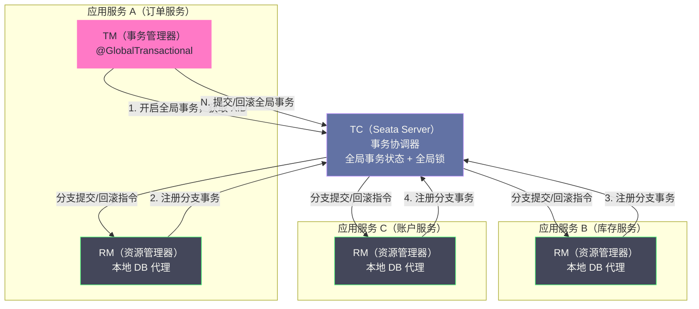
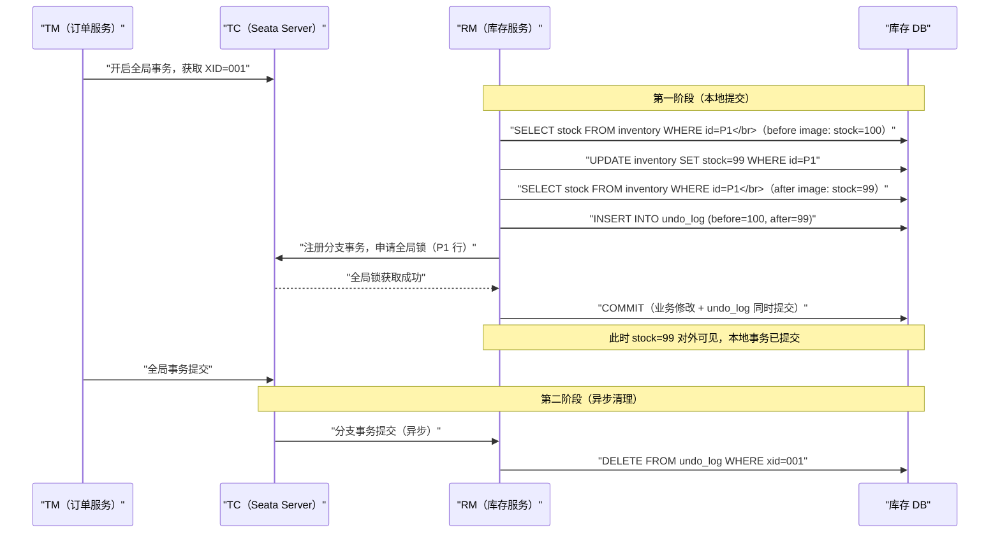
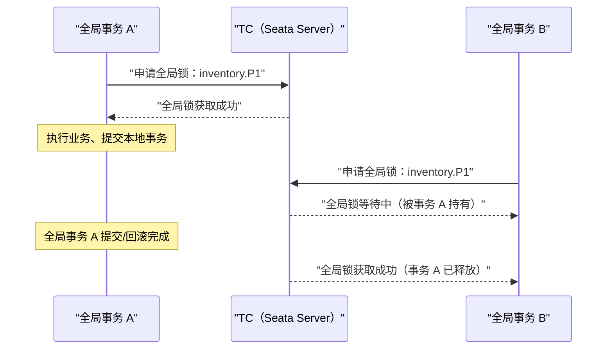
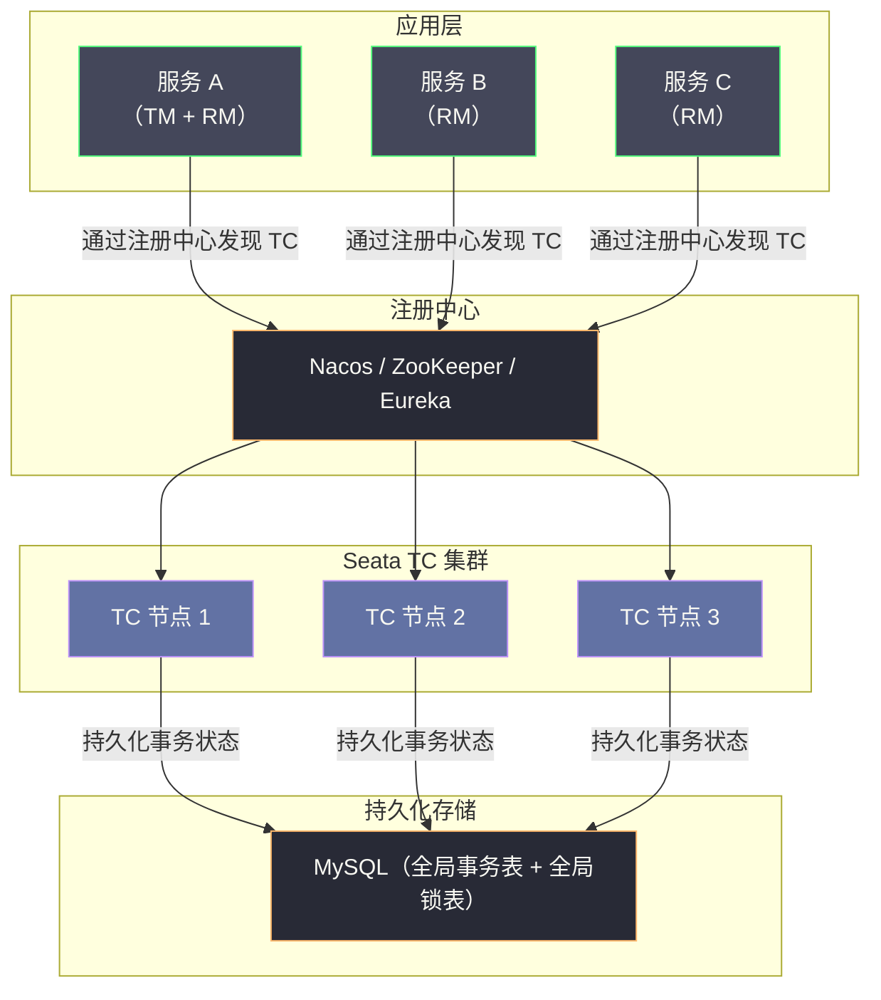

# 07 Seata 框架原理与工程实战

**摘要：**

Seata（Simple Extensible Autonomous Transaction Architecture）是阿里巴巴开源的分布式事务框架，也是目前 Java 生态中应用最广泛的分布式事务解决方案。本文聚焦 Seata 的核心架构与底层原理，重点深度解析其标志性的 AT 模式——它是如何通过自动生成 undo_log、维护全局锁、以及两阶段异步提交，实现对业务代码"几乎零侵入"的分布式事务；同时介绍 TCC、Saga、XA 三种模式的实现机制与各自适用边界；并通过典型的生产故障案例，揭示 AT 模式的性能瓶颈与正确使用姿势。读完本文，你应当能回答两个问题：AT 模式凭什么能做到"加一个注解就有分布式事务"，以及它的全局锁为什么在高并发热点场景下会成为瓶颈。

---

## 第 1 章 Seata 的诞生背景与核心定位

### 1.1 从 Fescar 到 Seata：阿里巴巴的分布式事务演进

Seata 的前身是阿里巴巴内部的 TXC（Taobao Transaction Constructor）框架，随后以 GTS（Global Transaction Service）的形式在阿里云商业化。2019 年，阿里巴巴把其核心能力以 Fescar（Fast & Easy Commit And Rollback）为名开源，后更名为 Seata，并贡献给 Apache 软件基金会（Apache Seata，2023 年成为 Apache 顶级项目）。

这条演进路径本身就很有意思：一个从电商大促的真实压力中长出来的框架，先在内部打磨，再商业化，最后开源。它身上带着鲜明的"业务驱动"印记——几乎所有设计取舍，都能在"双十一高并发"这个场景里找到解释。理解这一点，有助于理解 AT 模式为什么把"低侵入"放在如此高的优先级。

Seata 的核心设计目标可以用一句话概括：**为微服务架构提供高性能、易使用的分布式事务解决方案，在最大程度降低业务侵入性的前提下保证分布式场景下的数据一致性。**

"最大程度降低业务侵入性"是 Seata 与其他方案（尤其是 TCC）最大的区别。TCC 要求开发者为每个业务操作实现三个接口，对现有代码改动极大；而 Seata 的 AT 模式通过框架层的自动化机制，让开发者只需在方法上加一个注解（`@GlobalTransactional`），就能获得分布式事务能力，对业务代码几乎零侵入。

### 1.2 Seata 的四种事务模式

Seata 提供了四种分布式事务模式，覆盖了从强一致性到最终一致性的完整谱系：

| 模式 | 全名 | 一致性级别 | 业务侵入性 | 核心机制 |
| :--- | :--- | :--- | :--- | :--- |
| **AT 模式** | Automatic Transaction | 最终一致 | 极低（注解驱动）| 自动 undo_log 加全局锁 |
| **TCC 模式** | Try-Confirm-Cancel | 最终一致 | 高（需实现三接口）| 业务层资源预留 |
| **Saga 模式** | — | 最终一致 | 中（状态机配置）| 业务补偿加状态机编排 |
| **XA 模式** | eXtended Architecture | 强一致 | 低（注解驱动）| 数据库原生 XA 协议 |

这张表体现了 Seata 的一个设计取向：**它不发明新模式，而是把前几篇讨论过的模式都收进同一个框架，让开发者按场景选择**。AT 对应"低侵入的最终一致"，TCC 对应"高并发的可预留场景"，Saga 对应"长流程"，XA 对应"强一致"。本文重点解析 AT 模式，因为它是 Seata 的核心创新，也是绝大多数生产场景的首选。

### 1.3 AT 模式的定位：介于 2PC 与 TCC 之间

要理解 AT 模式，最好的方式是把它的定位说清楚：**它试图在 2PC 与 TCC 之间找一条中间路线**。

2PC 的优点是业务无侵入，缺点是同步阻塞、持锁时间长；TCC 的优点是高并发、无长持锁，缺点是业务侵入大、需要实现三个接口。AT 模式的想法是：能不能既像 2PC 一样对业务透明，又像 TCC 一样避免长时间持有数据库行锁？

答案是：用"自动生成的回滚信息"替代"业务手写的 Try/Cancel"，用"框架层的全局锁"替代"数据库层的行锁"。前者解决了业务侵入问题，后者解决了持锁问题。代价则是引入了 undo_log 的存储开销、全局锁的协调开销，以及一个较弱的一致性保证（本地事务立即提交，因此存在短暂脏读）。

**AT 模式不是"更好的 2PC"，也不是"自动化的 TCC"，而是一个独立的取舍点**——它用"可回滚日志加全局锁"这套机制，换来了"低侵入"与"较短的 DB 行锁持有时间"两全的可能。看清这一点，后面的所有细节就都能各归其位。

### 1.4 AT 模式适合什么、不适合什么

在深入细节之前，先给出 AT 模式的适用边界，便于建立预期。

**AT 模式适合**：跨库或跨服务的普通业务事务，参与者都是支持 JDBC 的关系型数据库；对业务代码侵入性敏感，团队不愿为事务改造业务逻辑；并发压力集中在"不同的行"而非"同一热点行"；可以接受短暂的读未提交。

**AT 模式不适合**：高并发的单一热点行（如秒杀库存），全局锁会成为瓶颈；参与者包含非数据库资源（Redis、HTTP 服务），因为 AT 依赖数据库代理；需要强一致读隔离的场景；存在大量绕过 Seata 的旁路数据修改的场景（会破坏回滚校验）。

一句话概括：**AT 模式是"大多数普通场景的默认选择"，但不是"所有场景的万能解"**。把它当作起点而非终点，是使用 Seata 的正确心态。

---

## 第 2 章 Seata 的核心架构：三个角色的职责分工

### 2.1 角色定义

Seata 的架构由三个核心角色组成。

**TC（Transaction Coordinator，事务协调器）**：

- Seata Server，独立部署的服务
- 负责维护全局事务和分支事务的状态
- 接收 TM 的全局事务开启、提交、回滚请求
- 接收 RM 的分支事务注册请求
- 协调所有分支事务的提交或回滚
- 维护全局锁（AT 模式）

**TM（Transaction Manager，事务管理器）**：

- 嵌入在应用服务中的 SDK 组件
- 负责定义全局事务的边界（开启、提交、回滚）
- 通常对应 `@GlobalTransactional` 注解所在的方法
- 向 TC 申请开启全局事务，获取全局唯一 XID

**RM（Resource Manager，资源管理器）**：

- 嵌入在应用服务中的 SDK 组件
- 管理本地事务的执行
- 向 TC 注册分支事务，汇报分支事务状态
- 负责驱动分支事务的提交或回滚



三个角色的划分，与 2PC 的协调者、参与者是同一个思路，只是把职责切得更细：TM 管边界，RM 管执行，TC 管协调。这个"三权分立"的设计，使得同一个应用既可以作为发起方（TM），也可以作为参与方（RM），角色由调用关系动态决定。

### 2.2 XID 的传播机制

XID（全局事务 ID）是贯穿整个 Seata 分布式事务的核心标识符，它必须在所有参与服务之间传播，以便各 RM 能把本地分支事务关联到正确的全局事务。

Seata 的 XID 传播通过以下机制实现：

- **本地线程**：在当前服务的同一线程调用链中，XID 存储在 `RootContext`（基于 ThreadLocal）中，自动跨方法传递
- **RPC 调用**：Seata 提供了 Dubbo、Spring Cloud OpenFeign、gRPC 等主流 RPC 框架的拦截器，在发出 RPC 请求时自动把 XID 写入请求头，在接收端自动从请求头读取并绑定到 ThreadLocal

```java
// Seata 自动在 RPC 请求头中传播 XID
// Header Key: TX_XID (Dubbo) / seata-xid (HTTP)
// 开发者无需手动处理 XID 传播
```

XID 的自动传播是"零侵入"体验的关键一环。如果没有它，开发者就要在每个 RPC 调用处手动传递事务 ID，这本身就是一种侵入。Seata 用拦截器把这个动作隐藏了起来——**所有"零侵入"的框架，背后都有一套"拦截与注入"的机制在默默工作**。

### 2.3 TC 与 TM/RM 的通信机制

理解 AT 模式的延迟构成，需要知道 TC 与 TM/RM 之间到底交换了哪些消息。Seata 使用自定义的 RPC 协议（基于 Netty 实现），主要消息类型有以下几类。

**由 TM 发起的消息**：

- `globalBegin`：开启全局事务，返回 XID
- `globalCommit`：通知全局提交
- `globalRollback`：通知全局回滚
- `globalStatusReport`：查询全局事务状态

**由 RM 发起的消息**：

- `branchRegister`：注册分支事务，返回 branchId
- `branchReport`：上报分支事务状态
- `lockQuery`：查询全局锁是否被占用（用于 SELECT FOR UPDATE）

一个典型的 AT 全局事务，其 RPC 次数与分支数成正比：每个分支至少一次 `branchRegister`、一次 `lockQuery`（如果用到读隔离）；全局层面一次 `globalBegin`、一次 `globalCommit` 或 `globalRollback`。因此，**减少分支数量，是降低 AT 模式延迟最直接的手段**。

这些 RPC 也解释了为什么 TC 与应用应部署在同一网络区域：每次 RPC 的延迟都会叠加到全局事务的总时长上，而全局事务时长又直接决定了全局锁的持有时间。**TC 与应用之间的网络距离，最终会以"全局锁持有时长"的形式，转化为业务的吞吐损失**——这是 Seata 部署中一个容易被忽视的容量因素。

### 2.4 全局事务的生命周期

把上面这些消息按时间顺序串起来，就是一个全局事务的完整生命周期。

**第一步，开启**。TM 向 TC 发起 `globalBegin`，TC 生成 XID 并把全局事务状态置为"已开始"，写入存储。

**第二步，分支执行**。业务代码逐段执行，每个 RM 在本地事务提交前向 TC 发起 `branchRegister` 与全局锁申请，成功后提交本地事务（AT 模式）或进入 Prepare（XA 模式）。TC 把该全局事务状态置为"进行中"。

**第三步，决策**。所有分支执行完毕，TM 根据结果向 TC 发起 `globalCommit` 或 `globalRollback`。TC 把状态置为"提交中"或"回滚中"，并向各 RM 下发分支指令。

**第四步，收尾**。各 RM 完成分支的提交（删除 undo_log）或回滚（执行反向 SQL），并向 TC 上报。TC 把全局事务状态置为"已完成"，清理相关记录与全局锁。

**第五步，超时兜底**。如果 TM 在事务执行期间崩溃、未发起决策，TC 会在全局事务超时后主动回滚它——这是 TC 作为"协调者"的关键职责，也是它相对于"TM 单点"的价值所在。

这个生命周期里最值得注意的是第四步与第五步之间的衔接：**TC 必须在"分支上报完成"与"全局事务超时"之间做出正确判断**，否则可能对一个已经提交的事务误发回滚。Seata 通过持久化全局事务状态来避免这种误判——这正是为什么生产环境必须为 TC 配置可靠的持久化存储（见 7.4 节）。

### 2.5 RM 的数据库代理：AT 模式的地基

AT 模式能"自动"生成 undo_log，靠的是 RM 对数据库访问的代理（DataSource Proxy）。理解这个机制，能看清 AT 模式的一条硬性前提。

在 AT 模式下，应用的数据库连接必须由 Seata 提供的代理数据源创建，而不是原生的连接池数据源。代理层拦截每一个 SQL 的执行，在它前后插入"查询前后镜像、写 undo_log、申请全局锁"这些动作。**如果应用绕过了代理（例如直接使用原生 JDBC、或某个组件自建了连接），Seata 就拦不到这条 SQL，也就无法为它生成 undo_log**。

这带来一条容易被忽视的要求：**参与 AT 全局事务的所有数据访问，都必须经过 Seata 的代理数据源**。在实践中，这通常意味着要统一数据源配置、检查是否有中间件或旧代码自行创建了连接。一个看似无关的"直连数据库"的工具类，就可能成为 AT 模式失效的缺口——因为它改的数据没有被记录，回滚时无法还原。

这条前提与 3.7 节的"不能有旁路修改"是同一件事的两个侧面：**代理负责"记录"，而旁路修改负责"破坏记录的有效性"**。AT 模式的地基，就是"所有相关写入都被代理看见"这个假设。

---

## 第 3 章 AT 模式深度解析：自动化两阶段提交的设计哲学

### 3.1 AT 模式的核心创新

AT 模式的核心创新在于：**通过在 JDBC 驱动层（DataSource 代理）拦截 SQL 操作，自动生成 undo_log，把业务开发者从"手写 Try/Confirm/Cancel"的繁琐中解放出来**。

开发者只需：

```java
@GlobalTransactional  // 唯一需要添加的注解
public void placeOrder(String userId, String productId, int quantity) {
    // 以下是普通的业务代码，无需任何分布式事务相关改造
    orderService.createOrder(userId, productId, quantity);  // 调用订单服务
    inventoryService.deductStock(productId, quantity);       // 调用库存服务
    accountService.deductBalance(userId, price);             // 调用账户服务
}
```

Seata 在底层自动完成：

1. 开启全局事务，获取 XID
2. 拦截每个服务中的 SQL 操作，自动生成 undo_log
3. 注册分支事务到 TC
4. 全局提交时：异步通知各 RM 删除 undo_log
5. 全局回滚时：通知各 RM 根据 undo_log 回滚数据

这里可以打一个比方：AT 模式像一个"自动记账的会计"——你只管做业务（改数据），它在旁边默默记录每一笔的"改前值"和"改后值"；一旦需要撤销，它就照着记录反向操作。你不需要告诉它"这笔该怎么撤"，因为它记录的是"数据原本长什么样"。这与 TCC 形成鲜明对比——TCC 要求你亲手写"怎么撤"的逻辑，而 AT 让框架从数据快照中"推导"出怎么撤。

### 3.2 AT 模式的两阶段设计

AT 模式对 2PC 做了一个关键改造：**把第二阶段（提交/回滚）变为异步操作**，从而把 2PC 的同步阻塞转化为异步最终一致性。

**第一阶段（Prepare）**：

1. TM 向 TC 申请开启全局事务，获取 XID
2. 业务代码执行 SQL，Seata DataSource 代理拦截 SQL：
   - 执行 SQL 前：查询数据当前值，保存为 **before image（前镜像）**
   - 执行 SQL
   - 执行 SQL 后：再次查询数据，保存为 **after image（后镜像）**
   - 把 before image 和 after image 组合成 **undo_log**，写入 `undo_log` 表
   - 向 TC 注册分支事务，申请全局锁
3. 本地事务提交（业务数据修改与 undo_log **在同一个本地事务中提交**）

注意：**第一阶段完成后，本地事务已经提交，数据变更立即对外可见**——这与 2PC 的 Prepare 阶段（数据未提交、行锁持有）有本质区别。这个区别是 AT 模式性能优势的来源，也是它一致性较弱的根源。

**第二阶段（Commit）**：

- 如果全局事务提交：TC 异步通知各 RM 删除对应的 undo_log，做清理工作
- 如果全局事务回滚：TC 通知各 RM，RM 根据 undo_log 中的 before image 执行反向 SQL，把数据回滚到事务开始前的状态



### 3.3 undo_log 的数据结构

`undo_log` 表是 AT 模式的核心数据存储，需要在每个参与事务的业务数据库中创建：

```sql
CREATE TABLE undo_log (
    branch_id     BIGINT(20)   NOT NULL COMMENT '分支事务 ID',
    xid           VARCHAR(100) NOT NULL COMMENT '全局事务 ID',
    context       VARCHAR(128) NOT NULL COMMENT '序列化类型（jackson/kryo）',
    rollback_info LONGBLOB     NOT NULL COMMENT '回滚信息（JSON，包含 before/after image）',
    log_status    INT(11)      NOT NULL COMMENT '0=NORMAL / 1=GLOBAL_FINISHED',
    log_created   DATETIME(6)  NOT NULL,
    log_modified  DATETIME(6)  NOT NULL,
    PRIMARY KEY (id),
    UNIQUE KEY ux_undo_log (xid, branch_id)
) ENGINE=InnoDB COMMENT='AT transaction mode undo table';
```

`rollback_info` 字段存储的是 JSON 序列化的前后镜像数据，典型结构如下：

```json
{
  "branchType": "AT",
  "sqlUndoLogs": [
    {
      "sqlType": "UPDATE",
      "tableName": "inventory",
      "beforeImage": {
        "rows": [
          {
            "fields": [
              {"name": "id",    "type": 4,  "value": "P001"},
              {"name": "stock", "type": 4,  "value": 100}
            ]
          }
        ]
      },
      "afterImage": {
        "rows": [
          {
            "fields": [
              {"name": "id",    "type": 4,  "value": "P001"},
              {"name": "stock", "type": 4,  "value": 99}
            ]
          }
        ]
      }
    }
  ]
}
```

> [!note] 为什么需要 before image 与 after image 两个镜像
> 初看之下，回滚只需要 before image（改前值）就够了，为什么要存 after image？原因在于**回滚前的校验**：RM 需要比对"当前数据库的实际值"与"after image"是否一致，以判断这行数据在全局事务执行期间是否被其他事务改动过。只有两者一致，才说明可以安全地用 before image 覆盖回去。after image 的存在，是为这个校验服务的。这也说明 AT 模式并不是"盲目回滚"，它在回滚前做了一次数据一致性检查。

### 3.4 回滚时的执行逻辑：数据校验与反向 SQL

当 TC 通知 RM 执行回滚时，RM 的回滚流程并不是简单地"把 before image 写回去"，而是有一套严格的数据校验逻辑：

```
回滚执行流程：

1. 查询当前数据库中该行的实际值（current image）

2. 校验 current image 与 after image 是否一致：
   - 如果一致：说明没有其他事务修改过这行，可以安全回滚
     → 执行反向 SQL（将数据恢复为 before image）
   - 如果不一致：说明在全局事务执行期间，有其他事务修改了这行数据
     → 这是一个"脏写"场景，抛出异常，记录回滚失败日志，需要人工介入
     → Seata 会尝试根据配置的策略处理（如跳过回滚并告警）
```

**为什么需要校验 current image 与 after image 的一致性？**

这是为了防止以下危险场景：

```
时间线：
T1: 全局事务 A：UPDATE inventory SET stock = 99 WHERE id = P1
    （after image: stock=99）
T2: 全局事务 A 决定回滚
T3: 并发的本地事务 B：UPDATE inventory SET stock = 90 WHERE id = P1
    （本地事务，已提交，stock=90）
T4: 全局事务 A 的回滚执行：
    current image = 90，after image = 99
    两者不一致 → 不能盲目把 stock 改回 100（因为事务 B 的修改 90 会被丢失）
    → 回滚失败，需要人工决策
```

这个校验机制保护了数据的完整性，但也说明了 AT 模式的一个重要假设：**在全局事务执行期间，被修改的数据行不能被全局锁之外的其他事务修改**。这正是全局锁的作用。

### 3.5 全局锁：AT 模式的隔离性保障

**全局锁（Global Lock）** 是 AT 模式实现隔离性的核心机制。它解决了 AT 模式第一阶段就提交本地事务后，数据对外可见可能导致的"脏写"问题。

**全局锁的获取时机**：RM 在第一阶段提交本地事务之前，向 TC 申请全局锁（锁定被修改行的主键）。全局锁的粒度是"表名加主键值"。

**全局锁的释放时机**：

- 全局事务提交：第二阶段异步删除 undo_log 完成后，全局锁释放
- 全局事务回滚：回滚完成后，全局锁释放

**全局锁如何防止脏写**：如果另一个 Seata 全局事务也想修改同一行（比如 P1 的库存），它在第一阶段提交前也需要申请全局锁。如果全局锁已被占用，它会等待或超时失败——这防止了两个全局事务同时修改同一行造成的写写冲突。



**全局锁的存储**：全局锁的状态存储在 TC（Seata Server）的内存或持久化存储中（取决于 TC 的存储模式：file、db、redis），不存储在业务数据库中。这是 AT 模式"对业务 DB 低侵入"的体现。

> [!warning] 全局锁与数据库行锁
> 全局锁和数据库行锁是两个不同层面的锁：
> - **数据库行锁**：在 SQL 执行和本地事务提交期间持有，持续时间很短（毫秒级）
> - **全局锁**：在整个全局事务期间持有（从第一阶段提交到第二阶段完成），持续时间较长（可能数十毫秒到秒级）
>
> AT 模式用较长时间的**全局锁**替换了 2PC 的**数据库行锁**，换来了本地事务的快速提交（尽快释放 DB 行锁），但全局锁的持有时间决定了不同全局事务之间写同一行的并发吞吐量。这个"换"是有代价的，代价在 4.2 节会具体量化。

### 3.6 AT 模式的写隔离与读隔离

AT 模式通过全局锁实现了"写隔离"，但**读隔离需要额外处理**。

**写隔离（Write Isolation）**：全局事务 A 修改了某行，其他全局事务 B 修改同一行时需要竞争全局锁，保证了全局事务之间不会出现脏写。

**读隔离的问题**：全局事务 A 修改了某行后（本地事务已提交，但全局事务未结束），此时普通的 SELECT 查询可以读到这个已修改的值。如果全局事务 A 最终回滚，这个读到的值是"脏数据"。这是 AT 模式的**读未提交（Dirty Read）**问题。

**解决读隔离的方案——SELECT FOR UPDATE**：

Seata 为 AT 模式提供了特殊的 `SELECT FOR UPDATE` 支持。当查询使用 `SELECT ... FOR UPDATE` 时，Seata DataSource 代理会在执行这条查询前，先检查全局锁是否被占用——如果目标行被全局锁占用，查询会等待全局锁释放后再执行，从而避免读到"未全局提交"的数据。

```java
// 使用 SELECT FOR UPDATE 获得读隔离（避免脏读）
@Transactional
public Stock queryStockWithLock(String productId) {
    return stockMapper.selectForUpdate(productId);
    // 对应 SQL: SELECT * FROM inventory WHERE id = ? FOR UPDATE
    // Seata 会检查全局锁，若 P001 行被全局事务占用则等待
}
```

> [!note] SELECT FOR UPDATE 的代价
> 使用 `SELECT FOR UPDATE` 虽然获得了读隔离，但也引入了额外的全局锁检查开销和可能的等待延迟。对于只读查询且可以接受短暂脏读的场景（如展示库存数量），不需要使用 `SELECT FOR UPDATE`。这与 05 篇讨论的 Saga 语义锁是同一类取舍：**读隔离需要读方主动声明，而不是自动生效**。

### 3.7 AT 模式的一个隐含假设

把前面几节串起来，可以提炼出 AT 模式依赖的一个关键隐含假设：**被全局事务修改的数据，在全局事务期间不会被"绕过 Seata 的普通事务"修改**。

如果存在这样的旁路修改（例如运维直接用 SQL 改了库存，或者一个没有接入 Seata 的老服务改了同一行），那么回滚时的"current image 与 after image 不一致"校验就会失败，全局事务无法自动回滚，只能人工介入。

这个假设在实践中经常被打破。**任何"绕过框架"的数据修改，都会破坏 AT 模式的可回滚性**。因此，采用 AT 模式的系统，必须保证所有可能修改相关数据的入口都接入了 Seata——这是一个看似显然、实则容易被运维脚本、定时任务、数据订正工具打破的要求。

### 3.8 AT 模式支持的 SQL 与限制

AT 模式的核心是"拦截 SQL、生成前后镜像"，因此它天然受限于"SQL 能否被解析"。了解它的支持范围，可以避免在生产中踩到"某些 SQL 无法回滚"的坑。

**支持较好的 SQL**：简单的 `INSERT`、`UPDATE`、`DELETE`，尤其是基于主键或唯一索引定位单行、单表的操作。这类 SQL 容易被解析出主键与前后镜像。

**支持受限的 SQL**：包含复杂多表连接的更新、包含子查询或函数的更新、批量更新影响多行、以及 `DDL` 语句。这些场景要么无法准确解析出"改动了哪些行"，要么无法生成有效的反向 SQL。

**根本不支持的**：非关系型资源的操作（如 Redis、消息发送），因为 AT 依赖 JDBC 代理。

这个限制背后有一个清晰的逻辑：**AT 模式依赖"框架能看懂你的 SQL"**。SQL 越简单、越规范，AT 越可靠；SQL 越复杂、越依赖数据库特性，AT 的风险越高。因此，使用 AT 模式时，一个隐含的最佳实践是：**把参与全局事务的 SQL 写得尽量简单规范，避免复杂更新**。这与"微服务边界清晰、单次操作粒度小"的设计理念是一致的——它们都在追求"让框架能准确理解你要做什么"。

### 3.9 AT 与 XA 的回滚机制对比

AT 与 XA 都做到了"零侵入"，但它们的回滚机制截然不同，理解这个差别有助于判断何时该选哪个。

**XA 的回滚，是数据库的原生回滚**。XA 事务在 Prepare 后并未提交，数据仍在事务上下文中，回滚就是执行 `XA ROLLBACK`，由数据库引擎完成，语义与本地事务的回滚完全一致。

**AT 的回滚，是框架生成的补偿**。AT 的本地事务早已提交，数据变更已生效，回滚靠的是"读取 undo_log 的 before image，执行反向 SQL"。因此，AT 的回滚有两个 XA 没有的风险：其一，它依赖 undo_log 的完整性（undo_log 丢了就回不去了）；其二，它依赖"回滚时数据未被旁路修改"的校验（被改了就只能人工介入）。

这个对比可以概括为一句话：**XA 的回滚是"真回滚"，AT 的回滚是"补偿"**。这也解释了为什么 XA 提供强一致而 AT 只提供最终一致——XA 的数据在全局提交前始终处于未提交状态，AT 的数据在第一阶段就已经提交并可见。两者的取舍，与 02 篇、04 篇的讨论一脉相承：**回滚越"真"，一致性越强，代价是持锁越久**。

---

## 第 4 章 AT 模式的性能特征与生产瓶颈

### 4.1 AT 模式的性能开销来源

AT 模式相对于普通本地事务有以下额外开销：

| 操作 | 额外开销 | 说明 |
| :--- | :--- | :--- |
| **before image 查询** | 1 次 SELECT | 每个 UPDATE/DELETE 前查询当前值 |
| **after image 查询** | 1 次 SELECT | 每个 UPDATE/DELETE 后查询新值 |
| **写 undo_log** | 1 次 INSERT | 与业务 SQL 在同一本地事务 |
| **向 TC 注册分支** | 1 次 RPC | 注册分支事务到 TC |
| **申请全局锁** | 1 次 RPC | 向 TC 申请全局锁 |
| **第二阶段删除 undo_log** | 1 次 DELETE（异步）| 全局提交后异步清理 |

在一个典型的全局事务中（3 个分支），额外的 SQL 操作约 9 次（3×3），额外的 RPC 约 6 次（3×2）。在局域网内，整体延迟增加约 5 到 15ms。

### 4.2 全局锁的并发瓶颈

全局锁是 AT 模式性能的核心瓶颈。考虑以下场景：

```
假设：商品 P001 的库存操作 QPS = 1000
全局事务平均持续时间 = 10ms（包括多次 RPC 和 DB 操作）
全局锁持有时间 = 10ms

单行数据的全局事务吞吐量上限：
= 1000ms / 10ms × 全局锁并发数
= 由于全局锁是行级串行化，上限 ≈ 100 TPS（针对 P001 这一行）
```

对于**热点数据**（如抢购商品的库存），全局锁会成为严重瓶颈。在高并发抢购场景，Seata AT 模式不适用，此时需要：

1. 使用 TCC 模式（通过 `frozen_stock` 字段实现无全局锁的并发预留）
2. 使用 Redis 等内存数据库处理热点数据，通过消息队列异步落库

这个瓶颈的本质，与 02 篇分析的 2PC 持锁瓶颈是同一个：**只要写同一行的操作被串行化，单行吞吐量就被"锁持有时间的倒数"所限定**。AT 模式把数据库行锁换成了全局锁，锁的持有时间未必更短，甚至可能更长（因为要等整个全局事务结束）——它的优势在于"DB 行锁快速释放"，从而不阻塞那些不参与全局事务的普通操作。这是一个精细的差别，理解了它，才能准确判断 AT 模式适合什么场景。

### 4.3 生产典型故障：全局锁死锁

**场景**：两个全局事务互相等待对方持有的全局锁，形成死锁。

```
全局事务 A（XID=001）：
  步骤 1：申请 inventory.P001 全局锁 ✓
  步骤 2：需要申请 account.U001 全局锁...

全局事务 B（XID=002）：
  步骤 1：申请 account.U001 全局锁 ✓
  步骤 2：需要申请 inventory.P001 全局锁...

结果：A 等 B 释放 U001 锁，B 等 A 释放 P001 锁 → 死锁。
```

**解法**：Seata 内置了全局锁的超时机制（默认 30 秒），超时后全局事务回滚，不会永久死锁。但频繁死锁会导致大量事务回滚和重试，严重影响吞吐量。

**根本解法**：保证所有全局事务对同类资源的申请顺序一致（如总是先申请 inventory 锁，再申请 account 锁），避免锁序不一致导致的死锁。这与单机数据库里"按固定顺序加锁"的经典建议是同一个道理——**死锁的根源永远是"加锁顺序不一致"，解法也永远是"统一加锁顺序"**。

### 4.4 undo_log 膨胀问题

在高并发场景下，`undo_log` 表的写入量与全局事务数量成正比。如果第二阶段的异步删除延迟过高（TC 负载高、网络抖动），`undo_log` 表会持续膨胀，导致表空间占用过大、索引扫描变慢、全局回滚时查询 undo_log 耗时增加。

**生产建议**：

1. 为 `undo_log` 表设置定期清理任务，清理 7 天前且 `log_status = 1`（已全局完成）的记录
2. 监控 `undo_log` 表的记录数，设置告警阈值
3. 考虑把 `undo_log` 表放在单独的表空间，避免影响业务表的性能

> [!warning] undo_log 膨胀是"沉默的"性能杀手
> undo_log 膨胀不会立刻报错，它只会让回滚越来越慢、磁盘越来越满，直到某个时刻集中爆发。这与 04 篇的悬挂问题、06 篇的消息积压一样，都属于"柔性事务的沉默错误"。**凡是依靠异步清理的机制，都必须配套对"未清理量"的监控**——因为异步意味着延迟，而延迟意味着积累。

### 4.5 AT 模式的调优清单

针对 AT 模式的性能瓶颈，工程上有一套相对成熟的调优手段，可以按"收益从高到低"排序如下。

**第一，缩短全局事务时长**。全局事务越短，全局锁持有越短，单行吞吐越高。手段包括：把外部调用、耗时计算移出 `@GlobalTransactional` 范围；减少分支数量；避免在事务内做大批量操作。

**第二，缩小热点**。把"热点行"拆成多行（如库存分桶），让不同全局事务落在不同行上，从根上绕开全局锁的行级串行化。这是应对高并发热点最有效的手段。

**第三，热点改用 TCC**。对于无法拆分的真热点（如单一秒杀商品），改用 TCC 的冻结字段，彻底避开全局锁。这是 04 篇与本文选型表反复强调的一点。

**第四，把 TC 拉近应用**。同机房部署 TC 与应用，减少每次 RPC 的网络延迟。

**第五，清理与监控**。配置 undo_log 定期清理，监控其大小与全局锁的等待情况。

**第六，统一加锁顺序**。让所有全局事务按相同顺序申请同类资源的全局锁，避免死锁导致的大量回滚。

这份清单的顺序本身就是一条信息：**AT 模式的性能优化，主要靠"业务设计"（缩短事务、缩小热点），而不是靠"参数调优"**。框架层面的参数能优化的空间有限，真正的杠杆在业务对事务边界的划分上。这也再次说明，分布式事务的成败，最终取决于架构设计而非工具配置。

### 4.6 一个容量估算：全局锁的吞吐天花板

AT 模式的吞吐天花板，可以用一个简单的公式估算出来，方法与 02 篇估算 2PC 的锁持有瓶颈完全一致。

设某个全局事务的全局锁持有时长（从第一阶段提交到第二阶段释放）为 T（毫秒）。由于全局锁是行级串行化的，同一行上的全局事务必须排队，因此这一行的吞吐上限为：

```
单行全局事务吞吐上限 ≈ 1000 / T
```

若 T = 10ms，单行上限约 100 TPS；若 T = 50ms（跨机房、分支多），则降到约 20 TPS。

把 T 拆开看，它大致包含：TM 向 TC 发起 `globalBegin` 的往返、各分支的 `branchRegister` 与 `lockQuery` 往返、以及第二阶段释放锁的延迟。分支越多、TC 越远，T 越大。这就是为什么 4.5 节把"缩短事务时长"和"把 TC 拉近应用"列为首要优化。

要突破这个天花板，还是那三条路：缩短 T（减少分支、移出耗时操作）、分散热点（库存分桶，让不同全局事务落在不同行）、放弃全局锁（改用 TCC 的冻结字段）。**三条路的共同逻辑，是"让写同一行的操作不再串行"**——只要还在串行，单行吞吐就永远被 T 锁死。这个结论与 02 篇、04 篇完全一致，说明它是分布式事务的一条底层规律，而非某个框架的缺陷。

---

## 第 5 章 Seata XA 模式：强一致性的新选项

### 5.1 XA 模式与 AT 模式的根本区别

Seata 引入了 XA 模式，基于数据库原生的 XA 协议实现强一致性。

| 维度 | AT 模式 | XA 模式 |
| :--- | :--- | :--- |
| **一致性级别** | 最终一致（允许短暂脏读）| 强一致（读提交或更高）|
| **隔离性** | 全局锁实现写隔离，读隔离需 SELECT FOR UPDATE | 数据库原生隔离级别 |
| **第一阶段** | 本地事务提交，数据立即可见 | 本地事务 Prepare，数据不可见（行锁持有）|
| **侵入性** | 极低（自动 undo_log）| 极低（自动 XA 代理）|
| **性能** | 较高（异步第二阶段）| 较低（行锁持有至第二阶段）|
| **数据库支持** | 支持所有 MySQL 版本 | 需要数据库支持 XA 协议（MySQL 5.7+）|

XA 模式的使用与 AT 模式几乎相同，只需修改数据源配置：

```yaml
# application.yml
seata:
  data-source-proxy-mode: XA  # 切换为 XA 模式（默认是 AT）
```

### 5.2 Seata XA 如何解决了传统 XA 的单点问题

传统 XA 协议的核心问题是协调者单点——TM 崩溃后，处于 PREPARED 状态的分支事务无限阻塞。

Seata 通过让 **TC（Seata Server）承担 TM 的协调职责**，并把 TC 本身设计为可持久化、可高可用的组件来解决这个问题：

- TC 使用 DB 或 Redis 持久化全局事务状态
- TC 支持集群部署（主备或负载均衡）
- TC 崩溃恢复后，自动扫描未完成的全局事务，重新驱动第二阶段（COMMIT 或 ROLLBACK）

这使得 Seata XA 模式比传统 XA/2PC 具有更好的可用性，解决了"协调者永久故障"的问题。需要指出的是，这与 03 篇讨论的"2PC 加共识协议"是同一条思路——**把脆弱的单点协调者，替换为一个可持久化、可集群化的协调者**。区别在于，Seata 的 TC 集群没有直接采用 Paxos/Raft，而是用"共享数据库加集群"的方式实现高可用，代价是全局锁的互斥性依赖数据库行锁来保证。

### 5.3 XA 模式的性能与适用

XA 模式虽然提供了强一致，但它的性能代价同样明显，理解这一点才能正确选型。

**性能特征**：XA 模式在 Prepare 后，数据库行锁会一直持有到第二阶段完成。这意味着它的行锁持有时间与 AT 模式的全局锁持有时间大致相当，甚至更长（因为 XA 的行锁是数据库原生锁，粒度与行为受数据库控制）。因此，XA 模式在"锁持有时间"这个维度上并不比 2PC 更优——它只是通过 TC 集群解决了协调者单点问题。

**适用场景**：需要强一致读隔离、且并发不极端的场景。典型的如金融对账、账务处理——这类场景宁可牺牲吞吐也要保证读到的是"已提交"的数据，且本身并发不高。

**不适用场景**：高并发热点写入、需要极短锁持有时间的场景。在这些场景下，XA 的行锁持有会成为比 AT 全局锁更严重的瓶颈。

把 AT 与 XA 放在一起看，可以得出一个清晰的判断：**它们共享"零侵入"这一优点，但在"一致性强度"与"锁持有时间"上做了相反的取舍**。AT 用较弱的读一致性换取了较短的数据库锁持有；XA 用较长的锁持有换取了强一致。选择哪一个，取决于业务更需要"读得准"还是"写得快"——这是一个典型的、没有标准答案的架构权衡。

---

## 第 6 章 Seata TCC 与 Saga 模式简述

### 6.1 Seata TCC 模式

Seata TCC 模式在 04 TCC 柔性事务模型原理与实践 中已经详细讨论过其原理。在 Seata 框架中，TCC 模式通过注解驱动实现：

```java
@TwoPhaseBusinessAction(
    name = "inventoryTccAction",
    commitMethod = "confirm",
    rollbackMethod = "cancel"
)
public interface InventoryTccAction {
    @BusinessActionContextParameter(paramName = "productId")
    boolean tryDeductStock(BusinessActionContext context, String productId, int quantity);
    boolean confirm(BusinessActionContext context);
    boolean cancel(BusinessActionContext context);
}
```

Seata 框架自动处理 XID 的传播和分支注册、Confirm/Cancel 的自动重试、以及防悬挂的状态检查（Seata 1.5.1+ 内置了防悬挂机制）。需要强调的是，框架处理了"协议脚手架"，但**业务语义（冻结字段设计、幂等、补偿逻辑）依然需要开发者自己实现**——这与 04 篇第 6.3 节的结论一致。

### 6.2 Seata Saga 模式

Seata Saga 模式采用状态机引擎（基于 JSON 配置的 DSL）实现 Saga 的编排（Orchestration）模式。

状态机配置示例：

```json
{
  "Name": "CreateOrderSaga",
  "StartState": "CreateOrder",
  "States": {
    "CreateOrder": {
      "Type": "ServiceTask",
      "ServiceName": "orderService",
      "ServiceMethod": "createOrder",
      "CompensateState": "CancelOrder",
      "Next": "DeductInventory"
    },
    "DeductInventory": {
      "Type": "ServiceTask",
      "ServiceName": "inventoryService",
      "ServiceMethod": "deductStock",
      "CompensateState": "RestoreInventory",
      "Next": "ProcessPayment"
    },
    "ProcessPayment": {
      "Type": "ServiceTask",
      "ServiceName": "paymentService",
      "ServiceMethod": "processPayment",
      "Next": "Succeed"
    },
    "Succeed": {"Type": "Succeed"},
    "CancelOrder": {"Type": "ServiceTask", "ServiceName": "orderService", "ServiceMethod": "cancelOrder", "Next": "Fail"},
    "RestoreInventory": {"Type": "ServiceTask", "ServiceName": "inventoryService", "ServiceMethod": "restoreStock", "Next": "CancelOrder"},
    "Fail": {"Type": "Fail"}
  }
}
```

这份配置恰好印证了 05 篇的两个要点：其一，Saga 的流程是**显式编排**的（每个 State 用 `Next` 指向下一个），全局流程一目了然；其二，**补偿是逆序的**（`RestoreInventory` 指向 `CancelOrder`），与正向顺序相反。

### 6.3 四种模式的统一视角

把 Seata 的四种模式放在一起，可以看到一个统一的设计：**它们共享同一套 TC、TM、RM 架构，以及同一套 XID 传播机制，区别只在于"分支事务如何执行、如何回滚"**。

- AT：拦截 SQL，自动生成 undo_log，回滚靠反向 SQL
- TCC：调用业务三接口，回滚靠 Cancel 接口
- Saga：驱动状态机，回滚靠补偿服务
- XA：使用数据库原生 XA，回滚靠数据库

这个统一性正是"框架"的价值：**把"协调"这件共性的事抽出来，让"执行与回滚"这件个性的事各自实现**。理解了这一点，就能理解为什么 Seata 能同时支持四种模式——它们本来就是在同一个抽象层之下的不同实现。

### 6.4 模式的组合与迁移

Seata 允许在同一个应用内混用多种模式：普通方法用 AT，热点方法用 TCC（通过 `@TwoBusinessAction` 声明），只读但需要避免脏读的方法用 `@GlobalLock` 加 `SELECT FOR UPDATE`。这种混用能力，使得团队可以采取"渐进式"的落地策略。

一个务实的迁移路径是：**先从 AT 起步，遇到瓶颈再局部改造为 TCC**。AT 的零侵入特性，让它可以快速覆盖大量普通场景；当监控发现某个全局事务的全局锁等待时间过长、成为瓶颈时，再把这个特定的热点分支改造为 TCC。这样，改造的投入集中在真正需要的地方，而不是一开始就对全系统做侵入式改造。

这条路径背后的思想，与 06 篇的"混合架构"、05 篇的"分层编排"是相通的：**不要追求"全系统统一用一种方案"，而要追求"每个子问题用最合适的方案"**。Seata 把四种模式收进一个框架，恰恰是在工具层面支持这种"按子问题选方案"的思路。

---

## 第 7 章 Seata TC 的高可用部署

### 7.1 TC 的存储模式

TC 的核心职责是维护全局事务状态和全局锁，其持久化存储支持三种模式：

| 存储模式 | 说明 | 适用场景 |
| :--- | :--- | :--- |
| **file** | 本地文件存储，性能最高 | 开发/测试环境 |
| **db** | 关系型数据库（MySQL）| 生产环境（高可靠）|
| **redis** | Redis 存储，性能高于 db | 生产环境（高性能，需要 Redis 持久化）|

生产环境推荐使用 `db` 模式，配合 MySQL 主从确保数据不丢失。

### 7.2 TC 集群部署架构



TC 集群的每个节点都连接同一个 MySQL，通过 MySQL 的行锁来保证全局锁的互斥性（避免多个 TC 节点同时为不同全局事务分配同一把全局锁）。这也意味着 **TC 集群的高可用，最终依赖 MySQL 的高可用**——数据库一旦不可用，TC 集群也失去协调能力。这是 Seata 架构中一个容易被忽视的依赖链。

### 7.3 TC 的容量与性能考量

TC 是全局事务的协调中心，它的性能直接影响整个分布式事务的吞吐。几项需要关注的容量指标包括：

**全局锁的并发冲突率**：如果大量全局事务竞争同一把全局锁，TC 会频繁处理锁等待与超时，压力骤增。降低冲突率的关键在于业务设计（减少热点、缩短全局事务时长），而非 TC 本身的扩容。

**全局事务表的增长**：db 模式下，每个全局事务都会在 TC 的数据库里留下记录。如果不清理，这张表也会膨胀。需要配置定期归档。

**TC 与应用之间的网络延迟**：每次申请全局锁、注册分支都是一次 RPC。TC 与应用跨机房部署时，这些 RPC 的延迟会成倍放大。因此，TC 应尽量与应用部署在同一网络区域。

这些考量指向同一个结论：**TC 不是"部署起来就完事"的组件，它本身也需要容量规划与运维**。把 TC 当作透明的基础设施，往往会在业务量上来后才发现它成了瓶颈。

### 7.4 存储模式的选择：file、db 还是 redis

TC 的三种存储模式，选择时需要权衡"可靠性"与"性能"两个维度。

**file 模式**把事务状态写在本地文件，性能最高，但一旦 TC 节点故障或迁移，状态就丢了——它只适合单机开发测试。生产环境使用 file 模式，等价于把全局事务状态的可靠性寄托在"TC 永不宕机"上，这是不可接受的。

**db 模式**把状态写入关系型数据库，可靠性最高（可借助数据库的主从、备份），是生产的默认推荐。它的代价是每次状态读写都要访问数据库，性能受数据库制约。

**redis 模式**把状态写入 Redis，性能介于两者之间。它的前提是 Redis 必须开启持久化（AOF 或 RDB），否则同样面临状态丢失风险。选择 redis 模式时，必须把"Redis 的持久化配置"当作硬性前置条件来检查。

三种模式的共同点是：**它们都在回答"全局事务状态存在哪里"这个问题**。而这个问题的答案，直接决定了 TC 崩溃后能否恢复未完成的全局事务——这正是 02 篇讨论的"协调者高可用"问题在 Seata 里的具体形态。**存储模式的选择，本质上是"协调者可靠性"的选择**。

---

## 第 8 章 四种模式的综合选型指南

### 8.1 各模式适用场景汇总

| 场景特征 | 推荐模式 | 理由 |
| :--- | :--- | :--- |
| **普通跨库/跨服务，对业务侵入要求低** | AT 模式 | 零侵入，自动 undo_log，适合大多数场景 |
| **高并发热点数据（如库存扣减）** | TCC 模式 | 无全局锁，通过 frozen 字段实现高并发预留 |
| **强一致性要求（金融对账）** | XA 模式 | 数据库原生强一致，Seata 解决了协调者单点 |
| **复杂长流程（多步骤，有外部调用）** | Saga 模式 | 状态机编排，支持复杂控制流和超时补偿 |
| **跨异构资源（Redis + MySQL + HTTP）** | TCC 模式或 Saga 模式 | AT/XA 模式依赖数据库代理，异构资源无法使用 |

### 8.2 生产部署 Checklist

在生产环境部署 Seata 时，以下检查项是最容易被遗漏的：

1. **每个业务数据库都创建了 `undo_log` 表**（AT 模式必须）
2. **TC 集群配置了持久化存储（db 或 redis 模式）**，避免 TC 重启后丢失事务状态
3. **TC 注册到了注册中心**，应用服务通过注册中心发现 TC，避免 TC 地址硬编码
4. **设置了合理的全局事务超时**（`seata.tm.commitRetryCount`、`seata.tm.rollbackRetryCount`）
5. **监控 undo_log 表大小**，配置定期清理任务
6. **AT 模式的 SELECT FOR UPDATE 需要显式启用**（对读隔离有要求的场景）
7. **`@GlobalTransactional` 方法内不能有 try-catch 吞掉异常**——Seata 依赖异常传播来触发全局回滚

> [!warning] 最常见的 AT 模式错误使用
> 在 `@GlobalTransactional` 方法内 try-catch 了子调用的异常，导致异常被吞掉，Seata 认为全局事务正常完成（提交），但实际上部分分支失败了，造成数据不一致：
> ```java
> @GlobalTransactional
> public void placeOrder() {
>     orderService.createOrder();
>     try {
>         inventoryService.deductStock();  // 抛出了异常
>     } catch (Exception e) {
>         log.error("库存扣减失败", e);
>         // 错误，吞掉了异常，Seata 不知道这里失败了
>     }
>     // Seata 以为全局事务成功，提交，但实际库存没扣
> }
> ```
> 正确做法：在 `@GlobalTransactional` 方法中让异常正常向上传播，由调用方决定是否重试或降级。这个坑的根源在于：**Seata 通过"异常是否抛出"来判断分支是否成功，吞掉异常等于欺骗了框架**。

### 8.3 从框架回到原理

读到这里，不妨把视角从"框架怎么用"拉回到"原理是什么"。Seata 的四种模式，其实都能在前六篇里找到原型：AT 是"自动化的 2PC 变体"，TCC 是 04 篇的实现，Saga 是 05 篇的实现，XA 是 02 篇的封装。框架的价值，不在于发明了新原理，而在于**把原理工程化、把共性的协调逻辑抽取出来、把接口统一起来**。

因此，理解 Seata 的正确姿势是：**先理解原理，再看框架**。如果只记住"加 `@GlobalTransactional` 注解"，而不理解 AT 模式第一阶段的本地提交、全局锁的持有时长、undo_log 的回滚校验，那么在遇到全局锁瓶颈、undo_log 膨胀、旁路修改导致回滚失败这些问题时，就会束手无策。框架能降低使用的门槛，但不能替代对原理的理解——**越是"零侵入"的工具，越需要使用者理解它背后的机制，因为出问题时你看不到它做了什么**。

### 8.4 一个常见误区：注解即万能

Seata 的 AT 模式因为"一个注解搞定"，容易被误解为"分布式事务是一件简单的事"。这个误解会导致两类典型问题。

其一，**把不适合的场景也套上注解**。高并发热点行、跨异构资源、需要强一致读隔离的场景，都不是 AT 的适用范围。给这些场景硬加 `@GlobalTransactional`，只会把全局锁变成瓶颈，或者因为资源不支持代理而直接报错。

其二，**以为加了注解就万事大吉**。注解只解决了"协调"问题，它无法保证业务代码本身的正确性：如果业务里吞掉了异常（8.2 节的坑），或者存在绕过 Seata 的旁路修改（3.7 节的坑），分布式事务依然会失效。

这两个误区的共同根源，是把"框架降低使用门槛"误读为"框架消除了复杂度"。事实上，**框架消除的只是"协议脚手架"的复杂度，业务语义的复杂度、场景适配的复杂度、运维监控的复杂度，一个都没有减少**。真正用好 Seata，靠的不是记住注解，而是理解前六篇讨论的那些原理，并能把它们对应到 Seata 的具体机制上。

### 8.5 一张贯穿专栏的取舍表

把 Seata 的四种模式与专栏前文对照，可以画出一张"场景到模式"的取舍表，作为整个分布式事务专栏的一个小结算。

| 场景特征 | 对应原理（前文）| Seata 模式 | 核心取舍 |
| :--- | :--- | :--- | :--- |
| 普通跨库，要低侵入 | 02 篇的 2PC | AT 模式 | 用弱读一致换低侵入 |
| 高并发热点，资源可预留 | 04 篇的 TCC | TCC 模式 | 用业务侵入换高并发 |
| 长流程，多外部调用 | 05 篇的 Saga | Saga 模式 | 用补偿复杂度换流程覆盖 |
| 强一致，并发不高 | 02 篇的 XA | XA 模式 | 用长持锁换强一致 |

这张表说明：**Seata 提供的不是"新方案"，而是"已有方案的工程化容器"**。它把 2PC、TCC、Saga 这些原理，包装成了统一接口、统一运维、可混用的四种模式。因此，选型的判断依据并没有因为 Seata 而改变——仍然要看业务是否需要强一致、资源是否可预留、流程是否很长。**框架让"实现"变简单了，但"选择"这件事，依然要由对业务与原理的理解来决定**。

---

## 参考资料

1. Seata 官方文档. https://seata.apache.org/zh-cn/docs/overview/what-is-seata
2. 蒋岳伦（Seata 核心作者）. (2019). 阿里巴巴分布式事务实践. QCon 演讲.
3. Apache Seata GitHub 仓库. https://github.com/apache/incubator-seata
4. Seata AT 模式白皮书. https://seata.apache.org/zh-cn/docs/dev/mode/at-mode
5. 于毅. (2020). Seata 事务隔离详解. Seata 官方博客.
6. 阿里云 GTS 产品文档. https://help.aliyun.com/product/48444.html
7. Mohan, C., et al. (1992). ARIES: A Transaction Recovery Method. *ACM TODS, 17*(1), 94–162.

---

> [!note] 思考题
> 1. AT 模式第一阶段的本地事务立即提交，因此存在短暂脏读。它用全局锁保证写隔离，用 SELECT FOR UPDATE 保证读隔离。请说明"写隔离自动生效、读隔离需要读方声明"这一不对称的原因。
> 2. AT 模式的回滚依赖"current image 与 after image 一致"这一校验。如果存在绕过 Seata 的旁路修改，回滚会失败。请设计一个检测机制，尽早发现系统中存在"绕过 Seata 的数据修改入口"。
> 3. Seata 的四种模式共享同一套 TC/TM/RM 架构。请说明"把协调逻辑抽到 TC、把执行与回滚留给 RM"这一设计，为框架带来了哪些好处，又引入了哪些新的依赖。
