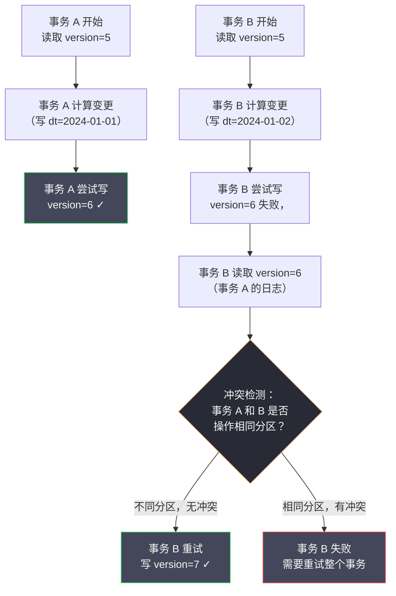

# 08 分布式事务在大数据场景下的实践

**摘要：**

分布式事务在 OLTP 领域已有成熟的解决方案（2PC、TCC、Saga），但在大数据领域，问题的形态完全不同：面对的不是几行记录的原子更新，而是亿级规模数据的一致性写入、跨引擎（Hive/Spark/Flink）的数据一致性协调、以及流批一体架构下的端到端 Exactly-Once 语义。本文系统梳理大数据场景的一致性挑战与主流解决方案：从 Hive 的悲观锁写入困境，到 Delta Lake 与 Apache Iceberg 通过 ACID 事务支持解决数据湖的并发写问题；深入剖析 Spark 的写幂等性设计；解析 Flink 的两阶段提交 Sink 如何实现端到端 Exactly-Once；最后探讨数仓 ETL 场景下的最终一致性保障策略，并给出场景到方案的选型矩阵。读完本文，你应当能回答两个问题：大数据的一致性难点为什么从"原子性"转向了"幂等性"，以及数据湖格式凭什么能在对象存储上重建 ACID。

---

## 第 1 章 大数据场景的一致性挑战：与 OLTP 的本质差异

### 1.1 大数据场景的一致性需求有何不同

在前面的文章中，我们深入探讨了 OLTP 场景的分布式事务——它的核心关注点是：多个微服务之间的**业务操作原子性**，以及并发事务的**数据读写隔离性**。

但在大数据场景中，问题的形态发生了根本性的变化。

**其一，数据规模不同**。OLTP 事务通常涉及几行到几千行数据；大数据场景的单次写入可能涉及数亿行、TB 级别的数据。你无法用一个单一的数据库事务来保护这个量级的数据写入——不是技术上做不到，而是代价上不可接受。

**其二，计算模型不同**。OLTP 是逐行处理的在线事务；大数据是批量处理（MapReduce、Spark Batch）或流式处理（Flink Streaming），计算任务可能运行数小时，期间任何节点都可能失败并重启。

**其三，存储系统不同**。OLTP 使用关系型数据库，原生支持 ACID 事务；大数据存储通常是 HDFS（Hadoop Distributed File System）、S3 等对象存储，或基于它们构建的 Hive 表，这些系统的原子性模型与关系型数据库截然不同。

**其四，并发模型不同**。OLTP 关注高并发短事务的冲突；大数据关注的是：**一个长时间运行的批处理任务失败后如何安全重试（幂等性）**，以及**多个并发写入任务如何避免相互覆盖数据（写并发控制）**。

**其五，一致性目标不同**。OLTP 追求强一致性，每个读操作都能看到最新提交的数据；大数据通常可以接受分钟级甚至小时级的最终一致性，但对**数据完整性（不重复、不丢失）**有严格要求。

把这五点合起来，可以得到一个关键判断：**大数据的一致性难点，从"原子性"转向了"幂等性"**。在 OLTP 里，我们担心的是"两个操作没能一起成功"；在大数据里，我们更担心的是"一个长任务失败重跑后，数据被写了两遍"。这个重心的转移，决定了大数据方案的全部形态——它们几乎都在回答"如何让一次可能被重跑的写入不产生重复"。

这里可以打一个比方：OLTP 的事务像一次"柜台交易"，钱货两清、立等可取；大数据的一致性像一次"长途货运"，货物分装成许多批次陆续抵达，你要保证的是"无论中途重发几次，最终仓库里的货不重不漏"。前者关心"这一刻是否一致"，后者关心"最终是否完整"。

### 1.2 大数据一致性问题的四个核心场景

大数据场景的一致性问题主要体现在以下四个方面。

**场景一：批处理任务的写幂等性**。一个 Spark 批处理任务运行 2 小时后，在最后的写入阶段因为某个 Executor 故障失败。任务重新调度并重跑——问题是：如何保证重跑的任务不会与第一次失败任务已写出的部分数据产生重叠？

**场景二：数据湖的并发写一致性**。多个 Spark 任务同时向同一张 Hive 表的同一个分区写入数据，如何避免并发写入导致的数据相互覆盖？HDFS 和 S3 都不提供文件级别的原子性保障，一个任务写到一半崩溃时，另一个任务可能看到不完整的中间状态。

**场景三：流处理的端到端 Exactly-Once**。一个 Flink 实时流处理任务，从 Kafka 消费数据，经过计算后写入 MySQL 和 HDFS。如何保证每条输入消息恰好被处理一次，不丢失、不重复？这是流处理领域最难解决的问题之一。

**场景四：跨引擎数据一致性**。上游 Spark ETL 任务向 Hive 写入数据，下游 Hive SQL 查询需要读取这批数据。如何保证下游查询看到的是完整的一批数据，而不是上游写到一半的中间状态？

### 1.3 与 OLTP 方案的对应关系

有意思的是，大数据场景的解法与 OLTP 场景存在一种"同构"关系，把两者对照起来看，会发现许多熟悉的思路换了件外衣。

| OLTP 概念 | 大数据对应概念 | 共同本质 |
| :--- | :--- | :--- |
| 事务提交 | 任务成功 + `_SUCCESS` 标记 | 用一个明确信号宣告"这一批完成" |
| 数据库行锁 | 数据湖的乐观并发版本号 | 检测并发冲突并串行化 |
| undo_log 回滚 | 时间旅行回退到历史快照 | 通过保留历史状态实现"回退" |
| 两阶段提交 | Flink 两阶段提交 Sink | 预提交加确认提交 |
| 幂等写入 | INSERT OVERWRITE / MERGE INTO | 让重复执行不产生副作用 |

这张表的意义在于：**大数据并没有发明全新的原理，它只是把 OLTP 的一致性原理，适配到了"大规模、长任务、对象存储"这个新环境里**。理解了 OLTP 的原理，再看大数据方案，就能看出它们各自在"借用"哪一个原理。这也正是本专栏把大数据场景放在最后一篇的原因——它是前面所有原理在新场景下的一次综合应用。

### 1.4 为什么 2PC、TCC、Saga 在大数据里不好使

一个自然的疑问是：既然 OLTP 有 2PC、TCC、Saga 这些成熟方案，为什么大数据不直接拿来用？答案在于，这些方案的前提在大数据场景里全部不成立。

**2PC 不适用**，因为它要求参与者支持 XA 协议并能在 Prepare 后长时间持有资源。大数据写入的目标是 HDFS/S3，它们不支持 XA；而且一次写入可能持续数小时，任何"长时间持锁"的设计都不可行。

**TCC 不适用**，因为它要求"资源可预留"。大数据的写入是"写一批文件"，你无法在写入之前"预留"一批还没生成的文件。

**Saga 部分可用，但代价高**，因为它的补偿需要"撤销已写入的数据"。在大数据里，撤销一批已写入的数据意味着"删除文件"，而删除大量文件本身就是一个昂贵且容易失败的操作。

因此，大数据的一致性方案转向了另一条路：**不做"回滚"，而做"幂等重写"**。与其在失败后撤销已写入的数据，不如设计一种写入方式，使得"重跑一次"就自然覆盖掉上次的残留。这正是 INSERT OVERWRITE、MERGE INTO、版本化目录这些手段的共同思路。**它们用"幂等"替代了"回滚"，把"撤销旧结果"这个难题，转化成了"重新生成正确结果"这个相对简单的任务**。

---

## 第 2 章 Hive 的写入一致性困境与传统解决方案

### 2.1 HDFS 的文件系统语义：原子性有限

理解 Hive 的一致性问题，需要先理解 HDFS 的文件语义。

HDFS 提供了以下原子性保证：

- **文件重命名（rename）是原子的**：把文件从路径 A 移动到路径 B 是一个原子操作（在同一个 NameNode 元数据管理范围内）
- **目录创建（mkdir）是原子的**
- **文件追加写入（append）不是原子的**：并发追加可能导致数据损坏
- **文件内容写入（write）不是原子的**：写到一半失败会留下不完整的文件

这意味着 HDFS 本身不适合作为多写者并发修改同一文件的存储系统，但可以通过"先写临时目录，再原子 rename 到目标目录"的模式来实现单次写入的原子性。**HDFS 只给了你一块"原子拼图"——rename——而所有上层的写入协议，都是围绕这块拼图搭建的**。

### 2.2 Hive 的写入过程与一致性保障机制

Hive 在 HDFS 之上实现了一套写入机制，利用 HDFS 的 rename 原子性来保证单次写入操作的原子性。

**Hive 写入的标准流程**：

```
1. 创建临时目录：/user/hive/warehouse/orders/.hive-staging_xxx/
2. 所有 MapReduce/Spark Task 将输出写入临时目录
3. 所有 Task 成功完成后，Hive 将文件从临时目录 rename 到最终目录
4. 最终目录：/user/hive/warehouse/orders/dt=2024-01-01/
```

这个设计保证了：只有当所有 Task 都成功完成时，数据才对读者可见（因为 rename 是原子的）。如果任何 Task 失败，临时目录中的数据被清理，对读者完全不可见。

**这个机制的局限性有三**：

其一，**只保护单次完整写入，不保护并发写入**。如果两个任务同时向同一分区写入，它们各自使用独立的临时目录，最后的 rename 会相互覆盖，导致其中一个任务的数据丢失。

其二，**Hive ACID（行级事务）性能差**。Hive 0.13+ 引入了基于 ORC 文件格式的 ACID 事务支持，但其实现机制（delta 目录加 Compaction）在高并发写入下性能极差，几乎不适合生产使用。

其三，**S3 上的 rename 不是原子的**。当 Hive 部署在 AWS S3（而非 HDFS）上时，S3 的 rename 实际上是"复制加删除"操作，不是原子的，这使得上述保障机制在 S3 上完全失效。

> [!warning] S3 rename 陷阱
> 这是许多公司迁移到云端数据湖时遇到的第一个重大坑：在本地 HDFS 上运行良好的 ETL 任务，迁移到 S3 后开始出现数据丢失或重复。根本原因就是 S3 的 `rename` 不是原子操作，Hive/Spark 的写入保障假设失效。解决方案是使用支持 S3 原子写入的数据湖格式（Delta Lake / Iceberg），或使用 S3Guard 等辅助工具。这个坑的普遍性说明了一个道理：**当底层存储的原子性模型改变时，建立在其上的所有协议假设都必须重新审视**。

### 2.3 传统的分区级写入策略

在数据湖格式成熟之前，大数据工程师通常采用以下策略来规避并发写入问题。

**策略一：分区隔离写入**。每个写入任务只写入自己专属的分区，不同任务写不同分区，从设计层面避免并发写入冲突：

```sql
-- 任务 A 写入 2024-01-01 的数据
INSERT OVERWRITE TABLE orders PARTITION (dt='2024-01-01')
SELECT * FROM orders_staging WHERE dt = '2024-01-01';

-- 任务 B 写入 2024-01-02 的数据（不冲突）
INSERT OVERWRITE TABLE orders PARTITION (dt='2024-01-02')
SELECT * FROM orders_staging WHERE dt = '2024-01-02';
```

这是最简单有效的方案，但它要求写入任务之间在分区层面没有重叠。

**策略二：INSERT OVERWRITE 而非 INSERT INTO**。`INSERT OVERWRITE` 会完全替换分区内的数据，天然是幂等的——无论执行多少次，结果都是最新一次运行的完整数据：

```sql
-- 幂等：每次运行都完整覆盖整个分区，不会重复
INSERT OVERWRITE TABLE dwd_orders PARTITION (dt='2024-01-01')
SELECT order_id, user_id, amount, status
FROM ods_orders
WHERE dt = '2024-01-01';
```

这个策略的核心思想是：**用"覆盖"代替"追加"，把写入操作从"累加型"变为"幂等型"**。即使任务失败重跑，也不会有数据重复问题。这是大数据幂等设计里最重要的一条原则，后文会反复回到它。

**策略三：写完整性检验**。在任务结束时，通过比较输出行数与预期行数来验证写入完整性：

```python
# PySpark 示例：写入后验证完整性
result_df.write.mode("overwrite").partitionBy("dt").parquet(output_path)

# 回读验证
written_count = spark.read.parquet(output_path).filter(f"dt='{target_date}'").count()
expected_count = result_df.filter(f"dt='{target_date}'").count()

if written_count != expected_count:
    raise Exception(f"写入完整性验证失败：期望 {expected_count} 行，实际 {written_count} 行")
```

这三种策略的共同点是**都不依赖底层存储提供强事务**，而是在工程层面用"分区隔离、覆盖写、写后校验"来构造出幂等与完整性。这体现了大数据工程的一贯风格：**在没有强事务的存储上，用约定与校验来"手工"实现一致性**。

### 2.4 Hive ACID 的失败教训

Hive 其实早在 0.13 版本就尝试过引入行级事务（Hive ACID），但这次尝试以失败告终，其中的教训很值得玩味。

Hive ACID 的实现思路是"delta 目录加 Compaction"：每次修改写入一个新的 delta 目录，读取时合并基础文件与所有 delta；定期通过 Compaction 把多个 delta 合并回基础文件。同时，它依赖一个外部的锁管理器（通常是 ZooKeeper）来协调并发写入。

这套机制之所以在生产中难以推广，有三个原因。其一，**性能差**：读取要合并大量 delta，写入要维护 delta 与锁，开销远超普通写入。其二，**依赖外部锁管理器**：锁管理器成为新的单点与瓶颈，且它需要持有锁的时间与任务时长相关，这与大数据的长任务特性天然冲突。其三，**只对 ORC 格式有效**，适用范围受限。

对比之下，Delta Lake 与 Iceberg 的成功，恰恰在于它们**没有试图"给 Hive 加事务"，而是重新设计了表格式的元数据层**。它们把"事务状态"放在独立的元数据文件里（事务日志或 Manifest），而不是改造数据文件本身。**这是一次"重新设计"而非"打补丁"的胜利**——它印证了 03 篇的一条判断：触及根因的改进往往意味着范式改变，而未触及根因的改进只会让问题换个形式重现。Hive ACID 就是后者。

---

## 第 3 章 数据湖格式的 ACID 革命：Delta Lake 与 Apache Iceberg

### 3.1 为什么需要数据湖格式

传统 Hive 加 HDFS/S3 的架构在以下场景下暴露了严重的局限性：

- **并发写入**：多个任务同时写同一张表，数据相互覆盖
- **小文件问题**：频繁的小批量写入产生大量小文件，严重影响查询性能
- **时间旅行（Time Travel）**：无法查询某个历史时间点的数据快照
- **Schema 演进**：在不影响现有数据的情况下修改表结构非常困难
- **ACID 支持**：无法安全地执行 UPDATE/DELETE 操作

Delta Lake 与 Apache Iceberg 正是为解决这些问题而出现的开放数据湖表格式，它们在 HDFS/S3 之上构建了一套事务日志机制，为数据湖带来了 ACID 语义。

这里的关键洞察是：**数据湖格式并没有改变底层存储的原子性（S3 的 rename 依然不是原子的），而是在存储之上"叠加"了一层元数据协议，用元数据文件的原子替换来模拟事务**。这与 AT 模式"在数据库之上用 undo_log 模拟回滚"是同一类思路——**当底层能力不足时，就在上层用协议补足**。

### 3.2 Delta Lake：基于事务日志的 ACID 实现

**Delta Lake** 是 Databricks 于 2019 年开源的数据湖格式，现已成为 Linux Foundation 下的顶级项目。

**Delta Lake 的核心机制是事务日志（Transaction Log）**。它在每张表的根目录下维护一个 `_delta_log` 目录，其中存储了该表所有历史写入操作的事务日志：

```
/user/data/orders/
├── _delta_log/
│   ├── 00000000000000000000.json   # 建表操作日志
│   ├── 00000000000000000001.json   # 第 1 次写入日志
│   ├── 00000000000000000002.json   # 第 2 次写入日志
│   ├── 00000000000000000010.checkpoint.parquet  # 检查点（合并历史日志）
│   └── _last_checkpoint             # 指向最新检查点
├── part-00000-xxxxx.parquet        # 实际数据文件
├── part-00001-xxxxx.parquet
└── ...
```

每个 JSON 日志文件（称为 commit file）记录了一次事务的操作内容，包含以下动作类型：

- **add**：新增了哪些数据文件（及其统计信息）
- **remove**：标记删除了哪些数据文件（逻辑删除，物理文件还在）
- **metaData**：表 Schema 或 Partition 信息的变更
- **protocol**：表格式版本信息
- **commitInfo**：提交者信息、时间戳、操作类型

一次典型的 INSERT 操作的日志：

```json
{
  "commitInfo": {
    "timestamp": 1705000000000,
    "operation": "WRITE",
    "operationParameters": {"mode": "Append", "partitionBy": "[\"dt\"]"},
    "isBlindAppend": true
  }
}
{
  "add": {
    "path": "dt=2024-01-01/part-00000-abc123.parquet",
    "partitionValues": {"dt": "2024-01-01"},
    "size": 1234567,
    "modificationTime": 1705000000000,
    "dataChange": true,
    "stats": "{\"numRecords\":50000,\"minValues\":{\"order_id\":1},\"maxValues\":{\"order_id\":50000}}"
  }
}
```

这份日志揭示了 Delta Lake 的核心思想：**数据文件本身是"不可变"的，表的"当前状态"由事务日志决定**。所谓"写入"，本质上是"新增一批数据文件，并在日志里登记它们"；所谓"删除"，只是"在日志里标记某些文件不再被引用"。这与 LSM-Tree 的"追加加标记删除"、MVCC 的"多版本"是同一类思路——**用不可变的追加与版本指针，替代可变的原地修改**。

### 3.3 Delta Lake 的并发控制：乐观并发加冲突检测

Delta Lake 使用**乐观并发控制（Optimistic Concurrency Control）** 来处理并发写入。

**基本流程**：

1. 读取当前最新的事务日志版本号（假设为 version=5）
2. 在本地计算需要新增或删除哪些数据文件
3. 尝试把事务日志原子写入 version=6（下一个版本）
4. 如果写入成功，提交完成
5. 如果写入失败（已有另一个事务占用了 version=6），进入冲突检测

**冲突检测的核心逻辑**：当两个并发事务都尝试写入 version=6 时，Delta Lake 会检测它们是否真的冲突：

- **如果两个事务写入的是不同分区**（如一个写 dt=2024-01-01，另一个写 dt=2024-01-02）：无冲突，后写入的事务重试写 version=7，两者数据都被保留
- **如果两个事务写入的是同一分区**：如果都是 Append 操作（添加新数据），通常无冲突，允许并发 Append；如果其中一个是 Overwrite 操作，冲突，后者失败，需要重试



**S3 上的原子性保证**：Delta Lake 使用 S3 的条件写入（Conditional PUT）或文件名唯一性来保证事务日志写入的原子性——每个版本的日志文件名（`00000000000000000006.json`）是全局唯一的，两个并发事务不能同时成功写入同名文件，于是利用"文件不覆盖"语义实现了乐观锁。这正是"用元数据文件的原子替换模拟事务"的具体落点。

### 3.4 Delta Lake 的时间旅行：基于事务日志的历史快照

由于 Delta Lake 保留了完整的事务日志，可以精确重建任意历史时间点的数据快照：

```python
# PySpark：查询 24 小时前的数据快照
df = spark.read.format("delta") \
    .option("timestampAsOf", "2024-01-01 12:00:00") \
    .load("/user/data/orders")

# 或者通过版本号查询
df = spark.read.format("delta") \
    .option("versionAsOf", 5) \
    .load("/user/data/orders")
```

这个能力在数据修复场景中极其有用：当发现某次 ETL 写入了错误数据时，可以直接回滚到上一个版本，而无需从原始数据重跑整个处理链路。**时间旅行本质上是"保留历史版本"这一 MVCC 思想在大数据场景的应用**——它把"回滚"从"逆向操作"变成了"切换指针"，代价是需要保留历史数据文件。

### 3.5 Apache Iceberg：更开放的数据湖格式

**Apache Iceberg** 是 Netflix 开源、现为 Apache 顶级项目的数据湖格式，与 Delta Lake 并列为当前最主流的两种数据湖表格式。

Iceberg 的核心架构与 Delta Lake 类似，也是基于快照和元数据文件来实现 ACID：

```
Iceberg 元数据层次结构：

Catalog（目录）
  └── Table（表）
        └── Snapshot（快照，每次写入创建一个新快照）
              ├── Manifest List（清单列表，记录此快照包含哪些 Manifest 文件）
              └── Manifest File（清单文件，记录此批数据文件的路径和统计信息）
                    └── Data Files（实际数据文件，Parquet/ORC/Avro）
```

**Iceberg 与 Delta Lake 的关键差异**：

| 维度 | Delta Lake | Apache Iceberg |
| :--- | :--- | :--- |
| **元数据格式** | JSON 事务日志 | Avro 格式的 Manifest 文件 |
| **并发控制** | 乐观并发加冲突检测 | 乐观并发加原子 Catalog 替换 |
| **分区演进** | 支持（但有限制）| 支持（更灵活，无需重写数据）|
| **Schema 演进** | 支持 | 支持（更完善，包括列重命名）|
| **引擎支持** | Spark（最佳）、Trino、Hive | Spark、Flink、Trino、Hive（更广泛）|
| **流式写入** | 支持（Delta Streaming）| 支持（Flink Iceberg Sink）|
| **删除文件** | 逻辑删除加 Vacuum 物理清理 | 支持 Position Delete 和 Equality Delete |
| **开源治理** | Linux Foundation | Apache Software Foundation |

> [!info] 如何选择 Delta Lake 还是 Iceberg
> 如果你的大数据栈以 Databricks 或 Spark 为核心，Delta Lake 是自然选择，与 Databricks 平台深度集成；如果你需要跨多个计算引擎（Spark 加 Flink 加 Trino 加 Hive）统一访问同一张表，Iceberg 的引擎兼容性更好。两者都在快速发展，能力差距在缩小。选型时除了技术能力，还要看团队已有的技术栈与运维经验——**一个团队熟悉的格式，胜过理论上更先进的格式**。

### 3.6 数据湖格式的代价

数据湖格式带来了 ACID，但它并非没有代价，认清这些代价才能用好它。

**其一，小文件问题**。每次写入都会新增一批数据文件，频繁的小批量写入会产生大量小文件。虽然数据湖格式提供了 Compaction（合并小文件）能力，但它本身又需要额外的计算资源与调度。

**其二，元数据膨胀**。事务日志与 Manifest 文件会随写入次数增长，需要定期做 Checkpoint 或元数据重写来压缩。

**其三，读取开销**。查询需要先读元数据（日志或 Manifest），再定位数据文件，相比直接读 Hive 目录多了一层元数据解析。

**其四，依赖 Catalog 的可靠性**。Iceberg 尤其依赖一个可靠的 Catalog 来保证原子替换，Catalog 成为新的关键依赖。

这些代价的共同点是：**它们都是"用元数据换 ACID"所必然带来的开销**。这与 AT 模式"用 undo_log 换低侵入"、消息方案"用 outbox 表换原子性"是同一个模式——**一致性从来不是免费的，它总要以某种形式付出成本**。

### 3.7 并发写的实战权衡：乐观还是悲观

数据湖格式普遍采用乐观并发（先写、冲突再重试），而不是悲观并发（先锁、再写）。这个选择在大数据场景下几乎是被逼出来的，理解原因有助于判断它何时会失效。

**为什么不能悲观**：悲观并发需要"加锁"，而在对象存储上，一个跨小时的任务无法合理地"持有锁"——锁的租约无法覆盖任务时长，且一旦任务崩溃，锁的清理本身就是难题。乐观并发则只需要在"提交元数据"这个瞬间做一次原子比较，时间窗口极短，天然适配"长任务、短提交"的形态。

**乐观并发的代价**：冲突发生时要"重试整个事务"。在数据湖里，"重试"意味着重新提交一次元数据（通常不贵，因为数据文件已经写好，只需重新登记），但如果冲突频繁，重试会带来额外的延迟与资源消耗。

**何时会失效**：当大量任务频繁写同一张表的同一分区时，乐观冲突率会急剧上升，重试成本变得不可接受。此时的正解不是"换悲观锁"，而是**从业务上消除冲突**——按分区隔离写入、错峰调度、或把写入合并到少数几个任务里。**数据湖的并发控制，本质上是在"提交瞬间"做冲突检测，它能防住并发提交，但防不住"大量并发提交"这件事本身**。

---

## 第 4 章 Spark 批处理的幂等写入设计

### 4.1 Spark 任务的失败重试与写入幂等性

Spark 批处理任务在运行过程中可能因为以下原因失败并重试：

- Executor OOM 导致 Task 失败（Spark 会自动重试 Task）
- 节点故障导致 Executor 丢失（Driver 会重新调度）
- 整个 Application 级别的失败（需要外部系统重新提交 Application）

对于 Task 级别的重试（Spark 内部自动处理），Spark 通过**推测执行（Speculative Execution）** 和 **Task 级别的原子写入**来保证幂等性：每个 Task 把输出写入带有 Task ID 和 Attempt ID 的唯一临时文件名，最终由 Commit Protocol 决定哪些文件被采用。

对于 Application 级别的重跑，需要应用层设计幂等。

**方案一：分区级 Overwrite（最常用）**

```python
# 设置动态分区覆盖（只覆盖本次写入的分区，不影响其他分区）
spark.conf.set("spark.sql.sources.partitionOverwriteMode", "dynamic")

result_df.write \
    .mode("overwrite") \
    .partitionBy("dt") \
    .parquet(output_path)

# 无论重跑多少次，每个分区都是最新一次运行的完整数据
```

这是最简单也最广泛使用的幂等写入策略。`dynamic` 分区覆盖模式确保只覆盖本次写入涉及的分区，不影响其他分区的数据。

**方案二：基于写入版本的文件命名**

对于不能简单 Overwrite 的场景（如增量写入），使用写入版本号或时间戳作为输出路径的一部分，保证每次运行的输出互不干扰：

```python
import time

run_id = int(time.time())  # 或使用 pipeline 调度系统提供的 run_id

# 每次运行写到独立的版本目录
result_df.write \
    .parquet(f"{base_path}/version={run_id}/")

# 下游通过读取最新版本来获取最新数据
# 可以用一个 "latest" 软链接指向最新版本
```

**方案三：使用 Delta Lake / Iceberg 的 MERGE INTO**

对于需要 UPSERT 语义（更新已有行、插入新行）的场景，Delta Lake 和 Iceberg 都支持 `MERGE INTO` 操作，天然是幂等的：

```python
# Delta Lake MERGE INTO：幂等 UPSERT
from delta.tables import DeltaTable

delta_table = DeltaTable.forPath(spark, "/user/data/orders")

delta_table.alias("target").merge(
    source=new_data_df.alias("source"),
    condition="target.order_id = source.order_id"
).whenMatchedUpdate(set={
    "status": "source.status",
    "updated_at": "source.updated_at"
}).whenNotMatchedInsertAll().execute()

# 无论执行多少次，结果相同（幂等）
```

### 4.2 Spark 写入数据库的幂等性

当 Spark 向关系型数据库（MySQL/PostgreSQL）写入数据时，幂等性需要在 SQL 层面保证：

```python
# 使用 INSERT IGNORE 或 ON DUPLICATE KEY UPDATE 实现幂等写入
def write_to_mysql_idempotent(df, table_name, key_columns):
    # 方案 1：INSERT IGNORE（主键冲突时忽略）
    df.write \
        .format("jdbc") \
        .option("url", jdbc_url) \
        .option("dbtable", table_name) \
        .option("insertMode", "insert_ignore") \  # Spark JDBC 扩展选项
        .save()

    # 方案 2：自定义 UPSERT SQL（推荐，灵活性更高）
    # 通过 foreachBatch 执行自定义 SQL
    def upsert_to_mysql(batch_df, batch_id):
        batch_df.createOrReplaceTempView("batch_data")
        # 先写临时表，再 UPSERT 到目标表
        # ...

    streaming_query.writeStream.foreachBatch(upsert_to_mysql).start()
```

### 4.3 幂等策略的选择依据

三种幂等方案各有适用场景，选择时可以按以下依据判断。

**能否覆盖整个分区？** 如果能，优先用分区级 Overwrite。它最简单、最可靠，且天然幂等。这是大多数"全量刷新"类任务的默认选择。

**是增量写入，且需要保留历史版本吗？** 如果是，用版本化目录（方案二）。它保留了每次运行的产物，便于追溯与回滚，代价是存储增长，需要配套的清理策略。

**需要 UPSERT 语义吗？** 如果需要"按主键更新或插入"，用 MERGE INTO（方案三）。它把幂等性下沉到表格式，由框架保证。

**目标表是关系型数据库吗？** 如果是，用 SQL 层面的 UPSERT（`INSERT ... ON DUPLICATE KEY UPDATE`）。

这四种选择的共同前提是：**写入操作必须有一个"可以判断是否已执行"的依据**——要么是"覆盖整个分区"（天然幂等），要么是"主键唯一约束"（UPSERT 幂等）。这与 OLTP 场景里"幂等是柔性事务入场券"的结论完全一致，只是判断依据从"事务 ID"换成了"分区或主键"。

### 4.4 一个反例：非幂等写入的代价

幂等的重要性，在一个具体事故里会显得格外刺眼。

某团队的一个日更报表任务，最初用 `INSERT INTO` 向目标表追加数据。任务运行稳定，直到某天因为上游数据源抖动而失败。运维重新调度后任务成功，但第二天报表的数字几乎翻倍——原因是这次重跑把当天的数据又追加了一遍，而第一次运行其实已经写入了大部分数据。

排查后发现了三个问题叠加：其一，写入用的是追加而非覆盖，天然不幂等；其二，任务失败时已经写出了部分数据文件（在临时目录之外直接落了盘）；其三，下游没有做行数校验，异常直到业务方看到报表才发现。

修复方案有三层：其一，把 `INSERT INTO` 改为 `INSERT OVERWRITE`（按 dt 分区覆盖），从根本上让重跑幂等；其二，让写入先落到临时目录，成功后再原子 move（避免"失败任务留下半成品"）；其三，在任务末尾加行数校验，输出行数与预期不符即告警。

这个案例的价值在于，它把大数据幂等的三条原则同时演示了一遍：**用覆盖代替追加、用临时目录加原子移动保证"要么全写要么不写"、用写后校验兜底**。三条里任何一条缺失，事故都可能重演。而它们的成本都很低——这也说明，大数据场景下最有效的防线，往往不是最复杂的机制，而是这些朴素的工程约定。

---

## 第 5 章 Flink 的端到端 Exactly-Once：两阶段提交 Sink

### 5.1 什么是端到端 Exactly-Once

在流处理领域，"恰好一次（Exactly-Once）"语义是指：**每条输入消息对输出的影响，恰好等同于它被处理了一次**。

实现端到端 Exactly-Once 需要在整个链路上协调：

- **消息源（Source）**：支持可重放（Kafka 通过 offset 重放）
- **算子内部状态**：通过 Checkpoint 持久化，崩溃后从 Checkpoint 恢复
- **输出 Sink**：支持事务写入或幂等写入

对于输出 Sink，实现 Exactly-Once 有两种路径：其一是**幂等写入**，每条消息的输出是幂等的，重复处理不影响结果；其二是**事务写入**，利用 Flink 的两阶段提交机制，把 Flink 的 Checkpoint 与外部系统的事务绑定。

这两条路径，恰好对应了本专栏反复出现的两种思想：**用幂等消除重复的影响，或用事务保证"要么都发生、要么都不发生"**。

### 5.2 Flink Checkpoint 与两阶段提交 Sink

Flink 的 Checkpoint 机制通过 Chandy-Lamport 分布式快照算法，定期把所有算子的状态持久化到可靠存储（HDFS/S3）。崩溃后，Flink 从最新的 Checkpoint 恢复，重新处理 Checkpoint 之后的输入数据。

但仅有 Checkpoint 不足以保证 Exactly-Once 端到端：Flink 内部的状态是 Exactly-Once，但如果 Sink 在 Checkpoint 完成后崩溃，已经写出的部分数据不会回滚，重跑时会产生重复。

Flink 的 **TwoPhaseCommitSinkFunction** 正是为解决这个问题而设计的：它把 Sink 的写入过程与 Flink Checkpoint 的两阶段完成过程绑定在一起。

**核心原理**：

```
Flink Checkpoint 的两阶段过程（与 Flink TwoPhaseCommitSink 的绑定）：

Phase 1（Pre-commit，对应 Checkpoint 的 snapshotState）：
  - Sink 将当前批次的数据写入"预提交缓冲"（如 Kafka 事务或文件的临时目录）
  - 将事务 handle 保存到 Checkpoint 状态中
  - Checkpoint 完成时，Flink 触发 notifyCheckpointComplete

Phase 2（Commit，对应 notifyCheckpointComplete）：
  - 收到 Checkpoint 完成通知后，Sink 真正提交事务（Kafka commit / 文件 rename）
  - 如果在 Phase 2 之前崩溃，从 Checkpoint 恢复后 Sink 会重新读取上次的事务 handle 并重新 Commit
```

这个设计与 2PC 的结构惊人地相似：**Phase 1 是 Prepare（写预提交缓冲），Phase 2 是 Commit（真正提交）**。区别在于，"协调者"的角色由 Flink 的 Checkpoint 机制扮演，"参与者"是各个 Sink，而"决策"就是"Checkpoint 是否完成"。**Flink 把 2PC 的协调逻辑，内嵌到了流处理框架的 Checkpoint 机制里**。

**以 Flink Kafka Sink 的 Exactly-Once 为例**：

Flink 的 Kafka Producer 在 Exactly-Once 模式下使用 Kafka 的事务 API：

```java
// Flink KafkaSink 的 Exactly-Once 配置
KafkaSink<String> sink = KafkaSink.<String>builder()
    .setBootstrapServers("kafka:9092")
    .setRecordSerializer(KafkaRecordSerializationSchema.builder()
        .setTopic("output-topic")
        .setValueSerializationSchema(new SimpleStringSchema())
        .build())
    .setDeliverGuarantee(DeliveryGuarantee.EXACTLY_ONCE)  // 关键配置
    .setTransactionalIdPrefix("my-flink-job")  // Kafka 事务 ID 前缀
    .build();
```

**内部执行流程**：

```
[Checkpoint n 开始]
Flink Kafka Sink：
  1. 开始 Kafka 事务（beginTransaction）
  2. 将消息写入 Kafka 事务（消息进入 Kafka，但对消费者不可见）
  3. Checkpoint 触发 snapshotState：保存当前 Kafka 事务 ID 到 Checkpoint 状态
  4. Checkpoint 完成（notifyCheckpointComplete 被调用）：
     → Kafka 事务 Commit（消息对消费者可见）
  5. 开始下一个 Checkpoint 的新事务

[如果在步骤 4 之前崩溃]：
  - 从 Checkpoint n 恢复
  - 读取 Checkpoint 中保存的 Kafka 事务 ID
  - 发现该事务未 Commit → 执行 Commit（保证消息被发出）
  - 或者该事务超时已被 Kafka 回滚 → 重新处理这批消息（At-Least-Once，需配合消费者幂等）
```

> [!warning] Kafka 事务超时的陷阱
> Flink 加 Kafka Exactly-Once 要求 Kafka 的事务超时时间（`transaction.timeout.ms`）大于 Flink 的 Checkpoint 间隔乘以最大重试次数。如果 Kafka 事务超时，处于进行中的事务会被 Kafka 自动回滚，导致 Flink 崩溃恢复后无法 Commit 已写入的消息，必须重新处理。在 Checkpoint 间隔较长（如 5 分钟）的情况下，这个超时设置极易被忽略。这个坑的根源在于：**两阶段提交的"预提交"状态有一个生存期上限，超过它，预提交就会被判定为失败**——这与 2PC 里"参与者在 PREPARED 状态等待过久"是同一类风险。

### 5.3 Flink 写 HDFS/S3 的 Exactly-Once：FileSink

Flink 的 `FileSink`（老版本是 `StreamingFileSink`）实现了向 HDFS/S3 写文件的 Exactly-Once：

```java
FileSink<String> sink = FileSink
    .forRowFormat(new Path("hdfs://namenode:9000/output"), new SimpleStringEncoder<String>("UTF-8"))
    .withRollingPolicy(
        DefaultRollingPolicy.builder()
            .withRolloverInterval(Duration.ofMinutes(5))  // 每 5 分钟滚动一个文件
            .withInactivityInterval(Duration.ofMinutes(1))
            .withMaxPartSize(MemorySize.ofMebiBytes(128))
            .build())
    .build();
```

FileSink 的 Exactly-Once 机制同样基于两阶段提交：

- **进行中状态（In-Progress）**：数据被写入 `.inprogress` 临时文件
- **Pending 状态（Checkpoint 触发时）**：临时文件被重命名为 `.pending` 文件，文件句柄被保存到 Checkpoint
- **Committed 状态（Checkpoint 完成后）**：`.pending` 文件被 rename 为最终文件名

```
文件状态流转：
part-0-0.inprogress  → （Checkpoint 触发）→  part-0-0.pending  → （Checkpoint 完成）→  part-0-0
```

这个机制利用了 HDFS rename 的原子性：只有 Checkpoint 真正完成后，数据文件才从 `.pending` 变为最终可见的文件，对下游查询可见。**它把"文件状态"当成了事务状态的载体——文件名后缀的变化，就是事务阶段的可见标记**。

### 5.4 幂等 Sink 与事务 Sink 的选择

Flink 的 Sink 有两条实现 Exactly-Once 的路径——幂等写入与事务写入，它们的适用场景不同，选错会带来额外的复杂度。

**幂等 Sink**：Sink 本身支持幂等写入（如写带主键的数据库表，重复 UPSERT 结果相同）。它的优点是实现简单、不依赖外部系统的事务能力；缺点是要求目标系统支持幂等，且"重复写入"依然会发生（只是不产生副作用），对写入量有放大效应。

**事务 Sink**：利用两阶段提交，把 Flink Checkpoint 与外部系统事务绑定。它的优点是能真正做到"不重复写入"；缺点是要求外部系统支持事务（Kafka、支持 XA 的数据库、HDFS 的 rename），且引入了事务超时、事务恢复等复杂度。

选择依据可以概括为：**目标系统支持事务且写入量大时，优先事务 Sink（避免重复写入的放大）；目标系统不支持事务或本身幂等时，用幂等 Sink**。需要提醒的是，事务 Sink 的复杂度并不低——Kafka 事务超时、Checkpoint 间隔、事务 ID 恢复，每一个都是容易踩的坑（见 5.2 节的警告）。因此，如果幂等 Sink 已经能满足需求，就不必为了"更纯粹"而引入事务 Sink。

---

## 第 6 章 跨引擎数据一致性：数仓 ETL 的最终一致性保障

### 6.1 数仓 ETL 的一致性需求

在典型的数据仓库架构中，数据经过多层 ETL 处理：

```
ODS（操作数据层）→ DWD（明细数据层）→ DWS（汇总数据层）→ ADS（应用数据层）
```

每层之间的 ETL 任务需要保证：**完整性**（上游写完整才触发下游读取）、**一致性**（下游看到的上游数据是某个时间点的完整快照）、**幂等性**（下游 ETL 失败重跑时不产生重复数据）。

### 6.2 分区完整性检验：_SUCCESS 文件机制

Hadoop 生态的传统做法是：**任务成功完成后在输出目录写一个 `_SUCCESS` 标记文件**，下游任务读取数据前先检查 `_SUCCESS` 文件是否存在。

```python
# 上游任务：写完数据后创建 _SUCCESS 标记
result_df.write.mode("overwrite").parquet(output_path)
# 写成功后，创建 _SUCCESS 标记（Spark 默认会自动创建）
# /output/dt=2024-01-01/_SUCCESS

# 下游任务：先检查 _SUCCESS 标记
from pathlib import Path
import subprocess

def check_partition_ready(hdfs_path, date):
    success_path = f"{hdfs_path}/dt={date}/_SUCCESS"
    result = subprocess.run(
        ["hdfs", "dfs", "-test", "-e", success_path],
        capture_output=True
    )
    return result.returncode == 0

if not check_partition_ready("/user/data/dwd_orders", "2024-01-01"):
    raise Exception("上游数据未就绪，等待重试")
```

> [!warning] `_SUCCESS` 文件的局限性
> `_SUCCESS` 文件只保证"任务整体成功"，不保证"数据完整性"。如果任务成功但某个 Task 输出的行数异常（如空分区），`_SUCCESS` 文件仍然会存在。建议在关键路径上额外做行数验证。**一个"成功标记"只能证明"流程走完了"，不能证明"结果是对的"**——把这两件事分开，是数据质量保障的基本功。

### 6.3 基于任务调度系统的依赖管理

在工程实践中，数仓 ETL 的任务依赖通常由调度系统（Apache Airflow、DolphinScheduler、阿里云 DataWorks）管理：

- 上游任务成功 → 调度系统把下游任务加入执行队列
- 上游任务失败 → 调度系统阻止下游任务执行，并触发告警

这种"任务级依赖"是大数据场景下最实用的最终一致性保障机制——它不依赖任何底层存储的事务特性，而是在调度层面保证"上游数据就绪后才执行下游"。**它把一致性问题从"存储层"提升到了"调度层"，用工作流的依赖关系来编排数据的就绪顺序**。

### 6.4 数据血缘与一致性版本管理

在复杂的数仓系统中，同一份源数据可能被多条 ETL 链路并行处理，产生多张下游表。如何保证这些下游表之间的数据一致性（即它们都基于同一个上游数据版本）？

**解决方案是版本化数据管理**。在 Delta Lake / Iceberg 的 Time Travel 能力支持下，可以实现版本化的 ETL：

```python
# 上游 ETL 写入时记录当前版本号
orders_table = DeltaTable.forPath(spark, "/data/dwd_orders")
current_version = orders_table.history(1).select("version").collect()[0][0]
print(f"dwd_orders 当前版本：{current_version}")

# 下游多个 ETL 任务都基于同一版本号读取上游数据，保证一致
df_for_agg = spark.read.format("delta") \
    .option("versionAsOf", current_version) \
    .load("/data/dwd_orders")
```

这种方式保证了所有基于同一批上游数据的下游 ETL 任务都读到相同的数据快照，避免了"A 任务在版本 N 运行，B 任务在版本 N+1 运行"导致的数据不一致。**它把"一致性"从"时间维度"（大家都在同一时刻读）转换成了"版本维度"（大家都读同一个版本）**——后者在异步、长流程的大数据环境里更可靠，因为它不依赖"同时"。

### 6.5 数据质量校验与对账

无论用哪种机制保证一致性，大数据场景都必须保留最后一道防线：**数据质量校验与对账**。原因在于，前面的机制都在保证"流程层面的正确性"（写完整、不重复），但它们无法保证"数据本身的正确性"（算得对不对、符合不符合业务规则）。

典型的数据质量校验包括：

- **行数校验**：输出行数是否与预期一致，是否存在异常的空分区或激增分区
- **主键唯一性校验**：目标表的主键是否唯一，是否出现重复写入
- **空值与范围校验**：关键字段是否为空、数值是否落在合理区间
- **上下游对账**：上游分区与下游分区的数据是否能对上（如按 dt 聚合的行数与金额）

这些校验通常以"数据质量任务"的形式挂在 ETL 之后，作为发布前的门禁：校验不通过，就阻断下游依赖并告警。**它与 OLTP 场景的"日终对账"是同一个角色——在自动机制之外，保留一道基于业务规则的人工可理解的检查**。

这也呼应了 01 篇的一条结论：**最终一致性的可靠性，等于收敛机制的可靠性**。大数据的一致性同样如此——数据湖格式、两阶段提交、调度依赖都在保证"流程收敛"，而数据质量校验在保证"结果可信"。两者缺一不可：只有流程收敛而没有质量校验，系统会"稳定地产生错误数据"；只有质量校验而没有流程收敛，校验会疲于奔命地拦截各种技术性不一致。

### 6.6 一个端到端案例：从 Kafka 到数据湖

把前面的机制串起来，看一个完整的实时入湖链路：数据从 Kafka 流入，经 Flink 计算后写入 Iceberg 表，供下游查询。

这条链路的端到端 Exactly-Once，需要每一段都配合：

**第一段，Kafka 到 Flink**。Flink 从 Kafka 消费，消费偏移量（offset）作为算子状态的一部分被 Checkpoint 持久化。崩溃恢复时，从 Checkpoint 中记录的 offset 重新消费。

**第二段，Flink 内部状态**。算子的中间状态通过 Checkpoint 持久化，保证恢复后计算结果与崩溃前一致。

**第三段，Flink 到 Iceberg**。Iceberg 提供了支持两阶段提交的 Flink Sink（FlinkIcebergSink）。它在 Checkpoint 的 pre-commit 阶段写入数据文件并准备元数据，在 Checkpoint 完成后（notifyCheckpointComplete）原子替换 Iceberg 的元数据指针，使这批数据对新快照可见。若在提交前崩溃，恢复后未提交的数据文件会被清理，不产生重复。

**第四段，下游读取**。下游查询读取 Iceberg 的某个快照，看到的是一批完整的数据——因为 Iceberg 用快照隔离保证读到的永远是某个已提交的版本，而不会读到"写了一半"的中间状态。

这条链路的每一段都在做同一件事：**把"我处理到哪了"这个信息持久化下来，并在恢复时从那里继续**。Kafka 持久化 offset，Flink 持久化算子状态，Iceberg 持久化元数据指针。**端到端 Exactly-Once 的本质，是"链路上每一段都把自己的进度变成可恢复的数据"**——这正是 05 篇"把过程变成数据"这条原则在大数据链路里的完整体现。任何一段缺少这个机制，整条链路的 Exactly-Once 都会退化。

### 6.7 大数据一致性的三道防线

把前几章的机制归纳一下，大数据的一致性保障可以看成三道层层设防的防线。

**第一道防线是幂等写入**。用覆盖写、UPSERT、版本化目录，让"重跑"这件事天然安全。这道防线成本最低、覆盖面最广，能挡住绝大多数"重跑导致重复"的问题。

**第二道防线是事务化写入**。用数据湖格式（Delta Lake/Iceberg）的事务日志、或 Flink 的两阶段提交 Sink，保证"一批数据要么全部可见、要么全部不可见"。这道防线处理的是"并发写与部分可见"的问题，成本较高。

**第三道防线是就绪依赖与质量校验**。用调度依赖加 `_SUCCESS` 标记保证"上游就绪才跑下游"，用行数校验、主键唯一性校验、上下游对账保证"结果可信"。这道防线处理的是"流程正确但结果错误"的问题，是最后的人工可理解的兜底。

三道防线的成本递增、覆盖面递减。**务实的做法是从第一道做起，按需叠加后两道**——而不是一上来就追求"最完备的第三道防线"，或者误以为有了数据湖格式就万事大吉。这与整个专栏的立场一致：**一致性的保障是一个"按需递进"的过程，而不是一个"一步到位"的配置**。

---

## 第 7 章 大数据分布式事务的总结与选型矩阵

### 7.1 各场景解决方案速查表

| 场景 | 推荐方案 | 核心机制 |
| :--- | :--- | :--- |
| **Spark 批处理写入 HDFS，幂等重跑** | INSERT OVERWRITE 加动态分区 | 覆盖写替代追加写 |
| **多任务并发写同一张 Hive 表** | Delta Lake / Iceberg 加乐观并发 | 事务日志加冲突检测 |
| **Spark 批处理 UPSERT（更新加插入）** | Delta Lake / Iceberg MERGE INTO | 事务日志原子 UPSERT |
| **需要数据回滚（误操作恢复）** | Delta Lake / Iceberg 时间旅行 | 事务日志版本快照 |
| **Flink 流处理写 Kafka，Exactly-Once** | Flink 加 Kafka 事务（TwoPhaseCommit）| Checkpoint 加 Kafka 事务 API |
| **Flink 流处理写 HDFS，Exactly-Once** | Flink FileSink（两阶段提交）| Checkpoint 加 pending 文件 rename |
| **Flink 流处理写 MySQL，Exactly-Once** | Flink JDBC Sink 加幂等 UPSERT | 主键 ON DUPLICATE KEY UPDATE |
| **数仓 ETL 上下游数据一致性** | 调度系统依赖加 `_SUCCESS` 标记 | 任务级依赖管理 |
| **跨引擎读写同一张表的版本一致性** | Delta Lake / Iceberg 版本化读取 | 时间旅行加版本号绑定 |
| **跨引擎增量同步** | Apache Hudi 加 Flink CDC | COW/MOR 表格式加增量拉取 |

### 7.2 大数据与 OLTP 分布式事务的范式对比

| 维度 | OLTP 分布式事务 | 大数据分布式一致性 |
| :--- | :--- | :--- |
| **数据规模** | 行级（几行到几千行）| 亿级（GB 到 TB）|
| **事务时长** | 毫秒到秒 | 分钟到小时 |
| **一致性要求** | 强一致（ACID）| 最终一致（最优先保证完整性）|
| **核心难点** | 原子性加隔离性 | 幂等性加完整性加并发写控制 |
| **主流解决方案** | 2PC、TCC、Saga、Seata | Delta Lake/Iceberg 事务、Flink 两阶段提交、任务调度依赖 |
| **回滚机制** | 数据库 ROLLBACK（毫秒级）| 版本回滚（重新读取历史快照）|
| **并发控制** | 数据库锁（行锁/表锁）| 乐观并发（版本号加冲突检测）|
| **读取语义** | 实时强一致读 | 快照隔离读（读到某个完整版本）|

### 7.3 两个世界的共同原理

把这张对比表读细一点，会发现两个世界其实共享同一套原理，只是表现形态不同。

**"预提交加确认提交"无处不在**。OLTP 里是 2PC 的 Prepare/Commit，大数据里是 Flink 两阶段提交 Sink 的 pending/committed，甚至 Hive 写入的"临时目录到最终目录"也是同一结构。**只要一个操作需要"先准备好、再宣布生效"，就会用到这个模式**。

**"用不可变追加替代原地修改"是通用的降级手段**。OLTP 里是 undo_log 记录前后镜像，大数据里是数据文件不可变加事务日志登记。它们都在回避"原地修改"带来的原子性难题。

**"幂等是入场券"这一结论跨场景成立**。OLTP 的柔性事务靠幂等容忍重试，大数据的批处理靠覆盖写与 UPSERT 实现幂等。**凡是允许重试的系统，都必须先解决幂等**。

**"回滚的两种形态"**：一种是"逆向操作"（OLTP 的补偿），一种是"切换版本指针"（大数据的时间旅行）。前者适合"无法保留全量历史"的场景，后者适合"历史本身就是资产"的场景。

### 7.4 一个实践建议：从幂等起步

对于刚开始面对大数据一致性问题的团队，一个务实的推进顺序可以避免"一开始就上最重的方案"。

**第一步，把所有写入改为幂等**。这是投入最小、收益最大的一步：能用覆盖写的用覆盖写，能加主键 UPSERT 的加主键，能用版本化目录的用版本化目录。做完这一步，绝大多数"重跑导致数据重复"的问题就消失了。

**第二步，补齐调度依赖与就绪标记**。用调度系统的任务依赖加 `_SUCCESS` 标记，保证"上游就绪才跑下游"。这一步解决的是"跨引擎的读一致性"，成本很低，收益很高。

**第三步，按需引入数据湖格式**。当出现"多任务并发写同一张表""需要时间旅行回滚""需要频繁 UPDATE/DELETE"这些诉求时，再引入 Delta Lake 或 Iceberg。它们是解决并发写与表级事务的正解，但引入它们意味着新的元数据管理、小文件合并、Catalog 运维成本。

**第四步，仅在需要真流式 Exactly-Once 时使用 Flink 两阶段提交**。这是最重的一步，它引入了事务超时、Checkpoint 调优、事务恢复等复杂度，应当只在"实时链路确实要求恰好一次"时才使用。

这个顺序背后的原则是：**先用"工程约定"解决 80% 的问题，只在真正需要时引入"重方案"**。它与本专栏在 OLTP 部分的建议一脉相承——能用架构手段避免的分布式事务，就不要引入；必须引入的，再按场景选最合适的那一种。

### 7.5 结语：从 OLTP 到大数据的完整图景

回顾整个分布式事务专栏，我们从 01 分布式事务的本质与挑战 出发，经历了 2PC 的阻塞困境、3PC 的改良尝试、TCC 的业务语义重构、Saga 的长流程编排、消息队列的最终一致性、Seata 的框架统一，最终到达大数据场景的一致性实践——可以看到，分布式事务这个问题从来就没有"银弹"。

**不同的场景需要不同的一致性方案，核心取舍始终是：一致性级别与系统可用性、吞吐量之间的权衡。**

在 OLTP 世界，这个取舍体现为"2PC（强一致）与 TCC/Saga（最终一致）"的对立；在大数据世界，这个取舍体现为"Hive 传统写入（低一致保障）、Delta Lake/Iceberg（ACID 事务）、幂等重写（工程实用主义）"的三分。

而把两个世界放在一起，又能看到更深一层的统一：**它们都在用"协议"去弥补"底层能力"的不足**。单机数据库没有跨节点原子性，于是有了 2PC；S3 没有原子 rename，于是有了数据湖格式；Kafka 没有端到端恰好一次，于是有了两阶段提交 Sink。理解这些协议的构造思路，比记住任何一个具体方案，都更有长期价值。

---

## 参考资料

1. Armbrust, M., et al. (2020). Delta Lake: High-Performance ACID Table Storage over Cloud Object Stores. *VLDB 2020*.
2. Apache Iceberg 官方文档. https://iceberg.apache.org/docs/latest/
3. Flink 官方文档：Two-Phase Commit Sink. https://nightlies.apache.org/flink/flink-docs-stable/docs/connectors/datastream/kafka/#fault-tolerance
4. Delta Lake 官方文档. https://docs.delta.io/latest/
5. Zaharia, M., et al. (2016). Apache Spark: A Unified Engine for Big Data Processing. *CACM, 59*(11), 56–65.
6. Carbone, P., et al. (2015). Apache Flink: Stream and Batch Processing in a Single Engine. *IEEE Data Engineering Bulletin, 38*(4).
7. Kleppmann, M. (2017). *Designing Data-Intensive Applications*. O'Reilly Media. Chapter 10–12.
8. Shankar, S., et al. (2022). Apache Iceberg: A Consistent, Scalable Data Lake Format. *Meta Engineering Blog*.

---

> [!note] 思考题
> 1. 大数据的一致性难点从"原子性"转向了"幂等性"。请解释这个重心转移的根源，并说明为什么"用覆盖代替追加"能天然实现幂等。
> 2. 数据湖格式在 S3 这类不支持原子 rename 的对象存储上重建了 ACID。请说明它用哪一层机制替代了"原子 rename"，以及这个替代方案引入了哪些新的依赖。
> 3. Flink 的两阶段提交 Sink 与 OLTP 的 2PC 在结构上高度相似。请指出它们各自的"协调者"是什么、"参与者"是什么，以及为什么 Flink 的方案不需要担心"协调者单点"问题。
