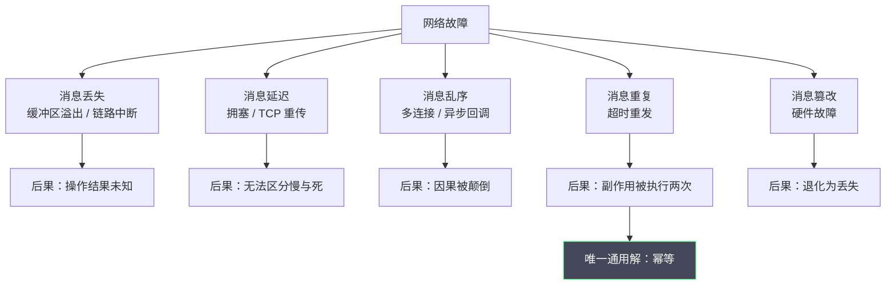
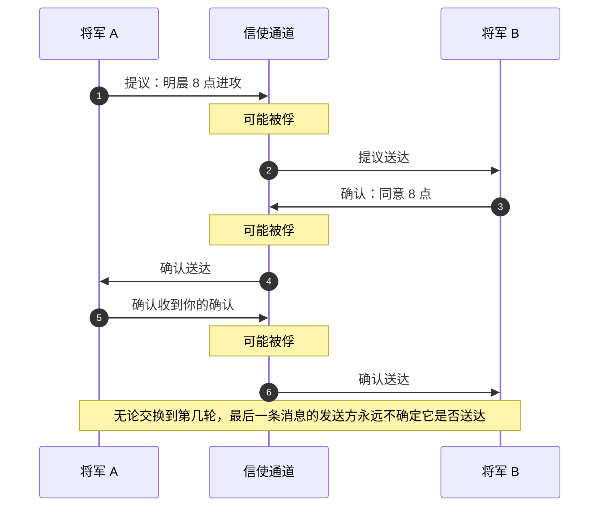
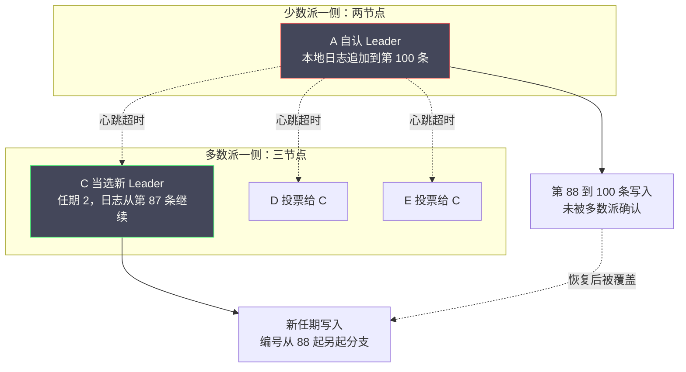
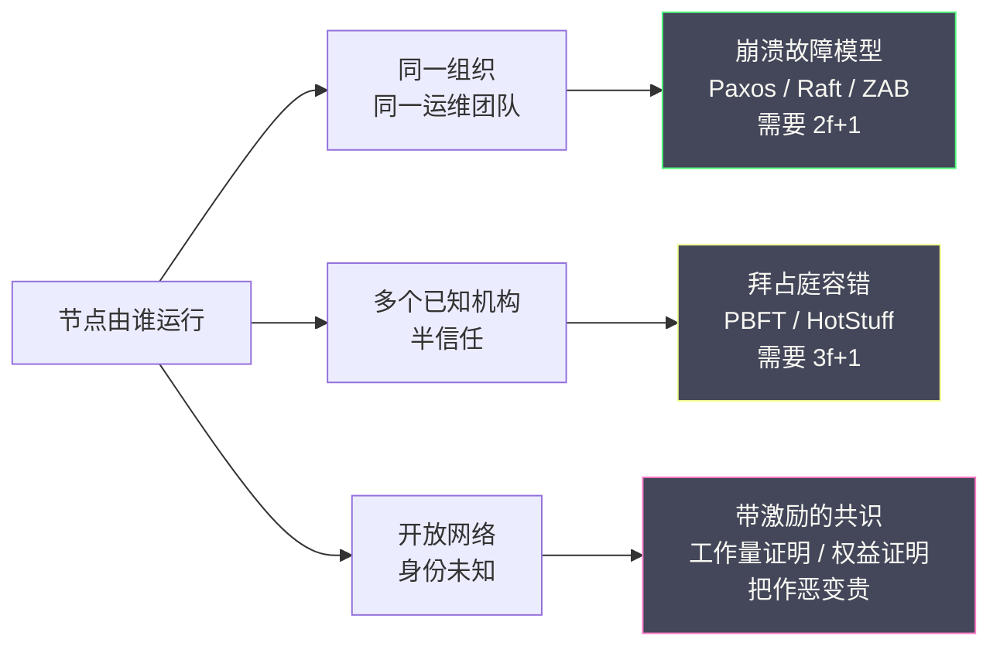

# 01 分布式系统的本质难题

**摘要：**

分布式系统的难，最容易被讲成一句工程感慨：网络会断、机器会坏、时钟不准。这句感慨没有错，但它把一组可以精确表述、各自锁死一个方向的结论压缩成了一声叹息，于是工程师真遇上问题时，仍然说不清是哪一个假设被打破，该用哪一样东西去补。本文把这些结论按本来的形态摊开：先从单机编程里四个从不被检查的前提说起，看它们如何逐个失效并收敛为「共享内存、可靠通信、统一时间」三个消失的前提；再讨论网络故障的五种形态与同步、异步、部分同步三个模型如何决定可解性的边界，用跨机房往返时延的物理下限说明跨城强同步的成本为什么优化不掉；接着把两将军问题讲成一个关于终止性的证明，并把它与拜占庭将军、FLP、CAP 摆在一起，说明四个结论各自锁住哪一个维度；随后量化时钟漂移与 NTP 的修正能力，用 2012 年与 2015 年两次闰秒事故说明时钟跳一下如何打穿一把分布式锁，再引出逻辑时钟与向量时钟这条因果追踪的线索；最后处理局部视角带来的脑裂与故障检测，比较崩溃容错与拜占庭容错的信任边界。全文按五问推进，读完应当能回答两个问题：分布式系统的难究竟难在哪些能被写下来的结论上，以及这些结论为什么只能被规避、不能被消除。

---

## 第 1 章 单机常识里的四个前提

### 1.1 1978 年，一个朴素的问题被重新提出

1978 年，Leslie Lamport 在《Communications of the ACM》第 21 卷第七期上发表《Time, Clocks, and the Ordering of Events in a Distributed System》。这篇文章后来成为分布式领域被引用最多的文献之一，但它关心的不是某个系统该怎么造，而是一个朴素到近乎幼稚的问题：当两台机器只能靠消息说话时，我们凭什么断定一件事发生在另一件事之前？

在单机上这个问题不需要回答，因为一切便利都来自同一个来源——同一块物理内存、同一个调度器、同一块主板上的时钟源。Lamport 那篇文章的分量在于，它指出一旦把这些拆开，事件之间的先后就不再是世界的属性，而必须由协议去构造，构造得出来才有，构造不出来就没有。

他后来给分布式系统下过一个半开玩笑的定义，流传之广几乎超过了论文本身。

> [!note] Lamport 的定义
> "A distributed system is one in which the failure of a computer you didn't even know existed can render your own computer unusable."
>
> 译过来是：一个分布式系统，是指一台你甚至不知道它存在的机器的故障，能让你自己的机器无法使用的系统。这个定义之所以被反复引用，是因为它把最反直觉的一面说透了——组件之间的依赖是隐式的，局部失效会沿着一条你没有画在架构图上的路径传导到全局。

### 1.2 单机程序员从不检查的四件事

第一个前提是操作结果只有成功与失败，没有「不知道」：调用要么拿到返回值，要么抛异常，即便进程被信号杀死、踩了段错误、被 OOM killer 挑中，操作系统也会留下可以事后观察的痕迹，因为整台机器只有一本账。第二个前提是时间单调向前：`System.currentTimeMillis()` 在同一个 JVM 里通常递增，先发生的事件时间戳一定更小，「谁先谁后」可以靠一个 `long` 比出来，日志排序、超时计算、缓存过期全都建立在这个从不被写进文档的信念上。第三个前提是内存只有一份：多线程共享一个变量，只要同步用对，所有线程看到的就是同一份数据，一个 `int` 不会对线程 A 显示 5 而对线程 B 显示 10，因为两个值需要两块内存。第四个前提是失败是整体的：一个关键模块崩了，整个进程通常跟着崩，不会出现「左半部分正常运行、右半部分早已死亡、而左半部分看不到尸体」的局面。

这四个前提在分布式系统里**全部不成立**，而且失效的方式不是「偶尔不准」，是「原则上不成立」。三个会计分别在北京、上海、深圳各管一本账，职责是让三本账保持一致，而他们之间只能靠同城快递传纸条，每人的手表每天会快慢不同的一点点，且没有任何一条快递线路承诺必达。这三个人构成的，就是一个最小的分布式系统。

### 1.3 四个前提在分布式环境里逐个失效

第一个前提失效的形态是「结果未知」。客户端发了一个请求，网络超时了——请求有没有到达、服务器执行了没有、响应是不是丢在回程、还是请求压根没出门？客户端无从得知。超时这个信号本身是二义的：既可能「对端没做」，也可能「对端做了但回执丢了」。

第二个前提失效的形态是「时间不可比」。北京那台机器上的 `10:00:00.500` 与上海那台机器上的 `10:00:00.500` 是不是同一个瞬间？不一定。两台机器的晶振各自漂移、NTP 各自校正、网络路径各自抖动，最后落在日志里的两个数字可以在真实顺序颠倒的情况下大小关系完全反过来，第 4 章会用 ppm 的算术把它量化到秒的量级。

第三个前提失效的形态是「没有共享内存」。北京那本账与上海那本账是两份独立的纸，北京改了自己那本，上海不会自动感知；要让两边看到同一个数，必须经过一次通信，而通信是不可靠的。于是「让多个节点看到同一份数据」从一个免费的默认，变成了需要整套协议才能付费购买的服务。

第四个前提失效的形态是「局部失败是常态」，这一条最容易被低估，因为它的量级可以用算术直接摆出来。一块企业级硬盘的年故障率按百分之一到二的量级估算，一千块盘的集群每年就有十到二十块盘坏掉，摊到每个月一块以上；如果把粒度放大到整机，任何一块盘、一个电源、一条内存出问题都会让整机退出服务，那么千人规模的集群里「今天有机器是坏的」就不是异常工况，而是**稳态**。更关键的不是频率而是后果的分布：坏掉的那台退出服务，其余九百九十九台照常运行，但它们看不到那台的状态，只能凭心跳去猜。

> [!info] 分布式系统的定义与它的代价
> 分布式系统（Distributed System）是由多台计算机组成、通过网络传递消息进行协作的系统。定义里的每个词都对应一笔代价：多台计算机意味着故障域不止一个，网络传递消息意味着结果可能未知，协作意味着必须有协议去裁定分歧。所谓「分布式系统比单机难」，难的不是机器数量，而是这三笔代价同时存在且互相纠缠。

### 1.4 三个消失的前提

把四个失效收敛一下，会看到三条线索，每一条都直接对应一类必须被发明出来的替代品。

第一条是共享内存的消失：任何「让多个节点看到同一份数据」的需求，都要靠复制与共识来支撑，代价是要付网络往返、要被多数派的可用性卡住。第二条是可靠通信的消失：任何「必须成功」的操作都要配一套确认、重试、幂等，代价是重复、延迟与状态机的复杂度。第三条是统一时间的消失：任何依赖时间排序的逻辑都要换成逻辑时钟、版本号或因果标识，代价是这些替代品只能给出偏序，给不出全序。

**理解了这三个前提的消失，就理解了整个分布式领域在补什么**。不过要说清一件事，免得后面读出一层误解：这三样替代品没有一个能真正把前提恢复回去，它们做的是把「不可能」转换成「在特定假设下可接受的近似」——共识协议恢复的是多数派眼中的一份数据，不是所有人眼中的一份数据；幂等恢复的是重复执行不产生副作用，不是消息一定送达；逻辑时钟恢复的是因果不颠倒，不是时间可比较。

---

## 第 2 章 网络故障的分类与模型边界

### 2.1 五类故障与一棵分类树

在讨论任何协议之前，先把「网络不可靠」拆成可以分别讨论的五种形态，因为不同类型的故障对协议设计的影响方向完全不同。

消息丢失是消息在途中彻底消失，收发双方都不知情，成因包括缓冲区溢出、网卡故障、链路中断与中间设备的策略性丢弃。消息延迟是消息最终到了但比预期晚得多，从同机房的几十微秒到跨大洲的上百毫秒都可能，还可能因 TCP 重传突增到秒级。消息乱序是先发的后到，在 UDP 上属于常态，在单条 TCP 连接上通常不发生，但在多连接、消息队列与异步回调里依然普遍。消息重复是同一条消息被收到多次，网络层少见（IP 有 TTL），但应用层用重试实现可靠传输时极为常见——发送方超时重发，而第一条其实只是慢，最后两条都到了。消息篡改是内容在途中被改坏，多由硬件故障引起，在有校验和的协议里会被检测出来并丢弃，从而退化成丢失。



这棵树里最值得停留的是消息重复那一支。它不像丢失那样「什么都没到」，而是「到了两次」，而到了两次往往比没到更难处理，因为接收方必须判断这个请求是不是已经做过，这需要业务层的幂等键或去重表，不是通信层能独立解决的。现实系统里最普遍的故障形态恰恰是它：任何带重试的调用链，在超时与重试叠加之后都会把一次失败放大成两次成功，而客户端只看到一次超时。

### 2.2 同步、异步与部分同步：模型决定可解性的边界

同步网络模型假设存在一个已知的传递时间上界 Δ，所有消息在 Δ 内必然到达或被判定为永久丢失。在这个模型里超时是确定性判据：等满 Δ 还没回应，就可以确凿地说对方崩了或者消息丢了，没有第三种解释。异步网络模型假设没有时间上界，消息可能在任意长的时间之后到达，于是超时退化成猜测：等了十秒没回应，可能是节点崩了，也可能是消息还在路上、打算第十一秒到。部分同步模型介于两者之间，它假设系统大多数时候运行在延迟有界的同步状态，但允许某些时段失去这个上界、之后又恢复。

三个模型的差别不是严不严格，而是可解性。FLP 不可能定理的前提是异步模型，它证明在完全异步且允许一个节点崩溃的网络里，不存在任何确定性共识算法能保证终止——「异步」这个假设本身就足以剥夺共识的终止性，不需要考虑丢包率，也不需要涉及时钟。实用协议之所以能用，是因为它们把假设换成了部分同步：Raft 的选举超时、Paxos 的活锁避免，都建立在网络最终会恢复到延迟有界这个信念上，代价是在网络真正恢复之前协议可能停滞、失去活性，但不会给出错误答案。这条定理的完整证明思路见 [[03 FLP 不可能定理与共识问题]]。

> [!info] 先看假设，再看结论
> 同步模型里很多问题可解，因为超时即故障；异步模型里很多问题不可解，因为慢与死在观测上不可区分；部分同步模型介于两者之间，是 Paxos、Raft、ZAB 的共同落脚点。因此「某个问题能不能解」必须先补一句「在哪个网络模型下」，脱离模型谈可解性没有意义。

### 2.3 跨机房往返时延的物理下限

光在光纤里的传播速度约为每秒二十万公里，等于真空中光速的三分之二。北京到上海的直线距离约一千二百公里，往返两千四百公里，光走完需要十二毫秒；实际光缆路径比直线长，中间还有若干跳转发，所以实测往返时延通常落在二十到三十毫秒。旧金山到东京直线约八千公里，往返一万六千公里，理论下限约八十毫秒，实测多在一百到一百五十毫秒。同机房跨机架在零点一到零点五毫秒的量级，同城两个可用区之间在一到两毫秒。这些数字不是哪家厂商的调优结果，而是光速除以距离再乘二。

这组数字对协议设计有一个直接推论：一次需要多数派确认的写入，时延下限等于到最远那个必需副本的一次往返。如果三位会计分处北京、上海、深圳，那么任何一次「三个人里至少两个确认」的写入都至少要等北京到深圳的一趟，也就是三十毫秒上下，剩下的时间全在光纤里。把三地五副本摊开看，五副本要三个确认，如果三个最近的副本都在同一城市，时延能压到毫秒级，可那样一次城市级故障就会带走多数派；要跨城容灾，就必须接受跨城往返成为每一次写入的固定成本。**跨城强同步的代价被钉在光速上，能动的只有光速之上那一层**——协议轮次、批量、压缩、连接复用，都只是在几十毫秒的底价上加价或减价。

### 2.4 故障不是均匀分布的

集中式的故障源包括机架、交换机、电源、空调，以及同一批次的硬件与同一个版本的内核。一次机架级供电故障会同时带走几十台机器，一次交换机固件缺陷会让整个叶脊子树失联，一次配置推送失误会让成千上万台机器在同一时间窗口里做出同样的错误动作。Google 在 2010 年 OSDI 会议上发表过一篇对自家存储集群可用性的统计研究《Availability in Globally Distributed Storage Systems》，报告的量级是：把系统拖入不可用的主因并非单盘或单机的独立故障，而是一批机器同时失效的关联故障，同时多数中断事件的持续时间并不长。笔者以为，这两个观察合起来正好指向一条设计原则——副本放置要打散故障域，恢复要快，而不是把希望寄托在「单点故障率足够低」上。

把可用性换算成时间更容易看出问题。按年度算，三个九是八小时四十六分钟不可用，四个九是五十二分钟，五个九是五分十五秒。单机年可用性通常落在两三个九之间，所以任何四个九以上的服务都不可能靠单机达成，只能靠复制；而复制并不能把可用性简单相乘，因为副本共享故障域，关联故障让多副本同时失效的概率远高于独立假设给出的数字。**可用性不是单机指标的平均值，而是故障相关性的函数**。

这也解释了一个看似矛盾的现象：系统低负载时从未出过问题，一到大促就各种网络故障。网络没在那一刻变坏，变的只是压力——流量越大，缓冲区溢出、TCP 重传、链路抖动的概率越高，原本落在长尾里的小概率事件被抬到了主干上。所谓面向失败设计，说的不是假设网络随时会坏这种悲观姿态，而是承认网络在压力下必然出问题，并把出问题之后的路径提前备好。

### 2.5 三类不确定性对应的三组手段

面对丢失、延迟、乱序这三类不确定性，工程上有三组对应手段，逻辑是同一条：用额外机制补偿网络的不足，而每个额外机制都会引入新问题。

应对丢失的手段是确认与重试。既然消息可能丢，就让接收方回确认、发送方超时重发；但重试会带来重复，因此确认与重试必须与幂等配套，否则补一次就变成做两次，常见做法是给每个请求分配客户端生成的幂等键，服务端用去重表记录已处理的键，保留期覆盖重试的最大时间窗。应对延迟的手段是超时与截止时间：用超时避免无限等待，用截止时间约束整条链路的耗时预算；但超时会把慢判成死，阈值太短造成大量误判与无谓切换，太长则让故障恢复变慢，合理阈值只能来自实测的 P99 甚至 P999。应对乱序的手段是序号与去重：给消息编号让接收方重排，或对乱序不敏感的操作（譬如幂等的状态覆盖）干脆不要求顺序；但排序意味着缓冲，缓冲溢出又退化成丢消息，绕回第一类问题。

---

## 第 3 章 两将军问题：确认的无限递归

### 3.1 两个将军与一条会丢的信使

两将军问题（Two Generals Problem）最早的正式描述出现在 1975 年 SOSP 会议的一篇论文里，作者是 Akkoyunlu、Ekanadham 与 Huber，题目是《Some constraints and tradeoffs in the design of network communications》；把它作为「原子提交为什么无法做到无阻塞」的论证引入数据库领域的，是 Jim Gray 在 1978 年的《Notes on Database Operating Systems》。

两支军队驻扎在城市两侧的山谷里，各有将军一名。只有同时进攻才能取胜，单独进攻会被全歼，撤退则双方都能保全。两位将军唯一的通信方式是派信使穿过城市，而信使可能被守军俘获。将军 A 想约定明晨八点进攻，他需要确认 B 也这么打算；B 收到后回信确认，但 B 无法确认这封回信是否送达；A 收到回信后再回一封，于是轮到 A 无法确认自己的确认是否送达；如此往复。



把这个递归写成形式化的记号会更清楚。

```
m1: A → B   「明晨 8 点进攻」
m2: B → A   「收到，同意」
m3: A → B   「收到你的同意」
m4: B → A   「收到你收到我的同意」
...
mk: 第 k 条消息

对任意有限的 k，取第 k 条消息 mk：
若 mk 丢失，则收发双方的状态，与只交换了 k-1 条消息时完全相同。
而协议在第 k 轮后才达成共识，说明第 k 轮的决定不可能依赖 mk 是否送达，
于是 mk 可以去掉，协议退化为 k-1 轮。对任意 k 归纳，任何有限轮协议都不成立。
```

### 3.2 为什么有限轮协议一定不够

上面那段归纳的力量在于它没有依赖任何实现细节——不论协议设计得多巧妙、加密多可靠、重传多密集，只要信道存在丢失的可能，就总有一条最后的消息悬在半空。它不是说明双方无法达成一致，而是说明双方无法在有限时间内同时知道「对方知道」「对方知道自己知道」「对方知道自己知道对方知道」这一整串知识。

这条知识阶梯是理解两将军问题的关键。工程上能做的全部努力，是把不确定的概率压到足够低：若每条消息丢失概率是 p，连续 m 轮全部丢失的概率是 p 的 m 次方，多传几轮就能让双方没对齐的概率小到可以忽略。但这只是概率上的收敛，不是知识上的确定。

### 3.3 它证明了什么，没有证明什么

它证明的是：在不可靠信道上不存在有限轮协议，能让两个进程都确知对方的决定，因此原子提交这类要求双方在同一时刻都知道最终结果的操作，不可能做到既不阻塞又绝对一致。它没有证明的是：无法用第三方仲裁绕开知识缺口（可以，代价是引入新单点），无法用超时把不知道转成当作失败处理（可以，代价是可能误判）。

反过来看，不承认这个结论会发生什么？最典型的事故形态是协调者崩溃后参与者长期持锁：在 2PC 里，参与者投出可以提交的票之后就把资源锁住，等待协调者的最终决定；如果协调者在发出决定之前崩溃，参与者既不能提交（可能别人投了反对票），也不能回滚（可能协调者已经让大家提交了），只能持锁等待协调者恢复。这段等待的长度不由参与者的实现质量决定，而由「无法区分『协调者还没决定』与『决定已经发出但我没收到』」这个知识缺口决定。**2PC 的阻塞不是实现不够好，而是两将军问题在工程里的投影**；3PC 通过预提交阶段与超时把阻塞窗口缩小了，代价是在分区时可能让两个分区做出不同决定，把阻塞换成了不一致。

### 3.4 两将军、拜占庭、FLP 与 CAP 的定位

这四个结论经常被混着引用，仿佛它们说的是同一件事的不同版本。实际上它们各自锁住的是不同维度，混用会得出荒谬的推论，譬如「CAP 说了不可用所以要接受数据错乱」。把坐标摊开，差别一目了然。

| 结论 | 年份 | 针对的假设 | 结论的形态 | 锁住的维度 |
| :--- | :--- | :--- | :--- | :--- |
| 两将军问题 | 1975 提出，1978 引入数据库领域 | 信道可能丢失消息 | 不存在有限轮的双方确知协议 | 协调的终止性与知识层级 |
| 拜占庭将军问题 | 1982 | 节点可能任意作恶 | 口头消息下需 n 不小于 3f 加 1 才可解 | 故障模型的上界与节点数下限 |
| FLP 不可能定理 | 1985 | 完全异步，允许一个崩溃 | 确定性共识不保证终止 | 共识的活性 |
| CAP 定理 | 2000 提出，2002 形式化证明 | 网络分区，要求线性一致与可用 | 分区期间两者不可兼得 | 分区期间的取舍 |

首先，讨论对象不同：两将军讨论两个进程如何确知彼此的决定，拜占庭讨论 n 个进程里有坏人时如何达成一致，FLP 讨论异步网络下共识能不能保证结束，CAP 讨论分区时一致性与可用性的取舍。更关键的是，它们的结论不能互相推出——FLP 说任何时刻都可能不终止，不等于分区时一定不一致；CAP 说分区期间必须放弃一个，不等于异步网络下共识不可能，恰恰相反，Raft 在部分同步假设下既是共识算法，也在分区时明确选择了 CP。四条结论的详细展开分别在 [[02 CAP 定理深度解析]] 与 [[03 FLP 不可能定理与共识问题]] 里，本文只固定它们的坐标。

---

## 第 4 章 时钟：从石英漂移到闰秒

### 4.1 ppm：一天能漂多少

分布式系统里，时间是个危险的幻觉，幻觉的源头是一块指甲盖大小的石英晶体。

现代计算机的时钟基于石英晶体振荡器，晶体在电流驱动下以固定频率振荡，计数器数振荡次数来推算时间。问题是每块晶体的频率都略有差异，且随温度、老化、供电电压变化。衡量差异的单位是 ppm（百万分之一）：1 ppm 的漂移意味着每一百万秒慢或快一秒，换算到一天是 86.4 毫秒。普通消费级晶振的精度在 10 到 50 ppm 之间，对应每天 0.86 到 4.32 秒的漂移；服务器用的温补晶振好一些，通常也在几 ppm 的量级。两台机器的漂移方向如果相反，一天下来钟面读数可以相差好几秒——而这两台机器日志里的时间戳格式精确到毫秒。

这个量级足以摧毁一切「用时间戳判定先后」的设计。设想北京与上海两本账，北京那台的钟每天快 2 秒，上海那台每天慢 2 秒，一周之后钟面差接近 30 秒；这期间任何「谁的时间戳大谁胜出」的冲突解决策略，都会在真实顺序与钟面顺序之间做出系统性的错误判断，而且错得安静——没有报错，数据只是悄悄变成了旧值。

### 4.2 NTP 能修正什么，不能修正什么

网络时间协议（NTP，Network Time Protocol，现行规范是 RFC 5905）通过与时间服务器交换报文来估算本地时钟偏差并修正。原理不复杂：客户端记下发送时刻 t1，服务器回响应时带上它收到请求的 t2 与发出响应的 t3，客户端记下收到的 t4；往返时延是 (t4-t1)-(t3-t2)，偏差估计是 ((t2-t1)+(t3-t4))/2。这个公式成立的前提是去程与回程延迟大致对称，而真实网络里这个前提只近似成立，路径不对称会直接变成偏差估计的误差。

精度因此有天花板。在互联网上，经过若干层时间服务器同步之后，NTP 的典型精度在 1 到 50 毫秒之间；局域网内直连一级服务器可以达到亚毫秒到 1 毫秒。这个精度对多数业务足够，但对两类场景不够：一类是高频交易与金融清算这种毫秒决定归属的场合，另一类是分布式数据库里靠时间戳给事务排序的场合——后者把数据正确性押在一个几十毫秒的不确定量上。

除了精度，NTP 还有两个更危险的行为。第一个是跳变：当本地时钟与服务器的偏差超过一个阈值（ntpd 的传统默认值是 128 毫秒），它不会慢慢把时钟调过去，而是直接 step，把钟面瞬间拨到正确位置，于是时间这个变量在某一刻突然向前或向后跳了一段。第二个是不保证单调：NTP 保证的是长期平均对准真实时间，短暂回拨完全在允许范围内。**NTP 保证的从来不是单调与连续，而是长期平均意义上的对准。**

### 4.3 闰秒：三次被记录下来的事故

比 NTP 调整更剧烈的，是人类自己给时间加的不连续点。UTC 为了与地球自转保持大致对齐，从 1972 年起引入闰秒机制：当国际地球自转与参考系统服务（IERS）观测到原子时与世界时之差接近 0.9 秒时，就宣布在某个月的最后一秒插入或删除一秒。对天文台这是一次校准，对计算机则是某一天有 86401 秒——一个几乎所有软件都不曾假设过的事实。

2012 年 6 月 30 日那次闰秒，让 Reddit、Mozilla、LinkedIn、Yelp 等一批站点在插入闰秒的瞬间出现大面积的 CPU 占用飙升与服务不可用。根因是 Linux 内核处理高精度定时器的方式在时间被重复或回拨时陷入了忙循环，叠加某些应用对时间倒退一秒的处理缺陷，机器虽然活着，却几乎不响应任何请求。2015 年 6 月 30 日再闰一次，Twitter、Instagram、Pinterest、Netflix 等又报告了程度不同的问题。2016 年 12 月 31 日的闰秒则打到了 Cloudflare——那套用 Go 写的 DNS 解析服务在闰秒期间出现部分解析失败，事后被写成一篇专门的事故分析。

业界的应对分两派。一派是涂抹（leap smear）：Google 在 2011 年公开了这套做法，把插入的那一秒摊平到一整天里，让本地时钟在二十多个小时里持续以极小速率加速，从而使所有依赖时间差的软件都看不到跳变；代价是这台机器的时间与 UTC 在那一天里存在最大约 0.5 秒的固定偏差，与外部系统对时会出问题。另一派是硬扛：升级内核、打补丁、在闰秒窗口前暂停关键任务。这场持续几十年的麻烦终于有了终点——2022 年国际计量大会通过决议，计划在 2035 年前后取消闰秒。不过在那之前，每隔几年的 6 月 30 日或 12 月 31 日，仍然会有系统在这多出来的一秒里翻车。

### 4.4 一次时钟跳跃如何打穿一把锁

把跳变与闰秒合起来看，会得到一条工程结论：**时钟不仅可能不准，还可能不连续**，而不连续对基于时长的判断是致命的。

设想一个用 Redis 实现的分布式锁，加锁时设置 TTL 为 30 秒，同时在应用侧记录一个开始时间用于看门狗续期。

```
T0 : 加锁成功，设置 TTL = 30 秒，本地记录 start_time
T10: 业务逻辑执行中，已过 10 秒
T10: NTP 同步，本地时钟向前跳 25 秒，钟面从 T10 直接到 T35
T35: 看门狗检查：now - start_time 算出 35 秒，超过阈值，触发续期或告警
     与此同时，Redis 侧的 TTL 按真实流逝时间也已到期，锁被释放
     → 锁已经不属于自己，持有方却还在临界区里执行
```

这里的关键不在 Redis 的实现质量，而在应用侧的时钟与 Redis 侧的时钟是两只不同的表，任何一只跳一下，两边对还剩多久的判断就会分叉。Kleppmann 批评 Redlock 时提出的核心质疑之一正是这一点：算法的安全性论证依赖各节点时钟以近似相同的速率前进，而现实中时钟可以被运维调整、被 NTP 跳变、被虚拟机迁移影响，一旦这个前提破了，互斥性就没有保证。这条争论的完整脉络见 [[分布式架构/分布式锁/03 Redlock 算法正确性争议|Redlock 算法正确性争议]]。

### 4.5 TrueTime 与混合逻辑时钟

既然物理时钟不可信，工程上有两种截然不同的姿态：一种是把时钟做到足够可信，让不确定性小到可以被等待覆盖；另一种是干脆不依赖物理时钟，用逻辑信息替代它。

第一种姿态的代表是 Google 的 Spanner。它在每个数据中心部署 GPS 接收机与原子钟，把当前时间的不确定区间显式地暴露成一套 API（TrueTime），返回的是区间而不是点，再配一个 ε 参数表示区间的一半宽度。Spanner 在 OSDI 2012 的论文里报告，实际部署中 ε 的量级在 1 到 7 毫秒；代价是每次提交要额外等待一段 commit-wait，长度约为 2ε，用来保证后一个事务的时间戳一定大于前一个事务的提交时刻。

第二种姿态的代表是混合逻辑时钟（Hybrid Logical Clock，HLC）。它在 2014 年由 Kulkarni 等人提出，思路是把物理时间与逻辑计数压进同一个 64 位整数：正常推进时取物理时间，一旦发现收到的消息时间戳比本地大，就把本地时间戳抬到对方加一，同时把物理部分与逻辑部分分开记录，使时间戳既能近似反映真实时间，又能严格保证因果不颠倒。CockroachDB 采用这套机制在跨节点事务里给操作排序，既避免了纯逻辑时钟无法与真实时间对照的问题，也避免了纯物理时钟回拨就打乱顺序的问题。

| 方案 | 时间的形式 | 依赖 | 典型误差或代价 |
| :--- | :--- | :--- | :--- |
| NTP | 单点时间戳 | 网络对称性 | 互联网上 1 到 50 毫秒，可能跳变 |
| TrueTime | 带误差区间的时间戳 | GPS 与原子钟 | ε 在 1 到 7 毫秒，需 commit-wait |
| HLC | 物理部分加逻辑部分 | 仅需消息往返 | 因果正确，物理部分可能滞后 |

---

## 第 5 章 因果顺序与逻辑时钟

### 5.1 happens-before

面对物理时钟的不可靠，计算机科学采取了一个务实的转向：不再追问这件事发生在几点，改为追问这件事是否可能影响了那件事。这个转向的产物就是 Lamport 在 1978 年那篇论文里定义的先发生于（happens-before）关系。

定义只有三条，却是整个分布式因果理论的起点。第一，若事件 a 与 b 在同一进程内且 a 在 b 之前发生，则 a 先发生于 b。第二，若 a 是进程 P 发送某条消息的事件、b 是进程 Q 接收同一条消息的事件，则 a 先发生于 b。第三，这个关系是传递的。三条之外一概称为并发——注意并发在这里不是同时发生，而是没有因果关系、无法判定先后。因果关系的价值在于可靠：只要 a 先发生于 b，无论时钟怎么漂、NTP 怎么跳，a 对 b 的影响都真实存在，任何观察者都不该看到 b 的结果里包含对 a 的反向依赖。

### 5.2 Lamport 时钟的三条规则

要把 happens-before 变成可以计算的东西，只需给每个进程配一个本地计数器。

```python
# 每个进程维护一个本地逻辑时钟 counter，初值为 0
counter = 0

# 规则 1：本地事件发生时，计数器加一
def local_event():
    global counter
    counter += 1
    return counter

# 规则 2：发送消息时，先把计数器加一，再把当前值附在消息上
def send_message(msg, dest):
    global counter
    counter += 1
    send(dest, (msg, counter))

# 规则 3：接收消息时，取本地与消息计数器的较大者，再加一
def receive_message():
    global counter
    msg_timestamp = recv()
    counter = max(counter, msg_timestamp[1]) + 1
    return msg_timestamp[0]
```

规则 3 里的 `max` 是整个算法的灵魂。它保证一次接收之后，本地计数一定大于消息携带的计数，于是发送与接收之间也建立了严格的大小关系，因果链上的每一环都被这个 `max` 接了上去。

```mermaid
%%{init: {'theme': 'dracula'}}%%
sequenceDiagram
    autonumber
    participant P as 进程 P
    participant Q as 进程 Q
    participant R as 进程 R
    Note over P: a 本地事件，计数 1 → 2
    P->>Q: m1 携带 2
    Note over Q: b 接收，max(1,2)+1 = 3
    Note over Q: c 本地事件，计数 3 → 4
    Q->>R: m2 携带 4
    Note over R: d 接收，max(1,4)+1 = 5
    Note over P,Q,R: a → m1 → b → c → m2 → d，计数严格递增
```

**Lamport 时钟的保证是单向的：若 a 先发生于 b，则 a 的时间戳一定小于 b 的时间戳。** 这条保证足以支撑用时间戳给请求排序、做乐观并发的版本比较、在日志里对齐因果链，但它只保证了一个方向，逆命题不成立。

### 5.3 偏序的边界

为了在某些场合得到全序，算法会补一条规则：时间戳相同时用进程 ID 打破平局。这样得到的人为全序在工程上有用——譬如 Lamport 的分布式互斥算法就靠它给请求排队，保证所有进程按同一顺序获得锁。但这个全序不能被当成因果顺序使用：它把并发事件排出了一个顺序，而真实世界里这两个事件之间并没有先后。**单一计数器的能力边界就在这里：它能保证有因果的不会颠倒，不能保证颠倒的没有因果。** 要区分并发与因果，需要把每个进程的计数器都带上，这就是向量时钟。

### 5.4 向量时钟与最后写入者胜

向量时钟（Vector Clock）用一个向量替代单个计数器，每一维对应一个进程。规则相似：本地事件让自己那一维加一，发送时把整个向量附上，接收时逐维取最大值再给自己那一维加一。判定规则变成两句：若 A 的向量每一维都不大于 B 且至少有一维严格小于，则 A 先发生于 B；若两者在至少两个维度上互有大小，则它们是并发的。这几行规则把偏序完整地捕捉住了，并发不再被伪装成顺序。

代价是尺寸：向量长度等于节点数，规模一大，每次通信都要携带一个长向量，元数据开销迅速变得不可接受。这也是为什么大规模系统往往退回服务端分配单调版本号这种更朴素的做法——ZooKeeper 的 ZXID、etcd 的 revision 都是全局单调递增的序号，它们不追踪因果，只保证一个所有写入共享的全序。

在替代方案里，最具欺骗性的一个策略是最后写入者胜（Last-Write-Wins，LWW）：两个副本各收到一个写入，谁的时间戳大谁赢。它的实现简单到只需要一个时间戳列，所以在很多多主复制系统里被当作默认选项。

```
副本 A 收到写入 W1，值 = "v1"，本地时间戳 = 10:00:00.100
副本 B 收到写入 W2，值 = "v2"，本地时间戳 = 10:00:00.050

按时间戳比较：W1 更大，W1 胜出，最终值 = "v1"
```

如果真实情况是 W1 先发生、W2 后发生，只是副本 B 的钟慢了 100 毫秒，那么 LWW 就把更新的写入覆盖成了更旧的写入。数据丢了，而且丢得没有痕迹：没有冲突、没有告警、没有异常日志，只有一个本不该留下的旧值安静地赢了一次比较。要避开它只有两条路：用因果信息判断两个写入是否真的并发（并发的才需要冲突解决），或者用服务端分配的单调版本号排序。两条路都不依赖物理时钟。向量时钟的完整机制与它在版本冲突检测里的用法，见 [[07 向量时钟与因果一致性]]。

### 5.5 用时间戳做唯一 ID 的风险

时钟不可靠还会以另一种方式咬人：把它当作唯一标识的生成器。

```java
// 危险的做法：用时间戳拼一个分布式 ID
public String generateId() {
    return System.currentTimeMillis() + "-" + Thread.currentThread().getId();
}
```

这个写法在单机上勉强能用，因为同一台机器上毫秒级时间戳已足够区分请求；到了分布式环境，它有两个独立的失效点。第一个是同毫秒冲突：两台服务器在同一毫秒各生成一个 ID，如果时钟恰好对齐，两个 ID 会完全相同，而这在高峰期的写入量下并不是小概率事件。第二个是时钟回拨：NTP 因为本地钟走快了而把它调慢，新生成的时间戳可能比之前生成的小，ID 的单调性被破坏，依赖 ID 递增的数据库索引、分页游标、锁的 TTL 计算会一起出错。

这正是 Snowflake 这类算法要解决的问题。它把一个 64 位整数拆成三段：高 41 位是毫秒时间戳，中间 10 位是机器 ID，低 12 位是同一毫秒内的序列号。时间戳提供趋势，机器 ID 保证不同机器的 ID 不撞，序列号保证同一毫秒内的多次生成不重；再配一个时钟回拨检测，发现当前时间小于上次生成时间就拒绝服务或等待。**Snowflake 恰好演示了如何在不信任时钟的前提下使用时钟**：它不假设时钟精确，而是用机器号与序列号把时钟的不可靠兜住，让时间戳只承担大致递增这一项弱职责。

---

## 第 6 章 局部视角、脑裂与故障检测

### 6.1 三个节点，三种世界观

分布式系统里最深的一层困难，不是网络会丢包，也不是时钟会漂移，而是每个节点只能直接观察到自己。它对他人的全部认知来自收到的消息，而消息可能丢、可能晚、可能来自一个已经过期的过去。于是任何时刻，任何节点对全局状态的认知都是一个不完整的、可能过时的快照。

```
集群有三个节点 A、B、C，A 是 Leader。

T0：一切正常，A 收到写入，同步给 B 与 C
T1：A 与 B、C 之间的链路断了
    A 的视角：我还是 Leader，B 和 C 没响应，它们可能挂了
    B 的视角：A 没响应，C 还活着，A 可能挂了
    C 的视角：A 没响应，B 还活着，A 可能挂了
T2：B 与 C 发起选举，C 当选
    B、C 的视角：C 是新 Leader，任期加一
    A 的视角：我还是 Leader，还在接受写入
T3：链路恢复
    系统里曾经同时存在两个自认为合法的 Leader
    如果两边都接受了写入，两条历史需要合并，而它们可能互相矛盾
```

这段过程里没有任何一个节点犯错，每个节点都在信息不完备的条件下做出了局部最优推断，而全局结果是两个 Leader。这就是 Raft、ZAB 这类协议必须设计任期（Term）与日志一致性检查的原因：任期让旧 Leader 在恢复连接后立刻发现自己过期，日志检查让旧 Leader 上那些没被多数派确认的写入被新 Leader 覆盖掉。



### 6.2 脑裂与多数派相交

脑裂（Split Brain）指系统因网络分区而出现多个节点各自认为自己是唯一权威、并独立对外提供服务或接受写入的状态。它是局部视角最危险的一种表现，因为外在症状不是报错，而是两边都能写、都写成功了。

以主从复制为例：

```
正常状态：
  A（主）← 写入 ← 客户端
  B（从）← 复制 ← A

分区之后：
  A 的视角：我仍是主，B 只是暂时失联，写入继续被我接受
  B 的视角：A 的心跳消失，我被提升为主，写入继续被我接受
  客户端的视角：两边都连得上，两边都说成功

结果：
  A 侧日志追加到第 100 条
  B 侧从第 87 条之后另起一条分支
  网络恢复后只能作废其中一条，而被作废那条上的写入，客户端早已收到过成功回执
```

解决脑裂的标准武器是多数派（Quorum）：只有获得超过半数节点认可的操作才生效。这个方案之所以成立，靠的是一条纯粹的集合论性质——**任意两个多数派必然相交**：五节点分成 2 与 3 两个分区时，不可能两侧都大于等于 3；相交的节点在同一个任期里只会投出一票，因此不可能有两个 Leader 同时拿到多数派授权。

但它有明确的边界。第一，多数派以配置中的成员数为准，成员增减必须走共识流程，否则两侧对新配置的理解不同，相交性就不再成立。第二，偶数节点没有额外收益，四节点的多数派是三，容忍一个故障，与三节点相同，却多了一台机器的成本。第三，只有两个节点时多数派是二，任何一台失联就凑不出多数派，这类集群实际上不具备容错能力。

### 6.3 故障检测器：从固定超时到 phi accrual

每个节点都需要判断其他节点是否还活着，以便在故障时触发恢复动作。但这件事在异步网络里原则上是做不到的，因为「没有响应」至少有四种互不相同的解释。

第一种，对方真的崩溃了，进程不存在，永远不会回应。第二种，对方运行正常，但链路断了，它的回应到不了。第三种，对方运行正常，但正在经历长时间垃圾回收停顿或磁盘阻塞，暂时没调度到处理心跳的线程。第四种，对方运行正常且没有停顿，是这次心跳本身在去程或回程丢了。节点收到对端没有回应这个观测时，只能下一个赌注。

理论上把这套赌注形式化了。Chandra 与 Toueg 在 1996 年发表于《Journal of the ACM》的论文《Unreliable failure detectors for reliable distributed systems》里，按完整性与准确性两个维度把故障检测器分成若干类：完美检测器 P 要求最终报告所有崩溃节点且永不误报，最终完美检测器 ◇P 只要求最终做到这两点，强检测器 S 要求不误报崩溃节点但允许漏报，最终强检测器 ◇S 放宽到最终满足，弱检测器 W 与最终弱检测器 ◇W 则更松。这个分类的价值在于它建立了一个对应关系：**完美故障检测器等价于同步网络模型**，因为只有在消息传递有确定上界的环境里超时才能作为确定性判据；而在异步网络里完美检测器不可能实现，这本身是 FLP 证明里的关键引理之一。

实用系统用的是最终完美或最终强这一类：允许一段时间里误判，但最终纠正。Raft 的选举超时就是最粗糙的一种实现——固定阈值，超过就认为 Leader 失联，然后进入选举；它的缺点是把长尾延迟当成了死亡，所以引入了随机化超时来避免多个 Follower 同时发难。工业界更精细的做法是 phi accrual 故障检测器，由 Hayashibara 等人在 2004 年的 SRDS 会议上提出。

phi accrual 的核心是把二值的活与死换成一个连续的怀疑度。它持续采样心跳到达的间隔，用这些样本估计出一个概率分布，再计算 φ 值：φ 等于负的以十为底的对数，取的是「如果对方还活着，下一次心跳会比当前这个间隔更晚到达」的概率。这个定义的好处是可读性极强：φ 等于 1 对应约 10% 的误判概率，等于 2 对应 1%，等于 3 对应 0.1%，等于 8 对应亿分之一。Cassandra 的 `phi_convict_threshold` 默认值是 8，Akka 集群的 `failure-detector.threshold` 默认值也是 8，两家选同一个值不是巧合，而是这个量级在误判率与检测时延之间取得了大家普遍接受的平衡。

这套机制比固定超时更适合真实网络，因为阈值会随观测到的抖动自动伸缩：网络平静时稍微晚一点就把 φ 推高，检测很快；网络抖动时间隔分布本身变宽，同样的迟到不会立刻触发怀疑。但它有失效模式。第一种是分布假设失真：phi accrual 通常假设心跳间隔服从正态或指数族分布，而真实的延迟分布有厚尾——大促期间的排队、慢查询、跨机房拥塞会把尾部拉得很长，统计模型给出的概率与真实概率偏差很大，表现为频繁误判。第二种是停止世界式的停顿：一次几百毫秒到几秒的 GC 停顿足以让对端连续丢失若干次心跳，φ 迅速越过阈值，而这个节点其实健康得很，这也解释了为什么跑在 JVM 上的共识组件通常要把选举超时从几百毫秒调到一秒以上。第三种是把误判的后果放大：误判本身只是怀疑，但怀疑会触发选举、主备切换、客户端重连，而**一次误判的代价可能远大于一次真实故障**。

### 6.4 局部视角的两个工程后果

局部视角与时钟不可靠叠加，会在排查问题时制造两类非常具体的陷阱。

第一类是跨机器日志的时间戳不可信。服务 A 的日志里有一条 `10:00:00.100`，服务 B 的日志里有一条 `10:00:00.050`。从时间戳看 B 先发生，但如果两台机器的时钟相差 100 毫秒（完全在 NTP 的正常误差范围内），真实顺序完全可能是 A 先，排查者据此断定 B 先处理了订单，因果链就整个反了。因此判断顺序应当用因果标识而不是时间戳：Trace ID 与 Span 的父子关系记录了谁调用了谁，不依赖任何机器的时钟；关联跨机日志时查询窗口要留出余量，前后各放若干秒而不是精确匹配到毫秒；测量耗时则要用单调时钟（`System.nanoTime()`）而不是墙上时钟（`System.currentTimeMillis()`），因为前者只会前进，后者可能被 NTP 拉回去，用墙上时钟测出的耗时会变成负数。

第二类是没收到不等于没做。**一个服务没有收到下游的响应，可能是下游没做，可能是下游做了但响应丢了，也可能是下游做了、响应也发了、而客户端提前超时退出。** 三者在观测上完全一样，因此下游没响应不能作为下游没执行的证据。

---

## 第 7 章 拜占庭故障与信任边界

### 7.1 三个层次的故障模型

前面六章讨论的故障，都默认节点是「诚实但会死」的：它可能停止响应，可能丢消息，可能慢，但它不会故意撒谎。这个假设在理论里叫崩溃故障模型。

按节点行为的恶劣程度，故障模型大致分三层。崩溃故障（Crash Failure）最轻，节点停止响应，不再发送任何消息，Paxos、Raft、ZAB 都只假设这一层。遗漏故障（Omission Failure）重一点，节点会漏发或漏收某些消息，但发出去的内容是对的。拜占庭故障（Byzantine Failure）最重，节点可以发送任意内容的消息，可以对不同的接收者说互相矛盾的话，甚至可以与其他故障节点合谋。

工业界默认选择崩溃模型，理由很实在：数据中心里的服务器由同一个团队运维，故障的典型形态是硬件损坏、内核崩溃、进程被杀，这些都不会让机器说谎。但有一条容易被忽略的缝隙：软件缺陷可以让一个诚实节点发出内容错误的消息——一段内存越界可能让进程发出格式合法但数值荒谬的响应。这类行为在观测上像拜占庭，但工程上的处理方式通常不是上 BFT，而是加校验、加断言、加交叉验证，把它们转成崩溃，譬如校验失败就主动退出。

### 7.2 3f+1 从哪来

拜占庭将军问题由 Lamport、Shostak 与 Pease 在 1982 年发表于《ACM Transactions on Programming Languages and Systems》，场景与两将军问题形似而神不同：n 位将军包围一座城市，需要通过信使协商一致的行动，其中有 f 位是叛徒，会发送虚假的、互相矛盾的信息来阻止忠诚将军达成共识。结论是：在口头消息、无法伪造他人身份的模型下，可解的条件是节点总数 n 不小于 3f 加 1。

为什么是三倍而不是两倍？可以用不可区分性论证来看。假设 n 等于 3f，把节点分成三组，每组 f 个，让其中一组全是叛徒。叛徒对第一组忠诚节点说第三组要撤退，对第三组说第一组要进攻，自己两边都不表态或者两边都表态。此时第一组看到的证据是一个节点说进攻、一个节点说要撤退，第三组看到的是对称的相反证据，两组忠诚节点都处在无法判断谁是叛徒的局面里，任何决定都可能在另一组看来是错的。要打破这个僵局，需要存在第三个独立、可被两组共同信任的观察者，也就是第四个组——这便是 3f 加 1 的直觉来源：f 个叛徒可以制造 f 对 f 的对立，第 2f 加 1 个诚实节点才保证其中至少有一组是压倒性多数。

Lamport 的论文里还有一处容易看漏的补充：如果消息带不可伪造的签名，可解条件放宽到 n 大于 f 加 1。原因是签名把冒充这条路堵死了，叛徒无法伪造他人签名，于是消息来源可被验证，它只能在「自己说了什么」这个维度上撒谎。签名降低的是节点数门槛，付出的是密钥管理与签名验证的开销；但它并不改变两将军问题的结论，因为签名解决的是身份可信，不是对方是否收到，知识阶梯上的那一环仍然悬着。

### 7.3 CFT 与 BFT 的能力对照

把崩溃容错（Crash Fault Tolerance，CFT）与拜占庭容错（Byzantine Fault Tolerance，BFT）放在一起对照，能看清多花的成本买到了什么。

| 维度 | CFT（Paxos、Raft、ZAB） | BFT（PBFT、HotStuff） |
| :--- | :--- | :--- |
| 假设的故障 | 节点崩溃，停止响应 | 节点可能作恶，发送矛盾信息 |
| 所需节点数 | 2f 加 1（容忍 f 个崩溃） | 3f 加 1（容忍 f 个作恶） |
| 消息复杂度 | O(n) | O(n²) 或多轮聚合 |
| 典型延迟 | 一次到两次往返 | 多轮投票，轮次明显更多 |
| 适用场景 | 受信任的数据中心 | 互不信任的开放网络 |

这张表里最关键的一行是节点数：CFT 要 2f 加 1，BFT 要 3f 加 1。差额的来源不是多留余量这种保守习惯，而是作恶节点具备崩溃节点不具备的一种能力——它可以对不同接收者给出不同说法，从而让诚实节点在证据层面陷入不可区分。**要抵消这种分裂能力，诚实节点必须占到三分之二以上**；CFT 不需要这一层，因为崩溃节点不会说谎，沉默是它唯一能发出的信号。

这也意味着 BFT 的代价不止是节点数。PBFT 在 1999 年由 Castro 与 Liskov 提出，正常路径需要三轮通信，消息复杂度是 O(n²)；2019 年的 HotStuff 通过流水线与聚合签名把每轮通信量压到 O(n) 量级，代价是更多轮次与更高的实现复杂度。对三地部署来说，多一轮投票就多一次跨城往返，BFT 的延迟成本会以轮次乘以跨城 RTT 的形式叠加起来。

### 7.4 信任边界

于是要不要上 BFT 的答案，可以归结为一个关于信任的判断：谁在运行这些节点。

前文那三位会计，如果都是同一家公司的员工，用的是同一套运维流程、同一批机器、同一个发布系统，那么他们之间不存在故意做假账的动机，最坏的情况是某人病了没来、纸条丢了、表停了；此时崩溃故障模型足够，Paxos 或 Raft 是最优选择。如果三位分属三家互相竞争的机构，各自有动机让自己的账本更有利，那么某一位偷偷改了一笔就必须被假设成可能，BFT 才有意义。如果三位是一群身份未知、随时可以退出重进的参与者，那么连三分之二诚实这个前提都难以维持，只能把信任建立在别的机制上——工作量证明把作恶换成了算力成本，权益证明把它换成了押金成本，本质都是同一个思路：不假设节点诚实，而让不诚实变得昂贵。



这条边界解释了数据中心用 Raft、区块链用 BFT 这个常见分工：它不是技术偏好，而是信任模型决定的。边界之内用 CFT，边界之外用 BFT，跨在边界上的联盟链视具体情况而定——节点身份已知但机构之间不完全互信，通常选 BFT，好在联盟链的节点数远小于公有链，O(n²) 的开销可以接受。

---

## 第 8 章 接受不确定性

### 8.1 五种手段

走过前面七章，可以把散落的应对手段收拢成五样。它们不是五个可以随意挑选的工具，而是对三类消失前提与局部视角的分别回应。

超时是异步网络里判断故障的唯一实用手段，尽管它不精确，阈值必须与实测的 P99 甚至 P999 分布对齐。幂等是重复消息的唯一通用解——既然超时与重试的组合必然产生重复，接收方就必须能安全地处理同一条消息来了两次。**幂等不是某个协议的附加特性，而是重试这个动作能够存在的前提。** 多数派是分区场景下的裁判机制，它把谁说了算从谁先到改成谁拿到过半数授权，代价是少数派一侧必须停止服务。状态机复制把一致性转化为顺序：所有副本从相同初始状态出发、以相同顺序执行相同操作，最终状态必然相同，于是共识协议的任务被简化成保证所有副本看到相同的操作序列。回退是在无法确知全局状态时选择保守行为——分区时拒绝写入、只读模式下返回旧数据、降级路径返回缓存值，都是它的具体形态。

### 8.2 一份假设清单

既然每个协议都要靠假设来规避困难，把假设列成清单就是一个极实用的阅读工具。

| 协议 | 核心假设 | 假设被打破的后果 |
| :--- | :--- | :--- |
| 2PC | 协调者最终可达 | 参与者无限阻塞，资源被长期持有 |
| 3PC | 参与者对「是否已决策」认知一致 | 分区下两个分区可能做出不同决定 |
| Paxos / Raft | 多数派节点可用且能互相通信 | 少数派侧无法提交，失去活性但不破坏安全 |
| ZAB | Leader 与 Follower 之间是 FIFO 通道 | 顺序被破坏，需要重新同步整个历史 |
| Gossip | 概率性送达，以极高概率收敛 | 极低概率下个别节点长期未收到，需要反熵兜底 |
| 向量时钟 | 节点集合相对稳定 | 向量随节点数增长，元数据开销上升 |

用法只有一步：读任何一个协议时，先找到它的核心假设那一列，再问自己的环境是否满足。满足就可靠，不满足就要么换协议，要么补机制兜底。譬如把 Raft 部署在两个机房，如果两个机房的链路长期不对称，多数派能互相通信这条假设在单机房故障时就会变成跨机房往返时延决定选举速度，集群行为会从快速切换退化成每次选举都要等一次跨城 RTT。

### 8.3 难题与替代品

把讨论再收敛一层，可以得到一张难题到替代品的对应表。

| 本质难题 | 对应的替代品 | 详见 |
| :--- | :--- | :--- |
| 共享内存的消失 | 复制与共识（Paxos、Raft、ZAB） | 第 04、05、06 篇 |
| 可靠通信的消失 | 幂等、超时、重试、多数派 | 第 03、10 篇 |
| 统一时间的消失 | 逻辑时钟、向量时钟、混合逻辑时钟 | 第 07 篇 |
| 全局视角的消失 | 多数派、Gossip、故障检测器 | 第 06、08 篇 |

遇到一个具体问题时，先问自己缺的是哪一样前提，就能避免在错误的层次上找方案——用重试去补时延问题、用时钟去补共识问题，都是典型的层次错配。

### 8.4 收束

那三位分处三地的会计，最终也没有办法做到三个人都确知另外两个人确知。他们能做的，是约定一个多数派规则、把每一笔改动编号、接受某一侧会短暂停业，并用对账去兜住那些真的丢了的纸条。这套办法不优雅，却可以被审计、被复现、被交接——而分布式系统这门手艺，说到底就是在光速、晶振与不可靠链路的夹缝里，找到这样一种可以被承担的安排。

---

## 参考资料

1. Lamport, L. (1978). Time, Clocks, and the Ordering of Events in a Distributed System. *Communications of the ACM, 21*(7), 558–565.
2. Lamport, L., Shostak, R., & Pease, M. (1982). The Byzantine Generals Problem. *ACM Transactions on Programming Languages and Systems, 4*(3), 382–401.
3. Fischer, M.J., Lynch, N.A., & Paterson, M.S. (1985). Impossibility of Distributed Consensus with One Faulty Process. *Journal of the ACM, 32*(2), 374–382.
4. Gray, J. (1978). Notes on Data Base Operating Systems. *Operating Systems: An Advanced Course*, Lecture Notes in Computer Science, vol. 60.
5. Akkoyunlu, E.A., Ekanadham, K., & Huber, R.V. (1975). Some Constraints and Tradeoffs in the Design of Network Communications. *Proceedings of the 5th ACM Symposium on Operating Systems Principles (SOSP)*.
6. Chandra, T.D., & Toueg, S. (1996). Unreliable Failure Detectors for Reliable Distributed Systems. *Journal of the ACM, 43*(2), 225–267.
7. Hayashibara, N., Défago, X., Yared, R., & Katayama, T. (2004). The φ Accrual Failure Detector. *Proceedings of the 23rd IEEE International Symposium on Reliable Distributed Systems (SRDS)*.
8. Corbett, J.C., et al. (2012). Spanner: Google's Globally-Distributed Database. *Proceedings of the 10th USENIX Symposium on Operating Systems Design and Implementation (OSDI)*.
9. Kulkarni, S.S., Demirbas, M., Madappa, D., Avva, B., & Leone, M. (2014). Logical Physical Clocks and Consistent Snapshots in Globally Distributed Databases. *OPODIS*.
10. Ford, D., Labelle, F., Popovici, F.I., Stokely, M., Truong, V.-A., Barroso, L., & Grimes, C. (2010). Availability in Globally Distributed Storage Systems. *Proceedings of the 9th USENIX Symposium on Operating Systems Design and Implementation (OSDI)*.
11. Kleppmann, M. (2017). *Designing Data-Intensive Applications*. O'Reilly Media. Chapter 8: The Trouble with Distributed Systems.
12. Tanenbaum, A., & Van Steen, M. (2016). *Distributed Systems: Principles and Paradigms* (3rd ed.). Pearson.
13. Coulouris, G., Dollimore, J., Kindberg, T., & Blair, G. (2011). *Distributed Systems: Concepts and Design* (5th ed.). Addison-Wesley.

---

> [!note] 思考题
> 1. 两将军问题证明了「确认本身需要再确认」的无限递归。实际的分布式协议通过引入超时、多数派、协调者等假设来规避它。请举例说明：一个协议引入的假设一旦不成立，会产生什么后果，以及这个后果是「失去活性」还是「破坏安全」——这两者的严重性并不相同。
> 2. 物理时钟不可靠，逻辑时钟只能给出偏序（不能区分并发事件）。请说明「放弃精确时间、追求因果顺序」这个转变，为什么是分布式系统设计的一次关键思想解放；再举一个具体例子，说明误把逻辑时钟的全序当作因果顺序会造成什么错误。
> 3. 故障检测器无法区分「节点慢」与「节点死」。请说明「最终精确故障检测器」（允许暂时误报、最终纠正）为什么比「完美故障检测器」更实用，以及它依赖什么网络假设；phi accrual 在什么负载特征下会给出大量误判，为什么。
> 4. 拜占庭容错要求 3f+1 个节点，崩溃容错只要 2f+1。请构造一个场景，说明为什么「多留一倍冗余」不能替代 BFT；再说明在什么情况下，把一个可能发出错误消息的软件缺陷当成崩溃处理，比上 BFT 更划算。