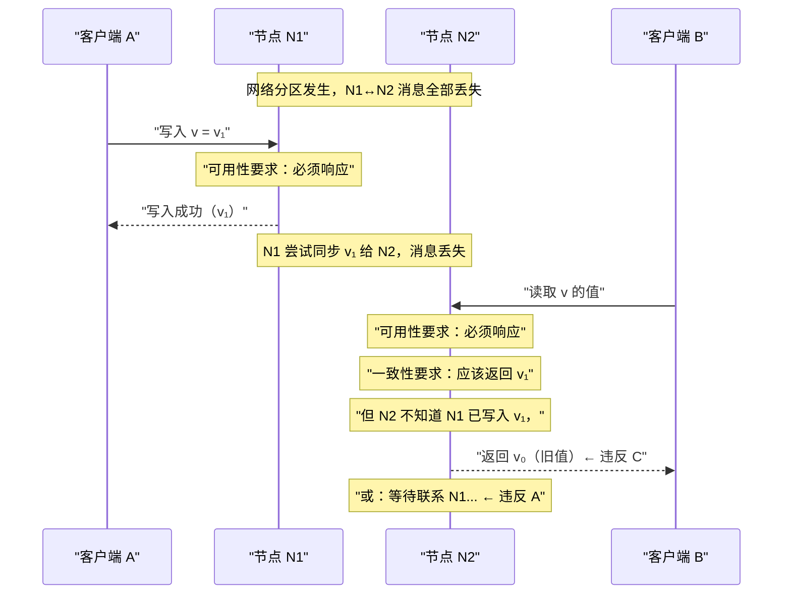
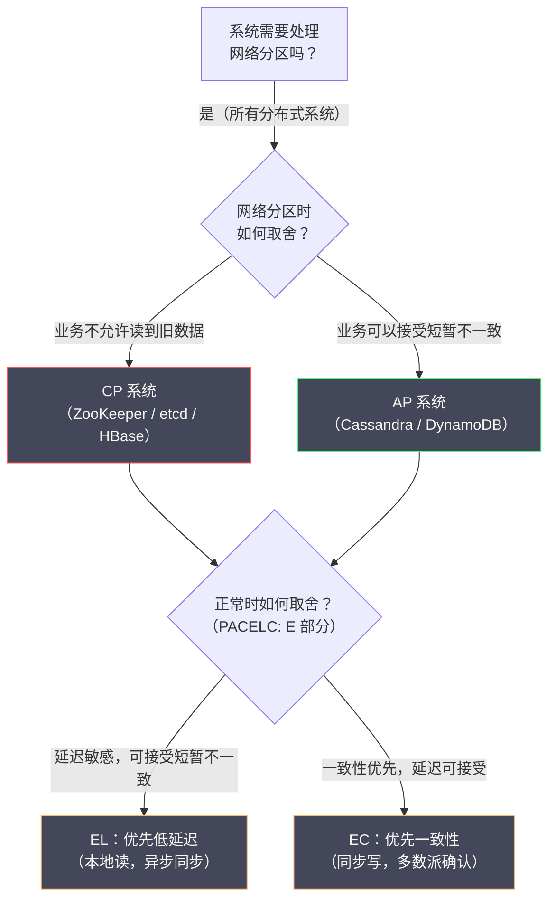

# 02 CAP 定理深度解析

**摘要：**

CAP 定理是分布式系统领域被引用最多、同时也被误解最多的理论成果。很多工程师对它的理解停留在"三选二"的口号层面，但这个口号本身就是对 CAP 的严重简化——它忽略了"P（分区容忍性）为什么不是一个选项"的根本问题，也没有解释"C（一致性）和 A（可用性）到底在什么时候不能兼得"。本文回到 Eric Brewer 2000 年的原始猜想与 Gilbert 和 Lynch 2002 年的形式化证明，厘清 CAP 三个性质的精确含义，深入分析为什么在网络分区时一致性和可用性必然冲突，讨论 PACELC 模型对 CAP 的重要补充——分区之外的延迟与一致性权衡同样重要，并辨析关于 CAP 的三个常见误解。读完本文，你应当能回答两个问题：CAP 究竟说了什么、没说什么，以及为什么"分区时二选一、平时另有取舍"才是它真正的指导意义。

---

## 第 1 章 CAP 定理的起源：从猜想到证明

### 1.1 Brewer 的猜想：2000 年 PODC 演讲

2000 年，Eric Brewer 在 ACM PODC（Principles of Distributed Computing，分布式计算原理）会议上发表了一篇题为《Towards Robust Distributed Systems》的演讲。在演讲中，他提出了一个关于分布式系统的猜想（Conjecture）：

> 互联网服务的一致性（Consistency）、可用性（Availability）与分区容忍性（Partition tolerance）三个属性，最多只能同时满足其中两个。

这个猜想来自 Brewer 在工业界多年的实践经验——他是 Inktomi（早期搜索引擎公司）的联合创始人，在构建大规模分布式 Web 服务的过程中，观察到这三个属性之间存在根本性的张力。但在 2000 年，这还只是一个工程直觉，没有形式化的证明。

### 1.2 Gilbert 与 Lynch 的证明：2002 年

2002 年，Seth Gilbert 与 Nancy Lynch（MIT）在《ACM SIGACT News》上发表了论文《Brewer's Conjecture and the Feasibility of Consistent, Available, Partition-Tolerant Web Services》，把 Brewer 的猜想转化为精确的定理并给出了证明。

这篇论文做了两件重要的事情。**第一件事，给 C、A、P 三个属性以精确的数学定义**（这是理解 CAP 的关键，后面详细展开）。**第二件事，证明了"三者不可兼得"**——在有网络分区（消息丢失）的异步系统中，不存在一个算法能同时满足一致性与可用性。

从此，CAP 定理（CAP Theorem）作为分布式系统的基础理论之一，深刻影响了工业界的系统架构设计。

### 1.3 Brewer 的反思：2012 年

有趣的是，Brewer 本人在 2012 年写了一篇文章《CAP Twelve Years Later: How the "Rules" Have Changed》，对 CAP 的常见误解进行了纠正，并建议工程师应该更细致地思考 CAP，而不是简单地用"三选二"来指导设计。

这篇反思文章的核心观点，也将贯穿本文：**CAP 三选二是一个有用的思维框架，但它过于简化，在实际工程中需要更精细的权衡模型**。**提出者本人回过头来纠正自己的"口号"，这件事本身就说明：一个理论在传播中被简化的程度，往往远超它的原意**。

### 1.4 一个时间线：CAP 从猜想到被误用的历程

把 CAP 的演进梳理成一条时间线，能看到一个理论"从精确到简化再到纠正"的完整过程。

**2000 年，猜想提出**。Brewer 在 PODC 演讲中提出"三者不可兼得"，这是一个工程直觉，尚未形式化。

**2002 年，形式化证明**。Gilbert 与 Lynch 给出了精确的数学定义与证明。**这一步把"直觉"变成了"定理"，但也把"精确的定义"引入了**——而这个定义（C 指线性一致性）恰恰是后来被忽略的部分。

**2008 到 2010 年，大规模传播**。随着 NoSQL 的兴起，CAP 被广泛引用为"选型依据"，"三选二"成为流行口号。**这一步把"定理"简化成了"口号"，而"精确的定义"在传播中被丢掉了**。

**2012 年，作者纠正**。Brewer 发文指出 CAP 被过度简化，Abadi 提出 PACELC 补充"平时"的权衡。**这一步是"纠正"，但它很难追上"口号"的传播速度**。

**这条时间线的启示是**：**一个理论的"流行版本"，往往比它的"精确版本"简单得多——而简单版本虽然好记，却容易误导**。因此，**读任何流行理论，都值得回一趟原始文献**——不是因为原始文献"更权威"，而是因为"精确的定义"往往就藏在里面，而它恰恰是判断"适用性"的关键。

### 1.5 一个延伸：为什么"分区"在云环境中更常见

传统观念里"分区很罕见"——这是基于"自己运维的物理机房"的经验。但在云环境下，这个经验需要修正。

**原因一，虚拟化与容器引入了新的分区来源**。虚拟机可能被热迁移、宿主机可能被维护、容器可能被驱逐——这些操作都可能导致"网络短暂中断"，而这类中断在物理机时代并不常见。

**原因二，可用区（AZ）之间的链路更脆弱**。跨可用区的流量要经过更多网络设备，任何一段出问题都会造成"分区"。**这也是为什么共识集群通常不跨可用区部署**（05 篇会讨论）。

**原因三，云厂商的网络策略可能变化**。安全组、网络 ACL、路由表的调整，都可能造成"意外的分区"。**这类"人为分区"虽然可以避免，但在大型组织中难免发生**。

**因此，在云环境里，"分区"的发生频率可能远高于"一年几次"**——这意味着 PACELC 的 E 部分虽然仍占大多数时间，但 CAP 的 P 部分不再是"可以忽略的极端情况"。**这也使得"分区容忍"从一个"理论要求"变成了一个"日常需要面对的工程现实"**。

---

## 第 2 章 C、A、P 的精确含义

在日常讨论中，CAP 的三个字母被广泛引用，但很少有人能精确说出它们的定义。这种模糊性是 CAP 被广泛误解的根本原因。

### 2.1 C：一致性——不是你想的那个"一致性"

**Gilbert 与 Lynch 的定义**：CAP 中的一致性（Consistency），是指**原子一致性（Atomic Consistency）**，也称为**线性一致性（Linearizability）**。

形式化地说：对于一个分布式存储系统，如果所有操作（读和写）看起来是**瞬间完成**的，且所有操作构成一个符合真实时间顺序的全序（Total Order），则该系统满足线性一致性。

更直观地理解：一个满足线性一致性的系统，**对客户端来说看起来就像只有一台服务器**——客户端看不出数据是分布存储的。任何写操作一旦成功返回，所有后续的读操作都必须能看到这个写入的值（无论请求被路由到哪个节点）。

**一个具体的例子**：

```
系统有两个副本节点：N1 和 N2，存储变量 x，初始值 x = 0

操作序列：
  T1: 客户端 A 向 N1 写入 x = 1（写操作开始）
  T2: 写操作成功返回
  T3: 客户端 B 向 N2 读取 x（读操作在 T2 之后发起）

线性一致性要求：客户端 B 必须读到 x = 1
→ 因为写操作已经在 T2 成功完成，任何在 T2 之后发起的读操作都应该看到新值

如果客户端 B 读到 x = 0（旧值），则系统不满足线性一致性
```

**关键点是，CAP 中的 C 不是"所有副本数据相同"**。很多人把一致性理解为"所有副本的数据是相同的"——这是最终一致性（Eventual Consistency）的定义，而不是 CAP 中的 C。CAP 中的线性一致性要求更强：**不仅要求最终相同，还要求在每个操作时刻，系统对外呈现的是一个单一的、最新的数据视图**。

这种混淆导致了大量的误用：很多人说"MySQL 主从复制是 CA 系统"，但 MySQL 的异步主从复制既不满足 CAP 中的 C（Slave 上可能读到旧数据），也不满足 CAP 中的 A（Master 宕机后 Slave 需要人工介入才能提供服务）——它是一个不满足 CAP 三者中任何一个的系统，被误归类为 CA 系统。

> [!warning] "一致性"是一个被严重过载的词
> 分布式系统里至少有四种"一致性"：CAP 的一致性（线性一致性）、ACID 的一致性（完整性约束）、一致性模型谱系里的一致性（因果、顺序、最终等）、以及"副本数据相同"（收敛）。**它们说的是完全不同的东西，却共用了同一个词**。
>
> 因此，每当看到"一致性"三个字，第一件事应当是问："这里说的是哪一种一致性？"**这个澄清动作，能避免绝大多数关于一致性的无谓争论**——因为很多时候，争论的双方说的是不同的一致性，却以为在争论同一个问题。

### 2.2 A：可用性——每个请求都必须得到响应

**Gilbert 与 Lynch 的定义**：CAP 中的可用性（Availability）是指：**集群中每个正常运行的（Non-faulty）节点，必须对每个收到的请求返回一个响应**（响应可以是成功或失败，但不能是超时或无响应）。

这里有两个关键词需要注意。

**"正常运行的节点"**：可用性的要求只针对没有崩溃的节点。一个节点崩溃了、无法响应，不算违反可用性——因为那是节点故障，不是系统设计的选择。可用性要求的是：那些还活着的节点，必须对每个请求给出响应。

**"必须返回响应"**：不能说"我现在不确定，你等一等"。如果一个节点收到请求后因为不知道全局状态（如是否已发生 Leader 切换）而无限期等待，那就违反了可用性。

**一个不满足可用性的例子**：

```
三节点集群（N1、N2、N3），N1 是 Leader

场景：N1 与 N2、N3 之间的网络分区
→ N1 无法与 N2、N3 通信

如果系统设计为"Leader 必须得到多数派确认才能响应客户端"：
  客户端向 N1 发送读请求
  N1 尝试联系 N2、N3 获取多数派确认
  N1 无法联系到 N2 或 N3（分区中）
  N1 无限期等待，或最终超时返回错误

→ N1 是一个正常运行的节点，但它无法返回有效响应 → 违反可用性
```

### 2.3 P：分区容忍性——不是一个可以"选择"的属性

**Gilbert 与 Lynch 的定义**：分区容忍性（Partition Tolerance）是指：**系统在任意数量的消息被网络丢失（或任意延迟）的情况下，仍然能够正确运行**。

换句话说，系统的正确性（满足 C 或 A 的程度）不应该依赖于网络的可靠性。

**为什么 P 不是一个可以"选择不要"的属性？** 这是 CAP 最大的误解之一。很多文章中写"CP 系统选择了 C 而放弃 A，AP 系统选择了 A 而放弃 C，CA 系统同时满足 C 和 A 但不支持 P"。但"CA 系统"在真实的分布式环境中是不存在的——你无法"不支持 P"。

原因很简单：**网络分区是现实世界中不可避免的**。无论你的网络设计多么可靠，都无法从根本上消除网络分区的可能性——硬件故障、软件 Bug、数据中心断电、人为操作错误，都可能导致网络分区。如果你的系统"不支持 P"，意味着当网络分区发生时，系统的行为是未定义的（"不保证任何事情"）。对于一个生产系统，这是不可接受的。

**更精确的理解**：CAP 定理实际上描述的是一个**条件性**的选择：**当且仅当网络分区发生时**，系统必须在一致性（C）与可用性（A）之间做出选择。在网络正常（没有分区）的情况下，系统可以同时满足 C 和 A。

> [!info] 重新理解"CA 系统"
> 当有人说"MySQL 是 CA 系统"时，他们通常的意思是：在单机环境下（没有网络分区），MySQL 同时满足 C 和 A。这是正确的——单机系统不需要面对网络分区，因此 CAP 定理对其不适用。
>
> 但一旦 MySQL 被部署为主从复制集群，网络分区就成为可能，CAP 定理就适用了。此时系统需要在 C 和 A 之间选择——而 MySQL 的默认行为（异步主从，Slave 可读）是 AP 的（可用但可能读到旧数据）。
>
> 因此，**"某系统是 CA 的"这句话，只有在"它不跨网络"时才有意义**。一旦跨越了网络，它就必须面对 P，也就必须在 C 与 A 之间做出选择。

### 2.4 一个常被误用的推论：CAP 不能用来"排除"任何系统

理解了 C、A、P 的精确含义之后，就能看出一个常见的误用：**用 CAP 来"证明某个系统不可用"**。

例如，有人会说"Cassandra 是 AP 的，所以它不适合金融场景"——这个推论的前提（Cassandra 是 AP）是对的，但结论下得太快。因为：**第一，Cassandra 提供可调一致性（Consistency Level），在 `QUORUM` 配置下它接近线性一致**；**第二，CAP 描述的是"分区时"的行为，而分区是罕见事件，不能因为"分区时它选 A"就否定它在"平时"的价值**；**第三，金融场景的具体需求是什么？是"绝对不能读到旧余额"，还是"最终一致但要有对账"？** 不同答案对应不同结论。

因此，**CAP 的正确用法不是"用它排除系统"，而是"用它提出更精确的问题"**——"这个系统在分区时如何处理这类数据？它的读是什么级别？我的业务能容忍哪些异常？"**把这几个问题问清楚，比贴一个"CP"或"AP"的标签有用得多**。

**这也解释了为什么 Brewer 本人要专门写文章纠正 CAP 的误用**：一个被简化成口号的理论，最大的危险不是"不够精确"，而是"被用来做它不该做的判断"。**CAP 是思考工具，不是排除工具**。

### 2.5 一个延伸：CAP 的 C 与"强一致读"的关系

理解了 CAP 的 C 是线性一致性之后，可以澄清一个相关的常见问题：**"强一致读"与 CAP 的 C 是什么关系？**

"强一致读"通常指"读到最新已提交的值"，这其实正是线性一致性对"读"的要求。因此，**一个系统如果要保证"强一致读"，就必须保证 CAP 的 C**——而这就意味着它在分区时可能不可用（CP 倾向）。

但有一个微妙的差别值得注意：**"写线性一致"与"读线性一致"是两件事**。很多系统在写路径上保证线性一致（多数派确认后才返回），但在读路径上为了性能而放松（从 Follower 读，可能读到旧值）——ZooKeeper 就是典型。**这类系统的"写是 C 的、读不是"**，因此严格说，它们不是"完全 CP 的"。

**这个澄清的实用价值在于**：当你评估一个系统是否"适合强一致场景"时，不能只看"它是不是 CP"，还要问"**它的读路径是什么级别的**"。**如果业务需要的是"写后立即读到最新"，那么"写强一致但读弱一致"的系统可能不够**——需要额外的手段（如 `sync()`、只读主节点）来补偿。这一点在 06 篇讨论 ZooKeeper 时还会展开。

---

## 第 3 章 为什么分区时 C 和 A 不能兼得：证明思路

### 3.1 Gilbert 与 Lynch 证明的核心思路

Gilbert 与 Lynch 的证明是反证法：假设存在一个算法同时满足一致性（线性一致性）和可用性，然后构造一个网络分区场景，推导出矛盾。

**证明场景构造**：考虑一个简单的分布式系统——两个节点 N1 和 N2；存储一个变量 v，初始值 v₀；一个写操作把 v 改为 v₁；一个读操作读取 v 的值。

**步骤一**：N1 和 N2 之间发生网络分区（所有消息被丢弃）。

**步骤二**：客户端向 N1 发送写请求，把 v 改为 v₁。由于可用性要求，N1 必须响应这个写请求（因为 N1 是正常运行的节点）。N1 本地写入 v₁，返回写入成功。

**步骤三**：另一个客户端向 N2 发送读请求，读取 v 的值。由于可用性要求，N2 必须响应这个读请求。但是：N2 无法联系 N1（分区中），不知道 N1 已经写入了 v₁；N2 本地存储的仍然是旧值 v₀。

**步骤四**：N2 面临两难——如果 N2 返回 v₀（本地存储的值），违反了一致性（写操作 v₁ 已经成功，但读操作看不到）；如果 N2 等待联系 N1 确认后再响应，违反了可用性（N2 无法响应请求）。

**结论**：无论 N2 怎么做，都不能同时满足一致性与可用性。矛盾，因此，不存在在网络分区下同时满足 C 和 A 的算法。

### 3.2 直觉性理解：信息无法穿越分区

这个证明的本质是非常直观的：**写操作发生在分区的一侧（N1），读操作发生在分区的另一侧（N2）。由于分区阻止了 N1 把写入信息传递给 N2，N2 在不知道写入已发生的情况下，要么给出错误答案（违反 C），要么拒绝回答（违反 A）**。

这不是算法设计不够巧妙的问题——信息无法穿越被切断的网络链路，这是物理约束，任何算法都无法突破。



### 3.3 一个关键澄清：证明用的是"消息丢失"而非"节点崩溃"

值得强调的是，Gilbert 与 Lynch 的证明中，网络分区的含义是**消息被丢弃**，而不是"节点崩溃"。这个区别很重要：**它说明 CAP 的困境不来自"节点故障"，而来自"通信被切断"**。

即使两个节点都完全正常运行、都在积极地处理请求，只要它们之间的消息传不过去，CAP 的困境就会发生。**因此，"把节点做得更可靠"无法解决 CAP 问题——因为问题不在节点，而在通信**。这也是为什么 CAP 描述的是一个"通信层面"的权衡，而不是"可靠性层面"的权衡。理解了这一点，就能理解为什么"提高硬件可靠性"对 CAP 没有帮助。

### 3.4 一个反例：把"分区"与"节点故障"混为一谈

CAP 的困境容易被误读为"节点坏了怎么办"，但它说的其实是"通信断了怎么办"。这个区别在工程上很重要，因为它决定了"该修什么"。

设想一个三节点集群，节点都健康，但其中一个节点与另外两个之间的网络断了。此时：**从"节点故障"的视角看**，那三个节点都活着，没有"故障"；**从"分区"的视角看**，集群被切成了 1 个和 2 个两部分，出现了分区。

如果系统设计为"少数派侧继续服务"（AP），那么少数派那个节点会继续接受写入，而多数派那侧也在接受写入——**两侧的数据会分叉**。这个分叉的根源不是"哪个节点坏了"，而是"两侧各自以为自己是完整的集群"。

**这个反例的教训是**：**面对"分区"问题，修"硬件可靠性"是无效的，因为它不是硬件问题；有效的做法是引入"多数派"这类机制，让少数派侧"知道自己不是完整的集群"，从而停止服务或降级**。**把问题的性质判断对，才能选对解法**——这也是本专栏反复强调的一条方法论。

### 3.5 一个延伸：证明的"最小反例"为何只需两个节点

Gilbert 与 Lynch 的证明只用了两个节点，这个"极简"值得玩味——**它说明 CAP 的困境与"集群规模"无关**。

有人可能会想：如果集群更大（比如 5 个节点），是不是可以通过"让多数派继续服务"来同时保证 C 和 A？答案是不能。**因为分区可能把集群切成"两个都有相当规模"的部分**——在 5 个节点里，可能是 2 个和 3 个；在 100 个节点里，可能是 49 个和 51 个。无论怎么切，只要两侧都"认为自己可以服务"，就可能出现不一致；只要一侧"停止服务"，就失去可用性。

**因此，两节点反例之所以有效，是因为它已经把"分区的本质矛盾"完整地呈现出来了**——更多的节点只会让"切法"变多，不会让矛盾消失。**这也是不可能性证明的一般特征：用最简单的反例，揭示最本质的矛盾**。理解了这一点，就不会幻想"通过增加节点数来绕过 CAP"。

---

## 第 4 章 CP 与 AP：权衡的真实含义

### 4.1 选择 CP：牺牲可用性，换取一致性

当网络分区发生时，CP 系统选择**拒绝服务**（或只让多数派侧提供服务），以保证不向客户端返回不一致的数据。

**CP 系统的行为**：

```
网络分区将集群分为两组：
  多数派侧：N1、N2、N3（3个节点，拥有多数）
  少数派侧：N4、N5（2个节点）

CP 系统的处理：
  多数派侧（N1/N2/N3）：继续提供服务，可以确认写操作和读取最新数据
  少数派侧（N4/N5）：停止对外提供服务（返回错误），或只提供只读服务
                     （返回可能旧的数据，但标注"不一定最新"）

→ 少数派侧的节点不可用（违反 A），但保证了数据一致性（C）
```

**典型 CP 系统**：ZooKeeper 在网络分区时，少数派节点停止服务（拒绝所有读写请求），只有多数派节点（包含 Leader）继续工作，这保证了写操作的线性一致性，但在分区期间少数派节点不可用；HBase 依赖 ZooKeeper 做协调，分区时 RegionServer 可能因为无法联系 ZooKeeper 而停止服务；etcd（使用 Raft 协议）要求 Leader 在多数派确认后才能提交操作，少数派分区侧无法提交新操作，会拒绝写入。

**CP 系统的工程权衡**：CP 系统并非在所有时候都不可用——它在**分区期间**（通常是短暂的）牺牲可用性。分区恢复后，系统恢复全量服务。对于强一致性要求高的场景（配置中心、分布式锁、Leader 选举），这个权衡是值得的：宁可暂时不服务，也不能返回错误数据。

### 4.2 选择 AP：牺牲一致性，换取可用性

当网络分区发生时，AP 系统选择**继续服务**（分区两侧都对外提供服务），以保证高可用性，代价是可能返回不一致的数据（旧数据或冲突数据）。

**AP 系统的行为**：

```
网络分区将集群分为两组：
  组 A：N1、N2
  组 B：N3、N4

AP 系统的处理：
  组 A：继续接受写入和读取，以组 A 的本地状态响应
  组 B：也继续接受写入和读取，以组 B 的本地状态响应

→ 两组可能接受了不同的写入，数据产生分歧（违反 C）
→ 但两组都能响应请求（满足 A）

分区恢复后：
  需要合并两侧的数据（Reconciliation），解决冲突
```

**典型 AP 系统**：Cassandra 在分区时，每侧继续接受读写请求，分区恢复后通过反熵（Anti-entropy）机制合并数据，写冲突通过"最后写入者胜"或向量时钟解决；CouchDB 与 DynamoDB（默认配置）采用最终一致性模型，分区时两侧独立工作，分区恢复后自动同步；DNS 是一个经典的 AP 系统——它的更新需要时间传播，全球各地的 DNS 服务器可能在短时间内返回不同的结果（不一致），但它极少拒绝服务（高可用）。

**AP 系统的工程权衡**：AP 系统返回的不一致数据并非"随机错误"——大多数 AP 系统都提供**最终一致性**保证：分区恢复后，系统会合并数据，最终所有副本的数据是相同的。在网络正常时，AP 系统也尽力提供最新数据（通过副本同步）。不一致只在分区期间暂时发生。

### 4.3 CP 与 AP 的决策框架

| 维度 | CP 系统 | AP 系统 |
| :--- | :--- | :--- |
| **分区时的行为** | 少数派停止服务，保证不返回旧数据 | 所有节点继续服务，可能返回旧数据或冲突数据 |
| **一致性强度** | 强一致（线性一致性）| 最终一致性（弱一致）|
| **可用性** | 分区期间部分节点不可用 | 始终可用（但数据可能不最新）|
| **冲突处理** | 不允许冲突（顺序化所有操作）| 需要冲突检测和合并机制 |
| **典型使用场景** | 分布式锁、配置中心、Leader 选举、金融交易 | 购物车、用户会话、DNS、社交 Feed |
| **代表系统** | ZooKeeper、etcd、HBase | Cassandra、DynamoDB、CouchDB |

**决策的核心问题是**："如果我返回了旧数据（不一致），最坏的情况是什么？"**不可接受**（金融余额、库存精确数、分布式锁状态）则选 CP；**可以接受，会有 UI 提示或后台同步**（购物车、用户偏好、社交点赞数）则选 AP。

这个"最坏情况"的问法，是把 CAP 从抽象理论落到具体业务的桥梁。**它把"选 C 还是选 A"这个技术问题，转化为"业务能容忍什么"这个业务问题**——而后者才是决策的真正依据。

### 4.4 一个常被忽视的问题：分区恢复后的数据分叉

选择 AP 意味着"分区时两侧都继续服务"，但这会留下一个后续问题：**分区恢复后，两侧的数据分叉了，怎么办？**

这个问题常被忽视，因为大家讨论 CAP 时往往只关注"分区期间"，而忘了"分区之后"。但数据分叉是 AP 选择的必然结果——既然两侧都接受了写入，就必然有两份可能不同的数据。

处理数据分叉有三条路。**其一，自动合并**：用 CRDT 或向量时钟，让冲突的数据能被自动合并（如计数器求和、集合取并集）。**其二，客户端合并**：把冲突的多个版本返回给客户端，由业务决定保留哪个（如 Dynamo 的做法）。**其三，人工处理**：对于无法自动合并的数据（如账户余额），标记冲突并交由人工处理。

**这三条路的共同前提是"数据分叉是可被检测的"**——而这需要版本向量这类机制来标记"哪两个版本是并发的"。**如果系统既选择了 AP、又没有冲突检测机制，那么分区恢复后的数据分叉就会"静默地"存在**——这是比"分区期间读到旧数据"严重得多的问题。

**因此，选择 AP 的正确姿势是"选 AP 加冲突处理机制"，而不是"只选 AP"**。这与分布式锁专栏"锁加幂等兜底"、分布式事务专栏"最终一致加对账"的思路完全一致：**选择弱保证时，必须配套"收敛机制"**。

### 4.5 一个延伸：分区恢复的"自动愈合"与"人工介入"

数据分叉的处理，可以按"能否自动合并"分为两类，它们对应不同的工程投入。

**可自动合并的数据**，用 CRDT 或"最后写入者胜"处理即可——例如计数器（求和）、集合（取并集）、配置项（取最新）。**这类数据的分叉可以在分区恢复后"自动愈合"，不需要人工介入**。代价是：CRDT 要求数据模型被设计成"可合并"的（如计数器要拆成每节点一份），这需要提前规划。

**不可自动合并的数据**，如账户余额、库存数——两个版本各说各话，没有"客观正确"的合并方式。**这类数据的分叉必须"人工介入"**：系统标记出冲突，由业务方按业务规则决定保留哪个，或走对账流程修正。

**这两类的划分标准是"数据语义是否支持自动合并"**——这是一个业务判断，不是技术判断。**因此，选择 AP 之前，必须先问一句"我的数据分叉了，能自动合并吗"**：能，则 AP 可行且成本低；不能，则要么准备人工流程，要么改用 CP。

**这也解释了为什么"金融系统偏爱 CP"**——因为金融数据大多是"不可自动合并"的（余额不能说"两个都对"），而人工介入的成本又很高。**技术选择背后，是数据语义与业务成本的共同约束**。

---

## 第 5 章 CAP 的常见误解

### 5.1 误解一："三选二"意味着可以均衡地选两个

"三选二"的表述让人误以为可以"选 C 和 P，放弃 A"或"选 A 和 P，放弃 C"，好像 C、A、P 是三个地位对等的选项。

事实上，**P（分区容忍性）是任何分布式系统都必须具备的基础属性**——因为分布式环境中网络分区不可避免。真正的选择只有一个：**当网络分区发生时，你选择保证 C 还是保证 A？**

CAP 不是"三选二"，而是"**在网络分区时，C 和 A 二选一**"。

### 5.2 误解二：CAP 适用于所有时候

CAP 定理描述的是**网络分区发生时**的权衡。在网络正常（没有分区）的情况下，系统可以同时满足 C 和 A。

大多数生产系统在 99.9% 以上的时间里都没有网络分区，因此大多数时候它们可以同时做到高可用和强一致。只有在那极少数发生分区的时刻，才需要做出取舍。这意味着：**选择 CP 并不意味着系统大多数时候不可用**——只有在分区期间，系统才会降低可用性。选择 AP 也不意味着系统大多数时候不一致——只有在分区期间，系统才会出现短暂的不一致。

### 5.3 误解三：一致性和可用性是非此即彼的二元选择

现实中，一致性和可用性都是可以**调节的连续谱**，而不是非此即彼的二元选项。

**可调节的一致性**：Cassandra 提供的一致性级别（Consistency Level）允许客户端按请求指定一致性要求——`ONE` 只需一个副本确认即可（最低一致性，最高可用性）；`QUORUM` 需要多数副本确认（中等一致性，中等可用性）；`ALL` 需要所有副本确认（最高一致性，最低可用性）。同一个 Cassandra 集群，不同的业务可以使用不同的一致性级别。

**可调节的可用性**：类似地，系统可以选择"在有多少个节点存活时继续服务"——要求至少 2/3 节点存活（牺牲部分可用性，换取更强一致性），或只要 1 个节点存活就服务（最高可用性，最弱一致性）。

> [!info] "连续谱"视角比"二选一"视角更有价值
> 这个误解的纠正，实际上提升了 CAP 的实用价值。如果 C 与 A 是"非此即彼"，那么架构决策就只能在两个极端之间选；而如果它们是"连续谱"，架构师就能**为不同的数据、不同的操作，选择不同的点**。
>
> 例如，同一个系统里，用户余额的读用强一致（`QUORUM`），商品浏览量的读用最终一致（`ONE`）。**这种"细粒度权衡"的能力，远比"整个系统选 C 还是选 A"更有实用价值**。它也是 Brewer 本人 2012 年反思文章的核心建议：不要用 CAP 做"系统级"的标签，而要用它做"数据级"的权衡。

### 5.4 三个误解的共同根源

回顾前面三个误解，会发现它们共享一个根源：**把 CAP 当成了一个"静态的分类框架"，而它其实是一个"动态的权衡框架"**。

**"三选二"误解**把 CAP 当成了三个平级选项的排列组合——这是静态的；而实际上，P 是既定前提，真正的选择只在 C 与 A 之间，且只在分区时生效——这是动态的。

**"CAP 适用于所有时候"误解**把 CAP 当成了一条"永远生效的约束"——这是静态的；而实际上，它只在分区时生效，平时系统可以同时满足 C 和 A——这是动态的。

**"非此即彼"误解**把 C 与 A 当成了两个离散的开关——这是静态的；而实际上，它们是可以连续调节的（Consistency Level、节点存活阈值）——这是动态的。

**这个共同根源的启示是**：**很多理论被误用，不是因为理论本身有问题，而是因为人们倾向于把"动态的东西静态化"**——把"某条件下的权衡"简化成"永远成立的规则"。**对抗这种倾向的方法，是永远追问"这个结论在什么条件下成立"**——这也是本专栏从 01 篇到 09 篇反复使用的方法。

### 5.5 一个实践：用"异常清单"替代"CP 或 AP 标签"

既然标签会掩盖细节，一个更好的实践是：**用"这个系统容忍哪些异常"来替代"这个系统是 CP 还是 AP"**。

具体做法是列一张清单，逐项问："这个系统在分区时，会不会出现以下异常？"——**读到旧值**（是或否）；**跨客户端时间倒流**（是或否）；**因果倒置**（是或否）；**单 Session 时间倒流**（是或否）；**并发写冲突产生多版本**（是或否）。

**这张清单的信息量，远大于一个"CP"或"AP"的标签**。因为"AP"只说明"分区时保可用"，但没说明"保可用之后会出现哪些具体异常"——而后者才是业务真正关心的。

**这个实践的价值在于：它把"技术标签"翻译成了"业务影响"**。业务方听不懂"CP 还是 AP"，但听得懂"用户会不会看到旧数据""会不会出现时间倒流"。**把技术术语翻译成业务能理解的异常，是架构师的一项基本功**——这也是 09 篇"从异常反推模型"那一节的同一思路。

### 5.6 一个总结：CAP 的正确使用姿势

把第 5 章三个误解的纠正合并起来，可以得到 CAP 的三条正确使用姿势。

**姿势一，把 P 当作前提，而不是选项**。不要说"我们选了 CA"，因为"不跨网络"的系统不需要讨论 CAP。**一旦系统跨了网络，P 就已经在，你只能在 C 与 A 之间选**。

**姿势二，把 CAP 当作"分区时"的问题，而不是"永远"的约束**。分区是罕见事件，平时的行为由 PACELC 描述。**因此，讨论 CAP 时一定要加一句"在分区时"**。

**姿势三，把 C 与 A 当作"连续谱"，而不是"二选一"**。系统可以提供可调一致性、可以按数据分级、可以读写不对称。**因此，"这个系统是什么一致性"这个问题，答案往往是"取决于怎么配"**。

**这三条姿势的共同点是"给结论加上条件"**——P 是前提、分区是条件、可调是范围。**一个不加条件的"CAP 结论"，几乎总是错的**；而加上条件之后，它才成为一个有用的判断依据。**这也是使用一切理论模型的通则：先明确它的适用范围**。

---

## 第 6 章 PACELC：CAP 之外更重要的权衡

### 6.1 CAP 的局限：只描述了分区时的极端情况

CAP 定理的一个重要局限是：它只描述了**网络分区时**的权衡，而网络分区是罕见的极端情况。在 99% 以上正常运行的时间里，系统面临的是另一个同样重要的权衡：**延迟（Latency）与一致性（Consistency）**。

即使在网络正常的情况下，如果要保证强一致性（所有副本同步完成后才响应），写操作必须等待所有副本确认，这会带来额外的延迟。而如果选择返回本地副本的数据（不等待所有副本同步），延迟低，但在副本同步完成之前，不同客户端可能看到不同的数据（短暂不一致）。

### 6.2 PACELC 模型：对 CAP 的完整补充

2012 年，Daniel Abadi 提出了 PACELC 模型，对 CAP 进行了重要补充。

**PACELC 的含义**：**P**（Partition）表示当网络分区发生时；**A vs C** 表示选择可用性（A）还是一致性（C）；**E**（Else）表示在没有分区的正常情况下；**L vs C** 表示选择低延迟（L）还是强一致性（C）。

用伪代码表达：

```
if partition:
    choice(Availability, Consistency)  # CAP 的范畴
else:
    choice(Latency, Consistency)       # PACELC 新增的范畴
```

### 6.3 PACELC 对主流系统的分类

| 系统 | 分区时 | 正常时 | PACELC 分类 |
| :--- | :--- | :--- | :--- |
| **DynamoDB** | 选 A | 选 L（低延迟）| PA/EL |
| **Cassandra** | 选 A | 选 L（默认）| PA/EL |
| **ZooKeeper** | 选 C | 选 C（强一致）| PC/EC |
| **etcd（Raft）** | 选 C | 选 C（强一致）| PC/EC |
| **MongoDB（默认）** | 选 A | 选 L | PA/EL |
| **MySQL 主从（同步）** | 选 C | 选 C | PC/EC |
| **MySQL 主从（异步）** | 选 A | 选 L | PA/EL |

**为什么 PACELC 比 CAP 更实用？** 在大多数系统的日常运行中，正常时间（无分区）占了 99.9%，分区时间只占 0.1%。因此，PACELC 的 E（Else）部分——正常时的延迟与一致性权衡——对系统的日常性能影响远大于 CAP 的分区时权衡。

以 DynamoDB 与 etcd 为例：DynamoDB（PA/EL）分区时选可用性，正常时选低延迟——适合高吞吐量的购物车、会话数据，用户可以接受短暂的不一致；etcd（PC/EC）分区时选一致性，正常时选强一致——适合 Kubernetes 的配置存储、服务注册，数据必须精确且最新。

选型时，需要同时考虑分区时和正常时的行为，而不仅仅是 CAP 的分区时权衡。**这正是 PACELC 的价值：它把"只在 0.1% 时间生效的权衡"与"在 99.9% 时间生效的权衡"放在同等重要的位置**。

### 6.4 一个推论：延迟也是"一致性成本"

PACELC 的 E 部分（平时选延迟还是一致性）带来一个值得记住的推论：**在分布式系统里，"延迟"与"一致性"是同一枚硬币的两面——你付出的延迟，本质上是在为一致性买单**。

具体地说，要保证"读到最新数据"，就必须"等到所有相关副本都同步完成"——而"等"就是延迟。反之，要降低延迟，就必须"不等"——而"不等"就意味着"可能读到旧数据"。**因此，"低延迟"与"强一致"的冲突，不是一个可以"用更快的硬件"解决的问题，而是一个结构性的取舍**。

这个推论有一个实用的价值：**它把"要不要强一致"这个问题，转化为"愿意为一致性付多少延迟"**。例如，一个读操作"等待 50ms 换取强一致"值不值得？这取决于业务——如果这个读是"支付前的余额确认"，值得；如果是"商品列表页的浏览量"，不值得。**把抽象的"一致性"翻译成具体的"延迟代价"，能让取舍变得可讨论**。

**这也再次说明，"一致性"不是一个"越高越好"的指标，而是一个"需要按场景定价"的成本项**——这与 09 篇"一致性模型谱系"的核心立场完全一致。

### 6.5 一个实践：如何用 PACELC 分析一个系统

用 PACELC 分析一个系统，可以按四个问题依次进行。

**第一问，分区时它选 A 还是 C？** 看它在分区时是否让少数派继续服务——继续服务是 PA，停止服务是 PC。

**第二问，平时它选 L 还是 C？** 看它的写操作是否等待副本同步完成——等待是 EC（保一致），不等是 EL（保延迟）。

**第三问，它的读写路径是否不对称？** 很多系统的"写"是强一致的，而"读"是弱一致的（如 ZooKeeper、MySQL 主从）。**这个不对称很重要，因为它意味着"同一个系统，不同操作的保证不同"**——不能笼统地说"这个系统是强一致的"。

**第四问，它能否按数据或请求分级？** 如果它提供可调一致性（如 Cassandra 的 Consistency Level），那么"它是什么级别"就没有唯一答案——**答案是"取决于你怎么配"**。

**这四个问题，构成了一个"系统一致性画像"的模板**。相比"它是 CP 还是 AP"这个单一标签，这个画像能捕捉到"分区时、平时、读路径、写路径、可调性"五个维度——**信息量大了许多，也更能指导实际使用**。

### 6.6 一个对照：CAP 与 PACELC 的使用场景分工

既然 PACELC 补充了 CAP，那么两者的分工就很清晰了。

**CAP 用于"分区设计"**：当你要决定"分区发生时系统怎么办"（少数派是否停服、是否引入多数派），用 CAP 的框架思考。

**PACELC 用于"日常设计"**：当你要决定"平时的读写走什么路径"（是否等待副本同步、是否从本地读），用 PACELC 的框架思考。

**而在实践中，PACELC 的"日常设计"其实更常用**——因为分区是罕见事件（可能一年几次），而读写路径的选择每天都在生效。**一个系统在分区时的选择（CP 或 AP），只影响那几次分区；而它在平时的选择（EL 或 EC），影响每一天的性能**。

**这个分工带来一个实用的建议**：**做架构设计时，先按 PACELC 想清楚"日常行为"，再按 CAP 想清楚"极端行为"**。**先定常态、再定异常，比反过来更自然**——因为常态决定了系统的"手感"，而异常只决定系统的"韧性"。

### 6.7 一个延伸：为什么"可调一致性"成为主流

观察现代分布式数据库，会发现"可调一致性（Tunable Consistency）"越来越普遍——Cassandra 的 Consistency Level、DynamoDB 的强一致读选项、MongoDB 的读关注（Read Concern）级别。**这背后是 CAP 与 PACELC 思想在工程上的胜利**。

**原因在于："一刀切"的取舍太浪费**。如果一个系统"整个都是强一致的"，那么连"读商品浏览量"这样的操作都要付出强一致的延迟代价——这显然是浪费。反之，如果"整个都是最终一致的"，那么"读余额"这样的操作就可能读到错数据——这显然不安全。**因此，最合理的做法是"让不同的数据、不同的操作，各自选择合适的级别"**——这正是"可调一致性"提供的。

**"可调一致性"的实现，依赖于 CAP 与 PACELC 揭示的"取舍是连续谱而非二选一"这一认识**。如果 C 与 A 真的是"非此即彼"，那么"可调"就无从谈起。**因此，CAP 的"被简化"与"被纠正"，最终催生了更灵活的工程实践**——这是"精确理解理论"带来的实际价值。

**这也再次印证了本专栏的一条主线：理解理论的"精确含义"与"适用范围"，比记住它的"口号"更有价值**——因为精确的理解能指导更精细的设计，而口号只能给出粗糙的方向。

---

## 第 7 章 CAP 在工程实践中的指导意义

### 7.1 不要教条地应用 CAP

CAP 定理是一个思维框架，不是一个选型清单。工程实践中需要注意以下几点。

**考量一，不一致的"持续时间"与"严重程度"**。AP 系统不一致，但不一致是暂时的——分区恢复后，数据最终会一致。如果业务能容忍几秒甚至几十秒的短暂不一致，AP 系统完全可行。如果业务连 1 毫秒的不一致都不能接受，则必须用 CP 系统。

**考量二，不可用的"范围"与"持续时间"**。CP 系统在分区期间不可用，但不是整体不可用——通常只有少数派节点不可用，多数派继续服务。以 5 节点 Raft 集群为例，只要不超过 2 个节点故障，整个集群都能正常工作，只有当 3 个以上节点同时故障时集群才停止服务。

**考量三，数据的"可合并性"**。AP 系统产生冲突后，需要合并策略。有些数据天然可合并（计数器用 CRDT，集合用并集），有些数据无法自动合并（账户余额），需要人工干预。选择 AP 系统时，需要考虑冲突解决机制的可实现性。

### 7.2 一张图总结



### 7.3 CAP 的三条正确用法

把本文的讨论收敛，可以得到 CAP 的三条正确用法。

**第一，把 CAP 当作"分区时的问题"，而不是"系统的标签"**。不要用"CP"或"AP"给系统贴标签，而要问"这个系统在分区时如何处理某一类数据"。**标签会掩盖细节，而细节才是决策的依据**。

**第二，把 CAP 当作"数据级的权衡"，而不是"系统级的抉择"**。同一个系统里，不同数据可以有不同的取舍。**"为每一类数据找合适的一致性级别"，比"整个系统选一种"更贴近实际**。

**第三，把 CAP 与 PACELC 一起用**。CAP 管"分区时"，PACELC 管"平时"。**一个完整的选型，应当同时回答这两个问题**——否则就会漏掉"平时"这个占 99.9% 时间的场景。

这三条用法，与 Brewer 本人 2012 年的建议一致：**CAP 是一个"思维工具"，而不是一个"分类标签"**。把它用成思维工具，它能帮你理清权衡；把它用成分类标签，它只会带来误解。

### 7.4 一个与分布式事务、分布式锁的呼应

CAP 不只属于"原理"专栏，它是整个分布式架构领域的共同基础。在分布式事务里，CAP 解释了"为什么强一致的 2PC 会在分区时阻塞"（它选择了 C）；在分布式锁里，CAP 解释了"为什么 Redis 锁与 ZooKeeper 锁有不同的取舍"（前者倾向 A、后者倾向 C）。

因此，**理解 CAP，不只是为了回答"选 CP 还是 AP"，更是为了获得一个统一的视角，去看待所有分布式方案的一致性取舍**。当你能用"分区时选什么、平时选什么"这个框架去分析任何一个系统时，CAP 的价值就真正发挥出来了。

### 7.5 一张"从需求到选择"的速查表

把本文的讨论整理成一张速查表，作为面对具体场景时的参考：

| 业务需求 | 分区时的选择 | 平时的选择 | 典型方案 |
| :--- | :--- | :--- | :--- |
| **绝不能读到旧数据**（余额、锁状态）| CP | EC | etcd、ZooKeeper、Spanner |
| **必须持续可用**（购物车、会话）| AP | EL | DynamoDB、Cassandra（ONE）|
| **写要强一致、读可放宽**（配置中心）| CP（写）| EL（读）| ZooKeeper、MySQL 主从 |
| **只需最终收敛**（点赞数、浏览量）| AP | EL | Cassandra、CRDT 方案 |

**这张表的主干是"分区时的选择"与"平时的选择"两列**——它们分别对应 CAP 与 PACELC。**它把抽象的定理，落成了四类具体的业务场景**，从而让"该选什么"变得可操作。

**需要提醒的是**：这张表是"起点"，不是"终点"。真实选型还要考虑"运维成本""团队熟悉度""已有技术栈"等因素——**一个团队熟悉的方案，往往胜过理论上更优的方案**。这与本专栏一贯的立场一致：**技术选型从来不是"选最好的"，而是"选最合适的"**。

### 7.6 一个延伸：为什么"分区"的"边界"很难定义

CAP 讨论的前提是"分区"，但"分区"本身很难精确定义——这个困难值得说明。

**困难在于"分区不是'全通或全断'，而是'部分可达'"**。现实中，两个节点之间可能"延迟很高但没断""丢包率很高但没全丢"——**此时"算不算分区"？** **如果按"完全断连"算，那么大量"几乎断连"的情况就不算分区；如果按"延迟超阈值"算，那么阈值又是主观的**。

**因此，"分区"在实践中是一个"光谱"，而不是"二元状态"**。**CAP 的"分区时二选一"，在现实里变成了"当'连通性差到某个程度'时，你倾向选哪边"**。

**这个困难的实践含义是**：**不要指望"精确判断何时进入了分区"，而要"设计成'无论连通性好坏，行为都是可预期的'"**——**例如，"只要多数派可达就服务，否则停服"，这个规则"不依赖对分区的精确判断"**。

**这条延伸的启示是**：**CAP 的"分区"是一个"理想化的概念"，现实中的"连通性问题"是一个"连续谱"**。**因此，工程上应当"用'多数派可达性'这类明确规则来替代'对分区的判断'"**——**这与 06 篇 ZAB、05 篇 Raft 用"多数派"来定义"能否服务"完全一致**。**把"模糊的概念"转化为"明确的规则"，是工程化的关键一步**。

---

## 参考资料

1. Brewer, E. (2000). Towards Robust Distributed Systems (Keynote). *PODC 2000*.
2. Gilbert, S., & Lynch, N. (2002). Brewer's Conjecture and the Feasibility of Consistent, Available, Partition-Tolerant Web Services. *ACM SIGACT News, 33*(2), 51–59.
3. Brewer, E. (2012). CAP Twelve Years Later: How the "Rules" Have Changed. *IEEE Computer, 45*(2), 23–29.
4. Abadi, D. (2012). Consistency Tradeoffs in Modern Distributed Database System Design: CAP is Only Part of the Story. *IEEE Computer, 45*(2), 37–42.
5. Kleppmann, M. (2017). *Designing Data-Intensive Applications*. O'Reilly Media. Chapter 9: Consistency and Consensus.
6. Vogels, W. (2009). Eventually Consistent. *Communications of the ACM, 52*(1), 40–44.
7. Bailis, P., & Ghodsi, A. (2013). Eventual Consistency Today: Limitations, Extensions, and Beyond. *ACM Queue, 11*(3).
8. Attiya, H., Bar-Noy, A., & Dolev, D. (1995). Sharing Memory Robustly in Message-Passing Systems. *Journal of the ACM, 42*(1), 124–142.

---

> [!note] 思考题
> 1. CAP 中的 C 指线性一致性，而"所有副本数据相同"指最终一致性。请举例说明这两个概念的区别，以及混淆它们会导致什么错误结论。
> 2. "CA 系统"在分布式环境中不存在。请说明为什么"不支持 P"意味着"分区时行为未定义"，以及为什么这在生产系统中不可接受。
> 3. PACELC 补充了"平时"的延迟与一致性权衡。请针对一个你熟悉的系统，分别说明它在"分区时"与"平时"的取舍，并判断它属于 PACELC 的哪一类。
