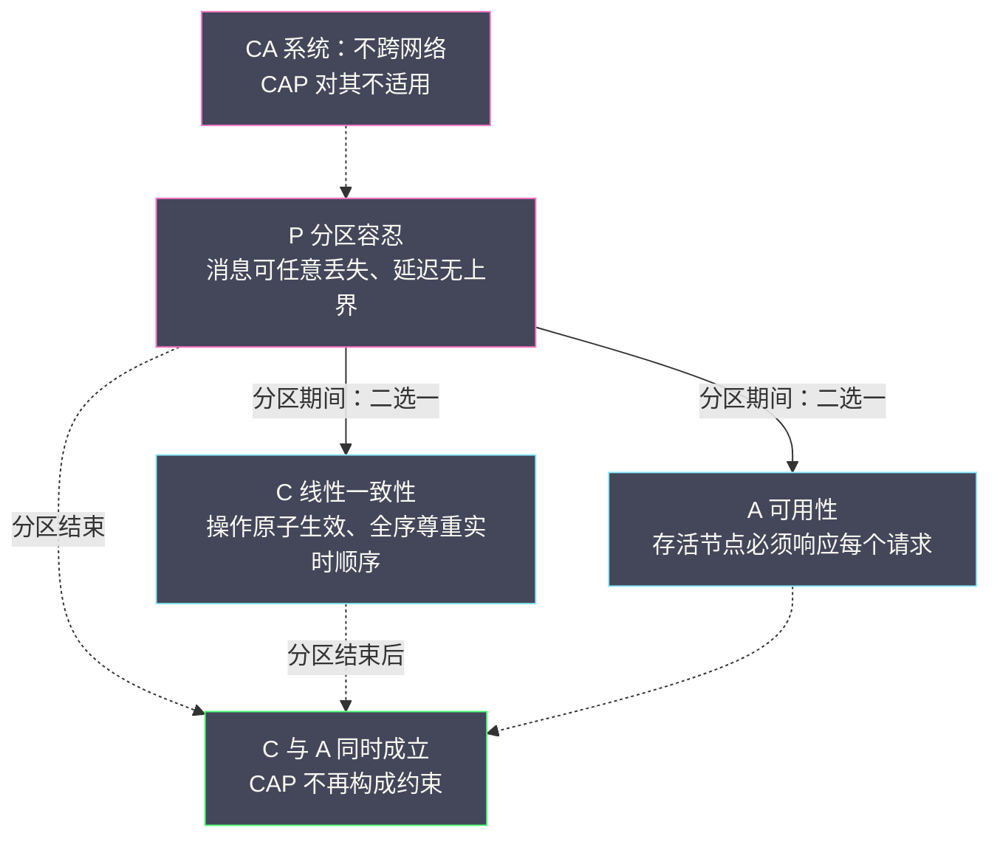
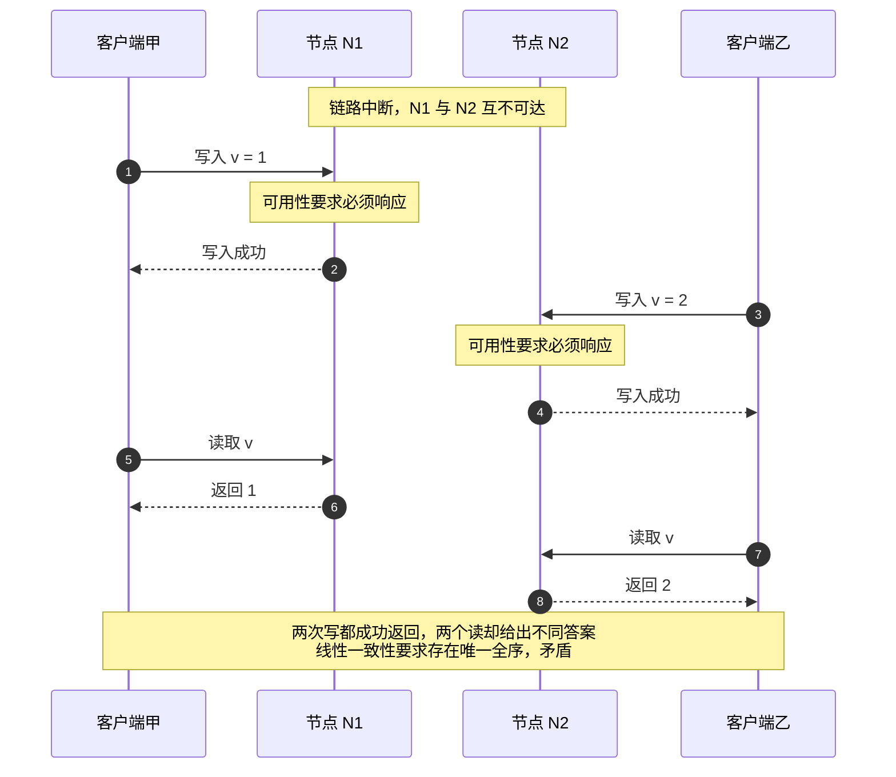
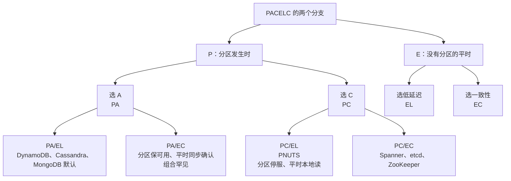

# 02 CAP 定理深度解析

**摘要：**

2000 年，Eric Brewer 在 ACM PODC 的主题演讲里抛出一句话：一致性、可用性、分区容忍性，三者最多取二。两年之后，MIT 的 Seth Gilbert 与 Nancy Lynch 把它写成定理；十二年之后，Brewer 又写了一篇文章，说三选二这个说法把事情讲坏了。一段理论在传播中被反复削平、又被原作者亲手掰回来的历史，几乎浓缩了分布式系统的方法论：每个结论都挂着一串隐含前提，前提丢了，结论就成了口号。

本文按五个问题推进。第一问回到原始文献，看 CAP 究竟在什么模型下被提出与证明，为什么一句工程直觉要被改写成一份带定义的不可能性证明。第二问把三个字母拆到可操作的程度：C 是线性一致性而不是副本相同，A 是逐请求的响应而不是时间维度的可用率，P 不是选项而是前提，并且有粒度。第三问补上反事实，看误用 CAP 会导出哪些具体的错误架构决策。第四问给出证明的最小反例——两个节点、两侧各写一次——再沿分区恢复的路径走到数据分叉与冲突解决。第五问用 PACELC 与异常清单替代 CP/AP 标签，把定理变成能落地的画像，最后收在三类常见误解的边界上。

读完应当能回答两个问题：CAP 到底说了什么、又没有说什么，以及为什么今天讨论一致性时，PACELC 的 E 分支比 CAP 的 P 分支更值得花时间。

---

## 第 1 章 一份猜想、一份证明、一次纠偏

### 1.1 2000 年那场主题演讲

2000 年的 ACM PODC（Principles of Distributed Computing）会议上，时任加州大学伯克利分校教授、同时是 Inktomi 联合创始人的 Eric Brewer 做了题为《Towards Robust Distributed Systems》的主题演讲。Inktomi 当时为几家门户网站提供搜索后端，那是一个典型的跨广域网、读多写少、对延迟极其敏感的负载，Brewer 在构建它的过程中反复撞上同一类困境：当机房之间的链路出问题，服务要么给出一个可能过期的答案，要么挂起等待，没有第三条路。

演讲里的论断被后世压缩成一句话：一致性、可用性、分区容忍性，最多同时满足两个。压缩过程丢掉的东西比留下的多。在 Brewer 的原意里，P 并不是与 C、A 并列的第三个抽屉，而是系统一旦跨网络就已经落入的前提条件；他真正想说的是，在这个前提下，当分区把集群切成互不可见的两半，一致性与可用性之间必须做一次取舍。这句话在 2000 年还只是一份工程直觉，Brewer 见过太多团队在分区发生时被迫在两个坏答案里挑一个，他相信这不是实现水平的问题，而是结构性的约束。

直觉要变成定理，还缺两样东西：三个性质的精确数学定义，以及一个不可能性证明。前者决定这句话能不能被检验，后者决定它是不是普遍成立。

### 1.2 2002 年：从猜想到定理

2002 年，MIT 的 Seth Gilbert 与 Nancy Lynch 在《ACM SIGACT News》上发表《Brewer's Conjecture and the Feasibility of Consistent, Available, Partition-Tolerant Web Services》，做了两件事。第一件，把三个性质钉死在定义上：一致性取原子一致性（Atomic Consistency），也就是线性一致性；可用性要求每个非故障节点对每个收到的请求都返回响应；分区容忍性要求系统在消息被任意丢失的情况下仍然满足它的保证。第二件，在异步网络模型里证明这三者不可兼得。

模型的选择值得多说一句。所谓异步，是指消息的传递延迟没有上界、节点没有共享的物理时钟、任何超时都不足以判定对端已经失效。这是分布式理论里最保守的模型，也是最贴合广域网现实的模型：你无法从"消息还没到"推断出"对端已经死了"，因为消息也可能只是走得慢。CAP 的证明就建在这个模型上，它允许对手在任意时刻丢弃任意多条消息，而算法必须在这种执行下依然满足承诺。

证明的结论常被转述为"三选二"，但论文真正的贡献不是这句口号，而是让"一致"与"可用"这两个词第一次有了可检验的含义。此后二十年里所有关于 CAP 的争论，只要回到这三条定义，多半能立刻判断出争论双方说的不是同一件事：一方在说线性一致性，另一方在说副本收敛；一方在说每个请求都要响应，另一方在说年度可用率。

### 1.3 2012 年：作者本人回来纠偏

2012 年，Brewer 在《IEEE Computer》上发表《CAP Twelve Years Later: How the "Rules" Have Changed》，承认三选二的表述有毛病。他给了三层理由。第一层，分区是罕见事件，把罕见事件当成选型的第一原则，会让架构师在绝大部分时间里为一个几乎不出现的问题付出代价，而真正的日常成本是延迟。第二层，C 与 A 的选择不是系统级的，而是操作级的：同一个系统可以为不同的数据、不同的请求选不同的边，他在文中称之为分区期间的精细管理。第三层，选择不是一次性的：分区开始时可以限制部分操作，分区结束后再做补偿，取舍可以随分区的进展而调整。

同一期杂志上，Daniel Abadi 发表《Consistency Tradeoffs in Modern Distributed Database System Design: CAP is Only Part of the Story》，提出 PACELC：分区发生时在可用性与一致性之间选，没有分区的平时在延迟与一致性之间选。Abadi 的观察是，很多系统在分区时的选择相同，平时的选择却相反，CAP 无法把这两类系统区分开；而平时那段占了系统生命周期里的绝大部分时间。更早的 2010 年，他在一篇讨论 CAP 分类缺陷的文章里已经点到了这个缺口，两年后在期刊上把它整理成了模型。

把两篇文章放在一起读，会发现它们纠正的是同一件事：CAP 描述的是一个条件性的、罕见的、以"最坏时刻"为对象的三元约束，而工程决策发生在常态里。用 CAP 指导常态设计，就像用消防预案安排日常作息。

### 1.4 一条认识演进的时间线

把与 CAP 有关的关键节点排成一条线，可以看到一个理论从精确到简化、再从简化被拉回精确的完整轨迹。


这条线里有一个反复出现的模式：精确的定义留在论文里，简化的口号在传播中扩散，纠偏发生在十年之后，而纠偏的传播速度永远追不上口号。笔者不认为这是智识上的懒惰，更像是工程共同体的一种信息压缩——一个要在会议上三秒内讲完的判断，必然被削成一个短句，而短句一旦流传，就不再携带前提。Dynamo 在 2007 年给出了 AP 路线的可抄样本，Spanner 在 2012 年用带误差上界的物理时钟把 C 买了回来，两者都在说明同一件事：所谓选择，最终要用工程手段付账。

### 1.5 云让分区从极端事件变成日常状态

传统经验说分区很罕见，那是基于自建物理机房的经验：一台机器要么在，要么不在；一条链路要么通，要么断。云环境改写了这份经验，新的分区来源至少有三类。

第一类是虚拟化与调度动作。热迁移、宿主机维护、容器驱逐都会在迁移窗口里造成短时不可达，而编排系统的心跳超时会把一次几十秒的网络抖动放大成一次"节点失联"——kubelet 与 apiserver 之间的心跳中断几十秒，控制器就认为那台节点上的 Pod 需要重建，于是同一份工作负载在旧节点上还活着、在新节点上已经起来了。这不是教科书里两个机房被切成两半的分区，但它满足 CAP 的形式条件：两侧各自看到的世界不同，而消息传不过去。

第二类是跨可用区的链路。跨 AZ 的流量要经过更多的网络设备与更多的策略点，任何一段出问题都会造成局部不可达，这也是共识集群通常要求成员均匀铺在三个故障域、而不把五个成员堆在同一个机柜里的原因。

第三类是网络策略本身。安全组、网络 ACL、路由表、服务网格的 sidecar 规则，任何一次变更都可能造出一对方向不对称的邻居：A 能连 B，B 连不上 A。这类人为分区在大型组织里几乎无法避免，它的特点是持续时间短、定位困难、事后在监控上只留下一个尖峰。

这三类来源加在一起，把分区从"理论上必须容忍的极端事件"变成了"运维里需要定期面对的状态"。但要注意，它们的持续时间依然远小于正常时间：一个一年发生几次、每次几十秒的事件，占全年时间的比例小到可以忽略。这恰好划出了 CAP 与 PACELC 的分工边界——CAP 管最坏的那几十秒，PACELC 管剩下的全部时间。

---

## 第 2 章 三个字母的可操作定义

### 2.1 第一种 C：ACID 里的那个 C

讨论 CAP 之前，得先把"一致性"这个词身上背的几层意思分开，否则后面每一句都会踩到歧义。第一层来自 ACID。事务的 C 指数据库从一个满足完整性约束的状态，转移到另一个满足约束的状态：主键唯一、外键有效、余额非负，这些约束在事务边界上不能被破坏。

这一层 C 有一个常被忽略的性质：它不是数据库单方面能提供的。外键、唯一索引、CHECK 约束可以替应用挡住一部分违例，但"转账前后总额不变""库存不能被卖成负数"这类业务不变量，最终靠应用代码维护，数据库只能提供隔离与原子性来帮你。因此 ACID 的 C 更接近"应用与数据库的共同承诺"，把它与 CAP 的 C 摆在一起比较强弱，等于把一个业务责任当成一个系统性质。

### 2.2 第二种 C：线性一致性

CAP 的 C 是原子一致性，Gilbert 与 Lynch 明确说它与线性一致性（Linearizability）等价，后者由 Maurice Herlihy 与 Jeannette Wing 在 1990 年的论文里提出。它的定义可以拆成三条：每个操作在调用与返回之间的某个瞬间原子地生效；所有操作存在一个全序；这个全序尊重实时顺序，即如果操作 A 在操作 B 开始之前就已经返回，那么在全序里 A 必须排在 B 之前。读操作返回的是它在这个全序中前一个写操作写入的值。

把定义落到一次具体的读写上，会更容易看清它约束了什么。下面的例子只有两个节点，却已经足够说明问题。

```
初始状态：变量 x = 0，副本 N1 与 N2 都保存 x

T1  客户端甲向 N1 写入 x = 1
T2  N1 返回写入成功
T3  客户端乙向 N2 读取 x（发起时刻晚于 T2）

线性一致性要求：乙必须读到 1
  理由：写操作已在 T2 完成，任何在 T2 之后发起的读，
        在全序里都排在这次写之后，只能看到新值

若乙读到 0，则系统不满足线性一致性
```

这个定义最值得记住的性质是可组合：如果系统里每个对象都是线性一致的，那么由这些对象组成的整体也是线性一致的。Herlihy 与 Wing 把这条性质称为局部性（locality），它意味着线性一致性可以逐对象验证、可以像积木一样拼接。反过来，最终一致性不具备这条性质：两个各自最终一致的对象组合起来，客户端可能看到一个对象已更新、另一个尚未更新的中间态，而这个中间态在任何单一副本上都不存在。

CAP 之所以选线性一致性作为 C，技术理由正在这里。定理需要一个可组合、与实现无关、能写成数学对象的性质，否则"不一致"这个词根本没法参与证明；而"所有副本数据相同"这种说法既不可组合，也无法在异步模型里判定。

### 2.3 第三种 C：一致性模型谱系里的 C

第三层意思来自一致性模型的谱系。线性一致性之下还有顺序一致性（Sequential Consistency，要求每个进程内部的顺序被尊重，但不要求尊重跨进程的实时顺序）、因果一致性（只保证有因果关系的操作被所有节点以相同顺序看到）、以及一组面向会话的保证（读己之写、单调读、单调写），最弱的一端是最终一致性：只要不再有新写入，所有副本最终会收敛到同一个值。

这些性质彼此不是一条直线上的强弱刻度。因果一致与顺序一致互不包含，前者管因果，后者管单进程顺序；会话保证是客户端视角的补丁，不是全局性质。把这套谱系摊开对照，是判断一个系统"到底给了什么"的唯一可靠办法，[[09 分布式系统的一致性模型谱系]] 里有完整的定义与反例。

> [!warning] 一致性是一个被严重过载的词
> 至少有四种东西共用这个词：ACID 的 C 是应用不变量，CAP 的 C 是线性一致性，一致性模型谱系里的 C 是一族强弱不同的保证，副本收敛则是"最终相同"这个最弱承诺。它们说的不是同一件事，却写成同一个词。看到"一致性"三个字，第一件事应当是问：这里说的是哪一种。这个澄清动作能消掉绝大多数无谓争论，因为争论双方往往各说各的一种，却以为在争同一个问题。

### 2.4 A：逐请求的响应，不是可用率

Gilbert 与 Lynch 对可用性的定义是：每个收到请求的非故障节点，都必须返回一个响应。这短短一句里有三个限定，每一个都被日常讨论丢掉了。

其一，主语是节点而不是系统。可用性约束的是每个还活着的成员的行为，不是整个集群的聚合指标；一个集群整体上"还能服务"并不等于每个节点都满足 A。其二，量词是每个请求，不是绝大多数请求。论文的脚注里交代了这个取舍：Brewer 最初只要求几乎所有请求得到响应，但允许概率化的可用性并不会改变不可能性结论，于是为了简化，他们直接要求百分之百。其三，前提是节点没有故障。节点崩溃导致的沉默不计入违反 A，分区导致的沉默才算。

把这三条摆在一起，就能看出 CAP 的 A 与 SLA 里那个 99.99% 的差别有多大。前者是逐请求的、与分区事件绑定的定性约束；后者是时间维度的统计量，把"响应慢""响应错""根本没响应"混进了同一个百分比。一个系统可以全年可用率 99.99%（全年停机五十来分钟）却在每次分区时让少数派节点无限期挂起，它在 SLA 报表上很好看，在 CAP 的意义上却不满足 A；反过来，一个系统也可以全年可用率只有 99.9%，却在分区期间让少数派快速返回错误，从字面上看它响应了每个请求。两个指标衡量的不是同一件事，用后者论证前者，是讨论 CAP 时最常见的偷换。

关于"返回错误算不算响应"，还有一处长期含糊的地方。论文的措辞只要求"得到响应"，没有明说响应必须是正确的或成功的；若按字面读，快速失败也满足 A，CP 与 AP 的分野就落在"是否返回正确的数据"而不是"是否响应"上。工程界与后来的多数分析者习惯把错误响应视为不可用，Brewer 在 2012 年的文章里也更接近后一种读法。讨论时把这层歧义挑明，比争论某个数据库到底是 AP 还是 CP 更有价值。

### 2.5 P：不是选项，是前提，而且有粒度

分区容忍性的定义是：网络可以任意地丢失节点之间的消息，等价地说，消息延迟没有上界。P 之所以不能像前两个字母那样被"选择放弃"，理由不是"工程上无法彻底消除"这么一句经验之谈，而是一条更彻底的结构性事实：分布式系统的定义本身就包含了跨网络通信，而跨网络通信的失败是不可拒绝的。你可以选择在分区时停服，那是选 C；可以选择在分区时继续服务，那是选 A；但你无法选择让分区不发生。

所谓 CA 系统，要么根本没跨网络（单机、单进程、共享内存），要么在分区到来时行为未定义。而"未定义"在工程上不是中性状态，它意味着最坏情况：调用方不知道会发生什么，重试可能造成重复写入，监控上只看到一堆超时。任何对外承诺 SLA 的系统都不可能接受这个状态，所以 P 不是可选项，它是入场券。

P 还有粒度问题，这一点比"P 不可选"更少被提及。在形式化模型里，分区是"消息可以丢失"的整体假设；在现实中，分区发生在具体的通信路径上：客户端与集群之间、两个副本之间、两个机房之间。同一时刻，可能 A、B 两个数据中心之间链路正常，而 C 与两者都不通；也可能某个客户端到所有节点的路径都不通，而节点之间彼此健康。因此 CAP 的选择实际上是逐对象、逐操作的：Kubernetes 的控制面可以在 etcd 上选 CP，同一个集群里的日志采集可以在另一套存储上选 AP。任何"我们公司选 CP 还是 AP"的说法，都把粒度放错了一整层。

顺带说清一个高频混淆：客户端与集群之间的分区，和副本之间的分区，在形式化模型里都被归约为消息丢失，但工程上的处理完全不同。前者靠入口冗余、重试与超时预算；后者靠多数派与冲突解决。把两者混为一谈，就会得出"我们上了三个可用区，所以不怕客户端连不上"这类错位判断——三个可用区解决的是副本之间的分区，客户端到集群的那条路径是另一回事。

### 2.6 三角的精确画法

下面这张图画的是三个字母之间真正的关系：P 在底部，是前提；分区期间 C 与 A 二选一；分区结束后两者可以同时成立。所谓"三角"，是教学上的简化，真实结构是一条"条件—选择"的分支。



图里有三处值得停留：P 是唯一的入口，没有从 C 或 A 指向 P 的边；C 与 A 之间没有直接连线，它们的关系由"分区期间"这个条件中介；分区结束后，两个箭头汇聚到一个节点，说明约束本身退场了。

### 2.7 "CA 系统"为什么不存在

> [!info] 重新理解那句"MySQL 是 CA 系统"
> 说这句话的人，心里想的通常是单机 MySQL：一台机器、一个进程、一次事务，不跨网络，CAP 对它根本不适用，说它"满足 C 和 A"在单机语境里是对的，但"CA"这个类别在分布式语境里没有对应物。
>
> 一旦 MySQL 被部署成主从集群，网络分区就成为可能，CAP 立刻适用。此时它的默认行为（异步复制、从库可读）在分区期间会把读请求导向可能陈旧的副本，写请求则在主库不可达时彻底停摆——它既不满足 CAP 的 C，也不满足 CAP 的 A，却被归入 CA 这一类。贴标签的人没有算错数学，只是把"单机不适用"误当成了"满足两者"。

更准确的描述是画像而不是标签：单机 MySQL 提供的是线性一致的本地事务；异步主从集群提供的是"有界陈旧"的读，陈旧窗口由复制延迟决定；在分区期间，它的可用性取决于客户端连的是主库还是从库，写路径事实上不可用，读路径事实上是 AP 的。同一个产品在不同拓扑下有三套行为，一句"CA"把这些全部抹平了。

### 2.8 从贴标签转向提问题

CAP 常被当成排除工具使用：某系统是 AP 的，所以它不适合金融场景。这个推论的前提（它是 AP 的）可能是对的，结论却下得太快。

以 Cassandra 为例，它确实在分区时优先保可用，但这不足以支持"不适合金融"这个判断。第一，它提供可调一致性（Consistency Level），`QUORUM` 读写在某些配置下确实能保证读到已确认的写。第二，CAP 描述的是分区时的行为，而分区是罕见事件，不能因为"分区时它选 A"就否定它在常态下的价值。第三，也是最关键的一条，金融场景的具体需求是什么——是"绝对不能读到旧余额"，还是"允许最终一致但必须有对账"？这两个答案对应完全不同的结论，而 CAP 一个字都没有回答。

这里还要补一个技术细节，它经常被"QUORUM 就等于强一致"的说法盖过去：Cassandra 的冲突解决是最后写入者胜（Last Write Wins），依赖各节点本地时间戳；两台客户端并发写同一个 key 时，系统无法给出"哪一次先发生"的客观答案，因此即使读写都取多数派，它也不满足线性一致性。多数派保证的是读集合与写集合有交集，交集能保证你读到"某个已确认的写"，但保证不了这个写就是全序里的最后一个。把这句话记住，就能理解为什么"可调一致性"是一个关于新鲜的旋钮，而不是一台能调出线性一致性的机器。

因此，CAP 的正确用法不是拿它排除系统，而是拿它提出更精确的问题：这个系统在分区时如何处理这类数据，它的读是什么级别，写路径与读路径是否对称，业务能容忍哪些异常。把这几个问题问清楚，比在选型会上给产品贴一个 CP 或 AP 的标签有用得多。

---

## 第 3 章 最小反例：两个节点，两次写

### 3.1 反证法的骨架

Gilbert 与 Lynch 的证明是反证：假设存在一个算法同时满足一致性、可用性与分区容忍性，然后构造一个合法的执行，在这个执行里导出矛盾。所谓合法，指节点严格按算法运行、消息按网络模型被丢弃，没有任何一步是"算法写错了"；所谓矛盾，指结论直接违反三条定义中的某一条，而不是"效果不理想"。

这类证明有一个共同特征：只需要一个执行就够。不可能性证明不需要论证"所有情况下都不行"，它只需要说明存在一种情况，任何算法都应付不了。CAP 的证明挑中的情况是"分区恰好把写与读放在两侧"，这是最省力的构造，也是最难反驳的构造，因为它不依赖具体的算法细节。

### 3.2 两个节点的推演

把常见版本加强一步，不再只写一次、读一次，而是让两侧各写一次。这个构造能把矛盾从"读到了旧值"提升到"不存在自洽的历史"。

```
初始状态：变量 v = 0，两个节点 N1、N2 各持一份副本
网络状态：N1 与 N2 之间链路中断，消息全部丢弃

第一步  客户端甲向 N1 写 v = 1
        可用性要求 N1 必须响应，N1 本地写入并返回成功
第二步  客户端乙向 N2 写 v = 2
        可用性要求 N2 必须响应，N2 本地写入并返回成功
第三步  客户端甲向 N1 读 v，得到 1
        客户端乙向 N2 读 v，得到 2

矛盾：线性一致性要求所有操作存在一个尊重实时顺序的全序。
  若"写 1"排在"写 2"之前，则乙的读发生在写 2 之后，
    按全序必须返回 2，而 N1 返回的 1 违反定义；
  若"写 2"排在"写 1"之前，对称地，甲的读违反定义。
  两种排序都被排除，全序不存在
```

结论很清楚：只要两侧都坚持满足可用性，两个成功返回的写就无法被排进同一个历史。这不是"数据暂时不一致"这种可修复的问题，而是"系统对外承诺的语义已经崩了"。加强版反例之所以更有说服力，是因为它同时堵住了"读的时候再查一次""让客户端重试"这类补救——重试只会让两侧的写入更多，矛盾更明显。

### 3.3 互换写的时序

把上面的执行画成时序图，可以看清矛盾的来源不在任何单个节点的计算，而在两个节点各自掌握的历史都合法、却互相不兼容。



读这张图要注意三处：两个写都拿到了成功回执，所以它们都必须进入历史；两次读分别落在两侧，各自只能看到本地历史，它们都没有"作弊"；矛盾的根源是两份历史无法合并成一个尊重实时顺序的全序，而不是某个节点算错了。这就是 CAP 想说的全部内容——它甚至不需要讨论数据最终会怎样，因为在分区结束之前，系统已经给出了两个互相矛盾的承诺。

### 3.4 证明用的是消息丢失，不是节点崩溃

证明中"分区"的准确含义是消息可以被丢弃，而两个节点始终存活、始终在正常处理本地请求。这个区别直接决定工程上该修什么。

如果困境来自节点崩溃，那么修法很清楚：更好的硬件、更完善的健康检查、更快的故障转移。但困境来自通信被切断，而链路上的失败无法通过把节点做得更可靠来消除——两台完全健康的机器，只要中间的光纤断了，它们就无法把各自的状态告诉对方。这也解释了为什么"提高硬件可靠性"对 CAP 没有帮助：CAP 描述的是通信层面的权衡，不是可靠性层面的权衡。有效的修法是引入多数派、引入"我是否还能代表集群"的自我判断、引入快速失败，让系统在通信断裂时做出明确的选择，而不是指望链路不出问题。

### 3.5 两个节点为什么已经足够

有人会想：如果集群更大，比如五个节点，是不是可以让多数派继续服务，从而同时保证 C 和 A？答案是不能，而这个不能恰好可以在两节点反例里看全。

不可能性证明的特征是：一个最小的合法执行就足以推翻"存在这样的算法"。五个节点只会增加切法——可能是 2 个和 3 个，也可能是 1 个和 4 个，一百个节点则可能是 49 和 51——但每一种切法里都有一侧无法确认自己是不是多数派。多数派规则做的事情是保证"至多一侧能提交"，因此另一侧必须停写或停服，这仍然是 C 与 A 的取舍，而不是绕过它。用更多的节点，买到的是"哪一侧能继续服务"的确定性，买不到"两侧都能继续服务同时保持一致"。

理解了这一点，就不会再幻想"通过增加节点数来绕过 CAP"。节点数解决的是容错与仲裁，不解决信息无法穿越断链这件事。

### 3.6 多数派买到了什么，又买不到什么

多数派是分布式系统里最基础的数学工具，值得把它的能力边界说清楚。下表是三、五、七节点的算术，它决定的是容错能力，不是一致性强度。

| 节点数 | 多数派门槛 | 可容忍故障 | 分区后的局面 |
| :--- | :--- | :--- | :--- |
| 3 | 2 | 1 | 至多一侧能提交，另一侧停写 |
| 5 | 3 | 2 | 同上，且多数派需要更多回应 |
| 7 | 4 | 3 | 同上，延迟与运维成本继续上升 |

多数派买到的第一样东西是唯一历史：任意两个多数派必然相交，交集中的节点在同一任期里只会给一个候选人投票，因此已提交的写入不会出现两条互相矛盾的版本。买到的第二样东西是"少数派知道自己不是多数派"，于是可以体面地停服，而不是继续接受写入制造分叉。它买不到的是少数派侧在分区期间的可用性——那一侧有数据、有 CPU、有网络，就是不能服务，因为它无法确认自己的历史是不是最新的。

这里还要把两个常被混用的条件分开：多数派提交（quorum commit）与读写交集（`R + W > N`）不是一回事。前者保证写入在返回前已被足够多的节点持久化，后者保证一次读至少碰到一个持有最新已确认写的节点。两者都不足以推出线性一致性，因为它们只管"读到某个已确认的写"，不管"哪一次写是最后发生的"。冲突解决策略（譬如时间戳、版本向量）才决定后者，而一旦冲突解决退化成"本地时钟更大者胜"，线性一致性就丢掉了。

---

## 第 4 章 分区期间与分区之后

### 4.1 CP 的实际形态

CP 系统在分区期间的行为可以一句话概括：多数派侧继续服务，少数派侧停止服务或降级。以五节点集群被切成 3 与 2 为例，两边的表现完全不同。

```
多数派侧：N1、N2、N3
  写请求：凑够多数派，可以提交
  线性一致读：可以服务，读到的都是已提交的最新值
少数派侧：N4、N5
  写请求：立即失败，返回无 Leader 一类错误
  线性一致读：不能服务，因为无法确认自己是不是多数派
  串行化读：可以服务，但可能读到本节点已应用的旧状态
分区恢复后：少数派追平日志，重新加入服务
```

这里要纠正一个流传很广的误解：CP 不等于"分区时整个系统不可用"。以五节点为例，只要还能凑出三个节点，集群就能正常提交与读取，同时容忍任意两台故障；只有在失去多数派时，整个集群才停止写服务。CP 牺牲的是"分区期间少数派那一侧的可用性"，换来的是"所有响应都不是旧值"。这两个代价的量级完全不同，前者的影响面是少数派节点上的客户端，后者影响的是数据的正确性。

代表系统里，etcd 用 Raft 做多数派提交，默认读走 ReadIndex，保证线性一致；ZooKeeper 用 ZAB，少数派节点直接不服务；HBase 依赖 ZooKeeper 做协调，RegionServer 与 ZooKeeper 失联就自行关闭。ZooKeeper 还有一个读写不对称的细节值得单说：写路径是线性一致的，读路径默认可以落在 Follower 上，读到可能陈旧的值，需要先 `sync()` 才能把读提升到最新。因此严格说它是"写 CP、读未必"，笼统称它 CP 会掩盖这一点。

Spanner 是另一个值得单说的例子。它用 TrueTime 给出的时间不确定区间，在提交事务时等待这个区间过去（commit-wait），从而把"时间戳顺序"变成"真实顺序"，对外提供外部一致性。这笔等待是它为一性付的固定税，成本落在每一次跨区写上；在分区发生、失去多数派时，它同样停写。它证明的不是 CAP 可以被绕过，而是 CAP 的那笔账可以用带误差上界的物理时钟分期支付——而分期的利息，就是每次提交多等的那一小段时间。

### 4.2 AP 的实际形态

AP 系统在分区期间的行为相反：两侧都继续接受读写，各自以本地状态响应，恢复后再合并。

```
四节点集群被切成两组：组 A 为 N1、N2，组 B 为 N3、N4
组 A：接受写与读，以组 A 的本地状态响应
组 B：接受写与读，以组 B 的本地状态响应
分区恢复后：合并两侧历史，解决冲突
```

Dynamo 在 2007 年的 SOSP 论文里把这条路走到了极致，两个设计值得记住。第一个是 sloppy quorum：当某个键的归属节点不可达时，写入可以暂时寄存在其他节点上，由后者在恢复后转交（hinted handoff）。这让"可用"的定义超出了"副本都可达"——即使一份数据的法定副本有一半不可达，写仍然能成功。第二个是向量时钟：每个值带上版本向量，用来判断两个版本是因果关系还是并发关系；并发版本不会被自动覆盖，而是全部返回给客户端，由应用决定保留哪个。这套设计的取舍很清楚：把冲突判断从存储层推给应用层，换取任何时刻都能接受写入。

Cassandra 继承了这条路线，再加上 read repair 与可调一致性；DNS 是一个日常可见的 AP 例子，更新需要时间传播，全球解析器在短时间内可能给出不同答案，但它几乎从不拒绝解析请求。对这几个系统来说，不一致不是故障，而是设计里被明确定价的一部分——代价被转移给了读方与业务方。

### 4.3 决策框架

把两类系统的行为并排放进一张表，决策维度就清楚了。下表在原稿基础上补了「可调项」一列，因为现实中的系统很少纯粹属于某一类。

| 维度 | CP 系统 | AP 系统 | 可调项 |
| :--- | :--- | :--- | :--- |
| 分区时的行为 | 少数派停服，不返回旧数据 | 两侧继续服务，可能返回旧值 | 多数派门槛、读一致性级别 |
| 一致性强度 | 写路径线性一致 | 最终一致 | 读来源：主、多数派、任意副本 |
| 可用性 | 分区期间少数派不可用 | 始终可响应 | 超时与降级策略 |
| 冲突处理 | 不允许冲突，顺序化操作 | 需要检测与合并 | 冲突解决策略 |
| 典型场景 | 分布式锁、配置中心、选主 | 购物车、会话、Feed、DNS | 按数据与操作分级 |
| 代表系统 | etcd、ZooKeeper、HBase | Cassandra、DynamoDB、Dynamo | — |

决策的核心问题不是选 CP 还是 AP，而是"如果返回了旧数据或冲突数据，最坏的情况是什么"。最坏情况不可接受——余额、库存精确数、锁状态——就往 C 这一侧偏；最坏情况可以接受、且有界面提示或后台同步兜底——购物车、用户偏好、点赞数——就往 A 这一侧偏。这个问法把技术选择翻译成业务选择，而后者才是决策的真正依据。

### 4.4 分区恢复：数据分叉的四条路

AP 的选择在分区期间很轻松，账单在恢复时才到。既然两侧都接受了写入，就必然存在两份可能冲突的历史，恢复期的任务是把它们变成一份。

第一条路是最后写入者胜（Last Write Wins）。实现最简单：每个值带一个时间戳，合并时取最大者。代价藏在时间戳里——物理时钟会漂移，NTP 会跳变，一台机器的时钟快了几秒，它写下的值就会永远压过别人，更糟的是这个"未来值"会让后续的正常写入在比较中落败。这条路只适合幂等覆盖型数据，譬如配置项、状态快照；用在计数器或余额上，等于随机丢弃一部分写入。

第二条路是版本向量。每个值带一个向量，记录各节点各自写到了第几版，合并时能判断两个版本是因果还是并发：有因果关系就取后者，并发就都保留。版本向量解决的是检测，不是决策——它能告诉你存在冲突，不能替你决定保留谁。Dynamo 的做法是把并发版本一起返回，让应用层合并，这就是 sibling 机制。

第三条路是 CRDT（Conflict-free Replicated Data Type，无冲突复制数据类型）。把数据结构本身设计成可交换、可结合、幂等的，合并顺序就无关紧要，任意顺序合并都收敛到同一结果：计数器拆成每个节点一份的增量，集合用带唯一标签的增删，寄存器用带时间戳的覆盖。代价是数据模型被限制住——不是所有业务语义都能表达成 CRDT，元数据也会随节点数增长。

第四条路是人工对账。余额、库存这类数据没有"两个都对"的合并方式，只能标记冲突、交由业务按规则处理，或走对账流程修正。这条路成本最高，却常常是唯一正确的选择；金融系统偏爱 CP 的根子就在这里，不是它们更保守，而是它们的数据语义不支持自动合并。

四条路有一个共同前提：分叉必须是可检测的。系统得知道"这两个版本是并发的"，而这需要版本向量、变更日志或至少一个单调的序号。如果系统既选了 AP、又没有冲突检测机制，恢复后的分叉就会静默存在——两侧都认为自己是对的，谁也不会报错，直到某天有人发现一笔数据对不上。这比分区期间读到旧值严重得多，因为后者至少是可见的。

### 4.5 两次真实的分区事故

真实事故能说明理论里的每一步在工程上对应什么。2018 年 10 月 21 日，GitHub 在做例行维护，更换故障的 100G 光纤设备，过程中东海岸网络中心与东海岸数据中心之间的连接断开。连接在 43 秒后恢复，但这 43 秒触发了一连串事件，最终导致 24 小时 11 分钟的服务降级。

复盘里有三点值得记住。第一，分区只持续了 43 秒，代价却付了一整天。真正昂贵的不是分区期间，而是分区之后的决策：自动故障转移把写流量指向了西海岸的新主，而东海岸的库里有一段尚未复制过去的写入；连接恢复后，两侧都有对方没有的数据，任何一边都无法安全地成为唯一主，最后只能从备份恢复、重建复制拓扑，再把积压的写请求放回去。第二，故障转移机制本身没有做错——Orchestrator 用 Raft 在多数派一侧选出新主，符合共识规则；错的是复制延迟让新主先天缺一段历史，而应用无法在两侧拓扑之间安全迁移。多数派保证的是唯一历史，不是"新主拥有全部历史"。第三，恢复流程的复杂度被严重低估：切回、重建、重放，每一步都要在"继续服务"与"保证一致"之间再选一次，而每一次选择都可能把降级时间拉长。

另一类证据来自 Jepsen 在 2013 年到 2015 年间对多个数据库做的分区测试。这些测试反复发现同一类现象：在没有多数派写关注的情况下，分区两侧各自确认写入，恢复后一侧的写入被静默丢弃；有些系统还会在分区期间返回比已确认写更旧的版本。结论的价值不在于"某某数据库不可靠"，而在于它把 CAP 的抽象断言落成了可复现的失败模式。根因往往不是选了 AP——选 AP 是合法决策——而是选了 AP 却没有配套的冲突检测与收敛机制。能力与承诺不匹配，比选择本身更危险。

### 4.6 不检测分区，改用可达性规则

工程上有一个诱人的想法：先检测出分区，再决定进入哪种模式。这个想法会立刻卡在实现上，因为"是否分区"没有可靠判据。心跳超时可能因为分区，也可能因为垃圾回收停顿、网络拥塞、对端过载；跨区往返时间的突增可能因为链路，也可能因为对端排队；应用层探活失败可能是进程问题，也可能是中间设备丢包。把超时阈值调小，误判变多；调大，故障发现变慢。任何基于超时的检测都是在误报与漏报之间挪动阈值，而不是在真假之间做判断。

更稳的做法是绕开"判断是否分区"，直接定义"在什么条件下允许服务"。多数派可达就服务，否则停服或降级——这条规则不引用"分区"这个概念，只引用可观测的事实：我现在能联系上几个成员。无论链路是断了还是慢了，无论对手是网络还是垃圾回收，行为都是可预期的。Raft 的选举与提交、etcd 的 checkQuorum、ZooKeeper 的多数派规则，本质上都是这条思路的实例。

进入受限模式后，通常做三件事。限制操作，譬如拒绝写入、只允许读、只允许特定命名空间的写。降级，譬如返回缓存值、进入只读模式、把写请求排队。记录待补偿，把被拒绝或被降级的操作记下来，恢复后重放或对账。第三件事最容易被忽略，而它恰恰决定恢复期是"自动愈合"还是"人工排查"：分区期间被拒绝的写如果只留在客户端日志里，恢复后没人知道该补什么；如果服务端把它们记成待办，恢复流程就能自动化。把这三件事写进应急预案，比在监控面板上争论"现在算不算分区"要有用得多。

---

## 第 5 章 PACELC：把罕见事件与日常开销放进同一张表

### 5.1 CAP 没有写进去的那一维

CAP 的模型里没有"时间"这个量。异步模型让延迟失去意义——既然消息延迟没有上界，讨论"多等 20 毫秒"就没有理论基础。这个抽象对证明有利，对工程不利，因为现实中的一致性成本绝大多数以延迟的形式支付：多等一次跨区往返、多等一次 fsync、多等一次多数派确认，账单都记在延迟上。

于是出现一个错位：CAP 把注意力引向一年几次的分区，工程师却每天都在为"要不要等副本"做决定。PACELC 补的正是这一维。

### 5.2 PACELC 的读法

PACELC 是六个字母的缩写：如果有分区（Partition），在可用性（A）与一致性（C）之间选；否则（Else），在延迟（Latency）与一致性（C）之间选。写成伪代码只有四行。

```
if partition:
    choose(Availability, Consistency)   # CAP 的旧战场
else:
    choose(Latency, Consistency)        # 日常的真正战场
```

把两个分支展开，得到四个格子。下面的图把这四个格子与对应的系统放在一起，可以看到同一批产品在同一张图上的分布并不集中。



四格里最反直觉的是 PC/EL：分区时选 C（宁可停服保一致），平时却选 L（本地读省延迟）。它听起来自相矛盾——既然平时肯为一致性停服，为什么平时不肯等一次副本同步？答案是两件事的成本结构不同：分区是罕见事件，停服的期望损失小；平时是每一天，每次读多等一次往返的累积成本大。PNUTS 是这一格的样本。这个格子的存在本身就说明，"选 CP 还是 AP"这种问法没法刻画一个系统，因为同一个系统在两个分支上的偏好可以相反。

**延迟是分布式系统里最容易被忽略的一致性成本，也是最容易被定价的一项。**（这句可能算 bold，ch5.1 better place）

### 5.3 四个系统的实际分类

把四个常见系统放进 PACELC 的框架，会发现它们的分区选择常被说对、平时选择常被说错。

| 系统 | 分区时 | 平时 | 可调项 | 代价落在哪 |
| :--- | :--- | :--- | :--- | :--- |
| DynamoDB | 选 A | 选 L（本地读） | 可选强一致读，单次读转成 EC | 强一致读的延迟与吞吐 |
| Cassandra | 选 A | 选 L | 一致性级别可调 | 冲突解决退化为最后写入者胜 |
| MongoDB 默认 | 选 A | 选 L（主节点确认、本地读） | 写关注与读关注可调 | 主节点不可达时不可写 |
| Spanner | 选 C | 选 C（提交前等不确定性区间过去） | 无 | 每次跨区提交多等一段时间 |

DynamoDB 的默认形态是 PA/EL，但它的强一致读选项值得单说：一次强一致读会绕开副本、直接读主，于是这一次读变成了 EC；不过整个系统在分区时仍然优先可用，所以它属于"可调项落在读路径上"的 PA/EL。Cassandra 的默认形态同样是 PA/EL，可调一致性让它可以对单次操作提出更高的新鲜度要求，但如前所述，最后写入者胜的冲突解决让它到不了线性一致。MongoDB 的默认写关注是主节点确认、默认读可以从副本读，因此默认是 PA/EL；把写关注提到多数派、读关注提到线性一致，它才进入 PC/EC 的写法，代价是主节点不可达时不可写。Spanner 是标准的 PC/EC，它的"E"这一格靠 commit-wait 买下来，代价直接体现在跨区写的延迟上。

这张表最有用的一行是 Spanner。它经常被误读成"CAP 被打破了"或"强一致与可用性可以兼得"，其实它做的是把不确定性摆到明面上：TrueTime 告诉你本地时钟的误差不超过某个区间，于是系统在提交前等这个区间过去，用可测量的等待换不可争辩的顺序。等待的时间取决于时钟同步的精度，精度越高等待越短，而精度是要花钱的——原子钟与 GPS 接收机不是免费的，数据中心之间的光纤也不是。所谓"用工程换理论"，换成账本就是这几项。

### 5.4 从标签到异常清单

既然标签会掩盖细节，一个更实用的做法是列一张异常清单，逐项问"这个系统在分区时会不会出现以下现象"。下表把六类常见异常与它们对应的语义列在一起。

| 异常 | 具体表现 | 被哪种语义禁止 |
| :--- | :--- | :--- |
| 读到旧值 | 写已返回成功，随后的读仍看到旧值 | 线性一致性、读己之写 |
| 单调读违例 | 同一客户端先读到新值，后读到旧值 | 单调读、线性一致性 |
| 读己之写违例 | 自己刚写的值，自己的下一次读看不到 | 读己之写、线性一致性 |
| 因果倒置 | 先看到结果，后看到原因 | 因果一致性、线性一致性 |
| 并发写多版本 | 两个写都成功，系统保留了两份值 | 线性一致性禁止，AP 系统允许 |
| 跨客户端时间倒流 | 不同客户端看到的新旧顺序相反 | 线性一致性禁止 |

**这张清单的信息量远大于一个 CP 或 AP 的标签**，因为标签只说明"分区时优先保什么"，清单说明"保下来之后业务会看到什么"。业务方听不懂 CP 与 AP，但听得懂"用户会不会看到旧数据""会不会出现时间倒流""两个客服同时改一单会不会都成功"。把技术术语翻译成业务能理解的异常，是架构师的基本功，也是需求评审时唯一能落地的部分。

### 5.5 可调一致性的边界

可调一致性越来越普遍：Cassandra 的一致性级别、DynamoDB 的强一致读、MongoDB 的读关注、etcd 的串行化读选项。它的流行有很清楚的经济理由：一刀切的取舍太浪费，让不同数据、不同操作各选各的级别，总成本最低。但可调有三处边界，越过去就没有意义。

第一，分区之后两侧各自凑不出多数派，一致性级别调得再高也没有多数派可凑。第二，冲突解决策略决定上限：在最后写入者胜的语义下，再高的读写级别也给不出唯一历史，因为"谁最后写"本身就是本地时钟的裁决。第三，读写路径必须成对设计：写用多数派、读只读一个副本，等于把写付出的代价白白扔掉；反过来，写只写一个副本、读却要求多数派，读到的不一定是已确认的写。

**可调不等于任意，它调的是一次操作的新鲜度，不是整个系统的语义。** 把这句话想清楚，就不会出现"我们把一致性级别调到了 ALL，所以系统是强一致的"这类判断——如果冲突解决本身不保序，ALL 也只是让每个副本都收到同一个可能被丢弃的版本。

### 5.6 给一致性定价

把 PACELC 的 E 分支换算成钱，讨论会变得具体。一次跨区往返是写代价的下界：同城多可用区之间通常在毫秒以内，跨城则是几十毫秒量级，这个差距不是优化能抹平的，它由光速与路由决定。commit-wait 是 Spanner 为顺序付的固定税。本地读省下的延迟是 AP 系统在平时赚到的利润。把这三笔账摆在一起，"要不要强一致"就变成了"这笔读值不值这几毫秒"。

定价之后，分级是自然结果。同一套系统里，余额确认的读值得等一次多数派，商品浏览量的读不值得；配置中心的写值得等多数派，访问日志的写不值得。可调一致性之所以成为主流，不是因为它时髦，而是因为它在同一个系统里同时容纳了这两种定价——而"整个系统选一种"的架构，无论选哪一种，都会在另一类数据上亏钱。

---

## 第 6 章 三类误解与它们共同的根源

### 6.1 三选二：把前提当成了选项

三选二的说法让人以为 C、A、P 是三个地位对等的抽屉，可以随手抽掉一个。实际上 P 在底层，是被网络结构给定的入场券；真正的选择只有一个，而且带条件：分区发生时，保 C 还是保 A。所以更准确的表述是"一分区、二选一"，而不是"三选二"。这个差别不只是措辞——按三选二思考的人会问"我们能不能选 C 和 A"，而这个问题在跨网络的系统里没有答案。

### 6.2 全天候生效：把条件当成了常态

CAP 只在分区发生时构成约束，这条限定在传播中被丢掉了。丢掉之后，CP 被理解成"常年不可用"，AP 被理解成"常年不一致"，于是选型变成在两个坏结果之间挑一个。真实的图景相反：绝大部分时间里没有分区，系统可以同时高可用且强一致；分区期间的那段时间里，CP 系统只是少数派不可用，AP 系统只是短暂不一致。把时间轴拉出来看，两类系统的差异集中在很窄的窗口里，而决定日常体验的是延迟与吞吐——那是 PACELC 的 E 分支。

### 6.3 二选一：把端点当成了全部

一致性与可用性都是可以调节的连续谱，而不是两个开关：一致性级别可以按请求指定，节点存活门槛可以按集群配置，读可以走主、走多数派、走任意副本。同一个系统里，余额的读用强一致，浏览量的读用最终一致，这种细粒度权衡的能力，比"整个系统选一边"实用得多。

不过这里也要给"连续谱"加上边界，否则它会被读成"什么都能调"。连续谱的两端仍然由物理约束钉住：要线性一致就必须在返回前确认没有更晚的写，要确认就得等通信，等通信就有延迟下界；要任何时刻都能响应，就必须接受某些时刻的答案可能陈旧。可调的是在这两端之间取点，不是取消两端。

### 6.4 共同根源：条件句被读成了陈述句

三个误解共享一个根源：把一个带条件的判断，读成了一条无条件成立的规则。CAP 的原句是"分区发生时，C 与 A 不能兼得"，被读成"C 与 A 不能兼得"；"分区罕见"被读成"分区不重要"；"可以选择倾向哪一侧"被读成"只能选一侧"。条件被删掉之后，剩下的句子依然通顺，只是不再成立。

对抗这种倾向的办法很朴素：看到任何一条架构格言，先问它在什么条件下成立，再把条件补回句子里复述一遍。如果补完条件之后这句话变得平淡无奇，那说明它的价值本来就在条件里；如果补完条件之后它仍然有力，那才值得记住。**把条件句读成陈述句，是理论被误用的最常见方式，而它的解药只是把被删掉的那半句找回来。**

### 6.5 误用 CAP 导出的三种错误决策

反过来说更清楚：如果按错误的理解去用 CAP，会做出什么样的架构决定。下面三种在真实项目里都出现过。

第一种，为了"选 CA"而把系统做成单机房单库。既然三选二，那就选 C 和 A，放弃 P——这个推论的每一步都错在起点。放弃 P 不是一种架构选择，而是把系统退回到"不跨网络"的假设里；一旦机房级故障发生，整个系统不可用，而这不是用 C 和 A 换来的，是赌机房不出事换来的。正确的做法是承认 P，然后在 C 与 A 之间选，并把选择写进预案。

第二种，给系统贴上 AP 标签，就不再做冲突检测与对账。贴标签的人通常这样论证：我们要高可用，所以选 AP，不一致是可以接受的。但"可以接受不一致"不等于"可以接受静默丢数据"；前者是可观测的短暂陈旧，后者是不可观测的永久损失。分区恢复后没有版本向量、没有变更日志、没有对账流程的系统，会把一侧的写入悄悄扔掉，而两侧的客户端都收到过成功回执。

第三种，用 CAP 在选型会上给产品定罪或背书。这类辩论的典型句式是"它是 CP 的，所以我们不能用"或"它是 AP 的，所以它不适合交易"。真正该问的是可调级别是什么、读写路径是否对称、冲突怎么解决、恢复流程怎么走、延迟预算够不够。**CAP 是提问的工具，不是排除的工具**；把它当成判决书，得到的只会是一个正确但无用的标签。

---

## 第 7 章 落地：画像、异常清单与延迟预算

### 7.1 四问画像

分析任何一个系统，用四个问题就够搭出一份画像，比贴标签有用得多。

第一问，分区时它选 A 还是 C？看它在失去多数派时是否让少数派继续服务，继续服务是 PA，停止服务是 PC。第二问，平时它选 L 还是 C？看写操作是否等待副本同步完成，等待是 EC，不等是 EL。第三问，读写路径是否对称？很多系统写强读弱，譬如同步复制的 MySQL 主从、读可落 Follower 的 ZooKeeper；这意味着"同一个系统，不同操作的保证不同"，不能笼统一句"它是强一致的"。第四问，能否按数据或请求分级？如果有一致性级别、写关注、读关注这类旋钮，那么"它是什么级别"没有唯一答案，答案是"取决于怎么配"。

四个问题问完，得到的是一张四维画像：分区行为、平时行为、读写对称性、可调性。它比一个 CP 或 AP 的标签多出三倍的信息，而且每一条都能落到配置项与监控指标上。

### 7.2 从业务不变量到可容忍异常

画像的输入应当来自业务不变量，而不是来自技术偏好。做法是先把业务不变量列出来，再逐条问"它允许出现哪些异常、允许多久"，最后才去看哪些方案能满足。

| 业务不变量 | 可容忍的异常 | 可接受的窗口 | 候选方案方向 |
| :--- | :--- | :--- | :--- |
| 余额不能透支 | 不允许读到旧余额 | 0 | 强一致写加多数派读，冲突走人工 |
| 库存不能超卖 | 短暂超卖可由流程回滚 | 秒级 | 强一致扣减，或最终一致加补偿 |
| 会话不能丢 | 允许读己之写，不允许回调丢失 | 亚秒级 | 粘性路由加会话复制 |
| 点赞数只要最终正确 | 任意短暂不一致 | 分钟级 | 最终一致加 CRDT 计数 |
| 配置变更必须立即生效 | 读必须看到最新值 | 0 | 强一致读，或版本号校验重试 |

这张表的每一行都在回答同一个问题：这个不变量在分区期间能不能让步，让步多久。答案一旦明确，CP 与 AP 的选择就不再是立场问题，而是匹配问题。反过来，先定技术再找业务理由的做法，通常会在评审时被一句"用户能看到旧余额吗"击穿。

### 7.3 一张从需求到选择的速查表

把画像、异常清单与延迟预算合起来，可以整理出一张速查表。它不替代设计，只用来在讨论开始时把话题摆正。

| 业务需求 | 分区时的选择 | 平时的选择 | 典型方案 |
| :--- | :--- | :--- | :--- |
| 绝不能读到旧数据 | CP | EC | etcd、ZooKeeper、Spanner |
| 必须持续可响应 | AP | EL | DynamoDB、Cassandra 低级别读 |
| 写要强一致、读可放宽 | CP（写） | EL（读） | ZooKeeper 加 sync、MySQL 主从加主库读 |
| 只需最终收敛 | AP | EL | Cassandra、CRDT 方案 |

用这张表时要注意两点。第一，它是起点不是终点：真实选型还要考虑运维成本、团队熟悉度、已有技术栈，一个团队摸得透的方案常常胜过理论上更优的方案。第二，同一行里的"典型方案"只是举例，不是推荐——Spanner 与 etcd 都满足第一行，但一个要全球部署与原子钟，一个只要三台机器，选哪个取决于规模与预算。

### 7.4 验证：故障注入与不变量检查

画像与清单都是纸面推演，真正的保证要靠验证。验证的核心不是"系统会不会挂"，而是"分区期间与恢复之后，哪些不变量被破坏了、破坏了多久"。

可做的验证有三层。第一层是故障注入：用网络策略切断选定的链路，观察少数派侧是快速失败还是长时间挂起，观察多数派侧是否继续服务，观察恢复后两侧的数据是否收敛。第二层是不变量检查：在压测的同时持续校验业务不变量（余额非负、订单不重复、计数单调），把违例记成时间线，而不是只看最终值。第三层是恢复演练：故意制造分叉，走一遍合并或对账流程，看它是自动愈合还是需要人工介入，需要多久。

这一层最容易被跳过，因为它不产出功能，只产出信心。但没有它，前两层的画像就只是假设——而假设在分区到来时会以最难看的方式被推翻。

### 7.5 三个 CAP 管不到的边界

最后要把 CAP 的适用边界划清，避免把它当成万能框架。

第一，分区本身不是一个二元状态。现实中更多是"延迟很高但没断""丢包严重但没全丢"，此时算不算分区取决于阈值，而阈值是主观的。CAP 的"分区时二选一"在现实里应读成"当连通性差到某个程度时，你倾向选哪边"，这也是为什么工程上用多数派可达性这类明确规则替代对分区的判断。

第二，CAP 不谈持久性与拜占庭故障。一个满足 CAP 的系统仍可能在返回成功之后丢数据（如果持久化没做好），也可能被恶意节点欺骗。CAP 的三条定义里没有"写进磁盘"这一项，也没有"节点可能撒谎"这一项，把 CAP 当作可靠性保证会出大问题。

第三，CAP 不谈单机语义与性能。事务隔离级别、索引、锁粒度这些决定日常体验的东西，与 CAP 无关；一个 CP 系统可以很慢，一个 AP 系统也可以很快，反之亦然。CAP 只回答一个问题：分区发生时，你的系统选择牺牲哪一边。**把这个问题答对，只完成了一半的设计；另一半是把这个选择写进配置、指标与预案里，让它在故障那天真的生效。**

---

## 参考资料

1. Brewer, E. (2000). Towards Robust Distributed Systems (Keynote). *PODC 2000*.
2. Gilbert, S., & Lynch, N. (2002). Brewer's Conjecture and the Feasibility of Consistent, Available, Partition-Tolerant Web Services. *ACM SIGACT News, 33*(2), 51–59.
3. Herlihy, M., & Wing, J. (1990). Linearizability: A Correctness Condition for Concurrent Objects. *ACM Transactions on Programming Languages and Systems, 12*(3), 463–492.
4. Brewer, E. (2012). CAP Twelve Years Later: How the "Rules" Have Changed. *IEEE Computer, 45*(2), 23–29.
5. Abadi, D. (2012). Consistency Tradeoffs in Modern Distributed Database System Design: CAP is Only Part of the Story. *IEEE Computer, 45*(2), 37–42.
6. DeCandia, G., et al. (2007). Dynamo: Amazon's Highly Available Key-value Store. *SOSP 2007*.
7. Corbett, J., et al. (2012). Spanner: Google's Globally-Distributed Database. *OSDI 2012*.
8. Kleppmann, M. (2017). *Designing Data-Intensive Applications*. O'Reilly Media. Chapter 9: Consistency and Consensus.
9. Bailis, P., & Ghodsi, A. (2013). Eventual Consistency Today: Limitations, Extensions, and Beyond. *ACM Queue, 11*(3).
10. GitHub Engineering (2018). October 21 Post-Incident Analysis. https://github.blog/news-insights/company-news/oct21-post-incident-analysis/
11. Kingsbury, K. (2013–2015). Jepsen: Distributed Systems Safety Analysis. https://jepsen.io/analyses

---

> [!note] 思考题
> 1. 如果某个系统在分区期间让少数派继续接受写、恢复后用最后写入者胜合并，它在 PACELC 里属于哪一格？把"最后写入者胜"换成版本向量会改变它的分类吗，还是只改变了恢复期的成本？
> 2. Gilbert 与 Lynch 的证明只用了两个节点。如果换成五节点、并要求"多数派继续服务"，反例的构造需要改动哪一步，为什么结论不变？
> 3. CAP 的 A 是逐请求的响应，SLA 的可用率是时间维度的统计。请构造一个"全年可用率 99.99%、却在每次分区时违反 CAP 的 A"的系统，并说明它的监控应该看什么指标。
> 4. GitHub 2018 年的分区只持续了 43 秒，代价却是 24 小时 11 分钟。在这 43 秒里，哪些操作是 CAP 意义上的选择，哪些是延迟与拓扑带来的次生问题？
> 5. 一个团队说"我们选用 AP 系统，所以不一致是可接受的"。请把这句话拆成三个必须补充的前提，并说明缺了哪一个前提会让它变成"静默丢数据"的许可证。