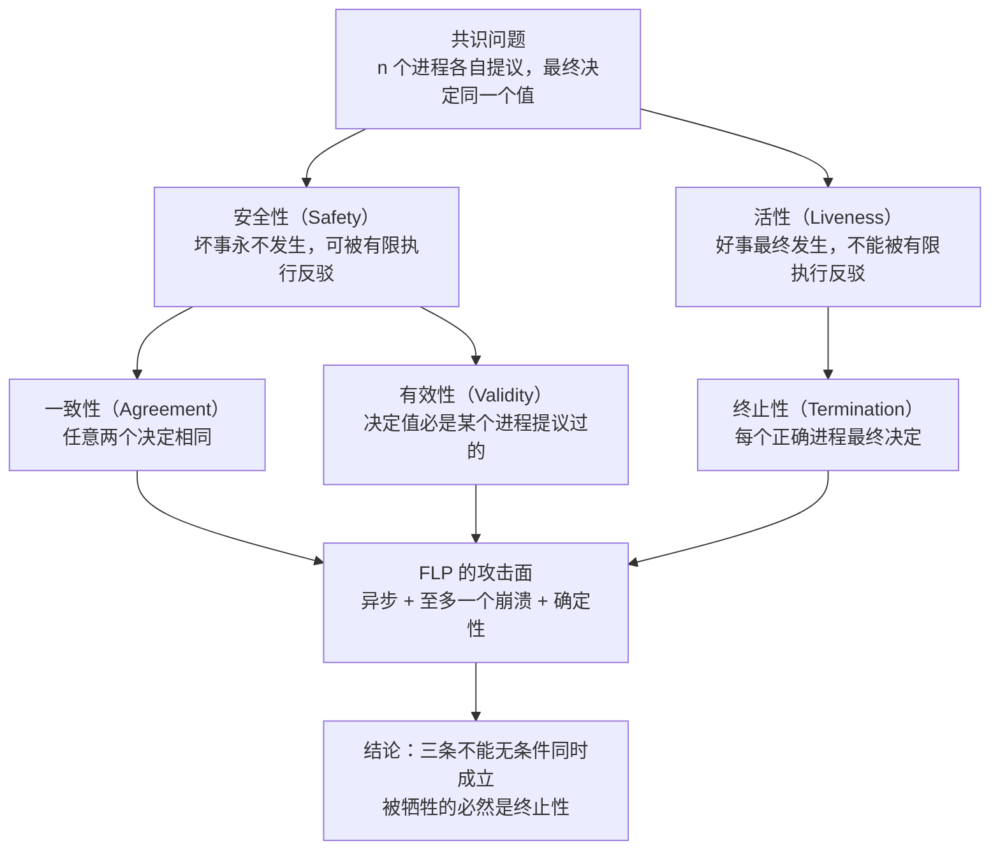
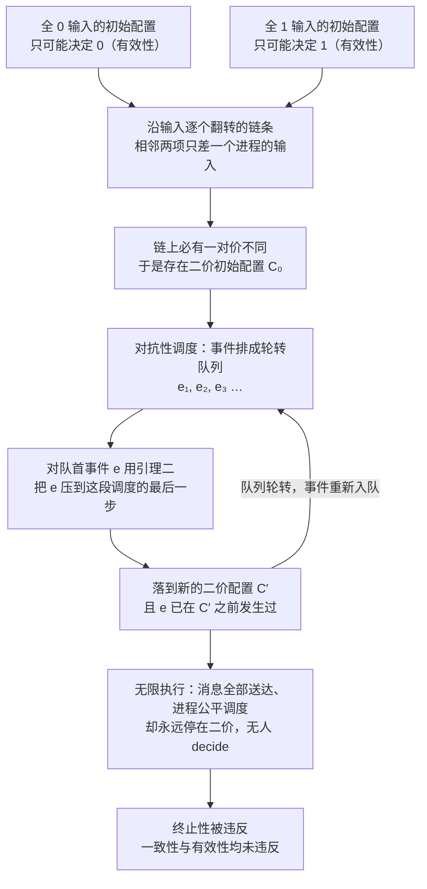
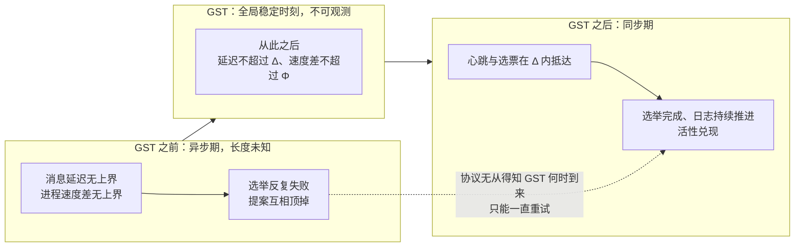
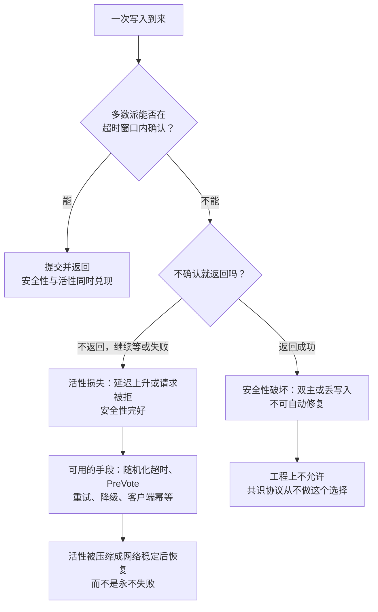

# 03 FLP 不可能定理与共识问题

**摘要：**

1985 年 4 月，《Journal of the ACM》登出一篇篇幅不长的论文，结论悲观得近乎判决：在一个完全异步的消息传递系统里，只要允许哪怕一个进程在无人知晓的时刻崩溃，就不存在任何确定性算法能保证所有存活进程最终就同一个值达成一致。这就是 FLP 不可能定理。它关掉的是「完美共识」这扇门，而不是工程实践的路——真正被大规模部署的 Paxos、Raft、ZAB 全部出现在它之后，而且每一个都在它的约束里找到了自己的位置。本篇按五问推进。第一问是什么：共识的三条性质各自站在安全性还是活性一侧，输入与输出的边界在哪，它与「一致性」「多数派」这两组常被混用的词差在哪里。第二问为什么出现：1985 年之前工程界用两阶段提交处理原子提交，撞上的正是 FLP 后来形式化的那面墙。第三问不这样会怎样：一个系统如果在设计时没有把安全与活性分开考虑，会掉进哪些具体的坑。第四问如何落地：把定理的四个前置条件逐个放松，就得到部分同步、随机化与故障检测器三条路，Paxos 与 Raft 选了第一条，而它们身上那些选主抖动、提交延迟的真实症状，全部来自这个选择。第五问是边界：把 FLP 读成「共识不可能」是一种极常见的误读，本篇给出它的适用前提与几个真会咬到人的反例。读完应当能回答两个问题：为什么「完美共识」在异步网络下并不存在，以及实用协议凭什么叫作「绕过」了它。

---

## 第 1 章 三条性质划出的那块地

### 1.1 三个合伙人、三张纸条

1985 年那篇论文没有提出任何算法，它做的事正好相反：证明有一类算法永远写不出来。要看清这个结论的分量，得先把论文讨论的问题摆到桌面上，因为后面所有的精妙之处都藏在「共识」这个词的边界里。

设想三个合伙人 A、B、C 合开一家店，每天开门前要确定一件事：今天由谁坐柜台。三个人各有偏好，也各自握着一部分信息，他们之间唯一的沟通方式是让信使送纸条。规则很朴素：每个人最后都要说出一个名字，说出口就不能改；只要大家说的是同一个人，这一天的安排就算成立。至于这个人选得好不好、是不是最优，没有谁来检查——制度只关心一件事，说的是不是同一个。

换成分布式系统的语言，这段场景就给出了共识（Consensus）问题的定义：n 个进程各自提出一个值（Propose），通过消息传递相互协商，最终每个未崩溃的进程都输出一个值（Decide），所有输出必须相同，而且一旦输出就不能反悔。信使就是网络，纸条就是消息，「坐柜台的人」可以是主库地址、事务该提交还是回滚、日志里的下一条命令。共识不解释这些值的含义，它只负责让所有进程接受同一个值。

这个定义里有一处容易被读快的限定：它要求「每个未崩溃的进程」都做出决定，而不是「大多数进程」。一旦某个进程崩溃，它就被从合约里划掉，剩下的进程仍然必须齐步走。这条限定看起来只是措辞，实际上决定了整套理论的气质——共识讨论的是「活着的那些人怎么办」，而不是「所有人怎么办」。

### 1.2 三条性质，两条安全一条活性

学界把共识拆成三条性质，写法略有差异，但骨架一致。

第一条是终止性（Termination）：每个未崩溃的进程最终都会做出决定。它管的是「事情不会永远悬着」。

第二条是一致性（Agreement）：任意两个做出决定的进程，决定的值必须相同。它管的是「不会出现两个版本的历史」。

第三条是有效性（Validity）：被决定的值必须是某个进程提出过的值。它防的是算法取巧——如果没有这一条，一个永远决定 0 的算法就同时满足前两条，而它对任何输入都毫无用处。

三条性质分属两个不同的类别，这个归类不是学术装饰，而是理解 FLP 的钥匙。1977 年 Lamport 在讨论程序正确性时把性质分成安全（Safety）与活性（Liveness）两类，1985 年 Alpern 与 Schneider 又给出了严格的形式化：安全性说的是「坏事永远不会发生」，它可以被一个有限执行前缀反驳——只要你抓到一次两个进程决定了不同的值，安全性就破了；活性说的是「好事最终会发生」，它不能被任何有限前缀反驳——你看到系统到现在还没决定，不能据此断定它永远不决定，因为下一秒它可能就决定了。一致性与有效性属于前者，终止性属于后者。



图里最后一条箭头值得多看一眼。FLP 的结论并不是「算法会做出不同的决定」，那种失败模式属于协议性被破坏，是远比不终止严重的事故。FLP 构造的恰恰是一个反过来的局面：协议性与有效性完好无损，唯独没有任何进程做出决定。换句话说，它证明的不是「共识会出错」，而是「共识可能永远不给出答案」。安全与活性在可反驳性上的这个不对称，正是整个证明能够成立的土壤——如果活性也能被某段有限执行判死，那 FLP 的论证方式根本无从展开。

### 1.3 输入与输出：它保证一致，不保证正确

把共识协议当成一个黑盒，看清它的输入输出，边界立刻清楚。

输入是每个进程各自提议的一个值。这里要强调一句：共识不关心值是什么，也不关心值从哪来。它可以是主库地址，可以是事务的提交意向，也可以是日志里下一条命令的字节。协议不对值做任何语义解释。

输出是一个被所有进程接受的值，或者一串按顺序被接受的值。这里同样要强调：共识不保证这个值是对的。如果所有进程都提议了一个错误的值，共识会一丝不苟地让所有人接受这个错误的值——它履行了合约，只是合约本身不包含「正确」这一项。

这个界定澄清了两个流传很广的误解。其一，共识不等于做正确的决策，它只保证一致。业务上「余额不能为负」「库存不能超卖」这类约束，必须由提议之前的检查或应用之时的校验来保证，共识层对此无能为力。其二，共识不等于业务逻辑。把业务规则塞进共识层，会让一个本来只需要协调顺序的组件背上语义判断的责任，而这两件事的故障模式完全不同。

笔者在这里想强调一个层次划分：共识是一个协调原语，不是一个决策系统。它提供「一致」，正确性由上层的约束来提供。把这两件事混在一起谈，是很多架构讨论跑偏的起点——因为一旦把「一致」和「正确」当成同一件事，就会指望协议去解决本该由业务解决的问题。

### 1.4 两组容易混的词

第一组是共识与一致性（Consistency）。共识是一个算法问题：多个进程如何就某个值达成一致，它是一个动态过程，描述的是协调协议本身。一致性是一个系统属性：分布式存储在不同操作之间应该呈现什么样的数据视图，描述的是系统对外暴露的语义。两者的关系是工具与目标——用共识算法给写操作排出一个全局顺序，可以构造出满足线性一致性（Linearizability）的存储；但线性一致性也可以被更弱的手段部分满足，代价是接受某些陈旧读。把目标与工具分清，是读分布式系统论文的一项基本功，因为大量争论的实质分歧就发生在这一层。

第二组是共识与多数派（Quorum）。多数派是实现共识的一种手段，不是共识的定义。共识的定义只要求所有进程对某个值达成一致，它没有规定用什么方式达成；理论上，全体一致可以，某个权威节点拍板、其他人服从也可以。多数派之所以成为主流，是因为它同时满足三个要求：少数节点故障不影响推进，任意两个多数派必然相交从而不会出现两份矛盾的决策，通信开销可控。这三个要求叠在一起，使多数派成为崩溃故障模型下性价比最高的实现方式。

这层关系解释了一个常见的困惑：主从架构里「主节点决定、从节点服从」也是一种共识，只是它的容错性很差，主节点一挂就得靠人工切换。它不是「不共识」，它是共识的一种低容错实现。多数派不是共识的全部，它只是共识的一种划算的落地方式。

### 1.5 三处落地

共识之所以值得单独成篇，是因为它是若干核心机制的共同底座，而这三处落地各有各的形状。

复制状态机（State Machine Replication，SMR）是最直接的一处。所有强一致的复制系统，无论 etcd、ZooKeeper 还是 TiDB 的 Region 副本，都要让多个副本按相同顺序执行相同操作，最终状态自然相同；而「对操作序列达成一致」就是共识问题，只是它把一次共识展开成一串按位置编号的共识。这一处的特点是对吞吐敏感，因为每一个写操作都要走一次协调。

主节点选举（Leader Election）是第二处，也是形态最简单的一处：每个节点提议自己或某个候选人，最终所有节点决定同一个主。这一处的特点是频率低但权重高，它决定的不只是一个值，而是接下来一段时间里谁来发号施令，所以它的活性问题会被放大成整个集群的可用性问题。

原子提交（Atomic Commit）是第三处。分布式事务里，多个参与者要就「提交还是回滚」达成一致，只有所有参与者决定相同，原子性才成立。这一处的特殊之处在于它通常和共识协议叠在一起用：两阶段提交（Two-Phase Commit，2PC）解决的是「如何协调」，而协调者本身的高可用要靠共识来保证。把这两层分开看，才能理解为什么有的系统「用了 Paxos 还是会有分布式事务问题」。

三处落地的共同点是：它们都需要多个节点对一个值达成一致，而且这个一致不能出错。共识因此不是一个学术玩具，它是主节点选举、分布式事务、复制状态机这些机制的共同地基。地基的承载力上限在哪里，正是 FLP 要回答的问题。

---

## 第 2 章 1985 年，一扇门被关上

### 2.1 1985 年之前：2PC 已经撞过一次墙

在 FLP 之前，工程界处理原子提交的主流方案是 2PC，它在协调者正常工作时表现得相当好：协调者先问所有参与者「能不能提交」，收到全部肯定答复之后发出提交指令，收到全部确认之后事务完成。问题出在协调者发出询问之后、发出指令之前的那段窗口——如果协调者此时崩溃，参与者手里握着锁，既不知道别人投了什么票，也不知道该提交还是回滚，只能一直等下去。这段阻塞不是实现瑕疵，而是协议的固有结构：参与者缺少足够的信息来独自决断，而它又不能凭猜测行动，因为猜错就会与别人分叉。

工程界当时的应对是加阶段，也就是三阶段提交（Three-Phase Commit，3PC）：在「准备」与「提交」之间插一个「预提交」，让参与者在协调者崩溃时有更多信息可用。这一招确实把阻塞点往后推了，代价是多一轮通信，而且它仍然依赖「消息延迟有界」这个假设；一旦网络分区把两侧隔开，两侧可能各自按自己的进度推进，结论就不再唯一。换言之，3PC 换来的是「在同步假设下不阻塞」，而不是「在任意网络下都安全」。

这就是 1985 年之前的状态：工程上知道有个坑，但说不清这个坑的边界在哪里。FLP 的价值在于它把这个坑画成了一条精确的线——它不讨论具体的协议，而是问「任何算法，只要满足这些前提，能不能做到」。答案是不能。从这一刻起，2PC 的阻塞不再是一个待修的缺陷，而是一个已被证明无法彻底消除的现象；能做的只是换假设、换代价。

### 2.2 定理的精确陈述与四个前置条件

把定理写成一句完整的话，每个限定词都不能省。

> 在一个异步的、消息最终送达的消息传递系统中，即使至多只有一个进程可能发生崩溃故障，也不存在确定性算法能够在所有执行中都解决共识问题——即同时满足一致性、有效性与终止性。

这里有四个前提，逐个拆开看。

第一个是异步（Asynchrony）。它包含三层意思：消息的传输延迟没有上界；进程之间的相对速度没有上界（一个进程走一步的时间可以任意长）；系统里没有可用的全局时钟。前两层是核心，第三层是前两层的推论——时钟同步本身要靠消息，消息延迟无界，时钟就无法被可靠地同步。这里有一个常被忽略的细节：FLP 并不需要消息丢失，它假设链路可靠、消息最终送达，只是送达时间不确定。所以「丢包导致共识做不出来」不是 FLP 的内容，FLP 说的是一件更强的事——消息一条都不丢，仅仅因为延迟不可预期，共识就已经无法保证终止。

第二个是确定性（Determinism）。进程的每一步只由本地状态与收到的消息决定，不掷硬币，不读随机数。这一条把随机化算法排除在外，也是后面「绕过」路线之一的入口。

第三个是至多一个崩溃（At most one crash）。故障模型是 fail-stop：进程停在某一刻，不再发送消息，不会发出内容错误的消息。注意「至多一个」这个量词——最坏情况下只需要一个进程可能崩溃，定理就成立。这不是「f 个」的弱化版本，而是一个更尖锐的结论：连一个都容不下。

第四个是没有认证通道。这一条在崩溃模型下几乎是自动成立的，因为崩溃的进程不会伪造消息，签名与否不改变结论；列出它是为了说明 FLP 的证明没有借用任何「消息来源可信」的额外力量。它真正开始起作用，是在把故障模型换成拜占庭（Byzantine）的时候：那时接收方需要签名来确认消息的来源与未被篡改，故障容忍的门槛也从「多数派」变成别的比例。

| 前置条件 | 精确含义 | 放松它得到什么 | 需要付出的代价 |
| :--- | :--- | :--- | :--- |
| 异步 | 消息延迟与进程相对速度都没有上界，无可用全局时钟 | 部分同步模型：某个未知时刻之后延迟不超过 Δ | 活性退化为「网络稳定后才成立」 |
| 确定性 | 每一步只由本地状态与收到的消息决定 | 随机化共识：以概率 1 终止 | 终止成为概率命题，期望时间可能很长 |
| 至多一个崩溃 | fail-stop，进程停下不说话，不伪造消息 | 容忍 f 个崩溃 | 至少需要 2f+1 个进程，开销随 f 上升 |
| 无认证通道 | 没有签名与共享秘密，无法验证来源 | 拜占庭模型加认证通道 | 要处理说谎者，副本数与消息量都上一个台阶 |

四个前提合起来，说明 FLP 是一个关于特定模型的精确结论，不是一句「分布式很难」的感叹。这也直接给出了「绕过」的方法论：要绕开它，就必须改动其中某个前提，并且公开承认改了哪一个、付出了什么。

### 2.3 「可能崩溃」为什么就够了

定理里最反直觉的地方不是「一个进程崩溃」，而是「一个进程可能崩溃」。这个进程完全可以在整个执行过程中正常运行，一步都不出错，仅仅是「存在崩溃的可能性」，就足以让任何确定性算法失去终止保证。

原因在于异步系统的观察能力。算法能看到的只有「收到了什么消息」，看不到「对方是死了还是慢了」。当一个进程迟迟不回应，其他进程面对的是一个二义的证据：它可能已经崩溃，也可能只是它的消息还在路上，而异步模型允许这条消息晚到任意久。这两种情况在观测上完全等价，任何确定性的判断都必然在其中一种情况下出错。

这个不可区分性有一个直接的工程投影。所有基于超时的判断，本质上都是在做这种区分：等够久了就认定对方死了。而 FLP 指出，在纯异步模型里，「够久」这个阈值不存在——因为延迟没有上界，你永远无法排除「再等一会儿它就来了」。工程上的超时之所以有效，靠的是偷偷引入了一个额外假设：延迟通常有界。这个假设在真实数据中心里大多成立，但它不是定理的前提，而是工程自己加进去的。

### 2.4 证明的骨架：配置、事件、二价

完整的证明需要几十页形式化符号，但骨架可以用三个概念搭起来，理解了骨架，再读原文就不会迷路。

第一个概念是配置（Configuration）。一个配置描述某一时刻系统的完整状态：每个进程的内部状态，加上所有在途消息的集合。初始配置是全员启动时的状态，其中每个进程带着自己的初始提议。算法是确定性的，所以「配置加上一个事件」唯一确定下一个配置。

第二个概念是事件（Event）。一次事件就是「某个进程收到某条消息并执行一步」。由于消息集合是有限的、进程是有限的，一个配置上可应用的事件也是有限的。一串事件按顺序作用在初始配置上，就得到一条执行（Execution）；调度（Schedule）就是这串事件的排列方式。

第三个概念是二价性（Bivalence）。对一个配置来说，如果从它出发无论后续事件怎么排，最终决定都只能是 0，称它为 0-单价（0-valent）；只能是 1 的称 1-单价（1-valent）；两种结局都可达的称二价（Bivalent）。二价这个词的含义很具体：这个配置还没有锁定命运，后续的调度可以把它推向任何一边。

证明由两个引理支撑，第二个才是难点。

引理一说的是：存在一个二价的初始配置。论证方式是把「全员提议 0」与「全员提议 1」两个初始配置用一条链连起来，每一步只改动一个进程的初始提议。链首的配置只能决定 0（有效性不许它决定 1），链尾的只能决定 1，于是链上必然存在相邻的一对，其中一个是 0-单价、另一个是 1-单价。接下来用崩溃假设收口：这两个配置只差一个进程的初始提议，如果这个进程从第一步起就不动（等价于它已经崩溃），那么其余进程在两种情形下看到的消息完全相同，按确定性它们必然做出相同的决定，与「一个是 0-单价、一个是 1-单价」矛盾。矛盾说明链上不可能处处单价，二价初始配置必然存在。

引理二说的是：从一个二价配置出发，总能到达另一个二价配置，而且可以把任意指定的事件安排在这一段的最后一步。这一条是 FLP 的心脏，下一节单独拆。

### 2.5 临界配置：二价与单价之间那道边界

引理二的证明靠一个叫临界配置（Critical Configuration）的构造。思路是这样的：假设结论不成立，也就是从二价配置 C 出发，凡是不应用事件 e 就能到达、且 e 在其上可应用的配置，全都是单价的。既然 C 是二价的，这条路上必然存在一对相邻的配置 C₀ 与 C₁：C₁ 由 C₀ 再走一步 e′ 得到，而 C₀ 是 0-单价、C₁ 是 1-单价。这两个配置之间的那一步，就是二价与单价的分界。

接下来考察 e 与 e′ 的关系，分两种情况。

第一种，e 与 e′ 作用于不同的进程。两个不同进程上的事件可以交换顺序，先 e 后 e′ 与先 e′ 后 e 得到同一个配置。从 C₀ 出发先应用 e，得到一个 0-单价的配置（因为 C₀ 是 0-单价，它之后的一切都是 0）；在这条路上再应用 e′，得到的配置与「从 C₁ 出发应用 e」是同一个。可后者落在 1-单价的 C₁ 之后，必须是 1。同一个配置既是 0 又是 1，矛盾。这一条路被封死。

第二种，e 与 e′ 作用于同一个进程。这时交换律用不上了，需要动用崩溃假设：既然至多一个进程可能崩溃，而这个进程恰好就是「可能崩溃」的那一个，那么考虑它在关键步骤不动、其余进程照常推进的执行。其余进程在 C₀ 与 C₁ 两条路径上看到的消息与状态完全一致，按确定性会做出相同的决定，而 C₀ 侧要求 0、C₁ 侧要求 1，矛盾再次出现。这一条路也被封死。

两种情况的处理合起来说明：假设不成立，从二价配置出发，一定能到达另一个二价配置，并且可以让任意指定的事件出现在这段的最后。笔者在这里要坦白一句：上面这段是骨架，真正的论文还要处理「事件作用于同一进程但消息内容不同」「多个进程同时处于临界位置」等一串技术细节，那些细节决定了证明的严密程度；但骨架的逻辑已经完整，它说明这个证明的力量来自两个地方——事件的交换性，以及「任何进程都可能是那个崩溃的进程」这一对称性。

### 2.6 轮转构造：每条消息都送达，却永远不决定

有了引理二，反例的构造就变得机械了。把所有可能的事件排成一个轮转队列，反复做同一件事：取出队首事件 e，用引理二构造一段以 e 结尾的调度，落到一个仍然是二价的配置上。因为每一步之后配置仍是二价，任何进程都还没有决定；又因为队列是轮转的，每条消息最终都会轮到一次。于是得到一条无限执行：消息一条不丢，每个进程都被无限次调度，公平性无可指摘，但没有任何进程做出决定。

这条执行击中的正是终止性。协议性与有效性毫发无损——没有人决定，也就谈不上两个人决定得不同。这就是 FLP 结论的精确形状：它不构造一个「决定错了」的世界，它构造一个「永远不给答案」的世界。



把这段构造写成伪码，会更直观地看到对抗者其实只做了两件事：保持二价，以及保证公平。

```python
# 对抗者构造的示意，不是可执行实现
queue = fair_round_robin_events()        # 轮转顺序：每条消息最终都会被投递
config = a_bivalent_initial_config()     # 引理一保证它存在
while True:
    e = queue.pop(0)
    # 引理二保证：存在以 e 结尾的一段调度，落到仍是二价的配置
    config, prefix = extend_ending_with(config, e)
    assert is_bivalent(config)           # 对抗者只停在二价上
    queue.extend(prefix)                 # 其余事件回到队尾，下一轮还会轮到
# 循环没有出口：公平性成立，决定永不发生
```

这里有一处容易被误读成「证明不成立」的地方：既然循环是构造出来的，那是不是只要算法足够聪明就能识破？不能。对抗者的构造只依赖算法本身的确定性，它不需要预知算法的内部结构，只需要在每个岔路口确认「现在还能通往两个结论」。换句话说，这不是一个针对某个算法的特例，而是一个针对所有确定性算法都成立的论证结构。

### 2.7 读不懂这份证明，不是读者的问题

FLP 的证明在分布式理论里以难读著称，原因不在符号密度，而在它讨论的对象。

「存在」的证明有一个天然的抓手：造一个算法，再证明它满足要求。读者可以顺着算法一步步验证。「不存在」的证明没有这个抓手，它必须把「所有可能的算法」压缩进一个统一的模型，再在这个模型上导出矛盾。配置、事件、调度、二价，这套工具就是为了处理「所有算法」而发明的；它们不是算法的一部分，而是对「任何算法都必然具有的那些结构」的抽象。

更让人不适应的是证明的对抗性前提。它假设存在一个调度者，能够按照自己的意愿安排消息到达的顺序。这个假设初看像在耍赖——现实里没有谁会刻意把系统卡住。但它的含义要更深一层：如果存在一种合法的消息排列让算法永远无法决定，那么算法就没有「保证」终止，而「保证」这个词在正确性论证里是严格的全称量词，一个反例就够了。

理解了这一点，读证明时的挫败感会轻一些。对工程实践而言，结论与「它为什么不可绕过」比完整证明更重要——结论指导设计，完整证明是理论工作者的功课。后面几章讨论的全部是结论的用法，而不是证明的细节。

---

## 第 3 章 被否定的与没有被否定的

### 3.1 「不保证终止」的精确含义

FLP 说的是：不存在一个确定性算法，能在所有执行中都保证终止。它说的不是：所有执行都不终止。这两句话差别很大，而把前者读成后者，是这门理论最常见的误读。

用句法拆开看。前一句是「不存在一个算法 A，使得对所有执行 E，A 都终止」；后一句是「对所有算法 A，存在执行 E 使其不终止」——逻辑上这两句其实等价，但它们的工程含义完全不同：前一句容易被读成「算法不能用」，后一句的正确读法是「算法可用，但它的保证是有条件的」。真实的系统运行在一条具体的执行上，而不是在所有执行上，所以「存在某些执行不终止」和「我这套集群能不能跑」是两件事。

这里还可以再往前推一步。FLP 的反例执行需要对抗者精确地维护二价状态，这是一个极其精巧的排列，现实里的网络抖动、GC 停顿、调度延迟不会自动拼出这种排列。所以在真实系统里，共识大多数时候是能达成的；FLP 只否定「无条件保证」，不否定「常常成功」。

不过，这个「大多数时候」并不构成安慰。工程上的活性事故往往不是因为遇上了那个精妙的无限执行，而是因为它长时间停在一段「还没决定」的窗口里——选举没完成、多数派联系不上、提案被反复顶掉。这些窗口正是 FLP 所说的二价状态在现实中的粗粒度版本。

### 3.2 反事实：缺了这根弦会怎么设计

假设一个设计者没有读过 FLP，也没有把安全与活性分开考虑，那么他在四个地方会踩到坑，而且这四个坑在真实系统里都能找到对应的故障。

第一处是把超时当成故障结论。既然「慢」与「死」不可区分，任何「超时就认为对方死了」的推论都可能出错。如果系统按这个推论动手，比如在认为主节点已死后自行升主，那么一次网络抖动就能造出两个主，而两个主各自接受写入之后，数据分叉是不可自动修复的。FLP 在这里给出的不是一条禁令，而是一条纪律：超时只能用来触发试探（试探性的选举、试探性的接管），不能用来直接做不可逆的决定，除非有额外的机制保证旧主确实不会再行动。

第二处是追求「无损切换」。既然终止性无法无条件保证，一个系统如果坚持「切换期间不能有任何请求失败」，它就只能无限等待旧主的消息或者无限重试选举。真实可用的做法是接受一个短暂的拒绝窗口，让客户端重试。把这个窗口当作设计的输入，而不是当作缺陷。

第三处是把活性问题当 Bug，用重启来解决。选举卡住时重启节点，看似能刷新状态，实际常常加剧问题：重启的节点丢失了内存里的投票信息与日志缓存，重新加入后要么触发新一轮选举，要么拖慢日志追赶，反而让抖动持续更久。活性问题需要的是参数与网络层面的处理，不是进程层面的重启。

第四处是把「多数派 + 超时」当成安全性的充分条件。多数派保证的是任意两个多数派相交，从而不会同时产生两个有效的决定；但这条论证有一个前提——每个节点在同一任期里只投一次票，且投票信息必须持久化。如果这个前提被破坏（比如投票状态只放在内存里、重启后丢失），多数派相交的论证就断了，系统会在有超时机制的情况下依然脑裂。这一条的教训是：安全性来自协议的不变量，而不是来自「我们用了多数派」这句话。

### 3.3 FLP 与 CAP：一个约束算法，一个约束系统

FLP 与 CAP 经常被并列提起，但它们是两个不同层次的结论。

CAP 讨论的是分布式存储系统在网络分区发生时，一致性（C）与可用性（A）之间的取舍。它的对象是系统对外暴露的行为：分区期间，系统要么拒绝部分请求以保住一致性，要么接受请求但允许读到不一致的数据。FLP 讨论的是共识算法在异步网络中的能力上限，它的对象是算法本身：在给定的故障模型下，能不能写出一个在所有执行中都终止的算法。

两者的关系可以用一句对照说明：FLP 约束算法，CAP 约束系统。一个系统可以在 CAP 意义上选择 CP，同时在 FLP 意义上使用一个「只在网络稳定后保证活性」的共识算法——这两件事不矛盾，因为它们说的是不同层面的限制。

> [!note] FLP 与 CAP 不是互相包含的关系
> 有一类说法把 FLP 当成 CAP 的「理论证明」，这是不准确的。CAP 的证明（Gilbert 与 Lynch，1992 年）确实借用了异步模型，但它的结论是「分区期间 C 与 A 不可兼得」，与 FLP 的「异步下确定性共识无法保证终止」是两个不同的命题。CAP 允许系统在分区时放弃可用性从而保住一致性，FLP 则说明即使在不分区的正常情况下，纯异步模型里也不存在一个对所有执行都终止的确定性共识算法。把两者混为一谈，会导致一种错误的推论：以为「选了 CP 就绕过了 FLP」。CP 只是选择了在分区时牺牲可用性，它并没有、也不可能让共识算法变得无条件终止。

### 3.4 当假设检查器用

FLP 最实用的用法，是把它当作一张检查表，而不是一份判决书。面对任何一个共识实现，按顺序问四个问题，就能定位它的能力边界。

第一个问题：它假设了什么网络条件。是纯异步，还是部分同步，还是依赖时钟同步（比如 Spanner 的 TrueTime）？网络假设决定了它的活性在什么条件下成立。

第二个问题：它假设了多少个故障、什么类型的故障。是崩溃还是拜占庭，容错上限是 f 个还是别的比例，超过上限之后行为是停止服务还是可能出错？这一条决定了它的安全边界在哪里。

第三个问题：它的安全性依赖时间吗？如果安全性依赖超时（比如靠「租约未过期」来判断旧主已失效），那么时钟漂移就会变成安全性风险；如果安全性只依赖多数派相交与日志匹配，时间只影响活性，风险的性质就完全不同。

第四个问题：它的活性依赖什么？随机化、选举超时、还是外部协调服务？这决定了它在网络抖动时的表现，也决定了该监控哪些指标。

用这张表去看 Paxos、Raft、ZAB，会发现它们的差异集中在第三、第四个问题上，而这个差异恰好解释了它们各自在工程上的脾气。FLP 在这里的作用是把问题问对：不是「这个协议能不能用」，而是「它补了哪些假设，我的环境满足吗」。

---

## 第 4 章 三条绕过它的路

### 4.1 路一：把异步换成部分同步

1988 年，Dwork、Lynch 与 Stockmeyer 在《Journal of the ACM》上发表〈部分同步下的共识〉，第一次系统地回答了「把异步假设放松一点能得到什么」。他们给出两个模型：其一，延迟与速度的上下界存在，但系统在某个未知时刻之前可以不理它；其二，界本身未知，但自某个时刻起真实成立。工程上说的部分同步（Partial Synchrony）通常指后者的变体，并用一个名字标记那道分界：全局稳定时刻（Global Stabilization Time，GST）。

GST 的定义值得逐字读：存在一个时刻，从它之后任意两个进程之间的消息延迟不超过 Δ，任意进程执行一步的时间不超过 Φ；但系统里没有任何进程知道这一刻何时到来，也没有任何机制能观测它。

协议因此只能始终按「现在可能还没稳定」的方式运行，同时保证一旦稳定下来就能推进。这个形状决定了部分同步下共识的气质：安全性在任何时刻都必须成立，活性只承诺最终成立。



图里那条虚线箭头是部分同步模型的要害：协议不能「等到 GST 再行动」，因为它不可观测；能做的只有持续重试，而重试本身会在异步期制造额外负载与抖动。共识集群在某些时段变慢，常常不是「算得慢」，而是「一直在试，直到某一次试成了」。

从理论上说，部分同步并没有反驳 FLP，它只是离开了 FLP 的前提域。这不是对定理的挑战，而是对定理边界的尊重，也是「改动某个前提就能绕开」的第一个实例。

工程含义还要再具体一层：部分同步下共识可解的前提是故障进程少于一半。三节点集群挂掉两台之后拒绝服务，不是 Raft 实现得不好，而是模型的容错上限已经被用尽。

### 4.2 路二：随机化，把对手的预知能力拿走

1983 年，Ben-Or 在 PODC 上给出一个完全异步的共识算法：每一轮结束时，还没能统一意见的进程各自抛一次硬币，按结果决定下一轮提议什么。这个算法在纯异步模型里以概率 1 终止，直接绕开了 FLP 对确定性的限定。

代价写在保证的措辞里。终止不再是「必然发生在有限步之内」，而是「以概率 1 在有限期望时间内发生」——**随机化把确定性保证换成了概率 1 的保证**，而零概率事件不等于不可能事件，只是工程直觉常常把两者抹平。

更实际的问题在期望值。Ben-Or 原始构造的期望轮数随进程数指数增长；1983 年 Rabin 引入共享硬币（common coin）把它压到常数级，代价是共享硬币需要一个可信、对手不可预测的随机源。随机化把一个算法问题部分转化成了随机源问题。

这里要辨析一个流传很广的混淆：Raft 的随机化选举超时不是概率共识算法。它的安全性不依赖随机数，随机化只用来打破对称——避免所有节点同时到期、同时参选、选票分裂；它换来的不是「概率终止」，而是「更快更稳地选出一个主」。

随机化起作用的机制值得说清：对抗者的力量来自预知，确定性算法每一步的行为都能被算出来，于是调度者总能选择让它陷入僵局的那条路，随机数切断了预知。这个切断有前提——随机源若可预测（譬如拿系统时间做种子），对抗者依然算得出来，随机化就退化回确定性。

### 4.3 路三：故障检测器 Ω，把猜测变成接口

1996 年，Chandra 与 Toueg 把「怀疑谁挂了」从算法里抽出来，做成独立的抽象：故障检测器（Failure Detector）。它不告诉进程谁活着，只给出怀疑，并按两个维度分类——完整性（真的有故障时最终会被怀疑）与准确性（不许乱怀疑，或最终不再怀疑正确进程）。

在这个框架里，FLP 可以重述成一句更精确的话：纯异步系统中若没有任何故障检测器提供信息，共识不可解；反过来，只要检测器足够强，共识就可解。

Chandra、Hadzilacos 与 Toueg 在同年证明：在多数进程正确的异步系统里，事件最终领导者（Ω）是解共识所需的最弱故障检测器。Ω 的语义只有一句——最终会有一个进程被所有进程永久信任，不保证是哪一个，也不保证多久之后。

这条结论把 FLP 的「不可能」翻译成一个资源问题：算不出来的原因不是时间不够，而是缺一份「最终正确」的故障信息。工程上做不出完美检测器，但做得出最终正确的检测器——心跳加超时正好是这么一种东西。

于是每个 Raft 集群里都住着一个 Ω：选举超时是它的怀疑机制，心跳是它的信任机制，随机化是它的防抖动补丁，PreVote 与 CheckQuorum 是对它误判行为的修正。

代价同样明确：Ω 的「最终」没有时间界，误判率直接决定活性质量——超时太短则误判频繁、选主抖动，超时太长则恢复缓慢、故障窗口拉长。这个旋钮的两难，就是 FLP 在工程里的日常形态。

### 4.4 三条路的代价对照

| 维度 | 部分同步（Paxos / Raft） | 随机化（Ben-Or 一类） | 故障检测器（Ω 加多数派） |
| :--- | :--- | :--- | :--- |
| 网络假设 | 最终稳定，GST 存在 | 纯异步即可 | 纯异步即可 |
| 终止保证 | 稳定后必然终止 | 以概率 1 终止 | 检测器最终正确后必然终止 |
| 性能可预期性 | 高，延迟可按 RTT 与落盘估算 | 低，期望有限但方差大 | 中，取决于检测器误判率 |
| 工程复杂度 | 中，需处理选主与日志修复 | 较高，需可靠且不可预测的随机源 | 中，检测器本身由超时实现 |
| 代表系统 | Paxos、Raft、ZAB | 理论构造居多，少见生产部署 | 与部分同步叠用，不单独出现 |

随机化那一列的「低可预期性」要展开：期望轮数不大，不等于每次都快，尾部可能长到写不进 SLO；容量规划按尾部算，不按期望算。Ω 那一列则有一个自我指涉——检测器靠超时实现，而超时的有效性依赖「延迟通常有界」，部分同步假设又被偷偷请了回来。

### 4.5 三条路在实践中被叠着用

教科书分三节讲，是因为它们在理论上各自能单独解释「为什么共识可解」；工程实现很少只走一条。常见叠法是：部分同步作主假设，活性只在网络稳定后承诺；随机化作打破对称的补丁，用在选举超时上；Ω 作心跳与租约的抽象，管怀疑与信任。

这种叠法有一个副作用：它让「到底绕过了 FLP 的哪一条」变得不易回答。看一个实现时，要分别问它的安全性依赖什么、活性依赖什么，而不是贴一个「部分同步协议」的标签了事。

工业界偏爱第一条路，说到底是个可预期问题：网络稳定后，部分同步协议的延迟可以由一次往返与若干次磁盘同步估出来，容量与 SLO 都有落脚点；随机算法的延迟服从长尾分布，尾部不可控。**工程选择偏爱可预期的假设**，而不是更弱的假设。

落点仍在权衡：把活性押在「网络最终稳定」上，代价是网络长期不稳时长期不可用；押在随机源上，代价是延迟不可控；押在检测器上，代价是误判率成为稳定性的天花板。三条路都通向共识，只是过路费不同。

---

## 第 5 章 把活性让出去

### 5.1 共同骨架：安全性绝对，活性有条件

Paxos 与 Raft 的设计哲学可以概括成一句：**安全性是绝对的，活性是有条件的**。这句话不是宣言，它有机制支撑。

安全性靠两个不变量。其一是多数派相交：任何一个被提交的值都经过一个多数派确认，而任意两个多数派必有交集，交集里的节点不会对两个矛盾的值都点头。其二是任期内的单一发言权：每个节点在一个任期里只投一次票，且投票记录必须先落盘再发出。两个不变量都与时间无关。

活性只能有条件，因为活性需要「某个节点在足够长的时间里持续拿到多数派回应」，而这依赖消息在有限时间内抵达、依赖超时判断不出错。这两件事不由协议控制，只能由网络假设提供。



图里唯一不能走的分支是右下角。所有共识协议都在同一个岔路口做了同一个选择：宁可暂时拒绝服务，也不返回一个未经验证的答案。理解了这一点，后面那些「活性问题」就不再是 Bug，而是这个选择的必然代价。

### 5.2 Paxos 的活锁：两个提案者的对撞

Paxos 的安全性在纯异步模型里就成立，这点常被误解成「Paxos 没有 FLP 问题」。它有，只是问题落在活性上。

设想两个提案者同时工作。P1 用编号 1 发起准备阶段，拿到多数派的承诺；就在它准备发起接受阶段时，P2 用编号 2 发起准备，接受者按规则承诺了更高编号，P1 的接受请求被拒绝。P1 用编号 3 重来，P2 立刻用 4 顶上去。两个提案者你追我赶，谁都拿不到多数派的接受，而每一轮都是合法的、安全的，只是没有任何值被决定。

这个现象叫活锁（Livelock），文献里的说法是两个提案者在打架（dueling proposers）。它恰好是 FLP 反例在工程尺度上的粗粒度版本：没有谁做错，安全性一次都没破，系统却停在原地。

工程上的解法有两条：选出一个稳定的提案者（distinguished proposer），让它在足够长的时间里独占发起权；或者给失败的一方加随机退避，降低对撞概率。前者是 Multi-Paxos 需要一个主节点的真正原因——不是为了安全，而是为了活性与效率。

### 5.3 Raft 的随机化超时与 PreVote

Raft 把选主做成超时驱动：从节点等心跳，等够一个选举超时还没等到，就自增任期、转为候选者、向所有节点拉票。如果所有节点的超时相同，它们会同时参选，票被分散，谁都不够多数，于是全部重来——这叫选票分裂（Split Vote）。

解法是让每个节点的超时从一个区间里随机取，把「同时到期」这个对称性打破。

```go
// 每个节点独立采样，区间取心跳间隔的若干倍
const base = 150 * time.Millisecond
const spread = 150 * time.Millisecond
timeout := base + time.Duration(rand.Int63n(int64(spread))) // 150ms 到 300ms 之间
// 随机化的目的不是让选举更快，而是避免所有节点同时到期、同时参选
```

这个区间不能随便取：下限必须显著大于一次广播往返加一次落盘，否则正常心跳也会被误判成失联；上限必须显著小于用户能忍受的不可用窗口，否则真故障时恢复太慢。论文给出的 150 到 300 毫秒是示例量级，取值要按实测 RTT 与磁盘延迟定。

**PreVote** 是对这套机制的补丁。一个被分区隔开的节点会反复超时、反复自增任期，等它重连时带着远高于当前任期的编号，会让正常工作的主节点被迫下台，引发一次本可避免的选举。PreVote 在正式参选前先问一圈「如果我发起选举，你会投票给我吗」，确认有机会当选才动手。

这两个机制有一个共同点：全部作用在活性一侧，从不放松安全性。Raft 的安全性证明完全不依赖随机化超时与 PreVote，删掉它们协议依然安全，只是更容易抖动。这正是「安全性绝对、活性可优化」的落地形态——活性部分可以加装、调参、迭代，因为它不影响正确性的论证。

### 5.4 选主抖动：活性问题的第一副面孔

活性出问题时，最先在监控上显形的是**选主抖动（Leader Churn）**。

症状很好认：主节点切换次数在短时间内爬升，客户端缓存的「谁是主」失效，写请求被转发的比例上升，写入错误率出现尖峰，日志里出现成串的任期递增。背后通常是同一个循环——一次无谓选举让主节点下台、日志复制中断、新主追赶日志、追赶期间写请求排队、队列变长推迟心跳、心跳迟到再触发下一次选举。

诱因有几个典型来源：超时设得太短，正常的网络抖动被当成失联；节点的垃圾回收停顿超过选举超时，进程还在但心跳发不出去，其他节点合理地把「慢」判成「死」；跨机房部署，往返本身就有几十毫秒，抖动幅度轻易吃掉超时裕量；资源竞争，磁盘与 CPU 被快照、备份、批量任务占满。

抖动会自我强化，这一点在容量规划里常被低估：每一次选举都伴随一段日志复制真空，真空越长新主追赶越吃力，追赶期间的读请求又要等应用追平。等业务侧开始重试，负载再上一个台阶，抖动就有了持续下去的动力。

可观测性在这里很实际：主节点切换次数、提案失败计数、日志应用落后程度、心跳往返时间，四个量放在一起，基本能区分「偶发的一次故障切换」与「陷入抖动的循环」。

### 5.5 提交延迟：另一副面孔

活性问题的另一副面孔是提交延迟，它比抖动安静得多，也更容易被误诊成性能问题。

一次写入要被提交，必须等到多数派的确认到齐。三节点集群里这意味着等两个节点——最快的那个，以及凑够多数的最后一个。这条链路的延迟由**多数派里最慢的那一个**决定，而不是平均值：某个节点的磁盘偶尔抖一下，只要它恰好是最后一票，整次写入就得等它。

跨机房会把这段延迟放大一个量级：同城往返几毫秒，跨城往返几十毫秒，而这条往返同步压在每一次提交上。流水线与批量能把单位吞吐摊上去，摊不掉单条写入的那一次往返。Spanner 用每个分片一个 Paxos 组、组内同步复制，换来的是「每次提交付一次广域往返」的账单——TrueTime 让外部一致性的推理变得扎实，但没有、也不可能让这条往返消失。

客户端重试会再放大一次：超时重试在共识层看来是一次新的提案，同一次业务写入可能被提交两次。协议层不管幂等，业务侧的重复写入要靠幂等键或去重表来挡。

所以活性问题在指标上的典型形状，不是错误日志刷屏，而是尾部延迟变长与周期性尖峰。看平均值看不出问题，看 P99 与按分钟聚合的最大值才看得见。

### 5.6 参数清单：每个旋钮都在拿什么换什么

| 参数 | 调小之后 | 调大之后 | 取值依据 |
| :--- | :--- | :--- | :--- |
| 选举超时 | 故障恢复快，误判增多、抖动变密 | 误判减少，故障窗口拉长 | 显著大于广播往返与落盘时间 |
| 心跳间隔 | 检测更灵敏，网络与 CPU 开销上升 | 开销下降，失联发现变慢 | 通常取选举超时的十分之一量级 |
| 单次提案上限 | 大批量写入被切碎，吞吐下降 | 尾部延迟拉长，失败重试代价变大 | 按写入体积分布定，不按峰值定 |
| 快照阈值 | 快照频繁，写路径被 I/O 抢占 | 日志体积膨胀，重启恢复变慢 | 按磁盘与恢复时间预算定 |
| PreVote 与 CheckQuorum | 抖动更易发生，任期被无效推高 | 误判被抑制，对网络抖动更敏感 | 跨机房或频繁迁移时建议开启 |

这张表最值得看的是第三列：没有一个参数存在绝对最优，每一项都是两个代价之间的位置选择。照搬别人的配置经常不好用，是因为对方的 RTT 分布、磁盘型号与写入体积分布都与你不同。

### 5.7 为什么多数共识集群待在同机房

把 GST 假设与工程经验放在一起，就能理解这条默认规矩的来源。同机房的往返通常在亚毫秒到一毫秒之间，抖动小，「延迟有上界」这个假设更容易成立，GST 更容易早早到来；跨机房则相反，往返几十毫秒、抖动可能突然翻倍，GST 迟迟不来，协议长时间停在异步期，反复选举、无法提交。

超时的取值也被这条约束卡住：同机房能设小，误判概率低、恢复快；跨机房必须设大以避免误判，而设大又让真故障时的恢复更慢。

需要跨机房容灾时，常见做法是分层：每个机房内部署一个强一致的共识集群，机房间用异步复制同步必要的数据。这把强一致限制在低延迟的故障域内，把跨域的代价交给异步链路。它不是绕过了 FLP，而是把「活性依赖网络稳定」这条约束安排在最容易满足的那一层。

---

## 第 6 章 误读、边界与反例

### 6.1 误读一：把 FLP 读成「共识不可能」

最常见的误读，是把定理从「不存在对所有执行都保证终止的确定性算法」读成「共识做不出来」。这中间差了两个限定：一是「所有执行」与「某条执行」的差别，二是「确定性」这个前提。

前一个差别在第 3 章已经拆过：FLP 只否定无条件的保证。后一个同样关键：它把随机化算法排除在外，而随机化在理论上确实能绕开。两个限定都在，说明这条定理的结论是精确的、有条件的，而不是一句「努力也没用」的感叹。

还有一种更细的误读，把 FLP 当成「异步网络里什么都不用做了」。事实正相反：**「不保证」不等于「不能」**，正因为知道活性无法无条件保证，工程上才会把安全性做成绝对、把活性做成可观测、可调参、可降级。

### 6.2 误读二：把活性损失当成 Bug

第二类误读发生在故障复盘里：把一次选举期间的写入失败写成「服务异常」，然后立项去消除选举窗口。

这类项目通常不会成功，因为选举窗口是「安全性优先」的直接代价。要消掉它只有两条路：让旧主在不确定自己还有资格时继续服务，或让新主在没拿到多数派承诺时就开始接受写——两条路都破坏安全性。

正确的处理方式是把窗口当作设计输入：客户端重试与退避、上游降级路径、SLO 把不可用窗口算进去、容量按最坏情况下可用性打折来规划。这些工作不会让窗口消失，但会让窗口的代价可控。

### 6.3 误读三：以为随机化是无代价的银弹

第三类误读出现在读过几篇随机共识论文之后：既然抛硬币能绕开 FLP，把它用上就好了。

随机化确实绕开了确定性限制，但它把「必然终止」换成「以概率 1 终止」，把「有界时间」换成「有限期望时间」。这两个替换都有工程代价：概率保证写不进 SLA，期望时间不能用来做容量规划，随机源的质量与不可预测性本身又成了新的依赖项。

更实际的问题是，随机化并不能让活性变得无条件：它保证的是「以概率 1 最终成功」，而在任何一段有限时间里，系统仍可能处在还没成功的那一侧，而工程要的恰恰是有限时间内的行为。

### 6.4 误读四：以为多数派就是共识

第四类误读在术语层面：把「我们用了多数派」当成「我们实现了共识」。

多数派只解决「不会出现两个矛盾决定」这一半问题，它不解决「谁来提议」、不解决「提议被接受后如何让所有人知道」、不解决「旧主复活后如何不破坏已有决定」。这些问题靠任期、日志匹配与应用顺序来解决。

这也是为什么「三个副本加多数派写入」听起来像共识，实际可能只是一个带仲裁的复制方案：它能防脑裂，但未必能保证已提交的写入在故障切换后仍然存在。区别在于有没有一条可验证的日志与一套完整的选主规则。

### 6.5 反例清单：FLP 什么时候真的会咬人

FLP 的反例执行极其精巧，现实里几乎不会原样出现，但它的「精神」会以粗粒度的形式反复出现。

| 场景 | 失效的前提 | 观察到的症状 | 代价 |
| :--- | :--- | :--- | :--- |
| 三节点集群跨城部署且写入密集 | 最终同步迟迟不到 | 选主频繁，写 P99 抬升一个量级 | 吞吐与可用性双降 |
| 选举超时小于一次垃圾回收停顿 | 进程「慢」被判成「死」 | 周期性无谓选举，任期反复递增 | 抖动自我强化 |
| 少数派侧的旧主继续服务读请求 | 领导权判断只靠本地状态 | 读到陈旧数据却看不出陈旧 | 业务基于旧值做决策 |
| 客户端超时重试且写入不幂等 | 活性缺口被重试放大 | 重复下单、重复扣款 | 数据正确性受损 |
| 两个提案者都没有退避 | 活性需要稳定的提案者 | 活锁，谁都不被接受 | 长时间无法提交 |
| 把共识存储当高吞吐数据库 | 每次提交都要多数派确认加落盘 | 写入排队、提案失败计数上涨 | 扩容也压不住尾延迟 |

表里第一行与最后一行是同一件事的两面：共识的代价是每次提交都要等多数派，这个代价在低延迟网络里被摊得很薄，在广域网络或高写入负载下就显形。判断一个场景适不适合放共识，标准不是「数据重不重要」，而是「每次写能不能接受一次多数派往返」。

第三行值得单独说一句，因为它最隐蔽：旧主在分区期间并不知道自己已经不是主了，它的本地状态完整、日志完整，完全可以正常回答读请求——只是回答的内容已经过期。这种**读到了旧值却看不出来**的失败模式，比报错危险得多。应对有两条：读也走一轮多数派确认，或者用租约把「我还合法」限定在一个时间窗内，而租约又要求时钟漂移有界。

### 6.6 落点：把不可能定理当检查表

行文至此，可以把 FLP 的用法收敛成一句判断：它是一张检查表，不是一份判决书。

作为检查表，它逼着设计者回答四个问题——网络假设是什么、故障上限与类型是什么、安全性是否依赖时间、活性依赖什么。这四个答案决定了系统在故障面前的表现，也决定了该监控哪些量、该给客户端什么语义。

作为判决书，它什么也解决不了。把「FLP 说不可能」当成拒绝讨论分布式一致性的理由，与把「CAP 说三选二」当成不设计分区策略的理由，是同一种偷懒。理论给出的是约束条件，工程要做的，是在约束之内找到当时当地最合适的那个点。

---

## 小结

FLP 的结论可以压缩成一句话：在纯异步网络里，「一定成功」的共识不存在，「不出错」的共识存在，代价是「有时会卡住」。三层信息分别对应三条性质：终止性无法无条件保证，一致性可以绝对保证，卡住是活性的代价。

从这个结论出发，实用协议做了三件事：把异步换成部分同步，用「网络最终稳定」换回活性；把安全性做成不依赖时间的不变量，让它在任何网络条件下都成立；把活性做成可观测、可调参、可降级的工程问题。

这条路线的落点是一个价值排序：**正确性的下限比性能与可用性的上限更重要**。安全性违反不可自动修复，活性违反会随网络稳定自行恢复；正因为修复代价不对称，工程上才一致地选择「宁可短暂不可用，也不出错」。

---

## 参考资料

1. Fischer, M.J., Lynch, N.A., & Paterson, M.S. (1985). Impossibility of Distributed Consensus with One Faulty Process. *Journal of the ACM, 32*(2), 374–382.（FLP 原始论文）
2. Dwork, C., Lynch, N., & Stockmeyer, L. (1988). Consensus in the presence of partial synchrony. *Journal of the ACM, 35*(2), 288–323.（部分同步模型与 GST 的理论基础）
3. Ben-Or, M. (1983). Another advantage of free choice: Completely asynchronous agreement protocols. *PODC 1983*.（随机化共识）
4. Rabin, M.O. (1983). Randomized Byzantine generals. *FOCS 1983*.（共享硬币与期望常数轮）
5. Chandra, T.D., & Toueg, S. (1996). Unreliable failure detectors for reliable distributed systems. *Journal of the ACM, 43*(2), 225–267.（故障检测器框架）
6. Chandra, T.D., Hadzilacos, V., & Toueg, S. (1996). The weakest failure detector for solving consensus. *Journal of the ACM, 43*(4), 685–722.（Ω 的最弱性）
7. Lamport, L. (1998). The Part-Time Parliament. *ACM Transactions on Computer Systems, 16*(2), 133–169.（Paxos 原始论文）
8. Lamport, L. (2001). Paxos Made Simple. *ACM SIGACT News, 32*(4), 51–58.（提案者活锁与稳定提案者的口径来源）
9. Ongaro, D., & Ousterhout, J. (2014). In Search of an Understandable Consensus Algorithm. *USENIX ATC 2014*.（Raft 论文，选举超时示例取值）
10. Ongaro, D. (2014). *Consensus: Bridging Theory and Practice*. PhD thesis, Stanford University.（PreVote 与 CheckQuorum 的工程讨论）
11. Lamport, L. (1977). Proving the correctness of multiprocess programs. *IEEE Transactions on Software Engineering, SE-3*(2), 125–143.（安全性与活性划分的源头）
12. Alpern, B., & Schneider, F.B. (1985). Defining liveness. *Information Processing Letters, 21*(4), 181–185.（活性的形式化定义）
13. Kleppmann, M. (2017). *Designing Data-Intensive Applications*. O'Reilly Media. Chapter 9: Consistency and Consensus.
14. Lynch, N. (1996). *Distributed Algorithms*. Morgan Kaufmann.（FLP 证明的完整形式化版本与异步模型细节）

---

> [!note] 思考题
> 1. FLP 的四个前置条件（异步、确定性、至多一个崩溃、无认证通道）里，哪一个最难在真实系统中真正满足？放宽它的代价分别落在哪一层？
> 2. 如果只允许改动一处，你会用随机化还是部分同步来让一个纯异步共识算法获得活性？请从 SLO 可写性、容量规划与实现复杂度三方面比较。
> 3. Raft 的安全性不依赖随机化超时，但随机化超时却是它可用的关键。这个「安全与活性解耦」的设计，对后续加装新机制（譬如 PreVote、租约读）意味着什么？
> 4. 在一个跨城三节点集群里，写入的 P99 会随城市间往返时间线性抬升。如果把多数派改成「本地两节点加远端观察者」，安全性与活性各发生了什么变化？
> 5. 把 FLP 当作检查表使用时，你会为自家系统补上哪几条假设？请写出它们的失效条件与对应的降级策略。