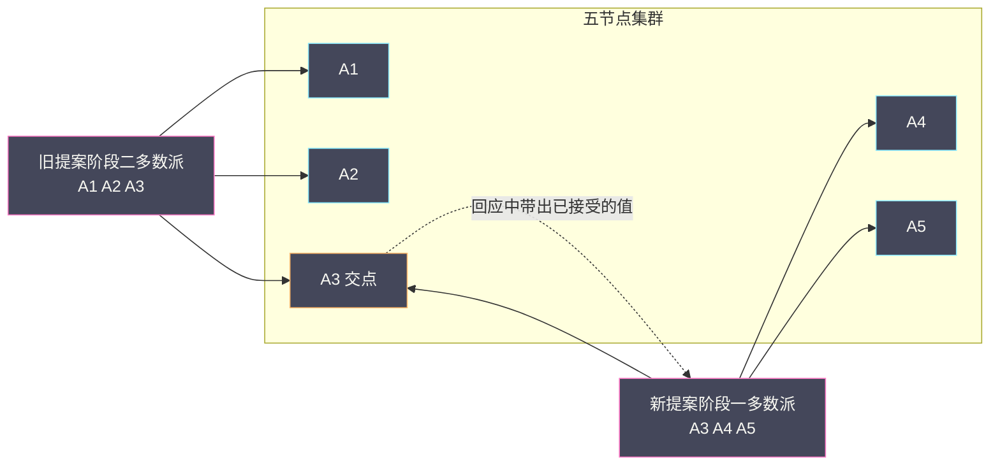
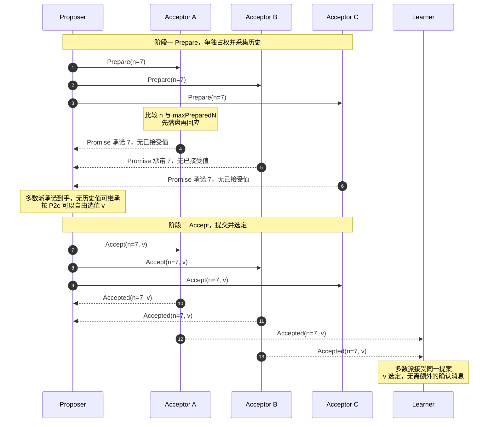
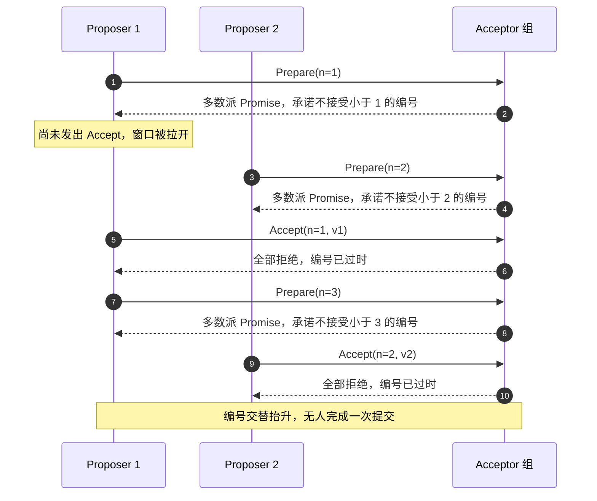
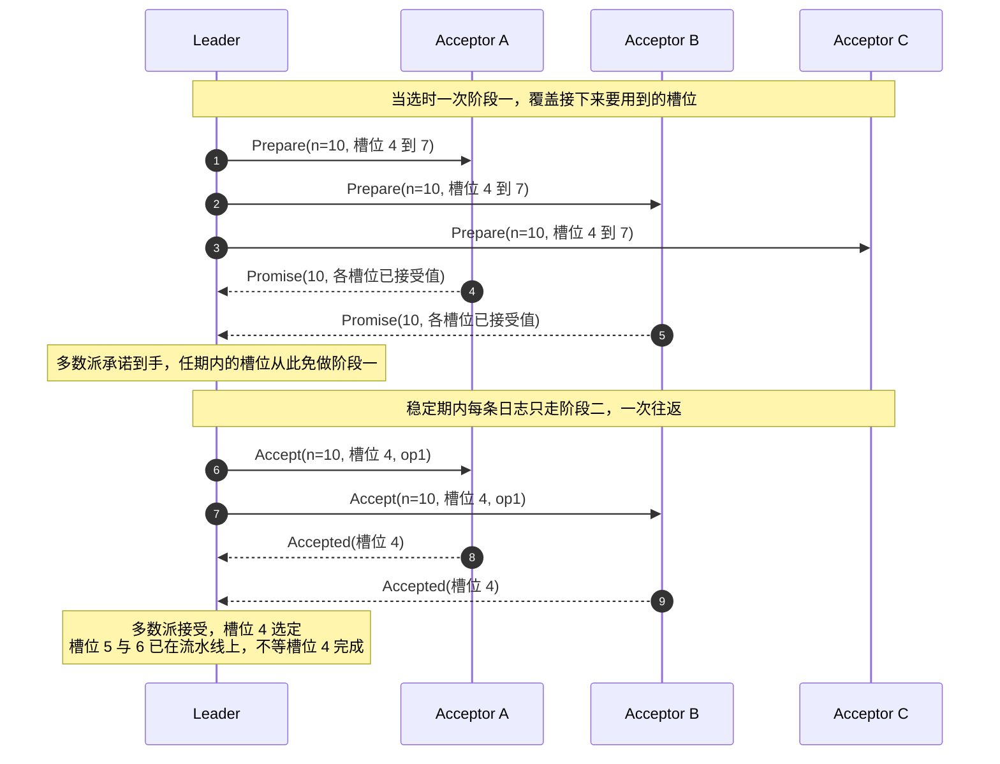

# 04 Paxos 算法原理深度解析

**摘要：**

1989 年，Leslie Lamport 写下了一份用爱琴海小岛议会比喻分布式共识的手稿，此后近十年它被审稿人反复退回，直到 1998 年才以《The Part-Time Parliament》为题正式刊出，2001 年又用《Paxos Made Simple》重讲了一遍。这篇论文给出的东西比「一个能用的协议」要多：它第一次说清了，在消息会丢、节点会崩、时钟不可信的异步网络里，让一群机器就同一个值达成一致，需要付出什么代价、遵守哪些约束。本文按五问推进：Paxos 约束的到底是什么、它为什么必须长成两阶段的样子、抽掉编号与多数派会退化成什么样、Multi-Paxos 与真实系统怎样把它落地、以及它在哪些场合根本不划算。中段把 Lamport 的 P1 与 P2 两条不变量逐级推导到可执行的消息格式，用四张图分别拆开两阶段时序、多数派相交、活锁的形成与 Leader 任期内的槽位复用，再把 Chubby、Spanner、etcd 三处实现里踩过的坑摊开对照。读完应当能回答两个问题：为什么「一个提案者、一次投票」永远不够，以及为什么数学上正确的算法到了生产环境仍然要重写一遍。

---

## 第 1 章 一个希腊岛屿上的协议

### 1.1 一份被退稿九年的手稿

故事的起点比大多数人以为的更早。1989 年，Lamport 想给分布式共识找一个直觉模型，于是虚构了爱琴海上一个叫 Paxos 的岛屿，岛上的议会用一套传令兵往返的流程来表决法律条文；议员会中途离席去处理别的事，记载法律的那本账册也可能被雨淋湿，而议会依然要保证「同一部法律不会被记成两个版本」。手稿在 1990 年投出，审稿人认为它太像寓言、不够像论文，此后八年它躺在抽屉里，直到 1998 年才在《ACM Transactions on Computer Systems》上全文发表；因为读者抱怨难以读懂，Lamport 又在 2001 年写了《Paxos Made Simple》，用更直白的语言重新推导了一遍同一套结论。

这段曲折本身值得记一笔。同一份内容，用寓言的写法递出去被拒，用定理与不变量的写法递出去被接受，而真正被工程界大规模采用的，反而是后来那篇「简化版」。算法史上有不少这样的例子：一个想法能不能传播，不只取决于它是否正确，还取决于它是否愿意为读者的认知负担让步。Paxos 之后二十年里不断有人重写它的解释，直至 2014 年 Raft 干脆把「可理解性」写进设计目标，这条线索一以贯之。

需要先把边界划清楚。本文讨论的 Paxos 指 Basic Paxos（单值共识）与 Multi-Paxos（多值共识加日志复制）这一族，不含 Byzantizing Paxos、Cheap Paxos 一类针对特定故障模型的变体，也不含把 Paxos 用于成员管理之上的工程封装。它假设的故障模型是崩溃—恢复（crash-recovery）：节点会停下来、会重启，但不会说谎、不会发出伪造的消息。

### 1.2 三种角色，以及它们的边界

寓言里只有三种人，这套划分沿用至今。提案者（Proposer）提出一个值，希望它被接受；接受者（Acceptor）对提案投票，决定接受与否；学习者（Learner）不投票，只负责得知哪个值最终被选定。真实系统里一个进程常常同时扮演三种角色，这个映射关系留到后文再谈，先记住一个要点：**只有 Acceptor 的投票决定结果**，Proposer 只是提出候选，Learner 只是旁观者与传播者。

角色划分的价值在于把一个混杂的问题拆成三段可分别论证的命题。Proposer 的自由度最大，它可以提出任意值，也可以提出重复的值，甚至可以提出一个「别人已经接受过的值」；Acceptor 的自由度最小，它只能依据自己记住的状态作答，而它记住的状态又必须能扛住重启；Learner 的自由度看似最大，但它必须从 Acceptor 的回应里推断出「已选定」这个事实，而「已选定」在异步网络里从来不是一个可以当面确认的事件。

这里埋下了后文反复出现的矛盾：**「已选定」是逻辑事实，不是通信事实**。多数派接受了某个提案，这个值就算选定，哪怕还没有任何一个节点把「已选定」这件事告诉别人，哪怕提案者在此刻崩溃。这个定义上的选择极其关键——它让选定不需要协调者宣布，代价是任何想确认它的人都必须自己去做多数派推断。

### 1.3 共识要满足的那三条性质

在展开协议之前，得先把「共识」这个词收紧。它要求一个分布式系统就某个值达成一致，并且这个一致要同时满足三条性质：终止性（Termination），所有未崩溃的进程最终都会决定某个值；一致性（Agreement），所有决定的进程决定的是同一个值；有效性（Validity），被决定的值必须是某个进程提出过的值，不能凭空产生。

三条之中，一致性与有效性是安全性（Safety），终止性是活性（Liveness）。安全性的特点是「一旦破坏就无法挽回」，因为它意味着两台机器对同一件事给出了不同答案，此后无论怎么修复，总有一方的历史是错的；活性的特点是「破坏了还能等」，系统停在那里不前进，等网络恢复、等故障节点重启，通常可以自己缓过来。Paxos 与所有以它为基础的协议，都选择先保安全、后谈活性——宁可停下来不决策，也不做出两个互相矛盾的决定。

这个取向不是偏好问题，而是被 1985 年的 FLP 不可能性定理逼出来的。Fischer、Lynch 与 Paterson 证明了：在完全异步的模型里，只要有一个进程可能崩溃，就不存在一个确定性的算法能同时保证安全性与终止性。既然不能同时要，那就只能选一个。Paxos 保安全性，把终止性交给「工程上的时间假设」——超时、随机化、Leader 租约，这些手段都不是协议本身的一部分，而是为了让协议在实际网络里能往前走而添加的外部条件。

### 1.4 它和「一次投票」差在哪里

把 Paxos 理解成投票，是最常见也最致命的简化。投票的前提是候选值已经确定，选票只回答「张三还是李四」；而共识面对的是**候选值开放**的局面，任何提案者都可以提议任何值，没有人预先给出候选清单。投票的另一个前提是投票者一定到场、一定投完；而共识面对的是**参与者不可靠**，提案者可能发出提案后立刻崩溃，接受者可能收到一半消息就断网。

这两个前提一旦被抽掉，一次投票立刻失效。设想三个接受者，两个提案者几乎同时提出不同的值，各自被一部分接受者先看到，结果没有任何一个值拿到多数；此时系统既不满足终止性（没有值被选定），也不满足任何人期待的结果。想靠「再投一轮」解决也不行——第二轮面对的仍是同一批可能随时消失的提案者，除非引入某种让某一轮具有排他性的机制。

Paxos 的两个阶段正是为这两个缺口设计的。阶段一用编号与承诺建立一个临时的排他窗口，把「多个提案者同时竞争」压成「某一时刻只有一个提案者的提案有资格被接受」；阶段二用一条选值规则处理「前任提案者可能已经把某个值推进到中途」的情形，让新提案者无法覆盖可能已经生效的值。理解了这两个缺口，就理解了为什么 Paxos 无法被简化成一次往返的投票。

---

## 第 2 章 两阶段是怎么被逼出来的

### 2.1 朴素方案为什么必然分票

从最朴素的方案开始，才看得清每一步是被什么逼出来的。假设每个提案者把自己的值发给所有接受者，接受者接受它收到的第一个提案，当某个值被多数接受者接受时即告选定。这个方案在无竞争时工作良好，一旦有竞争就立刻崩掉。

```
接受者集合：A1, A2, A3
提案者 P1 提出 v = 苹果
提案者 P2 提出 v = 香蕉

A1 先收到 P1 的提案，接受 苹果
A2 先收到 P2 的提案，接受 香蕉
A3 收到的顺序取决于网络延迟，可能是苹果，也可能是香蕉

最坏情况：A3 接受 苹果，则 苹果 得 2 票、香蕉 得 1 票
另一最坏情况：A3 接受 香蕉，则 香蕉 得 2 票、苹果 得 1 票
两个最坏情况之间的差别，只取决于一条消息早到了几毫秒
```

分票的根源不在于票数不够，而在于**接受者没有拒绝的权利**。它只能「接受第一个」，无法表达「我已经在别处听到过更靠后的提案，你这条太旧了」。补上这个拒绝权，就需要一个能判断新旧的东西，于是有了编号。

还有一层更隐蔽的问题。即使某一轮侥幸凑出多数派，「多数派」的构成也可能在两轮之间变化：第一轮的多数派是 {A1, A2}，第二轮的多数派是 {A2, A3}，唯一的交点是 A2。如果 A2 在第二轮忘记了自己在第一轮接受过什么，两轮的决定就可能互相矛盾。所以除了编号，还需要「记忆」，而且这份记忆必须比进程的寿命更长。

### 2.2 提案编号：给「谁说了算」建立全序

Paxos 引入**提案编号（Proposal Number）**，记为 `n`，要求全局唯一且任意两个可比大小。实现上通常取「轮次号加进程 ID」的复合格式，轮次号递增，进程 ID 在轮次相同时打破平局；这样一来，不同进程在同一轮次给出的编号必然不同，任意两个编号又必然可比。

编号的作用是把「谁说了算」这件模糊的事变成一次比较。接受者面对一个提案时，只需比较编号：编号更大的提案优先级更高，编号更小的提案一律视为过时。这条规则简单到近乎粗暴，却解决了分布式系统里最难的一件事——**在没有全局时钟的情况下，为竞争建立一个所有节点都会得出相同结论的序**。

为什么不能用时间戳代替编号？因为时间戳依赖时钟同步，而时钟可能回拨、可能漂移，两台机器的时钟差出几毫秒，就会让「谁更新」的判断出现分歧。编号把这个判断从「物理时间」搬到了「逻辑计数」，只要能保证唯一与可比，就与时间的准确性彻底解耦。这也是分布式系统里一条反复出现的经验：凡是需要「先后」的地方，尽量用逻辑量而不是物理量。

### 2.3 P1 与 P2：把安全性写成不变量

现在可以做真正的推导了。要保证的安全性只有一句：**任何时刻至多一个值被选定**。把它写成一条更强、更容易操作的不变量：

> 若某个值 v 在编号为 n 的提案中被选定，则任何编号大于 n 的提案，其值也必须是 v。

这条性质足够强：如果它成立，那么一旦 v 被选定，所有编号更大的提案都只能携带 v，于是不可能有第二个不同的值被选定。但「任何编号大于 n 的提案」这个说法太笼统，需要逐级收紧成可执行的形式。Lamport 的推导是一串逐步加强的命题，每一级都把上一级里无法检查的部分换成可以检查的部分。

第一级，P2：若 v 在编号 n 中被选定，则任何编号大于 n 的提案，只要被提出，其值就是 v。这比原命题强了一点（覆盖了「提出」而不只是「选定」），但仍无法验证，因为提案者无法预知未来的提案。

第二级，P2a：若 v 在编号 n 中被选定，则任何编号大于 n 的提案，只要被任何接受者接受，其值就是 v。这一级把主语从「提案者提出」换成了「接受者接受」，因为接受是接受者自己做的动作，可以被约束。代价是接受者不知道「v 是否已在编号 n 中被选定」，它没有全局视野。

第三级，P2b：若 v 在编号 n 中被选定，则任何提案者提出的编号大于 n 的提案，其值都是 v。这一级把约束重新放回提案者身上，由提案者在发出提案前自行保证。问题依然是视野——提案者怎么知道未来哪些值会被选定。

第四级，P2c：对任意值 v 与编号 n，若提案者发出值为 v、编号为 n 的提案，则存在一个由多数接受者组成的集合 S，使得要么 S 中没有任何接受者接受过编号小于 n 的提案，要么 v 是 S 中所有接受者已接受的、编号小于 n 的提案里编号最大的那个提案的值。

到 P2c 这一步，约束终于变成了可以执行的动作：提案者只要先问一遍多数派「你们接受过什么」，再按问到的结果决定自己提什么值即可。这个「先问一遍」就是阶段一，「按结果提交」就是阶段二。**两阶段不是设计者拍脑袋分出来的，而是 P2c 对信息的要求逼出来的**——你必须先收集多数派的已接受记录，才可能选出满足 P2c 的值。笔者建议把这一串命题当成一个整体来读：P2、P2a、P2b 三级都不是最终答案，它们只是把「无法检查的约束」逐级换成「可以检查的约束」的中间产物，真正的落点是 P2c。

与 P2c 配对的是接受者一侧的规则 P1a：接受者可以接受编号为 n 的提案，当且仅当它没有对编号大于 n 的 Prepare 请求作出过响应。这条规则就是后文的「承诺」，它保证提案者在阶段一收集到的信息在阶段二仍然有效——如果接受者随时可以反悔，阶段一辛苦收集的信息就会在阶段二作废。

### 2.4 从 P2c 到消息：阶段一到底在收什么

把 P2c 展开成协议动作，阶段一的语义就非常清楚了。提案者广播 `Prepare(n)`，接受者的回应里必须带两样东西：一个承诺，一份历史。

```python
"""接受者需要持久化的三个量，重启后必须原样恢复。"""
max_prepared_n = 0    # 承诺过的最大编号，决定还能不能接受更小的提案
accepted_n = None     # 已接受提案中最大的编号
accepted_v = None     # 与之对应的值

def on_prepare(n):
    if n > max_prepared_n:
        # 先落盘，再回应。顺序反了就等于没有承诺
        persist(max_prepared_n=n)
        max_prepared_n = n
        return Promise(n, accepted_n, accepted_v)
    return Nack(max_prepared_n)

def on_accept(n, v):
    if n >= max_prepared_n:
        persist(max_prepared_n=n, accepted_n=n, accepted_v=v)
        notify_learners(n, v)
        return Accepted(n, v)
    return Nack(max_prepared_n)
```

代码里最容易被看漏的是 `persist` 的位置。接受者必须先把状态写到稳定存储，再发出回应；如果先回应后落盘，回应所承诺的事情在掉电后就消失了，阶段一收集到的信息随之作废，正确的协议立刻退化成不安全的协议。这一点在后文还会以「失忆的接受者」的形式再讲一遍，因为它是最多实现出事的地方。

回应里的三个值各有用途。`Promise` 本身回答「你有没有让出这个编号」，`accepted_n` 与 `accepted_v` 回答「你手上最靠后的值是什么」。提案者收到多数派回应后，只需在所有回应里找出 `accepted_n` 最大的那一对：若存在，就必须采用它的值；若全部为空，才可以自由选择。这条规则看起来只是几行比较，实质上是 P2c 在具体消息格式下的投影。

### 2.5 两个阶段各自解决了什么

把两阶段放在一起看，职责划分相当干净。阶段一解决「谁有权提案」，它用编号加承诺排除掉过时的提案者，形成一个临时的排他窗口；阶段二解决「提案什么值」，它在已知历史的前提下选值，避免与可能已生效的值冲突。

这个划分解释了一个常见的疑问：阶段一能不能省掉？答案是省不掉，但原因不是「流程规定如此」。省掉阶段一，等于放弃 P2c 里的信息采集，提案者只能凭自己的意愿选值；一旦前一个提案已经把某个值推进到多数派，后一个提案就可能提出不同的值，两个值同时被选定。阶段二的选值规则之所以能工作，全靠阶段一问出了那个「已接受的最大编号」。

反过来，阶段二也不能省。只做阶段一，等于所有接受者都承诺让位，但没有人真正提出值，系统达成的是「一致地不决定」，终止性被牺牲掉了。两阶段各管一头，缺一个都不成协议。

### 2.6 多数派为什么是 n/2+1

**多数派（Quorum）** 取 ⌊n/2⌋+1，这个数字是被「任意两个多数派必须相交」唯一确定的。设阈值为 k，要求任意两个大小为 k 的子集都相交，等价于 2k 大于 n，即 k 大于 n/2，最小整数解就是 ⌊n/2⌋+1。

相交的必要性来自安全性的构造方式。新的阶段一多数派必须能够看到旧阶段二多数派接受过的值，如果两组不相交，新提案者就完全看不到旧值，它可以合法地提出一个不同的值，而旧值其实已经被选定——一致性当场破裂。所以「相交」不是效率优化，而是正确性的前提。

阈值也不能随意放大。取 2n/3 当然也满足相交，但每多要求一票，就多一个必须存活的节点，可用性下降、延迟上升，换来的只是「相交得更充分」这个用不上的性质。多数派是满足相交的最小值，多一分浪费。这也是为什么所有以「相交」为基础的协议——Paxos、Raft、ZAB——最终都收敛到同一个数字，它们的约束条件相同，解自然相同。

下图把相交这件事画出来。五节点集群里，旧提案的阶段二多数派与新提案的阶段一多数派各有三个成员，无论怎么取，都必然共享至少一个节点；共享的那个节点就是旧值得以延续的通道。



图中交点的存在是必然的，但交点是哪一个并不确定。它取决于两次多数派各自的网络时序，可能是 A3，也可能是 A1 或 A5。协议的正确性不能依赖「交点恰好是谁」，只能依赖「交点一定存在」，这是多数派相交与一般投票最本质的差别。

### 2.7 值选择规则为什么反直觉

阶段二的选值规则要求提案者在发现历史值时放弃自己的值，这在直觉上很难接受——我提出的值凭什么要让位给别人的？答案在于「可能已生效」这个判断的性质。

提案者看到的只是多数派的回应，它无法确定那个被接受的值是否已经被选定。可能那个值只被一个接受者接受过、距离多数派还差两票；也可能它已经被多数派接受、早已选定。异步网络里这两种情况在回应内容上完全一样。既然无法区分，就只能按最坏情况处理：**假定它已经选定**。假定成立时，沿用旧值是唯一安全的选择；假定不成立时，沿用旧值也只是让一个尚未生效的值提前生效，没有破坏任何安全性。

反过来选自己的值，赌的是「旧值尚未选定」。赌赢一次没有收益，赌输一次就是双值选定。这是一个收益与风险极不对称的赌局，理性选择只能是让位。这条规则背后的价值取向很明确：在信息不足的分布式环境里，**保守本身就是安全的一部分**。

举一个具体的走法。五节点集群里，P1 用编号 1 提出「苹果」，A1、A2 接受后 P1 崩溃，此时「苹果」只有 2 票、尚未选定。P2 用编号 2 发起阶段一，A1、A2 的回应里带着 (1, 苹果)，A3、A4、A5 回应为空。P2 若按自己的意愿提「香蕉」，就可能出现「P1 的苹果被 A3 补上最后一票」与「P2 的香蕉被多数派接受」同时成立，两个值都选定。按规则提「苹果」，则不论哪种时序，最终只有「苹果」被选定。P2 的意愿落空了，系统的一致性守住了。

---

## 第 3 章 安全性的代价：记忆、持久化与容错边界

### 3.1 两条不变量如何配合

前面推导出的一串命题，最终可以压缩成两条互相咬合的不变量。第一条管值的延续：若 v 在编号 n 中被选定，则任何编号大于 n 的提案，其值也必须是 v。第二条管承诺的约束力：接受者一旦承诺了编号 n，就不再接受编号小于 n 的提案。

两条不变量各管一半。第二条保证编号更大的提案拥有排他权，旧提案者无法在新提案推进时插进来；第一条保证新提案者必须延续旧值，不能引入冲突。合起来，任何时刻至多一个值被选定的结论就成立了。判断一个 Paxos 变体是否安全，其实就是检查这两条是否同时被满足——凡是会削弱承诺约束力的优化，都必须有额外的机制补回来，否则安全性就有漏洞。

用这两条去检查常见的「优化」，会立刻发现一些看起来无害、实则会坏事的主意。譬如「接受者只记住最近一分钟的承诺，超时就忘掉」，第二条被削弱，一个延迟超过一分钟的旧提案就能趁着记忆过期溜进来；再譬如「提案者在收到多数派 Promise 后允许改值」，第一条被削弱，已选定的值可能被覆盖。这类改写之所以危险，是因为它们在正常路径上完全看不出问题，只在特定的时序窗口里才暴露。

### 3.2 一个失忆的接受者

把第二条不变量拆掉，看看会发生什么。假设接受者 A 先收到 `Prepare(5)`，承诺不再接受编号小于 5 的提案；随后它收到一条迟到的 `Accept(3, v3)`。如果 A 忠实记住了承诺，它会拒绝这条过时的提案；如果 A 因为重启、因为内存被清、因为实现里图省事把它当缓存丢掉了，它就会接受 v3。

后果不只是「A 多接受了一个值」这么简单。编号 5 的提案可能已经在其他接受者那里推进到快选定的程度，此时 A 接受了编号 3 的值，等于让两个不同编号、不同值的提案同时朝「多数派」方向前进。若后续的时序恰好凑巧，编号 3 的值与编号 5 的值可能先后被多数派接受，双值选定就此发生。

由此得到一条硬约束：接受者承诺过的最大编号、已接受的提案编号与值，都必须持久化。它们不是缓存，不是可重建的派生状态，而是安全性的一部分。很多实现出事，恰恰是因为把 `maxPreparedN` 放在了内存里——单机测试永远正常，只在「进程重启加网络重排」的组合下暴露，而这类组合在混沌工程里特别贵。

### 3.3 全体确认的诱惑

既然多数派相交这么麻烦，为什么不干脆要求全体确认？全体确认当然也满足相交（它比多数派更严格），安全性没有问题，问题出在可用性上：只要有一个节点故障或延迟，就无法达成共识，容错能力降为零。一个三节点集群用全体确认，等于把三个节点的可靠性串起来，可用性比单机还低。

多数派确认是这两者之间的最优折衷。三节点允许一个故障，五节点允许两个，容错能力随节点数增长，而成本只是「少数派可能暂时落后」。落后的节点并不影响一致性——它没有参与那次选定的多数派，只要后续的日志修复把它补齐，它就重新跟上。**用少数派的暂时不一致，换多数派的持续可用**，这是共识协议容错能力的真正来源。

把这三种确认方式摊开对比，取舍就一目了然。

| 确认方式 | 三节点容错 | 提交延迟 | 安全性 | 主要问题 |
| :--- | :--- | :--- | :--- | :--- |
| 单一节点确认 | 零 | 最低 | 依赖该节点不故障 | 单点故障即丢数据 |
| 全体确认 | 零 | 取决于最慢节点 | 最强 | 一个慢节点拖住全局 |
| 多数派确认 | 一个 | 取决于多数派中最慢者 | 足够 | 少数派暂时落后 |

表里第三行与第二行的差别，是「更严格是否更好」这个问题的一个反例。全体确认看起来更严格、更安全，实际上是三种方案里最脆弱的——它连单点故障都扛不住，而安全性并不比多数派更高。在分布式系统里，保证的强度与系统的可靠性并不总是正相关，中间隔着「故障模型」这个变量。

### 3.4 多数派的容错账本

多数派还有一个常被忽略的性质：它把「容错能力」与「决策成本」绑定在一起增长。三节点容忍一个故障，代价是每次决策等两票；五节点容忍两个故障，代价是每次决策等三票。想要更强的容错，就得接受更多的等待与更大的消息量，这笔账没法赖掉。

由此我们可以推出两个实际结论。其一，偶数节点没有意义：四节点与三节点的容错能力相同（都只能容忍一个故障），但四节点需要三票才能决策，比三节点多等一票，纯属浪费。其二，集群规模不会无限增长：七节点容忍三个故障，代价是每次决策四票，跨地域部署时这四票的往返时间会成为写延迟的下界，所以生产集群很少超过七个节点。

还有一个更细的推论，关于「容错」的定义。多数派能容忍的是「少数节点不可用」，而不是「少数节点叛变」。如果故障模型里包含节点发出错误消息（拜占庭故障），多数派就不够了，需要超过三分之二的正确节点，因为错误节点可以主动配合、伪造投票、把错误的信息传给不同的人。Paxos 的故障模型里没有这一项，它假设节点只会沉默，不会说谎。

---

## 第 4 章 完整时序、活锁与退避

### 4.1 一次完整的共识

把消息串起来看，一次 Basic Paxos 的完整过程是两轮往返。下图把两个阶段、每条消息的语义与最终「选定」的判定点都标了出来，注意最后一个判定点不在任何一条消息里，而在 Learner 收到的多数派回执中。



图里有一处值得停留：阶段一的第三票回来时，提案者并不知道另外两个接受者是否「真的」持久化了承诺。它只是相信回应，而回应的可信度建立在一个假设上——接受者先落盘再回应。这个假设不属于协议，属于实现；协议正确性的一半责任，被悄悄交给了实现者的自觉。

### 4.2 活锁：两个提案者互相抬价

Basic Paxos 保证了安全性，却没有保证活性。最著名的反例是两个提案者互相抬编号，谁也提交不了。

```
P1 发出 Prepare(1)，收到多数派 Promise
P1 还没发出 Accept(1, v1)

P2 发出 Prepare(2)，收到多数派 Promise
多数派从此拒绝一切编号小于 2 的提案

P1 的 Accept(1, v1) 到达，全部被拒
P1 重试：Prepare(3)，又拿到多数派 Promise
P2 的 Accept(2, v2) 到达，全部被拒
P2 重试：Prepare(4) …

编号一路抬升，每一轮都「正常执行」，整体却零进展
```

这不是死锁。两个进程都在跑、CPU 在转、消息在飞，只是没有产出。这类状态比死锁更难发现：死锁会让系统明显卡住，容易触发告警；活锁会让系统看起来「很忙」，如果只盯资源利用率，甚至会以为它很健康。判断标准必须换成「有效产出」——共识是否达成、写入是否成功，而不是「进程是否活着」。

下面的时序把活锁的循环画出来。注意每一轮里两个提案者的动作都是合法的，问题只出在节奏——一方的 Accept 总是恰好落在另一方抬价之后。



### 4.3 随机退避的期望收益

工程上缓解活锁的标准手段是随机退避：失败后等一段随机长度的时间再重试，让两个提案者的节奏错开。这一步的效果可以算出来，不必凭感觉。

设两个提案者各自独立地从区间 [0, T] 里均匀抽取退避时长，一次消息往返记为 r。要让其中一方稳稳赢下一轮，需要它比对方早出发至少 r，否则落后的一方仍可能在其 Accept 到达之前抬价成功。两次独立均匀抽取的差落在 r 以内的概率可以算出来，于是「一轮就能解决」的概率约等于 ((T−r)/T)²，期望轮数是它的倒数。

不妨代进两个数看看：取 T = 2r，成功率约 0.25，期望四轮；取 T = 10r，成功率约 0.81，期望不到两轮。把退避区间放大一个数量级，期望轮数就从四降到二，这个收益很划算——退避区间只需要比往返时间大一个量级，而不需要无限放大。收益递减也很清楚：T 到 100r 时成功率只从 0.81 涨到 0.98，期望轮数的改善已经微乎其微，而平均等待时间却涨了十倍。

```python
import random, time

def propose(value, max_rounds=50):
    for _ in range(max_rounds):
        n = next_proposal_number()          # 必须严格递增
        promises = broadcast_prepare(n)     # 阶段一
        if len(promises) < quorum_size:
            time.sleep(random.uniform(0, backoff_window))
            continue
        v = adopt_or_choose(promises, value)  # P2c：有历史值就沿用
        if broadcast_accept(n, v) >= quorum_size:
            return v
        # 关键在于退避窗随失败次数增长，且用全抖动而非固定步长
        backoff_window = min(backoff_window * 2, backoff_cap)
        time.sleep(random.uniform(0, backoff_window))
    raise ConsensusNotReached()
```

退避能压住概率，压不掉根因。FLP 定理保证了在纯异步模型下不可能有一个确定性算法既保安全又保终止，随机化只是把「必然失败」换成「极小概率失败」。真正的解法是换模型：引入时间假设，让某个节点在正常情况下拥有稳定的提案权，把「多个提案者竞争」这个前提本身消掉。这就是卓越提案者（Distinguished Proposer）的思路，也是 Multi-Paxos 的起点。

### 4.4 卓越提案者：把竞争从协议里拿掉

Lamport 在论文里给出的建议很朴素：正常情况下只让一个提案者工作，其余节点只在它失效时接管。这样一来，活锁的前提消失了——没有第二个提案者来抬价，编号可以单调推进，每轮都是「阶段一一次、阶段二一次」的确定性路径。

这个建议的分量比它看起来重。它把 Paxos 从「对等竞争」改造成了「主从协作」，也把协议的重心从「如何在竞争中保证安全」转向了「如何安全地换主」。前者是算法问题，后者是工程问题，而后者恰恰是 Paxos 论文着墨最少、现实中最难的部分。换个说法：Paxos 用一个优雅的方式解决了「多个提案者同时提案」的安全性，然后把这个问题的解法本身当成了新问题的源头。

换主引入的第一个难题是「新主如何确认自己真的当选」。它拿到多数派 Promise 只是必要条件，因为在它收集 Promise 的过程中，可能已经有另一个提案者也拿到了多数派。真正的判据只能靠编号——谁的编号更大谁说了算，于是「当选」这件事在 Basic Paxos 里并没有一个明确的完成事件，只有一个单调推进的编号序。这个模糊地带，正是 Multi-Paxos 与 Raft 在设计上分道扬镳的地方。

---

## 第 5 章 Multi-Paxos：从单值到日志

### 5.1 Basic Paxos 的账单

Basic Paxos 只解决一个值的共识。而真实系统要的是「一串操作按同一顺序被所有副本执行」，也就是日志复制：第一条是什么、第二条是什么、第十万条是什么。最直接的做法是为每条日志独立跑一次 Basic Paxos，但这样每提交一条日志都要两轮往返（阶段一加阶段二），在高吞吐场景下这个开销完全无法接受。

把账算细一点。假设集群同机房部署，一次往返 1 毫秒，那么纯协议开销就是每条日志 2 毫秒，对应每秒五百条的理论上限，这还没算磁盘落盘与状态机应用。而实际系统里日志写入往往是批量、连续的，两轮往返意味着每条日志都要串行等两个 RTT，吞吐被往返次数死死压住。降不下来，就只能改协议。

改的方向有两个，一个省阶段一，一个省等待。省阶段一靠「一次承诺，多次使用」，省等待靠「不等确认就发下一条」。前者是 Multi-Paxos 的核心，后者是流水线。

### 5.2 Leader 与阶段一复用

Multi-Paxos 的第一个优化是把提案权收敛到一个 Leader 上，选举一次、任期之内只由它提案。竞争消失，活锁消失，编号也可以简化成「任期号加槽位号」。

第二个优化是利用一个观察：阶段一争到的承诺是「不再接受编号小于 n 的提案」，这条承诺的作用域是**编号**，不是**某个具体的值**。既然 Leader 用编号 n 拿到了多数派承诺，那么它对编号 n 之下的所有提案都拥有排他权，也就可以用同一个 n 提交任意多个值——只要这些值分别落在不同的槽位上。

于是协议变成了这样：Leader 当选时做一次阶段一，覆盖全部槽位（实际操作中往往是按需覆盖，遇到没承诺过的槽位再补一次）；此后每提交一条日志只走阶段二，一次往返即可完成。两轮降一轮，吞吐翻倍，而安全性没有任何损失，因为承诺仍然在，只是被摊销了。

下图把「任期开工时一次阶段一、之后逐槽位阶段二」的节奏画出来。关键在时间轴的上半段与下半段的对比：上半段是当选成本，只付一次；下半段是每条的提交成本，只付一次往返。



图里下半段的并发是刻意的。Leader 不需要等槽位 4 的 Accepted 回来才发槽位 5，因为两个槽位是两个独立的共识实例，编号相同但槽位不同，互不干扰。代价是提交顺序与发送顺序不再一致，需要额外维护「提交点」这个水位线。

### 5.3 槽位、空洞与流水线

Multi-Paxos 把日志切成槽位（Slot），每个槽位是一个独立的共识实例，槽位号就是日志索引。这个设计带来两个好处与一个麻烦。

第一个好处是流水线。Leader 可以连续发出多个槽位的 Accept，不必逐条等确认，吞吐不再被单个往返限制，而是被带宽与批处理能力限制。第二个好处是修复的粒度变细——某个槽位出了问题，只需要针对那个槽位重跑阶段一，不必回滚整条日志。

麻烦是空洞。如果槽位 4 卡住（多数派迟迟不确认）、槽位 5 与 6 正常，那么 5 与 6 即使已经选定，也不能被上层状态机应用——状态机要求按序执行，前面有一个洞，后面的操作就不能落地。处理办法有两种：等 4 恢复，或者让 Leader 在 4 上提一个空操作（no-op）把它填上。空操作不改变状态，但它占住位置，让顺序得以延续。

空洞是「并行提案」的必然产物，也是 Multi-Paxos 与 Raft 在工程形态上最大的分野之一。Raft 用「日志连续性」这条更强的约束把空洞从设计里排除掉：Leader 只为紧邻的下一个位置提案，前缀不匹配就回退修复，日志永远是一条连续的线。代价是 Leader 的日志必须是全网最新，选举时要比较日志新旧，而且填充式的修复要跑多轮。两条路各有代价，一条把复杂度放在协议的提交规则里，另一条放在协议的选举与修复里。

### 5.4 批量与租约

除了 Leader 与阶段一复用，Multi-Paxos 还有两个常见的吞吐与延迟优化，思路都来自「摊销」。

批量提案（Batching）把多个待提交操作打包进一个槽位，一次往返完成多条日志。共识的固定成本主要是消息往返与落盘，而一次往返能携带一个操作，也能携带一百个操作，把操作打包就等于摊薄固定成本。代价是延迟：为了凑够一批，单个操作要等一会儿，批越大等得越久。这是吞吐与延迟之间最经典的一笔交易，取值只能由业务对尾延迟的容忍度决定。

Leader 租约（Lease）省的是读路径。**线性一致（Linearizability）** 的读要求确认「自己是否仍是合法 Leader」，朴素做法是走一次多数派确认，把读延迟推到一次往返。租约换了个思路：Leader 在当选后与多数派约定一段时间，在这段时间内它确定自己不会被取代，于是可以直接读本地状态机，读延迟降到零往返。代价是依赖时钟——租约的有效性建立在「时钟不会跳跃」这个假设上，一旦发生时钟漂移或暂停（比如虚拟机被宿主机挂起几秒），Leader 可能以为自己还在租约内，实际早已过期，读出去的就是旧值。

这是一笔典型的「用假设换延迟」。低延迟很少是免费的，通常要用一个额外的、往往很脆弱的假设去换，而「时钟可靠」恰恰是分布式系统里最不该被轻信的假设。所以租约优化通常只在时钟环境可控的场景里使用——同机房、NTP 稳定、虚拟化层不做长时间暂停；跨地域部署时，租约要么拉长到失去意义，要么干脆换回多数派确认。

### 5.5 与 Raft 的本质差异

把 Multi-Paxos 与 Raft 放在一起，很容易得出「Raft 就是 Multi-Paxos 的工程版」这个结论。这个说法在精神上成立，在细节上会误导人，因为两者对「协议应该定义到哪一层」的立场不同。

| 维度 | Multi-Paxos | Raft |
| :--- | :--- | :--- |
| Leader 产生 | 论文未定义，阶段一顺带形成事实上的 Leader | 协议内置任期与投票，一张选票一个任期 |
| 日志形态 | 槽位独立，允许空洞，需 no-op 或等待填充 | 前缀连续，不允许空洞，按前缀匹配修复 |
| 提交判据 | 每个槽位独立凑多数派 | 仅当前任期的条目按多数派推进，前驱随之提交 |
| 成员变更 | 未定义，实现自行设计 | 论文给出单步变更与联合共识两种方案 |
| 读一致性 | 未定义，实现自行设计（租约或多数派确认） | ReadIndex 与租约读都有明确描述 |
| 失效恢复 | 新 Leader 需扫描全部槽位找中间态 | 靠日志新旧比较与逐段回退，规则统一 |

表格最上面两行的差别是根本性的。Multi-Paxos 的 Leader 是「阶段一的副产品」——谁能拿到多数派承诺谁就是 Leader，协议里没有一个「当选」事件，只有一个单调推进的编号。Raft 把 Leader 的产生做成了协议的一等公民：任期、投票、随机超时、日志新旧比较，全部写清楚。这个差别的直接后果是「正确性论证的边界」不同：Multi-Paxos 的安全性只覆盖单值共识那一层，Leader 选举与日志连续性属于实现者的责任；Raft 的安全性覆盖到整个协议，包括选举。

第三行的差别常被低估。Raft 有一条容易被误读的规则：Leader 只能通过「当前任期条目的多数派确认」来推进提交点，不能直接数旧任期条目的票数。这条规则看起来多余，实际上是防止「幽灵提交」的关键——旧任期的条目即使已被多数派持久化，也可能在后续选举中被覆盖，只有当前任期的条目被多数派确认，才能反推前驱也已安全。Multi-Paxos 里没有这条规则，因为它的提交判据是逐槽位的，等价问题由「槽位是否已被多数派接受」直接回答，不需要借助任期。

---

## 第 6 章 从算法到生产：那些论文没写的部分

### 6.1 2006 年的 Chubby 与 2007 年的复盘

Paxos 论文发表后的第八年，Google 的 Chubby 上线并支撑了 GFS 与 Bigtable 的元数据协调。2006 年的 OSDI 论文《The Chubby lock service for loosely-coupled distributed systems》披露了它的形态：每个单元（Cell）五个副本，用 Paxos 复制日志，选出一个主副本（Master）对外服务，客户端靠租约缓存元数据并用失效通知保持一致性。

第二年，Chandra、Griesemer 与 Redstone 在 PODC 上发表了《Paxos Made Live: An Engineering Perspective》，把实现过程中的坑逐条摊开。这篇论文的价值不在于否定 Paxos，而在于划清了一条界线：核心算法只占整个系统的一小部分，真正吃掉工期的是「算法如何与文件系统、快照、成员变更、主租约、客户端交互正确协作」这些论文里没写的东西。

论文里提到的问题可以归成几类。磁盘数据损坏是真实存在的，不是理论担忧，实现必须用校验和去发现它；快照与日志的交互很棘手，快照期间协议不能停，而日志截断又必须与快照严格对齐；成员变更不能随手做，配置切换的过渡期要保证不会出现两个互相独立的多数派；主租约的时序必须精确到「什么时候可以认为对方已经不是主」，任何一处偏差都会产生幽灵主。这些问题的共同点是：它们都不在 Paxos 的定理里，但每一个都能让系统出错。

### 6.2 磁盘、快照与日志修复

落盘这件事在论文里只有一句「状态必须持久化」，在实现里却是一整套工程。写日志要保证顺序，要保证写入的完整性，要在掉电后能判断某条记录是完整的还是写了一半的。常见的做法是给每条记录加长度前缀与校验和，读取时先校验再解析，遇到不完整就截断到最后一个完整记录——这个动作本身必须有幂等性，因为重启可能发生在任何时刻。

快照的难点在于它与日志的边界。快照是对某一时刻状态机的全量拷贝，日志是这个时刻之后的所有操作，两者必须严格衔接：快照里已经包含的操作，不能再从日志重放；日志里缺失的操作，快照必须完整覆盖。实现上通常给快照打上一个「已应用到哪个槽位」的标记，恢复时以这个标记为分界线。这个标记一旦写错，恢复出来的状态会静默地少几条或多几条操作，而这类错误往往要等到业务数据对不上时才被发现。

**日志修复（Log Repair）** 是 Multi-Paxos 里最复杂的模块。新 Leader 上任后，必须确定每个槽位的状态：哪些已经被多数派接受（可以直接沿用）、哪些只有部分接受（需要补一轮重新选定）、哪些是空洞（需要填 no-op）。这个过程要扫描全部未提交槽位，对每个槽位重跑一次阶段一，还要处理「旧 Leader 在任期内接受了但未提交」的条目。Raft 用「日志新旧比较加前缀匹配」把这件事简化成一条可证明的规则，这也是它在工程上更受欢迎的直接原因之一。

### 6.3 成员变更与幽灵 Leader

成员变更的风险来自配置本身的不一致。设想集群从三节点扩到五节点，如果两个节点已经用了新配置、三个节点还在用旧配置，那么新配置的多数派是三票、旧配置的多数派是两票，两组人都能各自选出 Leader，双主就此产生。解决思路无非两种：要么让新旧配置的多数派都满足，即**联合共识（Joint Consensus）**，要么一次只改一个节点、保证任意时刻两套配置的多数派必然相交（单步变更）。

幽灵 Leader 是另一个方向的坑。旧 Leader 因网络分区与多数派失联，但它自己不知道，继续对外提供读服务。客户端连上它，读到的可能是几十秒前的旧数据，而线性一致性要求「读到的必须是某一时刻之后的最新值」。防御手段有两个层次：一是让读也必须确认 Leader 身份（读也走多数派确认，或者依赖租约并在租约到期后立即停止服务），二是让客户端在发现异常时主动切换到新 Leader。前者的代价是延迟，后者的代价是客户端要理解协议。

这两个坑有一个共同点：它们的危害都不体现在「协议是否安全」上，而体现在「系统对外呈现的语义是否还符合承诺」。Paxos 的定理只保证「不会有两个值被选定」，它不保证「客户端不会读到旧值」——后者取决于读路径怎么设计、租约怎么实现、边界怎么判。这是一个从「算法正确」到「系统正确」的跨越，也是《Paxos Made Live》反复强调的那条鸿沟。

### 6.4 Spanner：把 Paxos 组塞进每个分片

2012 年的 Spanner 展示了 Paxos 在大规模系统里的另一种用法。它没有把整个数据库做成一个 Paxos 组，而是把数据切成很多分片（Tablet），每个分片一个 Paxos 组，组内跨三个以上的可用区复制。写入只走分片自己的 Paxos 组，读取则依赖分片 Leader 的租约与 TrueTime 提供的时钟不确定性上界。

这个结构把一个全局问题拆成了很多局部问题。分片之间互不干扰，一个分片的 Paxos 组失去多数派，只影响这个分片的写入，整库不至于停摆；分片内只有三个副本，多数派只需两票，跨可用区的往返被限制在可控范围内。代价是跨分片事务需要两阶段提交，而两阶段提交的协调者又必须高可用——Spanner 的做法是把协调者状态也用 Paxos 复制一遍，于是 Paxos 成了整个系统的底层砖块。

Spanner 对租约的使用值得单独说一句。它给每个分片的 Leader 一个租约，租约长度以十秒为量级，配合 TrueTime 给出的时钟误差上界，保证「在租约有效期内，不可能有第二个 Leader 被选出」。有了这条保证，只读事务就可以在租约内直接读本地副本，不必走多数派确认，也不必加锁。这个设计的代价前文已经说过：它把正确性押在时钟上，于是 Spanner 必须在机房里部署 GPS 与原子钟，用硬件冗余去支撑一个软件假设。

### 6.5 etcd 这一支：Raft 谱系上的同一个骨架

etcd 用的是 Raft，不是 Paxos，但把它放进这一章有实际意义——它是「Multi-Paxos 那一族思想」在生产环境里最广为人知的一次落地，而它踩过的坑也最能说明工程化的代价。

第一类坑是集群规模。两节点集群在 etcd 里没有意义，因为多数派是两票，任意一个节点故障都无法写入，可用性不如单机；四节点同理，容错能力与三节点相同而要多等一票。这类错误在部署时非常常见，原因是运维人员按「副本越多越可靠」的直觉扩容，而共识协议的可靠性与副本数不是单调关系。

第二类坑是磁盘。Raft 的活性依赖心跳与选举超时，而心跳的处理、日志的落盘、快照的生成全在同一个进程里。一旦磁盘 fsync 变慢，Leader 处理心跳就会延迟，Follower 误判 Leader 失联、发起选举，集群反复换主。此时 CPU 与网络都不高，只有写延迟的尾部在抖，监控上看起来「一切正常」。这是共识系统里最典型的活性故障：不是协议错了，是协议依赖的时间假设被底层 I/O 破坏了。

第三类坑是网络分区带来的「抬价干扰」。一个被隔离的节点不断发起选举、把任期号抬高，等它重新连回集群时，高任期会让当前的合法 Leader 被迫退位，集群白白抖一次。解决办法是在选举前先做**预投票（PreVote）**：先问一圈「你们会不会支持我」，拿不到多数派支持就不真的抬任期。这个机制不是 Raft 论文的原始内容，而是工程实践中补上的——它恰好印证了「协议定义到哪一层」这件事有多重要。

第四类坑是成员变更。etcd 采用一次只改一个节点的方式，并在变更前后做显式检查，因为一次改多个节点可能让新旧配置的多数派不相交。为了降低变更风险，它还引入了不参与投票的 Learner 角色：新节点先以 Learner 身份追上日志，再转成投票成员，避免「新节点刚加入就拖慢多数派」。这些机制在 Paxos 论文里一个字都没有。

### 6.6 一份落地检查清单

把上述实现的经验收敛，笔者整理出一份「生产级共识协议必须回答的问题」清单。清单的用处很直接：评估一个协议或一个实现时，逐项对照，缺项越多，落地风险越大。

| 必答项 | 问题 | Paxos 论文 | 生产实现 |
| :--- | :--- | :--- | :--- |
| Leader 选举 | 谁有资格提案，如何防止选票分裂 | 未定义 | Chubby 用主租约，Raft 用任期加投票 |
| 日志修复 | 新主如何补齐与截断日志 | 未定义 | 扫描槽位重跑阶段一，或按前缀匹配回退 |
| 成员变更 | 如何避免新旧配置双多数派 | 未定义 | 联合共识或单步变更加检查 |
| 日志压缩 | 快照与日志如何衔接 | 未定义 | 槽位标记加校验和，截断点严格对齐 |
| 读路径 | 如何保证读不到旧值 | 未定义 | 多数派确认、ReadIndex 或租约读 |
| 客户端交互 | 如何找到 Leader、如何处理重定向 | 未定义 | 服务端转发，或客户端缓存 Leader 地址 |

这张表解释了一个长期存在的困惑：为什么「Paxos 是共识算法的标准答案」与「工业界普遍用 Raft」可以同时成立。前者说的是理论地位——它第一个把共识讲清楚了；后者说的是工程成本——把六个空填满的工作量，远大于理解算法本身。Raft 的贡献不是发明了更好的共识，而是把这六个空一次性填掉，并且让填法可以被验证。

---

## 第 7 章 边界与反例

### 7.1 FLP 的边界在哪里

FLP 定理常被误读成「共识不可能实现」。它真正说的是：在完全异步、且允许一个进程崩溃的模型里，不存在同时保证安全性与终止性的确定性算法。它限制的是「确定性」与「完全异步」这两个前提的组合，不是共识本身。

Paxos 绕开它的方式是放弃确定性终止：协议保证不会做出错误决定，但可能一直做不出决定（活锁就是其中一种表现）。工程系统绕开它的方式是再加一个前提：网络在大多数时候是同步的，消息延迟有上界。有了这个前提，超时就有了意义，选举就能收敛，活性就能恢复。所以生产系统里的共识协议，本质上都是「Paxos 的安全性」加「一个时间假设换来的活性」。

这个边界的实践含义是：共识系统的故障，绝大多数不是安全性故障，而是活性故障——网络抖动、磁盘变慢、GC 停顿、时钟漂移，都会让「时间假设」失效，进而让系统停止推进。排查这类问题时，盯着「协议是否正确」往往找不到答案，要去盯「哪个时间假设被破坏了」。

### 7.2 Flexible Paxos：相交是可以重新分配的

多数派必须相交这条结论，有一个常被忽略的限定：它要求的是「阶段一的多数派」与「阶段二的多数派」相交，而不是「两个阶段一的多数派」相交，也不是「两个阶段二的多数派」相交。Howard 等人在 2016 年的 Flexible Paxos 里把这一点讲透：只要保证任意一个阶段一的法定人数与任意一个阶段二的法定人数有交集，协议就是安全的。

这条放宽带来了实实在在的灵活性。读多写少的系统可以让阶段二的法定人数变小（写更快）、阶段一的法定人数变大（选主更慢但更少发生）；反过来也可以。它把「法定人数」从一个固定数字变成了两个可以分别调校的参数，代价是每次调整都要重新验证相交条件，实现的复杂度上升。

不过这条放宽也提醒了一件事：多数派不是 Paxos 的本质，相交才是。多数派只是「在不知道读写比例、要求两边对称」时最省心的那个解。一旦知道了负载形状，就可以把相交的预算重新分配。这跟读写型法定人数系统里「读写配额相加大于副本数」是同一套数学，只是 Paxos 把它藏在了两个阶段里。

### 7.3 不该用 Paxos 的场合

Paxos 不是万能的，把它用在错误的地方，代价会远超收益。

第一种是单机或主备架构能解决的场景。一个主库加一个同步备库，切换靠外部工具或人工，几十毫秒的不可用可以接受，那么引入共识协议只是徒增复杂度——它会把「一个数据库」变成「一个需要多数派在线的集群」，运维负担翻倍，而收益只在「自动切换」这一个点上。

第二种是需要拜占庭容错的场景。Paxos 假设节点只会沉默、不会说谎，一旦故障模型里包含恶意节点或数据损坏导致的错误响应，多数派就不够了，必须换成 BFT 类协议，节点数从 3f+1 起步、消息复杂度高一个量级。用 Paxos 去扛拜占庭故障，安全性的前提从一开始就不成立。

第三种是跨地域强一致写。多数派的地理分布决定了写延迟的下界：三个副本分布在三个大洲，一次写就要等最远的那个副本的往返，几百毫秒起步。这类场景要么接受延迟，要么改用「本地写加异步复制加冲突解决」的弱一致方案，共识协议在这里不是不够好，是物理上做不到。

第四种是只想要「最终一致」的场景。缓存同步、配置下发、日志聚合这类需求，用 Gossip 或者基于版本号的收敛协议就够，共识提供的强一致在这里是过度供给，而它的代价（多数派在线、写延迟）却要全额支付。

### 7.4 权衡的落点

回到最初的问题：Paxos 到底解决了什么。它用「编号加承诺」把竞争排成序，用「多数派相交」把局部共识变成全局唯一，用「值选择规则」把不确定的历史变成保守的延续。三步合起来，安全性被完整地证明了，而活性被显式地交了出去，交给时间假设、随机化和 Leader 机制去补。

这笔交易的形状很清晰：Paxos 换来的是一套可以被验证的安全性论证，付出的代价是「协议本身不保证能往前走」。工程实现的所有复杂度——选举、租约、快照、成员变更、日志修复——本质上都是在补活性这一半，而补法没有标准答案，只能按部署环境、延迟预算、运维能力逐个调。这也是为什么同一个 Paxos，在 Chubby 里长成租约加主副本，在 Spanner 里长成分片加 TrueTime，在 etcd 里干脆换成了 Raft 的形状。

所以在笔者看来，评价 Paxos 不该停在「它难懂」或者「它过时」。它难懂，是因为它把安全性的每一分都摊开给你看，没有用「反正工程上不会出问题」糊过去；它被 Raft 取代，是因为它把工程细节留白太多，而留白的地方恰恰最容易出事。真正值得带走的是那两条不变量与一条相交性质——它们比任何具体协议都活得久，下一个人想设计新的共识协议时，仍然要在这三条约束里做取舍。

---

## 参考资料

1. Lamport, L. (1998). The Part-Time Parliament. *ACM Transactions on Computer Systems, 16*(2), 133–169.（Paxos 原始论文）
2. Lamport, L. (2001). Paxos Made Simple. *ACM SIGACT News, 32*(4), 18–25.（简化版推导，P1/P2 系列的出处）
3. Chandra, T.D., Griesemer, R., & Redstone, J. (2007). Paxos Made Live: An Engineering Perspective. *PODC 2007*.
4. Burrows, M. (2006). The Chubby Lock Service for Loosely-Coupled Distributed Systems. *OSDI 2006*.
5. Corbett, J.C., et al. (2012). Spanner: Google's Globally-Distributed Database. *OSDI 2012*.
6. Fischer, M.J., Lynch, N.A., & Paterson, M.S. (1985). Impossibility of Distributed Consensus with One Faulty Process. *Journal of the ACM, 32*(2), 374–382.
7. Howard, H., Malkhi, D., & Spiegelman, A. (2016). Flexible Paxos: Quorum Intersection Revisited. *arXiv:1608.06696*.
8. Van Renesse, R., & Altinbuken, D. (2015). Paxos Made Moderately Complex. *ACM Computing Surveys, 47*(3), Article 42.
9. Ongaro, D., & Ousterhout, J. (2014). In Search of an Understandable Consensus Algorithm. *USENIX ATC 2014*.
10. Kleppmann, M. (2017). *Designing Data-Intensive Applications*. O'Reilly Media. Chapter 9.

---

> [!note] 思考题
> 1. P2c 要求提案者先向多数派采集「已接受的最大编号值」，再据此选值。如果把采集范围从多数派缩小到任意子集，安全性会在哪个环节失守？
> 2. 活锁的期望轮数可以用退避区间与往返时间的比值算出来。若把退避改成「固定步长」，两个提案者会长期保持同步节奏，此时期望轮数是多少，为什么它比随机退避差得多？
> 3. Multi-Paxos 的槽位允许空洞，Raft 的日志不允许。请各构造一个场景，说明这两种选择分别在哪类故障下更省事，以及省下来的复杂度被转移到了哪里。
> 4. 租约读把正确性押在时钟上。假设某台机器的时钟在一次 GC 停顿期间被 NTP 向前拨了 500 毫秒，租约读会读到什么，防御措施应该放在哪一层？
> 5. Flexible Paxos 允许把阶段一与阶段二的法定人数分别调小调大。如果业务是写少读多，你会把预算分给哪一侧，这个分配对「选主频率」有什么副作用？