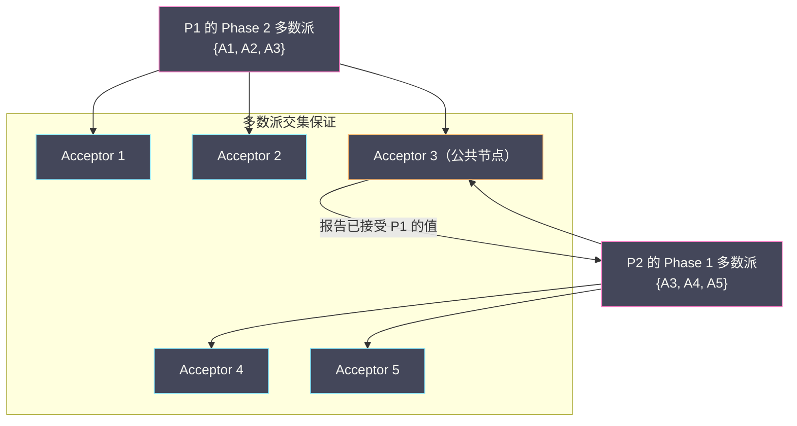
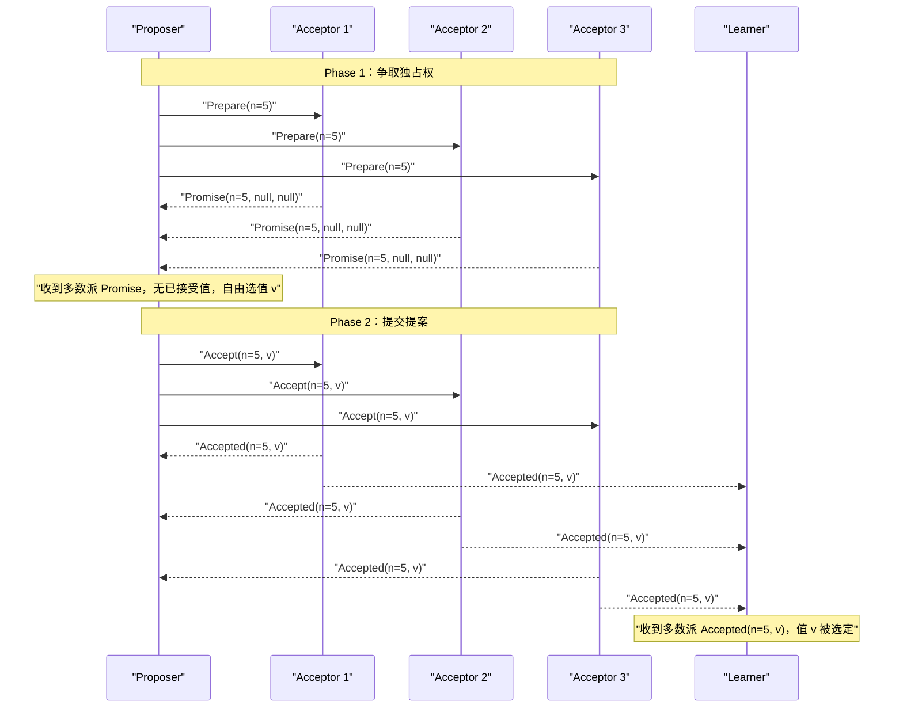
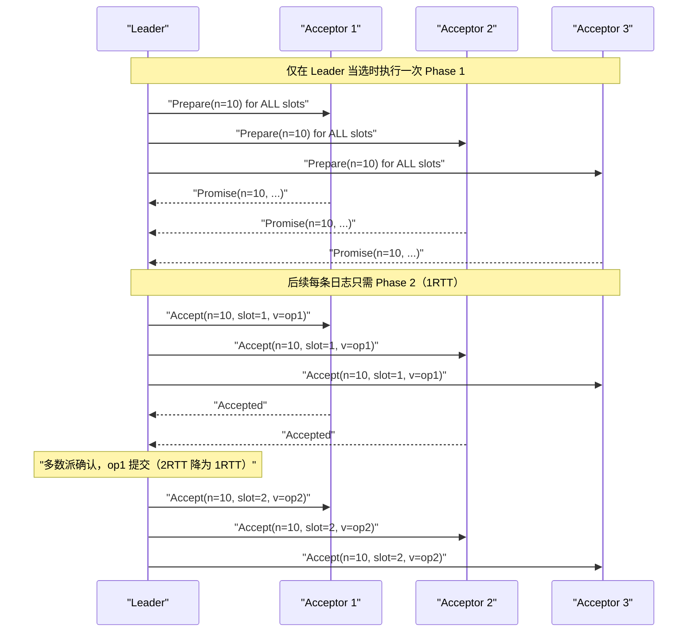

# 04 Paxos 算法原理深度解析

**摘要：**

Paxos 是分布式共识算法的奠基之作。Leslie Lamport 用一个虚构的希腊议会（Paxos 岛）来类比分布式共识协议，在 1989 年写成论文，直到 1998 年才正式发表——据说是因为论文太过晦涩，审稿人多次拒绝。Paxos 解决了一个根本问题：**在消息可能丢失、节点可能崩溃的异步网络中，如何让多个节点就某个值达成安全且持久的共识**。本文从零推导 Basic Paxos 的两阶段设计逻辑，解释每个设计决策背后的"为什么"——为什么需要两个阶段、为什么 Proposer 必须承诺不使用小于某个编号的提案、为什么多数派是安全性的关键；进而分析 Basic Paxos 的活锁问题与 Multi-Paxos 的优化思路，并梳理 Paxos 在工程实现中的五大难点。读完本文，你应当能回答两个问题：Paxos 的两阶段设计为什么"非如此不可"，以及为什么"算法正确"与"工程可用"之间隔着一条鸿沟。

---

## 第 1 章 Paxos 的背景与设计目标

### 1.1 Leslie Lamport 与 Paxos 岛的故事

Paxos 算法由 Leslie Lamport 于 1989 年设计完成，以古希腊爱琴海上一个名为 Paxos 的小岛命名。论文以寓言方式讲述了 Paxos 岛上的"议会"如何在议员（进程）可能随时离席（崩溃）的情况下，通过信使（网络消息）传递提案并达成法律（共识决定）。

这个寓言框架里，Paxos 算法的角色定义如下：**Proposer（提案者）** 提出一个值（Value），希望让所有人接受它；**Acceptor（接受者）** 对提案进行投票，决定是否接受；**Learner（学习者）** 不参与投票，但需要知道最终被选定的值。在实际系统中，一个节点通常同时扮演多种角色。

这个寓言式的表述，既是 Paxos 的魅力，也是它的"门槛"——**它用一个生动但非标准的场景来讲算法，导致很多人读完之后记住了"议会"和"信使"，却没抓住协议的本质**。本文的写法是：先用寓言的直觉建立框架，再用精确的规则把它讲透。

### 1.2 Paxos 要解决的核心问题

在 03 篇中我们已经知道，共识需要满足三个性质：终止性、协议性、有效性。Paxos 的核心挑战是在以下约束下满足这三个性质：消息可能丢失（但不会被篡改）；节点可能在任意时刻崩溃（崩溃后不再响应，但可以恢复）；没有全局时钟，没有消息延迟上界。

这些约束排除了许多朴素的解法。最简单的"Leader 收集所有人的投票后广播决定"方案，一旦 Leader 崩溃，系统就永远无法达成共识（终止性失败）。**Paxos 的巧妙之处，在于它用"多数派加提案编号"这套机制，在没有稳定 Leader 的前提下也能保证安全性**——而稳定性（Leader）只用于优化性能，不用于保证正确。

### 1.3 一个延伸：为什么 Paxos 被称为"分布式系统的公理"

Paxos 常被形容为"分布式系统领域的公理"——**不是因为它"简单"，而是因为它"基础"**。

**它是许多后续协议的思想源头**。Raft、ZAB、以及各类分布式数据库的复制协议，在"多数派决策""提案编号""两阶段"这些核心思想上，都能追溯到 Paxos。**理解了 Paxos，再看这些协议，就会发现它们只是在"具体形态"上做了调整**。

**它把"共识"从"工程直觉"提升为"可证明的协议"**。在 Paxos 之前，"多个节点达成一致"更多是一种工程实践；Paxos 第一次给出了"在什么假设下、用什么机制、为什么正确"的完整回答。**这种"从实践到理论"的提炼，是它成为"公理"的根本原因**。

**它的"难懂"本身也成了一种启示**。Paxos 的晦涩催生了 Raft（以可理解性为目标），而 Raft 的成功又反过来证明了"可理解性"是一项重要的工程属性。**Paxos 的"不友好"与 Raft 的"友好"，构成了分布式系统设计史上一次有意义的对照**。

**这三条合起来说明**：Paxos 的价值，不只是"一个能用的协议"，更是"一套被反复借鉴的思想"与"一次关于'可理解性'的教训"。**这也是本专栏把它放在 Raft、ZAB 之前讲的原因——它是理解后续一切的基础**。

**这三条合起来说明**：Paxos 的价值，不只是"一个能用的协议"，更是"一套被反复借鉴的思想"与"一次关于'可理解性'的教训"。**这也是本专栏把它放在 Raft、ZAB 之前讲的原因——它是理解后续一切的基础**。

### 1.4 一个对照：Paxos 与"普通投票"的区别

Paxos 常被误以为"就是投票"——但它与"普通投票"有关键区别，理解这个区别有助于抓住 Paxos 的精髓。

**普通投票**假设"投票者知道候选值"（如选举中候选人是确定的），且"投票一次就结束"。**Paxos 则面对两个额外的难题**：其一，**Proposer 可以提议任意值**（不像选举中候选人已定），因此"不同的 Proposer 可能提议不同的值"，需要机制保证"最终只选一个"；其二，**Proposer 可能中途崩溃**（不像选举中候选人一定在场），因此"提议者可能消失"，需要机制保证"即使提议者消失，已选定的值仍被保留"。

**Paxos 的两个阶段，正是为这两个难题设计的**：Phase 1 用"编号加承诺"解决"多个提议者竞争"；Phase 2 用"值选择规则"解决"提议者崩溃后值如何延续"。**理解了这两个难题，就理解了"为什么 Paxos 不能简化成一次投票"**。

**这个对照的启示是**：**分布式共识比"投票"复杂，是因为它要处理"提议内容的开放性"与"参与者的不可靠性"**——而这两个，恰恰是"投票"所假设掉的。

**这个对照的启示是**：**分布式共识比"投票"复杂，是因为它要处理"提议内容的开放性"与"参与者的不可靠性"**——而这两个，恰恰是"投票"所假设掉的。

### 1.5 一个延伸：Paxos 的"角色"与实际系统的映射

Paxos 定义了 Proposer、Acceptor、Learner 三种角色。在实际系统里，这些角色如何映射到"节点"？

**最简的映射是"每个节点同时扮演三种角色"**——这在实际系统中很常见（如 etcd 的每个节点都既提案、又投票、又学习）。**这样的好处是"对称"（所有节点地位相同），代价是"消息量大"（每个节点都要给所有其他节点发消息）**。

**另一种映射是"角色分离"**——例如，让"客户端"扮演 Proposer（提出写请求），"服务端节点"扮演 Acceptor，而"其他服务端节点"扮演 Learner。**这样的好处是"职责清晰"，代价是"客户端需要理解协议"**。

**还有一种映射是"Leader 集中提案"**——只让 Leader 扮演 Proposer，其他节点扮演 Acceptor 与 Learner。**这正是 Multi-Paxos 的做法**——它把"提案权"收敛到 Leader，从而消除了"多 Proposer 竞争"。

**这三种映射的演进，恰好对应"从 Basic Paxos 到 Multi-Paxos"的演进**：从"对称提案"到"集中提案"。**理解了角色映射的灵活性，就能理解"Paxos 是一个框架，而不是一个固定实现"**——不同的角色映射，对应不同的性能与复杂度取舍。

---

## 第 2 章 Basic Paxos：从第一性原理推导两阶段设计

### 2.1 朴素方案的问题：为什么"直接投票"不够

先考虑一个最朴素的共识方案：每个 Proposer 向所有 Acceptor 发送自己的提案值 v，Acceptor 接受第一个收到的提案，如果多数 Acceptor 接受了同一个值，则该值被选定。

**问题是**：如果两个 Proposer 同时提案不同的值，可能产生"分票"——没有任何值能获得多数派支持，共识无法达成。

```
Acceptor 集合：A1, A2, A3
Proposer P1 提案 v = "苹果"
Proposer P2 提案 v = "香蕉"

A1 先收到 P1，接受 "苹果"
A2 先收到 P2，接受 "香蕉"
A3 先收到 P1 还是 P2 取决于网络延迟

最坏情况：A3 也无法打破平局，两个值各有 1~2 票，无多数派
→ 共识失败
```

这就引出了 Paxos 的核心设计思想：**在允许值被选定之前，必须先建立一个"独占期"，确保在独占期内只有一个 Proposer 的提案有可能被选定**。

### 2.2 提案编号：建立全序

Paxos 引入了**提案编号（Proposal Number）**，通常记为 `n`，要求全局唯一且全序可比（即任意两个提案编号可以比较大小）。

提案编号的设计通常是 `(轮次号, 进程 ID)` 的复合格式，轮次号递增，进程 ID 打破平局。这样可以确保全局唯一性（不同进程在同一轮次的编号因 ID 不同而不同）且全序可比。

提案编号的作用是：**编号越大的提案，优先级越高**。当一个 Acceptor 面对多个提案时，它总是优先接受编号更大的提案。Proposer 通过"竞争"获得一个足够大的提案编号来"独占"当前的共识过程。**这个"用编号建立优先级"的思路，是 Paxos 安全性的基石**——它让"谁说了算"这件事有了一个全局一致的判据。

### 2.3 Phase 1：Prepare 阶段——争取"独占权"

**Phase 1a：Proposer 发送 Prepare 请求**

Proposer 选择一个**唯一的提案编号 `n`**，向所有（或多数）Acceptor 发送 `Prepare(n)` 请求：

```
Proposer → Acceptors:  Prepare(n)
含义："我提议一个编号为 n 的提案，请问你之前有没有接受过任何提案？
      如果没有，请承诺不再接受编号小于 n 的任何提案。"
```

**Phase 1b：Acceptor 响应 Promise**

每个 Acceptor 收到 `Prepare(n)` 请求后，做出以下判断。

**情况一**：如果 n 大于该 Acceptor 之前响应过的所有 Prepare 请求的编号（记为 `maxPreparedN`），则更新 `maxPreparedN = n`，并返回 `Promise(n, 已接受的最大编号提案)`——承诺不再接受编号小于 n 的提案，并告知自己已经接受过的提案（如果有的话）。

**情况二**：如果 n 小于等于 `maxPreparedN`（这个提案编号已经过时了），则忽略该请求，或返回拒绝（`Nack`）。

```python
# Acceptor 的状态
maxPreparedN = 0   # 承诺过的最大提案编号
acceptedN = None   # 已接受的提案编号
acceptedV = None   # 已接受的提案值

def on_prepare(n):
    if n > maxPreparedN:
        maxPreparedN = n
        return Promise(n, acceptedN, acceptedV)
        # 承诺：不再接受编号 < n 的提案
        # 告知：之前接受过的最大编号提案（如果有）
    else:
        return Nack(maxPreparedN)
        # 拒绝：已有更大编号的 Prepare，这个过时了
```

**Phase 1 的目的是**：Proposer 通过发送 `Prepare(n)` 并收到多数派的 `Promise`，完成两件事。**争取独占权**：多数派承诺不再接受编号小于 n 的提案，即"旧的提案者"无法让多数派接受它们的提案了。**探知已有的提案**：了解是否有任何值已经被之前的 Acceptor 接受过（用于 Phase 2 中的值选择）。

### 2.4 Phase 2：Accept 阶段——提交提案

**Phase 2a：Proposer 发送 Accept 请求**

Proposer 收到多数派的 `Promise` 响应后，准备进入 Phase 2，选择一个值 v 并发送 `Accept(n, v)` 请求。

**值的选择规则**（这是 Paxos 安全性的关键）：

```
如果多数派的 Promise 响应中，没有任何 Acceptor 报告"已接受过提案"：
    → Proposer 可以自由选择任意值 v（通常是 Proposer 自己希望提议的值）

如果多数派的 Promise 响应中，有 Acceptor 报告了"已接受过提案"：
    → Proposer 必须选择"所有响应中，已接受的最大编号提案对应的值"作为 v
    → 而不能使用自己想要的值。
```

这个规则乍看令人困惑——为什么 Proposer 有时必须"放弃"自己的值，而使用另一个 Proposer 之前接受过的值？这正是 Paxos 安全性证明的核心，我们在下一章专门解释。

```python
def on_majority_promise_received(promises):
    # 找到所有已接受提案中编号最大的那个
    max_accepted = max(
        [(p.acceptedN, p.acceptedV) for p in promises if p.acceptedV is not None],
        key=lambda x: x[0],
        default=(None, None)
    )

    if max_accepted[1] is not None:
        # 有 Acceptor 已接受过提案，必须用那个值
        v = max_accepted[1]
    else:
        # 没有 Acceptor 接受过提案，可以自由选择
        v = my_proposed_value

    # 发送 Accept 请求
    for acceptor in all_acceptors:
        send(acceptor, Accept(n, v))
```

**Phase 2b：Acceptor 响应 Accepted**

每个 Acceptor 收到 `Accept(n, v)` 请求后：

```python
def on_accept(n, v):
    if n >= maxPreparedN:
        # 编号符合承诺（不小于已承诺的最大编号）
        maxPreparedN = n
        acceptedN = n
        acceptedV = v
        # 通知所有 Learner
        for learner in all_learners:
            send(learner, Accepted(n, v))
        return Accepted(n, v)
    else:
        # 编号已过时（在 Phase 1 期间有更大编号的 Prepare 到来）
        return Nack(maxPreparedN)
```

**值被选定（Chosen）的条件是**：当多数派 Acceptor 都接受了同一个提案 `(n, v)` 时，值 v 被"选定"（Chosen）。注意"被选定"是一个逻辑上的状态，不需要任何额外的消息来"确认"——多数派接受即是选定。

Learner 通过接收 Acceptor 发送的 `Accepted(n, v)` 消息来感知哪个值被选定：一旦 Learner 收到了来自多数派的 `Accepted(n, v)`，它就知道值 v 被选定了。

### 2.5 两个阶段的职责划分

把两个阶段放在一起，可以看清它们各自的职责：**Phase 1 解决"谁有权提案"**（用编号与承诺排除过期的提案者），**Phase 2 解决"提案什么值"**（在获知已有值的前提下选择，避免冲突）。**这个"先争权、再提案"的两步结构，是 Paxos 的核心**——它把一个"多者竞争"的问题，拆成了"先确定唯一候选者，再由它提案"两个步骤。

理解了这条职责划分，就能理解为什么"Phase 1 不能省"：如果跳过 Phase 1 直接 Accept，那么多个 Proposer 就会像 2.1 节的朴素方案那样互相冲突；而 Phase 1 的承诺机制，恰好保证了"一旦某个编号的提案开始 Accept，就不会有更小编号的提案再来捣乱"。

### 2.6 一个延伸：为什么"多数派"是 n/2+1 而不是别的

Paxos 要求"多数派"（n/2+1）——这个数字不是随便选的，它是由"任意两个多数派必须相交"这条要求**唯一确定**的。

**为什么必须相交？** 因为 Paxos 的安全性依赖"新的 Phase 1 多数派能看到旧的 Phase 2 多数派接受过的值"。如果两个多数派不相交，那么新 Proposer 就可能"看不到"旧值，从而错误地提出不同的值，破坏一致性。

**为什么 n/2+1 是"最小的相交保证"？** 设多数派的大小为 k。任意两个大小为 k 的集合要保证相交，必须满足 `2k > n`，即 `k > n/2`。因此 k 的最小整数值就是 `n/2 + 1`。**再小一点（如 n/2）就无法保证相交，再大一点（如 2n/3）虽然也相交，但浪费了容错能力**。

**这个"唯一确定"的性质很有价值**：它说明"多数派"不是 Paxos 的一个"经验选择"，而是"数学上的必然"。**理解了这一点，就能理解为什么 Raft、ZAB 也都用多数派——因为只要它们同样依赖"相交"来保证安全，就必然得到同一个数字**。**这也是"多数派相交"这条性质如此基础的原因：它决定了所有共识协议都必须采用同一个阈值**。

**这也是"多数派相交"这条性质如此基础的原因：它决定了所有共识协议都必须采用同一个阈值**。

### 2.7 一个反例：如果 Acceptor 不记住承诺

Paxos 的 Acceptor 必须"记住自己承诺过的最大编号"——如果它"健忘"，会发生什么？这个反例能说明"承诺"的必要性。

设想 Acceptor A 先收到 `Prepare(5)`，承诺"不再接受小于 5 的提案"；随后它收到一个"迟到的"`Accept(3, "v3")`。如果 A 忘记了自己的承诺，它就会接受 `Accept(3, "v3")`——而此时，编号 5 的提案可能已经在其他 Acceptor 那里推进了。

**后果是**：编号 3 和编号 5 两个提案可能"同时被接受"，破坏"最多一个值被选定"的安全性。**这正是"承诺"要防止的情况**。

**因此，"记住承诺"不是一个实现细节，而是安全性的必要条件**。这也是为什么 Acceptor 的 `maxPreparedN` 必须**持久化**——如果它崩溃重启后忘记承诺，安全性就会被破坏。**Paxos 对持久化的要求，根源就在这里**。

**这个反例的启示是**：**共识协议里的"记忆"（承诺、编号、已接受的值）都是"安全性的一部分"，不是"可以优化的缓存"**。因此，**实现时必须持久化这些状态，不能为了性能而把它们放在内存里"用完即弃"**——这是一个容易被忽视、但后果严重的实现要点。

---

## 第 3 章 为什么 Paxos 是安全的：正确性的直觉推导

### 3.1 安全性的核心问题：防止两个值同时被选定

Paxos 安全性的核心要求是：**任何时候，最多只有一个值会被选定（Agreement）**。如果两个不同的值 v₁ 与 v₂ 同时被选定，就会产生"双 Leader"式的数据不一致，这是不允许的。

为了防止这种情况，Paxos 的关键不变量（Invariant）是：

> **如果一个值 v 在某个提案编号 n 中被选定，那么任何编号大于 n 的提案，其值也必须是 v。**

这个不变量保证了：一旦某个值被选定，后续的提案都不会"覆盖"它，系统永远不会决定两个不同的值。

### 3.2 为什么 Proposer 必须使用"已接受的最大编号值"

Phase 2 中，Proposer 选值的规则（必须使用已接受的最大编号值）正是为了维护上述不变量。

**场景分析**：

```
假设：
  - Acceptor 集合：{A1, A2, A3, A4, A5}（5 个 Acceptor）
  - Proposer P1 先发起提案，提案编号 n=1，提议值 v="苹果"

P1 的执行过程：
  Phase 1：P1 发送 Prepare(1) 给所有 Acceptor
           A1、A2、A3 响应 Promise(1, null, null)（没有已接受提案）
  Phase 2：P1 发送 Accept(1, "苹果") 给所有 Acceptor
           A1、A2 响应 Accepted(1, "苹果")
           [此时 P1 崩溃，还差 1 票就达到多数派]

"苹果" 尚未被选定（只有 2/5 票，不是多数派）

现在 Proposer P2 发起新提案，提案编号 n=2，希望提议 v="香蕉"
  Phase 1：P2 发送 Prepare(2) 给所有 Acceptor
           A1 响应 Promise(2, acceptedN=1, acceptedV="苹果")  ← 已接受过 (1, "苹果")
           A2 响应 Promise(2, acceptedN=1, acceptedV="苹果")  ← 已接受过 (1, "苹果")
           A3 响应 Promise(2, null, null)                     ← 没有已接受提案
           A4 响应 Promise(2, null, null)
           A5 响应 Promise(2, null, null)
           → P2 收到多数派（5/5）的 Promise

  Phase 2：P2 看到 A1、A2 报告了已接受的提案 (1, "苹果")
           根据规则，P2 必须使用 "苹果" 而不是 "香蕉"
           P2 发送 Accept(2, "苹果") 给所有 Acceptor
           → 所有 Acceptor 接受 (2, "苹果")，"苹果" 被选定
```

**关键思想**：P2 通过 Phase 1 探知到 A1 和 A2 已经接受了 `(1, "苹果")`，这意味着 P1 很可能已经让多数派接受了 "苹果"（只是 P2 不知道 A3、A4、A5 是否也接受了）。为了安全起见，P2 必须假设 "苹果" 可能已经被选定，因此 P2 也使用 "苹果" 作为提案值——这样无论 "苹果" 是否已被选定，P2 的提案都与之一致，不会产生冲突。

如果 P2 自作主张地提议 "香蕉"，可能的结果是：P1 的提案（还缺最后一票）被 A3 接受了（"苹果" 被选定），而 P2 的提案（"香蕉"）也被选定——两个值同时被选定，协议性被违反。

**这条规则揭示了一个深刻的设计思想：当"是否已达成共识"无法确定时，选择"保守地延续已知的候选值"，而不是"激进地提出新值"**。这与分布式锁专栏里"栅栏令牌""宁可拒绝也不出错"的思路一脉相承——**在不确定的分布式环境里，保守往往是安全的同义词**。

### 3.3 多数派机制为何能保证唯一性

多数派（Quorum）机制是 Paxos 安全性的数学基础。

**关键性质是：任意两个多数派集合必然有交集。** 对于 n 个 Acceptor，多数派是至少 ⌊n/2⌋ + 1 个。任意两个多数派集合的大小都大于 n/2，因此两者的并集大小大于 n，而总 Acceptor 数量为 n，所以两个多数派必然有至少 1 个公共 Acceptor。

**这个性质如何保证安全性？** Phase 1 的多数派承诺：P2 的 Phase 1 多数派必须与 P1 的 Phase 2 多数派有交集（至少 1 个公共 Acceptor）；公共 Acceptor 会在 P2 的 Phase 1 中报告"我已经接受了 P1 的提案"；P2 因此得知 P1 的值，并被迫使用该值。

这个保证是严密的：**只要 P1 在 Phase 2 让任何 Acceptor 接受了值 v，P2 在 Phase 1 时一定能发现这个事实（通过公共 Acceptor），并被迫使用 v**。



> [!info] "多数派相交"是分布式一致性最基础的数学工具
> "任意两个多数派必有交集"这条性质，是 Paxos 安全性的全部秘密，也是本专栏里反复出现的一把钥匙：它在分布式锁里解释了 Redlock 与 ZK 的多数派设计，在 CAP 里解释了"不可能两侧都是多数派"，在 Raft 里解释了 Leader 的唯一性。
>
> 这条性质的威力在于：**它把"全局唯一"这个看似需要全局协调的要求，用"局部多数派"实现了**——不需要所有节点都同意，只需要多数派同意；而"任意两个多数派相交"保证了不会出现两个互相矛盾的多数派。**用局部保证全局，这是分布式系统最优雅的一类设计**。

### 3.4 一个延伸：Paxos 安全性的"两条不变量"

Paxos 的安全性，可以精确地归结为两条不变量——**理解了它们，就理解了 Paxos 的全部"秘密"**。

**不变量一（值的延续性）**：如果一个值 v 在编号 n 中被选定，那么任何编号大于 n 的提案，其值也必须是 v。**这条保证了"已选定的值不会被后续提案覆盖"**。

**不变量二（承诺的约束力）**：一个 Acceptor 一旦承诺了编号 n，就不再接受编号小于 n 的提案。**这条保证了"新提案不会被旧提案干扰"**。

**两条不变量是如何配合的？** 不变量二让"编号更大的提案"拥有排他权（旧提案者无法再捣乱）；不变量一让"新提案者必须延续旧值"（不能引入冲突）。**两者合起来，就保证了"任何时刻最多一个值被选定"**。

**这个"两条不变量"的视角很有价值**：它把 Paxos 的"两个阶段、承诺机制、值选择规则"这些看似繁琐的细节，浓缩成了两条可以背诵、可以验证的命题。**当你想判断"某个 Paxos 变体是否安全"时，只需检查它是否同时满足这两条不变量**——**这是把"读协议"变成"验协议"的一种方法**。

**这个"两条不变量"的视角很有价值**：它把 Paxos 的"两个阶段、承诺机制、值选择规则"这些看似繁琐的细节，浓缩成了两条可以背诵、可以验证的命题。**当你想判断"某个 Paxos 变体是否安全"时，只需检查它是否同时满足这两条不变量**——**这是把"读协议"变成"验协议"的一种方法**。

### 3.5 一个延伸：为什么"值选择规则"如此反直觉

Paxos 的"值选择规则"（Proposer 必须使用已接受的最大编号值）非常反直觉——**它要求 Proposer"放弃自己提出的值"，改用别人的值**。为什么必须如此？

**直觉的答案是"安全优先于意愿"**。Proposer 想提议值 v，但如果它发现"某个更早的提案可能已经推进了值 w"，那么它就不能固执地提 v——**因为万一 w 已经被选定，提 v 就会造成两个值被选定**。因此，**为了安全，Proposer 必须"让位"给"可能已经生效的值"**。

**这个"让位"的代价是**：Proposer 的"意愿"可能无法实现——它想提 v，最终却提了 w。**但从系统整体看，这个"让位"恰恰是保证"只有一个值被选定"的关键**。

**这条规则的启示是**：**在分布式共识里，"让位"往往比"坚持"更安全**。这与 02 篇 CAP 里"宁可停摆也不出错"、分布式锁里"宁可拒绝也不双持"是同一类价值取向——**当"坚持自己的意愿"可能破坏全局一致性时，选择"让位"是更明智的**。

**理解了这一点，就能理解为什么 Paxos 的安全性证明如此"绕"**：它要证明的正是"即使 Proposer 各有意愿、且会崩溃，'让位'机制仍能保证唯一性"——**这是一个"用约束个体行为来保证整体安全"的证明**。

---

## 第 4 章 Basic Paxos 的完整流程与边界情况

### 4.1 完整的消息流

一次完整的 Basic Paxos 共识过程的消息流如下：



### 4.2 Proposer 竞争：活锁（Livelock）问题

Basic Paxos 存在一个著名的活锁场景：两个 Proposer 互相"抢先"，导致没有值能被选定（活性失败）：

```
P1 发送 Prepare(n=1)，收到多数派 Promise
P1 准备发送 Accept(n=1, v1)...

P2 发送 Prepare(n=2)，收到多数派 Promise
（多数派承诺不再接受编号 < 2 的提案，P1 的 Accept(n=1) 被拒绝）

P1 发送 Accept(n=1, v1) → 被所有 Acceptor 拒绝（因为已承诺 n ≥ 2）

P1 重新开始：发送 Prepare(n=3)，收到多数派 Promise
（多数派承诺不再接受编号 < 3 的提案，P2 的 Accept(n=2) 将被拒绝）

P2 发送 Accept(n=2, v2) → 被所有 Acceptor 拒绝

… 如此循环，没有 Proposer 能成功提交值
```

这是一个**活锁（Livelock）** 而非死锁——两个进程都在活动，但没有进展。FLP 定理告诉我们这种情况不可完全避免，但实践中可以用**随机退避（Random Backoff）** 大幅降低活锁概率：

```python
def propose_with_backoff(value, max_retries=100):
    for i in range(max_retries):
        n = next_proposal_number()
        promises = send_prepare_and_wait(n)
        if len(promises) < quorum_size:
            # 没有收到多数派，等待随机时间后重试
            time.sleep(random.uniform(0.01, 0.1))  # 随机退避，避免活锁
            continue

        v = choose_value(promises, value)
        accepted_count = send_accept_and_count(n, v)

        if accepted_count >= quorum_size:
            return v  # 成功

        time.sleep(random.uniform(0.01, 0.1))

    raise ConsensusException("达到最大重试次数")
```

Lamport 在 Paxos 论文中建议的方案是**选举一个"卓越提案者"（Distinguished Proposer）**：在正常情况下只允许一个 Proposer 提案，避免多 Proposer 竞争。这个想法直接启发了 Multi-Paxos 中的 Leader 概念。**而"随机退避"这个手段，与 03 篇 Raft 的"随机化选举超时"是同一个思路**——用随机化打散"同步化的冲突"。

### 4.3 一个延伸：活锁与死锁的区别

Paxos 的"活锁"是一个容易与"死锁"混淆的概念，值得辨析。

**死锁（Deadlock）**是"进程互相等待对方持有的资源，谁也无法推进"——它的特征是"大家都阻塞着"。**活锁（Livelock）**是"进程都在活动，但整体没有进展"——它的特征是"大家都在忙，但忙不出结果"。

**为什么这个区别重要？** 因为**活锁比死锁更难发现**：死锁会让系统"卡住"，容易观测；而活锁会让系统"看起来很忙"（CPU 在转、网络在跑、日志在刷），只是"没有产出"。**如果只看"资源利用率"，活锁甚至可能显得"系统很健康"**。

**Paxos 的活锁正是这种"忙而无果"**：两个 Proposer 交替提升编号、交替被拒绝、交替重试——每一步都在"正常执行"，但整体永远无法达成共识。**这也解释了为什么"随机退避"是必需的**：它打破"两个 Proposer 同步抢先"的节奏，让其中一个能"抢赢一次"。

**这条辨析的启示是**：**监控系统不能只看"资源利用率"，还要看"有效产出"**（如共识是否达成、请求是否成功）。**一个"忙而无果"的系统，比一个"明确卡住"的系统更危险**——因为后者会触发告警，而前者可能被误认为"正常运行"。

**这条辨析的启示是**：**监控系统不能只看"资源利用率"，还要看"有效产出"**（如共识是否达成、请求是否成功）。**一个"忙而无果"的系统，比一个"明确卡住"的系统更危险**——因为后者会触发告警，而前者可能被误认为"正常运行"。

### 4.4 一个延伸：Learner 的三种通知方式

值被选定后，如何通知 Learner？Paxos 提供了三种方式，它们在"消息复杂度"与"延迟"之间取舍。

**方式一，Acceptor 直接通知所有 Learner**。每个 Acceptor 在接受一个值后，直接发给所有 Learner。**优点是延迟低（Learner 最快知道）；缺点是消息量大（Acceptor 数 × Learner 数）**。

**方式二，选一个 Learner 作为"中转"**。Acceptor 只通知一个指定的 Learner，由它转发给其他 Learner。**优点是消息量小；缺点是延迟高（多一跳），且中转 Learner 成为单点**。

**方式三，选一组 Learner 作为"中转"**。折中方案：Acceptor 通知一组 Learner，由它们分别转发。**优点是在"消息量"与"可靠性"之间取得平衡**。

**这三种方式的取舍，本质上是"广播"与"树形传播"的经典取舍**——**广播延迟低但消息多，树形传播消息少但延迟高**。**这与 Gossip（08 篇）讨论的"传播方式"是同一类问题**，只是场景不同。**理解了这一点，就能看出分布式系统里"传播"这个问题的普遍性**。

**这三种方式的取舍，本质上是"广播"与"树形传播"的经典取舍**——**广播延迟低但消息多，树形传播消息少但延迟高**。**这与 Gossip（08 篇）讨论的"传播方式"是同一类问题**，只是场景不同。**理解了这一点，就能看出分布式系统里"传播"这个问题的普遍性**。

### 4.5 一个实践：为什么"日志即状态机"是共识协议的核心

共识协议最常见的用途是"复制状态机"（State Machine Replication）——而它的核心思想是"**日志即状态机的输入序列**"。

**原理是**：如果所有副本"从相同的初始状态出发、按相同的顺序执行相同的操作序列"，那么它们的最终状态必然相同。因此，**共识协议的核心任务，就是"让所有副本对操作序列达成一致"**——而"操作序列"就是日志。

**这个"日志即输入序列"的视角，解释了很多设计**：为什么日志要"有序"（顺序影响最终状态）；为什么日志要"持久化"（崩溃恢复需要重放）；为什么日志可以"压缩"（已应用的部分可以用快照替代）。**它们都源于"日志是状态机的输入"这一本质**。

**这个视角也解释了"共识与复制的分工"**：**共识负责"对日志达成一致"，复制负责"把日志传播到各副本"**。在 Raft 里，两者都做了（Leader 既决定日志、又推送日志）；在 Paxos 里，共识只负责"对某个值达成一致"，日志的组织方式由上层决定。**理解了这条分工，就能理解"为什么 Multi-Paxos 需要自己定义日志结构"**——因为 Paxos 本身只管"值"，不管"日志"。

### 4.6 一个延伸：为什么"多数派确认"比"全体确认"更好

Paxos 用"多数派确认"而不是"全体确认"——这个选择看起来是"降低了保证"，实际上却是"提升了整体可靠性"。

**如果要求"全体确认"**：任何一个节点故障或延迟，都会导致"无法达成共识"——**因为只要有一个节点没确认，就不能提交**。这意味着"容错能力为零"：任何单点问题都会让系统停摆。

**用"多数派确认"**：只要多数节点确认即可提交——**这容忍了少数节点故障**。而且如 3.3 节所述，"任意两个多数派相交"保证了"已提交的值不会被覆盖"。**因此，多数派既容忍了故障，又保证了安全**。

**这个选择的本质是"用'可能的少数派不一致'换取'多数派可用'"**——代价是"少数派可能暂时落后"，收益是"系统能容忍少数节点故障"。**这正是"共识协议容错能力"的来源**。

**这条延伸的启示是**：**在分布式系统里，"更严格的要求"不一定带来"更好的可靠性"**——有时恰恰相反。"全体确认"看起来更严格，实际却更脆弱；"多数派确认"看起来更宽松，实际却更可靠。**这与 01 篇"拜占庭容错需要更多节点"是同一类反直觉**：**在分布式系统里，"保证的强度"与"可靠性"不是简单的正相关**。

---

## 第 5 章 Multi-Paxos：从单值共识到日志复制

### 5.1 Basic Paxos 的实用局限

Basic Paxos 只解决了**单个值**的共识问题——所有节点就"某一个值是什么"达成一致。但实际的分布式系统需要的是**连续的操作序列**的共识（即日志复制）：第 1 条日志条目是什么？第 2 条是什么？第 N 条是什么？

直接对每条日志条目运行一次 Basic Paxos，需要每次都进行 Phase 1（2 轮消息往返）和 Phase 2（1 轮消息往返），总计 **2 次消息往返（RTT）** 才能提交一条日志。在高吞吐量系统中，这个开销是无法接受的。

### 5.2 Multi-Paxos 的核心优化：固定 Leader 加 Phase 1 复用

Multi-Paxos 通过两个关键优化把单条日志的提交开销从 2RTT 降低到 1RTT。

**优化一，选举一个稳定的 Leader（卓越提案者）**。选出一个 Leader 节点，在 Leader 任期内，只有 Leader 才能提交新的日志条目。这消除了多 Proposer 竞争的活锁问题。

**优化二，Phase 1 复用（批量 Prepare）**。在 Basic Paxos 中，每次提案都需要独立的 Phase 1（Prepare 加 Promise）。Multi-Paxos 的关键洞察是：**如果一个 Leader 完成了 Phase 1 并获得了多数派的承诺，它可以复用这个承诺来提交多个值，而无需为每个值重新执行 Phase 1**。

具体地说：Leader 执行一次 `Prepare(n)`（对所有日志条目位置），多数派给出 `Promise`。此后，Leader 可以直接跳过 Phase 1，对每个新的日志条目直接发送 `Accept(n, slot_i, v_i)`——只需 1RTT（Phase 2）即可提交一条日志。



这个优化的本质，与 02 篇 2PC 的"只读优化""单参与者优化"是同一类思路：**把"每次都要做的固定开销"摊薄到"多次操作"上**。Phase 1 是"选 Leader"的固定成本，把它从"每条日志一次"变成"每任期一次"，就大幅提升了吞吐。

### 5.3 Multi-Paxos 的 Leader 选举问题

Multi-Paxos 假设有一个稳定的 Leader，但 Lamport 的 Paxos 论文对"如何选出 Leader"着墨不多——他只是说选一个"卓越提案者"，但没有给出具体的选举算法。这是 Paxos 难以实现的原因之一。

实践中，Multi-Paxos 通常把 Leader 选举本身也用 Paxos（或类似机制）实现，形成一个递归的结构。这种自举（Bootstrap）的设计使得系统的正确性分析变得复杂。**Raft 的出现正是为了解决这个问题**：Raft 把 Leader 选举与日志复制作为一个统一的、易于理解的协议设计，避免了 Multi-Paxos 的这种复杂性。

### 5.4 一个延伸：Multi-Paxos 的"槽位"概念

Multi-Paxos 把"单值共识"扩展为"日志复制"的关键，是引入了**槽位（Slot）** 的概念：**每一条日志条目占据一个槽位，每个槽位是一个独立的共识实例**。

**这个设计的意义在于**：它把"一次共识"变成了"一串共识"，从而支持"流水线（Pipelining）"——Leader 可以在"槽位 1 尚未确认"时，就开始"槽位 2"的提案，只要它们不冲突即可。**这让吞吐量不再受"单次共识的往返延迟"限制，而是可以"多个共识并发推进"**。

**槽位设计也带来了新的问题**：如果"槽位 1 确认了、槽位 2 卡住了"，日志就会出现"空洞"。Multi-Paxos 需要处理这种"空洞"（等待槽位 2 完成，或填充 no-op）。**这正是 Raft 试图简化的地方——Raft 要求"严格按顺序提交"，从而避免了空洞**。

**这个对照说明**：**"槽位加流水线"是提升吞吐的通用手段，但它引入了"空洞处理"的复杂度**。**Paxos 选择了"性能加复杂度"，Raft 选择了"简单加受限"**——这是两者设计取向的又一个体现。

**这个对照说明**：**"槽位加流水线"是提升吞吐的通用手段，但它引入了"空洞处理"的复杂度**。**Paxos 选择了"性能加复杂度"，Raft 选择了"简单加受限"**——这是两者设计取向的又一个体现。

### 5.5 一个延伸：Multi-Paxos 的"租约"优化

Multi-Paxos 有一个常见的性能优化：**Leader 租约（Lease）**——Leader 在与多数派确认后，获得一段"确定时间内它一定是合法 Leader"的保证；在这段时间内，它可以直接读取本地状态机，而不必每次都做多数派确认。

**这个优化省掉的是"读操作的多数派确认"**——正常情况下，为了线性一致读，Leader 需要"确认自己仍是 Leader"（如 Raft 的 ReadIndex）。而有了租约，Leader 可以在租约期内"直接读"，从而把读延迟从"一次往返"降到"零往返"。

**代价是"依赖时钟"**：租约的有效性建立在"时钟不会跳跃"这一假设上。如果时钟跳跃，Leader 可能"以为自己还在租约内"，而实际上租约已过期、它已不是合法 Leader——**此时它返回的读数据可能已经过时**。

**这个取舍与 05 篇 Raft 的 Lease Read 完全一致**：**用时钟换延迟**。**它再次说明，"低延迟"往往要用"额外假设"来换**——而"假设时钟可靠"恰恰是最脆弱的一类假设。**因此，租约优化通常只在"时钟环境可控"（同机房、NTP 良好）时使用**。

**这个取舍与 05 篇 Raft 的 Lease Read 完全一致**：**用时钟换延迟**。**它再次说明，"低延迟"往往要用"额外假设"来换**——而"假设时钟可靠"恰恰是最脆弱的一类假设。**因此，租约优化通常只在"时钟环境可控"（同机房、NTP 良好）时使用**。

### 5.6 一个延伸：Multi-Paxos 的"批量提案"优化

除了"Leader 加 Phase 1 复用"，Multi-Paxos 还有一个常见的吞吐优化：**批量提案（Batching）**——把多个待提交的操作打包成一个提案，一次性完成共识。

**原理是**：共识的成本主要来自"消息往返"，而"一次往返"可以携带"一个操作"，也可以携带"一批操作"。**因此，把多个操作打包，能让"一次往返"完成"多个操作"，从而摊薄每次共识的固定成本**。

**代价是"延迟增加"**：如果为了凑够一批而等待，单个操作的延迟会上升。**因此，批量大小需要在"吞吐"与"延迟"之间取舍**——这正是 Raft 的"批处理"参数所控制的（03 篇 4.7 节的调优清单）。

**这个优化的普遍性值得注意**：**"批量"是提升吞吐的通用手段**——数据库的组提交（02 篇）、Kafka 的批量发送、共识协议的批量提案，都是同一个思路。**它们的共同逻辑是"把多次小的固定开销，合并成一次大的开销"**——**而代价永远是"延迟增加"**。**理解了这条取舍，就能理解为什么"高吞吐"与"低延迟"常常不能兼得**。

---

## 第 6 章 Paxos 的工程实现难点

### 6.1 Lamport 本人承认的工程挑战

Lamport 在 2001 年发表了一篇题为《Paxos Made Simple》的论文，试图用更简单的语言重新解释 Paxos。但工程界很快发现，即使有了"简化版"，实现 Paxos 仍然极其困难。2007 年，Google 的工程师发表了论文《Paxos Made Live》，详细描述了他们在 Chubby 系统中实现 Paxos 时遇到的各种工程挑战。

### 6.2 主要工程挑战

**挑战一，多值 Paxos 的 Leader 切换**。当 Leader 崩溃后，新 Leader 需要执行 Phase 1 来确定"哪些日志条目已经被接受但尚未提交"。这需要新 Leader 扫描所有日志槽位，找出其中处于"中间状态"的条目，并决定是继续提交它们还是覆盖为 no-op。这个过程称为**日志修复（Log Repair）**，实现细节极其复杂。

**挑战二，日志压缩（Log Compaction）**。日志不能无限增长，需要定期进行快照（Snapshot）和日志压缩。快照需要包含某个时刻系统的完整状态，且在快照过程中不能暂停服务。如何在不影响 Paxos 协议运行的情况下安全地做快照，是一个复杂的工程问题。

**挑战三，成员变更（Cluster Membership Change）**。如果需要向集群中添加或删除节点（如扩容、缩容），如何安全地完成配置变更？配置变更期间，旧配置和新配置可能同时活跃，导致出现两个独立的多数派（脑裂风险）。Paxos 没有提供标准的成员变更算法，需要工程师自行设计。

**挑战四，只读操作的一致性**。如何在 Paxos 集群上安全地进行只读操作？最朴素的做法是让读操作也走 Paxos 协议（完整的两阶段），但这会极大地增加读操作的延迟。实践中通常用"Leader 读"（直接读 Leader 的状态，但需要确保 Leader 仍然是合法的 Leader）或"ReadIndex"（记录当前提交索引，确保读到该索引之前的所有写入）来优化。

**挑战五，网络分区时的"幽灵 Leader"**。一个旧 Leader 因网络分区与多数派失联，但它不知道新 Leader 已被选出，继续以为自己是 Leader 并对外提供"读服务"。客户端向旧 Leader 读取数据，可能读到过期的旧数据（Stale Read），违反了线性一致性。**这正是 01 篇讨论的"局部视角"与"脑裂"的具体体现**。

### 6.3 Paxos 的工程教训

《Paxos Made Live》论文的结论可以概括为：**Paxos 的核心算法是正确的，但从核心算法到生产级系统，中间有一条充满陷阱的鸿沟**。这些陷阱大多不在算法本身，而在"算法如何与其他系统组件（日志、快照、成员变更、客户端交互）正确地协作"。

这正是 Raft 诞生的直接动因：Raft 的设计者 Diego Ongaro 与 John Ousterhout 在设计 Raft 时，把"可理解性（Understandability）"作为首要设计目标，而不是最小的消息复杂度或最高的容错能力。Raft 通过明确的 Leader 选举算法、清晰的日志复制语义、以及内置的成员变更协议，填补了 Multi-Paxos 留给工程师的那条鸿沟。

> [!note] "可理解性"是一种被低估的工程属性
> 《Paxos Made Simple》与《Paxos Made Live》这两篇论文的标题，本身就构成了一个耐人寻味的对比：**一个说"很简单"，另一个说"实现起来全是坑"**。这个对比揭示了一个常被忽视的事实：**算法的正确性，与系统的可用性，是两件不同的事**。
>
> 一个算法可以在数学上被证明正确，却因为"难以正确实现、难以调试、难以维护"而在工程上失败。因此，"可理解性"不是"锦上添花"，而是"决定一个协议能否被可靠使用"的关键属性。Raft 的成功，很大程度上正是因为它把这一点作为了首要目标——**这也是本专栏反复强调"理解原理"的原因：只有理解了，才能正确地实现与运维**。

### 6.4 一个与 Raft 的对照预告

Paxos 与 Raft 的关系，是"理论奠基"与"工程实现"的关系。Paxos 提供了"如何在异步网络中安全达成共识"的理论框架，Raft 则在同样的理论基础上，把"Leader 选举、日志复制、成员变更"整合成一个可理解、可实现的完整协议。

因此，读 05 篇 Raft 时，可以带着一个问题：**Raft 是如何把 Paxos 的"两阶段加多数派"这套理论，转化成"强 Leader 加日志匹配"这套工程机制的？** 理解了 Paxos 的"为什么"，就能更好地理解 Raft 的"怎么做"。

### 6.5 一个总结：Paxos 给工程实践的三条启示

把本篇的讨论收敛，可以得到 Paxos 留给工程实践的三条启示。

**启示一，"算法正确"不等于"工程可用"**。《Paxos Made Simple》与《Paxos Made Live》的标题对比，正是这条启示的写照：**一个在数学上被证明正确的算法，可能在工程上"难以正确实现"**。因此，评估一个方案时，不能只看"它的正确性证明"，还要看"它是否给出了完整的工程细节"。

**启示二，"可理解性"是一项工程属性**。Raft 的成功，很大程度上源于它把"可理解性"作为首要目标。**一个只有发明者能懂的协议，在工程上是不可靠的**——因为它的正确性无法被维护者验证，它的故障无法被运维者定位。**这条启示对"设计自己的协议"同样适用**。

**启示三，"未定义的细节"才是工程难点**。Paxos 的核心算法是清晰的，但"Leader 选举、日志修复、成员变更、只读优化"这些细节，论文里并未完整定义——而**这些恰恰是工程落地时最难的部分**。**因此，读一个协议时，要特别关注"它没说什么"**——因为"没说的部分"，往往是你要自己填的坑。

**这三条启示，超出了 Paxos 本身，适用于所有分布式协议**。**它们共同指向一个判断：一个协议的"工程价值"，不只取决于它的"理论正确性"，还取决于它的"可实现性、可理解性、完整性"**——这也解释了为什么 Raft 能取代 Paxos 成为工业界的主流。

**这三条启示，超出了 Paxos 本身，适用于所有分布式协议**。**它们共同指向一个判断：一个协议的"工程价值"，不只取决于它的"理论正确性"，还取决于它的"可实现性、可理解性、完整性"**——这也解释了为什么 Raft 能取代 Paxos 成为工业界的主流。

### 6.6 一个延伸：从 Paxos 到"生产级协议"的必填项

既然"未定义的细节才是工程难点"，那么把"必填项"列出来，就是一个实用的检查清单。一个"生产级共识协议"除了核心算法，还必须定义以下内容。

**必填项一，Leader 选举**。如何选出 Leader、如何避免选票分裂、如何在 Leader 失效时快速重选。

**必填项二，日志修复**。新 Leader 如何"补齐"落后 Follower 的日志、如何"截断"多余日志。

**必填项三，成员变更**。如何安全地增删节点（避免双多数派）。

**必填项四，日志压缩**。如何做快照、如何在不中断服务的情况下压缩日志。

**必填项五，读路径**。如何保证读的线性一致（ReadIndex、Lease Read）。

**必填项六，客户端交互**。客户端如何找到 Leader、如何处理"请求发送到非 Leader"的情况。

**这六项，正是 Raft 明确给出、而 Paxos 留白的部分**。**"Raft 比 Paxos 好用"的实质，就是"Raft 把这六项都定义了"**——而这六项，恰恰是工程落地时最难的部分。

**这份清单的实用价值在于**：**当你评估或实现一个共识协议时，可以逐项检查"它定义了没有"**。**缺项越多，落地风险越大**——这也是"选 Raft 而非自研 Paxos"的理性依据。

### 6.7 一个总结：Paxos 的三层价值

把本篇的讨论最终收敛，Paxos 的价值可以分为三层。

**第一层，"一个可用的协议"**。它给出了"在部分同步假设下，如何安全地达成共识"的完整方案——这是它最直接的贡献。

**第二层，"一套被反复借鉴的思想"**。多数派、提案编号、两阶段、值延续——这些思想被 Raft、ZAB 以及各类分布式数据库的复制协议反复借鉴。**理解了这些思想，就理解了现代共识协议的共同骨架**。

**第三层，"一次关于'可理解性'的教训"**。Paxos 的晦涩催生了 Raft，而 Raft 的成功证明了"可理解性"是一项重要的工程属性。**这一层价值超出了协议本身，成为分布式系统设计的一条通则**。

**这三层价值，恰好对应"读 Paxos"的三种收获**：学会一个协议、掌握一套思想、领悟一条通则。**而第三种收获，往往是最持久的**——因为协议会过时，思想会被改进，但"重视可理解性"这条通则，会一直适用。

**这也是本专栏把 Paxos 作为"理论奠基"来讲的原因**：它的价值，不在"要不要用它"，而在"它教会了我们什么"。

### 6.8 一个延伸：Paxos 与"两阶段提交"的关系

Paxos 的两阶段与 2PC 的两阶段，名字相似但本质不同——这个区别值得澄清。

**2PC 的两阶段是"提交协议"**：**Phase 1 询问"能否提交"，Phase 2 执行"提交或回滚"**。**它的目标是"原子提交"**——**要么所有参与者都提交，要么都回滚**。

**Paxos 的两阶段是"共识协议"**：**Phase 1 "争取独占权并探知已有值"，Phase 2 "提交提案"**。**它的目标是"就一个值达成一致"**——**最终所有节点接受同一个值**。

**关键区别在于"参与者是否有否决权"**：**2PC 中，任何参与者投 NO 都能导致全局 ABORT**（参与者有否决权）；**Paxos 中，只要多数派接受，值就被选定**（多数派决定）。**因此，2PC 是"全体一致"，Paxos 是"多数派决定"**。

**这个区别决定了"能否用 Paxos 替代 2PC"**：**不能**——**因为 2PC 需要"任何参与者的 NO 都能导致 ABORT"，而 Paxos 是多数派决策**。**但可以用"Paxos 保证协调者高可用"来改进 2PC**——**这正是 Spanner 等系统的做法**。

**这条延伸的启示是**：**"名字相似"不等于"本质相同"**。**2PC 与 Paxos 都叫"两阶段"，但一个是"原子提交"、一个是"共识"**。**分清"原子提交"与"共识"，是理解分布式事务与共识协议关系的关键**——**这也是分布式事务专栏 03 篇讨论过的区别**。

---

## 参考资料

1. Lamport, L. (1998). The Part-Time Parliament. *ACM Transactions on Computer Systems, 16*(2), 133–169.（Paxos 原始论文）
2. Lamport, L. (2001). Paxos Made Simple. *ACM SIGACT News, 32*(4), 18–25.（简化版 Paxos）
3. Chandra, T.D., Griesemer, R., & Redstone, J. (2007). Paxos Made Live: An Engineering Perspective. *PODC 2007*.
4. Van Renesse, R., & Altinbuken, D. (2015). Paxos Made Moderately Complex. *ACM Computing Surveys, 47*(3), Article 42.
5. Ongaro, D., & Ousterhout, J. (2014). In Search of an Understandable Consensus Algorithm. *USENIX ATC 2014*.
6. Kleppmann, M. (2017). *Designing Data-Intensive Applications*. O'Reilly Media. Chapter 9.
7. Howard, H. (2019). Flexible Paxos: Quorum Intersection Revisited. *arXiv:1608.06696*.

---

> [!note] 思考题
> 1. Paxos 的 Phase 1 用于"争取独占权"，Phase 2 用于"提交值"。请说明如果省掉 Phase 1 直接 Accept，会产生什么冲突，以及承诺机制是如何阻止这种冲突的。
> 2. Proposer 在 Phase 2 必须使用"已接受的最大编号值"。请说明这条规则为什么能保证"已选定的值不会被覆盖"，以及它体现了怎样一种"保守优先"的设计思想。
> 3. Multi-Paxos 通过"Leader 加 Phase 1 复用"把提交开销从 2RTT 降到 1RTT。请说明这个优化的本质，以及它与 2PC 的"单参与者优化"有什么相似之处。
