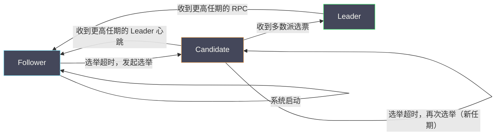

# 05 Raft 共识算法深度解析

**摘要：**

Raft 是 2014 年由 Diego Ongaro 与 John Ousterhout 在论文《In Search of an Understandable Consensus Algorithm》中提出的共识算法。它的设计目标与 Paxos 截然不同——Paxos 追求理论上的最优解，而 Raft 以**可理解性（Understandability）** 为首要目标，刻意把共识问题分解为三个相对独立的子问题：领导者选举（Leader Election）、日志复制（Log Replication）、以及安全性（Safety）。Raft 的普及程度已经超越了 Paxos——etcd、CockroachDB、TiKV、Consul 等主流分布式系统都使用 Raft 作为一致性内核。本文从 Raft 的设计哲学出发，深入讲解三个子问题的实现机制，重点解析那些不显而易见的安全性保证（为什么拥有最新日志的候选节点才能当选 Leader、为什么不能直接提交前任 Leader 遗留的日志条目），对比 Raft 与 Paxos 的本质差异，并给出工程实践中的关键配置原则。读完本文，你应当能回答两个问题：Raft 凭什么比 Paxos"好理解"，以及它那些看似奇怪的安全规则背后的必要性。

---

## 第 1 章 为什么 Paxos 之后还需要 Raft

### 1.1 Paxos 的"不可理解性"问题

上一篇（04 篇）我们分析了 Paxos 的核心机制，也提到了它的工程实现难题。但问题不仅仅是工程复杂度——即使只是**理解** Paxos，对于大多数工程师来说也是一件困难的事情。

Ongaro 在他的博士论文中做了一个用户研究：让两组学生分别学习 Paxos 与 Raft，然后用测试题评估他们的理解程度。结果，学习 Raft 的学生在测试中显著优于学习 Paxos 的学生，且学习 Raft 的学生主观上认为 Raft 更容易理解。

Paxos 难以理解的根本原因有两个。

**原因一，Paxos 以"单值共识"为基础，没有给出完整的日志复制方案**。Basic Paxos 只解决了"就一个值达成共识"的问题。如何把多个 Basic Paxos 实例组合成一个连续的日志复制系统（Multi-Paxos），Lamport 的原始论文只给出了粗略的方向，没有完整的设计。每个工程团队各自填充细节，导致各种"Paxos 变体"层出不穷，且正确性难以验证。

**原因二，Paxos 的强假设（Proposer 可以自由选择任意值）使得系统状态空间复杂**。Paxos 允许任何 Proposer 在任意时刻发起提案，多个 Proposer 并发提案时的交互状态空间非常复杂。而 Raft 通过"强 Leader"（所有写操作必须经过 Leader）约束了并发度，大幅简化了状态空间。

### 1.2 Raft 的核心设计思路：强 Leader 加问题分解

Raft 的设计哲学可以概括为两点。

**强 Leader（Strong Leader）**：在任意时刻，集群中最多有一个 Leader；所有写操作都必须经过 Leader；Leader 到 Follower 的日志流是单向的（Leader 总是向 Follower 推送日志，而不是 Follower 向 Leader 拉取）。强 Leader 大幅简化了一致性推理——只需要保证 Leader 的日志是权威的，并正确地复制到多数派即可。

**问题分解**：Raft 把共识问题明确分解为三个独立的子问题，每个子问题都有清晰的语义边界——**Leader Election（领导者选举）**：集群如何选出一个 Leader，并在 Leader 失效时选出新 Leader？**Log Replication（日志复制）**：Leader 如何把客户端请求以正确的顺序复制到多数派？**Safety（安全性）**：如何保证集群中的所有副本最终拥有相同的日志（即使 Leader 在中途崩溃）？

这两条设计思路，是 Raft"可理解"的全部秘密：**强 Leader 简化了并发，问题分解简化了理解**。而它们的代价，则在第 8 章会讨论——Leader 成为写操作的瓶颈。

### 1.3 一个延伸：Raft 的"可理解性"具体体现在哪

"可理解性"听起来抽象，但 Raft 对它的追求体现在几个具体的设计选择上。

**选择一，把问题分解为三个子问题**。Raft 没有试图"用一个统一的理论覆盖所有情况"，而是把共识拆成"选主、复制、安全"三块，每块独立讲清楚。**这让学习者可以"分块理解"，而不必一次消化全部**。

**选择二，用"强 Leader"减少并发**。Paxos 允许任何节点提案，导致"多 Proposer 并发"的状态空间复杂；Raft 规定"只有 Leader 能提案"，把并发降到最低。**这是"用约束换简单"**。

**选择三，明确给出"未定义的细节"**。Paxos 留白了"选主、日志修复、成员变更"等，Raft 则一一给出。**这让"实现 Raft"变成"照着做"，而不是"自己设计"**。

**选择四，用随机化替代复杂协调**。选票分裂本可以用复杂的协调机制解决，Raft 用一个"随机超时"就搞定了。**这是"用简单手段解决复杂问题"**。

**这四个选择的共同点是"主动降低复杂度"**——**它们不是"性能最优"的选择，而是"最容易理解与实现"的选择**。**这正是 Raft 的设计哲学：可理解性优先，其他让位**。**理解了这一点，就能理解 Raft 里那些"看起来不够优雅"的设计——它们都是为了"好懂"而做的妥协**。

### 1.4 一个对照：Raft 与"主从复制"的区别

Raft 与"普通主从复制"看起来都是"一个主节点加若干从节点"，但两者的保证天差地别。

**普通主从复制**通常是"主节点接受写、异步复制到从节点"。它的"主"是"人为指定的"（或由外部组件如 Sentinel 指定），"切换"需要外部干预。**因此，它不保证"主节点唯一"**——在网络分区时，可能"出现两个主"（脑裂）。

**Raft 的"主"是"通过选举产生的"，且"选举需要多数派"**。因此，**它保证了"任意时刻最多一个 Leader"**——因为两个"多数派"不可能同时存在（03 篇 3.3 节的多数派相交）。**这个保证，是 Raft 与"普通主从复制"的根本区别**。

**此外，Raft 的"写"需要多数派确认才算提交**，而普通主从复制通常是"主节点确认即返回"。**这让 Raft 的"已提交"更可靠**——即使主节点随后崩溃，已提交的写也不会丢。

**这个对照的启示是**：**"看起来像"不等于"保证相同"**。Raft 与主从复制在"形态"上相似，但在"保证"上差异巨大——**一个保证"唯一主加多数派提交"，一个只保证"尽力复制"**。**因此，评估一个系统时，不能只看"它的架构长什么样"，还要看"它给出了什么保证"**——**这与本专栏反复强调的"先看假设与保证"一致**。

---

## 第 2 章 Raft 的基本概念

### 2.1 任期（Term）：Raft 的逻辑时钟

**任期（Term）** 是 Raft 的核心概念，类似于 Paxos 中的提案编号，用于区分不同时期的 Leader。

**任期的定义**：任期是一个单调递增的整数，每当发生新的选举，任期号就递增。每个任期最多有一个 Leader（可能选举失败，没有 Leader），下一次选举开始新的任期。

```
任期 1: 节点 A 当选 Leader，任期 1 持续直到 A 崩溃
任期 2: 发起选举，但选举失败（无人获得多数票）
任期 3: 节点 C 当选新 Leader，任期 3 持续
```

**任期的作用**：节点用任期号来检测过时的 Leader 和消息。每个节点都记录自己当前所知的最新任期号（`currentTerm`）。如果收到一条消息，其任期号比自己的 `currentTerm` 小，则该消息被视为过时，直接拒绝。如果收到的任期号比自己的大，则更新 `currentTerm`，并立即转换为 Follower 状态（无论当前是什么角色）。

```python
# 每个节点的核心状态
currentTerm = 0    # 当前已知最大任期号（持久化到磁盘）
votedFor = None    # 本任期内投票给谁（持久化，防止重启后重复投票）
log = []           # 日志条目列表（持久化）
commitIndex = 0    # 已提交的最高日志索引（volatile）
lastApplied = 0    # 已应用到状态机的最高日志索引（volatile）

# Leader 特有状态（每次当选后重置）
nextIndex = {}     # 对每个 Follower，下一条待发送日志的索引
matchIndex = {}    # 对每个 Follower，已确认复制的最高日志索引
```

**任期号为什么必须持久化？** 假设节点 A 在任期 5 时投票给节点 B，然后 A 崩溃重启。如果 `currentTerm` 与 `votedFor` 没有持久化，A 重启后可能不记得自己投过票，在同一任期内再次投票给节点 C——这会导致同一任期有两个 Leader，破坏安全性。因此，`currentTerm`、`votedFor` 与 `log` 这三个状态必须在每次修改时持久化到磁盘，即使崩溃重启后也能恢复。

**任期这个概念，本质上是一个"逻辑时钟"**——它不测量物理时间，只用来标记"时期"与"顺序"。这与 01 篇讨论的 Lamport 逻辑时钟是同一个思路：**在不信任物理时钟的环境里，用单调递增的整数来标记顺序**。

### 2.2 节点的三种状态

Raft 集群中的每个节点处于以下三种状态之一。

**Follower（跟随者）**：被动角色，响应来自 Leader 与 Candidate 的请求，不主动发起任何请求。如果在一段时间内（选举超时）没有收到 Leader 的心跳，会转变为 Candidate 发起选举。

**Candidate（候选者）**：选举期间的过渡状态，正在发起新的选举、收集选票。收到多数派选票后转变为 Leader；收到更高任期的消息后退回 Follower；选举超时未当选则重新发起选举（增加任期号）。

**Leader（领导者）**：处理所有客户端请求；向所有 Follower 复制日志；定期发送心跳（空的 `AppendEntries` RPC）维持权威，防止 Follower 触发选举超时。



### 2.3 一个延伸：Raft 的状态机视角

Raft 常被描述为"一个状态机"——**每个节点在三种状态（Follower、Candidate、Leader）之间迁移，每次迁移都由特定事件触发**。这个视角有助于理解 Raft 的行为。

**触发迁移的事件有三类**：**超时**（选举超时触发 Follower 到 Candidate）；**收到更高任期**（任何节点收到更高任期的消息都退回 Follower）；**获得多数票**（Candidate 获得多数票后成为 Leader）。

**这个"事件驱动状态机"的视角，带来两个实用的理解**。其一，**Raft 的行为是可预测的**——给定当前状态与事件，下一个状态是确定的（除了随机超时）。这让"推理 Raft 的行为"变得可行。其二，**Raft 的故障是"状态迁移的异常"**——例如"频繁选举"就是"Follower 与 Candidate 之间反复迁移"，"脑裂"就是"出现了两个 Leader 状态"。**用状态机的语言描述故障，能让排查更有条理**。

**这个视角也解释了"任期号"的作用**：它是"状态的版本号"——任何"版本更旧"的消息都被拒绝，从而保证"旧状态不会干扰新状态"。**这与 ZAB 的 epoch（06 篇）是同一个设计**：**用版本号来隔离"新旧状态"**。

### 2.4 一个延伸：为什么"任期号"能检测过时消息

Raft 用"任期号"来检测过时消息——**规则是"收到更小任期号的消息就拒绝，收到更大任期号就更新并退回 Follower"**。这条规则为什么有效？

**关键在于"任期号单调递增"**。由于每次选举都会让任期号加一，且"当选 Leader"意味着"拥有当前最大任期"，因此**任何"任期号更小的 Leader"，一定是"旧 Leader"**——它已经过时了。

**这条规则的作用是"隔离新旧状态"**。设想一个被网络分区隔离的旧 Leader：它仍在发消息（以旧任期号）。当分区恢复，它发的消息会被其他节点"因为任期号小"而拒绝——**于是旧 Leader 无法"干扰"新集群**。当它收到"更大任期号"的消息时，它会自动退回 Follower，**从而"自我纠正"**。

**这就是"任期号"的核心价值**：**它是一个"状态的版本号"，让"旧状态"无法干扰"新状态"**。**任何"新状态的产生"，都会"让旧状态失效"**——**这正是"脑裂"能被避免的根本原因**。

**这条延伸的启示是**：**"版本号"是隔离"新旧状态"的通用手段**。它与 01 篇的"逻辑时钟"、06 篇的"ZXID"、07 篇的"版本向量"是同一类工具——**都用"单调递增的编号"来表达"新旧"**。**理解了这一点，就能看出分布式系统里"版本号"这个工具的普遍性**。

---

## 第 3 章 领导者选举：如何选出唯一的 Leader

### 3.1 选举超时触发选举

每个 Follower 维护一个**选举超时计时器（Election Timeout Timer）**。只要在超时时间内收到 Leader 的心跳（或合法的 `AppendEntries` RPC），计时器就重置。如果超时时间内没有收到心跳，Follower 认为 Leader 已失效，发起新一轮选举。

**选举超时的随机化**：Raft 规定选举超时时间从一个区间（通常是 150ms 到 300ms）中**随机选取**。随机化的目的是避免多个节点同时超时、同时发起选举、分散选票（选票分裂，无人获得多数派）。随机化使得大多数情况下只有一个节点先超时，它能在其他节点超时之前完成选举。

### 3.2 选举过程

**步骤一，Follower 转为 Candidate，自增任期号**：

```python
def start_election():
    currentTerm += 1        # 任期号自增
    state = CANDIDATE       # 状态转为 Candidate
    votedFor = self_id      # 先给自己投一票
    votes_received = 1      # 计票：自己的一票
    reset_election_timer()  # 重置计时器（防止立即再次超时）
```

**步骤二，向所有其他节点发送 RequestVote RPC**：

```python
RequestVote RPC 的参数：
  term          = currentTerm    # 候选者的当前任期
  candidateId   = self_id        # 候选者的节点 ID
  lastLogIndex  = len(log) - 1   # 候选者最后一条日志的索引
  lastLogTerm   = log[-1].term   # 候选者最后一条日志的任期号
```

**步骤三，Follower 决定是否投票**。每个 Follower 收到 `RequestVote` 时，做两个检查才决定是否投票。

**检查一，任期号检查**：如果 `term < currentTerm`，拒绝投票（候选者的任期号过时）；如果 `term > currentTerm`，更新 `currentTerm = term`，转为 Follower，继续检查二。

**检查二，日志新鲜度检查（Vote for the Most Up-to-date Candidate）**：这是 Raft 安全性的关键约束——**只投票给日志"至少和自己一样新"的候选者**。"更新"的定义是：如果两者的最后一条日志的任期号不同，任期号更大的更新；如果任期号相同，日志更长（索引更大）的更新。

```python
def on_request_vote(term, candidateId, lastLogIndex, lastLogTerm):
    if term < currentTerm:
        return VoteResponse(term=currentTerm, voteGranted=False)

    if term > currentTerm:
        currentTerm = term
        state = FOLLOWER
        votedFor = None

    # 检查：本任期内是否已经投票
    already_voted = (votedFor is not None and votedFor != candidateId)

    # 检查：候选者的日志是否足够新
    my_last_log_term = log[-1].term if log else 0
    my_last_log_index = len(log) - 1

    candidate_log_is_newer = (
        lastLogTerm > my_last_log_term or
        (lastLogTerm == my_last_log_term and lastLogIndex >= my_last_log_index)
    )

    if not already_voted and candidate_log_is_newer:
        votedFor = candidateId
        reset_election_timer()
        return VoteResponse(term=currentTerm, voteGranted=True)
    else:
        return VoteResponse(term=currentTerm, voteGranted=False)
```

**步骤四，Candidate 统计选票**：收到多数派（大于 n/2）的 `voteGranted=True` 则当选 Leader，立即广播心跳，阻止其他节点发起选举；收到更高任期的响应则退回 Follower；选举超时则增加任期号，重新发起选举。

### 3.3 为什么"日志最新"才能当选 Leader

这个约束是 Raft 安全性（"Leader Completeness"性质）的关键，值得深入解释。

**Leader Completeness 性质是**：一条日志条目一旦被提交（多数派确认），它就会出现在所有未来 Leader 的日志中。

**为什么需要这个性质？** 考虑这样的场景：Leader A 已经提交了日志条目 X（多数派确认），然后 A 崩溃。如果新选出的 Leader B 没有日志条目 X，B 可能会把 X 对应的日志位置写入其他内容，导致已提交的操作"消失"，破坏线性一致性。

**"日志最新"约束如何保证 Leader Completeness？** 一条日志条目 X 被提交，意味着多数派节点（Quorum Q₁）都有 X。新 Leader 选举需要多数派投票（Quorum Q₂）。由于 Q₁ 与 Q₂ 有交集（任意两个多数派有交集），至少有一个节点同时在 Q₁ 和 Q₂ 中——它既有日志条目 X，也参与了新 Leader 的选举投票。

这个节点（称为"见证节点"）会拒绝给一个比自己日志旧的候选者投票（因为 Raft 的投票规则要求候选者的日志至少和自己一样新）。如果候选者没有日志条目 X，它的日志就比见证节点"旧"，见证节点会拒绝投票。因此，没有日志条目 X 的节点无法获得多数派选票，无法当选 Leader——日志最新约束保证了 Leader Completeness。

**这个证明的关键，仍然是"多数派相交"**——与 Paxos 的安全性证明同源。这再次说明：**多数派相交是分布式一致性的通用数学工具，不同的协议只是在"如何用它"上各有设计**。

> [!note] 与 Paxos 的对比
> 在 Paxos 中，任何节点都可以成为 Proposer，然后通过 Phase 1 探知已有的提案来修复状态。这意味着 Paxos 允许"日志不完整的节点"发起提案，只要它在 Phase 1 时能发现并修复缺失的日志。
>
> Raft 的做法更严格：在选举阶段就过滤掉日志不完整的候选者，让当选的 Leader 天然拥有最完整的日志，无需 Phase 1 式的"探知和修复"过程。这大幅简化了 Leader 上任后的初始化逻辑，但代价是约束了选举的候选者范围。
>
> **两者是"选举后修复"与"选举前过滤"两种思路**——Paxos 把修复放在协议执行中，Raft 把过滤放在选举阶段。Raft 的选择让"Leader 一定有完整日志"成为一个选举时就确定的事实，从而简化了后续逻辑。

### 3.4 一个延伸：为什么"随机化超时"能解决选票分裂

选票分裂是分布式选举的经典难题：如果多个候选人同时发起选举、各自拉到一部分选票，就没人能获得多数，选举失败。**Raft 用一个"随机化超时"就解决了它**——这背后的原理值得展开。

**如果不随机化**：所有 Follower 的选举超时都是同一个值（如 200ms）。当 Leader 崩溃，所有 Follower 会在"同一时刻"超时，同时变成 Candidate、同时发起选举——**结果是所有候选人各得一票，选票彻底分裂，本轮选举必然失败**。而且下一轮它们还会"再次同时超时"，**形成"同步的僵局"**。

**随机化之后**：每个 Follower 的超时是"150 到 300ms 之间的随机值"。当 Leader 崩溃，**最先超时的那个 Follower 会率先发起选举**；由于它的超时比其他人早，它能在"其他人还没超时"时，就拉到多数票当选 Leader。**其他人还没来得及发起选举，就已经收到了新 Leader 的心跳，于是退回 Follower**。

**这个原理的普遍性**：**随机化打破"同步化"，从而避免"同步化的冲突"**。这与 03 篇"随机退避避免 Paxos 活锁"、10 篇"随机抖动避免重试风暴"是同一个手段。**它的本质是"用随机性给竞争者们'错开时间'"**——**只要竞争者不同时行动，冲突的概率就大幅降低**。

**这个设计也体现了 Raft 的"简单优先"哲学**：选票分裂本可以用"复杂的协调机制"解决，Raft 用"一个随机数"解决了。**能用随机数解决的，就不引入复杂机制**——这是 Raft 可理解性的又一个体现。

### 3.5 一个延伸：为什么"日志最新才能当选"是"预防"而非"修复"

Raft 与 Paxos 在处理"日志不完整节点"上的差异，可以概括为"预防"与"修复"两种思路。

**Paxos 是"修复"**：它允许日志不完整的节点成为 Proposer，然后通过 Phase 1 "探知并修复"缺失的值。**它的思路是"先允许，后纠正"**。

**Raft 是"预防"**：它在选举阶段就"过滤掉"日志不完整的候选者，让当选的 Leader 天然拥有最完整的日志。**它的思路是"先过滤，后使用"**。

**这两种思路各有代价**。**"修复"更灵活**（任何节点都能提案），但**"修复"的过程更复杂**（需要 Phase 1 的探知逻辑，且要处理"探知到旧值时被迫改变自己值"的情况）。**"预防"更严格**（候选者范围受限），但**"预防"让后续逻辑更简单**（Leader 上任后不需要"探知与修复"）。

**为什么 Raft 选择"预防"？** 因为它的设计目标是"可理解性"——**"预防"把复杂性集中在"选举阶段"，而"选举阶段"是相对独立的、容易讲清楚的一块；"修复"则把复杂性分散在"每次提案"里，更难理解**。**这正是"问题分解"思想的应用**：把复杂逻辑收敛到一处，比分散在多处更可理解。

**这条延伸的启示是**：**"预防"与"修复"是两种通用的工程思路**——**预防把成本放在"事前"，修复把成本放在"事后"**。**分布式系统里两者都有应用**（如"幂等"是预防，"对账"是修复）。**选择哪个，取决于"事前成本"与"事后成本"的比较，以及"可理解性"的考量**。

---

## 第 4 章 日志复制：Leader 如何把操作同步到所有副本

### 4.1 日志条目的结构

Raft 的日志是一个有序的条目序列，每个条目包含三个字段：

```python
class LogEntry:
    index: int    # 日志索引（从 1 开始，单调递增）
    term: int     # 写入这条日志时的任期号（用于一致性检查）
    command: Any  # 客户端请求的操作（如 "set x = 1"）
```

`term` 字段看似冗余（每条日志不都记录了创建它的任期号吗？），但它是 Raft 安全性检查的关键——通过比较日志条目的 `term`，节点可以检测出日志中是否存在不一致（来自不同 Leader 任期的日志）。

### 4.2 AppendEntries RPC：日志复制的载体

Leader 通过 `AppendEntries` RPC 向 Follower 复制日志（同时用于发送心跳，心跳是不携带日志条目的 `AppendEntries`）：

```python
AppendEntries RPC 的参数：
  term          = currentTerm     # Leader 的当前任期
  leaderId      = self_id         # Leader 的 ID（Follower 转发客户端请求用）
  prevLogIndex  = nextIndex[f]-1  # 新日志条目之前的那条日志的索引
  prevLogTerm   = log[prevLogIndex].term  # 该条目的任期号
  entries       = [...]           # 要复制的日志条目（心跳为空）
  leaderCommit  = commitIndex     # Leader 已提交的最高日志索引
```

**一致性检查（Consistency Check）**：`prevLogIndex` 与 `prevLogTerm` 这两个字段构成了一个"前缀匹配"检查：Follower 在接受新日志之前，先检查自己在 `prevLogIndex` 处的日志条目的任期号是否等于 `prevLogTerm`。如果不匹配，说明 Follower 的日志在这个位置之前就已经与 Leader 不一致，需要回退并修复。

这个检查保证了一个不变量：**如果 Follower 接受了 `AppendEntries`，那么 Follower 在 `prevLogIndex` 之前的所有日志条目都与 Leader 完全一致**（由归纳法可证）。

```python
def on_append_entries(term, leaderId, prevLogIndex, prevLogTerm, entries, leaderCommit):
    if term < currentTerm:
        return AppendEntriesResponse(term=currentTerm, success=False)

    # 重置选举超时（Leader 还活着）
    reset_election_timer()
    currentTerm = term
    state = FOLLOWER

    # 一致性检查
    if prevLogIndex > 0:
        if len(log) < prevLogIndex or log[prevLogIndex-1].term != prevLogTerm:
            return AppendEntriesResponse(term=currentTerm, success=False)

    # 追加/覆盖日志条目
    for i, entry in enumerate(entries):
        log_idx = prevLogIndex + i  # 0-indexed
        if log_idx < len(log):
            if log[log_idx].term != entry.term:
                # 冲突：截断后面所有日志，用 Leader 的日志覆盖
                log = log[:log_idx]
                log.append(entry)
            # else: 已有相同日志，跳过
        else:
            log.append(entry)

    # 更新 commitIndex
    if leaderCommit > commitIndex:
        commitIndex = min(leaderCommit, prevLogIndex + len(entries))
        apply_committed_entries()

    return AppendEntriesResponse(term=currentTerm, success=True)
```

### 4.3 日志提交：多数派确认后才能提交

Leader 追踪每个 Follower 的复制进度：`nextIndex[f]` 是下一条待发送给 Follower f 的日志索引；`matchIndex[f]` 是已确认 Follower f 复制成功的最高日志索引。

当某个日志索引 `N` 满足以下条件时，Leader 把 `commitIndex` 更新为 `N`（提交该日志条目）：

```python
def maybe_update_commit_index():
    # 找到最大的 N，满足：
    # 1. N > commitIndex
    # 2. 多数派的 matchIndex >= N
    # 3. log[N].term == currentTerm（关键约束，下文详解）

    for N in range(commitIndex + 1, len(log) + 1):
        replication_count = 1  # Leader 自己算一票
        for follower in followers:
            if matchIndex[follower] >= N:
                replication_count += 1

        if replication_count > len(cluster) / 2:
            if log[N-1].term == currentTerm:
                commitIndex = N
                apply_committed_entries()
```

**第 3 个条件的约束是"只提交当前任期的日志"**。注意 `log[N].term == currentTerm` 这个约束——Leader 不能直接提交**前任 Leader 遗留的日志条目**，必须通过提交当前任期的新日志来"间接"提交前任的日志。这是 Raft 中一个关键的、容易被误解的设计决策，下一章专门解释。

### 4.4 一个延伸：日志复制为什么是"单向推送"

Raft 的日志复制是"Leader 推送给 Follower"（Push），而不是"Follower 从 Leader 拉取"（Pull）。这个方向的选择值得说明。

**"推送"的好处是"Leader 掌握全局"**：Leader 知道每个 Follower 的进度（通过 `nextIndex` 与 `matchIndex`），因此可以"按需推送"——对落后的 Follower 多推一些，对跟上的 Follower 少推一些。**这让日志复制是"自适应的"**。

**"拉取"的坏处是"Leader 不知道谁需要什么"**：如果由 Follower 主动拉取，Leader 无法知道"哪些 Follower 落后了"——除非 Follower 主动上报，而这又需要额外的机制。**因此，"推送"让"进度追踪"更自然**。

**"推送"还与"强 Leader"设计一致**：既然所有写都经过 Leader，那么"由 Leader 主导推送"就是自然的延伸。**如果改成"拉取"，就等于让 Follower 主导了复制的节奏，与"强 Leader"的取向不符**。

**这个选择也解释了 Raft 与 Paxos 的一个差异**：Paxos 没有规定"推还是拉"（因为它没有强 Leader）；Raft 因为有强 Leader，自然地选择了"推"。**"强 Leader"这个前提，决定了后续的许多设计选择**——这也是"先定大方向、再定细节"的一个例子。

---

## 第 5 章 安全性：为什么不能直接提交旧任期的日志

### 5.1 问题场景：直接提交旧任期日志的危险

考虑以下场景（Raft 论文 Figure 8 的经典场景）：

```
集群有 5 个节点：S1、S2、S3、S4、S5
日志条目：index=2, term=2 的条目（由任期 2 的 Leader S1 写入）

时间线：
T1: S1 在任期 2 将 index=2, term=2 复制到 S2
    （只复制到了 S2，还没提交——只有 2/5 票，不是多数派）

T2: S1 崩溃，任期 3 开始，S5 当选新 Leader
    S5 的日志：只有 index=1 的条目（没有 index=2 的条目）
    S5 在任期 3 写入一些新的日志条目（index=2, term=3）
    但 S5 只复制给了自己

T3: S5 崩溃，任期 4 开始，S1 重启并当选 Leader（S1 的日志包含 index=2, term=2）
    S1 将 index=2, term=2 复制到 S3（现在 S1、S2、S3 都有了 index=2, term=2）

问题：此时 S1 能否提交 index=2, term=2？
```

**如果 S1 直接提交 index=2, term=2（旧任期的日志）**：

```
T4: 假设 S1 提交了 index=2, term=2，客户端收到成功响应
T5: S1 崩溃，任期 5 开始
    S5 重新加入集群，S5 的日志更"新"（index=2, term=3 任期号更大）
    S5 有资格当选新 Leader（因为它的 lastLogTerm=3 > S3 的 lastLogTerm=2）
    S5 当选后，将 index=2, term=3 覆盖到 S1、S2、S3

→ index=2, term=2 的操作曾经被提交（客户端收到成功），
  现在却被覆盖，对应的状态机操作被抹去
→ 已提交的操作丢失，线性一致性被破坏。
```

### 5.2 Raft 的解决方案：用当前任期的提交来"带动"旧任期

Raft 规定：Leader **不能直接提交旧任期（term 小于 currentTerm）的日志条目**，只能提交当前任期（term 等于 currentTerm）的日志条目。但当当前任期的日志被提交时，它之前所有未提交的日志条目（包括旧任期的）也被**间接提交**（通过 `commitIndex` 向前推进）。

**回到上面的场景，正确的处理方式是**：

```
T4（修正版）：
    S1（任期 4 的 Leader）在任期 4 写入新的日志条目（index=3, term=4）
    将 index=3, term=4 复制到 S2 和 S3（多数派确认）
    S1 提交 index=3, term=4

    提交 index=3 时，commitIndex 从 1 推进到 3，
    index=2, term=2 也被"顺带"提交了

T5: 即使 S1 崩溃，S5 也无法覆盖 index=2, term=2 了——因为 S2 和 S3 已经有了
    index=3, term=4 的日志，S5 的日志（只有到 index=2, term=3）比 S2/S3 更"旧"，
    S5 无法获得 S2 和 S3 的投票，无法当选新 Leader
```

**这个设计的核心逻辑是**：通过要求"只提交当前任期的日志"，Raft 确保了一旦某条日志被提交，**没有任何未来的 Leader 能够"合法地"覆盖它**——因为任何能合法当选新 Leader 的节点，其日志必然包含这条提交的条目（由 Leader Completeness 保证）。

> [!warning] 常见误解
> 很多人误解为"Raft 不能提交旧任期的日志"。这是不准确的——Raft 可以**间接**提交旧任期的日志（通过推进 `commitIndex` 覆盖旧条目），只是不能**直接**用旧任期的日志来更新 `commitIndex`。区别在于：直接提交旧任期日志可能导致后来的 Leader 覆盖这条日志（因为新 Leader 不知道它已经被提交），而间接提交通过当前任期的日志来"锚定"旧日志的安全性。
>
> 这个"细微区别"是 Raft 里最容易被误解、也最容易被实现错的地方之一。**它提醒我们：读协议时，"能不能做"与"怎么才安全"是两回事**——很多规则看似冗余，实则是为了堵住某个特定时序的漏洞。

### 5.3 一个延伸：Figure 8 场景的直觉理解

第 5 章讨论的"不能直接提交旧任期日志"（Raft 论文 Figure 8 场景），是 Raft 里最难理解的部分。这里给一个更直觉的解释。

**核心问题是"已提交的日志可能被覆盖"**。设想一个旧任期的日志条目 X：它"可能已经被提交"（多数派确认过），但"新 Leader 不知道它是否已提交"（因为旧 Leader 崩溃了，没留下明确的提交记录）。

**如果允许"直接提交旧日志"**：新 Leader 可能"以为 X 没提交，从而覆盖它"——而实际上 X 可能已经提交，客户端已经收到了成功响应。**覆盖它，就等于"抹去了一个已经承诺的操作"**。

**Raft 的解法是"用当前任期的日志来'锚定'旧日志"**：新 Leader 必须先提交一条"当前任期的新日志"，才能"间接提交"旧日志。**为什么这样安全？** 因为"提交当前任期日志"需要多数派确认，而"多数派确认"意味着"多数节点都拥有了这条新日志"——**于是，任何"未来想覆盖旧日志的节点"，都必须先拥有这条新日志（多数派相交），从而也就间接拥有了旧日志**。

**一句话概括是**：**Raft 用"当前任期日志的多数派确认"，来"锁定"旧日志的安全**。**这个机制看似绕，本质是"用一个新的多数派确认，来给旧日志'补一个正式的背书'"**——**这正是"不能直接提交旧日志"这条规则的精髓**。

---

## 第 6 章 日志修复：新 Leader 如何处理不一致的 Follower

### 6.1 为什么 Follower 的日志可能不一致

当 Leader 崩溃时，Follower 的日志可能处于各种不一致的状态：

```
正常 Leader 的日志：
[1,T1] [2,T1] [3,T2] [4,T3] [5,T3]

可能的 Follower 状态：
  Follower A（日志更少，正常情况）：
    [1,T1] [2,T1] [3,T2]
    → Leader 还没来得及复制 4、5

  Follower B（多余日志，历史上曾是 Leader）：
    [1,T1] [2,T1] [3,T2] [4,T2] [5,T2]
    → B 在任期 2 时当过 Leader，写入了一些未提交的日志，然后崩溃
    → 现在的 Leader（任期 3）的 index=4、5 与 B 不同
```

### 6.2 nextIndex 回退：自动修复不一致

当 Leader 向 Follower 发送 `AppendEntries` 时，如果 Follower 的一致性检查失败（`prevLogTerm` 不匹配），Follower 返回 `success=False`。Leader 收到后把该 Follower 的 `nextIndex` 减一，重发更早的日志，直到找到两者日志的"公共前缀"，然后从那里开始补发所有缺失的日志，覆盖 Follower 上冲突的部分。

**优化是加速日志回退（Accelerated Log Backtracking）**。朴素的"每次减一"回退在日志差异很大时效率极低（需要多轮 RPC 往返才能找到公共前缀）。Raft 论文中提出了一个优化：Follower 在返回失败时，同时告知 Leader 自己在失败位置的日志的 `term`（以及该 `term` 在自己日志中的最早索引）。Leader 根据这个信息可以跳过整个 `term` 的日志，大幅加速回退过程。

这个"回退直到找到公共前缀，再从那里覆盖"的机制，与版本控制系统（如 Git）的"找到共同祖先再合并"是同一个思路。**它体现了"日志即版本历史"这一视角——Raft 的日志修复，本质上是一次"历史对齐"**。

### 6.3 一个延伸：日志修复的"收敛性"

日志修复（nextIndex 回退加覆盖）有一个值得说明的性质：**它一定会收敛**——也就是说，无论 Follower 的日志与 Leader 差多少，修复过程总能在有限步内完成。

**为什么一定收敛？** 因为"回退"每次至少退一格，而日志长度有限，因此"回退"必然停在"找到公共前缀"的位置。一旦找到公共前缀，Leader 就从这个位置开始"补发全部缺失的日志"——**由于 Leader 的日志是完整的（它拥有所有已提交的日志），补发后 Follower 就与 Leader 一致了**。

**这个"必然收敛"的性质，依赖于一个前提：Leader 拥有最完整的日志**。而这个前提，正是"日志最新才能当选"这条选举约束所保证的（3.3 节）。**因此，选举约束与日志修复是"配套"的**：**选举时保证 Leader 日志最全，修复时才能保证"以 Leader 为准一定收敛"**。

**这个观察揭示了一条设计原则：分布式协议的安全性保证，往往是"多条约束配套"的结果**。单独看"日志修复"，它"必然收敛"；但"必然收敛"的前提，是"选举时选出了日志最全的 Leader"。**因此，读协议时要"成对地看"约束**——**一条约束的成立，往往依赖另一条约束**。**这也解释了为什么"删掉任何一条看似冗余的约束，都可能破坏安全性"**。

### 6.4 一个延伸：为什么日志修复是"以 Leader 为准"

Raft 的日志修复是"以 Leader 为准"——Follower 的日志被"截断并覆盖"为 Leader 的版本。这个方向的选择值得说明。

**为什么不能"以 Follower 为准"？** 因为 Follower 可能有"多余的、未提交的日志"（它曾在旧任期当过 Leader，写过一些未被多数派确认的日志）。**如果"以 Follower 为准"，就会把这些"未提交的日志"当成"真实的"**——而这会破坏一致性（它们本来就没被确认）。

**"以 Leader 为准"的安全性依据是"Leader 拥有所有已提交的日志"**（由"日志最新才能当选"保证）。**因此，凡是 Leader 没有的日志，一定是"未提交的"，可以安全截断**。

**这个"以谁为准"的选择，本质上是"以谁为'真相来源'"的选择**。**Raft 选择 Leader 作为真相来源，因为它由选举保证"拥有最完整的已提交日志"**。**这与 ZAB"以新 Leader 为准做数据同步"是同一个思路**——**都是"选举保证 Leader 拥有最新数据，因此以它为准"**。

**这条延伸的启示是**：**"以谁为准"必须由"谁拥有最完整信息"来决定**。**在分布式系统里，"真相来源"往往就是"被选举保证为最完整的那一方"**——**这也是"选举"如此重要的原因：它不只选出"领导者"，还选出了"真相来源"**。

---

## 第 7 章 成员变更：集群配置的安全修改

### 7.1 为什么成员变更是危险的

向 Raft 集群中添加或删除节点（成员变更）是一个充满陷阱的操作。朴素的方案——直接让所有节点切换到新配置——会产生**双多数派（Split Brain）** 风险：

```
原配置（3 节点）：{S1, S2, S3}，多数派 = 2 个节点
新配置（5 节点）：{S1, S2, S3, S4, S5}，多数派 = 3 个节点

如果 S1、S2 率先切换到新配置，S3 还在旧配置：
  新配置的多数派（3/5）：{S1, S2, S4}，可以提交日志
  旧配置的多数派（2/3）：{S1, S3}，也可以提交日志

→ 同时存在两个"多数派"，可能提交冲突的日志
```

### 7.2 联合共识（Joint Consensus）

Raft 最初提出的成员变更方案是**联合共识（Joint Consensus）**：引入一个过渡配置 `C_old,new`，在过渡期间同时遵守新旧两个配置的多数派规则（操作需要同时获得旧配置的多数派和新配置的多数派的确认才能提交）。过渡期结束后，切换到纯新配置。联合共识正确，但实现复杂。

### 7.3 单步成员变更（Single-Server Changes）

Raft 扩展论文（Diego Ongaro 的博士论文）提出了一个更简洁的方案：**每次只添加或删除一个节点**。可以证明，对于奇数节点集群，添加一个节点（偶数变奇数）或删除一个节点（奇数变偶数），新旧两个配置的多数派必然有交集（不存在双多数派风险）。

这个方案的约束是：每次只能改变一个节点，且上一次变更完全提交后才能开始下一次变更。etcd 使用的是这个方案。

> [!note] 成员变更是"多数派相交"的又一次应用
> 无论是联合共识还是单步变更，它们的正确性依据都是"新旧配置的多数派必然相交"。这个思路与第 3 章的选举安全性、与 Paxos 的安全性完全一致。
>
> 这再次印证了一条规律：**分布式一致性协议的"正确性论证"，几乎都可以归结为"某个多数派与另一个多数派相交"**。理解了这条主线索，就能看懂各种协议里那些看似繁琐的约束——它们都是在确保"某个必要的相交成立"。

### 7.4 一个延伸：成员变更为什么容易出错

成员变更之所以是"最容易出错的运维操作之一"，根源在于它"在协议运行中改变协议的参与者"。

**问题在于"多数派的定义会变"**。当配置从 3 节点变成 5 节点，"多数派"从 2 变成了 3。**如果变更过程中"新旧配置并存"，就可能出现"两个不同的多数派"**——这正是"双多数派"风险的来源。

**更麻烦的是"变更期间的一致性问题"**：如果某个节点"已经切到新配置"、另一个"还在旧配置"，那么它们在"谁能构成多数派"上会有不同认知——**这会导致"同一时刻，两个不同的多数派各自认为自己是合法的"**。

**因此，成员变更的正确做法，必须保证"变更过程中始终只有一个有效的多数派定义"**。联合共识通过"同时满足新旧两个多数派"来实现；单步变更通过"每次只改一个节点，保证新旧多数派必然相交"来实现。**两者都是在"确保多数派定义不歧义"**。

**这条延伸的启示是**：**"改变规则"比"遵守规则"更难**。协议的运行依赖于一套规则（多数派定义），而成员变更恰恰要"在运行中改变这套规则"——**这是一个"自指"的难题**。**这也解释了为什么"成员变更"是共识协议里最晚被完善的部分之一**——它不是"算法问题"，而是"元规则问题"。

---

## 第 8 章 Raft 与 Paxos：本质差异对比

| 维度 | Paxos（Multi-Paxos）| Raft |
| :--- | :--- | :--- |
| **设计目标** | 最优的消息复杂度和容错能力 | 可理解性优先 |
| **Leader 选举** | 未明确定义，各实现自行设计 | 明确定义（随机超时加 RequestVote）|
| **日志一致性** | Phase 1 探知加修复，允许日志空洞 | AppendEntries 严格顺序复制，无空洞 |
| **旧 Leader 日志的提交** | 新 Proposer 在 Phase 1 时主动修复旧提案 | 只能由当前任期的提交间接触发 |
| **成员变更** | 未定义 | 单步变更或联合共识 |
| **日志空洞** | 允许（不同日志槽位可以并发提案）| 不允许（严格按索引顺序提交）|
| **读操作优化** | 无标准方案 | ReadIndex 或 Lease Read |
| **工程可实现性** | 困难（大量实现细节未定义）| 较容易（协议完整定义）|
| **代表实现** | Google Chubby、Apache ZooKeeper（ZAB）| etcd、CockroachDB、TiKV、Consul |

**Raft 相比 Paxos 的根本差异是**：Raft 通过"强 Leader"约束，把所有写操作序列化经过 Leader，避免了 Paxos 中多 Proposer 并发带来的日志空洞和复杂的修复逻辑。代价是 Leader 成为写操作的瓶颈——所有写请求必须经过单一节点，在极高吞吐量场景下 Leader 可能成为性能瓶颈。Paxos 的多 Proposer 模型理论上可以并发提案到不同日志槽位，但实现复杂度大幅提升。

**这个对比的核心是"简单与最优的取舍"**：Paxos 追求理论最优（允许并发提案、允许日志空洞），代价是实现复杂；Raft 追求工程可用（强 Leader、顺序复制），代价是 Leader 瓶颈。**Raft 的成功说明，在工程领域，"能被正确实现"往往比"理论最优"更重要**——这也是本专栏反复强调的一条判断。

### 8.1 一个总结：Raft 与 Paxos 的"同源异形"

把第 8 章的对比收敛，可以用一个词概括 Raft 与 Paxos 的关系：**"同源异形"**。

**"同源"指的是**：两者共享同一套核心思想——多数派决策、版本号（提案编号或任期）区分新旧、日志最全者当选、两阶段提交与确认。**这些思想是"共识协议的本质"，无论叫 Paxos 还是 Raft，都必须具备**。

**"异形"指的是**：两者在"如何组织这些思想"上做了不同的选择——Paxos 允许"对称提案加日志空洞"，Raft 选择"强 Leader 加顺序复制"。**这些差异源于"设计目标"的不同**：Paxos 追求理论最优，Raft 追求可理解性。

**这个"同源异形"的概括，带来一个实用的读协议方法**：**先找"同源"（这个协议共享了哪些共识思想），再看"异形"（它在组织方式上做了什么选择）**。**这样读，就不会被不同协议的"表面差异"迷惑，而能看清它们的"共同骨架"**。

**这也再次印证了本专栏 03 篇的结论**：**所有共识协议，都是在回答同一个问题——"在部分同步假设下，如何实现安全性绝对、活性条件性"**。Paxos 与 Raft 只是这个问题的两个不同答案。**理解了"同源"，就理解了"为什么学一个协议能帮你理解其他协议"**。

### 8.2 一个延伸：为什么工业界"选择 Raft"

Paxos 是"理论奠基"，Raft 是"工程主流"——为什么工业界普遍选 Raft？答案可以归纳为三条。

**第一条，"Raft 的完整度高"**。如 04 篇 6.6 节所列，Raft 明确定义了"选主、日志修复、成员变更、日志压缩、读路径、客户端交互"这六项，而 Paxos 留白了它们。**这意味着"用 Raft"是"照着实现"，而"用 Paxos"是"自己设计"**——**后者的风险高得多**。

**第二条，"Raft 的生态成熟"**。etcd、TiKV、CockroachDB 等系统的成功，让 Raft 有了大量经过验证的实现与运维经验。**"有成熟实现"这件事本身，就是巨大的价值**——它意味着"不用自己踩坑"。

**第三条，"Raft 的可理解性降低了沟通成本"**。团队里只要有一个人懂 Raft，就能向其他人解释清楚；而 Paxos 的晦涩，让"团队共识"变得困难。**在工程组织里，"能被团队理解"是一项实实在在的竞争力**。

**这三条的共同点是"它们都不是'技术指标'"**——完整度是"工程完备性"，生态是"社区资产"，可理解性是"组织效率"。**它们共同说明：技术选型不只比"技术指标"，还比"工程完备性、生态、可理解性"**。**这正是 Raft 战胜 Paxos 的原因，也是本专栏反复强调"工程属性同样重要"的例证**。

---

## 第 9 章 Raft 在工程实践中的关键配置与调优

### 9.1 心跳间隔与选举超时的设置原则

Raft 性能对以下参数非常敏感。

**心跳间隔（Heartbeat Interval）**：Leader 向所有 Follower 发送心跳的频率。过长会导致 Follower 频繁触发不必要的选举；过短会增加网络和 CPU 开销。通常设置为选举超时的 1/10。

**选举超时（Election Timeout）**：Follower 等待心跳的最大时间。需满足以下不等式：

```
广播时间（broadcastTime）<< 选举超时（electionTimeout）<< MTBF（平均故障间隔）

其中：
  broadcastTime = Leader 广播一轮 AppendEntries 的往返时间（通常 0.5ms~20ms）
  electionTimeout = 选举超时（通常 150ms~300ms）
  MTBF = 单台服务器的平均故障间隔（通常月级到年级）
```

这个不等式值得细读：**左半边保证"选举超时不会误判正常的广播延迟"，右半边保证"选举超时远小于机器故障间隔"**。两边都留出了数量级的余量，这正是 Raft 参数设置的稳健之处。

### 9.2 读操作的线性一致性保证

**直接读 Leader 的状态机并不安全**——如果 Leader 已经被网络分区孤立但还不知道，它可能返回旧数据。Raft 提供了两种线性读方案。

**ReadIndex**：Leader 收到读请求时，先记录当前的 `commitIndex`，然后发一轮心跳确认自己仍然是合法 Leader（收到多数派确认）。确认后等到 `applyIndex >= commitIndex` 时，读取状态机并返回结果。这保证了读到的数据至少是 `commitIndex` 时刻的最新状态。

**Lease Read**：Leader 记录上次心跳的时间，如果距上次多数派心跳确认的时间小于选举超时，则认为自己仍然是合法 Leader，可以直接读取本地状态机而无需额外的 RPC。Lease Read 性能更高（无额外 RPC），但依赖时钟精度（与 01 篇的时钟漂移问题相关）——如果时钟跳跃，可能违反线性一致性。etcd 默认使用 ReadIndex，TiKV 提供 Lease Read 作为可选优化。

> [!warning] Lease Read 是"用时钟换性能"
> Lease Read 的本质，是"用一段确定的时间窗口（租约）来替代一次多数派确认"。它的正确性完全建立在"时钟在这段窗口内不会跳跃"这一假设上——**而这恰恰是 01 篇反复警告的"不可靠假设"**。
>
> 因此，Lease Read 是一个典型的"用性能换假设"的取舍：它省掉了一次 RPC，代价是把正确性建立在了时钟之上。**这也是为什么 etcd 默认选择更保守的 ReadIndex，而把 Lease Read 作为可选优化**——在"默认要安全"的系统里，不轻易依赖时钟是明智的。

### 9.3 一个总结：Raft 给工程实践的三条启示

把本篇的讨论收敛，Raft 给工程实践留下三条启示。

**启示一，"可理解性"值得被当作一项硬指标**。Raft 用"分解问题、强 Leader、随机化、完整定义"换来了"好懂"，从而在工业界大获成功。**这提醒我们：在设计或选择技术方案时，"团队能不能看懂、能不能维护"应当被认真考虑，而不是只看"理论指标"**。

**启示二，"用约束换简单"往往是划算的**。Raft 的"强 Leader"约束了并发，代价是"Leader 成为瓶颈"，但换来的是"大幅简化的推理与实现"。**对于大多数场景，"简单可靠"比"极致性能"更重要**——**这也是"工程取舍"的典型形态**。

**启示三，"随机化"是解决协调难题的利器**。从选举超时到重试退避，随机化反复出现在分布式系统里。**当面对"多方同步竞争"的难题时，不妨先想想"能不能用随机化打散"**——**它常常比"设计复杂的协调机制"更简单有效**。

**这三条启示，与 04 篇 Paxos 的三条启示互补**：Paxos 教你"算法正确不等于工程可用"，Raft 教你"可理解性是一种竞争力"。**两者合起来，构成了"从理论到工程"的完整认知**——**一个协议要成功，既要正确，也要能被理解与实现**。

### 9.4 一个延伸：Raft 的"常见误用"

Raft 虽好，但用错场景同样会出问题。以下是几种常见的误用。

**误用一，把 Raft 集群当"高吞吐存储"**。Raft 的写要经过多数派确认，吞吐受限于 Leader。**因此，它适合"存元数据、存配置"，不适合"存业务数据"**——**把它当"高吞吐 KV"用，会撞上它的吞吐天花板**。

**误用二，跨机房部署单一 Raft 集群**。跨机房的延迟与抖动，会让 Raft 的"选举超时"很难设置——**设小则频繁选举，设大则恢复慢**。**正确做法是"机房内 Raft，机房间异步复制"**（这与 06 篇 ZooKeeper 的部署经验一致）。

**误用三，用 Raft 存"大 value"**。Raft 的日志会复制到所有节点，**如果 value 很大，日志会迅速膨胀，导致"复制慢、恢复慢、磁盘紧张"**。**因此，大对象应当存在对象存储里，Raft 里只存"引用"**。

**误用四，忽略"快照与日志压缩"**。如果不做日志压缩，日志会无限增长，最终导致"启动恢复极慢"甚至"磁盘写满"。**因此，必须配置快照**。

**这四种误用的共同点是"把 Raft 用在它不适合的场景"**——**Raft 是"一致性内核"，不是"万能存储"**。**理解这一点，就能避免"用错工具"**——**这也再次说明"按场景选组件"的重要性**。

### 9.5 一个延伸：Raft 集群的"容量规划"

Raft 集群的容量规划，有几个"硬约束"需要注意。

**约束一，"节点数用奇数，且不宜过大"**。**3 或 5 是常见配置**——**奇数最大化容错率，过大则因"多数派确认"拖慢写**。

**约束二，"写吞吐受限于 Leader"**。**单 Leader 无法通过"加节点"提升写吞吐**——**因此，高写入场景要考虑"分片"（多个 Raft 组）**。

**约束三，"日志与快照占用磁盘"**。**日志会增长，快照也会占用空间**——**因此，容量规划要包含"日志与快照的存储"**。

**约束四，"跨机房部署会拖慢写"**。**跨机房的多数派确认需要"跨网络往返"**——**因此，Raft 集群通常"同机房部署"**。

**这四个约束的共同点是"它们都源于'共识的固有成本'"**——**多数派确认、单 Leader、日志复制、跨网络往返**。**因此，容量规划不能"只算数据量"，还要"算共识的成本"**。

**这条延伸的启示是**：**"共识集群"的容量规划，与"普通服务"不同**——**它受"共识机制"的硬约束**。**理解这些约束，才能"规划出合理的集群"**——**而不是"照搬普通服务的容量规划方法"**。**这也是"理解原理"能指导"工程实践"的一个具体例子**。

---

## 参考资料

1. Ongaro, D., & Ousterhout, J. (2014). In Search of an Understandable Consensus Algorithm (Extended Version). *USENIX ATC 2014*.
2. Ongaro, D. (2014). *Consensus: Bridging Theory and Practice* (PhD Thesis). Stanford University.
3. Howard, H., Schwarzkopf, M., Madhavapeddy, A., & Crowcroft, J. (2015). Raft Refloated: Do We Have Consensus? *ACM SIGOPS Operating Systems Review, 49*(1).
4. Kleppmann, M. (2017). *Designing Data-Intensive Applications*. O'Reilly Media. Chapter 9.
5. Huang, C., et al. (2020). TiDB: A Raft-based HTAP Database. *VLDB 2020*.
6. The Raft Website. https://raft.github.io/（含可视化动画）

---

> [!note] 思考题
> 1. Raft 要求"只投票给日志至少和自己一样新的候选者"。请说明这条约束为什么能保证"已提交的日志出现在所有未来 Leader 的日志中"，以及它依赖哪条数学性质。
> 2. Raft 不能"直接"提交旧任期的日志，但可以"间接"提交。请说明这两种提交的区别，以及"直接提交"会带来什么风险。
> 3. Raft 的"强 Leader"简化了协议，但让 Leader 成为写瓶颈。请说明这个取舍的得失，以及它为什么是"可理解性优先"这一设计目标的必然结果。
