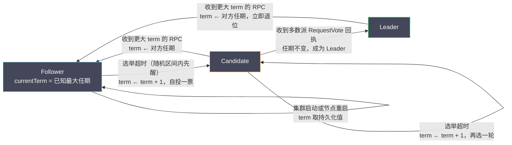
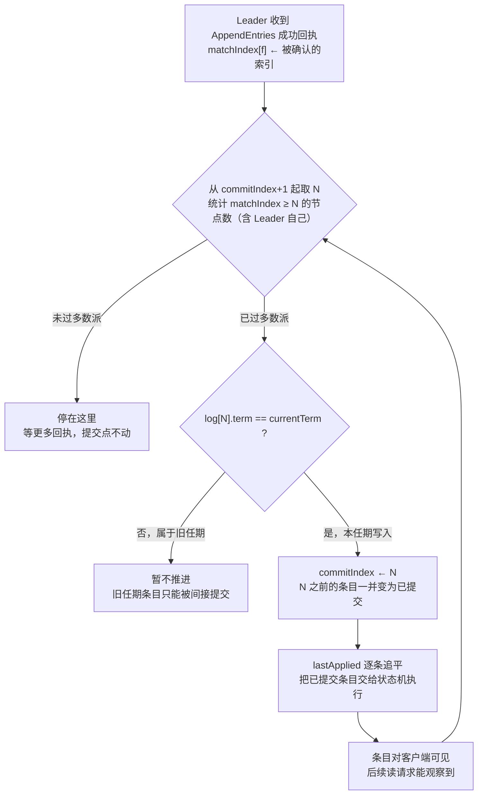
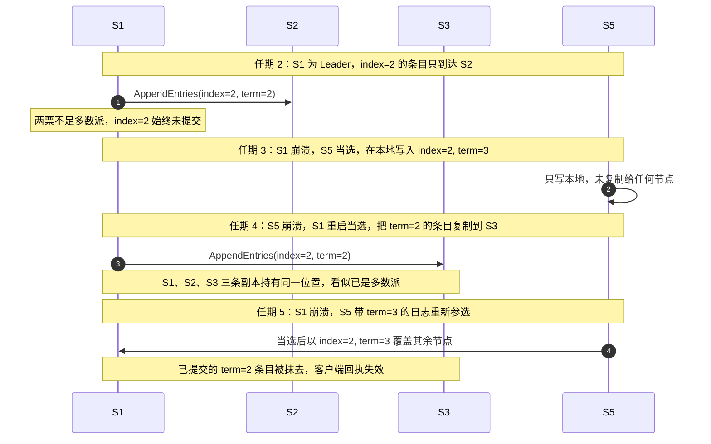
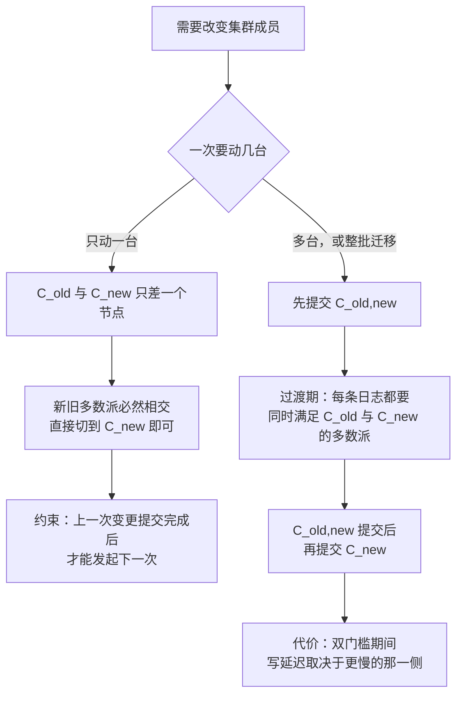

# 05 Raft 共识算法深度解析

**摘要：**

Paxos 在理论上把共识问题解决得很干净，却把「选主、日志修复、成员变更、日志压缩」这几件工程上最费神的事留给每个实现团队。2014 年，Diego Ongaro 与 John Ousterhout 在 USENIX ATC 上发表《In Search of an Understandable Consensus Algorithm》，把可理解性放到消息复杂度、吞吐、延迟之前，交出的答案就是 Raft。本文按五问推进：共识既然已经被 Paxos 解决，为什么还要再造一个协议；任期与三种状态构成的那台状态机为什么够用；日志复制与提交规则里那些看起来多余的限制各自在堵哪个洞；快照、成员变更、线性一致读在真实系统里如何落地；以及这套设计的边界——它在哪些地方确实不如 Multi-Paxos，哪几个优化又把正确性押在了时钟上。中段用四张图拆开状态机与任期推进、commitIndex 的推进条件、Figure 8 那个经典反例与成员变更的两条路线，并把 etcd-raft、TiKV、Consul 三份实现的差异逐项对照。读完应当能回答两个问题：Raft 的「好懂」究竟来自哪几处刻意的减法，以及那些看似冗余的安全规则为什么一条都删不得。

---

## 第 1 章 共识问题被解决之后，为什么还要再造一个协议

### 1.1 一个在纸面上早已了结的问题

把 2014 年之前的共识文献按时间摊开，会看到一个相当完整的序列：1998 年 Lamport 把希腊议会的故事整理成 The Part-Time Parliament 正式发表，多数派加两阶段这套机制从此固定下来；2001 年他又写了 Paxos Made Simple，把同一个算法换一种写法重述一遍；2006 年 Burrows 在 OSDI 上汇报 Chubby，说明 Google 如何用 Paxos 支撑一个跨机房的锁服务；2010 年 ZooKeeper 的论文出现在 USENIX ATC 上，把「协调服务」做成一个可以独立部署的组件。

在纸面上，共识已经不是一个开放问题。在工程上它仍然是：一个团队读完全部这些材料，依然不知道自己系统里那段复制逻辑该从哪里写起。缺口不在理论，在论文与代码之间的那一段距离——Paxos 的论文把大量内容归入「实现细节」，而这些细节恰好是工程上最容易出错、又最没有标准答案的部分。选主怎么做，日志空洞怎么补，成员变更怎么保证不出两个多数派，日志涨到磁盘装不下怎么办，这些问题在论文里找不到答案，只能由每个实现团队自己发明。

Paxos Made Simple 的开篇第一句就是「Paxos 这个算法很简单」。同一个算法需要作者亲手换一种写法重述才能被读懂，这件事本身就说明了包装方式的分量。

### 1.2 可理解性被当成一个可以测量的目标

2014 年，斯坦福的 Diego Ongaro 与 John Ousterhout 在 USENIX ATC 上发表了一篇标题略显冒犯的论文：《In Search of an Understandable Consensus Algorithm》。标题里的 understandable 不是修辞，而是这篇论文的立论方式：作者宣称现有共识算法的主要问题不是效率不够，而是难以理解，而难理解会直接转化为难实现、难调试、难在团队里传递。

为了不把这句话留在主张层面，Ongaro 在博士论文里做了一次对照实验：把学生分成两组，一组学 Paxos，一组学 Raft，学完用同一套题测验，再让他们给两个算法的理解难度打分。Raft 组在客观题上的得分更高，主观上给出的「容易理解」评价也更高。实验设计谈不上严密，样本是学生，学习时间有限，测验题也由研究者自己出；但方向足够清楚——在「让人学会」这件事上，两个算法确实拉开了差距。

这段历史值得记下来的一点是设计目标的排序。常规的算法论文把消息复杂度、吞吐、延迟摆在前面，可理解性最多写在讨论章节里；Raft 把可理解性放到了第一位，后面所有的取舍都从这条目标推出来。理解了这一点，才看得懂它为什么宁愿让 Leader 成为瓶颈，也要把并发提案这条路堵死。

### 1.3 三处刻意的减法

Raft 让问题变简单的办法不是发明新机制，而是做减法。三处减法贯穿全文。

第一处是强 Leader。在 Paxos 里任何节点都能当提议者，任意时刻都能发起提案，多个提议者并发时的交互状态要靠 Phase 1 的往返去理顺；Raft 直接把这条路收窄——任意时刻最多一个 Leader，所有写请求从 Leader 进入，日志只从 Leader 单向流向 Follower。**强 Leader** 这个约束把并发度压到最低，代价是 Leader 成为单点瓶颈，这笔账留到第 8 章再算。

第二处是问题分解。Raft 把共识拆成三个语义边界清晰的子问题：领导者选举（Leader Election）回答「谁来写」，日志复制（Log Replication）回答「怎么把写同步出去」，安全性（Safety）回答「中途崩了怎么保证不写坏」。三块各自有独立的论证，读者可以分块消化，实现者可以分模块测试，出了问题也能大致定位到是哪一块的约束被违反了。

第三处是把留白填上。Paxos 系列论文对成员变更、日志压缩、客户端如何与集群交互、只读请求怎么保证线性一致这几件事基本没有规定，每个团队自己发挥；Raft 逐条给出方案，连「新 Leader 上任要不要先写一条空日志」这种细节都写进了论文。填留白的收益不是算法变强了，而是「照着做」替代了「自己设计」——后者要求实现者具备与论文作者同等的判断力，绝大多数团队不具备这种判断力，于是各家的 Paxos 实现彼此不兼容，正确性也无从对照验证。

### 1.4 2015 年的复现：好懂不等于好写对

Raft 的可理解性叙事在 2015 年遇到过一次认真的检验。Howard、Schwarzkopf、Madhavapeddy 与 Crowcroft 在《Raft Refloated: Do We Have Consensus?》里独立复现了 Raft，并重复了那类学习效果的比较。结论比论文的乐观口吻复杂一些：Raft 的确比 Paxos 容易上手，但「读完论文就能写对」并不成立，复现中反复出问题的地方集中在论文着墨不多的角落——快照与日志压缩的交互、成员变更与快照的先后关系、崩溃恢复时必须先落盘什么再发什么。

他们还提出一个容易被忽略的判断：Raft 的可理解性优势，有一部分来自论文写得好，而不是算法本身更简单。把状态机、任期、日志这些概念讲清楚，与把算法设计得简单，是两件不同的事；Raft 两件都做了，所以在读者那里得到的印象是双份的。

这一节放在开头，是为了给后文定一个基调。Raft 的「好懂」是真的，但**它降低的是入门成本，不是正确性成本**——协议里那些看着别扭的约束，仍然需要逐条想清楚它堵的是哪个洞，否则写出来的实现会在某个罕见时序上翻车。

---

## 第 2 章 任期、三种状态与必须随机的那个超时

### 2.1 任期：只标顺序，不测时间

**任期（Term）** 是 Raft 里最基础的一个整数，也是最容易被低估的一个概念。它单调递增，每发起一次新的选举就加一，同一个任期内最多存在一个 Leader（也可能一个都没有，选举失败的那个任期就是空的）：

```
任期 1：节点 A 当选 Leader，一直服务到进程崩溃
任期 2：B、C 几乎同时超时，选票分裂，这个任期始终没有 Leader
任期 3：C 先醒，拿到多数票，成为新的 Leader
```

任期的用途只有一个，但用得极狠：它是每条 RPC 都必须携带的字段，接收方拿它和自己的 currentTerm 一比，就能判断这条消息属于现在还是过去。规则只有两条——消息里的任期小于自己的，直接拒绝并回一条自己的任期，让对方自己纠正；消息里的任期大于自己的，立刻把 currentTerm 更新过去，并退回 Follower，无论自己当前是 Candidate 还是 Leader。

这两条合起来做了一件事：把「时期」变成可比较的量。Paxos 的提案编号、ZAB 的纪元（epoch）、Lamport 逻辑时钟里的计数，都是同一形状的东西——在不信任物理时钟的环境里，用单调递增的整数标出先后。Raft 没有发明这个工具，只是把它提升成消息的第一等字段，并让所有状态迁移都服从它。

任期为什么必须单调？因为「过时」这个判断全靠它。一个被网络分区隔开的旧 Leader 会继续以旧任期发号施令，等分区恢复，它的消息因为任期偏小被其它节点丢掉，它自己也会因为收到更大任期的消息而退位，不需要任何额外的仲裁者。

一个反复出现的误解是把任期当成权威的度量：任期大的节点并不代表它更晚、更权威、日志更新，只代表它发起过更多次选举。一个被反复分区打断的节点，任期可能远高于集群其它成员，手里的日志却可能一片空白——这正是第 3 章 PreVote 要处理的现象。

### 2.2 三种状态与四条边

Raft 的每个节点在任意时刻处于三种状态之一，迁移由事件触发，没有第四种状态，也没有隐藏的中间态。

Follower 是被动角色，只响应 Leader 与 Candidate 的请求，自己不主动发起任何 RPC；它在选举超时内收不到 Leader 的心跳，就转成 Candidate。Candidate 是选举期的过渡状态，自增任期、先给自己投一票、向其它节点拉票；拿到多数票就转成 Leader，收到更大任期的消息就退回 Follower，超时没选出来就再自增任期重选一轮。Leader 处理全部客户端写请求，向每个 Follower 推送日志，并周期性发空心跳维持权威，让 Follower 的计时器不至于耗尽。

把三种状态和四条边连起来，就是一台只有三个状态的状态机，任期号是这台状态机的版本号：



图里那条自环值得单独看：Candidate 超时之后不是退回 Follower，而是原地再选一轮。这个选择暴露了 Raft 的一个取向——选举失败被当成常态而非异常，重试的代价只是一次任期自增与一轮 RPC，不需要额外的状态或外部的触发者。也正因为如此，「任期号会在频繁失败时迅速膨胀」成为一个必须在实现里防住的现象，第 3 章会回到这里。

另一条边是 Leader 收到更大任期后立即退位，不留任何缓冲。Leader 不能一边观察一边继续服务，因为只要它还在服务，就可能与新 Leader 同时接受写请求，两个 Leader 各自提交的日志在恢复时无法拼接；干脆退位，代价是一次短暂的服务中断，换来的是「任意时刻至多一个 Leader」这个不变量不被破坏。这条边也解释了为什么 Raft 里不需要额外的租约机制来防脑裂——任期比较本身就起到了隔离作用。

### 2.3 必须落盘的三样东西

Raft 的节点状态里，有三样必须在返回任何 RPC 之前写进稳定存储：currentTerm、votedFor、log。另外几样（commitIndex、lastApplied、Leader 侧的 nextIndex 与 matchIndex）可以放在内存里，重启后重新推导。

理由分开看。log 要落盘很好理解，日志丢了就等于历史丢了。currentTerm 要落盘，是因为它是判断新旧的全部基准，重启后如果从零开始计，集群里所有消息都会被它当成来自未来，于是它会给每一个候选者投票、给每一个 Leader 退位，成为集群里的噪声源。votedFor 要落盘最容易被忽略——它记录「我在本任期把票投给了谁」，如果重启后忘了这件事，同一个节点可能在同一个任期里投出两张票，两张票投给两个不同的候选者，于是同一个任期出现两个 Leader，多数派相交的论证当场失效。

比「哪三样」更容易出错的是顺序：**先持久化，再发消息**。一个节点在回复投票、回复 AppendEntries 成功、或者发出自己的投票请求之前，必须确保相关状态已经落到稳定存储上。反过来做（先回复、再落盘）在正常运行里看不出任何问题，只在崩溃重启的瞬间暴露：回执已经让别的节点相信了某件事，而自己重启后不再记得，于是同一份承诺被发出两次。

etcd 的 raft 库把这份责任显式推给调用方。它只提供算法，不提供存储与网络，每次状态推进后给出一个 Ready 结构，里面装着「必须先落盘的 HardState 与 Entries」「落盘之后才能发出的 Messages」「落盘之后才能应用的 CommittedEntries」。库不检查顺序，写错顺序的后果由应用承担。这种设计让 Raft 与存储、网络彻底解耦，一份代码可以接 WAL 也可以接别的日志存储，代价是把「正确性的一部分」交回使用者手里——库化设计一贯的交易方式。

```python
# 每个节点的核心状态，前三项必须在改动的同一时刻落盘
currentTerm = 0    # 当前已知最大任期号
votedFor = None    # 本任期内投给了谁，重启后必须还记得
log = []           # 日志条目，索引从 1 开始

commitIndex = 0    # 已提交的最高索引，重启后可由日志推导
lastApplied = 0    # 已应用到状态机的最高索引

# Leader 侧状态，每次当选后重建
nextIndex = {}     # 对每个 Follower，下一条待发送的索引
matchIndex = {}    # 对每个 Follower，已确认复制的最高索引
```

### 2.4 选举超时：一个必须随机的参数

选举超时（Election Timeout）是 Follower 等待心跳的容忍时间。窗口内收到 Leader 的 AppendEntries（哪怕是空心跳），计时器重置；窗口耗尽仍未收到，就认定 Leader 失效，自增任期发起选举。投票给某个候选者时计时器也会重置——票已经投出去了，总该给对方留出组阁的时间。

这个参数最容易被当成纯调优项，实际上它的取值方式决定协议能不能收敛。假设所有节点的超时都是同一个固定值，比如 200 毫秒，那么 Leader 一崩溃，所有 Follower 会在几乎同一时刻超时、同时自增任期、同时给自己投一票、同时向其它人拉票。每个候选者各得一票，五节点里五个候选者都拿不到三票，本轮必然失败；下一轮它们又同时超时，重复同一个局面。这不是偶发失败，而是**活锁**——协议在活动，却永远推不出结果。

随机化打破的就是这个对称。每个节点在自己重置计时器时，从一个区间里随机取一个值（论文给的是 150 到 300 毫秒），于是「同时超时」变成了「总有人先醒」。先醒的那个在别人还没醒时就发出投票请求，多数情况下能在第一轮拿到多数票；其它节点收到请求后重置计时器，甚至还没开始选举就已经有了新 Leader。

**随机化不是为了更快，而是为了打破对称**。让竞争者错开时间，冲突概率就下来了，这个手段在分布式系统里反复出现：重试要加抖动、缓存过期要加抖动、Gossip 的传播周期也要加抖动，动机都一样。

区间怎么取，笔者有两条经验。一是区间宽度要大于一次广播往返，如果两个节点的超时只差几毫秒，而一次 AppendEntries 往返就要十几毫秒，那么「先醒」的优势会被网络延迟吃掉，分裂照样发生。二是绝对值要远大于广播时间、又远小于机器的平均故障间隔：取小了，一次网络抖动或一次 GC 停顿就能引发误选举；取大了，真故障发生时要等很久才切换。

```
广播时间（broadcastTime）<< 选举超时（electionTimeout）<< MTBF（平均故障间隔）

broadcastTime  ：Leader 并行广播一轮 AppendEntries、并等到多数派回执的往返，同机房通常亚毫秒到几十毫秒
electionTimeout：选举超时，论文取 150ms ~ 300ms 的随机区间
MTBF           ：单台机器的平均故障间隔，月级到年级
```

工程实现的默认值差别不小。etcd 的心跳间隔默认 100 毫秒、选举超时默认 1000 毫秒；TiKV 用一个 1 秒的 tick 作基准，选举超时取 10 个 tick；Consul 的心跳与选举超时默认都在 1 秒上下。这些数字本身没有对错，它们服务各自的部署形态：同机房的控制面可以把超时压低以缩短切换窗口，跨机房部署则必须把超时抬到「最慢一次跨机房往返」之上。

---

## 第 3 章 选举：从拉票到上任

### 3.1 一次选举的五个动作

Leader 失效不是可观测事件，而是超时推断出来的结论，所以每次选举都从某个 Follower 的计时器开始。

第一个动作是自增任期、转成 Candidate、先投自己一票，并重置计时器——重置是为了防止刚发起选举就又超时，把一轮选举压缩成零轮：

```python
def start_election():
    currentTerm += 1        # 任期先加一，后续所有消息都带这个新任期
    state = CANDIDATE
    votedFor = self_id      # 先投自己，否则连自己的票都要向别人要
    votes_received = 1
    persist(currentTerm, votedFor)   # 落盘之后才允许对外发请求
    reset_election_timer()
```

第二个动作是并行向其它所有节点发 RequestVote，请求里带四项信息，后两项是日志新鲜度比较的全部输入：

```python
RequestVote RPC 的参数：
  term         = currentTerm     # 候选者的任期
  candidateId  = self_id         # 候选者 ID
  lastLogIndex = len(log)        # 候选者最后一条日志的索引
  lastLogTerm  = log[-1].term    # 候选者最后一条日志的任期
```

第三个动作是接收方做两道检查。任期检查先做：term 小于自己的，回一条自己的任期表示拒绝；term 大于自己的，更新 currentTerm、转为 Follower、清空 votedFor，再继续第二道检查。日志新鲜度检查后做：只有当候选者的日志不旧于自己时，票才可能投出去。两道检查都过、且本任期还没投给别人，才把票投出去并重置计时器。

第四个动作是计票。拿到多数派（大于 n/2）的 voteGranted 就当选，任期不变；收到更高任期的响应就退回 Follower；计时器先耗尽就自增任期、再拉一轮。这里有个细节常被写错：多数派是按「集群的投票成员数」算的，不是按「还活着的节点数」算的，把已经失联的节点从分母里扣掉，等于自己给自己造了一个多数派。

第五个动作是当选后立刻广播空心跳。这不是礼貌，而是抢在其它节点的计时器耗尽之前把它们压住——新 Leader 的第一次 AppendEntries 一旦到达，所有 Follower 的计时器重置，这一轮选举就结束了。

```python
def on_request_vote(term, candidateId, lastLogIndex, lastLogTerm):
    if term < currentTerm:
        return VoteResponse(term=currentTerm, voteGranted=False)

    if term > currentTerm:          # 见到更大的任期，先无条件退位
        currentTerm = term
        state = FOLLOWER
        votedFor = None
        persist(currentTerm, votedFor)

    already_voted = (votedFor is not None and votedFor != candidateId)

    my_last_term = log[-1].term if log else 0
    my_last_index = len(log)

    # 先比最后一条日志的任期，任期相同才比长度
    candidate_is_fresh = (
        lastLogTerm > my_last_term or
        (lastLogTerm == my_last_term and lastLogIndex >= my_last_index)
    )

    if not already_voted and candidate_is_fresh:
        votedFor = candidateId
        persist(currentTerm, votedFor)   # 投票承诺必须先落盘再回复
        reset_election_timer()
        return VoteResponse(term=currentTerm, voteGranted=True)

    return VoteResponse(term=currentTerm, voteGranted=False)
```

### 3.2 日志新鲜度：把修复挪到投票之前

日志新鲜度的比较规则可以一句话说完：先比最后一条日志的任期，任期大的更新；任期相同，再比最后一条日志的索引，索引大的更新。注意比较的是「最后一条」，不是「长度」——一条短日志完全可能比一条长日志更新，只要它的末尾来自更晚的任期。

这条约束撑起的是 **Leader 完整性（Leader Completeness）**：一条日志一旦在某任期被提交，它就会出现在所有更高任期的 Leader 的日志里。论证只有三步，但每一步都不能省。

第一步，一条条目被提交，意味着它存在于多数派 Q₁ 的每一个节点上。第二步，某个节点要当选 Leader，需要拿到多数派 Q₂ 的选票。第三步，Q₁ 与 Q₂ 必然相交——两个多数派各自超过半数，加起来超过总数，不可能没有重合。取交集里那个节点，它手里有这条已提交的条目，它按「日志不旧于自己才投票」的规则，不会把票投给一个缺少这条条目的候选者。于是任何缺少这条条目的候选者都拿不到 Q₂，也就当不上 Leader。

这套论证与 Paxos 的安全性证明同源，都靠多数派相交这一个性质；区别在于使用时机。Paxos 允许日志不完整的节点当提议者，靠 Phase 1 去探知并修复缺失的值；Raft 在投票阶段就把这类候选者过滤掉，让当选者天然拥有最完整的日志。

> [!note] 选举前过滤与选举后修复
> 两种思路的代价方向相反。Paxos 的「先允许、后修复」更灵活，任何节点都能发起提案，但每次提案都要背一轮 Phase 1 的探知成本，而且实现者要处理「探知到别人的值、被迫放弃自己的值」这种反直觉分支。
>
> Raft 的「先过滤、后使用」限制了候选者范围，选举可能因为「日志最新的节点恰好失联」而多等几轮，但 Leader 上任之后不需要任何修复前置逻辑，日志修复只是前缀检查的副产品。
>
> Raft 选后者，理由与可理解性一致：把复杂性收在选举这一处，比摊在每次提案里更容易讲清楚，也更容易测试。

### 3.3 退位抖动与 PreVote

随机化解决的是「同时起跑」，解决不了「带着错误的任期回来」。

设想一个跨机房的 Raft 组，机房间的链路抖了 30 秒。被隔在这一侧的两个节点中，有一个的计时器不断耗尽，它每秒发起一次选举，每次都因为凑不齐多数派而失败，任期从 5 一路涨到 35。链路恢复的瞬间，它把一条 term=35 的 RequestVote 发给集群；原 Leader 任期才 5，收到这条消息立刻按规则退位，整个集群被拖进一次本不必要的选举——客户端会看到几秒钟的写中断，而真正的故障只是链路抖了一下。

这类节点在 Raft 的博士论文里被单独讨论过，实现里管它叫干扰节点（disruptive server）。它没有做错任何事，所有行为都严格符合规则，问题出在规则本身：任期只增不减，而一个节点的任期增长与它是否有可能当选无关。

**PreVote** 的做法是给选举加一道预检。候选者在自增任期之前，先发一轮预投票，问的是「如果我现在真的发起选举，你会投给我吗」，接收方按日志新鲜度、并附加一个条件——最近一个最小选举超时内没有收到过 Leader 的心跳——来回答，但不改 currentTerm、不写 votedFor、不产生任何持久化副作用。只有预投票拿到多数派，候选者才真正自增任期、进入正式选举。被隔离的节点预投票永远凑不齐多数派，任期就一直停在原地；链路恢复后它既不会带回高任期，也不会打断健康的 Leader。

代价是每次真选举多一个往返。正常情况下这个往返可以并行发出，成本接近零；只有在真正需要切主时，切换时间会多出一次 RTT。**用一次额外往返换掉一类抖动**，这笔交易在网络不稳的部署里几乎总是划算的，所以 etcd 的 raft 库把它做成了可配置项，多数生产部署会打开。

### 3.4 CheckQuorum：Leader 该不该主动退位

随机化与 PreVote 管的都是「想当 Leader 的人」，还有一类抖动来自「已经是 Leader 的人」。按原始规则，一个失去多数派的 Leader 不会自己退位——Raft 里没有 Leader 的计时器，它只在收到更大任期时退位。于是它继续接受客户端写，这些写永远凑不齐多数派、永远提交不了，客户端只能等到超时；它还会持续给还能连上的少数派发心跳，压住它们的计时器，让整个少数派长期处于「有个 Leader 在正常发心跳」的假稳定状态，运维从监控上看不出任何异常。

**CheckQuorum** 让 Leader 自己记账：每过一个选举超时窗口，统计这一轮里有多少 Follower 回应了自己的心跳或日志，如果回应的数量不足多数派，就主动降级为 Follower。效果有两层——客户端写请求会快速失败而不是挂住，少数派也不会被一个已无实权的 Leader 压着。

代价同样清楚：网络抖动时，Leader 可能因为一轮心跳集体迟到而误判自己失联，把一次抖动放大成一次切主。所以 CheckQuorum 通常与 PreVote 一起开，两个机制的取向是配对的——一个让不该当选的人选不上，一个让不该留任的人主动让位，合起来把「任期涨得快、切主切得勤」这两类抖动都压住。

---

## 第 4 章 日志复制：从入口到提交

### 4.1 条目结构与四条不变量

日志是有序条目的序列，每个条目三个字段：

```python
class LogEntry:
    index: int     # 全局位置，从 1 开始，与任期无关地单调递增
    term: int      # 写入这条日志时的 Leader 任期，一致性检查的依据
    command: Any   # 客户端请求，交给状态机执行
```

term 字段看着冗余——日志的位置不就够了吗。它不冗余：index 全局单调、永不回退，term 随 Leader 更替而跳变，两者组合起来才能表达「这一条属于哪一届政府」。同一个 index 上出现不同 term，就说明两条历史在这里分叉了，而分叉正是需要被修复的东西。

Raft 的安全性由四条与日志直接相关的不变量支撑，另外还要算上第 3 章论证过的 Leader 完整性，后面所有的规则都是在保住这一组性质。选举安全：一个任期内至多一个 Leader。Leader 只追加：Leader 从不覆盖或删除自己日志里的条目，只往后加。**日志匹配性质（Log Matching Property）**：如果两份日志在某个 index 上的条目 term 相同，那么该 index 之前的所有条目完全相同。状态机安全：如果一个节点在某个 index 上应用了某条日志，那么没有任何其它节点会在同一个 index 上应用不同的日志。

第四条是最终目的，前三条是达到它的手段。日志匹配性质是其中最有用的一条，因为它把一个全局的、难以验证的命题（两份日志是否一致）压缩成一个局部的、每条消息都能检查的命题（这个 index 上的 term 对不对）。

### 4.2 AppendEntries 与前缀检查

Leader 通过 AppendEntries 向 Follower 推送日志，心跳就是不携带条目的 AppendEntries。请求里除了任期和条目，还多带两个字段：

```python
AppendEntries RPC 的参数：
  term         = currentTerm        # Leader 的任期
  leaderId     = self_id            # 便于 Follower 把客户端请求转发过来
  prevLogIndex = nextIndex[f] - 1   # 紧邻新条目之前那一条的位置
  prevLogTerm  = log[prevLogIndex].term
  entries      = [...]              # 要复制的条目，心跳时为空
  leaderCommit = commitIndex        # Leader 已知的提交点
```

prevLogIndex 与 prevLogTerm 组成一次前缀检查：Follower 先看自己在这个位置上有没有条目、term 对不对，对得上才接受后面的条目，对不上就整批拒绝。这不是优化，而是日志匹配性质的归纳步骤——如果两个日志在 index=N 的条目 term 相同，那么它们在 N 之前完全相同，这个结论的传递全靠每次追加前都核对前驱。

```python
def on_append_entries(term, leaderId, prevLogIndex, prevLogTerm, entries, leaderCommit):
    if term < currentTerm:
        return AppendEntriesResponse(term=currentTerm, success=False)

    # 能收到当前任期 Leader 的消息，说明 Leader 活着，重置计时器
    reset_election_timer()
    currentTerm = term
    state = FOLLOWER

    # 前缀检查：前驱对不上，说明更早的地方就已经分叉
    if prevLogIndex > 0:
        if len(log) < prevLogIndex or log[prevLogIndex].term != prevLogTerm:
            # 把冲突位置与冲突任期带回去，让 Leader 一次退一大段
            return AppendEntriesResponse(term=currentTerm, success=False,
                                         conflictIndex=len(log),
                                         conflictTerm=log[-1].term if log else 0)

    for offset, entry in enumerate(entries, start=1):
        idx = prevLogIndex + offset
        if idx <= len(log):
            if log[idx].term != entry.term:
                # 冲突只可能出现在未提交的尾部，截断后重写
                log = log[:idx]
                log.append(entry)
            # term 相同则内容必然相同，跳过即可
        else:
            log.append(entry)

    if leaderCommit > commitIndex:
        # 只能提交到自己确实拥有的最后一条，不能凭 leaderCommit 越界
        commitIndex = min(leaderCommit, prevLogIndex + len(entries))
        apply_committed_entries()

    return AppendEntriesResponse(term=currentTerm, success=True)
```

截断这一步值得单独说明边界。Follower 会截掉自己日志的尾部，但绝不可能截到已提交的部分——因为已提交的条目一定存在于当前 Leader 的日志里（Leader 完整性），前缀检查在走到那个位置之前就已经通过了，冲突根本到不了已提交区。这条推理把「截断」这件危险动作的安全性，完全托付给了选举阶段的那条约束，两条规则是一对。

### 4.3 commitIndex 的推进条件

Leader 为每个 Follower 维护两个指针：nextIndex 是下一条要发的，matchIndex 是已经确认复制的最高位置。提交判定只用 matchIndex——它在每个成功的 AppendEntries 回执里前进，是一个只增不减的事实记录，而 nextIndex 会因为失败回退，不能拿来当复制进度的证据。

一个 index 上的条目要被提交，需要同时满足三个条件：

```python
def maybe_update_commit_index():
    for N in range(commitIndex + 1, len(log) + 1):
        replicated = 1                     # Leader 自己那一票也算
        for f in followers:
            if matchIndex[f] >= N:
                replicated += 1

        if replicated > len(cluster) / 2:   # 条件一：多数派已持有
            if log[N].term == currentTerm:  # 条件二：必须是本任期的条目
                commitIndex = N             # 条件三：只能逐步前移，不能跳跃
                apply_committed_entries()
                break
```

三个条件的分工各不相同。多数派把「可能被后续 Leader 覆盖」变成「大概率不会」，它与日志新鲜度约束配合，才把「大概率」变成「一定」。本任期条件把「Leader 自己的判断」变成「所有未来 Leader 都必须遵守的事实」，理由留到下一节。单向推进则是为了让提交点与日志顺序保持一致，避免绕过中间尚未确认的条目。三条判断合起来，构成一条从回执到可见的完整路径：



### 4.4 Figure 8：为什么旧任期的条目不能直接提交

条件二最容易被误解成「Raft 不允许提交旧任期的日志」。准确的说法是：Leader 不能仅凭旧任期条目凑够多数派就推进 commitIndex，但当前任期的条目一旦提交，它之前的所有条目会随 commitIndex 前移被一并提交。为什么必须这么绕，答案在 Raft 论文的 Figure 8 里。

场景是五节点集群，S1 到 S5：

```
T1（任期 2，S1 为 Leader）：
    S1 把 index=2, term=2 的条目复制给 S2，只有两个节点持有，不构成多数派，不能提交
    S1 崩溃

T2（任期 3，S5 当选）：
    S5 的日志只到 index=1，它在自己的任期里写了 index=2, term=3
    但这条只留在 S5 本地，没复制给任何人，S5 崩溃

T3（任期 4，S1 重启并当选）：
    S1 的日志里有 index=2, term=2，它把这条复制到 S3
    此刻 S1、S2、S3 三个节点都持有 index=2, term=2，构成多数派
```

到这里是分岔口。如果允许 S1 直接提交 index=2, term=2，客户端收到成功回执，事情还没完：

```
T4（任期 5，S1 崩溃）：
    S5 重新上线并参选，它的最后一条日志是 index=2, term=3
    term=3 大于 S2、S3 的 term=2，按日志新鲜度规则，S5 最有资格当选
    S5 当选后把 index=2, term=3 覆盖到 S1、S2、S3

结果：index=2, term=2 已经被提交、客户端已经收到成功，
      却被一个合法当选的新 Leader 覆盖，状态机上的操作被抹掉
```

把四个任期连成一条时序，冲突发生在哪一步就看得更清楚：



问题的根不在多数派，而在「多数派之外还可能有别的历史」。S5 之所以能合法当选，是因为它的日志按新鲜度规则确实最新；它不知道自己覆盖的那条已经被提交，因为提交这件事只存在于 S1 的记忆里，S5 无从得知。让任何新 Leader 都必须「重新确认」一次旧条目的地位，才是安全的。

Raft 的解法是要求新 Leader 先提交一条本任期的条目（实现里通常是一条不含客户端操作的 no-op），用这条新条目的多数派确认去带动 commitIndex 前移，把旧条目一并提交。回到场景里，S1 在任期 4 提交 index=3, term=4 之后，S2 与 S3 都有了这条更新的日志；等 S5 再想当选时，它的最后一条还是 index=2, term=3，比 S2、S3 的都旧，拿不到它们的票，也就没有机会覆盖。

**只提交当前任期的条目**，代价是每次换届都要多写一条 no-op、多等一轮多数派确认；收益是「已提交」这件事一旦成立，就不再依赖任何人的记忆。

> [!warning] 一个流传很广的误读
> 常见的说法是「Raft 不能提交旧任期的日志」，这句话是错的。旧任期的日志可以被提交，只是不能被直接提交——它必须搭着一条本任期日志的顺风车，随 commitIndex 前移而生效。
>
> 区别看起来只是措辞，实际决定了实现对不对。写成「不能提交旧条目」的实现，会在换届后把前任留下的日志永久悬空，表现为「客户端写成功但数据不见了」；写成「可以随便提交」的实现，会撞上 Figure 8，表现为「已经确认的写被回滚」。中间那条窄路才是正确解，而它恰好是论文里一句话带过、注释里也不显眼的地方。

### 4.5 日志修复与队头阻塞

新 Leader 上任时，Follower 的日志可能各式各样：落后几条、领先几条、中间分叉。修复靠 nextIndex 回退——AppendEntries 被拒之后把该 Follower 的 nextIndex 减一，重发更早的位置，直到某次前缀检查通过，从那里开始补发并覆盖。

逐条减一的回退在日志差异大时慢得离谱，一次补齐要几十轮 RPC。论文给出的加速办法是让 Follower 在拒绝时回报冲突位置与冲突任期：Leader 收到后，如果自己的日志里也有这个任期，就跳到该任期的最后一条之后重试；如果没有，就直接把 nextIndex 退到冲突任期之前的第一条。这样一次往返能退掉一整段，而不是一格。

```
正常 Leader 的日志：[1,T1] [2,T1] [3,T2] [4,T3] [5,T3]

Follower A（单纯落后）：
  [1,T1] [2,T1] [3,T2]
  → 前缀检查通过，直接补 4、5

Follower B（曾在旧任期当 Leader，尾部是脏的）：
  [1,T1] [2,T1] [3,T2] [4,T2] [5,T2]
  → 在 index=4 处前缀检查失败，按冲突任期一次退到 3，覆盖 4、5
```

修复过程一定收敛，理由有两条：nextIndex 单调回退且下界为 1，不可能无限退；一旦退到公共前缀，Leader 的日志就是完整的（它拥有全部已提交条目），补发之后两者一致。收敛性依赖「Leader 拥有最完整日志」这个前提，而这个前提正是第 3 章的选举约束保证的——两条规则再次成对出现。

修复还有一个无法回避的副作用：队头阻塞。日志是一条不允许有洞的线，某个 index 上的条目没凑够多数派，它后面的条目即使已经复制到全部节点，也不能提交、不能应用。极端情况下一条慢 Follower 卡住了一个条目，整个集群的写延迟都会被它拖长。**无空洞是一条硬约束**，它换来了「日志位置即提交顺序」这个极简的推理模型，代价是把队头阻塞写进了协议的成本表。

---

## 第 5 章 快照与日志压缩

### 5.1 日志为什么不能无限长

Raft 的日志只追加不删除，如果一直跑下去，会出现三个问题，且一个比一个难绕。

磁盘会被写满，这是最直观的。第二个是重启恢复时间：节点重启后要按顺序重放全部日志才能重建状态机，日志有上千万条时，恢复窗口以小时计，而 Raft 的可用性要求重启的节点能尽快回到集群。第三个更隐蔽——InstallSnapshot 与 AppendEntries 的选择逻辑会退化：一个新加入或长期离线的节点，Leader 需要从它落后的位置开始补，如果日志跨度太大，补的过程本身就会把 Leader 拖慢。

压缩的通用做法是定期对状态机做一次快照，记下「到哪个位置为止的状态」，然后把该位置之前的日志整段丢弃。快照不是 Raft 独有的思路，但它与 Raft 的几个具体约束咬合得很紧。

### 5.2 快照里必须装什么

一份快照至少包含三部分：lastIncludedIndex 与 lastIncludedTerm（快照覆盖到哪一条），状态机在那一刻的完整数据，以及**快照必须包含集群配置**。

前两部分好理解，第三部分最容易被漏掉。一个节点从快照恢复时，它需要知道当前集群有几个投票成员、是哪些，才能判断多数派门槛、才能对一条 RequestVote 做出正确回应。如果快照里不带配置，恢复出来的节点要么用本地残留的旧配置（可能与现状不符，算出错误的多数派），要么等 Leader 重新告诉它——而 Leader 的心跳本身需要经过多数派判断，逻辑上绕回了自己。

这与日志压缩的实现方式有关：配置变更本身也是日志条目，被同一条日志流承载，压缩时如果只存了状态机数据而没存配置，那么「最后一次配置变更」这条信息就随日志一起被裁掉了。工程上通常的做法是把配置与快照元数据一并持久化，让恢复路径只依赖快照加尾部日志，不依赖任何外部输入。

快照的写入还有一条硬约束：必须是原子的。常见实现是先写临时文件、fsync、再原子重命名，或者写到一个新的编号目录再切换指针。半写的快照比没有快照更危险，因为恢复时它看起来是一份完整文件。

### 5.3 InstallSnapshot 与追落后的代价

Leader 发现某个 Follower 需要的 nextIndex 已经被压缩掉了（落在快照点之前），就不能再发 AppendEntries，而要发 InstallSnapshot：把快照分块传过去，接收端装载完成后连同快照覆盖到的日志位置一起更新自己的状态。

这条路径的代价比正常复制高一个数量级。正常复制传的是几条日志，几十字节到几 KB；InstallSnapshot 传的是整个状态机，几 MB 到几十 GB。它还会打断增量复制的节奏：传输期间该 Follower 不接收正常日志，传完之后要重新对齐一次。所以实现里通常要限速、分块、并在带宽紧张时优先保证多数派内的节点。

**InstallSnapshot** 的存在还引出一个循环：快照太频繁，传输成本高、且刚压缩完就可能有人需要补全量；快照太稀疏，日志涨得快、恢复慢。工程上一般用双触发——日志条数超过阈值做一次，或者距上次快照超过一定时间做一次，两者取先到者。

### 5.4 快照引发的两类故障

第一类是与成员变更的竞态。成员变更与快照同时在跑时，快照必须记录变更生效后的配置，而不是发起快照那一刻的配置。设想一个节点在做全量快照，期间集群从三个节点扩到五个；如果快照记录的还是三节点配置，这个节点重启后会按三个节点的多数派（两个）来判断，于是它可能与另一个同样持旧配置的节点凑出一个并不存在的多数派。这类问题的特征是「只在扩容或缩容的窗口里出现」，极难复现。

第二类来自快照本身的开销。做快照需要遍历状态机、序列化、落盘，这个过程会占用 CPU 与磁盘带宽，可能把心跳延迟推高到选举超时之上，于是一个节点只是做了个快照，整个集群就换了一次 Leader。工程解法有三条，譬如限制快照频率、把快照放到低优先级线程、或者用写时复制让快照与写入并行。无论哪种，思路都是把「快照的停顿」从心跳路径上挪开。

---

## 第 6 章 成员变更：在运行中改变协议的参与者

### 6.1 直接切换为什么会出现两个多数派

成员变更最朴素的写法是「改配置、重启、新配置生效」。这个写法在停机窗口里没问题，在线变更时立刻出事：多数派的定义会中途改变，而不同节点对「现在是几个成员」的认知可能不一致。

```
原配置 C_old：{S1, S2, S3}，多数派门槛 2
新配置 C_new：{S1, S2, S3, S4, S5}，多数派门槛 3

若 S1、S2 先切到新配置，S3 还在旧配置：
  按新配置算，{S1, S2, S4} 凑够 3 票，可以提交
  按旧配置算，{S1, S3}    凑够 2 票，也可以提交
→ 两套人马在同一时刻各自认为自己合法，可以提交互相冲突的日志
```

这就是双多数派。它的危险不在「有两个 Leader」——Raft 的任期机制仍然保证 Leader 唯一——而在「同一条日志可以在两套规则下分别被判定为已提交」，于是两份被客户端确认为成功的写，可能在恢复时只能留下一份。

问题的根源是自指：协议靠「多数派」这套规则运转，而成员变更要改的正是这套规则本身。**在协议运行中改变协议的参与者**，是所有共识实现里最晚被完善的一块，原因也在这里——它不是算法问题，是元规则问题。

### 6.2 联合共识：过渡期同时服从两套规则

**联合共识（Joint Consensus）** 的思路是不做瞬间切换，插一个过渡配置 C_old,new。过渡期内，任何一条日志的提交都必须同时在 C_old 和 C_new 下取得多数派；只要两套门槛都满足，就不可能出现「一套规则说已提交、另一套说没提交」的局面。

具体流程分三段：Leader 先提交 C_old,new 这条配置变更日志，集群进入过渡期；过渡期内所有决策按双门槛执行；C_old,new 提交完成后，再提交 C_new，整个集群切到纯新配置。每一步配置变更本身都是普通日志条目，走同一条复制路径，因此不需要为它发明新的通信机制。两条路线的形状与门槛差异如下：



图里两条分支的差别只在「一次动几台」。动一台时两侧配置的多数派天然相交，过渡配置可以省掉；动多台时交集没有保证，必须靠双门槛兜住。**这个划分不是风格选择，而是由交集是否存在决定的**。

### 6.3 单步变更：用交集替代过渡配置

**单步变更（Single-Server Change）** 走的是另一条路：每次只加一台或减一台，不做过渡配置。正确性来自一个简单的算术——旧配置 C_old 与新配置 C_new 相差一个节点时，它们的多数派必然相交。

设旧配置有 n 个节点，多数派门槛是 ⌊n/2⌋+1；新配置有 n+1 个节点，门槛是 ⌊(n+1)/2⌋+1。任取一个旧多数派 Q₁ 与一个新多数派 Q₂，两者的交集大小至少是 |Q₁| + |Q₂| - (n+1)。代入奇数到偶数的情形（n=3 到 4）：2 + 3 - 4 = 1；代入偶数到奇数（n=4 到 5）：3 + 3 - 5 = 1。**两边多数派的交集永远至少有一个节点**，而一个同时属于两个多数派的节点，不可能在两个配置下做出互相矛盾的决定。

单步变更的约束因此也很明确：一次只能改一台，且上一次变更完全提交之后才能开始下一次。这条约束让变更变成串行操作，代价是扩容十台要跑十轮，收益是实现极简——不需要过渡配置、不需要在代码里同时维护两份配置视图。

### 6.4 两条路线的取舍

联合共识支持任意粒度的变更，一次把三台机器换掉、把集群整体迁到另一个机房，都可以在一到两轮里完成；代价是过渡期要同时维护两套配置与两个 quorum 判断，代码路径翻倍，测试面也翻倍，而且过渡期一旦卡住（比如新旧两侧对同一批日志的确认进度不一致），排障比普通复制困难得多。

单步变更实现简单、推理直白，每个时刻只有一份配置在生效；代价是变更粒度被限制到一台，且串行执行。对于「偶尔加减一台」的运维节奏，这个代价几乎不存在；对于「整机房搬迁」这种场景，几十轮变更本身就是风险，每一轮都可能碰到节点故障。

工程实现的选择并不一致。etcd 的 raft 库长期只提供单步变更，后来补上了一次可携带多个节点的变更类型（ConfChangeV2），为的是把「替换三副本」从三轮压到一轮；TiKV 的 Region 调度也倾向这种方式，因为一次副本搬迁往往涉及多台节点同时换位置，串行改三次会让调度器多等两轮心跳。Consul 的 Raft 实现同样以单步变更为主，把大规模成员调整留给外层的运维流程。三种选择都能证明正确，分野在于「变更频率与粒度」的分布，而不在算法高下。

### 6.5 两个实践坑

第一个坑是移除 Leader 自身。Leader 提交一条「把自己移除」的配置变更后，它必须立刻退位，因为新配置下它已经不计入投票成员，继续自认 Leader 会与新的多数派产生两套认知。麻烦在于它可能收不到这条变更的提交回执（提交所需的多数派在新配置里），于是这次变更是否生效，Leader 自己并不确定；如果它这时崩溃，变更可能已经写进多数派也可能没有。处理办法是让客户端重试，并在重试前先读一次配置——变更本身就是日志条目，读配置等价于读日志的最新状态。

第二个坑是「新节点一加入就投票」。新节点的日志可能远远落后，让它一进来就计入多数派，会直接降低集群的容错能力：原本可以挂一台的三节点集群，在加入一台空节点后变成四节点，若空节点与另一台同时故障，集群只剩两台，凑不齐三票，不可用。正确做法是先以 **Learner** 身份加入——接收日志、不参与投票、不计入多数派门槛，等它的日志追平之后再提升为正式成员。etcd 与 TiKV 都提供了这个角色，它把「成员变更」拆成了「数据追平」与「投票权授予」两步，两步各自可以失败、可以重试。

---

## 第 7 章 读路径：线性一致读与它借用的时钟

### 7.1 直接读 Leader 为什么不够

写路径走多数派，读路径看起来可以取巧：Leader 的数据总是最新的，直接读它的状态机不就完了。问题出在「它还是不是 Leader」这个前提上。

一个被网络分区隔到少数派一侧的 Leader，在它自己的视角里一切正常，只是发出去的 AppendEntries 没人回应；它不知道集群已经在另一侧选出了新 Leader，也不知道自己已经过时。此时客户端连上它读一次，会读到一份在集群当前状态里已经不成立的数据。写请求在这种情况下会卡住（凑不齐多数派），读请求却会立刻返回一个错误答案——这比卡住更糟，因为调用方无法察觉。

所以线性一致读的核心不在于「读 Leader」，而在于「在返回之前确认这个 Leader 仍然是 Leader」。确认手段只有两种：向多数派问一次，或者用一段时间窗口替代这次询问。

### 7.2 ReadIndex：用一次心跳买一个读点

**ReadIndex** 的做法是把确认压缩成一次心跳。Leader 收到读请求后，先记下当前的 commitIndex 作为本次读的 readIndex；然后向所有 Follower 发一轮心跳，如果收到多数派回执，就证明在这一刻自己仍然是合法 Leader，并且没有任何更新的 Leader 已经提交过更高位置的日志；接着等本地状态机的 lastApplied 追平 readIndex，再把结果返回。

整个过程不写日志、不占日志位置，但要走一次多数派往返。它保证了读到的内容至少包含 readIndex 之前的全部已提交写，也就是线性一致的读。优化空间在于批量：同一时刻到达的一批读请求可以共享一轮心跳，把一次往返的成本摊薄到几乎为零，这也是为什么 ReadIndex 在实际系统里比看上去便宜——它贵在「轮次」，不贵在「请求数」。

### 7.3 Lease Read：用时钟换一次往返

**租约（Lease）** 类读法把那次心跳省掉。思路是：Leader 在每次成功拿到多数派心跳确认时，记下一个时间戳；此后一段时间窗口内（通常取略小于选举超时的值），它认为自己仍然是 Leader，读请求直接读本地状态机。安全性依赖一个时间论证——如果 Leader 在 T 时刻拿到了多数派确认，那么其它节点最早也要在选举超时之后才可能发起新选举并当选，而这个超时从 T 时刻算起尚未耗尽，所以窗口内不可能存在新 Leader。

这个论证有两个前提，都很硬。一是各节点的时钟速率有上界，且本地测量出的时间窗口不会比真实时间更长；二是这段窗口内进程不会被长时间挂起。前者在正常的物理机上成立，后者则不一定：虚拟机被宿主机挂起、容器被 cgroup 冻结、长时间的 STW 停顿，都会让「我算出来的 500 毫秒」在真实世界里变成几秒，而选举超时是按真实时间走的。窗口一被拉长，就可能出现「旧 Leader 还在用租约读，新 Leader 已经当选并写入」的重叠区。

所以租约读是典型的「用假设换性能」：省掉一次往返，代价是把正确性挂在了时钟上。etcd 默认走 ReadIndex，把租约读做成显式开启的选项；Consul 的默认读模式则把租约放在前面，另外提供一次 quorum 确认的强一致模式与允许任意节点本地读的 stale 模式。同一件事上的不同默认值，反映的是各系统对「谁来承担判断责任」的取舍——默认安全，还是默认快。

### 7.4 Follower Read 的两种强度

让 Follower 承担只读请求，可以把读吞吐从 Leader 身上摊开，但要先说清楚读的是哪个强度。

弱一点的版本就是本地读：Follower 直接返回自己已应用的状态，可能落后任意久。这在「读多写少、且能容忍陈旧」的场景里完全够用，可一旦调用方拿它做「读到自己刚写的数据」之类的判断，就会出错。

强一点的版本借用 ReadIndex 的思路：Follower 把请求转给 Leader，Leader 返回当前 readIndex；Follower 等自己的 lastApplied 追平这个位置再返回本地状态。这样读的仍然是本地数据，但保证不旧于某个全局的提交点，代价是每个请求多一次到 Leader 的往返——省下了 Leader 的状态机查询与网络出口，没省下延迟。TiKV 的 Follower Read 走的是后一条路，它允许把「从哪里读」与「读到多新」这两件事分开配置，这是把一致性强度做成旋钮的典型做法。

---

## 第 8 章 实现差异与失效边界

### 8.1 三份实现，三种责任划分

同一个协议，三份主流实现的形状差别很大，差别的根源不在算法，而在「这个库打算替使用者承担多少」。

etcd 的 raft 是一个纯算法库：不带网络、不带磁盘、不带定时器，通过一个 Ready 结构把「待持久化」「待发送」「待应用」三件事交给调用方，调用方处理完再调用一次 Advance 进入下一轮。这种设计让它可以被嵌进任意存储与网络栈，也让所有正确性责任变得显式——忘了持久化 HardState、落盘前就发出消息，库不会拦你，只会让集群在某个崩溃点之后出现两个 Leader。

TiKV 走的是另一条路：单组 Raft 的写吞吐受限于单 Leader，那就把数据切成很多个 Region，每个 Region 一个 Raft 组，**把单点瓶颈拆成多个 Raft 组**。这个思路不是 Raft 的一部分，而是把 Raft 当成可复制的单元之后的工程外延——多组之后，调度、分裂、合并、跨组事务都成为新的问题，而这些问题的复杂度远高于 Raft 本身。TiKV 还把日志存储与状态机存储分开（日志走顺序写、状态机走 LSM 树），批处理与流水线都围绕「多数派往返无法消除、但可以合并」这一点设计。

Consul 的分工又不一样：它把成员管理与故障检测交给 gossip，Raft 只负责强一致的那一小块存储。这么做的好处是集群规模变化不需要穿过 Raft——加减机器由 gossip 扩散，Raft 的配置变更只在必要时发生；代价是两套成员视图之间需要对账，gossip 认为某节点活着而 Raft 认为它失联的窗口里，判断会变得微妙。

### 8.2 Raft 在哪里不如 Multi-Paxos

| 维度 | Multi-Paxos | Raft |
| :--- | :--- | :--- |
| 设计目标 | 消息复杂度与容错能力的理论最优 | 可理解性优先，工程可实现性优先 |
| Leader 选举 | 论文未规定，各实现自行设计 | 明确定义：随机超时加 RequestVote |
| 日志连续性 | 允许空洞，槽位可独立提案、独立提交 | 严格前缀匹配，不允许空洞 |
| 并发提案 | 多个提议者可以同时推进不同槽位 | 只有 Leader 提案，写路径串行 |
| 旧提案的提交 | 新提议者在 Phase 1 中探知并修复 | 只能由本任期条目的提交间接触发 |
| 成员变更 | 未定义，常靠外部工具停机切换 | 单步变更或联合共识，协议内定义 |
| 日志压缩 | 未定义，各实现自行发明 | 快照加 InstallSnapshot，有标准路径 |
| 读操作 | 无标准方案 | ReadIndex 或租约读 |
| 代表实现 | Google Chubby、Spanner 的 Paxos 组 | etcd、TiKV、CockroachDB、Consul |

表的取向很清楚：Multi-Paxos 在理论上更宽松——允许多个提议者并发填不同槽位，允许日志有洞，允许后到的提案补前面的位置。这些宽松在广域网上有实际价值：写请求不必全部排队到同一个节点，提案之间可以并行，吞吐上限更高，Google 的 Spanner 用的正是这条路。

Raft 把这些宽松全部收紧，代价有两处。一处是写吞吐的天花板：所有写都要穿过同一个 Leader、同一条日志位置序列，加节点只能扩读不能扩写。另一处是队头阻塞：一条日志凑不齐多数派，它后面的全部条目都提交不了。Multi-Paxos 的槽位独立，一个槽位卡住不必然拖累后面的槽位。

所以「Raft 比 Paxos 好」这个说法只在工程维度成立。要极致吞吐、要跨地域并发提案、要利用广域网的带宽，Multi-Paxos 的形状更合适；要一个团队能在三个月内写出正确的实现、要故障排查时能把状态机讲清楚，Raft 的形状更合适。两者的正确性等价，代价的位置不同。

### 8.3 安全性与活性对时钟的不同依赖

把全篇的时钟相关讨论收在一起，能看到一条清晰的分界。

Raft 的安全性不依赖时钟。哪一个任期产生哪一条日志、哪条日志算已提交、谁会当选，全部由任期比较与多数派相交决定，与任何节点的本地时间无关。哪怕所有时钟都乱跳，也不会出现「两个 Leader 同时合法」或者「已提交的日志被覆盖」。

活性则完全依赖时钟。Follower 要靠超时判断 Leader 已死，Leader 要靠心跳周期维持权威，租约读要靠时间窗口省往返，PreVote 要靠「最近是否收到过心跳」来判断有没有活跃 Leader。所有这些判断的准确性都建立在「时钟速率有界」这个假设上，而这个假设在虚拟化环境里经常被打破。

**Raft 的安全性不依赖时钟，活性依赖时钟**。这条分界决定了工程上该关注什么：时钟出问题不会导致数据错乱，却会制造「选不出 Leader」「反复切主」「租约读返回旧值」这类混杂故障，重启只能缓解表象，真正要做的是盯住时钟源与进程停顿。

### 8.4 误用清单与容量规划

Raft 是共识内核，不是通用存储，用错场景的代价通常以「性能不达标」开始，以「数据丢失」收场。

把 Raft 集群当高吞吐 KV 用，会直接撞上单 Leader 的写天花板；存大 value 会让日志迅速膨胀，复制、恢复、快照一起变慢，正确做法是把大对象放对象存储，Raft 里只存引用；跨机房部署单一 Raft 组，会把选举超时逼到两难——设小了抖动误选，设大了故障恢复慢，通常的解法是机房内一个 Raft 组、机房间做异步复制；不做日志压缩，早晚会在某次重启时发现恢复要跑几个小时。

容量规划有几条硬约束值得先算清楚。节点数取奇数，3 与 5 是主流，7 以上多半是为了跨机房容灾而不是为了性能——每加一台，多数派确认就多一个可能拖慢响应的成员。写吞吐不随节点数增长，要提升只能靠分片成多个 Raft 组，而分片会引入跨组一致性的新问题。磁盘要同时容纳日志与快照，且两者性质不同：日志顺序追加、写入频繁，快照周期性全量、峰值很大，放在同一块盘上容易互相挤占。

### 8.5 结论落在取舍上

回到开头那个问题。Raft 之所以在工业界取代 Paxos 成为默认答案，靠的不是某个指标更强——它的吞吐上限不如 Multi-Paxos，它的写路径被单 Leader 卡死，它在跨地域场景里还要额外的工程手段来弥补。它赢在别处：把共识拆成三块各自可讲清楚的子问题，把 Paxos 留白的细节逐条填上，用随机化绕开了选举里最难协调的那部分，用「只提交本任期条目」这条窄规则堵住了 Figure 8 那个洞。

这些设计没有一条是免费的。强 Leader 换来简单，付出瓶颈；单步变更换来实现简单，付出串行；租约读换来性能，付出时钟假设；快照换来可恢复性，付出停顿与竞态。Raft 的价值不在于它避开了这些代价，而在于它把代价摆在了明处——每一条约束都能对应到一个具体的故障场景，每一次取舍都能说出换到了什么。

如果要在自己的系统里落一套共识，值得先问三个问题：写吞吐的天花板是否够用，集群规模与变更频率是否需要联合共识，读的一致性强度是否值得那次多数派往返。三个问题答完，剩下的基本是照着论文与成熟实现填细节——这正是 Raft 当初想达到的效果，也是「可理解性」这项设计目标最终兑现出来的东西。至于它在跨地域、高并发提案这些方向上的先天短板会不会被后来的协议补上，目前仍然言之尚早。

---

## 参考资料

1. Ongaro, D., & Ousterhout, J. (2014). In Search of an Understandable Consensus Algorithm (Extended Version). *USENIX ATC 2014*.
2. Ongaro, D. (2014). *Consensus: Bridging Theory and Practice* (PhD Thesis). Stanford University.
3. Howard, H., Schwarzkopf, M., Madhavapeddy, A., & Crowcroft, J. (2015). Raft Refloated: Do We Have Consensus? *ACM SIGOPS Operating Systems Review, 49*(1).
4. Kleppmann, M. (2017). *Designing Data-Intensive Applications*. O'Reilly Media. Chapter 9.
5. Huang, D., et al. (2020). TiDB: A Raft-based HTAP Database. *VLDB 2020*.
6. The Raft Website. https://raft.github.io/（含可视化动画与各语言实现列表）

---

> [!note] 思考题
> 1. 选举超时的随机区间宽度如果小于一次广播往返，分裂的概率会明显上升。请从「先醒者的优势被网络延迟吃掉」这个角度解释原因，并说明这个下限与「选举超时远大于广播时间」那条不等式是什么关系。
> 2. Figure 8 里 S5 能合法当选，正是因为它按新鲜度规则确实最新。如果把提交规则改成「多数派持有即可提交」，请构造一个客户端已经收到成功回执、随后数据被覆盖的完整时序。
> 3. 新 Leader 上任时先提交一条 no-op，再用它带动旧任期条目的提交。这条 no-op 能不能省掉？如果改成「上任后只复制不提交，等第一条客户端写再一起提交」，会引入什么问题？
> 4. 租约读省掉一次多数派往返，代价是把安全性挂在时钟上。请分别说明「时钟速率超界」与「进程被长时间挂起」这两种失效，各自会让租约读读到什么，以及监控上能否区分它们。
> 5. 单步变更与联合共识都能证明正确，取舍在变更粒度与过渡期复杂度。如果集群要做整机房迁移、一次换掉三个副本，你会选哪条路线，需要额外补哪些工程手段来覆盖它已知的短板？