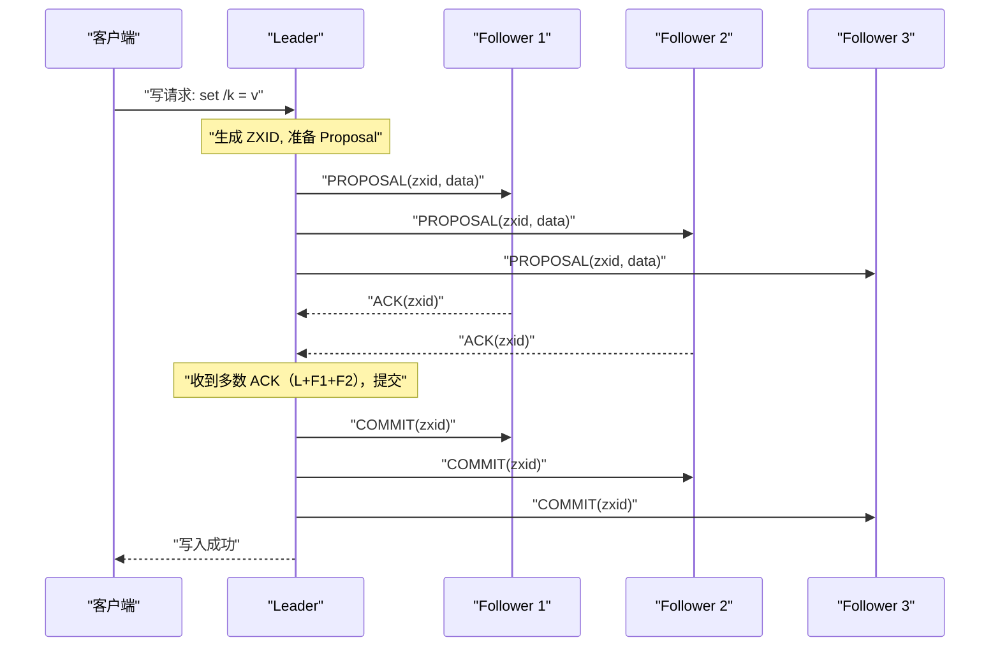

# 06 ZAB 协议：ZooKeeper 的一致性基石

**摘要：**

ZooKeeper 是分布式系统生态中最重要的协调服务之一，被 YARN、HBase、Kafka 等大量系统依赖来实现 Leader 选举、配置管理和分布式锁。支撑 ZooKeeper 高可用和强一致性的核心，是一个鲜为人知却设计精妙的协议——**ZAB（ZooKeeper Atomic Broadcast，ZooKeeper 原子广播协议）**。ZAB 不是 Paxos 的直接实现，也不是 Raft（Raft 诞生时间晚于 ZAB），而是一个针对"**主备模式下的状态机复制**"独立设计的协议。它在某些关键设计上与 Raft 有相似之处，但在 ZXID 的编码方式、崩溃恢复的语义以及 Leader 切换的一致性保证上有其独特之处。本文从 ZooKeeper 的使用场景出发，推导 ZAB 的两种工作模式（崩溃恢复模式与消息广播模式），深入分析 ZXID 的二进制设计之妙、Leader 切换时的数据同步机制，并系统对比 ZAB 与 Raft 的异同。读完本文，你应当能回答两个问题：ZXID 的"纪元加计数器"编码为什么值得如此设计，以及 ZAB 与 Raft 的相似是巧合还是必然。

---

## 第 1 章 ZooKeeper 与 ZAB 的背景

### 1.1 ZooKeeper 解决什么问题

Apache ZooKeeper 于 2007 年由雅虎开发，设计目标是为分布式应用提供**高可靠的协调服务**。它不是一个通用数据库，而是一个专注于存储少量关键协调数据（配置、状态、命名空间）的系统，强调强一致性和高可用性。

ZooKeeper 的典型应用场景如下。

**场景一，分布式 Leader 选举**。HBase 的 HMaster、Hadoop YARN 的 ResourceManager 都用 ZooKeeper 的临时节点（Ephemeral ZNode）做高可用切换。Leader 在 ZooKeeper 中创建临时节点 `/master`，备节点 Watch 这个节点；Leader 崩溃后临时节点自动删除，备节点监听到删除事件后竞争创建新的 `/master` 临时节点，成功者成为新 Leader。

**场景二，分布式配置中心**。把系统配置存储在 ZooKeeper 的 ZNode 中，所有服务节点 Watch 对应的配置路径。配置变更时，ZooKeeper 向所有 Watcher 推送通知，服务节点拉取新配置并热更新。ZooKeeper 的强一致性保证所有节点最终看到相同的配置。

**场景三，服务注册与发现**。服务节点启动时在 ZooKeeper 中注册自己的地址信息（临时节点），服务消费方 Watch 服务节点目录。节点宕机后临时节点自动清除，消费方实时感知服务节点变化。

**场景四，分布式锁**。如分布式锁专栏 04 篇中详细分析的，ZooKeeper 的临时顺序节点天然支持公平分布式锁，且锁的自动释放（Session 超时）比 Redis TTL 机制更鲁棒。

以上所有场景的共同特点是：**数据量小（KB 级），但对一致性要求极高**——如果两个节点同时以为自己是 Leader，或者两个节点看到不同的配置，后果是灾难性的。这正是 ZAB 协议被设计为强一致协议（CP 系统）的原因。**理解了"ZooKeeper 存的是协调数据而非业务数据"，就能理解它为什么可以把一致性放在性能之上**。

### 1.2 ZAB 的诞生背景

ZAB 是 Flavio Junqueira、Benjamin Reed 与 Marco Serafini 在 Yahoo! 研究院设计的，正式发表于 2011 年的论文《Zab: High-performance broadcast for primary-backup systems》。

ZAB 的设计目标与约束与 Paxos 不同。**Paxos 的设计目标**是：在任意 f 个节点崩溃的情况下，任意节点都可以发起提案，系统最终达成共识。**ZAB 的设计目标**是：在主备（Primary-Backup）架构下，由 Leader（Primary）把写操作以**有序、原子**的方式广播给所有 Follower（Backup），且在 Leader 切换时保证操作的全局顺序不被破坏。

ZAB 的核心约束——**有序性（Ordering）**——比 Paxos 的共识要求更强：ZAB 不仅要求所有节点最终接受相同的操作集合（共识），还要求所有节点按相同的顺序执行这些操作。这对于状态机复制至关重要——只有按相同顺序执行相同操作，所有副本的状态才能保持一致。

**这个"有序性"的差异，是理解 ZAB 的关键**：Paxos 解决的是"就一个值达成一致"，而 ZAB 解决的是"就一串有序操作达成一致"。前者是"点"，后者是"线"。**ZooKeeper 需要的是一条一致的日志流，而不是一次性的共识**——这正是 ZAB 被独立设计的原因。

**这个"有序性"的差异，是理解 ZAB 的关键**：Paxos 解决的是"就一个值达成一致"，而 ZAB 解决的是"就一串有序操作达成一致"。前者是"点"，后者是"线"。**ZooKeeper 需要的是一条一致的日志流，而不是一次性的共识**——这正是 ZAB 被独立设计的原因。

### 1.3 一个延伸：ZooKeeper 的"协调服务"定位

ZooKeeper 被称作"协调服务"，而不是"数据库"或"KV 存储"——这个定位决定了它的所有设计取向。

**"协调服务"意味着"存的是元数据，不是业务数据"**。ZooKeeper 存的通常是"谁是谁的 Leader""配置是什么""服务注册在哪"——这些数据量小（KB 级），但一致性要求极高。**因此，ZooKeeper 可以把"一致性"放在"吞吐量"之前**。

**"协调服务"意味着"读多写少"**。协调类数据通常是"偶尔写、频繁读"——因此，ZooKeeper 让"读"走本地 Follower（高性能），让"写"走 Leader 多数派确认（强一致）。**这个"读写不对称"的设计，正是为"协调服务"这个定位服务的**。

**"协调服务"意味着"不能存大对象"**。ZooKeeper 有 1MB 的节点大小限制，且不适合存"频繁更新的大数据"。**这不是缺陷，而是定位**——**把它当数据库用，就会撞上它的天花板**。

**这三条合起来说明**：**理解一个系统，先要理解它的"定位"**。**把 ZooKeeper 当"协调服务"用，它表现出色；把它当"数据库"用，它会令人失望**。**这与本专栏反复强调的"按场景选组件"完全一致**。

**这三条合起来说明**：**理解一个系统，先要理解它的"定位"**。**把 ZooKeeper 当"协调服务"用，它表现出色；把它当"数据库"用，它会令人失望**。**这与本专栏反复强调的"按场景选组件"完全一致**。

### 1.4 一个延伸：ZooKeeper 的"会话"与"临时节点"的关系

ZooKeeper 的"会话（Session）"与"临时节点（Ephemeral Node）"是配套的一对概念，它们共同实现了"无死锁"与"成员感知"。

**会话是"客户端与服务端之间的连接状态"**。它有一个超时时间（如 30 秒），客户端需要定期发心跳维持。**一旦会话超时，ZooKeeper 就认为"这个客户端离开了"**。

**临时节点是"与会话绑定的节点"**。它由某个客户端创建，**当该客户端的会话结束时，临时节点被自动删除**。**因此，"临时节点的存在"等价于"创建它的客户端还活着"**。

**这对概念的组合，实现了两个能力**。其一，**成员感知**：服务注册用临时节点，节点宕机后会话超时、临时节点自动消失，其他节点通过 Watch 立即感知。其二，**无死锁的锁**：锁用临时节点，持锁者崩溃后临时节点自动消失，锁自动释放（分布式锁专栏 04 篇详述）。

**这个设计的精妙在于"把'节点是否活着'这件事，交给'连接状态'来判断"**——**而不是交给"应用层的心跳"或"TTL"**。**这让"成员管理"与"锁管理"都变得简单可靠**。**理解这一点，就能理解为什么 ZooKeeper 适合"成员管理"这类场景**。

---

## 第 2 章 ZAB 的两种工作模式

ZAB 协议的运行分为两种截然不同的模式，根据 Leader 是否存在动态切换。

### 2.1 消息广播模式：正常工作时

当集群有稳定的 Leader 且 Leader 与多数 Follower 保持连接时，ZAB 运行在**消息广播模式**。这是 ZooKeeper 正常工作时的状态，负责处理客户端的写请求。

消息广播模式的工作流程类似于一个简化的两阶段提交（2PC）。

**步骤一，客户端发送写请求**。客户端可以连接到任意 ZooKeeper 节点（Leader 或 Follower）。如果连接到 Follower，Follower 会把写请求转发给 Leader。

**步骤二，Leader 生成 Proposal，广播给所有 Follower**。Leader 收到写请求后，为该请求分配一个全局唯一的事务 ID（ZXID，后文详解），然后把这个写操作封装为一个 **Proposal（提案）**，通过 FIFO 消息队列广播给所有 Follower：

```
Leader → Follower_1: PROPOSAL(zxid=0x0001_0003, data="set /config = v2")
Leader → Follower_2: PROPOSAL(zxid=0x0001_0003, data="set /config = v2")
Leader → Follower_3: PROPOSAL(zxid=0x0001_0003, data="set /config = v2")
```

**关键设计是 FIFO TCP 队列保证有序性**。ZAB 通过为每个 Leader-Follower 对维护一个 FIFO 的 TCP 连接，保证 Proposal 按照 ZXID 顺序到达每个 Follower。这比 Raft 的 `prevLogIndex` 加 `prevLogTerm` 一致性检查更简洁——FIFO 队列天然保证了顺序，不需要额外的"前缀匹配"检查。**这是 ZAB"用通信层保证顺序"的一个体现：它把"顺序"的责任交给了 TCP 的 FIFO 特性**。

**步骤三，Follower 写入事务日志，返回 ACK**。Follower 收到 Proposal 后，把它写入本地事务日志（但不立即应用到内存数据树），然后向 Leader 返回 ACK。

**步骤四，Leader 收到多数 ACK，广播 COMMIT**。当 Leader 收到多数 Follower（包含自身）的 ACK 后，广播 **COMMIT** 消息。Follower 收到 COMMIT 后，把对应的 Proposal 从日志中取出，应用到内存数据树，并通知等待的客户端。



**与 2PC 的关键区别**是：ZAB 的消息广播与传统 2PC 的根本区别在于——**ZAB 不需要 Follower 的"同意"才能提交**。Leader 一旦收到多数 ACK 就直接提交，Follower 即使返回了 ACK 也没有"否决权"（不像 2PC 中参与者可以投 ABORT）。这消除了 2PC 的阻塞问题：Leader 不需要等待所有节点，只需多数派即可。**这也说明：ZAB 更接近"广播加确认"而非"投票加决策"**——它的名字"原子广播"本身就点明了这一点。

### 2.2 崩溃恢复模式：Leader 失效时

当 Leader 崩溃、与多数 Follower 失联，或集群启动初始化时，ZAB 进入**崩溃恢复模式**。这个模式的目标有两个：**选出新的合法 Leader**（具有所有已提交事务的节点）；**确保所有 Follower 与新 Leader 的数据完全同步**，然后再进入消息广播模式。

崩溃恢复模式分为两个子阶段：Leader 选举加数据同步。

### 2.3 一个延伸：为什么"消息广播"不是"共识"

ZAB 的"消息广播模式"看起来像"共识"，但它与"共识"有关键区别——理解这个区别，有助于理解 ZAB 的定位。

**共识（Consensus）** 是"多个节点对某个值达成一致"，**且任何节点都可以提议值**。**ZAB 的消息广播**是"Leader 提议、Follower 接受"，**只有 Leader 能提议**。**因此，ZAB 的"广播"不是"对称的共识"，而是"单向的复制"**。

**那 ZAB 为什么还需要"崩溃恢复"？** 因为"Leader 可能崩溃"，此时"谁来提议"就成了问题——**崩溃恢复要解决的正是"重新选出一个提议者，并保证新旧提议者的操作不冲突"**。**因此，ZAB 是"广播加崩溃恢复"的组合，而不是"一个对称的共识协议"**。

**这个区别的实际意义是**：**ZAB 的"写"不需要"多 Proposer 竞争"**（因为只有 Leader 能写），**因此它比 Paxos 更简单、更高吞吐**。代价是**它必须处理"Leader 切换"**——而这正是"崩溃恢复模式"的职责。

**这条延伸的启示是**：**"广播"与"共识"是两种不同的协调模型**——**广播是"一个源、多个接收者"，共识是"多个源、达成一致"**。**ZAB 选择了"广播加恢复"，因为它的场景（主备日志流）天然适合这个模型**。**选择适合场景的模型，而不是"最通用的模型"，是一种务实的取向**。

### 2.4 一个延伸：为什么"FIFO 队列"能保证顺序

ZAB 用"FIFO TCP 队列"来保证 Proposal 的顺序——这个设计比 Raft 的"前缀匹配检查"更简洁，值得说明其原理与边界。

**原理是**：TCP 协议本身保证"同一连接上的数据按发送顺序到达"。因此，只要 Leader 按 ZXID 递增顺序"在同一个连接上发送 Proposal"，Follower 就会"按相同顺序收到"。**这让"顺序"成了"通信层的保证"，而不需要"应用层再检查一遍"**。

**这个设计的优势是"省掉了一致性检查"**。Raft 需要在每条 `AppendEntries` 里带上 `prevLogIndex` 与 `prevLogTerm`，让 Follower"检查前缀是否匹配"；ZAB 因为"顺序由 FIFO 保证"，不需要这个检查。**这让 ZAB 的消息更精简**。

**但"FIFO 队列"的保证有边界**：它只在"连接不断"时成立。**如果 Leader 与 Follower 之间的连接断开重连，FIFO 保证就可能被打断**——此时 ZAB 通过"崩溃恢复模式"（重新选主加数据同步）来重建一致性。**因此，"FIFO 队列保证顺序"与"崩溃恢复保证一致"是配套的**：前者负责"正常时的顺序"，后者负责"异常时的重建"。

**这条延伸的启示是**：**"用通信层保证顺序"是一个简化设计的好手段，但它的边界（连接断开会失效）必须由另一层机制来兜底**。**任何"依赖底层保证"的设计，都要想清楚"底层保证失效时怎么办"**——**这与 10 篇"假设会被打破，要有兜底"是同一条思路**。

---

## 第 3 章 ZXID：ZAB 设计中最精妙的细节

### 3.1 ZXID 的结构：64 位二进制的巧妙编码

**ZXID（ZooKeeper Transaction ID）** 是 ZAB 协议中标识事务的全局唯一 ID，是一个 64 位整数，分为两部分：

```
ZXID (64 bits):
┌─────────────────────────────────────────────────────┬───────────────────────┐
│                    高 32 位：epoch（纪元号）             │  低 32 位：counter（计数器）│
└─────────────────────────────────────────────────────┴───────────────────────┘
```

**高 32 位是 epoch（纪元号）**：对应 Raft 中的 term（任期号）。每当选出新的 Leader，epoch 递增。每个 epoch 最多对应一个 Leader。**低 32 位是 counter（计数器）**：在同一个 epoch 内，Leader 为每个新事务分配的单调递增序号。每次选出新 Leader 时，counter 从 0 重置。

**ZXID 的比较规则**是：先比较 epoch（高 32 位），epoch 大的 ZXID 更新；epoch 相同时，counter（低 32 位）大的更新。**这个规则让"比较两个 ZXID 的大小"等价于"比较两个事务的新旧"**，从而把"新旧判断"变成了一个整数比较。

### 3.2 为什么 epoch 和 counter 要分开编码

这个设计乍看有些过度工程，但其背后有深刻的原因。

**原因一，快速识别"旧 Leader"的遗留事务**。在 Leader 切换时，新 Leader 需要识别哪些是旧 Leader 遗留的未提交事务（需要决定是提交还是丢弃）。通过 ZXID 的高 32 位（epoch），新 Leader 可以立即识别出所有高 32 位不等于当前 epoch 的 ZXID——这些都是旧 Leader 的遗留事务。如果 ZXID 是一个简单的单调递增整数（如 Raft 的 logIndex），新 Leader 无法仅从 ZXID 判断一个事务是哪个 Leader 产生的，需要额外的元数据来做这个判断。

**原因二，防止"幽灵 ZXID"导致错误的有序性判断**。考虑这个场景：Leader L1（epoch 等于 1）的最后一个事务 ZXID 是 (1, 100)，L1 崩溃。新 Leader L2（epoch 等于 2）从 0 重新开始计数，新事务 ZXID 是 (2, 1)、(2, 2)。如果使用简单的单调整数，L1 的事务 ID 是 100，L2 的事务 ID 从 101 开始——这看起来没问题，但如果 L2 崩溃后 L3 再选出（epoch 等于 3），L3 需要知道从哪个数字开始计数，它必须扫描所有节点找到最大的 ZXID，这是一个代价较高的操作。使用 epoch 加 counter 的二进制编码，L3 只需知道当前 epoch 等于 3、counter 从 0 重置即可，不需要扫描历史 ZXID。

**原因三，支持 ZXID 的快速 Follower 同步**。在崩溃恢复阶段，Follower 向新 Leader 发送自己最大的 ZXID。新 Leader 通过比较 epoch，可以快速判断 Follower 的日志是否来自同一个 epoch——来自旧 epoch 的日志需要差异化处理（可能需要截断或补发），来自同一 epoch 的日志只需要比较 counter 来决定补发哪些缺失的日志。

这三条原因合起来说明：**ZXID 的"纪元加计数器"编码，不是"为了省空间"，而是为了"让三类判断变得廉价"**——判断新旧、判断归属哪个 Leader、判断需要补发什么。**这是"数据编码影响算法效率"的一个经典案例：一个好的编码，能让后续的所有操作都变简单**。

### 3.3 ZXID 与 Raft 的 Term 加 Index 对比

| 维度 | ZAB 的 ZXID | Raft 的 (term, index) |
| :--- | :--- | :--- |
| **编码方式** | 单个 64 位整数（高 32 位 epoch 加低 32 位 counter）| 两个独立整数（term 和 index）|
| **新 Leader 重置** | counter 重置为 0，epoch 递增 | index 不重置，全局单调递增 |
| **最大日志比较** | 直接比较 ZXID 整数大小 | 先比较 lastLogTerm，再比较 lastLogIndex |
| **旧任期日志识别** | 通过高 32 位 epoch 直接判断 | 通过 log[i].term 字段判断 |
| **全局顺序保证** | ZXID 全局唯一有序 | (term, index) 对全局唯一有序 |

这张表最值得玩味的一行是"新 Leader 重置"。**ZAB 的 counter 会重置，Raft 的 index 不会**——这个差异背后是两种设计哲学：ZAB 把"顺序"编码进了一个整数（用一个字段同时表达"时期"与"次序"），Raft 则用两个字段分别表达。**两者都能表达"全局有序"，但 ZAB 的比较更简洁（一次整数比较），Raft 的比较更显式（两次比较）**。这再次说明，同一目标可以有多种编码方式，各有取舍。

### 3.4 一个延伸：ZXID 的"溢出"问题

ZXID 是 64 位整数（高 32 位 epoch 加低 32 位 counter）——这个设计有一个理论上的边界：**如果 counter 或 epoch 溢出，会怎样？**

**counter 溢出**意味着"同一 epoch 内产生了 2³² 个事务"——以每秒一万个事务计，需要约 5 天。**这个边界在实际中可能触及**，因此 ZooKeeper 需要在"epoch 内 counter 接近上限时"主动"换 epoch"（即触发一次 Leader 重选）。

**epoch 溢出**意味着"经历了 2³² 次 Leader 切换"——这几乎不可能触及（除非有极端的持续故障）。

**这个"溢出"问题的启示是**：**任何"递增的编号"都要考虑边界**（这与 04 篇 3.7 节"顺序节点序号溢出"是同一类问题）。**设计时要么"留足空间"（如用 64 位），要么"提供重置机制"（如换 epoch）**。**ZXID 的"epoch 加 counter"结构，恰好提供了一种"重置"——counter 可以在换 epoch 时归零**。

**这也再次说明"编码设计"的重要性**：**把"编号"分成"两部分"（epoch 加 counter），不仅让"新旧判断"更廉价，还让"重置"变得自然**。**一个好的编码，往往能同时解决"效率"与"边界"两个问题**——**这正是 ZXID 设计的精妙之处**。

### 3.5 一个延伸：ZXID 与"逻辑时钟"的关系

ZXID 常被类比为"逻辑时钟"——这个类比有助于理解，但需要注意它们的不同。

**相似之处**：两者都是"单调递增的编号"，都用来表达"新旧"与"顺序"，都不依赖物理时钟。**这与 01 篇 Lamport 逻辑时钟的核心思想一致**：**用"编号"替代"时间"来表达顺序**。

**不同之处**：Lamport 逻辑时钟是"每个进程各自维护一个计数器"，用于追踪"事件之间的因果关系"；**ZXID 是"由 Leader 统一分配的全局编号"，用于表达"全局的顺序"**。**前者是"偏序"（只表达因果），后者是"全序"（表达全局顺序）**。

**这个区别的意义在于**：**ZAB 需要"全局全序"**（因为状态机复制要求"所有节点按相同顺序执行"），**因此它必须有一个"统一的编号分配者"（Leader）**。**而 Lamport 时钟的"各自维护"，只能给出偏序，不够用**。

**这条延伸的启示是**：**"偏序"与"全序"是两种不同的顺序保证**，它们分别对应"因果一致性"与"强一致"（09 篇会展开）。**ZAB 需要全序，因此它选择了"统一分配"（代价是"必须经过 Leader"）；而因果一致性只需要偏序，因此可以用"各自维护"（代价是"不能表达全局顺序"）**。**选择哪种顺序保证，取决于"业务需要什么"**。

---

## 第 4 章 崩溃恢复：Leader 选举与数据同步

### 4.1 Leader 选举算法：FastLeaderElection

ZooKeeper 使用 **FastLeaderElection** 算法进行 Leader 选举（ZooKeeper 3.4+ 版本）。算法基于 ZXID 选出拥有最新数据的节点作为 Leader。

**步骤一**：节点进入 LOOKING 状态（未找到 Leader），发起选举，先投票给自己（包含自己的 `(myId, myZxid)`）。

**步骤二**：向所有其他节点广播投票（Vote），包含 `epoch`（选举轮次，防止接受旧轮次的投票）、`leader`（当前认为应该当选的节点 ID）、`zxid`（候选节点的最大 ZXID）。

**步骤三**：收到其他节点的投票后，根据以下规则更新自己的投票（"选更好的候选人"）：

```python
def compare_votes(my_vote, received_vote):
    """
    返回 True 表示 received_vote 更好，应该更新自己的投票
    比较规则：先比 ZXID（epoch），再比 epoch（选举轮次），最后比 myId（打破平局）
    """
    # 1. 先比 ZXID 的 epoch（高 32 位）
    if received_vote.zxid.epoch > my_vote.zxid.epoch:
        return True
    if received_vote.zxid.epoch < my_vote.zxid.epoch:
        return False

    # 2. ZXID epoch 相同，比 ZXID counter（低 32 位）
    if received_vote.zxid.counter > my_vote.zxid.counter:
        return True
    if received_vote.zxid.counter < my_vote.zxid.counter:
        return False

    # 3. ZXID 完全相同，比 server ID（ID 更大的优先）
    return received_vote.leader_id > my_vote.leader_id
```

**步骤四**：当某个节点发现自己的投票票数超过集群半数，它就认为自己当选 Leader，切换到 LEADING 状态，并通知其他节点。其他收到通知的节点切换到 FOLLOWING 状态。

**选举的关键性质是**：选举确保**拥有最大 ZXID 的节点**当选 Leader（ZXID 最大意味着该节点的数据是所有节点中最新的）。这与 Raft 的"日志最新才能当选"约束是相同的思路，只是 ZAB 用 ZXID 大小来衡量"新鲜度"，Raft 用 (lastLogTerm, lastLogIndex) 来衡量。

### 4.2 数据同步：新 Leader 上任后的第一件事

新 Leader 当选后，**不能立即进入消息广播模式开始处理客户端请求**，必须先完成数据同步，确保所有 Follower 的数据与 Leader 完全一致，然后才能开始服务。

这个阶段称为 **Discovery 加 Synchronization（发现加同步）**，对应 ZAB 论文中的 Phase 1 与 Phase 2。

**Discovery 阶段（类似 Paxos Phase 1）**：新 Leader 向所有 Follower 发送 `NEWLEADER(epoch)` 消息，宣告新的 epoch。每个 Follower 回复自己的最大 ZXID。Leader 收集所有 Follower 的 ZXID 信息，找到"历史上可能被提交的最大 ZXID"（即所有 Follower 中最大的 ZXID）。

**Synchronization 阶段（数据对齐）**：根据每个 Follower 的 ZXID 与 Leader 的对比，有三种同步情形。

**情形一，Follower 的数据比 Leader 旧（缺少部分 PROPOSAL）**。Leader 向 Follower 补发缺失的事务：

```
Leader 的日志：[zxid=1001, zxid=1002, zxid=1003, zxid=1004]
Follower 的日志：[zxid=1001, zxid=1002]
→ Leader 向 Follower 发送 PROPOSAL(zxid=1003) 和 PROPOSAL(zxid=1004)
→ Follower 应用后两者数据一致
```

**情形二，Follower 的数据与 Leader 相同**。无需同步，直接进入广播模式。

**情形三，Follower 有旧 Leader 遗留的未提交 PROPOSAL**。这是最复杂的情形。旧 Leader 可能在 COMMIT 发出之前崩溃，某些 Follower 已经收到了 PROPOSAL 并写入了事务日志，但没有收到 COMMIT（因此这些 PROPOSAL 对应的操作还未提交到状态机）。

新 Leader 需要决定：这些遗留的未提交 PROPOSAL 应该**继续提交**（COMMIT）还是**丢弃**（TRUNC）？ZAB 的规则是：如果该 PROPOSAL 的 ZXID **等于**新 Leader 自己拥有的最大 ZXID，或新 Leader 也有这条 PROPOSAL，则继续提交（因为这条 PROPOSAL 可能已经被旧 Leader 提交，只是 COMMIT 消息没有到达这个 Follower）；如果该 PROPOSAL 的 ZXID **大于**新 Leader 的最大 ZXID，则截断（TRUNC），丢弃这条 PROPOSAL（因为新 Leader 没有这条 PROPOSAL，说明它从未被多数派接受，旧 Leader 必然没有提交它）。

> [!info] ZAB 的提交与截断判断
> 新 Leader 当选时，它拥有所有节点中最大的 ZXID（由选举保证）。因此，任何 Follower 拥有的 ZXID 如果大于新 Leader 的最大 ZXID，说明这是旧 Leader 在当选新 Leader 之后单方面写入的 PROPOSAL，没有被多数派确认，应该截断。
>
> 这与 Raft 中"新 Leader 不提交旧 term 日志"的原则异曲同工：都是为了保证"只有被多数派确认的操作才能最终生效"。**两者的差异在于"何时处理"**：ZAB 在"新 Leader 上任时"显式地做一次数据对齐（发现加同步），Raft 则在"后续的日志复制中"隐式地处理（AppendEntries 的冲突覆盖）。**ZAB 更"一次性"，Raft 更"渐进式"**。

**同步完成后**：Leader 向所有已完成同步的 Follower 发送 `UPTODATE` 消息，宣告数据同步完成。此时，新 Leader 正式进入消息广播模式，开始处理客户端请求。

### 4.3 一个延伸：数据同步的"三种情形"与"安全性"

第 4 章列出数据同步的三种情形（Follower 旧、相同、有遗留未提交）。这里说明它们为什么"安全"。

**情形一（Follower 旧）** 是"补发缺失"——**它只增加 Follower 的日志，不改变已提交的内容**，因此不会破坏一致性。

**情形二（相同）** 是"无需同步"——**显然安全**。

**情形三（有遗留未提交）** 是最关键的：**它要么"继续提交"、要么"截断"**。为什么这样是安全的？**因为"新 Leader 拥有最大 ZXID"**——如果一个 Follower 的 ZXID "大于"新 Leader 的，说明这是"旧 Leader 单方面写入、未被多数派确认"的，**截断它是安全的（因为它本来就没被提交）**；如果 Follower 的 ZXID "等于"新 Leader 的，说明"这条可能已被多数派确认"，**继续提交它是安全的（因为它可能已被提交，不能丢）**。

**这个判断的正确性，依赖"新 Leader 拥有最大 ZXID"这一选举保证**——**这正是"选 ZXID 最大的节点当 Leader"这条规则的意义**。**如果选出的 Leader 不是 ZXID 最大的，那么"截断"就可能截掉一条"实际已提交"的事务，破坏一致性**。

**这条延伸的启示是**：**"选举规则"与"数据同步规则"是配套的**——**选举保证"Leader 拥有最新数据"，数据同步才能"以 Leader 为准安全地对齐"**。**这与 05 篇 Raft"选举时保证 Leader 日志最全、修复时以 Leader 为准"是同一个配套关系**。**分布式协议的安全性，往往是"多条规则配套"的结果**。

### 4.4 一个延伸：Leader 选举的"两轮"机制

ZooKeeper 的 FastLeaderElection 实际上是"两轮"的：**先选出一个"候选者"，再让所有节点"确认"它**。这个两轮设计值得说明。

**第一轮是"投票轮"**：每个节点先投给自己，然后接收他人的投票，按"ZXID 更大优先、ID 更大打破平局"的规则更新自己的投票。**这一轮的目的是"让所有节点收敛到同一个候选人"**。

**第二轮是"确认轮"**：当某个节点发现自己获得了多数票，它宣布"我当选"，其他节点确认。**这一轮的目的是"让当选者获得正式的确认"**。

**为什么需要两轮？** 因为"第一轮的多数票"可能只是"暂时的"——在投票过程中，其他节点的投票可能还在变化。**只有"投票收敛后"的多数票，才是"稳定的多数票"**。**因此，"第一轮收敛、第二轮确认"保证了"当选是稳定的"**。

**这个"两轮"的思路，与 Paxos 的"两阶段"（Phase 1 争权、Phase 2 提交）有相通之处**：**都是"先收敛到唯一候选，再正式确认"**。**区别在于 ZAB 的选举是"独立的选举协议"，而 Paxos 的两阶段是"提案流程本身"**。**但"先收敛、再确认"这个结构，是两者共有的**。

---

## 第 5 章 ZAB 的有序性保证：两种关键有序性

ZAB 协议设计的核心目标之一是**全局有序性**，它保证了以下两种有序性。

### 5.1 因果有序（Causal Order）

如果事务 T₁ 在事务 T₂ 之前被 Leader 广播，那么任意节点在执行 T₂ 之前必须先执行 T₁。这保证了操作的因果顺序：如果 T₂ 的数据依赖于 T₁ 的结果（例如 T₁ 创建了 ZNode `/config`，T₂ 在 `/config` 下写入数据），那么所有节点都会先看到 `/config` 再看到其下的数据，不会出现"子节点存在但父节点不存在"的状态。

ZAB 通过 FIFO TCP 队列保证因果有序：Leader 按 ZXID 递增顺序发送 PROPOSAL，FIFO TCP 保证 Follower 按相同顺序收到，因此所有 Follower 按相同顺序执行事务。

### 5.2 全局有序（Total Order）

ZAB 保证了更强的全局有序性：所有节点执行的事务序列完全相同（不仅顺序相同，还包括集合相同——没有节点执行了其他节点没有执行的事务）。这是状态机复制的核心要求：只有所有副本执行相同的操作序列，才能保持状态一致。

在 Leader 切换时，全局有序性面临挑战。**场景**是：旧 Leader L1 提交了事务 T₁，发出了 COMMIT(T₁)，但只有部分 Follower 收到了 COMMIT，另一些 Follower 只收到了 PROPOSAL(T₁)。L1 崩溃，新 Leader L2 上任。

**ZAB 的处理是**：L2 在数据同步阶段，会确保所有活跃的 Follower 要么都应用 T₁（已收到 COMMIT 的 Follower 已经应用了；未收到 COMMIT 但有 PROPOSAL 的 Follower，L2 会向其补发 COMMIT），要么 T₁ 被截断（如果 T₁ 从未到达多数派，则截断，保证所有节点都不执行 T₁）。无论是哪种情况，最终所有活跃节点对 T₁ 的处理是一致的——要么都执行，要么都不执行。

**这个"要么都执行、要么都不执行"的保证，正是"原子广播"中"原子"二字的含义**——它保证了事务在所有节点上"同生共死"。这也是 ZAB 与普通"广播"的根本区别：普通广播不保证所有接收者都收到，而原子广播保证"要么都收到并执行，要么都不执行"。

### 5.3 一个延伸：有序性的"代价"

"全局有序"是 ZAB 的核心保证，但它并非没有代价——**代价是"串行化"**。

**要让所有节点"按相同顺序执行相同操作"，就必须有一个"全局的顺序来源"**。在 ZAB 里，这个来源是"Leader 的 ZXID 分配"——**所有写操作都必须经过 Leader 排序**。**这就意味着"写操作无法并行"**（至少无法在"顺序"这一维度上并行）。

**这个代价带来两个后果**。其一，**写的吞吐受限于 Leader**（单 Leader 无法通过"增加节点"来提升写吞吐）。其二，**写的延迟包含"Leader 排序加多数派确认"的开销**（约 2 到 3 轮网络往返）。

**为什么这个代价可以接受？** 因为 ZooKeeper 是"协调服务"——**协调数据的写入频率很低**（不像业务数据那样高频），因此"写的吞吐瓶颈"通常不构成问题。**反过来，如果用它做高频写入，这个代价就会显现**。

**这条延伸的启示是**：**"强保证"总有"代价"，而"代价是否可接受"取决于"场景"**。**ZAB 的"全局有序"代价（写串行化），对"协调服务"可接受，对"高吞吐存储"不可接受**。**因此，评估一个协议的"代价"，必须结合"它的目标场景"**——**脱离场景谈"代价大小"，是没有意义的**。

### 5.4 一个延伸："因果有序"与"全局有序"的区别

第 5 章区分了"因果有序"与"全局有序"——这个区分值得再展开，因为它对应两种不同的协调强度。

**因果有序**只要求"有因果关系的操作按顺序"——**如果两个操作没有因果关系（并发），它们的顺序可以不同**。**它可以用"各自维护的逻辑时钟"实现，不需要全局协调**。

**全局有序**要求"所有操作按同一个顺序"——**即使两个操作没有因果关系，所有节点也必须看到它们"相同的相对顺序"**。**它必须用"统一的编号分配者"（Leader）实现，需要全局协调**。

**为什么 ZAB 需要"全局有序"？** 因为它是"状态机复制"——**如果不同节点"看到并发的两个操作顺序不同"，那么它们执行后的状态就可能不同**。**因此，状态机复制必须"全局有序"**。

**而"因果一致性"（07、09 篇）只需要"因果有序"**——因为它不要求"所有副本状态相同"，只要求"因果不颠倒"。**因此，因果一致性可以用"向量时钟"（各自维护）实现，不需要 Leader**。

**这条区分是理解"一致性模型"的关键**：**"因果一致"与"强一致"的核心差别，就在于"要不要全局全序"**。**要全序，就必须有统一分配者，就必然有"Leader 瓶颈"与"多数派确认开销"**——**这正是强一致的代价所在**。

---

## 第 6 章 ZAB 与 Raft：协议对比

### 6.1 设计目标的差异

ZAB 的设计目标是"**主备模式下的有序原子广播**"，而 Raft 的设计目标是"**可理解的通用共识**"。这个差异导致了两者在某些设计上的取舍：

| 维度 | ZAB | Raft |
| :--- | :--- | :--- |
| **事务 ID 设计** | 64 位 ZXID（epoch 加 counter）| 独立的 (term, index)，index 全局递增 |
| **新 Leader 上任** | Discovery 加 Sync 两阶段，严格保证多数派对齐后才服务 | 上任后立即可服务，通过提交当前 term 日志间接同步 |
| **旧 Leader 日志处理** | Sync 阶段显式 COMMIT 或 TRUNC | 由 AppendEntries 的冲突覆盖机制隐式处理 |
| **有序性保证手段** | FIFO TCP 队列天然保证顺序 | AppendEntries 的 prevLogIndex 检查加串行提交 |
| **协议状态数** | 3 个状态（LOOKING/LEADING/FOLLOWING）| 3 个状态（Follower/Candidate/Leader）|
| **读操作一致性** | 默认可能读到旧数据（需 sync 保证）| ReadIndex 或 Lease Read 保证线性一致 |
| **成员变更** | 不支持动态成员变更（需要重启配置）| 支持单步成员变更或联合共识 |

### 6.2 ZAB 读操作的一个重要局限

ZooKeeper 的默认读操作**不保证线性一致性**——客户端从 Follower 读取数据，可能读到旧版本的数据（Follower 的数据可能落后于 Leader）。

这是 ZooKeeper 在 CAP 权衡中有意为之的设计：**读操作从本地 Follower 服务，不需要经过 Leader，大幅提高了读吞吐量**，但牺牲了读的线性一致性。写操作经过 Leader 多数派确认，保证了写的强一致性。

如果应用需要在读写之间保证线性一致性（如"写入后立即读取，必须能看到刚写入的数据"），ZooKeeper 提供了 `sync()` API：客户端在读取之前先调用 `sync()`，ZooKeeper 会等待直到 Follower 同步到最新的提交点，然后才返回读结果。代价是 `sync()` 会引入额外的延迟（需要一次 Leader 到 Follower 的同步往返）。

> [!warning] 生产避坑：ZooKeeper 读操作的不一致性陷阱
> 在生产中，有一个常见的 Bug 模式：
>
> ```
> 步骤 1：客户端 A 向 ZooKeeper 写入数据（通过 Leader 确认）
> 步骤 2：客户端 A 通知客户端 B："数据已写入，你可以读了"
> 步骤 3：客户端 B 从某个 Follower 读取数据，读到了旧数据
> ```
>
> 这不是 Bug，而是 ZooKeeper 的设计特性。如果你的业务需要"写入后立即读到最新数据"，有两种解法：所有客户端总是从 Leader 读（通过设置 `zookeeper.readonlyclient` 为 false，并只连 Leader）；读取前调用 `sync()` 同步到最新状态。
>
> 这个陷阱提醒我们：**"写是强一致"与"读是强一致"是两件事**。一个系统可以在写路径上保证线性一致性，却在读路径上为了性能而放松——**因此，用任何系统之前，都要问清"它的读是什么级别的"**（这一点与 02 篇"CP 系统不等于每个读都强一致"的结论一致）。

### 6.3 ZAB 与 Raft 的核心相似性

尽管设计背景不同，ZAB 与 Raft 在以下核心机制上高度一致。这不是巧合，而是分布式共识的本质决定的。

**相似点一，都依赖 epoch 或 term 来区分"旧 Leader"**。无论是 ZAB 的 epoch 还是 Raft 的 term，都是为了解决同一个问题：当 Leader 切换时，如何让节点辨别"来自旧 Leader 的消息"并安全地忽略或处理。

**相似点二，都要求"日志最全"的节点才能当选 Leader**。ZAB 选举最大 ZXID 的节点，Raft 选举 (lastLogTerm, lastLogIndex) 最大的节点，本质上都是"只有数据最新的节点才有资格成为权威"，防止新 Leader 覆盖已提交的数据。

**相似点三，都使用多数派（Quorum）保证安全性**。写操作必须被多数派确认才算提交，这是两者（也是所有 CFT 共识协议）的共同基础。任意两个多数派必然有交集，这保证了信息在 Leader 切换时不会丢失。

**相似点四，都区分"写入日志"与"提交到状态机"**。ZAB 的 PROPOSAL（写日志）加 COMMIT（应用到状态机），对应 Raft 的 AppendEntries（写日志）加 commitIndex 推进（应用到状态机）。两阶段的设计让节点可以安全地持有"未提交的暂存操作"，等待多数派确认后再应用。

**这四点相似性的意义在于：它们揭示了"共识协议"的本质结构**——无论叫什么名字、用什么编码，一个能在崩溃故障下正确工作的共识协议，都必须具备"用任期区分新旧、用日志最全选主、用多数派保证安全、用两阶段分离提交与应用"这四项能力。**理解了这一点，再看任何新的共识协议，都能迅速抓住它的骨架**。

**这四点相似性的意义在于：它们揭示了"共识协议"的本质结构**——无论叫什么名字、用什么编码，一个能在崩溃故障下正确工作的共识协议，都必须具备"用任期区分新旧、用日志最全选主、用多数派保证安全、用两阶段分离提交与应用"这四项能力。**理解了这一点，再看任何新的共识协议，都能迅速抓住它的骨架**。

### 6.4 一个延伸：ZAB 与 Raft 的"历史渊源"

ZAB（2011 年发表）比 Raft（2014 年发表）更早——这个时间关系值得说明，因为它澄清了一个常见误解。

**常见误解是"ZAB 是 Raft 的变体"**。这是错的——**ZAB 的设计早于 Raft，两者是"独立演进"的**。ZAB 针对"主备日志流"设计，Raft 针对"可理解的通用共识"设计——**它们"相似"不是因为"一个抄了另一个"，而是因为"它们面对同一个根本问题"**。

**这个"相似"恰恰印证了本专栏 03 篇的结论**：**所有共识协议，都是在回答"部分同步下如何实现安全性绝对、活性条件性"**。**当多个团队独立回答同一个问题时，答案会"趋同"**——这就是为什么 ZAB 与 Raft 有那么多相似点。

**理解了"独立演进却趋同"，就能理解"共识协议的核心思想是'被问题决定的'，而不是'被某个发明者决定的'"**。**这让人对"新出现的共识协议"多一层判断力**：**如果一个新协议声称"完全不同于以往"，那么要么它引入了新的假设，要么它在某个环节上有隐患**——**因为核心的取舍（多数派、任期、两阶段）是被问题"锁死"的**。

**这条延伸的启示是**：**面对"看起来全新的协议"，先问"它是否真的改变了核心取舍"**。**大多数"创新"其实是在"实现细节"或"性能优化"上做文章，而不是在"核心思想"上突破**。

### 6.5 一个总结：ZAB 与 Raft 的"三点共识"

把 ZAB 与 Raft 的对比收敛，可以得到它们在"核心机制"上的三点共识——**这三点是"所有共识协议"都必须具备的**。

**第一点，"用版本号区分新旧"**。ZAB 用 epoch、Raft 用 term——**它们都用一个"单调递增的编号"来隔离新旧状态**，防止"旧 Leader 干扰新集群"。

**第二点，"用日志最全者选主"**。ZAB 选 ZXID 最大的、Raft 选 (lastLogTerm, lastLogIndex) 最大的——**它们都保证"当选者拥有最新数据"**，从而让"以 Leader 为准"变得安全。

**第三点，"用多数派保证安全"**。ZAB 与 Raft 都要求"多数派确认"——**它们都依赖"任意两个多数派相交"这条性质**，来保证"已提交的不会被覆盖"。

**这三点共识，正是本专栏 03 篇所说的"共识协议的共同骨架"**。**理解了这三点，就理解了"为什么不同的共识协议看起来如此相似"**——**因为它们都被"同一个问题"锁定了核心取舍**。

**这条总结的价值在于**：**它给了你一把"通用尺子"**。**面对任何共识协议，都可以问"它的版本号是什么、它怎么选主、它怎么用多数派"**——**这三个问题回答完，就抓住了这个协议的骨架**。

---

## 第 7 章 ZAB 的生产实践观察

### 7.1 ZooKeeper 集群的典型部署

生产环境中，ZooKeeper 通常部署为 3 节点或 5 节点集群：**3 节点**最多容忍 1 个节点故障，成本最低，适合大多数场景；**5 节点**最多容忍 2 个节点故障，适合对可用性要求极高的场景（如金融核心系统）；**7 节点及以上**时消息广播延迟随节点数增加而增加（每次 Proposal 需要等待多数派 ACK），通常不推荐超过 7 节点。

> [!info] 为什么 ZooKeeper 节点数通常是奇数
> 奇数节点数可以最大化容错率：3 节点的多数派是 2，容错 1 个；4 节点的多数派是 3，容错 1 个（与 3 节点相同，但成本更高）；5 节点的多数派是 3，容错 2 个。
>
> 从 3 增加到 4 节点，容错率不变、成本增加。因此奇数节点数是最优的资源利用方案。**这条"奇数节点"的经验法则，适用于所有基于多数派的共识系统**——包括 ZAB、Raft、Paxos。它背后的数学很简单：**偶数个节点的容错能力，与"它少一个"的奇数节点相同**。

### 7.2 ZooKeeper 的性能特征

ZooKeeper 的性能瓶颈在于**写操作必须经过 Leader 确认多数派**（1 次 Leader 广播加多数派 ACK 加 1 次 COMMIT 广播，约 2 到 3 轮网络往返）。在同机房的低延迟网络中：写操作延迟 2ms 到 10ms；读操作延迟（本地 Follower）0.1ms 到 1ms（不经过 Leader）；单 Leader 写吞吐约 1000 到 10000 TPS（取决于硬件和网络）。

ZooKeeper 不适合高吞吐写入场景（如消息队列、高并发 KV 存储）——它的设计目标是低频、高一致性的协调数据，而不是高吞吐的数据存储。**这个定位与本专栏反复强调的"按场景选组件"一致**：ZooKeeper 是"协调服务"，不是"数据存储"，把它当后者用，就会撞上它的性能天花板。

### 7.3 ZAB 给工程实践的三条启示

把本文的讨论收敛，可以得到三条启示。

**其一，"顺序"可以被编码进数据结构**。ZXID 用一个整数同时表达了"时期"与"次序"，让"判断新旧"变得廉价。**在设计分布式系统的数据结构时，把常用的判断"编码进去"，往往能带来全局的简化**。

**其二，一致性的"写路径"与"读路径"可以分开设计**。ZooKeeper 在写路径上保证强一致（多数派确认），在读路径上为了性能而放松（本地 Follower 读）。**这种"读写不对称"的设计，是许多高一致性系统在性能与正确性之间找到平衡点的通用手段**。

**其三，协议的名字往往揭示了它的设计取向**。"原子广播"强调"广播加原子性"，"共识"强调"就一个值达成一致"——**理解了名字背后的取向，就能理解协议的设计重心**。ZAB 是"广播"取向（面向有序日志流），Paxos 是"共识"取向（面向单值），Raft 是"可理解"取向（面向工程实现）。

### 7.4 一个总结：ZAB 给工程实践的两条启示

把本篇的讨论收敛，ZAB 给工程实践留下两条启示。

**启示一，"编码设计"能带来全局简化**。ZXID 的"epoch 加 counter"结构，让"判断新旧、判断归属、判断补发什么"都变得廉价——**这是"一个好的数据结构，能让后续所有操作变简单"的典型**。**在设计分布式系统时，值得在"编号/版本/ID 的编码"上多花心思**——**因为它们的结构会渗透到整个系统的逻辑里**。

**启示二，"读写不对称"是性能与一致性之间的有效平衡**。ZooKeeper 让"写走 Leader 多数派确认（强一致）"、"读走本地 Follower（高性能）"——**这个不对称设计，让它同时具备了"强一致写"与"高吞吐读"**。**代价是"读可能读到旧值"**（需要 `sync()` 补偿）。**这种"在读写路径上分别取舍"的思路，适用于很多"读多写少"的场景**。

**这两条启示，与 05 篇 Raft 的三条启示互补**。**Raft 教你"可理解性是一种竞争力"，ZAB 教你"好的编码与读写不对称能带来效率"**。**两者合起来，构成了对"共识协议工程化"的完整认识**——**一个协议要在工业界成功，既要有清晰的骨架，也要有精妙的工程细节**。

**这也呼应了本专栏的一条主线：理解协议，不只要理解"它的思想"，还要理解"它的工程细节"**——**因为后者往往决定了"它好不好用"**。

### 7.5 一个延伸：ZooKeeper 的"运维要点"

理解了 ZAB 的原理，就能推导出 ZooKeeper 的几条运维要点。

**要点一，集群规模用奇数，且不宜过大**。3 或 5 节点是常见配置——**奇数能最大化容错率，过大（超过 7）则会因"多数派确认"而拖慢写**。这与 05 篇 Raft 的"奇数节点"经验一致。

**要点二，关注"选举触发频率"**。频繁选举是 ZooKeeper 最需要避免的运维状态——它会导致"持续不可用"。**如果频繁选举，要检查：选举超时是否设得太短、网络是否抖动、节点是否资源不足（GC 停顿频繁）**。

**要点三，监控"会话超时率"**。会话频繁超时，说明客户端与服务端的连接不稳定——**这会导致"临时节点频繁消失"，进而导致"服务注册表抖动""锁频繁释放"**。

**要点四，避免"大节点"与"高写入"**。ZooKeeper 不适合存大对象、也不适合高频写入。**如果发现"节点数据很大"或"写入 QPS 很高"，说明用错了场景**——应当改用数据库或消息队列。

**这四条要点，都是从"ZAB 的原理"推导出来的**——**这正是"理解原理"的价值：它让你能"推导出"运维要点，而不是"记住"别人的经验**。**这也呼应了本专栏的核心主张：理解"为什么"，比记住"是什么"更有用**。

### 7.6 一个延伸：ZAB 与"分布式协调"的未来

ZooKeeper（以及 ZAB）曾是"分布式协调"的代名词——但近年来，它面临着新的挑战，值得了解。

**挑战一，"etcd 的崛起"**。Kubernetes 选择了 etcd（基于 Raft），使得 etcd 成为"云原生协调"的事实标准。**ZooKeeper 在云原生生态里逐渐边缘化**。

**挑战二，"KRaft"**。Kafka 从"依赖 ZooKeeper"转向"KRaft（自带的 Raft 实现）"——**这进一步减少了 ZooKeeper 的使用场景**。

**挑战三，"运维复杂度"**。ZooKeeper 的集群运维（选举、会话、Watcher）相对复杂——**在"追求简单"的趋势下，它是一个负担**。

**但 ZooKeeper 不会"消失"**：**它仍有大量存量系统在用，且它的"临时节点、Watcher"等特性，在"配置中心、服务发现"场景仍有价值**。**因此，更准确的说法是"ZooKeeper 从'默认选择'变成了'特定场景的选择'"**。

**这条延伸的启示是**：**"技术没有'永远的主流'"**。**ZooKeeper 的"边缘化"不是因为它"不好"，而是因为"生态变了"**（云原生偏好 etcd）。**这提醒我们：评估技术时，要"看生态趋势"，而不只看"技术指标"**——**这也是本专栏反复强调的"技术选型要考虑生态"的体现**。

### 7.7 一个延伸：ZooKeeper 的"替代方案"对比

ZooKeeper 有几个常见替代方案（etcd、Consul、Nacos）——对比它们，能帮助选型。

| 方案 | 底层协议 | 特点 | 适合场景 |
| :--- | :--- | :--- | :--- |
| **ZooKeeper** | ZAB | 老牌、功能全、运维复杂 | 存量系统、配置中心 |
| **etcd** | Raft | 云原生标准、简单、API 清晰 | Kubernetes、新系统 |
| **Consul** | Raft | 内置服务发现与健康检查 | 服务网格、多数据中心 |
| **Nacos** | Raft（自研）| 配置加服务发现、国内生态好 | 微服务、国内团队 |

**这张表的核心信息是"它们的能力高度重叠，但生态定位不同"**。**ZooKeeper 是"老牌通用协调"；etcd 是"云原生协调"；Consul 是"服务发现加协调"；Nacos 是"配置加服务发现"**。

**因此，选型的依据往往不是"技术指标"，而是"生态"**：**用 Kubernetes，就选 etcd；用 Spring Cloud 国内生态，就选 Nacos**。**这与 06 篇 7.6 节"生态变了，技术选择也变"完全一致**。

**这条延伸的启示是**：**当"技术能力高度重叠"时，"生态"就成了决定性因素**。**因此，选型时要"看生态趋势"**——**而不是"只比技术指标"**。**这也是本专栏反复强调"技术选型要考虑生态"的又一次体现**。

### 7.8 一个延伸：ZXID 与"版本号"的通用设计

ZXID 的"epoch 加 counter"结构，其实是一类"版本号设计"的通用范式——把它提炼出来，能指导"设计自己的版本号"。

**范式是"高位表'时期'、低位表'次序'"**。**高位（epoch）在'换主/换阶段'时递增，低位（counter）在每个时期内部递增**。**这个结构让"判断新旧"变成一次整数比较，让"识别时期"变成一次高位比较**。

**这个范式的应用很广**：**Raft 的 (term, index) 是它的"两字段版"；Snowflake 的 (timestamp, machineId, sequence) 是它的"多字段版"；HLC 的 (physical, logical) 也是同一思路**。

**设计要点有三**：**其一，"高位要留足够空间"**（避免频繁换时期）；**其二，"低位要能重置"**（换时期时归零）；**其三，"整体要单调"**（保证"新旧可比较"）**。

**这条延伸的启示是**：**"版本号"的设计是有"范式"可循的**——**"高位时期、低位次序"这个结构，几乎适用于所有"需要表达'新旧'与'时期'"的场景**。**因此，设计分布式系统时，可以"套用这个范式"**——**而不是"每次从头想"**。**这也是"从具体设计中提炼通用范式"的一个例子**。

---

## 参考资料

1. Junqueira, F., Reed, B., & Serafini, M. (2011). Zab: High-performance broadcast for primary-backup systems. *DSN 2011*.
2. Hunt, P., Konar, M., Junqueira, F.P., & Reed, B. (2010). ZooKeeper: Wait-free coordination for internet-scale systems. *USENIX ATC 2010*.
3. Apache ZooKeeper 官方文档：ZooKeeper Internals. https://zookeeper.apache.org/doc/current/zookeeperInternals.html
4. Medeiros, A. (2012). ZooKeeper's atomic broadcast protocol: Theory and practice.
5. Ongaro, D., & Ousterhout, J. (2014). In Search of an Understandable Consensus Algorithm. *USENIX ATC 2014*.
6. Kleppmann, M. (2017). *Designing Data-Intensive Applications*. O'Reilly Media. Chapter 9.

---

> [!note] 思考题
> 1. ZXID 用"高 32 位 epoch 加低 32 位 counter"编码。请说明这个编码让哪三类判断变得廉价，以及如果改用单一递增整数，会带来什么额外开销。
> 2. ZAB 在"新 Leader 上任时"显式做一次数据对齐，Raft 则在"日志复制中"隐式处理冲突。请说明这两种方式的差异，以及各自的代价。
> 3. ZooKeeper 的读操作默认不保证线性一致性。请说明这个设计在 CAP 上的取舍，以及业务在什么情况下必须用 sync 来补偿。
