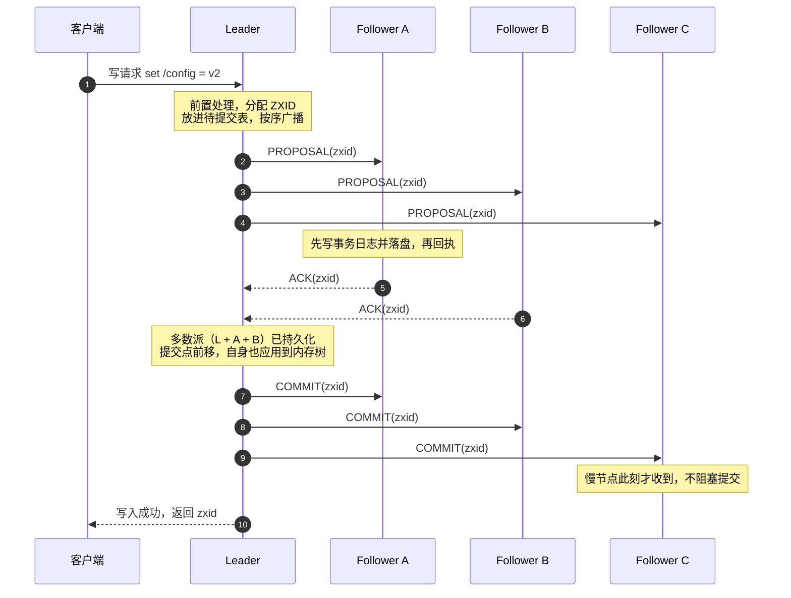
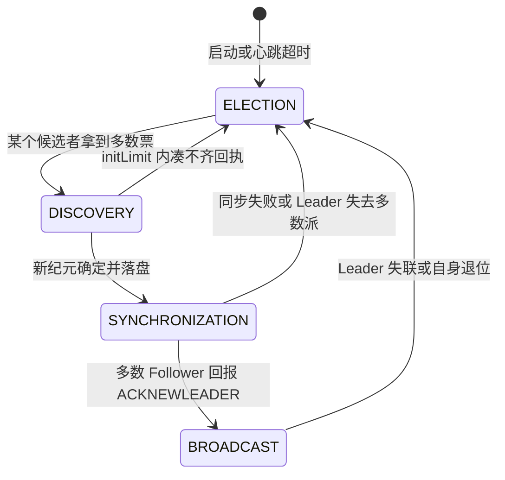
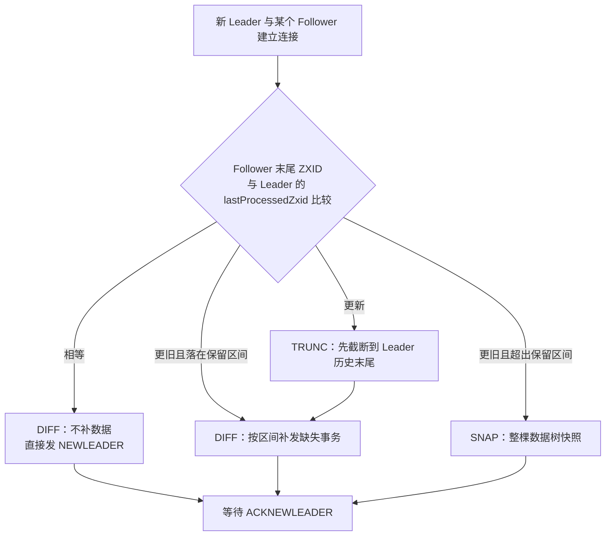
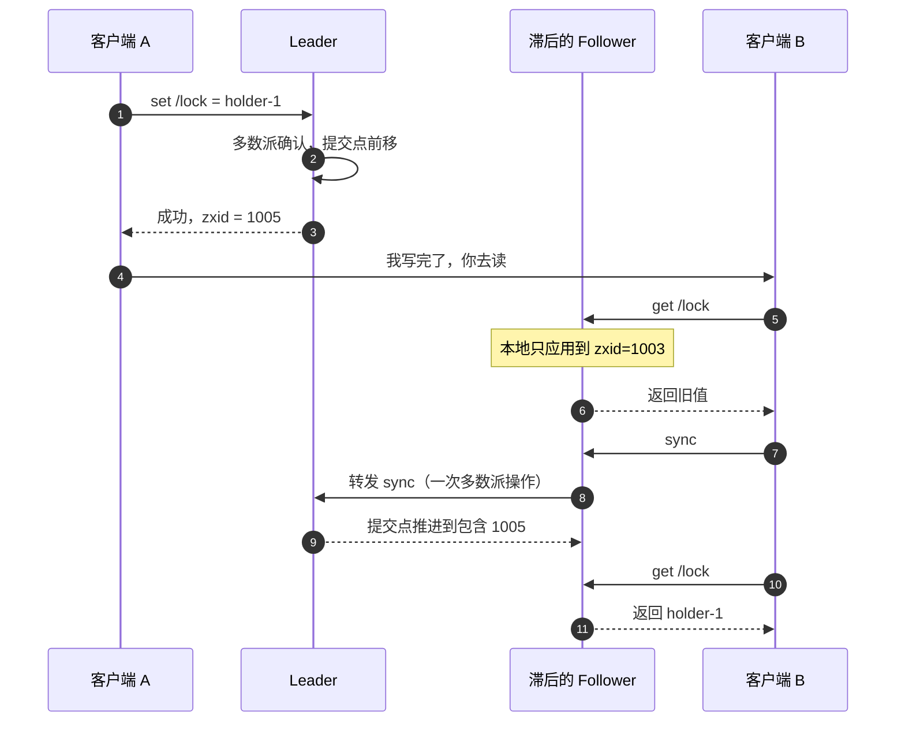

# 06 ZAB 协议：ZooKeeper 的一致性基石

**摘要：**

ZooKeeper 在 2008 年对外开源时，分布式协调这件事还没有标准答案。Paxos 解决了「就一个值达成一致」，却把「谁来当写者、写者挂掉之后怎么办」留给每个实现自己拼装；Chubby 用租约加 Paxos 走通了这条路，代价是在协议之外还要维护一整套主控逻辑。ZooKeeper 选了另一条：把「一个写者、一条有序日志、一套可显式执行的恢复流程」当成协议的一等公民，于是有了 **ZAB（ZooKeeper Atomic Broadcast）**。本文按五问推进：ZooKeeper 存的究竟是什么数据、为什么自研而不套现成的共识实现、抽掉有序性会退化成什么样、广播与恢复两个阶段各自怎么运转、这套设计又在哪里失效。中段用四张图拆开广播阶段的两阶段提交变体、崩溃恢复的选举—发现—同步状态机与同步分支，再用一张位段图说明 ZXID 的编码，并把 ZAB 与 Raft 在日志连续性假设、提交时机、成员变更与读一致性上逐项对过去。读完应当能回答两个问题：ZXID 把「时期」与「次序」压进一个整数，换来了哪些廉价的判断；以及 ZAB 与 Raft 的相似，究竟来自相互借鉴，还是来自问题本身的约束。

---

## 第 1 章 一间协调服务需要什么样的广播

### 1.1 它存的是「谁是谁的主」

把 ZooKeeper 的数据树摊开，几乎找不到一条业务记录。里面是一台机器对另一台机器的持有声明，是一份超时参数，是一个实例的地址与端口，是一把锁的排队序号。这些数据体积极小，彼此之间靠逻辑关联而不靠外键约束，可一旦两份副本给出不同答案，上层系统立刻会做出互相矛盾的动作：两个节点都相信自己仍是主，就会同时往同一个分区写；两台机器读到不同配置，就会用两套参数跑同一份业务。

四类用法覆盖了它的绝大部分生产形态。分布式选主最古老，HBase 的 HMaster、YARN 的 ResourceManager 都在 ZooKeeper 里挂一个临时节点表示在岗，备节点在这个节点上挂 Watch，节点消失就意味着持有人离场，谁先抢到重建谁就是新主。配置中心把配置写进 ZNode，持有 Watch 的进程在变更时收到通知，各自回拉新值，强一致保证它们最终读到同一份内容。服务注册与发现把实例写成临时节点，消费方遍历目录拿到列表，实例宕机后会话超时、节点自动消失，列表随之收敛。分布式锁用临时顺序节点排出一个公平队列，排队序号最小的拿到锁，持有人崩溃时节点随会话一起消失，锁自动释放。

四类用法叠起来，取舍的天平已经倾斜：这些数据的写入以「每次部署几次」计，读却以「每秒几千次」计，而任何一次读到脏数据的代价，都远高于一次写慢了几毫秒。一个存协调数据、不存业务数据的系统，天然可以把一致性放在吞吐之前。

### 1.2 2008 年，没有现成的协议可以套

那个时间点上的难处，比今天回看时要大。集群协调的需求已经很明确，可用的协议方案分成两类，两类都不合用。

第一类是 Paxos 及其变体。Basic Paxos 解决的是「多个节点就一个值达成一致」，而 ZooKeeper 要的是「一串值按同一顺序被所有节点接受」。从单值到一串值，中间隔的不是多跑几次 Paxos：多值 Paxos 需要有人负责给值编号、需要在编号冲突时退让、需要在提议者崩溃后重新收敛，这些在论文里都被归为「实现细节」留给工程团队。Chubby 的做法是把这些细节补全——选一个主、给主发租约、用 Paxos 保证租约独占，再让主把日志复制给备——逻辑是对的，但它把「主」做成了协议之外的一层，恢复流程因此散落在多处代码里。

第二类是直接照搬主从复制。它在正常网络里跑得很好，故障时立刻分叉：主失联、备被外部工具提升为新主，老主不知道自己已经下台还在接受写，等网络恢复，两条历史需要在某处合并，而被作废的那一条里，客户端早就收到过写入成功的回执。

ZAB 的立场是承认主备结构不可避免，把它抬进协议内部，用协议本身管理主的产生与交接。论文把正确性归结为两条性质：主序性（Primary Order）管顺序的传递，任一节点投递了后一条事务，就必须已经投递了它前面那条；主完整性（Primary Integrity）管新主的资格，只有包含了此前全部已被投递事务的节点才有资格上任。两条合起来，等价于一句工程上的话：日志是一条**不许有洞的线**，谁接任谁就得先把这条线接住。

这也解释了一个反复被问到的问题：Raft 不是更简单吗，为什么不直接用。答案朴素得有点扫兴——Raft 的论文发表在 2014 年，而 ZAB 的设计在 2008 年就写进了 LADIS 上的《A simple totally ordered broadcast protocol》，2011 年扩充成 DSN 上的正式论文。ZooKeeper 上线时，Raft 还不存在。今天把两者放在一起比较是有意义的，但它们属于事后复盘，不能反过来当作当年的选项。

### 1.3 有序性：从点达成到线达成

Paxos 与 ZAB 的分野可以用一句话概括：一个管点，一个管线。

共识要求所有节点对某个值达成一致，达成之后这个值就固定下来；ZAB 要求所有节点对一串操作的顺序达成一致，达成之后这串操作会按同样次序在每个节点上被重放。前者的判据是「值相同」，后者的判据是「序列相同」。序列相同要强得多——两个节点可能最终状态一致，却在中间走了不同路径，而对状态机复制而言，路径不同就意味着中间状态不同，中间状态不同就意味着任何一个在中间时刻做出的判断都可能错。

状态机复制的正确性全压在这条约束上。它的前提近乎苛刻：所有副本从同一初始状态出发，执行同一串命令，且执行顺序一致，则最终状态一致。三个条件里，前两个由快照与日志保证，第三个由广播协议保证。协调数据恰恰最不能容忍分支：一个创建 `/app/config` 父节点的请求与一个在它下面写子节点的请求，如果被两个副本以相反顺序执行，后者会失败而前者不会，两棵树立刻出现实质分歧。

**广播不是对称的共识**：ZAB 不是「多个提议者达成一致」，而是「一个提议者被授权之后，所有人按它的顺序走」。名字里那个 broadcast 是认真的，写者是单向的，读方只负责按序接收。

### 1.4 定位决定取舍：协调服务不是数据库

把 ZooKeeper 叫「协调服务」而不是「KV 存储」，这个称谓里藏着几乎所有默认参数的来历。

读写比极端不对称，写少读多，于是读走本地副本、写走主节点多数派确认，读吞吐从主节点这处瓶颈上解放出来。数据体积小，于是有了 `jute.maxbuffer` 那个大约 1MB 的节点上限，以及「不要往 ZNode 里塞大对象」的经验。写入频率低，于是写路径敢于做成严格串行、每次都要多数派往返的形状。

这三条不是缺陷，是定位的衍生品。把 ZooKeeper 当数据库用，撞上的第一个问题是 1MB 上限，第二个问题是单主写吞吐，第三个问题是 Watch 只给「变了」这一个信号、不给变更内容。这些问题在协调场景里都不存在，在存储场景里都是硬伤。判断一个系统能不能用，要先看它的定位与负载是否同构，而不是看功能列表够不够长。

### 1.5 会话与临时节点：把「活着」交给连接状态

ZooKeeper 里最不像数据库的两个概念是会话（Session）与临时节点（Ephemeral Node），它们配成一对，解决了分布式系统里最难判定的一件事：这台机器还活着吗。

会话是客户端与服务端之间的一段有状态连接，服务端分配一个 64 位会话 ID，并协商一个超时时间，取值落在 `minSessionTimeout` 与 `maxSessionTimeout` 之间，默认分别是 2 倍与 20 倍的 `tickTime`。客户端靠心跳维持它，超出窗口没有心跳，服务端就判定会话结束。临时节点是与会话绑定的 ZNode，会话一结束节点即被删除，其子节点一并消失。

两者合起来，把「成员是否在场」从应用层挪到了协调层。服务注册不再需要「定期 ping、连续三次失败才摘除」这种带猜测成分的启发式，只需要「会话还在不在」一个事实。锁同理，持锁者崩溃后会话超时、临时节点消失，锁自动释放，不需要超时兜底，也就不会出现「持锁者还活着但锁被误释放」这类事故。

代价落在会话超时这个参数上。调得太短，一次 GC 停顿或网络抖动就能让会话失效，临时节点集体消失，注册表抖动、锁反复释放；调得太长，真正的故障要等很久才被发现，切换窗口被拉长。这个参数没有正确答案，只有与业务容忍度匹配的取值。

---

## 第 2 章 广播阶段：一次写请求怎么被确认

集群存在稳定 Leader、且 Leader 与多数 Follower 保持连接时，ZAB 运行在广播阶段（Broadcast），这是处理写请求的常态。

### 2.1 从请求到提交的四个动作

客户端可以连任意节点。连到 Follower 时写请求会被转发给 Leader，转发的责任在服务端而不在客户端，这一点与 etcd 的处理方式相反。Leader 先做前置处理——校验会话、检查 ACL、把请求转成内部表示——然后进入提案流程。

第一步，分配 ZXID 并广播 PROPOSAL。Leader 为这次写分配全局唯一的 ZXID，把操作封装成提案，通过为每个 Follower 单独维护的 TCP 连接按序发出：

```
Leader → Follower_1: PROPOSAL(zxid=0x0001_0003, data="set /config = v2")
Leader → Follower_2: PROPOSAL(zxid=0x0001_0003, data="set /config = v2")
Leader → Follower_3: PROPOSAL(zxid=0x0001_0003, data="set /config = v2")
```

第二步，Follower 落盘并回 ACK。收到提案的 Follower 先把它写进本地事务日志并完成同步，才回一个 ACK。这个先后不能颠倒：ACK 的含义是「这条已经持久化，掉电也能从日志恢复」，若先 ACK 后落盘，多数派确认就失去意义——只存在于内存里的日志，掉电时和不存在没有区别。

第三步，Leader 汇总 ACK 判定提交。Leader 自己那一票也算在内，当某条提案被多数派（三节点两个、五节点三个）持久化之后，它把提交点推进到这条提案的位置，再广播 COMMIT。这里是多数派而不是全体，慢 Follower 拖不住提交，除非慢的那些加起来凑成了少数。

第四步，应用到状态机。收到 COMMIT 的 Follower 把提案从事务日志取出，应用到内存数据树，唤醒等待中的客户端连接。Leader 的处理路径相同，它也要等提交点越过自己那条提案才应用。

四步连起来是一条时序，慢节点落在哪一段、提交点在第几步前移，在这张图里最清楚：



时序图里有一处容易看漏：Leader 在推进提交点之后立刻开始应用，不等 Follower 也知道提交点前移。Follower 是通过下一条 COMMIT 或下一次心跳才得知的，因此它的状态机永远落后 Leader 一点，落后多少取决于消息节奏。这个落后对 Watch 没有影响，对「客户端换了节点之后能不能立刻读到」有直接影响，第 5 章会回到这里。

### 2.2 与经典 2PC 的三处差别

ZAB 的广播阶段常被描述成「一个简化的两阶段提交」，类比方向对，但三处差别必须说清，否则会推出错误性质。

第一处是没有中止分支。经典 2PC 里参与者可以投反对票，协调者收到反对就发 ABORT。ZAB 的 Follower 只能回 ACK——提案发出之前已由 Leader 单独校验过，它收到的是「必然合法」的操作，职责只是持久化。少了投票环节，也就少了「准备阶段是否全体就绪」那一轮等待。

第二处是协调者不等全体。2PC 的协调者必须收齐所有回应才能决定，任何一个参与者失联都会让事务挂起、资源被锁。ZAB 凑够多数派就提交，慢节点留在后面自己追。这一条消掉了「一个节点拖垮全局」的风险，代价是慢节点与新主之间出现落差，需要恢复阶段来补。

第三处是提交决定不落独立日志。2PC 的协调者要把 commit 写进决策日志以便重启后恢复；ZAB 没有这样一份东西，commit 与 proposal 的关系由多数派 ACK 隐式确定，重启之后靠恢复阶段重新推一遍「哪些已被多数派持久化」。它本来就要有一套完整恢复流程，与其维护两份真相，不如让恢复流程成为唯一判定者。

三处差别的共同方向，是把「达成一致」压缩成**多数派持久化**，把「如何处理不一致」全部推给恢复阶段。正常路径因此变短，异常路径因此变重。

### 2.3 提交必须按 ZXID 顺序推进

广播阶段有一条不显眼、却决定全序能否成立的规则：提交严格按 ZXID 递增推进，不能跳号。

设想 Leader 同时发出三号与四号两条提案，四号的 ACK 先凑够多数派，三号还差一票。能不能先把四号提交了？不能。一旦提交，某些节点会先应用四号再应用三号，另一些节点可能反过来，而这两条操作之间很可能有依赖——四号写 `/app/config/a`，三号才创建父节点 `/app/config`。顺序一乱，同一条日志在不同副本上会产生不同的最终状态，原子广播的「原子」二字就失效了。

实现上这条规则落在一张待提交表：Leader 把所有已发出未提交的提案按 ZXID 索引存放，提交时检查「当前提交点加一」这一点上是否有已凑够多数派 ACK 的提案，有就提交并继续检查下一条，没有就停下等。于是落后的那条提案会阻塞它后面所有提案的提交，这是一个刻意接受的队头阻塞：**全序是有代价的**，任何一个位置的空洞都必须在原地补上，不能绕过去。

这条规则还解释一个常见现象。客户端连着 Leader 连发两个写，第二个明显慢于第一个，延迟差未必来自磁盘——如果第一个撞上了某条慢提案，第二个就得排队等它。把这种延迟归因于磁盘抖动，往往找错方向。

### 2.4 FIFO 通道保证什么，不保证什么

ZAB 对通信层只有一个要求：任意两个节点之间的点对点通道是 FIFO 的，先发先到。TCP 天然满足这一条，于是一个简化成立了——只要 Leader 按 ZXID 递增在同一连接上发送，到达顺序必然递增，接收端不必再做「我收到的是不是比已有的更新」的检查。

Raft 走的是相反的路。它的 AppendEntries 带着 `prevLogIndex` 与 `prevLogTerm`，接收端先查前缀是否匹配，不匹配就拒绝并要求回退重发。这套检查让 Raft 不依赖通道顺序，任意重排都能收敛，代价是每条消息多两个字段、每次追加多一次比对、日志修复多跑几轮。

省掉检查之后，ZAB 的接收端并没有完全放弃校验。实现里 Follower 收到提案会检查它的 ZXID 是否恰好等于本地最后一条加一，不等就报错、断开连接、重新走一遍同步。**ZAB 把顺序当成通道的契约，把顺序断裂当成通道违约来处理**，而不是当成一种需要用算法兜底的常态。这个立场在协议层是经济的，在运维层则意味着一个隐蔽的坑：只要有一处组件悄悄重排了消息，故障表现会是一连串连接重建，而不是一条被拒绝的提案。

FIFO 保证的边界也很清楚，它只在连接存活期间成立。断开重连之后，双方对「已经到哪一条」的认知可能不一致，这段落差只能由恢复阶段重建。正常时的顺序由通道保证，异常之后的顺序由恢复流程重建，两层缺一不可。

---

## 第 3 章 ZXID：把「时期」与「次序」压进一个整数

### 3.1 64 位里的两段

ZXID（ZooKeeper Transaction ID）是 ZAB 为每个事务分配的全局唯一编号，64 位整数，高低两段各管一件事：

```
ZXID (64 bits):
┌─────────────────────────────────────────────────────┬───────────────────────┐
│                    高 32 位：epoch（纪元号）             │  低 32 位：counter（计数器）│
└─────────────────────────────────────────────────────┴───────────────────────┘
```

高 32 位是**纪元（Epoch）**，作用相当于 Raft 的任期号：每换一次 Leader 纪元加一，一个纪元内最多一个 Leader。低 32 位是**计数器（Counter）**，由 Leader 在自己的任期内分配，单调递增，换届归零。

比较规则一句话说完：先比高位，高位大的更新；高位相同比低位，低位大的更新。两个 ZXID 的大小关系直接对应两个事务在全局日志里的先后，一次整数比较解决全部问题。

### 3.2 三笔变廉价的判断

这个编码不是为了省空间——两个 32 位整数拼成 64 位，与分开存两个 int 占用相同。它省的是判断。

第一笔，判断某条日志属于哪一任 Leader。恢复时要回答「哪些是上一任写下的、可能已提交但没来得及广播 COMMIT 的事务」，只看高位是否等于当前纪元，一次掩码运算即可。若 ZXID 只是单调整数，每个条目就要额外带一个「产生它的 Leader」，或者反查时间段。

第二笔，判断新旧。日志比对、选主投票、同步时的区间确定，全都在回答「谁的日志更新」，编码之后就是一次整数比较。这里有个细节容易被忽略：新 Leader 上任时把本地 ZXID 设为 `(新纪元, 0)`，它的第一条提案因此必然是 `(新纪元, 1)`。计数器归零这个动作，正是 ZXID 不能退化成单调整数的原因——单调整数不允许回退，而纪元内的计数器必须能从头开始。把时期单独拎出来做高位，等于给「重新计数」找到了一个合法入口：计数回退，整体序不回退。

第三笔，判断该补什么。同步阶段要算「这个 Follower 缺哪一段」，比较两个 ZXID 的纪元即可分流：纪元相同，缺的是同一任期内的后缀，按计数器区间补；纪元更旧，缺的是整段历史，可能已超出 Leader 保留的区间，只能整棵树重传。

三笔判断是同一件事的三个侧面：一个好的编号结构，会把「之后所有操作都要反复回答的问题」提前答完。这类设计在分布式系统里反复出现，成本几乎为零，收益却摊在整条链路上。

### 3.3 与 Raft 的 (term, index) 对照

| 维度 | ZAB 的 ZXID | Raft 的 (term, index) |
| :--- | :--- | :--- |
| 编码方式 | 单个 64 位整数，高 32 位纪元、低 32 位计数器 | 两个独立整数，term 与 index |
| 新 Leader 上任 | 计数器从 0 重新开始，纪元加一 | index 不回退，全局单调递增 |
| 最大日志比较 | 直接比较整数大小 | 先比 lastLogTerm，再比 lastLogIndex |
| 旧任期日志识别 | 取高位掩码直接判断 | 读该条目的 term 字段 |
| 全局顺序 | ZXID 单值全序 | (term, index) 二元组全序 |
| 日志连续性的保证方式 | 依赖 FIFO 通道加恢复阶段重建 | 每条消息带前缀检查，可容忍重排 |

表里最值得停留的是「新 Leader 上任」一行。ZAB 的计数器会归零，Raft 的 index 不会，这不是风格差异，它连着后面两条设计：因为计数器可以归零，纪元就必须单独编码并用它压住整体序；因为 index 不回退，Raft 的日志天然是一条连续整数轴，任何新日志的位置都能用「上一条加一」推算，前缀检查才成为可能。两种编码把证明负担放在了不同位置。

### 3.4 纪元边界的第 0 号事务

新 Leader 上任后的第一件事不是接客，而是把自己编号成新纪元。实现上它把本地 ZXID 设为 `(epoch, 0)`，再以这个 ZXID 提出一条 **NEWLEADER** 提案——这是新纪元的第 0 号事务，不承载任何客户端操作，作用是给「这个纪元从这里开始」留一个可被多数派确认的锚点。

它的地位很特殊：同步阶段的收尾动作就是它。Leader 对每个 Follower 做完差异补齐之后，用 NEWLEADER 通知对方「历史对齐了，以这个纪元为准」，Follower 持久化后回 ACKNEWLEADER；收到多数派 ACKNEWLEADER，Leader 才真正开启对外服务，广播阶段的第一条客户端事务也因此必然是 `(epoch, 1)`。

把纪元边界做成一条真正的事务而非内存标志，好处很直接：纪元切换与普通事务共用同一套复制与确认机制，恢复阶段不必为它写特例。一个掉电重启的节点，只要看日志里有没有 `(epoch, 0)`，就知道自己是否进入过这个纪元。

### 3.5 溢出与「高位时期、低位次序」的通用范式

两段各 32 位，边界并非不可触及。计数器溢出意味着一个 Leader 任期内产生 2³² 条事务，按每秒一万条估算也要五天以上，真到这种写入量，ZooKeeper 本身早已不是合适的工具。纪元溢出意味着经历 2³² 次 Leader 切换，以每天一次计超过一千万年，可以当它不存在。

值得记下的不是这两个数字，而是这套结构抽象出来的形状：高位表达时期，低位表达次序，换时期时高位递增、低位归零，整体保持可比。Raft 的 `(term, index)` 是两个字段实现的同一形状，Snowflake 的 `(时间戳, 机器号, 序列号)` 是三段版，混合逻辑时钟的 `(物理时间, 逻辑计数)` 也是同一思路。

按这个范式设计编号有三条要点：高位要留够空间，否则换时期过于频繁，抵消掉它带来的简化；低位要能重置，否则整体序与时期无法解耦；整体必须严格单调，否则所有基于比较的判断都会失效。编号结构会渗透进上层所有逻辑，值得在写第一行代码之前想清楚。

---

## 第 4 章 崩溃恢复：选举、发现、同步

Leader 崩溃、与多数派失联，或者整个集群刚启动，ZAB 就进入恢复阶段。这一段由三个子阶段构成，ZooKeeper 内部用 `ZabState` 这个枚举把它们显式标出来：ELECTION、DISCOVERY、SYNCHRONIZATION，之后才是 BROADCAST。

### 4.1 三个子阶段各自回答一个问题

选举回答「谁来当新 Leader」。它只保证一件事：当选者的日志不落后于任何一个给它投票的节点。这个保证足够弱，因为它不承诺当选者是全集群日志最新的那一个；也足够强，因为任何一条已提交事务必然存在于多数派中，而多数派与投票多数派必然相交，交集里的节点不会把票投给日志比自己旧的候选人。

发现（Discovery）回答「新纪元是几号」。新 Leader 必须先知道一个 quorum 接受过的最大纪元，才能提出比它更大的新纪元。这一步不能省，因为旧 Leader 可能在失联后仍在发号施令，只有纪元比它大，它的提案才会被所有节点当成过期消息丢掉。

同步（Synchronization）回答「每个 Follower 缺什么、多什么」。新 Leader 逐个对账，落后的补上、超前的截断、差异太大的整棵树重传，对齐之后集群才重新具备服务能力。

三个阶段加两条回退边，构成一台四态机：



图里有两处回退边值得留意。一处是发现阶段超时：新 Leader 提出的纪元要拿到多数派回执才算成立，若在 `initLimit` 个 tick 内凑不齐，它就放弃这次当选，整个集群回到选举。另一处是广播阶段退位：Leader 若发现自己连不上多数派，不会硬撑，而是退回选举，因为连不上多数派的 Leader 已无法确认任何写入。

### 4.2 FastLeaderElection：三元组投票

ZooKeeper 3.4 之后默认使用 FastLeaderElection。每个节点进入 LOOKING 状态先投自己一票，票里带三项：候选者 ID、候选者日志中最后一条事务的 ZXID、候选者已知的最大纪元。收到别人的票后按固定顺序比较，把票改投给更优者：

```python
def total_order_predicate(new_id, new_zxid, new_epoch,
                          cur_id, cur_zxid, cur_epoch):
    """
    返回 True 表示收到的票更优，应当改投。
    顺序：先比纪元，再比 ZXID，最后用 server id 打破平局。
    """
    # 0. 没有投票权的节点（Observer）不参与
    if weight(new_id) == 0:
        return False

    # 1. 纪元大的优先：它见过更新的历史阶段
    if new_epoch != cur_epoch:
        return new_epoch > cur_epoch

    # 2. 纪元相同比 ZXID：日志更长的优先
    if new_zxid != cur_zxid:
        return new_zxid > cur_zxid

    # 3. 完全相同则 ID 大的优先，保证收敛到唯一候选者
    return new_id > cur_id
```

两个细节值得展开。

其一，第一项比的纪元来自节点持久化的 `currentEpoch`，而不是它最后一条日志的纪元。两者可能不一致：一个节点参加了纪元协商、把 `e` 写进磁盘、还没来得及接收事务就崩溃，重启后它的 `currentEpoch` 是 `e`，最后一条日志却停在 `e-1` 的某条事务上。投票用前者，因为「我见过纪元 e」这个事实本身就说明有节点在 e 上活动过。

其二，第三项用 ID 打破平局不是随手凑的规则。没有它，两个候选者可能永远互不认输，选举在二者之间反复震荡；加上它，比较关系成为严格全序，收敛才有数学保证。

### 4.3 发现阶段：纪元协商

当选之后，新 Leader 的事比「宣告新纪元」谨慎：先向所有 Follower 收一遍「你接受过的最大纪元」，取最大者加一，才是它要提的新纪元。

实现里这个函数叫 `getEpochToPropose`，逻辑清楚：把每个回报的 acceptedEpoch 与当前候选纪元比较，取更大者加一；同时把回执节点记进一个「已连接集合」，只有该集合包含自己且构成多数派，协商才算完成，Leader 把这个纪元持久化为自己的 acceptedEpoch，然后往下走。等待有超时，上限是 `initLimit` 个 tick，超时即抛异常、退出 LEADING，让选举重来。

这个设计要防的是纪元回退。假设某个节点曾接受纪元 7，而新 Leader 只见过 5，若它直接提 6，那个节点会发现「你说的纪元比我还小」而拒绝；即使勉强接受，旧 Leader 在纪元 7 里发出的提案也可能被误认合法，因为它带着一个不比当前纪元小的编号。让新纪元严格大于一个多数派见过的最大值，等于在所有旧提案之上盖了一道封条。

回执里还带着 Follower 最后一条日志的 ZXID，两项信息合起来，Leader 才知道自己面对的是什么状态的集群，同步阶段据此分流。

### 4.4 同步阶段：DIFF、TRUNC、SNAP 三个分支

同步阶段的输入是「Leader 的历史」与「这个 Follower 的历史」，输出是「让两者一致所需的最小动作」。分支判定围绕一个基准点展开：Leader 的 `lastProcessedZxid`，也就是它最后一条已应用的日志位置。

| 分支 | 触发条件 | Leader 的动作 | Follower 的动作 |
| :--- | :--- | :--- | :--- |
| DIFF | 末尾 ZXID 与 Leader 相等 | 只发 NEWLEADER，不补数据 | 直接进入广播阶段 |
| DIFF | 落后，但差值落在已提交区间内 | 按区间补发缺失事务 | 顺序应用，追平 |
| TRUNC | 末尾 ZXID 比 Leader 新 | 令其截断到指定位置，再走 DIFF | 回滚未提交的后缀 |
| SNAP | 过旧、区间已丢弃，或差异过大 | 传整棵数据树快照 | 清空本地树、装载快照 |

三个分支的语义可以用一句话概括：**以 Leader 的历史为准**，少了就补，多了就砍，差得太远就整棵重来。

三种情形里最复杂的是「Follower 比 Leader 新」，也就是 TRUNC 场景。它出现在旧 Leader 发出提案、部分 Follower 落了盘、COMMIT 还没发出的时候：这些 Follower 手里握着一条新 Leader 并不知道的事务。处理规则是：若该事务的 ZXID 大于 Leader 历史里的最大 ZXID，就截断它——它从未被多数派确认，旧 Leader 必然没来得及提交。

```
Leader 的日志：  [zxid=1001, zxid=1002, zxid=1003, zxid=1004]
Follower 的日志：[zxid=1001, zxid=1002]
→ Leader 向 Follower 发送 PROPOSAL(zxid=1003) 与 PROPOSAL(zxid=1004)
→ Follower 顺序应用，两者一致
```

```
Follower 的日志：[zxid=1001, zxid=1002, zxid=1005]
Leader 的日志：  [zxid=1001, zxid=1002, zxid=1003, zxid=1004]
→ Leader 先发 TRUNC 让 Follower 截到 1002，再发 DIFF 补齐 1003、1004
```

四条分支的判定树如下，基准都是 Leader 已应用到的那个位置：



> [!info] 提交与截断的判断依据
> 新 Leader 的历史是判定基准，而它的资格由选举保证：任何节点的日志都不比给它投票的候选者新，因此当选者一定包含此前所有已被多数派确认的事务。于是「Follower 比 Leader 新」只可能出现在「旧 Leader 未经多数派确认就发给它」这一种情况下，截断是安全的；反过来补齐缺失部分也安全，因为补的都是 Leader 已确认过的历史。
>
> 与 Raft 的差异在处理时机。ZAB 在 Leader 上任时集中对齐一次，把分歧处理成一次性事件；Raft 把分歧摊在后续日志复制里，靠前缀检查逐步回退覆盖。前者让广播阶段可以完全不带一致性检查，后者让恢复阶段不需要额外协商轮次。两种做法把复杂度放在了不同位置，没有哪边更简单，只有哪边更符合各自的骨架。

论文对发现阶段的设想比实现更宽：Leader 收集到一个 quorum 的历史之后，可以把其中最新的一份作为自己的初始历史，哪怕它来自某个 Follower。实现走的是更保守的一条路——以 Leader 自己的 `lastProcessedZxid` 为基准，把 Follower 往这个基准上对齐。两者在安全性上等价，因为选举已保证当选者的历史覆盖了所有已确认事务；差别只在极端情况下要不要让 Leader 自己回退，而实现选了「Leader 不回退、让 Follower 让路」这条更容易推理的路径。

### 4.5 什么时候算「可以开始服务」

同步做完不等于可以接客。Leader 要等的是多数派的 ACKNEWLEADER——每个 Follower 对齐历史后回一个确认，Leader 把它们记进同步确认集合，只有该集合满足 quorum 条件，它才启动本地请求处理线程，开始接受写请求。

这一步的必要性来自「多数派」这个词。假设 Leader 只与一个 Follower 对齐就开张，它接下的写入可能落在一个不含已提交历史的多数派上，换句话说，它可能在一条与历史断开的支线上继续写。等第三个节点重新连上，旧日志与新写入无法拼接，只能整棵树重传，一次本可避免的雪崩。

对齐完成、服务开启之后，Leader 还会向各 Follower 发一条 UPTODATE，通知它后面来的都是新区块、按广播阶段的规则处理。从这一刻起，协议回到常态。

### 4.6 选举规则与同步规则的配套

把投票与同步连起来看，会看到一对互相依赖的规则。

选举保证「当选者的日志不落后于所有投票者」，同步保证「以当选者的历史为准做对齐」。前者是后者的前提：如果选出的 Leader 可能比某个 Follower 还旧，「以 Leader 为准」就会砍掉一条实际已提交的事务，原子性瞬间破产。后者是前者的兑现方式：选举只承诺了一个弱性质，同步阶段必须把它兑现成「全集群历史一致」这个强结果。

这对配套关系可以推广成一句判断：分布式协议的安全性很少由单条规则承担，它通常是一组规则互相咬合的结果。设计时若只盯住其中一条，很容易在另一条上开出口子；读协议时若只看结论不看配套，很容易得出「这条规则多余」的错误结论。

---

## 第 5 章 有序性的两种强度与它的账单

### 5.1 因果有序与全局有序

ZAB 的文档里会出现两种「有序」，强度差着一层。

因果有序说的是「有因果关系的操作不许颠倒」。事务 T₁ 创建了 `/config`，T₂ 在它下面写子节点，任何节点都必须先执行 T₁ 再执行 T₂，不能出现「子节点存在而父节点不存在」的中间态。这一层靠 FIFO 通道就够：Leader 按 ZXID 递增发出，Follower 按同一顺序收到，因果自然被保留。

全局有序说的是「没有因果关系的操作也必须有同一个顺序」。两个互不相干的客户端同时写两个不同的 ZNode，任何一个节点看到的先后都可以，但所有节点必须看到同一个先后。这一层靠 FIFO 通道不够，必须有一个全局的顺序分配者——Leader 的 ZXID 分配。**全序不是通信层的副产品**，它是由一个点换来的。

协调服务为什么必须全序而非因果有序？因为它是状态机复制。两个并发的写在不同副本上以不同顺序执行，最终状态可能相同，也可能不同——若它们写的是同一棵树的不同分支，结果相同；若其中一个是删除父节点、另一个是给父节点加子节点，结果就不同。要让所有副本无条件一致，只能让所有操作走同一条序。

### 5.2 一次切换中的原子性

全局有序在 Leader 切换时最容易被打破，也最能看出 ZAB 的取舍。

设想旧 Leader L1 提交了 T₁ 并发出 COMMIT，但只有部分 Follower 收到；L1 崩溃，L2 当选。此刻集群里对 T₁ 有三种认知：已应用、已落盘未应用、完全不知道。放任不管，三种认知会各自往下走，产生三条分叉历史。

ZAB 的处理是把 T₁ 的命运在恢复阶段一次性定死：T₁ 若已被多数派确认，就存在于 L2 的历史里，L2 通过 DIFF 补齐落后的节点，通过补发 COMMIT 让已落盘的节点完成应用；T₁ 若从未凑够多数派，就不在 L2 的历史里，那些握着它的节点会被 TRUNC 截掉。两种结果都不会留下「一部分执行、一部分没执行」的中间状态。

这就是「原子广播」里「原子」二字的确切含义：一条事务在所有副本上**要么都生效，要么都不生效**。普通广播只承诺尽力送达，原子广播把送达与顺序捆在一起，用恢复阶段补上最后一次确认。

### 5.3 串行化的账单

全序的代价可以算得很具体。

**写吞吐被 Leader 卡住**。所有写都要经过同一处分配 ZXID、同一处汇总 ACK，加节点只能提升读能力，不能提升写能力。写到某个量级之后，瓶颈不在网络而在 Leader 单机的处理能力上，这是横向扩展解决不了的问题。

写延迟包含若干段固定往返：客户端到 Leader 一跳，Leader 广播到多数派一跳，ACK 回来一跳，COMMIT 再一跳。这些段无法靠增加并发摊薄，只能靠批量合并同一时刻的多个请求来摊——ZooKeeper 用组提交的思路，让一批请求共享一次落盘与一次广播。

提交侧还有一个队头阻塞，2.3 节说过：一条凑不齐多数派的提案会卡住它后面所有提案。

这三笔账在协调场景里都不算贵。写入频率以「每次变更几次」计，几毫秒延迟、几千写 TPS 完全够用；真正吃紧的是读，而读被设计成绕开 Leader 之后，压力就散到了所有副本上。同样是强一致，代价落在哪一段、由谁来付，取决于读写比例；把 ZAB 挪到一个写密集的场景里，这三笔账会立刻变得刺眼。

### 5.4 读路径：绕开共识换来的东西和丢掉的东西

ZooKeeper 的读不经过共识。客户端连任意节点，读请求在该节点本地执行，落在它已应用的状态上。这让读吞吐随节点数线性扩张，代价是读到的内容可能落后于集群的最新提交。

这里要把「落后」说准。官方保证里有两条与此相关：单一系统映像（Single System Image）要求客户端不会看到比自己已见过的版本更旧的数据；顺序一致性要求同一客户端发出的更新按发出顺序被应用。前者靠客户端记账实现——客户端库记住自己见过的最大 ZXID，重连时只连那些 ZXID 不小于该值的服务端，从根上排除时间倒流。后者靠服务端处理顺序实现——同一会话的请求在同一连接上按序发出，服务端会把该会话的待处理写请求排在它的读请求之前执行。

于是有个常被误传的说法需要纠正：**ZooKeeper 的读是「不回退，但不保证最新」**。拿两个不同客户端说事，A 写完拿到回执，B 立刻去连另一个 Follower 读，B 可能读到旧值，因为那个 Follower 可能还没收到这条的 COMMIT。这是跨会话可见性问题，与「读己之写」是两码事。

把 A 写、B 读、B 补 sync 再读这条路径画成时序，落差与补偿各在哪一步就很直白：



图里那条 `sync` 是 ZooKeeper 为这个场景准备的补偿手段。它看起来像刷新，实际重得多：sync 请求被转发给 Leader，走完整的提案与多数派确认流程，在日志里占用一个 ZXID，作用是把「此前的所有已提交写入」变成「从这一刻起这个 Follower 必然可见」。因此它是**一次真正的共识操作**，代价是一个完整往返，不是廉价的本地刷新。

> [!warning] 线上常见的读一致性陷阱
> 一种反复出现的故障模式是这样的：
>
> ```
> 步骤 1：客户端 A 写入数据，收到成功回执
> 步骤 2：A 通知客户端 B「数据已写入，你可以读了」
> 步骤 3：B 从另一个 Follower 读到旧值，业务判断出错
> ```
>
> 这不是缺陷，是读路径绕过共识的必然结果。可用的解法有三种，代价依次递增：读之前调用 `sync()`，用一次多数派往返换取「此后必然可见」；让 B 与 A 使用同一个会话或同一个客户端实例，享受「读己之写」；把读集中到自己维护的、带版本号的缓存层，用版本号判断是否可信。
>
> 还有一种做法是把 Leader 地址单独写进连接串，让所有读落在 Leader 上——写入成功时 Leader 一定已经应用（它是在应用之后才回执的），因此读到的内容对已完成的写是安全的。短板在可用性：Leader 一换，所有客户端都要重连，切换期间读也会中断。

### 5.5 「读己之写」的边界在哪里

把结论收窄一点：ZooKeeper 保证的是「同一会话内，客户端能读到自己此前写入的结果」，这个保证的有效范围有三个限定。

第一个限定是同一个会话。会话 ID 过期、客户端重连拿到新会话之后，服务端不再知道这两个会话属于同一个逻辑客户端，「读己之写」失去依据。长时间 GC 之后的客户端常读到「自己没写过」的状态，原因就是它已经换了会话。

第二个限定是同一个服务端。重连时客户端会挑一个 ZXID 不小于自己记录值的服务端，这保证它见过的东西不会消失，但不保证新服务端已应用它提交的、尚未确认的写。

第三个限定是会话内请求的顺序。服务端保证「先写后读」靠的是把同一会话的待处理写请求排在读请求之前执行，而不是靠读请求本身去等提交点。这套机制在正常网络里足够，但服务端切换的瞬间会出现一个短暂窗口，客户端可能看到「写成功、读不到」，这也是苛刻场景要在读之前补一次 sync 的原因。

---

## 第 6 章 ZAB 与 Raft：逐项对照

### 6.1 一张对照表

| 维度 | ZAB | Raft |
| :--- | :--- | :--- |
| 设计目标 | 主备结构下的有序原子广播 | 可理解的通用共识 |
| 事务标识 | 单个 64 位 ZXID，纪元加计数器 | (term, index) 二元组，index 全局递增 |
| 恢复流程 | 选举、发现、同步三阶段，集中处理 | 选举加日志修复，分散处理 |
| 新 Leader 服务时机 | 多数 Follower 同步完成后才接客 | 选举成功即可接客，靠后续复制间接补齐 |
| 日志连续性 | 依赖 FIFO 通道，接收端只校验号连续 | 依赖前缀检查，可容忍重排 |
| 旧 Leader 遗留条目 | 同步阶段显式提交或截断 | 冲突覆盖隐式处理，且不能直接提交旧任期条目 |
| 提交顺序 | 严格按 ZXID 递增，有队头阻塞 | 按 index 递增，同样有队头阻塞 |
| 读一致性 | 本地读，可能落后；`sync()` 作补偿 | ReadIndex 或租约读，默认线性一致 |
| 成员变更 | 3.4 及以前静态配置；3.5 起 `reconfig` | 单步变更或联合共识 |
| 只读扩容 | Observer 不参与投票与确认计数 | Learner 不参与投票 |
| 协议状态 | LOOKING、LEADING、FOLLOWING，加 OBSERVING | Follower、Candidate、Leader |

### 6.2 日志连续性假设的两种兑现方式

Raft 把「前缀匹配」写进了每一条消息：Leader 告诉 Follower「我这条日志的上一号是 `prevLogIndex`、上一任是 `prevLogTerm`」，Follower 检查自己那一号上是不是同一个任期，不是就拒绝。这套机制让 Raft 在任意乱序、任意断点下都能逐步收敛，代价是每条消息多一点开销、每次修复多几轮往返。

ZAB 把这件事交给了通道。它假设连接是 FIFO 的，只要 Leader 按 ZXID 递增发送，接收端收到的就一定是递增的，因此提案消息里不必携带任何位置信息。接收端仍保留一个廉价检查——收到的 ZXID 必须恰好等于本地最后一条加一——但它把不相等视为通道违约而非正常分支，处理方式是断开连接、重新同步。

两种兑现方式的差别在故障边界上最清楚。Raft 在通道乱序、消息重放、连接反复抖动时仍能收敛，最坏是多跑几轮；ZAB 在同样条件下会退化成反复重连、反复同步，把一次本可局部修复的分歧放大成整棵树传输。而如果通道确实可靠（同机房、同一交换机、TCP），ZAB 省下的那点开销就是纯收益。这是典型的**用假设换简洁**：假设成立时它更省，假设被打破时它更脆。

### 6.3 提交时机：一条 ZAB 不需要的规则

Raft 里有一条让初学者困惑很久的规则：Leader 不能直接提交旧任期的日志条目，必须等自己任期内的某条日志被多数派确认，才能连带把之前的条目一并提交。这条规则是为 Figure 8 那个反例准备的——旧任期的条目可能已被多数派接受，却在新 Leader 上任后被覆盖，直接提交会破坏安全性。

ZAB 没有对应规则，原因不在它更聪明，而在骨架不同。ZAB 的新 Leader 在开始服务之前已把整个集群的历史对齐成自己的历史：落后的补上、超前的截断、差太多的重传。对齐完成那一刻，「旧纪元的未提交条目」这个集合就空了——它们要么被纳入权威历史，要么被截断，不存在悬而未决的第三种状态。既然不存在，广播阶段就只需管新条目，每条新提案拿到多数派 ACK 即可提交。

代价被挪到了恢复阶段。ZAB 的恢复要收集 quorum 回执、协商纪元、逐节点对齐、等多数派确认，才敢开张；Raft 的 Leader 选出来就能接客，历史分歧在后续复制里慢慢磨平。一个把成本前置到恢复，一个把成本后置到运行。前置的好处是运行路径极简、推理容易，后置的好处是切换快、可用性窗口短。这也解释了一个观察到的现象：ZooKeeper 的故障切换通常比基于 Raft 的系统慢一点，但切换完成之后的行为更容易预测。

### 6.4 成员变更：从静态配置到联合共识

「ZAB 不支持动态成员变更」是一个流传很广的旧印象，它在 3.4 时代成立，3.5 之后不再成立。

3.4 及以前，成员写在配置文件里，改配置只能滚动重启或者停机重来。3.5.0 引入了动态重配置：成员信息抽到独立的动态配置文件，由静态配置里的一个键指向它；客户端可以调用 `reconfig` 增删节点，新配置本身作为一次事务被提交，走与其他写相同的广播路径。变更完成后，被移除的节点不会立刻被关掉，而是降级成没有投票权的 Follower——它的投票不再计入提交所需的 quorum，但仍接收并应用事务，这样既不会让连在它上面的客户端瞬间断开，也给运维留出迁移窗口。

过渡期的安全性靠一套判据保证：提交一条新配置时，要求**新旧配置各自凑够多数派**。实现里这一点落在一个同步确认集合上，该集合同时挂着当前配置与上一次见到的配置两个 quorum 判据，判定条件是「所有 quorum 都满足」。这与 Raft 的联合共识是同一思路——切换的那一小段时间里，任何一次提交都必须同时取悦两套人马，避免出现「旧配置的多数派」与「新配置的多数派」互不相交的窗口。

Raft 后来走了一条更轻的路：一次只加或减一台机器，两次变更之间的 quorum 交集天然存在，于是不需要过渡期的双 quorum。ZAB 支持任意成员集合的一次性变更，代价是过渡期更重；Raft 限制变更粒度，换来流程更简单。两条路的正确性都能证明，工程上选哪条，取决于运维想「一次改完」还是想「改得稳」。

### 6.5 读一致性：本地读与 ReadIndex

etcd 的默认读是线性一致的，做法是 ReadIndex：Leader 记录当前提交点作为这次读的位置，确认自己仍拥有多数派支持（必要时补一轮心跳），等本地状态机追平这个位置再返回结果。整个过程不写日志，但要走一次多数派确认，因此不是免费的。

ZooKeeper 的默认读是本地读，连 Leader 都不必经过，读的是本节点已应用的状态，因此可能落后；需要更强保证时，客户端显式调用 `sync()`，代价是一次完整的多数派操作。

两条路的分界线在默认值上。etcd 把线性一致做成默认，让不懂协议的人也不会读错；ZooKeeper 把本地读做成默认，让读吞吐随节点数扩张，把正确性的判断留给使用者。前者的风险是性能被默认值拖住，后者的风险是使用者不知道自己读到的是旧值。这两者都不是疏漏，是各自对「谁来承担判断责任」的回答。

### 6.6 相似不是巧合，是问题锁死的

把两张表叠起来看，相似之处集中在四处：都用单调递增的版本号区分新旧，都要求日志最全的节点才能当选，都用多数派确认定义「已提交」，都把「写入日志」与「应用到状态机」分成两步。

四处相似不需要用借鉴来解释。任何要在崩溃故障下正确工作的协议，都必须解决同一个问题：在一部分节点失联、消息延迟无上界的前提下，让还活着的节点对一条日志达成一致，且这条日志不许被后来的任意一方悄悄改写。能同时满足这些条件的机制并不多，用版本号隔离新旧、用多数派相交保证信息不丢、用两阶段分离持久化与可见，几乎是唯一可行的一组。**相似来自约束，不来自抄袭**。

这条判断有实用价值：面对一个声称「完全不同」的新协议，先问它是否真的改变了这四处取舍。大多数所谓创新集中在实现细节或特定负载的优化上——批量、流水线、快照压缩、只读副本、跨地域部署，这些都值得投入，但不改变骨架。真正改变骨架的协议，通常要先改变假设，譬如从崩溃故障改成拜占庭故障，或者从部分同步改成完全异步。**当一个协议宣称既改变了骨架又没有改变假设时，多半是有一处前提被悄悄放松了**。

### 6.7 一把可以反复用的尺子

把对照收敛，可以留下三个问题，用来摸清任何一个共识协议的骨架。

第一个是它用什么表达时期。ZAB 用纪元，Raft 用任期，Paxos 变体里常见的是提案编号或 ballot，形式各异而作用一致：让节点能识别并丢弃上一个时期的残留消息。

第二个是它怎么选出新主。是比日志新旧，还是比编号大小，还是像某些系统那样依赖外部组件指定。这一条决定恢复阶段要付多少代价：比日志新旧的方案需要额外一轮对齐，外部指定的方案需要额外的故障检测与租约。

第三个是它怎么定义已提交。多数派确认是通行做法，但确认粒度不同——有的每条单独确认，有的按批确认，有的把确认与提交点前移合成一个动作。粒度决定延迟与吞吐的形状，也决定恢复阶段要重放多少东西。

三个问题问完，剩下的都是工程细节；面对陌生协议不必从头读到尾，先定位骨架，再决定要不要深挖。

---

## 第 7 章 规模、故障与误读

### 7.1 三、五、七：quorum 的算术

ZooKeeper 集群通常部署成 3 节点或 5 节点。3 节点允许挂 1 台，5 节点允许挂 2 台，7 节点允许挂 3 台。节点数增加，容错能力按 (n-1)/2 增长，写延迟却随「需要等待的 ACK 数」与「最慢的那个多数派成员」一起上升。

| 节点数 | 多数派门槛 | 可容忍故障 | 写延迟趋势 | 常见用途 |
| :--- | :--- | :--- | :--- | :--- |
| 3 | 2 | 1 | 低 | 大多数业务集群 |
| 4 | 3 | 1 | 与 3 节点接近，成本更高 | 极少使用 |
| 5 | 3 | 2 | 中 | 对可用性要求高的核心系统 |
| 6 | 4 | 2 | 与 5 节点接近，成本更高 | 极少使用 |
| 7 | 4 | 3 | 高 | 跨机房容灾，需谨慎评估 |

> [!info] 为什么集群规模通常是奇数
> 容错能力由多数派门槛决定，而门槛是 ⌊n/2⌋+1。4 节点的门槛是 3，容错 1 台，与 3 节点一样，却多付一台机器的成本和多一份复制开销；6 节点与 5 节点同理。
>
> 这条算术对所有基于多数派的协议都成立，不限于 ZAB。理由朴素：偶数节点的「多余那一台」既不改变门槛，也不改变容错，只是把成本摊给了所有人。

规模的上限不来自算术，来自延迟。5 节点之后，每加一台都会让「凑够多数派」多一个可能拖慢响应的成员，而提交点必须等最慢的那一票凑齐门槛。跨机房部署时这一点尤其明显：两个机房各放若干节点，多数派必然包含跨机房的往返，一次写的延迟会被机房间的 RTT 直接抬高。

### 7.2 延迟的量级与它的构成

同机房、普通 SSD 的三节点集群上，一次写通常在毫秒量级（经验区间 2ms 到 10ms），一次本地读在亚毫秒到 1ms 之间，单 Leader 写吞吐在千级到万级 TPS 之间。这些数字会随硬件、批量大小、请求体大小、并发度大幅浮动，把它们当常数引用没有意义，有意义的是拆开看它们由哪几段构成。

写路径的四段是：客户端到 Leader 的一次往返、Leader 与 Follower 各自的一次事务日志落盘、多数派 ACK 的回程、COMMIT 的下发。第一段由部署位置决定，跨地域就无解；第二段由磁盘同步写延迟决定，换盘或者把事务日志放到独立设备都能改善；第三段受最慢的多数派成员影响；第四段常与下一次提案合并，成本较低。实际延迟接近「一次往返加一次落盘」而非四段相加，因为广播与本地落盘可以并行。

读路径只有一段：本地状态机的查询。它便宜是因为没经过共识，它可能给出旧答案的原因也在同一处。

### 7.3 六种故障场景与它们的恢复行为

把恢复阶段的知识落到具体故障上，可以得到一张推演表。

| 故障场景 | 集群表现 | 恢复行为 | 需要人为介入吗 |
| :--- | :--- | :--- | :--- |
| Leader 进程崩溃 | 写全部失败，读正常但可能旧 | 剩余多数派重新选举，同步后恢复写 | 不需要，秒级完成 |
| 一台 Follower 崩溃 | 无感知，写延迟可能略升 | 重启后按落后量走 DIFF 或 SNAP | 不需要 |
| Leader 与多数派隔离 | 旧 Leader 退位，少数派侧不可写 | 多数派侧选出新 Leader，纪元加一 | 不需要 |
| 分区恢复 | 可能出现旧 Leader 仍自认有效的短暂窗口 | 旧纪元提案被新纪元节点拒绝，旧主退位 | 不需要，但要监控日志 |
| Follower 磁盘严重落后 | 该节点被踢出提交计数，长期不可用 | 重启后走 SNAP 整树重传 | 需要关注容量与磁盘 |
| 半数以上节点失联 | 集群整体不可用 | 无自动恢复，直到多数派重新可达 | 需要，且要防止误操作 |

表里最容易被低估的是第五行。一个落后太多的 Follower 不只是自己不可用——它仍连着 Leader、占着一条连接、仍会让 Leader 等它的 ACK，直到 `syncLimit` 判定超时。如果它的磁盘正在做大量随机写，这段等待会周期性地出现在写延迟尾部。经验上写延迟的 P99 抖动，经常能追到某个 Follower 的磁盘上。

最需要警惕的是最后一行。失去多数派之后完全停止写服务，这是 CP 系统的定义性行为，不是缺陷。**失去多数派即停止写**这条规则真正的风险在人的动作上：有人看到集群不健康，把剩余节点重启，或者手工改配置里的一台机器地址凑数，把一次可以自愈的分区变成数据丢失。多数派不可达时的正确动作是恢复网络与主机，而不是改配置。

### 7.4 从原理推导出来的运维要点

集群规模用奇数且不超过 7，这是 7.1 的直接推论。

关注选举频率而不是选举耗时。偶发切换属于正常，若一小时内多次切换，说明有人在反复打断它：选举超时设得太短、网络有周期性抖动、某台机器的 GC 停顿超过心跳间隔，都会造成这个结果。四字命令与 JMX 指标里能看到当前角色与切换计数，把它们接进监控比事后翻日志有效得多。

盯会话超时率。会话频繁失效会直接表现为临时节点抖动：注册表频繁变更、锁被反复释放与争抢、上层业务大量重试。根因通常在客户端一侧——长 GC、线程池打满、网络策略把长连接踢掉。这个指标比「节点数变化」更能提前暴露问题。

不让大对象与高写入进来。ZNode 的大小上限与单主写结构决定了这两件事一定会撞墙。当有人提出「把几兆的配置放进 ZooKeeper」时，正确的回应不是调大 `jute.maxbuffer`，而是改用对象存储加版本号，或者换一个配置中心。

监控数据目录的磁盘。事务日志与快照性质不同：日志顺序追加、写入频繁，快照周期性全量、峰值很大。把日志目录单独挂一块盘，能显著降低写延迟抖动，也能避免快照把日志空间挤爆。

### 7.5 生态位移

ZooKeeper 曾是「分布式协调」的默认答案。今天它仍在大量存量系统里承担关键角色，但新增系统的默认选项已经变了。

Kubernetes 在 2014 年选择 etcd 作为唯一状态存储，这个决定把 etcd 推成云原生协调的事实标准，也把 ZooKeeper 挤出了增量市场。Kafka 的转向更直接：KIP-500 提出用自带的 Raft 实现替代 ZooKeeper，3.3 起 KRaft 可用于生产，4.0 正式移除了对 ZooKeeper 的依赖——一个曾经最著名的用户，把自己的元数据管理收了回去。HBase、YARN 这些老用户仍在用，但它们的增量也在放缓。

| 方案 | 底层协议 | 主要特点 | 适配场景 |
| :--- | :--- | :--- | :--- |
| ZooKeeper | ZAB | 成熟、语义丰富、运维负担较重 | 存量系统、选主与锁、老 Hadoop 生态 |
| etcd | Raft | 云原生标准、API 清晰、默认线性一致读 | Kubernetes 及新系统的控制面 |
| Consul | Raft | 内置服务发现与健康检查、多数据中心 | 服务网格、跨机房服务目录 |
| Nacos | Raft（JRaft） | 配置与服务发现合一、国内生态完整 | 微服务体系的注册与配置 |

四者的能力高度重叠，分野在生态而不是协议。**决定选择的是周边生态与团队熟悉度**：用 Kubernetes 就顺手用 etcd，跑在 Spring Cloud 体系里就顺手用 Nacos，手上有一堆 Hadoop 组件就继续用 ZooKeeper。

边缘化也不该被读成技术失败。临时节点、Watch、顺序节点这套语义至今没有更好的替代品，在选主、成员管理、粗粒度锁这些场景里依然顺手；问题在于云原生时代对「一个额外的有状态集群」的容忍度下降了，而 etcd 恰好可以顺带承担控制面存储，于是「少一个组件」的收益盖过了语义上的细微优势。

### 7.6 五个常见误读

第一个误读是「ZAB 是 Raft 的变体」。时间顺序上说反了，ZAB 的雏形比 Raft 早六年；机制上也不准确，两者的日志连续性假设、恢复流程、提交规则都不同。正确的关系是「同一约束下的两个独立解」。

第二个误读是「ZooKeeper 的读是强一致的」。写是强一致的，读不是。能读到自己的写、不会时间倒流，这两个保证不等于「总能看到最新」。需要更强保证时要用 `sync()`，代价是一次多数派往返。

第三个误读是「配上只读模式就能让少数派继续提供读」。只读模式确实存在，但它要求显式开启、客户端也要显式选择，且这条路径下服务端的语义保证更弱。它不是高可用兜底开关，把它当兜底，往往会让故障从「不可用」变成「静默读到旧数据」。

第四个误读是「加 Observer 能提升写能力」。Observer 不参与投票，也不计入提交所需的 quorum，它扩的是读能力与跨机房的数据分发能力。写能力仍被 Leader 单机与多数派往返卡着。

还有一个流传更久的说法是「ZAB 的成员变更只能重启」。这是 3.4 时代的结论，3.5 之后有 `reconfig`，代价是过渡期要同时满足新旧两份配置的多数派。

---

## 参考资料

1. Junqueira, F., Reed, B., & Serafini, M. (2011). Zab: High-performance broadcast for primary-backup systems. *DSN 2011*.
2. Reed, B., & Junqueira, F. (2008). A simple totally ordered broadcast protocol. *LADIS 2008*.
3. Hunt, P., Konar, M., Junqueira, F.P., & Reed, B. (2010). ZooKeeper: Wait-free coordination for internet-scale systems. *USENIX ATC 2010*.
4. Apache ZooKeeper 官方文档：ZooKeeper Internals. https://zookeeper.apache.org/doc/current/zookeeperInternals.html
5. Apache ZooKeeper 官方文档：Dynamic Reconfiguration. https://zookeeper.apache.org/doc/current/zookeeperReconfig.html
6. Medeiros, A. (2012). ZooKeeper's atomic broadcast protocol: Theory and practice.
7. Ongaro, D., & Ousterhout, J. (2014). In Search of an Understandable Consensus Algorithm. *USENIX ATC 2014*.
8. Kleppmann, M. (2017). *Designing Data-Intensive Applications*. O'Reilly Media. Chapter 9.

---

> [!note] 思考题
> 1. ZXID 用高 32 位纪元加低 32 位计数器编码，让「判断新旧、判断归属、判断补哪一段」三类操作变成廉价比较。若改用单一递增整数，这三类判断各自要额外付出什么，哪一类会最先在工程上暴露出来？
> 2. ZAB 在 Leader 上任时集中做一次历史对齐，Raft 把分歧处理摊进后续复制。请分别构造一个场景，说明哪种做法在这类场景里更占优势，以及这个优势是否以另一处的代价换来。
> 3. ZooKeeper 的读保证「不回退、可读己之写」，但不保证跨会话的实时可见。如果业务要求「A 写完 B 立刻读到」，除了 `sync()` 还有哪些做法，各自把代价转移到了哪里？
> 4. 新纪元以一条 `(epoch, 0)` 的空事务作为边界，并与普通事务共用确认机制。如果把纪元边界做成内存标志而不是持久化事务，哪些故障场景会变得难以判定？
> 5. ZAB 依赖 FIFO 通道并要求接收端校验 ZXID 连续，Raft 用前缀检查容忍乱序。请说明这两种假设在同一套物理网络上的风险差异，以及哪种更适合跨地域部署。