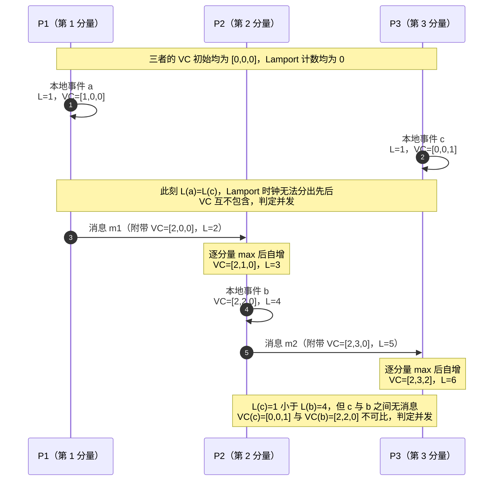
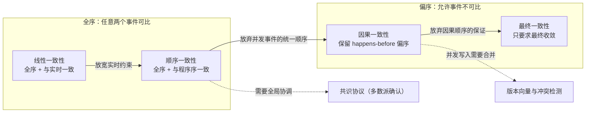
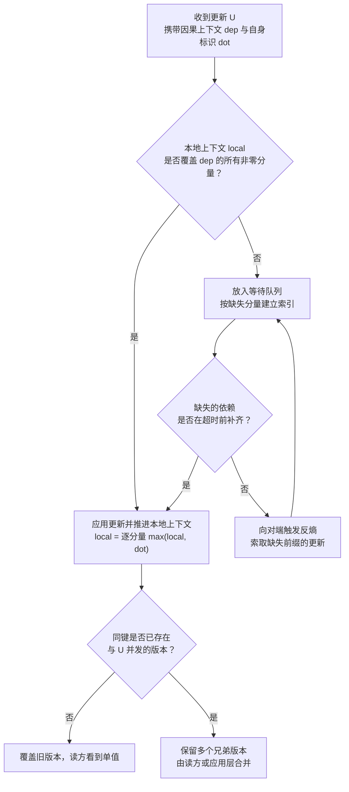
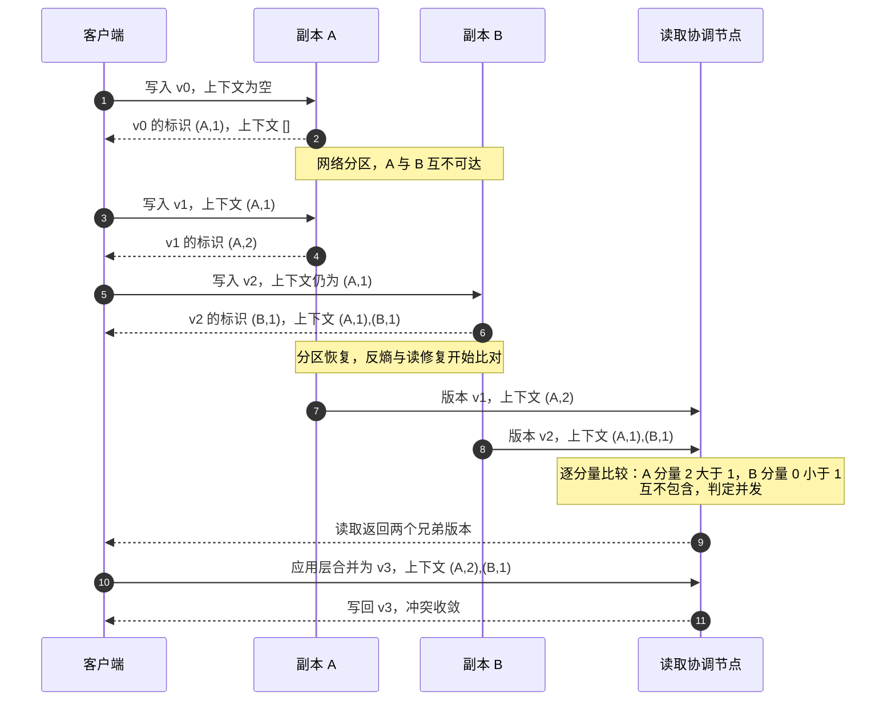

# 07 向量时钟与因果一致性

**摘要：**

1978 年，Leslie Lamport 在《Communications of the ACM》上发表《Time, Clocks, and the Ordering of Events in a Distributed System》，用一个整数把「先后」从物理时间里剥出来，让分布式系统讨论顺序时不必再依赖墙上那面钟。这份答卷只写了一半：逻辑时钟能保证「先发生于」的事件时间戳更小，却无法从两个时间戳的大小关系反推出谁先发生于谁，更无法把「互不相干」的并发事件与「确有先后」的事件分开。十年之后的 1988 年，Colin Fidge 与 Friedemann Mattern 各自给出向量时钟（Vector Clock），把一个计数器换成一维数组，让「因果」与「并发」成为两次逐分量比较就能得出的判定。本篇沿着这条演进线展开：先讲清顺序在分布式系统里有几种来源，再用反事实推演说明只剩物理时间戳会发生什么，随后把向量时钟的构造、比较规则、偏序代数与新成员问题逐个拆开，落到因果一致性（Causal Consistency）的定义、判定流程与会话保证上；进入工程层之后，看版本向量（Version Vector）在 Dynamo 的兄弟版本里如何流转，点版本向量（Dotted Version Vector）修掉了哪一类假阳性冲突，Git 的提交图为什么不需要向量时钟，Cassandra 与 Riak 又各自选了哪条岔路；最后讨论维度爆炸、修剪策略与八条常见误用。读完应当能回答两个问题：向量时钟凭什么能在一堆互不可比的事件里认出因果这件东西，以及为什么因果一致性常被当作性价比最高的一档一致性。

---

## 第 1 章 顺序从哪里来

### 1.1 1978 年那篇论文只写了一半

1978 年，Leslie Lamport 在《Communications of the ACM》上发表《Time, Clocks, and the Ordering of Events in a Distributed System》，这篇后来被引用上万次的论文做了一件事：把「先后」从物理时间里剥出来，重新定义成一个只由消息决定的关系。

定义只有三条。同一进程内先发生的事件先行于后发生的事件；一次消息的发送先行于它对应的接收；先行关系在传递闭包下继续成立。凡是不能用这三条串起来的一对事件，就叫并发（Concurrent），两者之间没有先后可言。

这个定义的价值在于它不需要钟。物理时间是一个连续量，任何一次读数都带着测量误差与同步偏差；「A 先行于 B」在 Lamport 的定义里只是一个逻辑命题，只要存在一条消息链把它串起来就成立，与任何一块表准不准无关。

实现逻辑时钟的规则同样只有两条：进程内每发生一个事件，本地计数器加一；发送消息时把当前计数附在消息上，接收方取本地计数与消息计数中的较大者再加一。由此得到时钟条件——A 先行于 B，则 C(A) 小于 C(B)。

论文并没有停在偏序上。Lamport 紧接着给出一个构造总顺序的办法：把时间戳与进程标识拼成二元组，先比时间戳，相同再比进程号，于是任意两个事件都能排出先后。对论文真正要解决的问题，也就是分布式互斥的取得顺序，这个总顺序完全够用：锁先给谁并不重要，重要的是所有进程对「谁先」看到同一个答案。

问题出在把这个总顺序拿去承载语义的时候。数据复制场景里，两个节点并发修改同一行，总顺序会按进程号决定谁覆盖谁，可进程号是拓扑编号不是业务含义，于是「谁后写」这个语义问题被替换成了「谁编号大」这个任意约定。互斥里「任意但一致」可以接受，因为它只关心排队先后；复制里「任意」不可接受，因为它决定数据留哪一份。

这就是那份答卷缺掉的一半。逻辑时钟能证明「先发生于」的事件时间戳更小，却不能从两个时间戳的大小关系反推出因果；它能给出一个总顺序，却不区分这个顺序里哪些有因果依据、哪些是任意约定。要补上这一半，得让时间戳本身携带「我知道谁进展到了哪一步」的信息。

### 1.2 反事实：只剩物理时钟会怎样

假设系统里没有任何逻辑时钟，冲突判定就只剩「谁的时间戳大谁赢」这一条路，也就是**最后写入者胜（Last-Write-Wins，LWW）**。它在实验室里工作得很好，两台机器对过时，误差在毫秒级，用户察觉不到。放到生产环境，误差会从几个很难预料的地方漏出来。

第一个漏点是同步误差。NTP 保证的不是顺序而是「尽量接近」，客户端在校正时用的是逐步调整（slew）而不是跳变，于是两台机器的表在几十毫秒的区间里可以任意交错，两条写入的先后完全取决于哪台机器的表快一点。

第二个漏点是时钟回拨。2012 年 6 月 30 日的闰秒让一批 Linux 机器在插入那一秒时出现时钟异常，内核与上层应用在那几分钟里看到时间倒退，定时任务重复触发、超时判断失效。只要系统里有一处依赖「时间只会向前」，那一刻它就不再成立。

第三个漏点更隐蔽：时间戳往往由客户端提供。Cassandra 的写入时间戳就是客户端给出的微秒数，一个把系统时间设错的客户端只要报出一个未来的时间戳，它的写入就会在此后很长一段时间里压过所有正常写入，而系统没有任何机制去纠正这个结果——快表即独裁。

比顺序错更糟的是丢弃是静默的。被覆盖的值不报错、不进日志、不留痕迹，直到用户来问「我加进购物车的那本书去哪了」。LWW 用一次字段比较就换掉了整套冲突检测，代价是把「谁赢」的决定权交给了一个不可靠的测量设备，而且输了的那一方永远不会知道自己输了。

### 1.3 并发是因果概念，不是时间概念

讨论「先后」之前，先把两种顺序分开。因果顺序问的是「有没有一条消息链把两件事串起来」，时间顺序问的是「两块表上谁的读数小」。前者的依据是客观事实，后者的依据是测量结果。

所谓并发是前一个问题里的术语，含义是「没有因果关系」，与物理时间上是否同时无关。两个用户相隔一小时各改一次同一个键，中间没有任何消息往来，它们是并发的；同一台机器上一个事件结束后两百微秒另一个事件开始，它们有因果。

反过来也成立：两块表恰好读数相同不代表没有因果，一次发送与一次接收可以在同一纳秒完成，而它们之间有明确的消息链。把并发读成「同时」，会在两个方向上同时出错——一边把真正冲突的写入当成有先后而随意覆盖，一边把有先后的写入当成冲突而要求人工介入。

于是可以写下一条判据：**并发是因果概念，不是时间概念**，判断只看能不能沿消息链走通——走通就是有因果，走不通就是并发。这也是为什么用物理时间做冲突检测注定在边界上出错，它用错了判据，而不是精度不够。

### 1.4 三件时间工具的分工

| 维度 | 物理时钟 | Lamport 逻辑时钟 | 向量时钟 |
| --- | --- | --- | --- |
| 衡量什么 | 物理时间 | 因果顺序的一维投影 | 因果关系（精确） |
| 能否判断并发 | 不能 | 不能 | 能 |
| 每个事件的开销 | 一个数 | 一个数 | n 个分量 |
| 可靠性 | 受漂移与回拨影响 | 与时钟无关 | 与时钟无关 |
| 典型用途 | 超时、TTL、审计 | 互斥排队、构造总顺序 | 冲突检测、因果一致性 |

这张表要读成一张精度与开销的对照表。物理时钟最便宜，一个 64 位整数就够，但它回答不了「谁在语义上更晚」；向量时钟最贵，每个事件都要背一个与参与者数量同长的数组，换来的是把「因果」与「并发」变成两次逐分量比较。

选哪一种，取决于要回答哪一类问题。只需要一个不会因时钟偏差而颠倒的排序，Lamport 时钟够用；需要判断两个写入是否并发，非向量时钟不可；需要回答「现在几点」「这个租约何时到期」「证书是否过期」，任何逻辑时钟都无能为力，只能回到物理时间并承担它的不可靠。

三者不是新旧替代的关系。真实系统里它们常常同时存在：物理时钟管超时与过期，Lamport 时钟管提案编号与任期，向量时钟管冲突检测，各自回答自己那一类问题。

### 1.5 因果依据为何比时间依据更硬

第一个理由是因果可以复核。一次写入到另一次写入之间有没有消息链，可以查日志、可以重放、可以由第三方事后核对；而时钟读数只能信，并且永远无法事后证明当时那块表是准的。

第二个理由是因果与业务语义对齐。用户说「先下单后支付」，说的是支付这件事基于订单存在，不是两个时间戳的大小；说「先把书加进购物车再结算」，指的是结算读到了购物车的内容。语义依赖的方向由因果关系刻画，物理时间只是它的一个粗糙代理。

第三个理由是因果不受时钟实现影响。基于因果的协议在任何时钟都坏掉的环境里仍然正确，这是它能在跨地域、跨云厂商的部署里站住脚的原因。

但要把边界划清：因果给不出全局顺序，也回答不了实时问题。真正需要「所有事件一个顺序且与真实时间一致」的场合，因果一致性不够，那要靠共识协议；真正需要「现在是否已超时」的场合，因果也给不出答案。所以更准确的说法是：**因果比时间更可靠，但它回答不了实时问题**——这份可靠性只在判断先后这一类问题里成立，越出这个范围它并不高人一等。

---

## 第 2 章 向量时钟的构造

### 2.1 一个分量对应一个进程

向量时钟由 Colin Fidge 与 Friedemann Mattern 在 1988 年各自独立提出，前者在澳大利亚计算机科学会议上给出保持偏序的时间戳，后者在同一年的并行与分布式算法会议上给出虚拟时间与全局状态的做法，两篇论文指向同一个结构。

在含 n 个进程的系统里，每个进程 Pᵢ 维护一个 n 维向量 VCᵢ，第 j 个分量表示 Pᵢ 直接或间接知道的 Pⱼ 的进展。与 Lamport 时钟一样，它只有三条更新规则，区别只在于被更新的是一个数组而不是一个整数。

```python
# 进程 P_i 的向量时钟，初始为全 0
VC = [0, 0, ..., 0]  # n 个分量，第 j 个位置对应进程 P_j

# 规则 1：本地事件发生时，只递增自己的分量
def local_event():
    VC[i] += 1  # 其他分量保持不动，因为它们没有新变化

# 规则 2：发送消息时先递增自己的分量，再把整个向量附在消息上
def send_message(msg, dest):
    VC[i] += 1
    send(dest, (msg, VC.copy()))  # 拷贝而非引用，避免接收方回写污染本地状态

# 规则 3：接收消息时逐分量取最大，然后递增自己的分量
def receive_message():
    msg, msg_vc = recv()
    for j in range(n):
        VC[j] = max(VC[j], msg_vc[j])  # 关键一步：把"别人知道的"并进"我知道的"
    VC[i] += 1  # 接收消息本身也是一个事件，自己的分量要往上走一格
    return msg
```

三条规则合起来是一句话：本地事件只动自己的分量，消息把整个向量带过去，接收方逐分量取最大再动自己的分量。逐分量取最大这一步是关键，它把「我知道的事」与「别人告诉我的事」并成了一个上界，于是每个进程手里的向量都是它自身因果历史的一份摘要。

与 Lamport 时钟的差别只在一处：Lamport 取单个值的最大，向量时钟取每个分量的最大。这一处改动把一维的投影还原成 n 维坐标，代价是每个事件的开销从常数变成 n。

### 2.2 比较规则与发生在先关系

给定两个事件 A 与 B，它们的向量分别是 VC_A 与 VC_B，关系只有三种。VC_A 逐分量小于等于 VC_B 且两者不等，记作 VC_A < VC_B；反之记作 VC_B < VC_A；两者各有分量更大，即不存在包含关系，记作**不可比（Incomparable）**。

把 happens-before 记作箭头，则有一个当且仅当的结论：A 的发生先于 B，当且仅当 VC_A < VC_B；A 与 B 并发，当且仅当两个向量不可比。

两个方向的论证方向不同。从因果推到比较，可以对 happens-before 的推导过程做归纳：同一进程内的相邻事件只让自己的分量加一，其余分量不变；发送事件同理；接收事件先把对方向量并进来再自增。每一步都保持「后者的向量不小于前者」这个不变式，传递闭包下仍然成立。

从比较推回因果，要用反证。假设 VC_A < VC_B，而 A 与 B 并发。B 所在进程在产生 B 之前，已经把 B 的每个分量都推到了不小于 A 的对应分量的位置，这意味着它掌握了 A 所在这条因果线上的全部进展；而向量分量的传播只有一条途径，就是随消息走。于是必然存在一条从 A 到 B 的通路，与并发的前提矛盾。

这个定理的工程意义在于它把「因果」换成了「比较」，而比较是每个节点都能独立完成、不需要任何协调的动作。因果一致性之所以能在去中心化的系统里实现，根子就在这里。

不过「当且仅当」有一个不显眼的前提：向量必须覆盖所有可能的参与者。任何修剪、任何遗漏、任何初始化不当的新成员，都会让第三种情形变多，也就是把本来有因果的一对事件判成并发。后续几章反复遇到的「假冲突」，几乎都是这个前提被破坏的结果。

### 2.3 三个进程的完整演算

用三个进程走一遍完整过程，可以看清每个分量的来龙去脉。为便于对照，把 Lamport 计数与向量并列写出。

```text
初始状态：
  P1: VC = [0, 0, 0]     L = 0
  P2: VC = [0, 0, 0]     L = 0
  P3: VC = [0, 0, 0]     L = 0

事件序列：
  1. P1 发生本地事件 a：
     P1: VC = [1, 0, 0]，L = 1        → a 的时钟

  2. P1 向 P2 发送消息（附带向量 [2, 0, 0]）：
     P1: VC = [2, 0, 0]，L = 2        → 发送时自增
     P2 收到：逐分量 max([0,0,0], [2,0,0]) = [2,0,0]，再自增 P2 分量
     P2: VC = [2, 1, 0]，L = max(0, 2) + 1 = 3

  3. P3 发生本地事件 c：
     P3: VC = [0, 0, 1]，L = 1        → 与 P1、P2 之间没有任何消息

  4. P2 发生本地事件 b：
     P2: VC = [2, 2, 0]，L = 4        → 再自增 P2 分量

  5. P2 向 P3 发送消息（附带向量 [2, 3, 0]）：
     P2: VC = [2, 3, 0]，L = 5        → 发送前自增 P2 分量
     P3 收到：逐分量 max([0,0,1], [2,3,0]) = [2,3,1]，再自增 P3 分量
     P3: VC = [2, 3, 2]，L = 6

比较三个事件：
  a 的向量 [1,0,0] 与 c 的向量 [0,0,1]
    → 第 1 分量 a 大，第 3 分量 c 大，互不包含，判定为并发
  a 的向量 [1,0,0] 与 P3 收到消息后的 [2,3,2]
    → 逐分量都不大于，判定 a 先发生于整条消息链
  c 的向量 [0,0,1] 与 b 的向量 [2,2,0]
    → 第 1、2 分量 b 大，第 3 分量 c 大，判定为并发；但 L(c)=1 < L(b)=4
```

代码块里最后一条比较最值得停留：Lamport 计数给 c 与 b 排出了先后（1 小于 4），而这两个事件之间没有任何消息，它们其实是并发的；向量时钟把这件事直接暴露在坐标里，两个向量各自在一个方向上更大，比较结果就是不可比。

把同一条时间线画成图，两种时钟的差别会更直观。图中 P1 与 P3 之间没有任何消息，因此事件 c 与后续的 b 虽然 Lamport 读数一前一后，却始终是并发的。



### 2.4 偏序为何是刻意的设计

向量时钟给出的是一种**偏序（Partial Order）而不是全序**。总顺序要求任意两个元素都能比较，偏序允许有些元素不可比。向量时钟不是做不到总顺序——把向量按字典序排一遍就能得到全序——而是拒绝伪造全序：并发是客观存在的关系，把它压成全序等于在数据里写下一句不成立的话。

这个「不可比」恰好是冲突检测的依据。多副本场景里，两个写版本的向量不可比，意味着它们各自在不同的因果历史里产生，谁覆盖谁都会丢掉一段真实发生的修改；可比则意味着后者已经包含了前者所知道的一切，覆盖是安全的。

于是冲突在这套语言里不是错误而是信息。版本向量不可比，说明系统需要一次合并；可比而选择不覆盖，才是真正的错误。把冲突当作正常状态来处理，是后面所有 AP 系统设计的共同前提。

### 2.5 逐分量取最大的代数性质

合并时的操作是**逐分量取最大**。这个操作满足交换律（先并谁的都一样）、结合律（并几次与并一次等价）、幂等律（同一个向量并自己不变），三条合起来说明向量状态的集合构成一个**代数半格（Join-Semilattice）**，任意两个状态都有唯一的最小上界。

这三条性质不只是数学上的整齐，它们直接决定了工程上能不能乱序、能不能重试、能不能重复投递。消息在网络里乱序到达，合并的结果不变；反熵把同一批版本反复比对，结果不变；一次合并失败后重来，结果仍不变。凡是具备这三条的操作，都可以随便重放。

更重要的性质是单调：合并后的向量一定不小于两个输入中的任何一个。单调让因果信息只进不出，读取历史永远可靠，代价是向量只能涨不能缩。想要压缩，就必须先确认某一段因果已经被所有人看过，也就是需要一个全局稳定点——一次检查点、一道屏障、或者一次明确的成员变更。

没有稳定点就想修剪，只能在精度上让步。这一点在第 6 章展开，这里先给出结论：修剪的方向必须偏向多报冲突，而不是少报冲突，因为前者只增加合并成本，后者会静默丢数据。

### 2.6 新成员如何进入这条因果链

向量时钟有一个在论文里不显眼、在工程里天天遇到的边界：新加入的节点，初始向量怎么给。

如果初始化为全零，新节点的向量只有自己的分量非零。它与任何老版本比较都不可比，于是历史上所有写入与新写入之间都会被判定为并发冲突——一次本来只是部署动作的扩容，凭空制造出一大批需要人工合并的兄弟版本。

正确的做法是让新节点先继承：向一个已知节点做一次全量同步，把对方的向量当作自己的起点，再开始接受写入。这在单机上只是一次拷贝，在系统层面上却意味着「加入」必须是一次经过状态迁移的动作，而不是一次简单的注册。

动态成员还有一层更深的问题：n 维向量的 n 是成员数，成员变了维度就变，历史向量的坐标含义也随之变化。工程上有两条路，一条是给新成员分配固定槽位、维度只增不减，用永久的空间浪费换坐标稳定；另一条是在成员变更时重编维度，把旧向量按新坐标系重写，并在重写期间暂停依赖向量的判定。

两条路都不便宜。2008 年前后出现的树时钟（Tree Clock）与区间树时钟（Interval Tree Clock）把「一个进程一个分量」换成「一棵可以分裂与合并的树」，新进程从父节点分叉、退出时把区间归还，让时钟的规模随活跃进程数增长而不是随历史成员总数增长，代价是结构复杂、调试困难。

---

## 第 3 章 因果一致性的定义与判定

### 3.1 三种关系，两条约束

因果一致性的标准定义来自 1995 年 Ahamad 等人的《Causal memory: definitions, implementation, and programming》。它约束的不是一份全局唯一的历史，而是每个进程各自看到的那条历史，规则可以用两句话说完。

第一句是**因果序保持**：若写操作 w1 因果先行于 w2，则任何观察到 w2 的进程必须已经观察到 w1，并且在它的观察序列里 w1 排在 w2 之前。第二句是程序序保持：同一个进程先后发出的两次写入，在任何其他进程看来也必须按这个次序出现。

把这两句话翻成集合语言会更清楚。设 V(p) 是进程 p 观察到的写集合，w1 先发生于 w2 记作 w1 → w2，两者并发记作 w1 ∥ w2，则约束只有两条：若 w1 → w2 且 w2 落在 V(p) 里，则 w1 一定也落在 V(p) 里，并且在 p 的观察顺序中先于 w2；若 w1 ∥ w2，则不对它们的次序作任何要求。箭头由消息链定义，并发由「两条方向的链都不存在」定义，两者互斥且穷尽，没有哪一对事件同时属于或同时不属于它们。

两个要点值得单独拎出来。第一，因果关系是偏序，所以因果一致性要求的只是「因果相关的那些对保持同一个次序」，并发事件在每个节点上的次序可以不同，于是系统不需要一个全局唯一的写入顺序。第二，正因为它不要求全局唯一历史，实现它**不需要任何共识**，没有多数派投票、没有 Leader，网络分区时两侧都能继续接受读写。

### 3.2 一条回复抢在帖子前面

因果倒置的经典例子是一条社交 feed。Alice 发帖说周末聚会，Bob 看到之后回复「好的，期待」，这条回复在因果上依赖 Alice 的原帖。如果复制链路不保证因果顺序，另一个数据中心里的 Carol 完全可能先看到 Bob 的回复，几秒之后才看到原帖。

```text
时间线：
  T1：Alice 发帖「周末聚会」          （写操作 W1）
  T2：Bob 看到原帖后回复「好的，期待」 （写操作 W2，因果上依赖 W1）

不保证因果一致性时，Carol 所在副本的到达顺序：
  [Bob 回复：好的，期待]     ← 先到，Carol 不知道这是在回复什么
  [Alice 发帖：周末聚会]     ← 数秒后才到

保证因果一致性时：
  任何看到 W2 的副本，必然已经看到 W1
```

这类异常不破坏「最终所有副本都会拿到两条数据」这个承诺，所以它在最终一致性的定义里完全合法；它破坏的是上下文。用户看到的不是一条迟到的数据，而是一条失去了前因后果的数据，随后要花几秒钟才明白自己刚才读到了什么。

比这更严重的是跨对象的因果倒置。用户下单之后支付，两个动作落在不同的分片上，若「支付成功」先于「订单创建」被某个节点看到，那次读到的状态是「已支付但查无此单」。因果一致性要挡住的正是这一类看起来像灵异事件的中间态。

反过来看，如果没有因果保证而只有最终收敛，系统能做的补救就只剩事后对账：把两边的状态定期比对、把矛盾找出来、人工或者规则化地修。对账能修数据的最终状态，修不了用户在窗口期里看到的错误，也修不了基于错误视图做出的后续决策。

### 3.3 它站在谱系的哪一级

```text
最强 ─────────────────────────────────────────────── 最弱

线性一致性 > 顺序一致性 > 因果一致性 > 单调读/单调写 > 最终一致性
```

因果一致性比最终一致性强的地方，是它把「因果相关的操作按同一顺序传播」变成了系统的承诺，从而消除**因果倒置这类异常**。它比线性一致性弱的地方，是它不要求并发操作也排进同一个全序，因而不需要全局协调。

把这几档模型放在一张图上，能看清它们真正的分野只有两条：是否要求全序，是否要求与实时一致。因果一致性放弃了全序，只保留偏序，于是它把「协调」这件事从全局降到了局部——每个节点只比较手里的向量，不需要问任何人。



图里那条从因果一致性指向版本向量的虚线，是本篇后半部分的入口：一旦承认并发写入可以并存，系统就必须有办法认出哪些写入是并发的，而这个办法就是版本向量。

不过因果一致性也有它自己的账要算。单个键上的因果保证不会自动合成跨键的因果保证——两个键各自满足因果序，跨键的依赖仍然可能丢失，这是文献里反复讨论的一个弱点。2011 年 Mahajan 等人把因果一致性与收敛性合起来定义为**因果加（Causal+）一致性**，要求系统在保持因果序的同时最终收敛到同一状态；同年 Lloyd 等人的 COPS 系统在广域范围内给出了 causal+ 的实现，靠的是给每次写入显式记录它依赖了哪些键的哪些版本，并在读取时做依赖检查。

### 3.4 一次更新能否应用

把定义落到代码上，核心只有一个判断：这条更新依赖的那些东西，本地是不是都已经有了。下图是一个节点收到更新之后的完整判断路径。



判据一是依赖覆盖：update.dep 的每一个非零分量，本地的对应分量都不小于它。判据二是并发判定：应用之后若同键上已有不可比的版本，不能覆盖，只能并存。判据三是兜底：依赖迟迟不齐的更新不能无限等待，必须有一条向对端索取缺失前缀的通路。

判据一之所以要用「非零分量」而不是「全部 n 个分量」，是因为依赖只可能落在写过这个键的副本上，其余分量恒为零，逐个比较是浪费时间。这一点在实现上的影响不小：真实系统里的依赖检查往往做成「只遍历 dep 的非零项」，复杂度与依赖长度成正比，而不是与集群规模成正比。

读取一侧还有一次对称的检查。COPS 的做法是读完之后不立刻返回，而是检查客户端上下文里记录的依赖是否都已被当前节点观察到，不满足就等或者去拉。这一步把「读到的值」与「读到的上下文」绑在一起，否则客户端可能读到一个值却不知道它依赖谁，下一次写入就会丢掉这段依赖。

### 3.5 会话保证：把因果装进客户端

实现因果一致性并不一定要在每个服务端都维护完整的因果图。Terry 等人在 1994 年提出的四条**会话保证（Session Guarantee）**，走的是另一条路：把因果信息装进客户端的会话里，由客户端带着它去要求服务端。

四条保证分别是，**读己之写（Read Your Writes）**：一个客户端总能看到自己刚写下的内容；单调读（Monotonic Reads）：客户端读到的版本不会倒退；单调写（Monotonic Writes）：同一客户端的写入按发出顺序生效；写随读走（Writes Follow Reads）：客户端基于某次读取所做的写入，被安排在那次读取之后。

这四条合起来，在单客户端视角上非常接近因果一致性：会话里的因果链由客户端自己携带，服务端只需要按上下文找到足够新的副本。它们的边界也很清楚——保证只在会话内部成立，两个不同客户端之间没有承诺，跨客户端的因果倒置仍然可能发生。

工程上这条路线的好处是侵入性小。MongoDB 3.6 引入的因果一致性会话就是这种形态：客户端拿到会话之后，读写都带上会话里的时间戳与集群时间，服务端据此把请求路由到足够新的节点或者等待复制追平；应用代码几乎不用改，代价是这些请求不能再随意打到任意副本上。

---

## 第 4 章 版本向量与真实系统的冲突处理

### 4.1 标注对象，而不是标注事件

**版本向量（Version Vector）**是向量时钟在存储系统里的工程形态，两者共享同一套比较规则，差别在于挂在哪一类东西上。向量时钟挂在事件上，回答「这两个事件谁先」；版本向量挂在数据对象的版本上，回答「这两个写入谁包含谁」。

这个位置的变化带来一个直接好处：向量的大小从此与「写过这个键的副本数」相关，而不是与集群规模相关。一个键通常只被少数几个副本写过，于是版本向量在实际系统里往往只有几项，而不是 n 项。

它也带来一个直接代价：事件会消失，版本会留下。事件流可以边处理边丢弃，版本必须长期存储并在读取时参与比较，于是向量从「传输时的开销」变成了「存储里的常驻开销」，修剪的问题也随之变得尖锐。

### 4.2 Dynamo 的兄弟版本

2007 年 SOSP 上的 Dynamo 论文是版本向量进入大规模生产系统的标志。Dynamo 用「最后写入者胜」之外的另一条路处理并发写：它把并发产生的多个版本都保留下来，成为**多个兄弟版本（siblings）**，交给读方去合并。

```text
初始状态：
  键 "user:001" 的值：{"name": "Alice", "age": 30}
  版本向量：(A,1)                      ← 由副本 A 写入，计数器为 1

网络分区，A 与 B 各自接受写入：
  A 收到写请求：{"name": "Alice", "age": 31}
  → A 的版本向量：(A,2)

  B 收到写请求（另一个客户端）：{"name": "Alice Lee", "age": 30}
  → B 的版本向量：(A,1),(B,1)          ← B 处理写入时给自己补了一项

分区恢复，协调节点同时收到两个版本：
  版本 1：{"age": 31}，VV = (A,2)
  版本 2：{"name": "Alice Lee"}，VV = (A,1),(B,1)

比较：
  A 分量：版本 1 为 2，版本 2 为 1（版本 1 大）
  B 分量：版本 1 为 0，版本 2 为 1（版本 2 大）
  → 互不包含，判定为并发，两个版本都是兄弟（sibling）

处理方式：
  两个版本都保留，读请求返回全部兄弟版本
  客户端按业务语义合并：{"name": "Alice Lee", "age": 31}
  合并结果写回，版本向量取两者的逐分量最大 → (A,2),(B,1)
```

这段流程里有三个设计选择值得逐个说清。第一，Dynamo 的向量不是定长数组，而是「(节点, 计数器) 对」的列表，没有出现过的节点不占位置，稀疏表示是默认形态。第二，A 与 B 之间没有因果关系，所以系统不替客户端做决定，只把冲突摆到桌面上。第三，合并之后写回时取逐分量最大，这一步正是 2.5 节那个半格运算的直接应用。

把这条流程画成时序，冲突从产生到收敛的四个阶段会更清楚。



### 4.3 合并策略的谱系

冲突被检测出来之后，怎么合是另一半问题。常见的四种态度差别很大，选错一种，前面所有的检测工作都会白做。

| 策略 | 判定依据 | 会不会丢写 | 典型系统 | 适合的数据 |
| --- | --- | --- | --- | --- |
| 最后写入者胜 | 时间戳或序号 | 会，且静默 | Cassandra、多数缓存 | 会话、昵称、心跳 |
| 兄弟版本交由应用合并 | 向量不可比即冲突 | 不会 | Dynamo、Riak | 购物车、待办清单 |
| CRDT 自动合并 | 合并函数的代数性质 | 不会 | Riak 的 OR-Set、Redis CRDT | 集合、计数器、协作文本 |
| 读修复加人工裁定 | 规则或人工 | 取决于规则 | 多主数据库 | 金额、库存、工单状态 |

最后一行与前两行的区别不在技术，而在责任归属：前两者把「谁对」的判断写进代码，最后一类承认有些冲突机器判不了，于是留一个人工入口。把这类数据交给 LWW，本质上是把一个业务问题伪装成时间戳比较问题。

CRDT 那一行值得多说一句。它把合并写成一个满足交换律、结合律、幂等律的函数，于是「谁先到」不再重要，重复投递与乱序都不影响最终结果——这正是 2.5 节半格性质在数据层面的兑现。向量时钟本身可以看成一个元数据层面的 CRDT，而 CRDT 则是把同一套思路用到值本身。

### 4.4 点版本向量与假阳性冲突

原始的版本向量有一个微妙缺陷，Riak 团队在线上撞上之后，2012 年提出了**点版本向量（Dotted Version Vectors，DVV）**。要理解它修了什么，得先看清缺陷的形状。

问题出在「谁给向量补项」。按 4.2 的流程，一个副本处理写入时会给自己的分量加一，于是这个版本带上了该副本的计数器，哪怕这次写入的内容与那个副本此前的状态毫无关系。当这个版本离开原副本、又被另一个副本当作基线继续写时，向量的某些分量描述的是「这个值经过了谁」，而不是「这个值依赖了谁」，因果信息里混进了路由信息。

后果是双向的。一端是假阳性：两个本来有先后关系的版本，因为各自带上了不同的「经手副本」分量，比较起来互不包含，被判成冲突，平白多出一次合并。另一端是识别力不足：同一个客户端在同一个副本上连续做读改写，产生的新版本可能无法被准确判定为旧版本的因果后继，读修复因此把同一份逻辑状态当成两个兄弟版本。

DVV 的修法是把两件事拆开。一个版本由两部分组成：因果上下文（一个版本向量，记录创建它的写入观察到了什么）与一个点（dot，记录这次写入由哪个副本的第几次操作产生）。判断两个版本的关系时，先看上下文是否包含对方的点，再看两个点是否相同；「经手」与「依赖」从此不再混在同一个数组里。

Riak 在后来的版本里用 DVV 替换了原始版本向量，这个替换本身说明了一件事：经典数据结构的正确性在论文的模型里成立，落到真实系统的读写路径上，还要再经受一轮关于「信息是不是必要」的审查。

### 4.5 Git 的提交图为什么不需要向量时钟

把视线挪到版本控制，会发现一个有趣的反例：Git 的因果判定比 Dynamo 精确得多，却一个向量时钟都没有。提交对象里只有父提交的哈希，因果链就是那张提交图（DAG）本身，判断一个提交是否是另一个的祖先，用 `git merge-base --is-ancestor` 沿图走一遍即可。

之所以能这样，是因为 Git 付得起另一笔账：它保留了完整历史。每个提交都是一个不可变节点，父指针把所有因果链原样存下来，于是因果判定退化成图可达性，不需要任何摘要。向量时钟做的事，本质上是给「因果」做有损压缩——用一个 n 维向量替代整张因果图，换取 O(n) 的比较代价与不随历史增长而膨胀的存储。

两条路的取舍可以摆在一起看。Git 的判定精确且能回答「共同祖先是谁」，代价是历史越长遍历越慢，仓库越大越重；向量时钟的判定只与向量长度相关，代价是精度依赖向量完整性，修剪即失真。**前者用空间换精确，后者用精度换空间**，两条路的成本落在完全不同的账本上。

有意思的是两条路在代数上仍然相通。Git 的合并提交把所有父提交列为 parent，这个动作与向量时钟的逐分量取最大是同一件事的两种写法，都是求两个分支的最小上界；而「两边改了同一处」被判定为冲突，与「两个版本向量不可比」也是同一个判断——并发修改才冲突，先后修改自动合入。

### 4.6 Cassandra 与 Riak 的两条岔路

Cassandra 选了最省事的一条：每个列值带一个写入时间戳，冲突用 LWW 解决，时间戳由客户端提供。这条路的好处是读路径极短，不需要比较向量、不需要保留兄弟版本；代价是 1.2 节说过的那些——时钟偏差即丢数据，而且丢掉的那些写入不会留下任何痕迹。

Cassandra 的取舍并非疏忽，而是把矛盾转移给了使用方：它在数据模型上引导用户按「后写覆盖前写」的方式组织业务，需要累加或集合语义时用专门的类型（计数器、集合）绕开整行 LWW，剩下的场景由应用自己保证不并发。这套办法在写多读少、以覆盖为主的负载里非常有效，在需要精确合并的负载里就需要额外的设计。

Riak 走的是另一条：默认保留兄弟版本，把冲突显式暴露给应用，同时在后期引入了基于 CRDT 的数据类型，让集合、计数器、映射这类结构自动合并。两条路的分界其实是对「应用愿不愿意承担合并责任」的回答，而不是对技术优劣的回答。

DynamoDB 则把冲突往前推了一步，用条件写（ConditionExpression）在写入时检查前置条件，把大量冲突挡在产生之前。**写时避免、读时暴露、事后覆盖**，这三条路对应三种成本结构，选哪一种取决于业务能承受哪一段的成本。

---

## 第 5 章 落地：一条因果一致性的实现结构

### 5.1 因果上下文的产生与传递

把因果一致性做成系统，第一件事是决定「依赖」长什么样。最直接的做法是让客户端携带**一套可回传的因果上下文**：每次读取时服务端返回当前版本向量，客户端保存下来，下一次写入时原样带回，服务端据此知道这次写入依赖了哪些历史。

```python
# 客户端写入：把上次读到的版本向量作为因果上下文交回服务端
def client_write(key, value, causal_context):
    """
    causal_context 是客户端上一次读取时拿到的版本向量，
    它声明：本次写入建立在 causal_context 所描述的那些写入之上。
    少了这个参数，服务端只能把它当成一次来路不明的并发写入。
    """
    return server.write(key, value, causal_context)

# 服务端读取：值与本版本的向量必须一起返回
def server_read(key):
    value, version_vector = store.get(key)
    return value, version_vector
```

这段代码看起来只是把向量搬来搬去，真正的难点在「谁负责维护它」。如果客户端必须理解并合并向量，那么每个业务代码都要引入一套因果逻辑，成本极高；于是多数产品把它做成不透明的令牌（token）：客户端只负责保存与回传，解析、比较、合并全在服务端。

这个选择改变了故障的形态。上下文变成不透明之后，客户端无法自证「我读到的是不是最新的」，一旦令牌丢失或被截断，系统只能退回更强的保证或者退回更弱的保证，无法自行修复。这也是为什么有些系统干脆把因果会话做成显式对象，让客户端在会话期间绑定一个服务端代理，把上下文管理的责任收进去。

### 5.2 依赖检查与等待队列

服务端收到写入之后，要判断这条更新能不能立刻应用，判断的依据是依赖是否齐备。

```python
def can_apply_update(update, local_vc):
    """
    只有当 update.dep 的每个非零分量都不大于本地对应分量时，才允许应用。
    逐分量比较而非比大小，因为向量之间是偏序关系，没有"整体更大"这种说法。
    """
    return all(update.dep[j] <= local_vc[j] for j in range(n))

pending_updates = []

def receive_update(update):
    if can_apply_update(update, local_vc):
        apply(update)
        local_vc[sender] = max(local_vc[sender], update.dot[sender])
        retry_pending()          # 本地推进之后，队列里可能有条目恰好解锁
    else:
        pending_updates.append(update)   # 依赖不全，先挂着

def retry_pending():
    for update in pending_updates[:]:
        if can_apply_update(update, local_vc):
            apply(update)
            pending_updates.remove(update)
```

上面的写法直白，但有一个明显的性能缺陷：每次本地上下文推进，都要把整个等待队列扫一遍。队列长、推进频繁时，扫描成本会超过应用本身的开销。

工程上的改法是给队列建索引，按「缺失的分量」倒排。每条待定更新登记它缺哪几个分量、缺到多少，本地某分量推进时只唤醒挂在那个分量上的条目，而不是全表扫描。这个改动把每次推进的成本从「队列长度」降到「受影响条目数」，在高并发写入下差别很大。

等待队列还有两个必须设的上限。一是条目数上限，依赖长期缺失的更新会把内存吃光；二是等待时长上限，超过阈值就判定这条通路有问题，转而向对端索要缺失的前缀。两个上限都不能省，只设其中一个，另一类故障仍然会把节点拖垮。

### 5.3 反熵：队列能被清空的前提

依赖检查的逻辑里藏着一个假设：缺失的前驱最终一定会到。这个假设不会自动成立，它需要一个独立的传播机制兜底。

前驱确实存在——否则依赖它的更新不会产生——但「存在」与「送达」是两件事。Gossip 式的传播会丢消息，网络分区期间发生的更新可能从未到达这个节点，如果没有任何机制去补，等待队列里就会沉淀一批永远等不到的条目，节点状态从此停在半路。

兜底机制是**反熵（Anti-Entropy）机制**：节点之间定期比对状态摘要，把缺失的部分补齐。Dynamo 用 Merkle 树做这件事，把每个键区间的哈希逐层汇总成一棵树，两边从根往下比，只在哈希不同的分支继续展开，于是「哪些键不一致」的定位成本与差异量成正比，而不是与数据量成正比。

反熵的代价是常态开销。它是周期性的，不随写入量变化，数据规模越大，一次全量摘要的构建越贵；分片能摊薄单次成本，但摊不掉总量。所以真实系统通常把反熵频率设得很低，让它只承担「最后一道保险」的角色，日常同步仍然靠复制与读修复。

### 5.4 与线性一致性的代价对照

| 维度 | 线性一致性（CP） | 因果一致性（AP） |
| --- | --- | --- |
| 一致性保证 | 所有操作构成全序，等效于单机 | 因果相关操作有序，并发操作无顺序承诺 |
| 可用性 | 分区时少数派不可用 | 分区时所有节点均可读写 |
| 写操作延迟 | 需多数派确认，多轮往返 | 本地写入即可，异步传播 |
| 读操作延迟 | 需 ReadIndex 或租约确认 | 本地读取，无额外等待 |
| 冲突处理 | 不允许冲突，串行化执行 | 可能产生并发版本，需要合并 |
| 代表系统 | etcd、ZooKeeper、TiKV | Riak、DynamoDB（默认行为） |
| 适用场景 | 分布式锁、选主、配置中心 | 社交 feed、购物车、协作编辑 |

这张表里最值得停留的是可用性与延迟两行。因果一致性在分区时两侧都可用、读写都不需要跨节点确认，因此它的性能非常接近最终一致性；而它又消除了因果倒置，在正确性上明显强于最终一致性。**接近最终一致性的性能，强于最终一致性的体验**，这两句话合起来就是它常被称为性价比最高一档的原因。

不过这张表也隐藏了因果一致性真正的成本：前四行看起来全是优势，但它省掉的协调开销并没有消失，只是转移到了元数据、队列与反熵上，而那三笔开销不体现在单次请求的延迟里，体现在存储、内存与后台流量里。

### 5.5 四笔成本与一张选型账

第一笔是元数据成本。每次写入要带一个向量，每个版本要存一个向量，向量长度与写过该键的副本数相关，长尾键的向量可能比值本身还大。

第二笔是等待成本。依赖不齐的更新必须在内存里排队，队列长度直接决定内存水位，也决定了一条更新从「收到」到「可见」的时间抖动。

第三笔是反熵成本。周期性的摘要比对是纯开销，不与业务量挂钩，规模越大越难忽略。

第四笔是读路径成本。因果一致性的读往往要附带一次依赖检查，或者等待复制追平到某个位点，这段等待在正常情况下是零，在复制落后的情况下会变成明显的尾延迟。

四笔加起来，才是因果一致性的真实价格。它比线性一致性便宜，因为省掉了多数派确认；比最终一致性贵，因为多了元数据、队列与反熵。把这两头的差额摆在一起，才能判断某类业务到底该买哪一档——这也是后面几节要落到反例的原因。

---

## 第 6 章 边界、代价与反例

### 6.1 维度爆炸与 1991 年的下界

向量时钟最直接的成本是维度。n 个进程就是 n 个分量，每个事件、每个版本都要背一个 n 维数组；按每个分量 16 字节估算，一千个进程的向量就是十六 KB，这个数值附在每一条消息、每一个版本上，传输与存储都会被放大。

维度能不能降？1991 年 Charron-Bost 在《Information Processing Letters》上给出过一个否定性的结论：如果要求时间戳对任意两个事件都能给出正确的因果判定，那么在最坏情况下向量维度无法降到参与者数量以下。这个结论把**维度爆炸这笔账**从工程困难升级成了理论边界——不是实现得不够聪明，而是信息量本来就那么多。

理论定了边界，工程只能在边界内做选择，而选择只有三条路。第一条是缩小 n：让向量只覆盖写过某个键的那几个副本，而不是整个集群，这一条几乎所有真实系统都做了。第二条是放弃精确：修剪向量，承认某些并发会被误判。第三条是换结构：用树状的时钟替代定长数组，让规模随活跃进程数而不是历史成员数增长。

三条路对应三种代价：缩小 n 牺牲的是跨键因果（不同键的向量无法互相比较），修剪牺牲的是判定精度，换结构牺牲的是实现复杂度与可调试性。没有哪一条是无损的。

### 6.2 五种修剪策略与它们的安全方向

第一种是稀疏表示。只存非零分量，Dynamo 的「(节点, 计数器) 对」列表就是这种形态，没有出现过的节点不占位置，长尾键的向量因此可以很短。

第二种是限制追踪范围。只对「写过这个键的副本」维护分量，副本迁移时做一次向量合并与压缩。这一条在 6.1 里已经说过，它同时缩小了 n 与长尾。

第三种是截断。当向量项数超过阈值时丢掉最老的分量，Dynamo 论文里提到的做法是在超过一定项数之后截断。截断的后果是可预期的：被丢掉的分量从此视为零，两个本有先后的版本可能被判成并发，多出一次合并。方向是安全的，因为多出来的只是合并成本。

第四种是树时钟与区间树时钟。把「一维数组」换成「一棵树」，进程在树上占据一个区间，分叉即创建子区间、退出即归还区间，于是时钟的规模与活跃进程数相关。它解决的是动态成员下的维度问题，代价是结构复杂、合并逻辑难写、出问题时难以人工核对。

第五种是服务端封装加周期性重置。客户端只持有不透明令牌，服务端在后台把长向量压缩成「某个检查点之后的差分」，检查点之前的因果信息被折叠掉。这一条把复杂度彻底藏进服务端，代价是检查点之后一旦出现跨检查点的因果依赖，系统只能退化为冲突处理。

五种策略之上有一条共同的原则：**修剪必须偏向多报冲突，而不是少报**。把「不确定」判成并发，最坏结果是多一次合并；把「不确定」判成有先后，最坏结果是静默丢掉一次写入。前者可以靠读修复与业务合并补回来，后者补不回来，因为丢掉的那份数据已经没有任何副本记得。

> [!warning] 修剪是不可逆的
> 被丢掉的分量不会因为数据回灌而恢复：读修复拿着修剪后的向量写回，新版本从此缺了那段因果，后续任何比较都不会再报告它。判断一次修剪能不能做，看的是「这段因果是否已经没有任何在途读与在途写」，而不是「磁盘还剩多少空间」。

### 6.3 能力上限：偏序给不出全序

向量时钟能回答「这两个事件有没有因果」，回答不了「所有事件的全局顺序是什么」。这个区别在工程上非常具体：它不能用来做互斥，不能用来选主，不能用来保证「读到的必然是最新已提交的值」。

脑裂场景最能说明这条边界的形状。网络分区之后两侧各有写入，向量时钟能准确告诉你这两个分支是并发的、谁也没有包含谁；但它不能告诉你哪一侧的写入应当作废——**偏序给不出全序，全序只能来自共识**。作废需要一份被所有节点承认的历史，而这份历史只有多数派能给出，偏序结构里根本没有这个信息。

同理，它也不适合回答实时问题。向量时钟里没有「现在几点」，一个版本是新是旧只能相对另一个版本而言，单看一个向量无法判断它是否已经过期。

能力上限还可以反过来说：向量时钟擅长的是**识别不可比这件事**，而所有需要「消除不可比」的问题，都要交给另一类机制。把这两类问题混在一起，是选型阶段最常见的误判来源。

### 6.4 八条常见误用

1. 拿 Lamport 时间戳做冲突检测。Lamport 时钟能给出一个总顺序，但这个顺序在并发事件之间是按进程号任意排的；用它决定覆盖，等于让节点编号决定数据归属，而且丢掉的那次写入不会报错。

2. 把并发读成同时。并发是因果概念，与物理时间无关；用「两次修改的物理时间是否接近」来判定冲突，会把相隔很久的并发写入当成有先后，也会把真正有因果的两次写入当成冲突。

3. 把冲突判定交给客户端时间戳。客户端把自己的表调到未来，它的写入就会在此后一直赢，而且没有任何机制会纠正结果；这不是精度问题，是授权问题。

4. 每个写入都携带全集群维度的向量。向量应当只覆盖写过该对象的副本，带上整集群的维度，等于让每个键为整个集群的成员变化付费，规模一大就不可用。

5. 修剪方向选错。为了让向量变短，把较老的分量并进最大分量或者直接丢弃，看起来省了空间，实际上把「并发」判成了「有先后」，丢写从此发生且无从察觉。

6. 把因果一致性当强一致用。因果一致性不保证读到最新值，也不保证并发写入有唯一结果；账本、库存、配额这类不能容忍并发分歧的数据，必须用线性一致性。

7. 只做因果序不做收敛。因果一致性本身不保证所有副本最终看到同一份历史，两个并发的写入可以在不同副本上以不同顺序长期存在；不叠加收敛机制，系统会「一致地不收敛」。

8. 忽略删除的因果。删除是一个写入，也参与因果序；**墓碑（Tombstone）**被过早回收，或者删除与并发写入的比较做错，已经删掉的数据会重新出现，而且往往在很久之后才被发现。

### 6.5 从 1978 年至今

这条线上的年份值得连起来看。1978 年 Lamport 给出 happens-before 与逻辑时钟；1988 年 Fidge 与 Mattern 各自给出向量时钟，把因果与并发变成可判定的比较；1991 年 Charron-Bost 证明维度无法实质性压缩，把工程限制固化成理论边界；1995 年 Ahamad 等人把因果一致性形式化为因果内存（Causal Memory），给了它一个可实现的定义；2007 年 Dynamo 把版本向量带进大规模生产，并用兄弟版本把冲突交给应用；2011 年 causal+ 与 COPS 补上了收敛这一半；2012 年 DVV 修掉了假阳性冲突；2017 年 MongoDB 用因果会话把这套机制包装成应用可用的接口。

每一代的改动都回应上一代暴露的问题，而不是推翻上一代。Lamport 的偏序不区分并发，于是有了向量；向量太占空间，于是有了稀疏与树结构；稀疏与截断引入误判，于是有了点版本向量；因果序不保证收敛，于是有了 causal+。架构不是发明出来的，是在一个个具体的失败现场被推着演进出来的。

今天的主流形态其实是混合的：多数系统用 LWW 处理大部分数据，用 CRDT 处理集合类数据，用版本向量只处理那些「丢一次写入就会出事」的键，用物理时间处理超时与过期。把五种工具按数据的语义分别指派，比争论哪一种时钟更先进要务实得多。

这也是本篇想留下的最后一层判断：因果一致性之所以显得划算，不是因为它比线性一致性更正确，而是因为大多数业务需要的正确性恰好停在「因果不倒置」这条线上；超过这条线，代价陡增而收益递减；不到这条线，用户会看到本不该看到的困惑。判断一个系统该停在哪一档，**靠的不是技术偏好，而是对数据语义的诚实评估**。

---

## 参考资料

1. Lamport, L. (1978). Time, Clocks, and the Ordering of Events in a Distributed System. *Communications of the ACM, 21*(7), 558–565.
2. Fidge, C. (1988). Timestamps in message-passing systems that preserve the partial ordering. *Proceedings of the 11th Australian Computer Science Conference*, 56–66.
3. Mattern, F. (1988). Virtual time and global states of distributed systems. *Parallel and Distributed Algorithms*, 215–226.
4. DeCandia, G., et al. (2007). Dynamo: Amazon's Highly Available Key-value Store. *SOSP 2007*.
5. Preguiça, N., Baquero, C., Almeida, P.S., Fonte, V., & Gonçalves, R. (2012). Dotted Version Vectors: Logical Clocks for Optimistic Replication.
6. Ahamad, M., Neiger, G., Burns, J.E., Kohli, P., & Hutto, P.W. (1995). Causal memory: definitions, implementation, and programming. *Distributed Computing, 9*(1), 37–49.
7. Lloyd, W., Freedman, M.J., Kaminsky, M., & Andersen, D.G. (2011). Don't settle for eventual: Scalable causal consistency for wide-area storage with COPS. *SOSP 2011*.
8. Kleppmann, M. (2017). *Designing Data-Intensive Applications*. O'Reilly Media. Chapter 5: Replication.
9. Charron-Bost, B. (1991). Concerning the size of logical clocks in distributed systems. *Information Processing Letters, 39*(1), 11–16.
10. Terry, D.B., Demers, A.J., Petersen, K., Spreitzer, M.J., Theimer, M.M., & Welch, B.B. (1994). Session guarantees for weakly consistent replicated data. *PDIS 1994*.
11. Almeida, P.S., Baquero, C., & Fonte, V. (2008). Interval Tree Clocks: A logical clock for dynamic systems. *OPODIS 2008*.
12. Mahajan, P., Alvisi, L., & Dahlin, M. (2011). Consistency, availability, and convergence. *Technical Report TR-11-22, University of Texas at Austin*.

---

> [!note] 思考题
> 1. Lamport 时钟能保证「若 A 先发生于 B，则 L(A) 小于 L(B)」，反过来不成立。请构造一个例子，使 L(A) 小于 L(B) 而 A 与 B 并发；再说明 Lamport 用「时间戳加进程号」构造出的总顺序，为什么在互斥场景下够用、在冲突消解场景下不能用。
> 2. 向量时钟靠「某些分量 A 大、某些分量 B 大」判定并发。请从 happens-before 的传递闭包出发说明这个等价关系成立的理由；再设想系统出于节省空间丢弃了一个非零分量，这条等价关系会在哪个方向失效，后果是合并变多还是数据丢失。
> 3. 因果一致性被称为性价比最高的一致性级别。请分别从正确性与性能两个角度，说明它相对于最终一致性与线性一致性的位置；再讨论一个已经用 Raft 做多副本复制的系统，是否还有理由在键上额外维护版本向量。