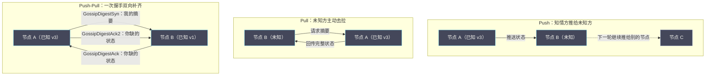
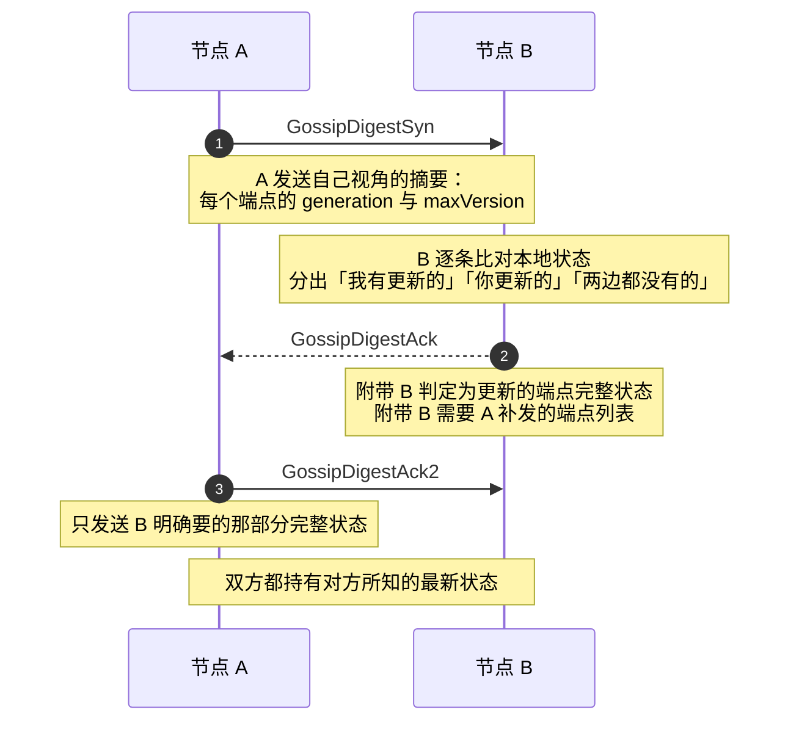
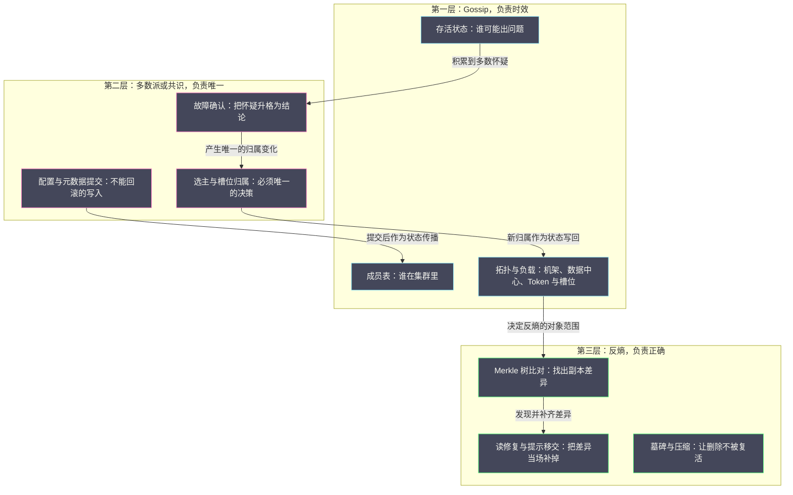

# 08 Gossip 协议：去中心化信息传播

**摘要：**

前七篇讨论的协议，从 Paxos 到 Raft 再到 ZAB，共享同一个前提：集群里存在一份需要被一致决定的东西，因此需要多数派、需要 Leader、需要日志。但还有另一类信息，它的数量随节点数增长、变化随时发生，而它偏偏是集群得以运转的前提——谁还活着、谁刚加入、谁负责哪一段数据。这类信息交给共识去决定，代价高得离谱；交给中心节点广播，中心会先于集群崩溃。**Gossip 协议**为这一类信息而生：每个节点每秒随机挑几个邻居交换状态，没有中心，没有投票，而整张成员表仍会在几秒内收敛到一致。

本文按五问推进：1987 年 Demers 等人为解决 Xerox 目录服务 Clearinghouse 的副本维护问题写下的那篇论文，如何用直接邮寄、反熵、谣言传播三种手法搭出一个组合式答案；集中式心跳汇聚的两笔账是什么；抽掉 Gossip 之后，删除如何被旧副本复活、扩容如何变成雪崩、成员管理如何撞上共识的循环依赖；三种传播模式、概率收敛的递推、Cassandra 的四步握手与 Phi Accrual、Merkle 树反熵，以及 Redis Cluster、Consul、Dynamo 在同一个骨架上的四种分歧；最后落到边界，即何时该用共识而不是 Gossip。

读完应当能回答两个问题：为什么「随机」这种看起来最不靠谱的传播方式，反而是唯一能扩展到数千节点的选择；以及 Gossip 与共识协议的保证边界画在哪里。

---

## 第 1 章 瘟疫、谣言与一张成员表

### 1.1 1987 年，帕洛阿尔托的一间办公室

施乐帕洛阿尔托研究中心（Xerox PARC）在 1980 年代维护着一套名为 Clearinghouse 的分布式目录服务，它是全网机器的「通讯录」：哪个资源在哪台机器上、哪个用户属于哪个域，都记在一张表里。为保可用，它在若干站点各存一份副本，任何一次更新都要让所有副本都改过来。最初的更新方式直截了当——发起方把变更逐个发给其余每一份副本，论文里叫**直接邮寄（Direct Mail）**。

直接邮寄在小规模下没有问题，问题出在副本增长之后。一次更新需要 n 减 1 次投递，其中任何一次丢失或延迟，那一份副本就永久性地落后，而系统里没有任何机制会发现它：它既不知道自己落后了，也没有人会来问它。1987 年的 PODC 上，Demers、Greene、Hauser、Irish、Larson、Shenker、Sturgis、Swinehart 与 Terry 提交了《Epidemic algorithms for replicated database maintenance》，把问题换了角度：如果允许副本像人群一样互相「传染」，让正确性由足够多次偶然接触来保证，通信成本会不会低得多。

这篇论文是 Gossip 这个词的全部起点。它给出的答案不是一个算法，而是三个手法的组合，其后三十多年里所有工业实现，无论 Cassandra 的 `GossipDigestSyn` 还是 Consul 的 SWIM，本质上都还是这三者的重新配比。

### 1.2 同一篇论文里的三种手法

第一种是直接邮寄。它的性质好总结：正确性有保证，因为每一次更新都被明确送到了所有副本；成本与副本数成正比，且这条成本全部落在发起方；一旦规模上去，发起方成了瓶颈，而任何一次投递失败都会留下一个静默的落后副本。

第二种是**反熵（Anti-Entropy）**。它不关心谁刚更新了什么，而是让副本之间周期性两两比对全部内容，发现差异就补齐。正确性论证异常干净：只要运行得足够久，每一对副本都有无限次被随机选中的机会，任何差异迟早会被某次比对发现并修复，系统必然收敛。代价也清楚——比对的是整份数据，开销与数据总量成正比，与「这期间改了什么」无关。反熵是「用浪费换确定性」的手法。

第三种是**谣言传播（Rumor Mongering）**。更新发生时，知情节点把它当成谣言，每周期随机挑几个邻居去讲；不知道的节点加入传播者行列，已经知道的则说明这条边重复了一次。重复达到阈值后停止传播（论文讨论了按计数停止的 feedback 与按概率停止的 blind 两种方式）。成本与变更次数成正比，收敛极快，但它放弃了一件事：没有人能证明所有节点都听到了，停止得太早，谣言就停在一半的节点上。

三种手法各有明显缺陷，论文真正的主张是把后两者配起来用：平时靠谣言传播把新鲜状态快速铺开，周期性地靠反熵把漏掉的角落补齐。快的那条路径负责时效，慢的那条路径负责正确，两者的成本分别与变更量和数据量成正比，互不冲突。今天 Cassandra 的 `nodetool repair` 与每秒一轮的 Gossip 任务、Dynamo 的增量传播加 Merkle 树同步，都是这个配方的直系后代。

> [!info] 从「消息」到「状态」的一次转写
> Demers 的谣言传播以「一条消息」为单位，必须处理「这条消息还该不该继续传」的停止问题，而停止判断本身带着漏传风险。现代成员管理把对象从「消息」换成「带版本号的状态」：要告诉邻居的不是「发生了 X 事件」，而是「节点 A 的状态是这个，版本号 17」。版本号大的覆盖小的，没有的补上，重复握手不产生副作用。这一步转写消掉了停止条件，因为状态可以无限次重复传播而不失真，代价是每轮都要先交换摘要来判断谁该覆盖谁。

### 1.3 SIR 模型：把协调换成概率

流行病学里描述传染病扩散的标准模型叫 SIR，三个字母分别代表易感者（Susceptible）、感染者（Infectious）、康复者（Recovered）。套到成员管理上，易感者是还没听到状态的节点，感染者是已经知道并正在往外讲的节点，康复者是知道但不再主动讲的节点。核心是一条阈值：记基本再生数 R₀ 为一个感染者在整个病程里平均能传染的人数，只要 R₀ 大于 1，感染人数就指数增长；而易感者比例随感染推进下降，R₀ 的有效值随之跌破 1，扩散自然停止。

Gossip 与这个模型之间有一处严格对应，也有一处必须说清的错位。对应之处在于阈值机制一致：早期几乎所有人都是易感者，一个节点每轮随机挑 k 个邻居，几乎每次都能「感染」成功；后期易感者只剩零星几个，随机挑中的目标大概率已知情，有效再生数跌破 1，扩散停在那里。错位之处在于「康复」的语义——真实流行病里康复者获得免疫，而协议里的康复只是不再主动传播，知情节点不会因此变得不可再被更新。

这个模型最值得记住的一点，是它把「谁该知道什么」这个协调问题替换成了「接触频率够不够」这个概率问题。集中式广播必须知道所有节点的地址，并为每一条更新安排 n 次投递；Gossip 只需要知道「随便几个邻居」的地址，剩下的交给接触次数。它把一次性的确定性成本，摊成了一串持续的小额概率成本。

### 1.4 边界：Gossip 保什么、不保什么

把 Gossip 与共识协议并排放，最容易产生的误解是「Gossip 是弱一点的共识」。这两者不是强弱关系，而是解决不同问题的两种工具，断言在逻辑上根本不同构。

| 维度 | 共识协议（Paxos / Raft / ZAB） | Gossip |
| :--- | :--- | :--- |
| 断言形态 | 对某个值达成一致且不可撤销 | 以极大概率在有限轮内使几乎所有节点持有同一状态 |
| 是否需要多数派 | 是，写入与选举都要 | 否，任何两个节点都可以直接交换 |
| 是否存在 Leader | 是（Paxos 的提案者、Raft 的 Leader） | 否，所有节点对等 |
| 写入延迟 | 一次多数派往返 | 至少一轮，通常数轮 |
| 故障时的行为 | 失去多数派则停止服务，保证不出错 | 继续运行，允许短暂不一致 |
| 典型承载的信息 | 日志条目、配置、锁状态、元数据提交点 | 成员表、心跳与存活状态、负载、路由与分片信息 |

这张表里最关键的是最后一行。共识协议承载「必须唯一」的信息，Gossip 承载「数量大、变化快、允许短暂不一致」的信息。把成员表塞进 Raft 并非做不到——etcd 就是这么干的，而且干得不错——但那种做法的前提是集群规模停留在个位数到几十个节点的量级，且成员变更由人发起；一旦节点数以千计、上下线由故障而非运维决定，共识就会先被自己的成员变更流程卡住。

---

## 第 2 章 集中式协调的三笔账

### 2.1 心跳汇聚的平方项

要看清 Gossip 的必要性，得先把集中式方案的成本算到底。假设集群有 n 个节点，每个节点每周期向中心上报一次自己的健康状态，中心维护一张完整的成员表，然后每周期把这张表发给所有节点。

第一笔账在条数上：中心每周期收到 n 条上报、发出 n 条广播，单节点看是常数，中心看是线性。第二笔账在体积上，这一笔常被忽略——每一条广播都携带完整成员表，而表的体积随 n 线性增长，因此中心的上行带宽是 n 乘 n，也就是平方项。第三笔账在延迟上：中心必须先把 n 条上报收齐才能生成「当前」的表，收齐本身就是一次全体同步，最慢的那个节点决定了整张表的刷新时刻。

三笔账合起来，n 等于 1000、周期 1 秒时，中心每秒要收 1000 条上报，再发出 1000 条各含 1000 个条目的广播，而 n 翻倍时这个数字变成四倍。这就是「中心节点不可扩展」在算术上的确切含义：它不是慢，是工作量随规模平方增长，而它可以用来加机器的手段只有纵向扩容一条。

Gossip 的处理方式是把「中心」整体拆掉。每个节点每轮只发常数条消息，每条消息携带常数个节点的状态或者一份摘要，于是整个集群每轮总消息量是 n 乘常数，单节点发送负载是常数、与集群规模无关。扩容不会让任何一个节点的工作量变重，这是去中心化在算术上的确切收益。

### 2.2 中心故障与分区的两种死法

集中式方案的第二个问题不在性能而在结构。中心节点一旦失联，成员表就停止更新：在它恢复或者被替换之前，所有节点手里的成员视图冻结在失联那一刻。冻结还不算最坏，最坏的是成员表在冻结期间与现实脱节——一个已经崩溃的节点仍出现在表里，一个刚加入的节点在任何人的表里都不存在，而基于这份过期视图做的路由与分片决策会全部走偏。

网络分区时更糟。中心位于分区的一侧，这一侧继续更新成员表，另一侧停在分区开始的那一刻；两侧各自运行一段时间之后，同一次成员变更可能得到两种结果，而没有任何机制能判定哪一侧是对的。如果中心本身发生了切换，两侧甚至会各自认为自己是正统，各自接受成员变更，等分区恢复时两份表需要合并，而合并规则在集中式方案里往往根本没有定义。

Gossip 的结构性优势正落在这里：成员表不是「中心的一份权威副本加若干缓存」，而是「每个节点各持一份完整副本，靠反复交换收敛」。分区期间两侧各自演化，恢复后靠版本号逐条合并，规则简单到一句话——同一个节点的状态，版本号大的赢。这份简单性不是免费的，它换来的代价是「永远没有一个时刻能说集群状态已经确定」。

### 2.3 六维对照：两种传播结构的取舍

把两种结构按六个维度铺开，取舍的形状就清楚了。

| 维度 | 集中式广播 | Gossip |
| :--- | :--- | :--- |
| 是否有中心 | 有（Leader 或协调者） | 无 |
| 每轮总消息量 | O(n²)（n 条广播，每条携带 O(n) 状态） | O(n)，每条消息携带常数条状态 |
| 单节点负载 | 中心 O(n)，其余 O(1) | 所有节点 O(1) |
| 收敛轮数 | 1 轮 | O(log n) 轮 |
| 容错性 | 中心故障则状态停更 | 无中心，任意少数节点故障不影响收敛 |
| 一致性语义 | 强，中心决定顺序 | 弱，传播窗口内不一致，可能极低概率遗漏 |

被误读最多的两行是「收敛轮数」与「一致性语义」。收敛轮数看起来 Gossip 完败——它要多花 O(log n) 轮，而中心广播一轮就到。但这一行必须与「总消息量」一起读：中心广播的一轮要付出 n² 的代价，Gossip 用 n 的代价换来若干轮，两者的总成本处在不同量级；在需要频繁刷新的场景里，中心根本付不起「一轮」的价钱，所谓「一轮」也就没有意义。

一致性语义这一行决定适用边界。中心广播能一轮完成，是因为它手里有一份权威的、有顺序的视图；Gossip 没有这份视图，每个节点在任一时刻看到的都是某个稍早的版本。对成员管理这毫无问题——晚两秒知道某台机器挂了，代价是两秒内可能有请求被路由过去然后超时；对分布式锁则是致命的——晚两秒知道锁的持有者换人了，互斥已经被破坏。

### 2.4 扇出系数：收敛速度与消息量的取舍

Gossip 有一个绕不开的参数：每轮随机挑几个邻居，这个数量叫**扇出（Fanout）**。它直接决定收敛速度与消息量这两条曲线的斜率，是整套机制里唯一一个既能加速又能加价的旋钮。

加速效应在传播早期最陡峭。扇出为 k 时，感染节点数在理想情况下每轮增长 k 倍，因此把 n 个节点全部覆盖所需的轮数大致是以 k 为底的对数，写出来就是 log_k(n)。从 k 等于 1 提到 3，轮数减半还有余；从 3 提到 9，只再减一半，也就是从 log_3(n) 降到 log_9(n)。这是典型的收益递减：每把扇出乘以 3，只换来一次固定的「减半」，而这个减半发生在越来越小的绝对值上。

成本侧的曲线没有递减可言。总消息量与扇出成正比，扇出翻倍消息量就翻倍，而且这份成本是持续的：它不只在收敛期存在，稳态运行时每轮都要付。因此扇出是一次收益对成本的对冲——轮数对扇出的敏感度是 1 除以 k，成本对扇出的敏感度是线性的 1，两个斜率的交点落在很小的 k 值附近。工业实现都在 1 到 3 之间并非巧合：Cassandra 每轮最多挑三个目标（一个随机存活节点、一个随机不可达节点、一个种子节点），SWIM 每周期只 ping 一个成员、失败时再请 k 个成员间接探测，Redis Cluster 则把杠杆换了个维度，不增加邻居数而让每条消息携带十分之一节点的状态。

扇出并非唯一的杠杆，甚至不是最有效的那个。真正决定收敛时间的是「每轮传递的有效信息量」，它等于扇出乘以每条消息携带的状态数。Redis Cluster 正是在后一个因子上下功夫：把每条 PING 携带的节点数压到总数的十分之一，让单条消息的体积随集群规模线性增长而不是停在常数，于是即使在数千节点的集群里，一轮 PING 也能覆盖很大一片状态。

---

## 第 3 章 抽掉 Gossip 会怎样

### 3.1 没有反熵：一次删除的复活

反事实推演最省力的做法是从一个具体操作开始：删除一个键。节点 A 收到删除请求，把键删掉，然后把「这个键没了」告诉邻居。假设这次传播在某条边上丢了一次——邻居不在线、消息被网络丢弃、进程刚好在这一轮重启——那么节点 B 上仍然留着这个键的旧值。

现在问题来了：B 手里的旧值并没有错，它只是旧。如果系统只有状态传播而没有反熵、也没有版本标记，下一次 B 与 A 交换状态时，A 看到 B 有一个自己没有的键，最自然的反应是把 B 的值同步过来。删除就此被撤销，而且这个撤销会继续扩散，最终全网都回到「键存在」。这是一次典型的幽灵复活，成因不是消息丢失，而是「缺失」与「删除」在数据模型上无法区分。

工业系统的解法是给删除留下痕迹，也就是墓碑（Tombstone），并让墓碑比数据活得更久；墓碑把「没有」转换成一条有版本号、可以参与比较的记录，于是「旧值赢」这条合并规则不会再把删除撤销。但墓碑只能解决「删除被覆盖」这一种情形，解决不了「B 落后了很久而没有人知道」。要发现这种落后，必须有反熵：定期把两侧内容做一次完整比对，而不是等某条状态恰好传到。

反熵的角色不是 Gossip 的替代品，而是它的对账机制。传言负责让绝大多数节点在几秒内对齐，反熵负责把那些从头到尾都没被任何一条传言覆盖到的角落找出来。Bimodal Multicast 在 1999 年给出了这个组合的分析：稳妥投递加上周期性 gossip 修复之后，投递延迟的概率分布呈双峰形状——绝大多数消息在很短时间内到达（第一峰），极少数尾巴被 gossip 拖到较晚补齐（第二峰），第二峰的体积随轮数指数衰减。工程的可行性正建立在尾巴很细上，而不是尾巴不存在上。

### 3.2 只有心跳没有感染传播：一次扩容的雪崩

第二个反事实与成员变更的时机有关。假设一个 1000 节点的集群要扩容 100 台，新成员表必须以某种方式让所有节点都知道。如果更新走「中心生成新版本、再逐个推给所有节点」，那么每加一台就要发起一次 1000 个接收方的推送；在正在扩容的集群里，这 100 次推送会密集叠加，中心的任务队列排队长度随规模增长，最坏的情况下推送本身成为集群的主要负载。

更微妙的问题在「谁知道谁」的传递性。集中式方案里，新节点必须先被注册进中心的核心表，之后才能被其他节点看见；这个「先登记后可见」的顺序要求注册动作是原子的，否则会出现一台机器已经被部分节点当作成员、而另一部分节点仍然不认识它的裂脑状态。在扩容窗口里，这种裂脑会让路由出现黑洞：一部分流量被导向新节点，而新节点还没有完成数据搬迁。

感染式传播天然没有这个问题。新节点启动时只需连上一个种子节点，拿到当时的成员表快照；此后它的状态通过每一轮随机握手自然扩散，速度与前文推导的收敛轮数一致。整个过程没有一步需要全体同意，也没有一个瞬间要求所有人看到同一份表。代价是有一部分节点会在一段时间内仍然不认识它，而这段时间的量级是 O(log n) 轮——工程上通常把它压到秒级，并让路由层容忍这部分偏差。

### 3.3 把成员管理交给共识：一个循环依赖

第三个反事实更接近原理层：能不能不要 Gossip，直接用 Raft 或 Paxos 管理成员表？答案是能，但会立刻撞上一个循环依赖，而这个依赖是共识协议自身的结构性特征。

Raft 的成员配置本身就是共识的对象：集群的配置作为一条特殊的日志条目被多数派确认，之后才生效。于是「新节点加入」被拆成两步——先把新节点写进配置并提交，它才能合法地接收日志、参与投票。问题在于第一步的提交需要多数派，而多数派是按旧配置算的；新节点在配置生效之前既不能复制日志也不该计入多数派。如果同时加入两台机器，旧配置的多数派与新配置的多数派可能在同一瞬间互相冲突，出现两个互不相交的 quorum，安全性就此破裂。Raft 的原始论文用「一次只改一个成员」绕开这一点，后续的 joint consensus 给出了更一般的处理。

这套机制在「成员变更由人发起、一次动一台」的场景里完全够用，这正是 Kubernetes 控制面乃至多数 etcd 集群的真实情形。但它在「成员变更由故障与扩缩容自动触发、一次可能动几十台」的场景里彻底不适用：每次变更都要走一次共识往返，每次都要求集群健康，而大规模集群最需要成员管理发挥作用的时刻，恰恰是它不健康的时刻——一批机器同时失联时，剩下的一侧可能凑不齐旧配置的多数派，于是连「把这些机器踢出去」都做不出来。

Gossip 在这个位置上的价值是打破循环：加入不需要任何人的批准，新节点连上种子节点就能拿到成员表，然后靠传播把自己的存在告诉别人。代价是「加入」变成了渐进过程而不是原子事件，系统必须能描述中间状态。Cassandra 用 `BOOT`、`NORMAL`、`LEAVING`、`LEFT` 描述节点的生命周期阶段，每个阶段都通过 Gossip 传播，别的节点据此决定要不要把读写路由给它；Redis Cluster 用 `CLUSTER MEET` 建立初次握手，再用 PING 里的 gossip 段把新节点慢慢介绍给全体。

### 3.4 三笔账合成一句话

把三节合起来看，抽掉 Gossip 之后剩下的每个方案都要在三个位置上付账：要么让中心的上行带宽按平方增长，要么接受成员表在中心故障期间停止更新，要么把成员变更交给共识并受制于「集群必须健康才能变更成员」的悖论。Gossip 用「允许短暂不一致」这一条代价，把三笔账一起抵掉了。

这也解释了为什么它的位置如此固定：它几乎从不出现在数据路径上，永远出现在控制路径的底层——成员、存活、负载、分片归属。这些信息有一个共同特征，就是「错一会儿没关系，一直错下去才有关系」。

---

## 第 4 章 三种传播模式与收敛的量化

### 4.1 Push：我有新消息，我推送给你

Push 是最直白的形态：已经知道某条状态的节点，每轮随机挑 k 个邻居，把自己知道的东西推过去。接收方如果发现对方的状态更新，就更新本地并在下一轮继续往外推。

```text
每轮（周期 T）对每个节点执行：
  1. 从成员表里随机挑 k 个目标；
  2. 把自己本地状态与版本号推给这 k 个目标；
  3. 接收方逐条比较版本号，版本号更大的覆盖本地。

接收方的处理：
  收到的版本号 > 本地版本号  → 采纳，并在下一轮参与传播
  收到的版本号 ≤ 本地版本号  → 丢弃，不做任何回应
```

Push 的时间结构非常不对称。早期它极快：感染节点数从 1 开始，每轮乘上一个接近 k 的因子，十几轮就能覆盖上万个节点。后期它极慢：此时几乎所有人都是知情者，每一条推送绝大多数落在已知节点上，真正命中剩余易感者的概率随剩余人数线性下降。理论上有小概率的节点从头到尾都没有被任何一次随机选择命中，传播因此停在不完整的状态上。

这个「推得动早期、推不动尾部」的特性不是实现缺陷，而是随机采样的数学必然。

### 4.2 Pull：我不知道，我去问你

Pull 把方向反过来：由还不知道的节点主动去问已知的节点。

```text
每轮（周期 T）对每个节点执行：
  1. 从成员表里随机挑 k 个目标；
  2. 向目标发送本地状态摘要（每个节点的版本号）；
  3. 目标回传自己更新或对方缺失的部分；
  4. 收到后按版本号合并。

失败处理：目标不可达时换下一个目标，本轮不重试。
```

Pull 的时间结构与 Push 恰好互补。早期它慢：已知者极少，一个易感者随机挑 k 个邻居，几乎全都挑到同样一无所知的节点，问了一圈什么也没拿到，白付了网络代价。后期它极快：已知者占了绝大多数，任何一个易感者随便挑一个邻居就能拿到全部缺失的状态，「最后一公里」在一轮之内走完。

用概率讲更清楚：设已知比例为 p，一个易感者在一轮内向 k 个目标拉取，至少命中一个已知者的概率是 1-(1-p)^k。当 p 接近 1 时这个概率接近 1，尾部被一轮扫平；当 p 接近 0 时它接近 kp，也就是说 p 每轮只按 k 倍增长，极早期因此很慢。

### 4.3 Push-Pull：Cassandra 采用的双向握手

把两个方向合起来，就是 Push-Pull：一次交互双方互换摘要，各自把对方缺的补上，一次握手同时完成一次 Push 与一次 Pull。下面的图把三种模式并排放，注意前两种的箭头是单向的，第三种两个方向同时发生。



Cassandra 的四步握手正是第三种：先发摘要（`GossipDigestSyn`），对方比对后回一个「我有更新的给你、我还缺你要给我」的应答（`GossipDigestAck`），发起方再补发对方要的那部分（`GossipDigestAck2`）。

Push-Pull 的优势在于把两种模式的时间结构拼接起来：早期由 Push 方向主导，知情方主动推，指数扩散；后期由 Pull 方向主导，未知方主动拉，一轮收尾。代价是消息量与摘要体积：一次纯 Push 只需一条消息，一次 Push-Pull 要三条，而且每条都带摘要，摘要体积与成员表规模相关。对成员管理这种「状态条数与节点数同阶、更新以分钟计」的负载，这个代价完全值得；对「状态条数少、更新以毫秒计」的负载，摘要反而成了主要开销。

### 4.4 收敛的递推：从 1-(1-1/n)^k 说起

到这里可以把收敛速度算准。设集群有 n 个节点，第 t 轮结束时知情者有 I(t) 个，易感者有 S(t) 个且 S(t) 等于 n 减 I(t)，每个知情者每轮随机挑 k 个目标。

先看单个知情者：它挑出的 k 个目标里，有没有命中某个特定易感者？一次挑选命中的概率是 1/n，k 次全都不命中的概率是 (1-1/n)^k，因此至少命中一次的概率是 1-(1-1/n)^k。在 n 远大于 k 的常见情形下，这个式子展开后近似为 k/n，也就是说单次接触的命中概率约为 k/n。

再放大到整个集群：本轮共有 I(t) 个知情者各自随机挑选，一个特定易感者被至少一个知情者命中的概率，是 1 减去「被所有知情者都错过」的概率：

```text
P(被命中) = 1 - [ (1 - 1/n)^k ]^I(t)
          ≈ 1 - e^(-k·I(t)/n)

期望新增知情者：
ΔI ≈ S(t) · ( 1 - e^(-k·I(t)/n) )
```

这个递推式有两个截然不同的工作区。第一个在 I 远小于 n 的地方，此时展开后 ΔI 约等于 k·I，解出来是指数增长，倍增轮数约为 ln(2)/k——k 等于 1 时每轮翻倍，这就是「十几轮覆盖上万节点」的来源。第二个在 I 接近 n 的地方，此时 S 很小，每一轮 S 按 e^(-k) 的因子衰减，k 等于 1 时每轮衰减到原来的 0.368 倍，k 等于 3 时衰减到 0.05 倍。

于是总轮数可以拆成两段：从 1 涨到 n/2 需要约 ln(n) 除以 k 轮，从 n/2 清到「期望剩余不足 1 个」又需要约 ln(n) 除以 k 轮，两段同量级。这就是文献里那个「c 乘 log n，c 在 1 与 2 之间」的常数的来历——它不是拟合出来的经验值，而是「前半段一次对数、后半段再一次对数」的直接后果。

### 4.5 尾部收敛与概率下界的推导

把尾部的衰减率接上去，就能算出「漏掉一个节点」的概率有多大。设已经进入 I 接近 n 的阶段，取 r 轮作为观察窗口：

```text
单个节点在 r 轮后仍未收到状态的概率：P ≈ e^(-r)
取 r = c·ln n，则 P ≈ n^(-c)

全体节点中残留未收到的期望个数：E ≈ n · n^(-c) = n^(1-c)
c = 2 时，E ≈ 1/n，即「所有节点都收到」的把握约为 1 - 1/n
c = 3 时，E ≈ 1/n²，把握提升到 1 - 1/n²
```

这组式子解释了工程实践中一个看似随意的经验：把收敛窗口设成理论轮数的两到三倍，就能得到 1 减 1/n 甚至 1 减 1/n² 量级的把握。它也解释了为什么这个把握的提升是指数级的：c 每加 1，失败概率再乘一个 1/n，而需要的额外轮数只是加一个 ln n。这种「用对数的时间换取指数的把握」是所有概率算法里最划算的一笔交易。

同时要注意式子成立的前提：每个节点每轮独立、均匀地随机挑目标。真实实现往往不是均匀的——机架感知让挑选偏向同机架，连接池让挑选偏向已建立连接的邻居，成员表的滞后让新节点被选中的概率偏低。这些偏差都会让尾部比理论更厚，因此工程上的收敛窗口通常要在理论值上加余量，或者干脆用反熵兜底，不去赌那 1 减 1/n²。

### 4.6 消息复杂度与单节点负载

Push 模式下的消息量很好算：每轮 n 个节点各发 k 条，一轮就是 nk 条，收敛需要 O(log n) 轮，总量是 O(n log n)，而集中式广播的总量是 O(n²)。这两个量级在小规模下差别不大，在 n 等于一万时相差三个数量级。

比总量更有意义的是单节点的负载分布。Gossip 下每个节点每轮发 k 条、收 k 条，与集群规模无关：一万个节点的集群里，一个节点的网络开销和一个节点的集群里完全相同。这个性质是「水平扩展」在协议层面的确切含义——扩展时每个节点的单位成本不变，总成本线性增长，没有哪一段曲线是弯的。

集中式广播的差别正在这里：它的总量是平方，而这个平方全部压在中心一个节点上，其余节点的负载是线性的。规模一大，中心先垮，而其余节点即使资源充足也帮不上忙。Gossip 把这份平方均匀摊成了 n 份线性，这就是「没有单点」的技术含义。

---

## 第 5 章 Cassandra：状态型 Gossip 的完整实现

### 5.1 两项任务：成员与存活

Cassandra 是一个无主（Leaderless）的宽列存储，没有 ZooKeeper 之类的协调服务可以依赖，必须自己解决两个问题：集群里现在有哪些节点、各自负责哪一段数据；以及某个节点究竟是崩了还是只是慢。这两件事由同一个 Gossip 子系统承担，跑在每一个节点上，每秒一轮。

第一项任务的数据密度比想象中高。它不只记录「有哪些节点」，还要记录每个节点的机架与数据中心归属（决定副本放置）、负责的 Token 区间（决定分片）、schema 版本（决定是否要同步表结构）、负载与压缩状态（决定读修复与流式传输的时机），以及 `HOST_ID`（一个在节点重装后仍然保持的 UUID，用于区分「同一台机器重启」与「换了一台机器」）。第二项任务的难点不在实现而在判据。

### 5.2 状态的数据结构：generation 与 version 的二元组

每个节点维护一份本地的端点状态表，为集群中每个节点（含自己）保留两个部分：心跳状态与一堆应用状态。

```python
# 每个节点本地维护的端点状态（EndpointState）
class HeartBeatState:
    generation: int   # 节点每次启动时取当前时间戳，重启即变大
    version: int      # 每个 Gossip 周期递增一次，重启时归零

class VersionedValue:
    value: str        # 状态的具体内容，字符串形式
    version: int      # 该状态被最后一次修改时的全局版本号

class EndpointState:
    heartbeat: HeartBeatState
    application_states: Dict[str, VersionedValue]

# application_states 里常见的键：
#   STATUS        NORMAL / BOOT / LEAVING / LEFT / REMOVING / REMOVED
#   TOKENS        该节点负责的 Token 区间
#   DC / RACK     数据中心与机架
#   SCHEMA        表结构版本，用于 schema 一致性检查
#   LOAD          当前承载的数据量
#   HOST_ID       节点的持久 UUID
#   RELEASE_VERSION / NET_VERSION  版本与协议信息
```

这个结构里最精巧的一处是 `generation` 与 `version` 的两级设计。`generation` 在节点每次启动时取当前时间戳，因此重启之后一定变大；`version` 每个 Gossip 周期加一，只在一次生命期内单调。比较两个节点对同一端点的认知时，先比 `generation`，大的赢；相同时再比 `version`。效果是一次重启会把该端点的整份应用状态一次性作废，因为新 `generation` 之下的 `version` 从零开始，旧的版本号再大也没有资格参与比较。

如果只有单级的单调计数器，重启会带来一个具体故障：节点重启后 `version` 归零，而其他节点持有的旧 `version` 仍是几百，于是全网都认为重启后的节点状态是过期的，它的新状态永远传播不出去，要等旧 `version` 被自然追上，而它每轮只加一。`generation` 这一级正是为这个场景准备的，它是「生命周期世代」与「生命周期内的修改次数」的分离，与版本向量里每个分量独立计数属于同一族设计。

合并规则是最后写入者胜出（Last-Writer-Wins），按 `(generation, version)` 的字典序比较。规则足够简单，代价是它不携带因果信息：如果两个节点在分区期间各自改了同一端点的同一项状态，合并之后只有一个版本存活，另一份修改被静默丢弃。成员与存活状态允许这种丢弃——它们的真值是机器此刻的状态，不是发生过的事件；但同样的规则用在用户数据上就会丢更新，这正是 Cassandra 在数据路径上不用这套规则的原因。

### 5.3 四步握手：三条消息完成一次双向同步

一次完整的 Gossip 交互由三条消息组成。节点 A 发起，节点 B 应答，B 也可以在同一轮里发起自己的交互，两者互不阻塞。



摘要的内容是一串二元组，每个对应一个端点的 `(generation, maxVersion)`，也就是「我对这个端点知道到哪一代、哪一版」。摘要的体积与成员数线性相关，与状态内容的体积无关，这是把「比较」与「传输」分离的关键：比较只花摘要的钱，传输只花差异的钱。

B 收到摘要后做三件事。对摘要里每个端点，如果 B 的版本更大，它把该端点的完整应用状态放进应答，这部分相当于 Push；如果 A 的版本更大，B 在应答里列出「我需要这个端点的更新」，这部分相当于 Pull 的请求；如果 B 手里有 A 完全没提到的端点（说明 A 还不认识这个节点），也把它放进应答。A 收到后按请求列表补发完整状态，这就是第三条消息。

这三条消息的结构是一个「先廉价交换元信息、再按需传输实体」的通用范式。同样的思路出现在 HTTP 的条件请求（先比 ETag 再传正文）、Git 的 fetch（先交换 ref 列表再协商对象）、rsync 的滚动校验里，其价值随「无差异的比例」上升而上升——在稳定集群里绝大多数端点的摘要都相同，一次握手只花三条小消息。

### 5.4 Phi Accrual：把「存活」从一个布尔值变成一个概率

Cassandra 不用固定超时判断节点死亡，而是用 Hayashibara 等人在 2004 年提出的 Phi Accrual 故障检测器。这个选择需要先理解固定超时为什么会失效。

固定超时的判据是「上一次心跳到现在超过了 T」，T 设小了网络抖动就误判，设大了故障发现太慢，而且这个阈值必须按最坏情况设定——同一机房内的集群与跨洲集群不可能用同一个 T。更根本的问题是它隐含了一个假设：网络延迟分布是稳定的。云环境里这个假设经常不成立，同一对机器在业务高峰时的往返延迟可能是低谷的数倍，而固定阈值不会随之调整。

Phi Accrual 先把历史心跳间隔收集起来拟合一个分布（Cassandra 用正态分布近似，取样本均值与标准差），然后计算「在当前观测到的间隔下，这种间隔属于正常分布的概率有多大」，再把概率取负对数，得到的数就是怀疑度 φ。

```python
def compute_phi(now, last_heartbeat_at, intervals):
    elapsed = now - last_heartbeat_at
    mean = statistics.mean(intervals)
    std  = statistics.stdev(intervals)

    # P_later：在正常分布下，间隔「至少这么长」的概率
    p_later = 1.0 - normal_cdf(elapsed, mean, std)
    # 取负对数，把「罕见程度」映射成一个可比的标量
    phi = -math.log10(max(p_later, 1e-15))
    return phi

# φ 的语义：φ 等于 3 表示「这种延迟在正常情况下大约千分之一概率出现」
# φ 越大越可疑，Cassandra 默认在 φ 超过 8 时判定为故障
```

φ 的取值有一个直观标定：φ 等于 1 对应约十分之一概率出现，3 对应千分之一，8 对应一亿分之一。用「多少分之一」而不是「秒」来度量怀疑，第一个好处是不同网络环境自动获得不同的有效阈值——延迟波动大的集群标准差大，同样的绝对延迟算出的 φ 就小，不会被误判；第二个好处是它输出连续量而非布尔值，上层可以分级响应，譬如在 φ 超过 4 时先降低该节点在读请求里的优先级，超过 8 时才彻底标记不可用。

> [!info] 为什么是「怀疑」而不是「判断」
> 分布式系统里不存在一个能同时保证「不漏判」与「不误判」的故障检测器，这是异步网络模型的直接推论——你无法区分「进程死了」与「消息还在路上」。Phi Accrual 承认这一点，然后把它转成一个可调参的连续信号：不追求判断正确，只追求怀疑程度与真实概率大致对应。这个姿态在工程上还有个额外好处，就是 φ 本身可以进监控——某个节点的 φ 长期在 3 到 5 之间抖动，说明它的网络质量已经退化，即使还没被判死也该被关注。

故障检测与反熵的分工在这里很清楚。φ 只负责「我认为它可能出问题了」，不负责证明，也不负责传播最终结论；把「它死了」变成全网共识的动作，是各节点各自算出 φ、各自在 Gossip 里把怀疑传出去，最后当足够多的节点都持有高 φ 时，上层才可能做出「把它排除在副本集合之外」的决定。**Gossip 传播的不是「它死了」这个事实，而是各个节点各自的怀疑**，因此没有哪个节点需要在故障判定上绝对正确。

### 5.5 反熵：Merkle 树与 repair 的分工

Cassandra 里的 Gossip 只负责元数据，不负责数据本身。这是一条必须记住的分界线：`GossipDigestSyn` 里传的是端点状态摘要，不是「哪一行数据在哪个副本上是什么值」。数据副本之间的一致性由反熵承担。

反熵的核心难点是「怎么比较两份大数据而不传输它们」。朴素做法是把两份都传过去逐条比，成本与数据量成正比，在 TB 级节点上不可行。Cassandra 沿用 Dynamo 的做法，用 **Merkle 树**：把一个 Token 区间里的数据按行键切成若干块，每块算一个哈希作叶节点，再逐层两两哈希上去直到根节点。两个副本各建一棵树，先比根哈希，相同就说明整个区间一致，成本是一个哈希；不同就下探到不同的子树，逐层定位到具体哪几块有差异，最后只传那几块的数据。比较成本因此从与数据量成正比，变成与差异量成正比。

这就是反熵可以「定期」而不是「实时」执行的理由：开销在系统一致时接近于零（只比一个根哈希），在不一致时才按差异量付费。Cassandra 把它包装成 `nodetool repair`，按 Token 区间逐个比对，可以指定只修某个 keyspace 或某张表。与之配套的还有读修复（读请求时对比多个副本的返回，发现旧值顺手修）、提示移交（写的时候某个副本不可达，先存在别的节点上等它回来）、以及墓碑过期时间（保证删除不会被早已过期的旧副本复活）。

把这套分工与 Demers 的组合对照，可以看到一个完整的闭环：Gossip 是谣言传播，负责让状态在秒级铺开；repair 是反熵，负责让漏掉的差异最终被发现。**反熵决定最终正确性，Gossip 决定时效性**，任何一方单独存在都不完整——只有 Gossip，差异会永久残留；只有 repair，修复要等下一个周期，而周期之间的窗口里读到的都是旧值。

### 5.6 种子节点与冷启动

一个全新启动的节点面对一个循环问题：要参与 Gossip，它得先知道集群里有哪些节点；而它现在谁都不认识。Cassandra 用**种子节点（Seed Node）**打破循环：配置文件里列若干台种子地址，启动时先与它们握手，拿到成员表快照，此后就能自行传播。

种子节点的角色常被误解成「特殊的中心节点」，实际上它在运行期与普通节点没有任何区别——不承担额外路由职责，不保存额外元数据，只是一组众所周知的初始联系人。因此种子全部故障不影响正在运行的集群，只影响新节点加入以及老节点重启后的重新发现。这份「只在冷启动时起作用」的性质，让种子列表的维护成本极低：不需要高可用，也不需与实际成员同步，只需保证任何时刻至少一个地址可达。

工程上种子配置有两个容易踩的坑。其一是列表设得太长：所有节点都去连同一批种子，种子在集群重启时会瞬间承受全集群的连接风暴，一般做法是每个节点只配两三台，且不同节点的列表适当打散。其二是设得太短：如果所有节点都只配了同一台种子，这台机器一旦重建、IP 变更，整个集群就失去了重新发现的能力，而运行中的节点不会立刻表现出异常，故障要等到下一次重启才暴露。

---

## 第 6 章 四种系统的分歧

同一个协议骨架在不同系统里长出不同的形状，差别几乎全部来自三个变量：成员表有多大、更新有多频繁、是否需要与共识协议配合。下面四个系统恰好构成一组完整的对照。

### 6.1 Redis Cluster：随机采样与两阶段故障判定

Redis Cluster 用 Gossip 维护集群状态，消息走集群总线（Cluster Bus），端口是客户端端口加一万，协议是与 RESP 不同的二进制私有格式。它的目标与 Cassandra 类似，但实现上的取舍完全不同。

第一个差别在消息里携带什么。Cassandra 每次发完整摘要，Redis 每次只在 PING 或 PONG 里附带**随机采样的十分之一节点的状态**。这个设计的意图是把单条消息的体积控制在固定比例上，让每轮开销随规模线性增长而不是被摘要的全部条目压满。代价是收敛变慢：采样意味着每一轮只能覆盖一部分状态，剩下的靠后续轮次慢慢覆盖，因此 Redis Cluster 的状态传播是「多轮渐进」而不是「一次摘要把差异全部暴露」。

第二个差别在故障判定的两阶段结构。节点 A 在 `cluster-node-timeout`（默认 15000 毫秒）内没有收到节点 B 的响应，就把 B 标记为 PFAIL，意思是「我这边看着它可能挂了」。PFAIL 是一个局部判断，只存在于 A 的本地视图里，A 会把它放在自己发出的 gossip 段里传出去。当集群中超过半数的 Master 都把 B 标记为 PFAIL 时，其中一个 Master 会把 B 提升为 FAIL 并广播 `CLUSTER FAIL`，此时 B 的副本才开始发起故障转移选举。

这个两阶段结构的必要性在于误判成本的差异。单个节点判断错误，代价只是它自己避开 B 一小会儿；全网确认错误，代价是一次不必要的故障转移——副本升主、槽位重新分配、客户端连接重建，而如果原主只是网络抖动，它恢复后会发现自己被降级，还要再切回来。用多数确认把单点误判过滤成集体误判，把误判概率从单个节点的误报率压到多数的联合概率，这个思路与 Raft 的多数派相交同源，只是不用于达成一致，而用于提高一次判定的可信度。

值得单独说的是故障转移本身不靠 Gossip。副本要成为新主，必须向所有 Master 请求投票并拿到多数票，这个过程是标准选举。原因很直接：Gossip 只能传播信息，不能保证唯一性——两个副本同时认为自己是新主，靠 Gossip 分不出胜负。因此 Redis Cluster 的分工是**Gossip 传播状态、多数派做出决策**，而槽位（16384 个，按 CRC16 取模分配）的归属变化由这个决策产生，再通过 Gossip 传播出去。

### 6.2 Consul 与 Serf：SWIM 与双层成员池

Consul 的架构把「成员与故障」和「一致的状态」分给了两个不同的协议，这个分层比前两个系统更清晰。成员管理交给 Serf，Serf 实现的是 SWIM；服务目录、KV、ACL 这些需要线性一致的数据交给 Raft。两者并行运行，互不阻塞。

SWIM 由 Das、Gupta 与 Motivala 在 2002 年提出，核心贡献是把故障检测的通信模式从「全员广播」改成「固定负载的随机探测加间接探测」。每周期，节点随机挑一个成员发 ping；若在一个超时内没有收到 ack，它不会立刻判定对方死亡，而是请 k 个其他成员帮忙去 ping 那个目标（ping-req），把直接探测的一次机会换成 k 次间接机会。只有直接与间接都失败，它才把目标标记为可疑（suspect），可疑状态通过 gossip 扩散，若在怀疑超时内目标自己出来否认就撤销怀疑，否则转为 dead。

这个设计里有两点值得对照前文的推导。一是每周期负载是常数：一个 ping、失败时 k 个 ping-req，与集群规模无关。二是它对误判的处理：suspect 状态与怀疑超时构成一个缓冲窗口，把可能挂与确认挂分开，这与 Redis 的 PFAIL 到 FAIL 是同一种思路的两种实现——区别在于 SWIM 的确认靠被怀疑者自己辟谣，Redis 的确认靠多数 Master 独立观察。

Consul 在 SWIM 之上还加了一层结构：LAN 池与 WAN 池。每个数据中心内部有一个 LAN gossip 池，负责本中心的成员与健康检查；所有数据中心的服务端另有一个 WAN 池，负责跨中心的成员发现与故障检测。两层池子用同一个协议，但作用域不同，于是跨机房 gossip 的流量被限制在 WAN 池的少量服务端之间，不会让每个节点都去跨机房握手。这是一个成本控制的细节，也是一种朴素的拓扑感知。

Consul 依赖分工还有一个可用性上的理由：如果成员管理走 Raft，那么当数据中心失去多数派时，连「谁还活着」都查不出来了，运维会失去诊断能力；而 Serf 的 gossip 不需要多数派，即使只剩两台机器也能继续交换状态。这把「失去多数派」从「彻底失明」降级成了「不能写」。这也是 etcd 与 Consul 在这个问题上取舍不同的根源：etcd 把所有东西交给 Raft，换语义统一与实现简单；Consul 把成员管理分出去，换分区时的可观测性。

### 6.3 Dynamo：带因果的成员历史与 Merkle 反熵

Dynamo 是 2007 年 SOSP 论文描述的系统，它是把 Gossip 用于成员管理的最早的大规模工业实践之一，也是把反熵与 Gossip 明确分工的源头。

Dynamo 的成员管理有一个与 Cassandra 不同的设计：它传播的不是「当前状态」，而是**带因果关系的成员变更历史**。每个节点维护一份自己看到过的成员变更序列，每次变更带一个版本；节点之间每秒随机交换一次，用类似向量时钟的机制判断两份历史是「谁更新」还是「并发」，并发则保留两个分支等应用层处理。

这个选择的代价与收益都很明确。收益是它能表达「两次变更并发发生」，从而在分区恢复后给出一个可以人工介入的分叉视图，而不是静默地让某一侧覆盖另一侧。代价是成员历史会不断增长，需要定期做垃圾回收，而回收本身又是一个需要判断「所有人都确认过了」的一致性问题。

数据侧完全交给反熵：每个节点按它负责的键区间维护 Merkle 树，副本之间定期同步树，只传输有差异的部分。此外还有提示移交——写请求遇到某个副本不可达时，先把数据连同「请转交给某某」的提示写到另一个节点，等目标恢复后再转交。提示移交是一种「把同步推迟」的机制，让写路径不必等待不可达副本，把一致性代价挪到了后台。

把 Dynamo 与 Cassandra 并排看，最值得对照的是它们对并发态度的差异。Dynamo 在成员层保留并发分支、在数据层用向量时钟保留多版本，由应用层解决冲突；Cassandra 在成员层用最后写入者胜出、在数据层用时间戳加可调一致性，把冲突解决压进时间戳比较。前者把复杂性推给应用，后者把复杂性推给时钟假设——这是一次典型的「复杂性不会消失，只会转移」。

### 6.4 四种实现的对照与分工模型

把四个系统的关键选择放在一张表里，分歧的形状就清楚了。

| 维度 | Cassandra | Redis Cluster | Consul（Serf） | Dynamo |
| :--- | :--- | :--- | :--- | :--- |
| Gossip 消息内容 | 完整摘要（每个端点的 generation 与 version） | 随机十分之一节点的状态 | SWIM 的 ping / ack / ping-req | 成员变更历史条目 |
| 故障检测 | Phi Accrual，连续怀疑度 | PFAIL 到 FAIL，多数 Master 确认 | 直接探测加间接探测，suspect 后超时转 dead | 心跳加显式成员变更 |
| 成员变更语义 | 最后写入者胜出 | 由故障转移与手工迁徙驱动 | 广播式加入与离开，suspect 可撤销 | 带因果的变更历史，可保留分支 |
| 与共识的关系 | 无共识协议，纯 Gossip 加反熵 | Gossip 传播加多数派选举 | Gossip 管成员，Raft 管状态 | Gossip 管成员，数据侧靠反熵与提示移交 |
| 数据一致性机制 | Merkle 树 repair 加读修复 | 主从异步复制加 WAIT 命令 | Raft 复制 | Merkle 树同步加提示移交 |
| 状态规模假设 | 中等，允许完整摘要 | 较大，必须采样 | 中小，SWIM 只关心成员 | 大，成员历史需要回收 |

这张表可以压缩成一个三层分工模型，任何一个把 Gossip 用对的系统都落在这个模型里。



三层之间的箭头是这套模型最值得看的部分：Gossip 层把怀疑攒成多数，共识层把多数变成唯一，再把结果写回 Gossip 层继续传播；反熵层独立地对副本比对，但比对范围由 Gossip 层传播的分片归属决定。缺一层，链条就断在一个具体的地方：缺共识，两个副本可以同时宣布自己是主；缺反熵，遗漏的差异永远补不上；缺 Gossip，前两层连该对谁做都不知道。

---

## 第 7 章 边界、误用与调优

### 7.1 三类不该用 Gossip 的场景

Gossip 的适用区间可以用一句话划出来：错一会儿没关系的，交给它；一会儿都不能错的，别交给它。展开成三类具体场景。

第一类是要求强一致的写。分布式锁、选主、配置提交、唯一约束，这些操作的正确性建立在所有节点看到同一个顺序之上，而 Gossip 连「所有节点都已经看到」都无法保证。用 Gossip 做锁的典型失败是这样：节点 A 认为自己持锁，因为它的成员视图里没有别人；同一时刻节点 B 也认为它持锁，因为它的视图里 A 已经失联。两人各自进入临界区，互斥被破坏，而系统里没有任何机制会发现。

第二类是需要精确、实时全局视图的决策。Gossip 的视图天然滞后，滞后的程度随规模按对数增长，但永远是滞后的。做精确计数时，这个滞后会转化成系统性偏差，因为各节点手里是不同时刻的快照，把它们加起来既不是任何一刻的真实值，也不是收敛值；做基于成员表的放置决策时同样如此，所有决策者可能同时基于同一份过期视图做出互相冲突的选择。

第三类是更新频率过高的数据。Gossip 每轮开销与状态体积成正比、与更新频率无关，因此它天然适合状态多、变化慢的负载。如果状态每秒变化上千次，每轮传播的内容都是全新的，摘要机制完全失效（没有任何两个节点的摘要会相同），每轮都在传全量，成本向中心广播看齐，而收敛速度仍要付 O(log n) 轮，两头不讨好。

### 7.2 三种常见误用

第一种误用是把 Gossip 当成弱一点的共识来用。表现是：用 Gossip 传播「谁是主」，然后期待它收敛出唯一答案。这在稳态下看起来是工作的——所有节点很快都认为同一个节点是主——但它的正确性不来自协议，而来自「没有冲突发生」这个额外假设。一旦两次主变更在传播窗口内重叠，就会出现两个主，而 Gossip 会让这个错误状态快速、稳定、一致地传播到全网，并且不会自愈。

第二种误用是把传播广泛的错误当成事实。成员管理里最典型的是误判：某个节点因为一次长时间的 GC 停顿被多个邻居判为 PFAIL，多数确认后升格为 FAIL，副本开始升主；等原主从停顿中醒来，它发现自己被降级了。这类抖动在大内存、长 GC 的集群里并不罕见，缓解手段有两层：改进故障检测器，让它在判定前多要一份证据；延长判定窗口，用可疑但不确认的中间状态撑过抖动期。两层都在压低误判概率，而不是消除误判可能。

第三种误用是把概率性保证当作不需要兜底。1 减 1/n² 的把握听起来足够，但它成立的前提是每轮独立均匀随机，而真实实现里存在大量偏差：连接复用让挑选偏向已连接的邻居、机架感知让偏向同机架、成员表的滞后让新节点被选中的概率偏低。这些偏差会让实际尾部比理论厚，因此所有严肃实现都保留了反熵这条兜底线。

### 7.3 四个可调的旋钮

Gossip 的调优围绕四个参数展开，它们各自的成本结构不同，因此不能一起调。

第一个是扇出，收益是收敛轮数按对数下降，成本是消息量线性上升，最优区间在 1 到 3。

第二个是 Gossip 周期。周期短则收敛快、开销高，周期长则相反。这个参数要参考状态变化的频率而不是集群规模：如果状态每分钟才变一次，把周期设成 1 秒纯属浪费；如果状态每秒都在变，周期设成 30 秒就会让状态长时间不同步。Cassandra 取 1 秒，因为它的成员表里有负载、压缩状态这类变化较快的条目。

第三个是每条消息携带的状态条数，这是一个体积与轮数的换算：携带得多，需要的轮数少，但单条消息大；携带得少，单条消息小，但要多轮才能覆盖。Redis Cluster 取十分之一是一个经验值，它在千节点规模下把单条消息控制在几十个条目的量级，同时让一轮 PING 覆盖足够多的状态。

第四个是反熵周期。它决定「最坏情况下一个差异能存活多久」，成本与数据量和差异量都相关。这个参数往往与业务的一致性要求直接挂钩：对一致性要求高的表，周期要短到与可接受的最长不一致时长匹配；对日志类表，周期可以长得多。

四个旋钮的共同点是它们都在「收敛速度」与「开销」之间做换算，没有一个是纯粹的性能优化。因此调参的起点永远是测量：集群规模、状态体积、变化频率、网络带宽与延迟分布，这四个量决定了参数的合理区间。

### 7.4 演进方向：从随机到有结构

Gossip 从 1987 年提出至今，主干思想没变，但周边的结构一直在加，方向大致有三条。

第一条是让随机变得更有针对性。纯随机的接触在均匀网络里效率最高，而真实数据中心是分层的：同机架内的往返延迟可能只有跨机房的一个零头。于是出现了**拓扑感知**的 Gossip，在挑选目标时给同机架、同中心的节点更高权重，把跨机房的握手频率降下来。Consul 的 LAN 池与 WAN 池就是这个思路的结构化版本——它不做概率加权，而直接把两个作用域分开。

第二条是把全随机换成部分结构化。HyParView 这类成员协议维护一个小的活跃视图和一个大的被动视图，活跃视图内的连接保持全连接，需要替换时才从被动视图里随机取。这样每轮的传播在活跃视图内是确定的，随机性只用在视图维护上，结果是延迟更稳定、修复更快，代价是视图维护本身需要额外的心跳与状态。Plumtree 走得更远，它在 gossip 之上叠加一棵生成树，绝大多数消息沿树推送，树断了才用 gossip 兜底。

第三条是扩散到新的信任模型下。区块链的区块与交易传播用的就是 gossip 的思路：每个节点收到新块后随机转发给若干邻居。但它与数据中心的前提完全不同——邻居可能是恶意的，因此每一条转发都必须先验证签名与工作量证明，验证不通过就不转发。这个差别让区块链的 gossip 在传播效率之外多了一层传播前过滤的职责，也让它必须处理恶意节点故意制造传播风暴这类攻击。

### 7.5 五类适用场景

把前面所有讨论收一下，Gossip 的舒适区可以列成五类。

| 场景 | 为什么适合 | 需要注意的边界 |
| :--- | :--- | :--- |
| 集群成员管理 | 成员信息量小、变化以分钟计、允许短暂视图分叉 | 加入与离开需要明确的状态机，不能只有「在」与「不在」两态 |
| 故障检测 | 只需要概率性的怀疑，不需要即时精确 | 必须配两阶段确认，否则一次 GC 停顿就可能触发不必要的转移 |
| 副本反熵 | 差异是稀疏的，Merkle 树把成本压到与差异量成正比 | 墓碑过期时间必须大于反熵周期，否则删除会被复活 |
| 路由与分片信息同步 | 变化不频繁，短暂路由到旧节点只造成一次重试 | 归属变更的决策必须由共识做，Gossip 只负责传播结果 |
| 大规模广播与内容分发 | 扇出可由接收方决定，天然抗单点故障 | 需要防重复与防风暴，必要时叠加树形结构 |

这五类的共同特征是「数据小、变化慢、容忍短暂不一致、要求高可用」。反过来说，凡是数据大、变化快、要求强一致或者要求精确视图的，都应当避开 Gossip。

### 7.6 收束：两种范式的分工而不是替代

把 Gossip 放回协议谱系里：共识协议解决的是多个节点必须对同一件事做出唯一决定，手段是多数派、日志与顺序；Gossip 解决的是大量状态必须在大规模节点间高效铺开，手段是随机接触、版本比较与反熵兜底。这两件事在任何一个真实系统里都同时存在，因此真实系统几乎不会只选一个，而是分层组合：底层用 Gossip 维护成员与存活，中层用共识做唯一决策，上层用反熵保证数据最终一致。

这个分层不是设计者的偏好，而是成本结构的必然。共识的每一次决策都要付一次多数派往返，因此必须用在次数少、重要性高的地方；Gossip 的每一轮都要付一次常数开销，因此必须用在状态多、单条不重要的地方。把两者的成本结构弄反，系统就会在错误的位置上付出错误的代价——用共识维护每秒变一次的心跳，集群会被高频提案压垮；用 Gossip 决定谁是主，集群会在某次分区后出现两个主。

**Gossip 用概率换来了规模，共识用延迟换来了确定，而工程的全部功夫在于判断眼前这件事到底需要哪一样。**

---

## 参考资料

1. Demers, A., et al. (1987). Epidemic algorithms for replicated database maintenance. *PODC 1987*.
2. Birman, K., Hayden, M., Ozkasap, O., Xiao, Z., Budiu, M., & Minsky, Y. (1999). Bimodal multicast. *ACM Transactions on Computer Systems, 17*(2), 41–88.
3. Hayashibara, N., Défago, X., Yared, R., & Katayama, T. (2004). The φ Accrual Failure Detector. *SRDS 2004*.
4. Apache Cassandra 官方文档：Gossip. https://cassandra.apache.org/doc/latest/cassandra/architecture/gossip.html
5. Redis Cluster 官方文档：Cluster Specification. https://redis.io/docs/reference/cluster-spec/
6. DeCandia, G., et al. (2007). Dynamo: Amazon's Highly Available Key-value Store. *SOSP 2007*.
7. Leitao, J., Pereira, J., & Rodrigues, L. (2007). Epidemic broadcast trees. *SRDS 2007*.
8. Kleppmann, M. (2017). *Designing Data-Intensive Applications*. O'Reilly Media. Chapter 5: Replication.

---

> [!note] 思考题
> 1. Gossip 的收敛时间是 O(log n)，而这个对数的常数因子在 1 到 2 之间——请从第 4.4 节的递推式出发，说明前半段与后半段各自为什么要花掉一次对数，以及为什么扇出从 1 提到 3 只能把轮数减半而不能更多。
> 2. Push 模式前期快后期慢，Pull 模式恰好相反。请用第 4.5 节的命中概率公式分别写出两种模式在 p 接近 0 与 p 接近 1 时的增长行为，并据此说明 Push-Pull 为什么在两端都快，以及它多付的那条消息为什么值得。
> 3. 假设你所在的集群有 2000 个节点，每秒一轮 Gossip，成员表里每个节点约 200 字节。请估算稳态下的总带宽与单节点带宽；若把周期改成 5 秒，收敛时间与带宽各变化多少；在这个规模下你更愿意调周期还是调扇出。
> 4. 「Gossip 只保证传得广，不保证传得对」。请构造一个具体场景，说明一条错误的状态会被 Gossip 稳定地传播到全网且不会自愈，并给出至少两层防御手段（提示：一层在故障检测器，一层在确认机制）。