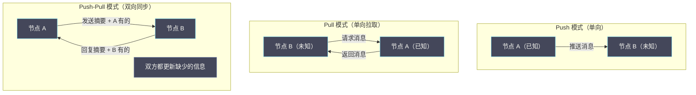

# 08 Gossip 协议：去中心化信息传播

**摘要：**

在 Paxos、Raft、ZAB 等强一致性协议主导的分布式系统世界里，有一类截然不同的协议——它不要求全局协调，没有 Leader，没有多数派投票，每个节点只与随机选择的几个邻居交换信息，系统却能以极高的概率把信息传播到所有节点。这就是 **Gossip 协议**，灵感来源于流行病学中的病毒传播模型（故又称 **Epidemic Protocol**）。Gossip 协议天然具备去中心化、高容错、弱一致性的特点，非常适合**集群成员管理、故障检测、反熵同步**等场景，是 Cassandra、Redis Cluster、DynamoDB、Consul 等主流分布式系统的核心组件。本文从 Gossip 的流行病学起源出发，推导三种主要的 Gossip 模式（Push、Pull、Push-Pull），量化分析收敛速度与消息开销，深入解析 Cassandra 中 Gossip 协议的工程实现细节，以及 Redis Cluster 如何用 Gossip 做节点状态同步，最后给出 Gossip 的适用边界。读完本文，你应当能回答两个问题：为什么"随机传播"能如此高效，以及 Gossip 与共识协议分别适合什么。

---

## 第 1 章 为什么需要 Gossip：集中式协调的局限

### 1.1 集中式状态管理的扩展性瓶颈

在 Raft、ZAB 等强一致性协议中，状态信息的传播依赖 Leader：Leader 收到更新后广播给所有 Follower，每次广播需要 O(n) 条消息（n 是节点数）。这对**少量、关键的一致性数据**（日志条目、配置）是合适的，但对**大规模、频繁更新的集群状态信息**（如每个节点的健康状态、负载信息、路由表），集中式广播面临严重的扩展性问题。

**问题一，Leader 成为单点瓶颈**。假设集群有 1000 个节点，每个节点每秒向 Leader 报告一次健康状态，Leader 需要处理 1000 条每秒的状态更新，并向 999 个节点各广播消息（约 10⁶ 条每秒的广播消息量）。Leader 很快成为计算和网络的瓶颈。

**问题二，Leader 故障导致全局状态信息停止更新**。如果负责广播集群状态的中心节点崩溃，整个集群的状态信息就停止更新，直到新的协调节点被选出。

**问题三，网络拓扑不均匀导致消息风暴**。在跨机房部署的场景中，Leader 向所有节点广播可能产生大量的跨机房流量，造成网络拥塞。

Gossip 协议解决这些问题的方式是：**不依赖任何中心节点，每个节点随机与少数邻居交换状态，通过指数级的"感染传播"把信息扩散到整个集群**，总消息量 O(n log n)，每个节点的消息发送量恒定为 O(1)（每轮 Gossip 只发给固定数量的随机节点）。

**这里的关键差异是"消息量的分布"**：集中式广播是"中心发 n 条"，Gossip 是"每个节点发常数条"。前者让中心成为瓶颈，后者让负载均匀分摊。**这正是 Gossip 能扩展到数千节点的根本原因**。

### 1.2 流行病学的启发：SIR 模型

Gossip 协议的设计灵感来源于流行病学的 **SIR（Susceptible-Infected-Recovered）传播模型**：**Susceptible（易感者）** 是尚未感染病毒的健康人，对应"还没有收到某条信息的节点"；**Infected（感染者）** 是已经感染病毒的人，会主动传播给其他人，对应"已经收到信息并在传播的节点"；**Recovered（康复者）** 是已经感染过、现在不再传播的人，对应"已经收到信息并停止主动传播的节点"。

在流行病学中，SIR 模型的核心结论是：只要每个感染者平均能传染的人数（基本再生数 R₀）大于 1，病毒就能在人群中传播；当大多数人已经感染或康复后，新感染者的传播速度会指数级下降（因为遇到易感者的概率降低），最终病毒消亡。

Gossip 协议借鉴了这个模型：每个节点定期随机选择 k 个邻居发送信息（k 通常是 1 到 3），如果 k 大于 1，信息会以指数级速度扩散，在 O(log n) 轮内传播到整个集群。

**这个类比的深刻之处在于：它揭示了一种"用概率替代协调"的传播机制**。集中式广播需要"知道所有节点的地址"（协调），Gossip 只需要"随机选几个邻居"（概率）——而概率的力量，在"只要感染率大于 1"时，就能保证信息扩散。**这是一种把"确定性的全局协调"替换为"概率性的局部交互"的思路**，也是去中心化系统的共同特征。

### 1.3 一个延伸：Gossip 与"集中式广播"的对比

Gossip 与集中式广播的对比，能更清楚地看出它的价值。

| 维度 | 集中式广播 | Gossip |
| :--- | :--- | :--- |
| **是否有中心** | 有（Leader）| 无 |
| **总消息量** | O(n²) | O(n log n) |
| **单节点负载** | 中心 O(n)，其余 O(1) | 所有节点 O(1) |
| **收敛时间** | 1 轮（中心直接广播）| O(log n) 轮 |
| **容错性** | 中心故障则停摆 | 无中心，天然容错 |
| **一致性** | 强（中心保证顺序）| 弱（概率性、可能短暂不一致）|

**这张表的核心取舍是"延迟"与"容错"**：**集中式广播"一轮就到"，但"中心是单点"；Gossip"要 O(log n) 轮"，但"没有单点"**。

**因此，选择哪个，取决于"你更在意延迟还是容错"**：**对"少量关键数据"（配置、日志），用集中式广播（要快、要强一致）；对"大量非关键状态"（成员、负载），用 Gossip（要容错、要可扩展）**。

**这条对比的启示是**：**Gossip 不是"集中式广播的替代品"，而是"不同场景的不同选择"**。**它在"需要去中心化容错"的场景里无可替代，在"需要强一致与低延迟"的场景里则不合适**——**这正是本专栏反复强调的"按场景选协议"**。

### 1.4 一个对照：Gossip 与共识协议的定位

Gossip 与 Paxos、Raft 的对比，是"两种协调范式"的对比。

**共识协议（Paxos、Raft）追求"强一致"**——它们保证"所有节点对某个值达成一致，且不可更改"。**代价是需要多数派确认、需要 Leader、写入串行化**。

**Gossip 追求"高概率传播"**——它保证"信息以极高概率传播到几乎所有节点"。**代价是"概率性"（可能有个别节点没收到）、"最终一致"（传播期间可能不一致）**。

**两者的"能力"差异在于**：**共识协议"保证正确"，Gossip"保证传播"**。**共识协议适合"少量关键数据"，Gossip 适合"大量状态信息"**。

**这个对照的启示是**：**"分布式协调"这个领域有两种基本范式——"用多数派换确定性"（共识）与"用概率换去中心化"（Gossip）**。**理解了这两种范式，就能在面对具体问题时，先判断"我需要哪种保证"，再选对应的协议**——**这也是本专栏希望传递的核心能力**。

### 1.5 一个延伸：Gossip 的"扇出"参数

Gossip 有一个关键参数：**扇出（Fanout）**——即"每轮随机选择多少个邻居发送"。它直接影响"收敛速度"与"消息量"。

**扇出越大，收敛越快**——因为"每轮感染的人数"更多。**理论上，扇出为 k 时，感染节点每轮增长 k 倍**（早期）。**因此，收敛轮数约为 log_k(n)**——**扇出从 1 增到 3，收敛轮数大约减半**。

**但扇出越大，消息量也越大**——**总消息量与扇出成正比**。**因此，扇出是"收敛速度"与"消息量"之间的取舍**。

**实践中，扇出通常取 1 到 3**。**为什么不用更大的扇出？** 因为"log_k(n) 的下降是递减的"——**从 k=1 到 k=3，收敛轮数减半；从 k=3 到 k=9，只再减半**。**而消息量却是"线性增长"**。**因此，"适度扇出"（1 到 3）是"收益递减"后的合理选择**。

**这条延伸的启示是**：**"参数调优"往往遵循"收益递减"规律**——**增大某个参数，收益先快后慢，成本却线性增长**。**因此，"最优值"通常在"收益开始递减"的位置**。**这与 03 篇"选举超时的折中"、10 篇"批量大小的取舍"是同一类判断**。

---

## 第 2 章 Gossip 的三种传播模式

### 2.1 Push 模式：我有新消息，我推送给你

**Push 模式**是最简单的 Gossip 变体：已知信息的节点（Infected）主动向随机选择的节点发送信息。

**算法**：

```
每个节点周期性（如每 1 秒）执行：
  1. 随机选择 k 个邻居节点
  2. 将自己拥有的"新消息"推送给这 k 个节点

接收方：
  如果收到的信息是新的（自己不知道），更新本地状态，并在下一轮继续传播
  如果收到的信息是旧的（自己已知道），忽略
```

**收敛速度分析**：设集群有 n 个节点，初始时只有 1 个节点知道某条信息，每轮每个感染节点向 1 个随机邻居推送：第 1 轮感染节点约 2 个；第 2 轮约 4 个；第 k 轮约 2^k 个。当 2^k 约等于 n 时，k 约等于 log₂(n)，信息扩散到整个集群。**Push 模式的收敛轮数是 O(log n)**。

但在传播后期，由于大多数节点已经是感染节点，新的推送消息大概率发给已知节点（冗余推送），导致**传播的最后几个节点（尾部收敛）很慢**——理论上有小概率某些节点永远不会被选中，导致传播不完全。

### 2.2 Pull 模式：我不知道，我去问你

**Pull 模式**的方向相反：不知道信息的节点（Susceptible）主动向随机节点询问是否有新信息。

**算法**：

```
每个节点周期性执行：
  1. 随机选择 k 个邻居节点
  2. 询问这些节点是否有比自己更新的信息（"你有我没有的消息吗？"）
  3. 如果有，拉取并更新本地状态
```

**Pull 模式的特点**：Pull 模式在传播**后期**比 Push 模式更快。在传播后期，只有少数节点（Susceptible）还不知道信息，这些节点主动去拉取，每次 Pull 请求都能找到已知节点，快速完成"最后一公里"的传播。但在传播**早期**，Pull 模式比 Push 模式慢——早期只有极少数节点有信息，Susceptible 节点随机选的邻居大概率是其他 Susceptible 节点（没有信息），Pull 请求效率很低。

**收敛速度**：Pull 模式的收敛轮数也是 O(log n)，但常数因子与 Push 不同。理论分析表明，Pull 模式在后期的收敛速度更快，但前期更慢。

**Push 与 Pull 的"前期后期互补"，是理解 Gossip 的一个重要视角**——没有哪种模式在所有阶段都最优，这直接催生了下一节的混合模式。

### 2.3 Push-Pull 混合模式：兼顾前期和后期

**Push-Pull 模式**结合了 Push 与 Pull 的优点：每次 Gossip 交互时，双方互相交换各自的状态（而不是单方向发送），各自更新自己缺少的部分。

**算法**：

```
节点 A 发起 Gossip（每轮选随机节点 B）：
  1. A 向 B 发送自己的状态摘要（Digest，如版本号或哈希）
  2. B 对比 A 的摘要与自己的状态，找出差异：
     - B 有但 A 没有的信息 → B Push 给 A
     - A 有但 B 没有的信息 → B 请求 A Pull（或 A 直接 Push 给 B）
  3. 双方都更新到最新状态
```

Push-Pull 模式的消息开销比纯 Push 多一倍（每次交互是双向的），但**收敛速度快约 2 倍**——因为每次 Gossip 不仅传播信息，还从对方学习自己不知道的信息。

**这正是 Cassandra 采用的 Gossip 模式**。Cassandra 的 Gossip 协议是 Push-Pull 的：每次 Gossip 交互，双方互相同步状态，使得集群成员信息和节点状态能够双向、快速地传播。



### 2.4 一个延伸：为什么"Push-Pull"是最常用的

三种 Gossip 模式里，Push-Pull 是实践中最常用的——**原因在于它"在前期与后期都快"**。

**Push 模式"前期快、后期慢"**：前期感染节点少，每次推送都能"感染"新节点；后期感染节点多，推送大概率"发给已知节点"，浪费。

**Pull 模式"前期慢、后期快"**：前期已知节点少，拉取大概率"拉不到新信息"；后期已知节点多，拉取总能拉到。

**Push-Pull"两者兼顾"**：每次交互双方互换信息——**在前期，Push 方向高效（已知方推给未知方）；在后期，Pull 方向高效（未知方拉取已知方）**。**因此，它在整个传播周期都保持高效**。

**代价是"消息量翻倍"**（每次交互是双向的）——**但对于"成员管理"这类"状态多、更新不频繁"的场景，这个代价可以接受**（因为交互频率不高）。

**这条延伸的启示是**：**当"两种模式各有优缺点"时，"把它们结合"往往能得到"兼顾两者"的方案**——**这正是 Push-Pull 的设计思路**。**这种"组合互补"的思路，在分布式系统里很常见**（如"快慢路径结合""同步异步结合"）。

### 2.5 一个延伸：Gossip 的"消息丢弃"策略

Gossip 在传播过程中，需要决定"哪些消息要发、哪些要丢"——这个策略影响"消息量"与"收敛速度"。

**"全量发送"是最简单的**：每次把"自己知道的所有信息"都发出去。**优点是"不会漏"；缺点是"消息量大"**（尤其是状态多时）。

**"只发新信息（Rumor Mongering）"**：只发"自己新知道的信息"，不重复发"旧的"。**优点是"消息量小"；缺点是"可能不完整"**（如果某个节点没收到，而其他节点又"认为它知道了"，就漏了）。

**"反熵（Anti-Entropy）"是"定期全量同步"**：它不追求"每次都发全量"，而是"定期做一次全量比对与同步"。**它是"Rumor Mongering"的兜底**——**用"定期全量"来弥补"只发新信息"可能造成的遗漏**。

**这三者构成一个"分层策略"**：**平时用"只发新信息"（高效），定期用"反熵"（兜底）**。**Cassandra 正是这样做的**——它的 Gossip 是"Rumor Mongering"（传新状态），而"反熵"（`nodetool repair`）用于"修复遗漏"。

**这条延伸的启示是**：**"高效路径加兜底路径"是分布式系统的通用设计模式**——**平时走高效路径（省资源），异常时走兜底路径（保正确）**。**这与 10 篇的"正常路径加降级路径"、分布式锁的"锁加幂等兜底"是同一个思路**。

### 2.6 一个延伸：Gossip 在"区块链"中的应用

Gossip 不只用于"成员管理"，它在区块链里也有核心应用——**区块与交易的传播**。

**区块链的节点需要"把新区块与交易传播给全网"**——这正是 Gossip 的场景。**每个节点收到新区块后，随机转发给若干邻居，邻居再转发**——**从而把信息传播到全网**。

**为什么区块链用 Gossip？** 因为区块链是"去中心化、无信任"的网络——**它不能依赖"中心广播"，也不能依赖"固定拓扑"**。**Gossip 的"随机传播、无中心"特性，恰好匹配区块链的需求**。

**但区块链的 Gossip 有一个特殊要求："抗审查与抗伪造"**。**因为节点可能作恶**（拜占庭故障），所以区块链的 Gossip 需要配合"签名验证"（每个区块都有签名，节点验证后才转发）。**这与"数据中心里的 Gossip"（节点可信）不同**。

**这条延伸的启示是**：**同一个协议，在不同信任环境下需要不同的"加固"**。**数据中心里的 Gossip 只需"防崩溃"，区块链里的 Gossip 还要"防作恶"**——**这与 01 篇"CFT 与 BFT 的信任边界"完全一致**。**"协议相同、加固不同"，是"按环境选方案"的又一个例证**。

### 2.7 一个延伸：Gossip 的"消息格式"

Gossip 的消息格式，直接决定"每轮的开销"——这是一个值得设计的细节。

**最朴素的做法是"每轮发送完整状态"**——**优点是"不会漏"；缺点是"消息量大"**（状态多时开销高）。

**更精巧的做法是"先发摘要、按需传详情"**——**Cassandra 正是这样做的**（`GossipDigestSyn` 发摘要，对方比对后回复差异）。**这大幅降低了"无差异时的开销"**。

**另一种做法是"随机采样部分状态"**——**Redis Cluster 正是这样做的**（每条 PING/PONG 随机携带 1/10 节点的状态）。**它把"每轮开销"固定在一个小值，通过多轮逐渐同步**。

**这三种做法的取舍是"精确"与"开销"**：**全量最精确但开销大；摘要按需较精确、开销中等；随机采样开销小但需要多轮**。**选择哪个，取决于"状态规模"与"更新频率"**。

**这条延伸的启示是**：**"消息格式"是 Gossip 的一个关键设计点，它决定了"开销与效率"**。**不同的系统（Cassandra 与 Redis Cluster）用了不同的格式，正是因为它们的"状态规模"不同**——**这再次说明"同一协议，不同场景，不同实现"**。

---

## 第 3 章 Gossip 的收敛性分析

### 3.1 数学模型：离散时间 SIR

用数学来量化 Gossip 的收敛速度。设 n 是集群节点总数；I(t) 是第 t 轮结束时已知某条信息的节点数（"感染"节点数）；S(t) 等于 n 减 I(t)，是还不知道信息的节点数（"易感"节点数）；k 是每个节点每轮向 k 个随机节点发送（Push 模式）。

每轮新增的感染节点数约等于：

```
ΔI(t) ≈ I(t) × k × (S(t) / n)
       = I(t) × k × (1 - I(t)/n)
```

当 I(t) 很小（早期）时，ΔI(t) 约等于 I(t) 乘 k，感染节点数指数增长（每轮增长 k 倍）。当 I(t) 接近 n（后期）时，ΔI(t) 趋近于 0，增速减缓（因为 S(t)/n 趋近于 0，随机选到的邻居基本都是已感染节点）。

**收敛轮数**：在 k 等于 1（每轮发给 1 个随机邻居）时，信息传播到 99% 的节点大约需要 c 乘 log(n) 轮，c 是一个常数（在 1 到 2 之间）。

**具体数字**（k 等于 1，每轮 1 秒）：100 节点约 7 轮（7 秒）传播到 99% 的节点；1000 节点约 10 轮（10 秒）；10000 节点约 14 轮（14 秒）。Gossip 的收敛时间随集群规模增长极为缓慢（对数增长），这是 Gossip 能够扩展到数千节点规模的根本原因。

**这组数字值得记住**：从 100 节点到 10000 节点（100 倍），收敛时间只从 7 秒涨到 14 秒（2 倍）。**这种"规模涨百倍、时间涨一倍"的特性，正是对数复杂度的威力**——也是 Gossip 在"成员管理"这类场景里无可替代的原因。

### 3.2 消息复杂度

**Push 模式**：每个节点每轮发送 k 条消息，整个集群每轮发送 n×k 条消息。经过 O(log n) 轮收敛，总消息数等于 O(n log n)。对比集中式广播的 O(n²)（Leader 向所有节点广播，每轮发 n-1 条），Gossip 的消息开销小得多。

**每个节点的发送负载**：O(k) 条每轮，与集群大小无关。这使得 Gossip 在大规模集群中保持恒定的单节点网络开销，非常适合大规模水平扩展。**"单节点开销与集群规模无关"这一点尤其重要**——它意味着"扩集群"不会让"每个节点的负担变重"，这正是去中心化设计的价值。

### 3.3 失败概率：Gossip 的概率性保证

Gossip 的一个重要特性是**概率性收敛（Probabilistic Convergence）**：它不能保证 100% 的节点在精确 O(log n) 轮内都收到信息，但能保证以极高的概率（如 1 减 1/n²）在 c 乘 log n 轮内完成传播。

残余"未感染"节点的概率在传播轮数增加时指数递减：经过 2 乘 log(n) 轮后，某个节点仍未收到信息的概率约为 1/n，对于 n 等于 1000，这个概率约为 0.1%——在工程上完全可接受（通过重传、反熵等机制处理）。

**"概率性"这个词，是理解 Gossip 的关键**：它不提供"保证送达"，只提供"极大概率送达"。**这与共识协议的"绝对保证"形成鲜明对比**——Gossip 用"概率"换取了"去中心化与低开销"。**因此，Gossip 适合"允许极低概率失败、且能用其他机制兜底"的场景，不适合"绝不能失败"的场景**。

### 3.4 一个延伸：为什么 Gossip 的"尾部"收敛慢

Gossip 的收敛曲线有一个特征：**前期极快（指数增长），后期极慢（尾部收敛）**。这个"长尾"值得说明。

**前期快，是因为"感染节点少、易感节点多"**——每次推送"大概率感染新节点"，因此指数增长。**后期慢，是因为"感染节点多、易感节点少"**——每次推送"大概率发给已知节点"，因此增速骤减。

**这个"长尾"意味着"最后几个节点可能要很久才收到"**。**以 1000 节点为例，传播到 99% 可能只需 10 轮，但传播到"全部 100%"，期望轮数可能大得多**。

**因此，Gossip 的设计必须"接受'不能保证 100%'"**——**它不追求"全部收到"，而是追求"极大概率收到"**，并用"反熵"来兜底"漏掉的那几个"。

**这条延伸的启示是**：**"概率性保证"必须配套"兜底机制"**。**Gossip 的概率性（1 减 1/n²）在工程上"够用"，但"不够绝对"**——**因此它必须配合"反熵"来做到"最终一定一致"**。**这与 07 篇"因果一致性需要反熵兜底"是同一个思路**：**概率性机制加确定性兜底，构成完整的保证**。

### 3.5 一个延伸：Gossip 的"收敛证明"直觉

第 3 章给出了 Gossip 收敛的数学模型——这里补充一个更直觉的理解。

**核心直觉是"感染率大于 1 就必然扩散"**。**每一轮，一个感染节点能"感染"的期望新节点数是"k 乘易感比例"**——**只要这个数大于 1，感染人数就增长**。**而"易感比例"在早期接近 1，因此"早期必然扩散"**。

**后期为什么慢？** 因为"易感比例"趋近 0——**"k 乘易感比例"可能小于 1，于是增长停滞**。**这就是"尾部收敛慢"的数学解释**。

**这个直觉与"流行病传播"完全一致**：**疫情初期"指数增长"，后期"增速放缓"，最终"趋于平稳"**——**这正是 SIR 模型描述的曲线**。**Gossip 的收敛曲线，就是一条 SIR 曲线**。

**这条延伸的启示是**：**"跨领域类比"能帮助理解抽象概念**。**Gossip 用"流行病"类比，让"信息传播"这个抽象问题变得直观**——**这也解释了为什么 Gossip 被称为"流行病协议（Epidemic Protocol）"**。**在设计分布式协议时，寻找一个贴切的"生活类比"，往往能帮助理清思路**。

### 3.6 一个延伸：Gossip 的"失败模式"

Gossip 虽"天然容错"，但也有它的失败模式，值得了解。

**失败模式一，"网络分区后的信息分叉"**。如果集群被分区，两侧各自 Gossip——**分区期间，两侧的成员视图可能不同**。**分区恢复后，它们会通过 Gossip"合并"视图**，但"合并规则"需要明确（如"以更大的版本号为准"）。

**失败模式二，"错误信息的传播"**。如果某个节点"误报"了状态（如误报某节点故障），这个错误会"通过 Gossip 传播到全网"。**因此，Gossip 的"正确性"依赖"信息的正确性"**——**一旦有节点"误报"，错误会扩散**。**这也是为什么"故障检测要谨慎"（如 Redis Cluster 的"PFAIL 到 FAIL"两阶段）**。

**失败模式三，"消息风暴"**。如果状态频繁变化，Gossip 会产生大量消息——**在极端情况下，Gossip 本身可能成为"负载来源"**。

**这三种失败模式的共同点是"Gossip 不保证信息的'正确'，只保证'传播'"**——**因此，信息的"正确性"必须由其他机制保证**（如"多节点确认的 FAIL"）。**这与 5.3 节"Redis Cluster 用多数派确认故障"完全一致**。

**这条延伸的启示是**：**"传播机制"与"信息正确性"是两回事**。**Gossip 只负责"传得快、传得广"，不负责"传得对"**——**"传得对"需要额外的机制**。**分清这两件事，才能正确地使用 Gossip**。

---

## 第 4 章 Cassandra 中的 Gossip 协议：工程实现剖析

### 4.1 Cassandra Gossip 的目标

Cassandra 是一个去中心化的分布式 KV 存储，没有 Leader、没有 ZooKeeper 依赖。Cassandra 用 Gossip 协议来完成两件关键事情。

**目标一，成员管理（Membership）**：哪些节点当前在线？哪些节点刚加入集群？哪些节点刚离开集群（正常退出还是崩溃）？每个节点负责哪些 Token 范围（数据分片信息）？

**目标二，故障检测（Failure Detection）**：哪些节点已经崩溃？崩溃的节点与"网络临时不通"的节点如何区分？

**这两个目标，恰好是 Gossip 最擅长的领域**——成员信息变化不频繁、允许短暂不一致、需要高容错。这与第 6 章的"最佳应用场景"完全吻合。

### 4.2 Cassandra Gossip 的数据结构

每个 Cassandra 节点维护一个**本地 Endpoint State 表**，记录集群中每个节点（包括自己）的状态：

```python
# 每个节点的状态（EndpointState）
class EndpointState:
    # HeartBeat State：用于故障检测
    heartbeat_version: int    # 心跳版本号，每次 Gossip 时递增
    heartbeat_timestamp: int  # 上次心跳的时间戳

    # Application State：业务相关状态
    application_states: Dict[str, VersionedValue]
    # 常见的 Application State key：
    # STATUS:      NORMAL / LEAVING / LEFT / REMOVING / REMOVED / HIBERNATE
    # LOAD:        当前节点的数据量
    # SCHEMA:      当前节点的 schema 版本（用于 schema 同步）
    # DC:          数据中心名
    # RACK:        机架名
    # TOKENS:      该节点负责的 Token 范围
    # HOST_ID:     节点的 UUID 标识

class VersionedValue:
    value: str
    version: int   # 版本号，单调递增，用于判断哪条信息更新
```

**这个数据结构里，`version` 字段是关键**——它让"新旧判断"变得简单（版本号大的更新），这与 07 篇的版本向量、06 篇的 ZXID 是同一个思路：**用单调递增的版本号来标记"新旧"，从而让状态合并变得可判断**。

### 4.3 Cassandra Gossip 的交互流程

Cassandra 的 Gossip 每秒触发一次，流程如下。

**步骤一，随机选择 1 到 3 个节点**（组合方式如下）：1 个活跃节点（随机选）；可能 1 个不活跃节点（以一定概率，用于检测已恢复的节点）；可能 1 个种子节点（Seed Node，用于新节点加入时的引导）。

**步骤二（GossipDigestSyn）：发送 Digest（摘要）**。发送方（节点 A）向目标节点（节点 B）发送 `GossipDigestSyn` 消息，包含 A 所知道的每个节点的 `(ip, heartbeat_version)` 摘要：

```
GossipDigestSyn：
{
  "10.0.0.1": {"heartbeat_version": 100, "application_state_version": 50},
  "10.0.0.2": {"heartbeat_version": 95, "application_state_version": 47},
  ...
}
```

**步骤三（GossipDigestAck）：B 比较并回复差异**。B 收到摘要后，与自己的本地状态对比：对于 A 版本比 B 旧的节点（B 有更新信息），B 把完整的最新状态包含在响应中（Push 给 A）；对于 A 版本比 B 新的节点（A 有更新信息，B 需要拉取），B 在响应中包含"我需要这些节点的更新"的请求列表。

**步骤四（GossipDigestAck2）：A 回复 B 需要的信息**。A 收到 Ack 后，把 B 请求的节点的完整状态发送给 B。

完成这四步后，A 和 B 都持有对方所知道的所有最新状态，实现了双向同步（Push-Pull 模式）。**注意这四步的结构**：先交换摘要（轻量），再按需传输完整状态（避免传冗余）——**"先摘要、后详情"是一个通用的优化手段**，它避免了"每次都传全量"的浪费，在状态差异不大时尤其高效。

### 4.4 Cassandra 的故障检测：Phi Accrual Failure Detector

Cassandra 不使用简单的超时机制来检测节点故障，而是使用 **Phi Accrual Failure Detector**（由 Hayashibara 等人在 2004 年提出）。

**简单超时的问题是**：固定的超时阈值（如"5 秒没有心跳就判断故障"）无法适应网络延迟的动态变化——在网络拥塞时，5 秒的心跳延迟可能是正常的，但固定超时会误判为故障。

**Phi Accrual 的思路是**：动态计算一个"怀疑值 φ（phi）"，而不是二元的"活着或死亡"判断。φ 值越大，该节点越可能已经崩溃；φ 值越小，节点越可能只是延迟。

φ 的计算基于历史心跳间隔的统计分布：

```python
def compute_phi(last_heartbeat_timestamp, heartbeat_intervals_history):
    """
    根据历史心跳间隔，估计当前到达延迟对应的怀疑级别
    """
    elapsed = current_time - last_heartbeat_timestamp

    # 用历史数据拟合正态分布
    mean = statistics.mean(heartbeat_intervals_history)
    std = statistics.stdev(heartbeat_intervals_history)

    # 计算 elapsed 超过历史正常间隔的概率（用于反映"迟到程度"）
    # 用对数转换为 φ 值（越大越可疑）
    prob_late = 1 - normal_cdf(elapsed, mean, std)
    phi = -math.log10(prob_late)
    return phi

# 在 Cassandra 中，默认 φ 阈值：
# φ < 8：节点认为存活
# φ ≥ 8：节点标记为疑似故障
```

**Phi Accrual 的优点有三**。**自适应**：阈值根据网络的历史延迟动态调整，而不是固定值，减少误判。**渐进式**：不是"活着或死了"的二元判断，而是一个连续的怀疑程度，允许上层系统根据 φ 值做出不同的响应（如 φ 等于 4 时降低读副本优先级，φ 等于 8 时彻底标记为故障）。**可调节**：不同业务可以设置不同的 φ 阈值，在敏感度（快速检测故障）与准确率（避免误判）之间取舍。

> [!info] Phi Accrual 是"失败检测器"思想的一个优雅实现
> 回顾 01 篇讨论的"失败检测器无法区分慢与死"，Phi Accrual 正是对这个困境的一种务实回应：**它不去追求"精确区分"，而是给出一个"怀疑程度"，让上层根据这个程度做决策**。
>
> 这与"最终精确故障检测器"（允许暂时误报、最终纠正）是同一类思路。**它们都承认"精确判断不可得"，转而提供"可用的近似"**——这是分布式系统里面对"不可解问题"的典型姿态：不追求完美，追求"足够好且可调"。

### 4.5 一个延伸：Cassandra 的"反熵"机制

Cassandra 用 Gossip 传播"成员与状态"，但"数据的一致性"另有一套机制——**反熵（Anti-Entropy）**。这个分工值得说明。

**Gossip 管的是"元数据"**：谁是节点、谁是主、谁负责哪些 token——**它不负责"数据本身的一致性"**。

**反熵管的是"数据一致性"**：它定期比对"不同副本上的数据"，找出差异并同步——**Cassandra 的 `nodetool repair` 就是反熵的实现**。

**为什么两者分开？** 因为"元数据"与"数据"的规模与更新频率不同——**元数据小、更新慢，适合用 Gossip 频繁传播；数据大、更新快，不能用 Gossip 每轮都传**。**因此，Cassandra 用"Gossip 管元数据、反熵管数据"的分工**。

**这个分工的启示是**：**"不同规模、不同频率的数据，应当用不同的同步机制"**。**把"小且频繁"的用 Gossip（轻量、频繁），把"大且稀疏"的用反熵（重量、定期）**——**这是一种"按数据特征分层"的设计**。**这也解释了为什么"反熵"通常"定期执行"而不是"实时执行"**：**它的成本高，因此不能频繁做**。

### 4.6 一个延伸：Cassandra 的"种子节点"

Cassandra 的 Gossip 依赖一个特殊角色：**种子节点（Seed Node）**——它解决的是"新节点如何加入集群"这个"冷启动"问题。

**问题是**：一个全新节点启动时，它"不知道集群里有哪些节点"——**没有初始信息，Gossip 无从开始**。**种子节点正是用来提供"初始信息"的**。

**机制是**：新节点配置中"列出若干种子节点"，启动时"联系种子节点"，从它们那里"获取集群成员列表"——**一旦获得了初始列表，后续的 Gossip 就能自行传播**。

**种子节点"不是特殊的节点"**——它只是"用于引导的已知节点"，**在正常运行中，它与普通节点地位相同**。**因此，种子节点故障不影响运行中的集群，只影响"新节点的加入"**。

**这条延伸的启示是**：**任何"去中心化系统"都需要一个"引导机制"**——**因为"去中心化"不等于"从零开始"，它需要一个"初始锚点"**。**这与"区块链的创世区块""DHT 的引导节点"是同一类问题**。**"如何冷启动一个去中心化系统"，是一个容易被忽视但必须解决的问题**。

### 4.7 一个延伸：Phi Accrual 与"简单超时"的对比

Cassandra 用 Phi Accrual 做故障检测，而很多系统用"简单超时"——两者的对比值得说明。

| 维度 | 简单超时 | Phi Accrual |
| :--- | :--- | :--- |
| **判断方式** | 二元（活或死）| 连续（怀疑程度）|
| **阈值** | 固定 | 基于历史分布动态调整 |
| **适应性** | 差（网络变化时误判）| 好（自适应）|
| **可调性** | 只有"超时值"一个旋钮 | φ 阈值可按业务调 |
| **实现复杂度** | 低 | 中 |

**简单超时的"问题"在于"阈值难设"**：**设小了，网络抖动就误判；设大了，故障发现太慢**。**而且它"假设网络延迟稳定"，这个假设在云环境里往往不成立**。

**Phi Accrual 的"优势"在于"自适应"**：**它根据"历史心跳间隔的分布"来判断"当前延迟有多异常"，而不是用一个固定阈值**。**这让它能适应"网络延迟变化"**。

**这条对比的启示是**：**"自适应"往往优于"固定阈值"**——**但代价是"更复杂"**。**因此，选择哪个，取决于"网络是否稳定"与"团队能否驾驭复杂度"**。**在"网络稳定、追求简单"的场景，简单超时够用；在"网络多变、追求准确"的场景，Phi Accrual 更合适**——**这又是"按场景选方案"的一个例证**。

---

## 第 5 章 Redis Cluster 中的 Gossip：节点状态同步

### 5.1 Redis Cluster 的 Gossip 目标

Redis Cluster 同样使用 Gossip 协议（基于 RESP3 协议的 Cluster Bus）来维护集群状态，目标与 Cassandra 类似：**节点发现**（新加入的节点通过 `CLUSTER MEET` 命令与种子节点建立连接，然后通过 Gossip 自动传播到整个集群）；**配置同步**（哪个节点负责哪些 slot？每个节点的主从关系是什么？）；**故障检测**（节点是否可达？是否需要触发故障转移？）。

### 5.2 Redis Cluster Gossip 的消息格式

Redis Cluster 的 Gossip 消息（PING/PONG）中包含：发送方的 Node ID、IP、端口、Flags（角色状态）；发送方所知道的部分其他节点的信息（每条 PING/PONG 随机携带集群中 1/10 节点的状态）。

这种"每次携带部分节点信息"的设计，是 Redis Cluster Gossip 与 Cassandra Gossip 的关键区别：**Cassandra 每次同步完整的摘要（Digest），而 Redis 每次只带随机采样的节点信息，通过多轮 Gossip 逐渐把状态同步到所有节点**。

**两种设计的差异体现了"状态规模"的考量**：Cassandra 的集群状态（含 schema、负载等）信息量较大，用"完整摘要"来精确判断差异；Redis Cluster 的状态相对轻量，用"随机采样"来摊薄每轮的开销。**同一个协议思路，在不同工程约束下会有不同的实现选择**。

### 5.3 Redis Cluster 的故障检测与故障转移

**PFAIL（Probable FAIL）**：当节点 A 在超时时间（`cluster-node-timeout`，默认 15 秒）内未收到节点 B 的响应，A 把 B 标记为 PFAIL（可能故障），并在 Gossip 消息中携带这个信息。

**FAIL（确认故障）**：当集群中超过半数的 Master 节点都把 B 标记为 PFAIL，通过 Gossip 汇聚后，某个 Master 会广播 `CLUSTER FAIL B` 消息，把 B 正式标记为 FAIL。此时，B 的 Slave 节点开始发起故障转移选举。

这个"先 PFAIL，再 FAIL"的两阶段故障检测，类似于分布式共识的思想：**单个节点的判断（PFAIL）可能是误判（网络瞬断），但多数节点都判断故障（FAIL）的概率极低，大幅减少了误判触发的不必要故障转移**。**这再次体现了"多数派"这个工具——即使在 Gossip 这样的去中心化协议里，"多数确认"依然是提升可靠性的手段**。

### 5.4 一个延伸：Redis Cluster 的"故障转移"

Redis Cluster 的故障检测（PFAIL 到 FAIL）之后，会触发"故障转移"——这个过程值得说明，因为它体现了"Gossip 加多数派"的组合。

**故障转移的流程是**：当某个 Master 被标记为 FAIL，它的某个 Slave 会"发起选举"——**它向所有 Master 请求投票，获得多数票后成为新 Master**。**这个选举依赖"多数派"，而不是"Gossip"**。

**为什么"故障转移"要用多数派，而不是 Gossip？** 因为"谁是新的 Master"是一个"需要唯一确定"的决策——**Gossip 只能"传播信息"，不能"保证唯一"**。**因此，涉及"唯一性"的决策（选主），必须用"多数派"**。

**这个组合的启示是**：**Gossip 适合"传播状态"，但不适合"做唯一性决策"**。**Redis Cluster 用 Gossip 传播"节点状态"，用多数派做"选主决策"**——**两者分工明确**。**这与 Cassandra"Gossip 管元数据、反熵管数据"是同一类分工**：**不同的任务，用不同的机制**。

**这条延伸也再次印证了"多数派"的普遍性**：**即使在 Gossip 这样的去中心化协议里，"选主"这个需要唯一性的环节，依然要用多数派**——**因为"多数派相交"是"保证唯一"的唯一手段**。

### 5.5 一个延伸：Redis Cluster 的"槽位分配"

Redis Cluster 用"槽位（Slot）"来分片——**16384 个槽位被分配给各个 Master，每个 key 通过 CRC16 映射到一个槽位**。这个"槽位"机制与 Gossip 的关系值得说明。

**Gossip 传播的信息里，包含"每个节点负责哪些槽位"**——**因此，当一个节点"接管"了某些槽位，其他节点会通过 Gossip 得知**。**这让"槽位分配"能在集群内自动同步**。

**槽位分配的变化发生在"故障转移"或"手动迁移"时**——**一旦变化，就通过 Gossip 传播**。**因此，"槽位分配"的一致性，也依赖 Gossip 的传播**。

**但"槽位分配"的"决策"（谁接管哪些槽位）依赖"多数派"**——**因为"选主"需要多数派**。**因此，"槽位分配"是"Gossip 传播加多数派决策"的组合**——**与 5.4 节的"故障转移"是同一个结构**。

**这条延伸的启示是**：**"传播"与"决策"是两个不同的环节，需要不同的机制**。**Gossip 负责"传播状态"（最终一致即可），多数派负责"做决策"（需要唯一确定）**。**把两者分清，就能理解"为什么 Redis Cluster 既用 Gossip 又用多数派"**——**它们各司其职，而不是"重复"**。

### 5.6 一个延伸：Gossip 的"安全考量"

Gossip 在"可信环境"（数据中心）与"不可信环境"（开放网络）里，安全考量不同——这个差异值得说明。

**在可信环境里**，Gossip 通常不加密、不签名——**因为节点都是"自己人"，不需要防"伪造"**。**这降低了开销**。

**在不可信环境里**，Gossip 需要"签名验证"——**因为节点可能"伪造信息"**。**区块链的 Gossip 正是如此**：每个区块都有签名，节点验证后才转发。

**这个差异的根源是"信任模型"**：**可信环境用 CFT（只防崩溃），不可信环境用 BFT（还要防作恶）**。**这与 01 篇 5.3 节"CFT 与 BFT 的信任边界"完全一致**。

**这条延伸的启示是**：**"安全措施"要与"信任模型"匹配**。**在可信环境里加签名是"浪费"；在不可信环境里不加签名是"危险"**。**因此，设计 Gossip 时，先要明确"我的节点可不可信"**——**这正是"先定信任模型、再定实现"的思路**。

---

## 第 6 章 Gossip 的局限与适用边界

### 6.1 Gossip 不适合的场景

**场景一，需要强一致性的数据**。Gossip 是最终一致性的——信息会在 O(log n) 轮内传播到几乎所有节点，但"几乎"不是"全部"，且传播过程中存在不一致窗口。如果需要强一致性（如分布式锁、事务协调），必须使用 Paxos 或 Raft，不能用 Gossip。

**场景二，需要精确、实时的全局视图**。Gossip 传播的信息有延迟（O(log n) 轮），在传播完成之前，不同节点看到的集群状态可能不同。对于需要精确全局视图的场景（如精确的负载均衡决策、精确的集群成员计数），Gossip 的延迟和不一致性可能导致次优决策。

**场景三，消息量大、更新频繁的数据**。Gossip 的每轮消息量与集群节点数成正比（O(n) 条总消息每轮）。如果要同步的数据非常频繁地更新（如每毫秒更新），每个节点需要处理大量的 Gossip 消息，网络和 CPU 开销可能超过 Gossip 的节省。

**这三条边界的共同点是：Gossip 的"弱一致"与"概率性"在需要强一致或精确视图的场景下会成为缺陷**。因此，用 Gossip 之前，先问一句"我能容忍短暂不一致吗"——如果答案是否定的，就该换协议。

### 6.2 Gossip 的最佳应用场景

| 应用场景 | 原因 |
| :--- | :--- |
| **集群成员管理** | 成员信息变化不频繁，允许短暂不一致，需要高容错（节点崩溃不影响其他节点的成员视图更新）|
| **故障检测** | 不需要即时精确，允许秒级延迟，高容错（不依赖中心节点）|
| **数据库反熵（Anti-entropy）** | 副本之间的差异同步，不要求实时一致，但需要最终收敛 |
| **路由表同步** | 路由表变化不频繁，允许短暂路由到旧节点，无需强一致 |
| **分布式哈希表（DHT）** | 节点加入或离开需要更新路由信息，Gossip 自然地支持去中心化的路由表维护 |

**这五类场景的共同特征是"数据小、变化慢、容忍短暂不一致、要求高容错"**——它们恰好是 Gossip 的"舒适区"。**反之，凡是"数据大、变化快、要求强一致、要求精确"的场景，都应当避开 Gossip**。**把协议用在对的场景，是架构决策的基本功**。

### 6.3 一条贯穿本专栏的对照

Gossip 与本专栏前几篇讨论的共识协议（Paxos、Raft、ZAB），构成了一组鲜明的对照。

**目标不同**：共识协议追求"所有节点对某个值达成强一致"；Gossip 追求"信息以极高概率传播到几乎所有节点"。

**机制不同**：共识协议依赖"多数派投票加 Leader 协调"；Gossip 依赖"随机交互加指数传播"。

**保证不同**：共识协议提供"绝对保证"（已提交的值不会改变）；Gossip 提供"概率保证"（极大概率送达）。

**适用不同**：共识协议适合"少量关键数据"（日志、配置、锁状态）；Gossip 适合"大量非关键状态"（成员、负载、路由）。

**这个对照的价值在于：它揭示了"分布式协调"这个领域的两种基本范式**——一种是"用多数派换确定性"（共识），一种是"用概率换去中心化"（Gossip）。**理解了这两种范式的分野，就能在面对具体问题时，先判断"我需要哪种保证"，再选对应的协议**。这也是本专栏希望传递的核心能力：**不是记住协议，而是理解协议背后的取舍逻辑**。

### 6.4 一个总结：Gossip 的三条启示

把本篇的讨论收敛，Gossip 给工程实践留下三条启示。

**启示一，"概率性保证"在工程上"够用"，但必须配套"兜底"**。Gossip 不保证 100% 送达，但"1 减 1/n²"的概率在工程上可接受——**前提是配合"反熵"来兜底"漏掉的那几个"**。**任何概率性机制，都要有确定性兜底**。

**启示二，"去中心化"的代价是"延迟"**。Gossip 的收敛需要 O(log n) 轮，比"集中式广播一轮"慢。**因此，它适合"允许秒级延迟"的场景**（成员管理、故障检测），不适合"需要即时"的场景。

**启示三，"不同任务用不同机制"是常态**。Cassandra"Gossip 管元数据、反熵管数据"，Redis Cluster"Gossip 传播状态、多数派选主"——**它们都在"一个系统里组合多种机制"**。**因此，不要指望"一个协议解决所有问题"**——**组合，才是工程系统的常态**。

**这三条启示，与 07 篇向量时钟的三条启示、09 篇一致性谱系的立场共同构成了"去中心化与一致性"这一主题的完整视角**。**它们共同说明：分布式系统的设计，是"多种机制的组合与取舍"，而不是"寻找一个万能协议"**——**这也是本专栏从 01 篇到 10 篇一贯的主线**。

### 6.5 一个延伸：Gossip 的"替代方案"

Gossip 适合"成员管理、故障检测"，但这些任务也有"非 Gossip"的替代方案——对比它们能帮助选型。

**替代方案一，"集中式注册中心"**（如 ZooKeeper、etcd）。**它提供"强一致的成员视图"，但"依赖中心"**——**中心故障则成员管理停摆**。

**替代方案二，"心跳加广播"**。**它简单，但"广播"的开销随节点数增长**（O(n²)）——**不适合大规模集群**。

**替代方案三，"Gossip"**。**它去中心化、开销低（O(n log n)），但"最终一致"（有延迟、概率性）**。

**三者的取舍是"一致性"与"可扩展性"**：**集中式注册中心"强一致但不可扩展"；心跳广播"简单但不可扩展"；Gossip"可扩展但弱一致"**。

**这条延伸的启示是**：**"没有最好的方案，只有最合适的"**。**对于"小规模、要求强一致"的成员管理，用注册中心；对于"大规模、容忍最终一致"的，用 Gossip**——**这正是本专栏一贯的立场**。**理解"每个方案的适用区间"，比"记住某个方案"更重要**。

### 6.6 一个延伸：Gossip 的"调优参数"

Gossip 的调优，主要围绕几个参数展开——理解它们的作用，能帮助"按场景调优"。

**参数一，扇出（Fanout）**。每轮随机选几个邻居——**增大加快收敛，但也增大消息量**（1.5 节）。

**参数二，Gossip 周期**。多久触发一次 Gossip——**周期短则收敛快、开销高；周期长则相反**。

**参数三，携带的节点数**。每条消息携带多少节点的状态——**携带多则收敛快、消息大；携带少则相反**（2.7 节）。

**参数四，反熵周期**。多久做一次全量比对——**周期短则遗漏少、开销高；周期长则相反**。

**这四个参数的共同特点是"它们都在'收敛速度'与'开销'之间取舍"**——**没有一个"绝对最优"，只有"匹配负载"的值**。**因此，调优要"基于实测"**：**先测量集群规模、状态变化频率、网络带宽，再据此设定参数**。

**这条延伸的启示是**：**Gossip 的调优，与 Raft 的调优（03 篇 4.7 节）性质相同——都是"在速度与开销之间找平衡"**。**这再次说明，分布式协议的"参数调优"是一个普遍问题，其本质都是"多目标取舍"**——**而"取舍的依据"，永远是"具体场景"**。

### 6.7 一个延伸：Gossip 的"演进方向"

Gossip 从 1987 年提出至今，也在持续演进——了解它的方向，能看到"去中心化传播"的新需求。

**方向一，"从'最终一致'到'可调一致'"**。**现代系统希望在 Gossip 之上，提供"可调"的保证**——**例如，某些状态用 Gossip（弱），某些用多数派（强）**。

**方向二，"从'固定拓扑'到'自适应拓扑'"**。**传统的 Gossip"随机选邻居"，但"随机"不一定"高效"**——**因此，出现了"基于网络拓扑优化"的 Gossip（如"优先选同机架邻居"）**。

**方向三，"与'区块链'结合"**。**区块链的"交易传播"大量使用 Gossip**——**这带来了"抗审查、抗伪造"的新需求**。

**方向四，"与'机器学习'结合"**。**分布式机器学习（如联邦学习）的"参数同步"，也用到了 Gossip 的思路**——**这带来了"带宽效率"的新优化**。

**这四个方向的共同点是"Gossip 在被'移植'到新场景时，需要新的优化"**——**抗伪造、拓扑感知、带宽效率**。**因此，"一个基础协议"的价值，在于它能"适应多种场景"**——**而"适应"的过程，就是"演进"**。

**这条延伸的启示是**：**"基础协议"往往有"长久的生命力"**——**因为它们解决的是"根本问题"（如"如何高效传播信息"）**。**因此，学习"基础协议"，比学习"某个具体系统"更有长期价值**——**这也是本专栏选择讲"原理与协议"而非"某个系统的用法"的原因**。

### 6.8 一个延伸：Gossip 的"收敛时间"实测

理论说 Gossip 的收敛是 O(log n)，实际如何？一些实测经验值得参考。

**经验一，"秒级收敛是常态"**。**以 1000 节点、每轮 1 秒、扇出 1 计，传播到 99% 约 10 秒**——**这在"成员管理"场景里完全可接受**。

**经验二，"尾部可能慢很多"**。**传播到 100% 的时间，可能远大于传播到 99% 的时间**——**因此，实践中"不追求 100%"，而是"99% 加反熵兜底"**。

**经验三，"网络拓扑影响很大"**。**如果"随机选邻居"恰好"跨机房"，延迟会显著增加**——**因此，一些实现会"优先选同机房邻居"**（6.7 节的"拓扑感知"）。

**经验四，"状态规模影响开销"**。**状态越多，"每轮消息"越大**——**因此，大状态要用"摘要加按需"或"随机采样"**（2.7 节）。

**这四条经验的共同点是"理论给出量级，实践决定细节"**——**理论说"O(log n)"，但"具体的秒数"取决于"网络拓扑、状态规模、参数配置"**。**因此，落地时要"实测调优"**——**而不是"照搬理论值"**。

**这条延伸的启示是**：**"理论复杂度"只给出"量级"，"实际性能"要"实测"**。**这与 03 篇"参数要基于实测"、10 篇"数据驱动决策"是完全一致的**——**理论指导方向，实测决定参数**。

---

## 参考资料

1. Demers, A., et al. (1987). Epidemic algorithms for replicated database maintenance. *PODC 1987*.
2. Birman, K., Hayden, M., Ozkasap, O., Xiao, Z., Budiu, M., & Minsky, Y. (1999). Bimodal multicast. *ACM Transactions on Computer Systems, 17*(2), 41–88.
3. Hayashibara, N., Défago, X., Yared, R., & Katayama, T. (2004). The φ Accrual Failure Detector. *SRDS 2004*.
4. Apache Cassandra 官方文档：Gossip. https://cassandra.apache.org/doc/latest/cassandra/architecture/gossip.html
5. Redis Cluster 官方文档：Cluster Specification. https://redis.io/docs/reference/cluster-spec/
6. DeCandia, G., et al. (2007). Dynamo: Amazon's Highly Available Key-value Store. *SOSP 2007*.
7. Leitao, J., Pereira, J., & Rodrigues, L. (2007). Epidemic broadcast trees. *SRDS 2007*.
8. Kleppmann, M. (2017). *Designing Data-Intensive Applications*. O'Reilly Media. Chapter 5: Replication.

---

> [!note] 思考题
> 1. Gossip 的收敛时间是 O(log n)。请说明"规模涨百倍、时间涨一倍"这一特性背后的数学原因，以及它为什么让 Gossip 适合大规模集群。
> 2. Push 模式在传播前期快、后期慢，Pull 模式相反。请说明原因，以及 Push-Pull 混合模式为什么能"兼顾前后"。
> 3. Gossip 提供的是"概率性保证"而非"绝对保证"。请说明这个特性让它适合哪些场景、不适合哪些场景，并说明"概率性"为什么是去中心化的代价。
