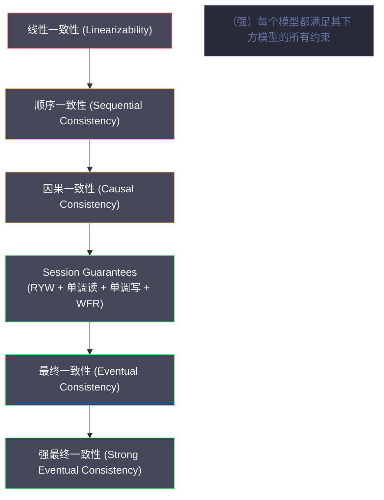
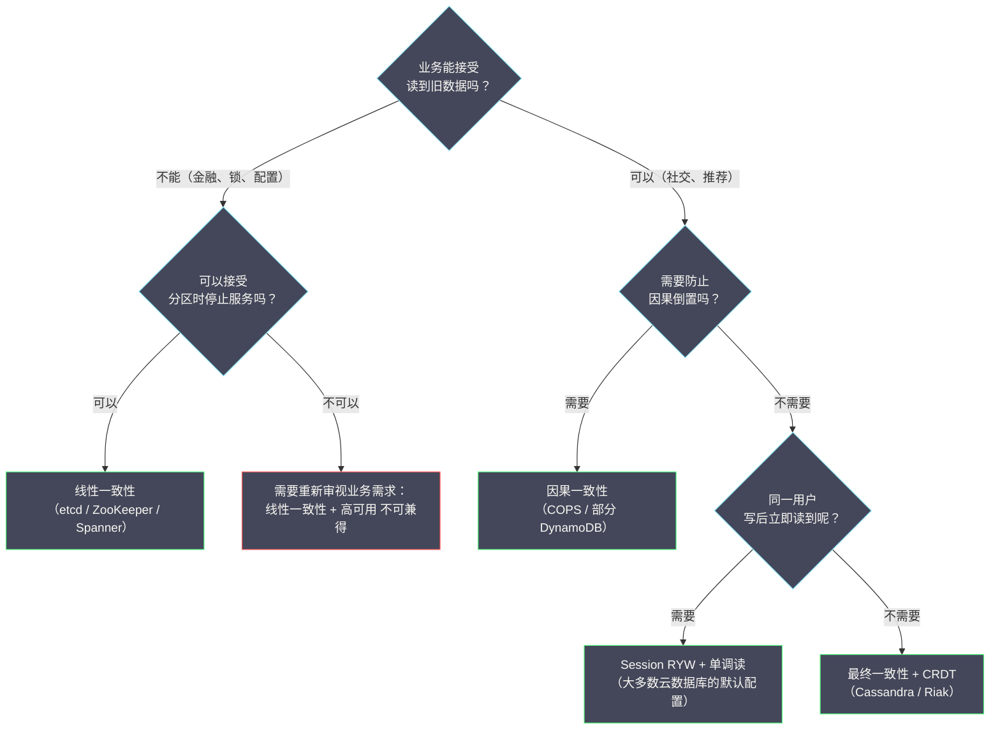

# 09 分布式系统的一致性模型谱系

**摘要：**

"一致性"是分布式系统领域使用频率最高、同时也是歧义最重的词汇之一。同样是"一致性"，数据库 ACID 中的 C（Consistency）、CAP 定理中的 C（Consistency）、副本一致性（Replica Consistency）以及事务隔离级别（Isolation Level）——这四个"一致性"的含义完全不同，混淆它们是工程讨论中最常见的错误来源之一。本文系统梳理分布式系统中真正重要的**一致性模型（Consistency Model）谱系**：从最强的**线性一致性（Linearizability）**，经过**顺序一致性（Sequential Consistency）**、**因果一致性（Causal Consistency）**、**单调读、单调写、读己之写（Session Guarantees）**，到最弱的**最终一致性（Eventual Consistency）**。对每个模型，详细解释它允许什么、不允许什么、用何种异常来区分它们，以及在哪些生产系统中被采用，最终给出一张供工程选型参考的完整对比表。读完本文，你应当能回答两个问题：一致性模型的"强弱"到底强在什么、弱在什么，以及如何根据业务需求选择合适的一致性级别。

---

## 第 1 章 先厘清"一致性"的多重含义

### 1.1 四种"一致性"的辨析

在深入一致性模型之前，必须先把这个被滥用的词语梳理清楚。

**第一种，ACID 中的 C（Consistency）**。这是数据库事务的 ACID 模型中的"一致性"，含义是：**事务在执行前后，数据库的状态必须满足所有预定义的约束**（如外键约束、唯一性约束、业务规则如"账户余额不能为负"）。这个"一致性"**与分布式系统的一致性模型完全无关**——它描述的是数据的业务语义正确性，是应用层定义的，不是系统层保证的。数据库只是确保事务不会破坏这些约束，但"约束是什么"完全由应用程序决定。

**第二种，CAP 中的 C（Consistency）**。CAP 定理中的"一致性"等同于**线性一致性（Linearizability）**——最强的副本一致性模型，要求所有操作看起来是原子性地、瞬间完成的，且所有节点看到的操作顺序符合真实时间顺序。这将在第 2 章详细讲解。

**第三种，副本一致性（Replica Consistency）**。这是本文的主角：描述分布式存储系统中，**多个副本在同一时刻或不同时刻对客户端呈现的数据视图**的一致性程度。一致性模型是一个**合约**：系统承诺满足某个一致性模型，客户端可以依据这个承诺推断系统行为。从线性一致性到最终一致性，构成了一个强弱连续的谱系。

**第四种，事务隔离级别（Transaction Isolation）**。事务隔离级别（Read Uncommitted、Read Committed、Repeatable Read、Serializable）描述的是**并发事务之间的可见性**，防止脏读、不可重复读、幻读等异常。隔离级别与副本一致性有交叉，但它们是不同层次的概念。

> [!info] 为什么要厘清这四种一致性
> 在工程讨论中，经常出现"我们的系统是强一致的"这样的说法，但没有指明是哪种"一致性"。如果没有精确的语义，这句话可能是指："我们的业务数据满足所有约束"（ACID C）；"我们实现了线性一致性"（CAP C）；"我们的副本最终会收敛"（最终一致性）；"我们的事务是可串行化隔离的"（Serializable Isolation）。
>
> 这四种解读的实现难度与性能代价差距是巨大的。**精确的术语是理性讨论的前提**——而"一致性"这个词的滥用，正是很多无谓争论的根源。**每当听到"一致性"，第一件事应当是问"哪一种一致性"**。

### 1.2 一致性模型的形式化定义方法

一致性模型定义了分布式存储系统**合法的执行历史（Execution History）**。一个执行历史是一系列操作（读或写）的记录，包含操作的调用时间、完成时间、以及返回值。

**合法性（Validity）**：给定一个一致性模型，如果一个执行历史满足该模型的所有约束，则称这个执行历史对于该模型是"合法的"或"正确的"。如果存在一个执行历史，在某个更强的模型下是合法的，但在更弱的模型下也合法，则说明更弱的模型允许更多的执行历史（对系统实现的约束更少）。

**区分不同模型的方式是看"异常（Anomalies）"**：从最强到最弱，每降低一级的一致性模型，都会允许某些"异常行为"——即在更强模型下不会出现、但在更弱模型下可能出现的执行历史。**通过这些异常，可以精确地区分不同强度的一致性模型**。这也是第 7 章那张"异常对比表"的意义所在。

### 1.3 一个延伸：为什么"一致性"这个词如此混乱

"一致性"之所以混乱，不只是因为"一词多义"，还因为**这几个含义在历史上"各自独立发展"，后来才"被放在一起讨论"**。

**ACID 的 C 来自数据库领域**（1970 年代），关注"业务约束"；**CAP 的 C 来自分布式系统领域**（2000 年），关注"副本可见性"；**副本一致性来自复制存储领域**（1980 到 1990 年代），关注"多副本语义"；**事务隔离级别也来自数据库领域**（1970 到 1990 年代），关注"并发事务可见性"。**它们诞生于不同的子领域，用词相同但所指不同**。

**因此，"一致性"的混乱，本质是"跨子领域的术语碰撞"**。**这不是某个人"用错了词"，而是"不同领域各自用了'一致'这个通用词"**。

**理解了这一点，就能理解"为什么澄清术语如此重要"**：**当来自不同领域的工程师讨论"一致性"时，他们可能说的是完全不同的东西**。**因此，讨论前先"对齐术语"，能避免大量无谓的争论**——**这也是本专栏把"厘清术语"放在 09 篇开篇的原因**。

### 1.4 一个延伸：为什么"更强的一致性"不一定"更好"

在一致性模型谱系里，"更强"通常意味着"更慢、更不可用"——**因此，"更强"不等于"更好"**。

**"更强"的代价是"性能与可用性"**：**线性一致性需要全局协调（慢），且分区时不可用**；**因果一致性需要向量时钟（开销），但可在 AP 系统里实现**。**因此，选"更强"的模型，就是"用性能换正确性"**。

**"更好"的标准是"匹配业务"**：**如果业务"能容忍读到旧值"，那么用强一致就是"浪费性能"**；**如果业务"绝不能容忍时间倒流"，那么用最终一致就是"埋下隐患"**。**因此，"更好"取决于"业务的容忍度"**。

**因此，"更强"与"更好"是两个不同的维度**：**前者是"技术强度"，后者是"匹配度"**。**把两者混淆，就会陷入"越强越好"的误区**——**而实际上，"恰好够用"才是最优**。

**这条延伸的启示是**：**面对"一致性模型谱系"，正确的态度不是"往上爬"，而是"找到匹配的那一档"**。**这与 02 篇"CAP 是思维工具不是分类标签"、本专栏"没有银弹"的立场完全一致**——**"恰好够用"，是架构决策的通用原则**。

### 1.5 一个延伸：术语对照速查

把四种"一致性"整理成一张对照表，作为讨论前的"对齐工具"。

| 术语 | 出处 | 关注什么 | 由谁保证 |
| :--- | :--- | :--- | :--- |
| **ACID 的 C** | 数据库事务 | 业务约束 | 应用逻辑 |
| **CAP 的 C** | 分布式系统 | 副本的写可见性 | 分布式协议 |
| **副本一致性** | 复制存储 | 多副本的语义强弱 | 复制协议 |
| **事务隔离级别** | 数据库并发 | 并发事务的可见性 | 数据库 |

**这张表的用法是"讨论前先指明'说的是哪一行'"**。**例如，"我们的系统是强一致的"这句话，应当补充"指的是副本一致性（第二、三行），而不是 ACID 的 C"**。**把"说的是哪一行"说清楚，能消除绝大多数关于"一致性"的争论**。

**这条速查的价值在于**：**它把"一个混乱的词"，拆成了"四个明确的所指"**。**在工程沟通中，"明确所指"比"用对术语"更重要**——**因为术语可以不同，只要双方知道"说的是同一件事"**。**这也是本专栏把"厘清术语"放在 09 篇开篇的用意**。

---

## 第 2 章 线性一致性：最强的单操作保证

### 2.1 定义：原子性加实时性

**线性一致性（Linearizability）**，由 Herlihy 与 Wing 在 1990 年提出，是副本一致性模型谱系中最强的一种（在不涉及事务的单操作层面）。

**形式化定义**：一个执行历史是线性一致的，当且仅当存在一个**合法的全序（Total Order）**，满足：这个全序与所有操作的**实时顺序（Real-time Order）**一致——如果操作 A 在操作 B 开始之前已经完成，则 A 在全序中排在 B 之前；在这个全序下，每次读操作返回的值，是同一 key 在这个全序中最近一次写入的值。

更直观地理解：**对客户端来说，整个分布式系统看起来就像只有一台服务器**，所有操作在这台"单机服务器"上串行执行，且执行的时间点在操作的调用时间和完成时间之间（即"操作原子地发生在某个瞬间"）。

### 2.2 线性一致性允许和禁止的行为

**禁止的行为（线性一致性异常）**：

**异常一，读到过时值（Stale Read）**：

```
时间线（水平方向为时间推进）：

写操作 W：|--写入 x=1--|          （写操作在 T2 完成）
读操作 R：               |--读 x--|（读操作在 T2 之后发起）

线性一致性要求：R 必须读到 x=1
如果 R 读到 x=0（初始值），则违反线性一致性（Stale Read）
```

**异常二，时间倒流（Time Travel）**：

```
时间线：
  T1: 客户端 A 写入 x=1，写操作完成，收到成功响应
  T2: 客户端 A 读取 x，发现 x=0（读到了 T1 之前的旧值）

这违反了"写完成后，后续读应该能看到新值"的直觉
```

**允许的行为**：并发操作（调用时间有重叠的操作）的顺序可以是任意的——只要最终结果与某个合法全序一致即可。线性一致性并不要求所有客户端"实时感知"每个写入，只要求**已完成的操作在全局顺序中的位置是合理的**。

### 2.3 线性一致性的实现代价

线性一致性的实现通常需要**全局协调**（如 Leader 确认多数派后返回），因此：**写延迟高**（每次写操作需要多数派确认，至少 1 次 RTT，典型延迟 2ms 到 20ms）；**读延迟也可能高**（如果需要线性一致读，如 etcd 的 ReadIndex，也需要 Leader 确认）；**可用性受限**（网络分区时，少数派不可用，属 CP 系统）。

**典型线性一致性系统**是 etcd、ZooKeeper（写操作）、Google Spanner（通过 TrueTime）、CockroachDB。**它们的共同点是"写路径经过多数派确认"**——这是线性一致性的必要条件。

### 2.4 一个延伸：线性一致性的"代价来源"

线性一致性是"最贵"的模型——它的代价具体来自哪里？拆开来看，有三处。

**代价一，"必须等待全局顺序确定"**。线性一致性要求"所有操作构成一个与实时顺序一致的全序"——**这意味着"每个操作都要等到'它在全局顺序中的位置'确定"，才能返回**。**这就必然引入"等待"**。

**代价二，"必须协调多个副本"**。要确定"全局顺序"，就需要"多个副本达成一致"——**这需要多数派确认、需要 Leader 协调**。**因此，线性一致的写延迟包含"多轮网络往返"**。

**代价三，"分区时不可用"**。为了保证"全局顺序的唯一性"，分区时必须"少数派停止服务"——**否则两侧各自排序，就会破坏全局唯一性**。**这就是 CAP 里"CP"的来源**。

**这三处代价的共同点是"它们都源于'全局唯一顺序'这个要求"**——**要求"全局唯一"，就必然要"等待、协调、拒绝分区"**。**因此，线性一致性的代价不是"实现不够优化"，而是"要求的必然结果"**——**这也是本专栏反复强调"强一致有结构性代价"的原因**。

---

## 第 3 章 顺序一致性：允许时间倒流的强一致

### 3.1 定义：有序性但无实时性约束

**顺序一致性（Sequential Consistency）**，由 Lamport 在 1979 年提出（为共享内存多处理器设计），比线性一致性弱一个档次。

**形式化定义**：一个执行历史是顺序一致的，当且仅当存在一个**合法的全序**，满足：这个全序与每个**单独进程（客户端）内部**的操作顺序一致；在这个全序下，每次读操作返回同一 key 在全序中最近一次写入的值。

**与线性一致性的区别是**：顺序一致性**不要求全序与实时顺序一致**——不同客户端的操作全序可以打乱实际的时间先后顺序，只要每个客户端内部的顺序被保留即可。

### 3.2 顺序一致性与线性一致性：一个关键的区分

```
系统：两个客户端（C1 和 C2），两个变量（x 和 y），初始值都为 0

C1 的操作：写 x=1，然后读 y
C2 的操作：写 y=1，然后读 x

线性一致性下，如果 C1 的"写 x=1"在 C2 的"读 x"之前完成：
  C2 读 x 必须返回 1（不能返回 0）

顺序一致性下，允许以下结果：
  C1 读 y 返回 0，C2 读 x 返回 0

  这在实时顺序下看起来矛盾（两个写操作都完成了，为什么读到 0？），
  但在顺序一致性下合法——可以构造一个与"每客户端内部顺序一致"的全序，
  尽管它与实际的时间先后不完全吻合
```

**一句话总结是**：顺序一致性要求"每个客户端内部操作有序"，但**不要求跨客户端的操作按实际时间先后排序**。线性一致性则要求跨客户端也按实际时间先后排序。**因此，线性一致性比顺序一致性多了一层"实时性"约束**——它把"实际时间"也纳入了排序依据。

### 3.3 顺序一致性的工程意义

顺序一致性在分布式系统中并不常见——大多数系统要么追求更强的线性一致性，要么为了性能接受更弱的模型。顺序一致性更多出现在**多处理器共享内存**（CPU 缓存一致性协议）与**某些分布式消息队列**的语义描述中。

Apache Kafka 的 Topic Partition 提供了类似顺序一致性的语义：同一 Partition 内的消息是有序的（生产顺序等于消费顺序），但不同 Partition 之间的顺序没有全局保证（不满足线性一致性）。**"分区内有序、分区间无序"这个特性，正是顺序一致性在消息队列里的一种体现**。

### 3.4 一个延伸：顺序一致性为什么"不常见"

顺序一致性比线性一致性弱，理论上"更容易实现、性能更好"——**但实践中它却"不常见"**。这个反差值得解释。

**原因是"顺序一致性的定位尴尬"**：**它比线性一致性弱，但没有"性能上的明显优势"**（它仍然要求"所有节点看到相同的全序"，仍然需要全局协调）；**它比因果一致性强，但"强出的部分"对业务价值有限"**（业务很少需要"并发操作也有全局顺序"）。

**因此，顺序一致性"夹在中间"**：**需要强一致时，直接用线性一致性（更强的保证、代价相仿）；不需要时，直接用因果一致性（更便宜、够用）**。**顺序一致性"两头不讨好"**。

**它的"主场"在别处**：**多处理器共享内存**（CPU 缓存一致性）与**某些消息队列的语义描述**。**在这些场景里，"顺序一致"是"硬件的自然语义"或"协议的天然特性"，而不是"刻意追求的目标"**。

**这条延伸的启示是**：**"理论上有中间档，不代表实践中需要它"**。**很多"中间档"的存在，是为了"理论完整性"，而不是"实践需求"**。**因此，面对"强弱谱系"，不要机械地"逐档选择"，而要问"我的业务到底需要哪一档"**——**很多时候，答案会在"两端"，而不是"中间"**。

### 3.5 一个延伸：顺序一致性的"历史地位"

顺序一致性虽"不常见"，但它在"一致性模型"的历史上有特殊地位——值得单独一提。

**它是"第一个被形式化的一致性模型"**。**Lamport 在 1979 年为"多处理器共享内存"提出它，第一次给出了"多处理器下'正确执行'的精确定义"**。**此后所有的"一致性模型"，都是在这个基础上"加强或放松"而来**。

**它也是"理解'强一致'的起点"**。**线性一致性是"顺序一致性加实时性约束"，因果一致性是"顺序一致性放松并发约束"**——**理解了顺序一致性，就能"由它推导出"其他模型**。

**因此，顺序一致性是"一致性模型谱系"的"坐标系原点"**——**它不一定"被使用"，但它是"理解其他模型"的基准**。**这与"顺序一致性不常见"并不矛盾**：**一个概念可以"作为理解工具而重要"，同时"作为实践选择而不常用"**。

**这条延伸的启示是**：**有些概念的价值在于"作为理解的基准"，而不在于"作为实践的选择"**。**顺序一致性、Lamport 时钟、Basic Paxos 都属于这类**——**它们"不一定被直接用"，但"理解它们是理解其他东西的前提"**。**因此，学习时不要只问"它有没有用"，还要问"它是不是理解其他东西的基础"**。

---

## 第 4 章 因果一致性：只保序因果相关操作

### 4.1 定义：因果有序，并发无序

**因果一致性（Causal Consistency）**，在 07 篇中已经详细讲解，这里做一个精炼的模型层面的总结。

**定义**：一个执行历史满足因果一致性，当且仅当：对于任意两个操作 A 和 B，如果 A 在因果上先于 B（A 先发生于 B），则所有节点在执行 B 之前必须已经执行了 A。对于没有因果关系的并发操作，不同节点可以以不同顺序执行。

**因果一致性允许的"异常"**（相比顺序一致性）：

```
场景：三个进程 P1、P2、P3

P1 写入 x=1
P2 读到 x=1，然后写入 y=1（P2 的写依赖于 P1 的写，因果关系：x=1 → y=1）
P3 读操作：可能先看到 y=1，再看到 x=1 吗？

因果一致性：不允许，因为 x=1 → y=1，P3 看到 y=1 时必须已经看到 x=1
顺序一致性：也不允许（全序要求严格有序）

现在考虑另一场景：
P1 写入 x=1（在某个时间）
P2 写入 y=1（与 P1 的写并发，没有因果关系）

P3 可以先看到 y=1，再看到 x=1 吗？
因果一致性：允许，x=1 和 y=1 是并发的，没有因果关系，可以任意顺序
顺序一致性：不允许，全序要求所有节点看到相同的 x=1 和 y=1 的顺序
```

**这个对比清楚地划出了因果一致性与顺序一致性的界线**：两者都禁止"因果倒置"，但因果一致性允许"并发操作乱序"，顺序一致性不允许。**这条差异，正是因果一致性能在去中心化系统里实现的关键**——因为它不需要对并发操作排序，也就不需要全局协调。

### 4.2 因果一致性的工程价值定位

因果一致性在性能与一致性之间的平衡点上具有独特价值：**比最终一致性强**（消除了因果倒置这种最令用户困惑的异常）；**比顺序一致性弱**（不需要对并发操作排序，不需要全局协调，可以在 AP 系统中实现）；**可以在无 Leader 的系统中实现**（通过向量时钟追踪因果依赖，每个节点本地判断是否满足因果前提）。

工业实现包括 COPS（2011）、Eiger（2013）、部分版本的 DynamoDB 支持因果读。**这些系统的共同点是"去中心化加向量时钟"**——它们用向量时钟替代了 Leader 协调，从而在保持高可用的同时提供了因果一致性。

### 4.3 一个延伸：因果一致性与"因果有序"的关系

因果一致性（09 篇）与"因果有序"（06 篇 ZAB 的有序性）用了相似的词，但含义不同——这个区别值得澄清。

**"因果有序（Causal Order）"** 是"消息传递的保证"：**如果 A 因果先于 B，则所有节点"按 A 后 B 的顺序"接收**。**它描述的是"通信层"的顺序保证**。

**"因果一致性（Causal Consistency）"** 是"一致性模型的保证"：**如果 A 因果先于 B，则所有节点"在观察到 B 之前，必须已经观察到 A"**。**它描述的是"系统对外语义"的保证**。

**两者的关系是**：**因果有序是"实现因果一致性的一种手段"**——**如果通信层保证"因果有序"，那么上层就自然满足"因果一致性"**。**但因果一致性还可以用"其他手段"实现**（如向量时钟加等待队列，如 07 篇所述）。

**这个区别的启示是**：**"通信层的保证"与"系统语义的保证"是两个层次**。**前者是"手段"，后者是"目标"**。**理解这个层次关系，就能理解"为什么同一件事在通信层与语义层有不同的叫法"**——**这与 03 篇"共识是工具、一致性是目标"是同一类澄清**。

### 4.4 一个延伸：因果一致性的"工业实现"

因果一致性在工业界有几类实现路径——了解它们，有助于评估"能不能落地"。

**路径一，"客户端驱动的因果上下文"**。客户端保存"上次读到的版本"，写入时携带——**服务端据此判断因果顺序**。**这是 COPS 类系统的做法**。

**路径二，"服务端维护的依赖图"**。服务端记录"操作之间的依赖关系"，传播时按依赖顺序——**客户端无需感知**。**这简化了客户端，但增加了服务端复杂度**。

**路径三，"基于物理时钟的近似"**。用"混合逻辑时钟（HLC）"来近似"因果顺序"——**它在"物理时钟基本同步"时，能提供接近因果一致的保证**。**CockroachDB 用 HLC**。

**这三条路径的取舍是"客户端复杂度"与"服务端复杂度"**：**路径一把复杂度放在客户端，路径二放在服务端，路径三用"物理时钟假设"简化两者**。**选择哪个，取决于"客户端可控性"与"时钟环境"**。

**这条延伸的启示是**：**同一个一致性保证，可以有多条实现路径**——**而"选哪条路径"，往往比"选哪种一致性"更影响落地难度**。**因此，评估"能不能用因果一致性"时，不只要看"它需要什么保证"，还要看"实现路径在你的环境里可行吗"**——**这是"理论可行性"与"工程可行性"的区别**。

---

## 第 5 章 Session Guarantees：面向单个客户端的实用一致性

### 5.1 为什么需要 Session Guarantees

线性一致性与顺序一致性都是"全局"的一致性模型——它们约束了所有客户端对系统的视图。但在很多场景下，我们只需要保证**单个客户端（Session）内部的一致性**，不需要跨客户端的强一致性。

**Session Guarantees** 由 Terry 等人在 1994 年提出，定义了四种面向单个客户端会话的一致性保证，它们可以独立组合使用。

### 5.2 四种 Session Guarantees

**Read Your Writes（读己之写，RYW）**。定义：在同一个 Session 内，一个客户端写入了某个值后，该客户端后续的读操作一定能看到这个写入（或更新的值）。

为什么需要这个保证？在高可用系统中，写操作通常经过 Leader，但读操作可能被路由到不同的 Follower，如果 Follower 还没有同步到最新写入，客户端就会读到"自己刚写的值却读不出来"——这在用户体验上是灾难性的（用户更新了个人资料，刷新后发现没变）。

**实现方式**是：客户端记录自己写入操作的版本号，每次读取时带上这个版本号，服务端确保读到的数据至少包含这个版本的写入（如果当前副本没有，等待同步或重定向到 Leader）。

**Monotonic Reads（单调读）**。定义：在同一个 Session 内，如果客户端读到了某个值，则该客户端后续的读操作不会读到比这个值更旧的版本。

为什么需要这个保证？在负载均衡系统中，同一个客户端的不同请求可能被路由到不同的 Replica，如果 Replica 之间的同步有延迟，客户端可能第一次读到新值（来自同步快的 Replica），第二次读到旧值（来自同步慢的 Replica）——时间"倒流"。

```
违反单调读的场景：
  T1: 客户端读 Replica A，返回 x=2（最新值）
  T2: 客户端读 Replica B（B 还未同步到最新），返回 x=1（旧值）
  → 客户端看到 x 先是 2，后变成 1，时间倒流。
```

**Monotonic Writes（单调写）**。定义：同一个 Session 内，写操作按照发出的顺序被系统接受。即：如果客户端先写了 W1，再写了 W2，则系统中 W1 必须在 W2 之前被应用。这对保证写操作的因果顺序非常重要，特别是当多个写操作存在依赖关系时（如"先创建目录，再在目录下创建文件"）。

**Writes Follow Reads（写跟随读）**。定义：在同一个 Session 内，如果客户端先读到了某个值，随后进行了写操作，则该写操作必须在读操作看到的数据的基础上执行（保证写操作包含了读到的数据版本的因果信息）。这是因果一致性中"写依赖于读"的轻量版实现——确保"读后写"的因果顺序在系统中被正确维护。

### 5.3 Session Guarantees 的组合与工程实现

四种 Session Guarantees 可以任意组合。实践中，大多数面向用户的系统至少实现了 **Read Your Writes 加 Monotonic Reads**，这两种保证对用户体验影响最大。

| Session Guarantee | 实现开销 | 用户感知 | 典型使用场景 |
| :--- | :--- | :--- | :--- |
| **Read Your Writes** | 中等（版本追踪）| 高（更新后立即可见）| 用户资料更新、购物车 |
| **Monotonic Reads** | 低（粘性路由或版本检查）| 中（避免时间倒流）| 任何读密集场景 |
| **Monotonic Writes** | 低（写操作排队）| 低（用户不直接感知）| 多步骤写操作 |
| **Writes Follow Reads** | 中等（版本追踪）| 低（用户不直接感知）| 社交评论、协作编辑 |

**这张表最有价值的一列是"用户感知"**：它说明，**并非所有一致性保证都同等重要**——"读己之写"与"单调读"直接影响用户体验（用户会立刻察觉），而"单调写"与"写跟随读"更多是内部的正确性保证（用户感知不到）。**因此，在做取舍时，优先保证"用户能感知到的那两个"，往往能获得最高的性价比**。

### 5.4 一个延伸：Session Guarantees 的"组合"

四种 Session Guarantees 可以任意组合——不同的组合，对应不同的"用户保证"。

**组合一，只用 RYW**：用户"能读到自己写的"，但"可能时间倒流"（读到旧值）。**适合"更新类"场景**。

**组合二，RYW 加单调读**：既"能读到自己写的"，又"不会时间倒流"。**这是"最常用"的组合**，也是"大多数云数据库的默认"。

**组合三，四种全用**：加上"单调写"与"写跟随读"，提供"完整的会话一致性"。**适合"多步骤、有依赖的写操作"**（如"先创建目录，再在目录下创建文件"）。

**组合四，不用**：即"完全最终一致"。**适合"用户感知不到顺序"的场景**（如"后台统计"）。

**这四种组合的取舍是"保证强度"与"实现开销"**：**保证越多，开销越大**（需要更多的版本追踪与路由控制）。**因此，"按需组合"是最合理的做法**——**只加"用户能感知到的保证"，不加"多余的保证"**。

**这条延伸的启示是**：**Session Guarantees 的"可组合性"，让"一致性"成了一种"可按需定制的服务"**。**这比"整个系统选一种一致性"灵活得多**——**也正是"一致性是可调成本项"这一认识的体现**。

---

## 第 6 章 最终一致性：最弱的收敛保证

### 6.1 定义：只保证最终收敛

**最终一致性（Eventual Consistency）**，由 Werner Vogels（Amazon CTO）在 2009 年的论文中系统阐述，是副本一致性模型谱系中最弱的有意义的模型。

**定义**：如果没有新的更新操作，那么最终（经过足够长的时间），所有副本的数据会收敛到相同的状态。

注意这个定义有多弱："最终"没有时间上界，可能是几毫秒，也可能是几分钟；"没有新的更新"意味着如果一直有写入，副本可能永远不收敛；对收敛期间的行为没有任何约束，读可能返回任何旧版本的值。

**最终一致性的"弱点是"**：最终一致性本身并没有定义不同副本之间发生冲突时如何解决（两个副本对同一个 key 各有不同的写入），它只说"最终会一致"，但不说"一致到什么值"。**冲突解决策略**（如 Last-Write-Wins、向量时钟加客户端合并、CRDT）是最终一致性系统实现时必须单独定义的。

**这一点非常关键**：**"最终一致性"不是一个完整的方案，它只承诺"收敛"，不承诺"收敛到什么"**。因此，采用最终一致性的系统，必须额外设计冲突解决机制——而这个机制的选择，往往决定了系统的实际行为。

### 6.2 最终一致性的变体

最终一致性是一个宽泛的模型，有多种增强变体。

**强最终一致性（Strong Eventual Consistency，SEC）**：由 Shapiro 等人在 2011 年提出，SEC 比最终一致性增加了一个约束——**任何两个节点，只要接收了相同的更新（集合相同，顺序可以不同），就必须达到相同的状态**。这要求更新操作满足交换律（Commutative）与幂等性（Idempotent），即更新的应用顺序不影响最终结果。

**CRDT（Conflict-Free Replicated Data Type，无冲突复制数据类型）** 是实现 SEC 的标准技术：通过把数据结构设计为满足 SEC 要求的数学结构（如计数器、集合、映射），消除了冲突解决的复杂性。

常见的 CRDT 类型包括：**G-Counter（增长计数器）** 只能增加，每个节点维护自己的计数，合并取最大值；**PN-Counter（正负计数器）** 可以增减，通过两个 G-Counter 实现；**LWW-Register（最后写入胜寄存器）** 用时间戳决定最终值，时间戳大的胜；**OR-Set（Observed-Remove Set）** 支持添加和删除，通过唯一 Tag 追踪每次添加，删除时精确移除对应 Tag。

CRDT 在 Redis Enterprise 的多主复制、Riak 等系统中有广泛应用。**CRDT 的价值在于：它把"冲突解决"从"运行时的人工决策"变成了"设计时的数学性质"**——只要数据结构满足交换律与幂等性，合并结果就自动正确。这与本专栏反复强调的"在设计阶段解决问题"的思路一致。

### 6.3 一个延伸：最终一致性的"变体"

第 6 章提到了"强最终一致性（SEC）"——最终一致性还有几个值得了解的变体。

**变体一，"读己之写最终一致"**：在最终一致的基础上，额外保证"客户端能读到自己写的"——**这是"最终一致加 RYW"的组合，比纯最终一致更实用**。

**变体二，"单调读最终一致"**：在最终一致的基础上，额外保证"不会时间倒流"——**这也是"最终一致加 Session Guarantee"的组合**。

**变体三，"带冲突解决的最终一致"**：明确"冲突如何解决"（LWW、向量时钟加合并、CRDT）——**这是"可用"的最终一致的必要条件**（如 6.1 节所述，纯最终一致"不说'一致到什么值'"）。

**这三类变体的共同点是"它们在'纯最终一致'之上，加了'用户能感知的保证'或'可用的冲突解决'"**——**这正是"最终一致性在实践中总是以变体形式出现"的原因**：**纯最终一致"太弱"，不足以直接使用**。

**这条延伸的启示是**：**"最弱的一致性"往往"不够用"，因此实践中总是"加一点保证"**。**这与 09 篇的立场一致：一致性不是一个"选档"的问题，而是一个"按需组合"的问题**——**而"最终一致加若干 Session Guarantee"，正是最常见的组合**。

### 6.4 一个延伸：CRDT 的"适用边界"

CRDT 是"强最终一致性"的标准技术——但它有明确的适用边界，值得说明。

**边界一，"只适合'可合并'的数据"**。**计数器、集合、寄存器可以合并；但"账户余额""库存精确数"不行**——**因为"两个版本的余额"没有"客观正确的合并方式"**（这与 02 篇"数据可合并性"是同一个判断）。

**边界二，"要求'合并满足数学性质'"**。**CRDT 的"无冲突合并"依赖"合并操作满足交换律、结合律、幂等律"**——**因此，设计 CRDT 时必须验证这三条**。

**边界三，"删除需要'墓碑'"**。**为了正确处理"并发添加与删除"，CRDT 需要保留"墓碑"**——**这带来"存储增长"与"墓碑回收"的复杂度**。

**这三条边界的共同点是"CRDT 的'无协调'是有前提的"**——**前提是"数据语义可合并、合并满足数学性质、能接受墓碑开销"**。**不满足前提时，CRDT 就不是"银弹"**。

**这条延伸的启示是**：**"无协调"不等于"无约束"**——**CRDT 用"数据模型的设计约束"换取了"运行时的无协调"**。**因此，采用 CRDT 前，要先问"我的数据模型能满足它的约束吗"**——**这与"采用任何方案前先看它的假设"是同一条方法论**。

---

## 第 7 章 完整的一致性模型谱系与工程选型

### 7.1 一致性模型的强弱偏序关系

下图展示了主要一致性模型的强弱关系（从上到下递弱）：



箭头方向表示"强于"：线性一致性最强（满足它的系统一定也满足下方所有模型），最终一致性最弱。**这张图最重要的信息是"单调递减"**——**越往上，越强、越慢、越不可用；越往下，越弱、越快、越可用**。理解了这条主线，就理解了一致性模型的全部取舍。

### 7.2 不同一致性模型的异常对比

| 异常类型 | 线性一致 | 顺序一致 | 因果一致 | Session RYW | 最终一致 |
| :--- | :---: | :---: | :---: | :---: | :---: |
| **Stale Read（读到旧值）** | 不允许 | 不允许 | 允许 | 允许 | 允许 |
| **时间倒流（跨客户端）** | 不允许 | 不允许 | 允许（并发操作）| 允许 | 允许 |
| **因果倒置（答复先于问题）** | 不允许 | 不允许 | 不允许 | 允许 | 允许 |
| **单 Session 时间倒流** | 不允许 | 不允许 | 不允许 | 不允许（单调读）| 允许 |
| **写后读不到自己写的值** | 不允许 | 不允许 | 不允许 | 不允许（RYW）| 允许 |
| **并发写冲突（多版本）** | 不允许 | 不允许 | 允许 | 允许 | 允许 |

**注**：Session Guarantees 的行表示同时启用 RYW 加单调读两种保证的情况；不同 Session Guarantee 组合可以防止不同的异常。

**这张表是理解一致性模型"强弱"最直观的工具**：每一列"允许的异常越多"，模型就越弱。**从线性一致到最终一致，允许的异常逐行增加**——这正是"弱"的含义：**弱模型不是"错的"，而是"允许更多合法行为的"**。

### 7.3 主流系统的一致性模型分类

| 系统 | 一致性模型 | 说明 |
| :--- | :--- | :--- |
| **etcd** | 线性一致性（写）加 ReadIndex（读）| Raft 保证写线性一致，ReadIndex 保证读线性一致 |
| **ZooKeeper** | 写线性一致，读顺序一致 | 写经过 Leader 多数派确认；读 Follower 可能读到旧数据 |
| **Google Spanner** | 线性一致性（外部一致性）| TrueTime API 保证跨机房线性一致性 |
| **CockroachDB** | 线性一致性 | 基于 Raft 加 HLC（混合逻辑时钟）|
| **Cassandra（ONE 级别）** | 最终一致性 | 单副本确认，允许读到旧数据 |
| **Cassandra（QUORUM 级别）** | 近似线性一致性 | 多数派写加多数派读，写读多数派必有交集 |
| **DynamoDB（默认）** | 最终一致性（AP 路径）| 异步复制，读可能旧 |
| **DynamoDB（强一致读）** | 线性一致性（可选）| 额外代价，从 Leader 读 |
| **Riak** | 最终一致性加版本向量 | AP，冲突通过版本向量检测，客户端合并 |
| **Redis（单机）** | 线性一致性（单线程）| 单线程串行执行，天然线性一致 |
| **Redis（主从加 Sentinel）** | 读己之写（主），最终一致性（从）| 主节点强一致，Slave 延迟同步 |
| **MySQL 主从（同步）** | 线性一致性（主）| 同步复制，主节点线性一致 |
| **MySQL 主从（异步）** | 最终一致性（从）| 从节点读可能读到旧数据 |

**这张表最有价值的信息是"同一个系统可以有多种一致性级别"**：Cassandra 按 Consistency Level 提供不同级别，DynamoDB 提供强一致读选项，Redis 与 MySQL 的主从架构让"主"与"从"有一致性差异。**因此，"某系统是什么一致性"这个问题，答案往往是"取决于配置与读写路径"**——这与 02 篇"CAP 是数据级的权衡而非系统级的标签"完全一致。

### 7.4 工程选型决策树



**这张决策树的主干是"能否容忍读到旧数据 → 能否容忍分区停服 → 是否需要防因果倒置 → 是否需要读己之写"**。它把"选一致性级别"这个抽象问题，转化为四个具体的业务判断——**而这四个判断，业务方往往能直接回答**。

### 7.5 一个延伸：一致性模型与"复制策略"的关系

一致性模型是"目标"，而"复制策略"是"手段"——两者的关系值得梳理。

**"同步复制"倾向于"强一致"**：写操作等待所有（或多数）副本确认后才返回——**这提供了"强一致"，代价是"延迟高"**。

**"异步复制"倾向于"最终一致"**：写操作在本地完成后立即返回，异步复制到其他副本——**这提供了"低延迟"，代价是"可能读到旧值"**。

**"半同步复制"是折中**：等待"至少一个副本"确认——**它比异步可靠、比同步快**。

**这三种复制策略，恰好对应"线性一致、最终一致、以及中间档"**——**因此，"选一致性模型"与"选复制策略"是"同一件事的两个视角"**：**前者是"要什么保证"，后者是"怎么实现"**。

**这条延伸的启示是**：**"一致性模型"不是一个"抽象目标"，它对应着具体的"复制策略"**。**因此，评估一个系统的一致性时，可以看它的"复制策略"**——**同步复制大概率强一致，异步复制大概率最终一致，半同步则是折中**。**把"目标"与"手段"对应起来，能让"一致性"从"抽象"变得"具体"**。

### 7.6 一个延伸：一致性选型的"常见错误"

一致性选型有几个常见错误，值得列出以避免。

**错误一，"一律追求强一致"**。**认为"越强越安全"，于是所有场景都用强一致**——**结果是"付出了性能代价，却没有获得相应的收益"**（因为很多数据根本不需要强一致）。

**错误二，"一律用最终一致加对账"**。**认为"对账能兜底一切"，于是都用最终一致**——**结果是"对账成本高、用户体验差"，甚至"对账也无法修复"**（如"时间倒流"这类问题，对账是修不了的）。

**错误三，"混用但不标注"**。**系统里"有的地方强一致、有的地方最终一致"，但没有"明确标注"**——**结果是"调用方不知道该期待什么保证"，容易踩坑**。

**错误四，"忽略读写不对称"**。**以为"系统是强一致的"，于是"写完立即读"**——**结果读到了旧值**（因为读路径是弱一致的，如 ZooKeeper）。

**这四个错误的共同根源是"没有'按场景区分'"**——**要么"一刀切"，要么"混用但不管"**。**避免它们的方法，就是"明确每一类数据、每一条路径的保证，并标注出来"**——**这也是"一致性可组合、可定制"这一认识在工程上的落地方式**。

---

## 第 8 章 一致性模型与事务隔离级别的关系

### 8.1 两个维度：单操作一致性与多操作事务语义

一致性模型（本文主题）与事务隔离级别描述的是两个不同维度的语义：**一致性模型**描述的是**单个操作（读或写）** 在多副本系统中的可见性保证；**事务隔离级别**描述的是**多个操作组成的事务**之间的相互可见性，防止脏读、不可重复读、幻读等异常。

**两者的交叉是**：在提供事务支持的分布式数据库中，事务语义与一致性模型是叠加的。例如 Google Spanner 提供**可串行化隔离（Serializable Isolation）加线性一致性**（事务之间完全隔离，且跨数据中心线性一致）；CockroachDB 同样提供可串行化隔离加线性一致性；大多数关系型数据库（如 MySQL）在单机上提供可串行化隔离，但在多主复制场景下一致性降为最终一致性。

### 8.2 最强的组合：可串行化加线性一致性

可串行化隔离（Serializable Isolation）加线性一致性的组合，有时称为**严格可串行化（Strict Serializability）** 或**外部一致性（External Consistency）**：**可串行化**保证所有事务的执行结果等价于某个串行执行序列（防止所有并发异常）；**线性一致性**保证这个串行执行序列与真实时间顺序一致（跨客户端可见性）。

严格可串行化是分布式数据库中能够提供的最强语义，代价是延迟高、吞吐量低，通常只在对正确性要求极高的核心金融业务中使用。**它也是本专栏讨论的所有一致性保证的"顶配"**——理解了它，就能理解"为什么最强的语义总是最贵的"。

### 8.3 一条贯穿本篇的总结

把本篇的讨论收敛，可以得到一条总结：**一致性模型是一个"强弱连续的谱系"，选择哪一个，取决于"业务能容忍哪些异常"**。

- 不能容忍任何异常 → 线性一致性（最贵）
- 能容忍并发乱序、不能容忍因果倒置 → 因果一致性（性价比高）
- 只能容忍"单次读旧值"、要求"读己之写" → Session Guarantees
- 能容忍一切、只要求最终收敛 → 最终一致性（最便宜）

**这条"从异常反推模型"的思路，比"记住模型的定义"更有实用价值**——因为在实际选型时，业务方最容易回答的正是"哪些异常不能接受"，而不是"你需要哪种一致性模型"。**把技术术语翻译成业务能理解的异常，是架构师的一项基本功**。

### 8.4 一个总结：一致性模型的三条启示

把本篇的讨论收敛，一致性模型给工程实践留下三条启示。

**启示一，先"对齐术语"，再讨论**。"一致性"有四种含义——**讨论前先问"你说的是哪一种"，能避免大量无谓争论**。**这也是本篇把"厘清术语"放在开篇的原因**。

**启示二，用"异常清单"反推模型，而不是"逐档选择"**。业务方最容易回答的是"哪些异常不能接受"——**从异常反推模型，比从"模型强弱谱系"逐档选更实用**。

**启示三，一致性是"可组合、可定制"的，而不是"选一个档位"**。Session Guarantees 可组合、Consistency Level 可按请求指定、读写路径可不对称——**因此，"整个系统选一种一致性"往往是过度简化**。

**这三条启示，与 02 篇 CAP 的三条启示、07 篇向量时钟的三条启示相互呼应**。**它们共同指向一个核心判断：一致性不是一个"越高越好"的指标，而是一个"按场景定价、按需组合"的成本项**——**这也是本专栏从 02 篇到 09 篇一贯的立场**。

**理解了这一点，就能在面对"该用什么一致性"这个问题时，先问"业务能容忍哪些异常、需要哪些保证"，再"按需组合"**——**而不是"纠结于选 CP 还是 AP、选强一致还是最终一致"**。

### 8.5 一个延伸：一致性模型的"未来"

一致性模型这一领域也在演进——了解它的方向，能看到"一致性"这个概念的新趋势。

**趋势一，"可调一致性的普及"**。**从 Cassandra 的 Consistency Level 到各类数据库的"读关注""写关注"，"可调"正在成为标配**——**这反映了"一刀切"的过时**。

**趋势二，"因果一致性的工具化"**。**过去"因果一致性"需要自己实现，现在越来越多的框架/数据库开始"内置"它**——**这让"因果一致性"从"研究课题"变成"可用选项"**。

**趋势三，"一致性与'隐私/合规'的结合"**。**在某些场景（如跨地域数据），"数据能不能跨区同步"会影响"能提供什么一致性"**——**这带来了"合规约束下的协调"这个新课题**。

**这三个趋势的共同点是"一致性正在从'理论选项'变成'可配置的工程能力'"**——**这与本专栏"一致性是可调成本项"的立场完全吻合**。**因此，未来的工程师可能不再"纠结选哪种一致性"，而是"按需配置"**——**但前提是"理解每种配置的含义"**——**而这正是本专栏的价值所在**。

**这条延伸的启示是**：**"工具化"降低了"使用门槛"，但不降低"理解门槛"**。**当一致性变成"一个配置项"时，理解"每个选项的含义"反而更重要**——**因为"配置错了"的代价，可能比"不会用"更大**。

### 8.6 一个延伸：一致性模型的"一句话对照"

给每个一致性模型一句"最精炼的定位"，作为速查。

- **线性一致性**：所有操作看起来"瞬间完成"，像单机。
- **顺序一致性**：所有节点看到"相同的顺序"，但不保证与实时一致。
- **因果一致性**：有因果关系的操作"有序"，并发的"任意"。
- **Session RYW**：至少"自己写的自己能读到"。
- **单调读**：至少"不会时间倒流"。
- **最终一致性**：只要"不再更新"，最终会一致。

**这六句话，把"强弱谱系"变成了"六个可记忆的定位"**。**它们的共同规律是"越往下，允许的异常越多"**——**线性一致"不允许任何异常"，最终一致"只保证收敛"**。

**这条对照的实用价值在于**：**当你要向别人解释"我们用什么一致性"时，可以直接用这六句话**——**比说"我们是 CP 的""我们是最终一致的"精确得多**。**把"术语"翻译成"一句话定位"，是沟通中极有效的手段**——**这也是本专栏反复强调"翻译术语"的又一次体现**。

---

## 参考资料

1. Herlihy, M., & Wing, J. (1990). Linearizability: A correctness condition for concurrent objects. *ACM Transactions on Programming Languages and Systems, 12*(3), 463–492.
2. Lamport, L. (1979). How to make a multiprocessor computer that correctly executes multiprocess programs. *IEEE Transactions on Computers, 28*(9), 690–691.
3. Ahamad, M., et al. (1995). Causal memory: definitions, implementation, and programming. *Distributed Computing, 9*(1), 37–49.
4. Terry, D., Demers, A., Petersen, K., Spreitzer, M., Theimer, M., & Welch, B. (1994). Session guarantees for weakly consistent replicated data. *PDIS 1994*.
5. Vogels, W. (2009). Eventually Consistent. *Communications of the ACM, 52*(1), 40–44.
6. Shapiro, M., Preguiça, N., Baquero, C., & Zawirski, M. (2011). Conflict-free Replicated Data Types. *SSS 2011*.
7. Bailis, P., Davidson, A., Fekete, A., Ghodsi, A., Hellerstein, J.M., & Stoica, I. (2013). Highly Available Transactions: Virtues and Limitations. *VLDB 2014*.
8. Kleppmann, M. (2017). *Designing Data-Intensive Applications*. O'Reilly Media. Chapter 9: Consistency and Consensus.
9. Abadi, D. (2012). Consistency Tradeoffs in Modern Distributed Database System Design. *IEEE Computer, 45*(2).

---

> [!note] 思考题
> 1. ACID 的 C、CAP 的 C、副本一致性、事务隔离级别是四种不同的"一致性"。请分别用一句话说明它们的含义，并指出混淆它们会导致什么错误结论。
> 2. 线性一致性比顺序一致性多了一层"实时性"约束。请用一个例子说明两者的差异，以及为什么"允许跨客户端时间倒流"让顺序一致性更容易实现。
> 3. 文中提出"从异常反推模型"的选型思路。请针对"社交 Feed"与"银行转账"两个场景，分别列出"不能接受的异常"，并据此推出各自合适的一致性级别。
