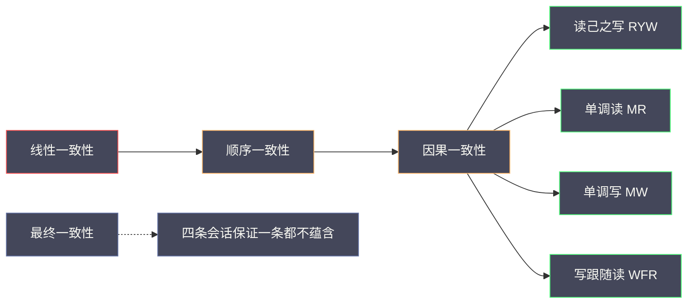
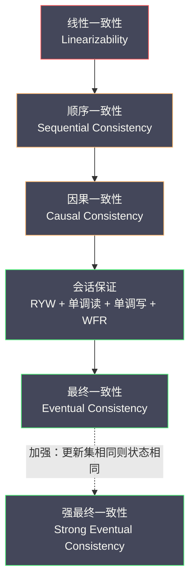
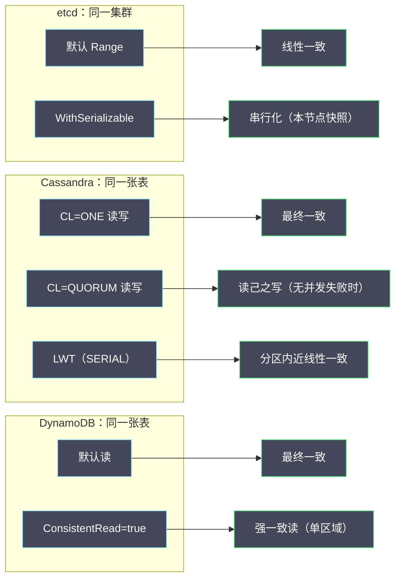
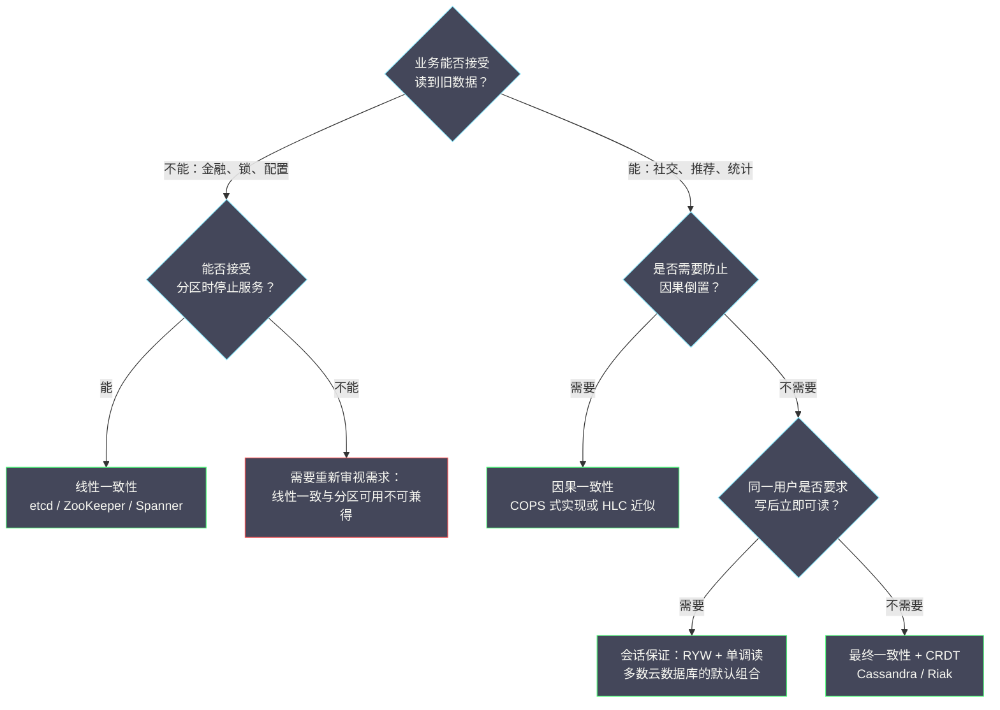

# 09 分布式系统的一致性模型谱系

**摘要：**

「一致性」是分布式系统里出现频率最高、歧义也最重的词之一。数据库事务的 ACID 里有一个 C，CAP 定理里有一个 C，副本复制里有一个「副本一致性」，事务隔离级别里又有一整套关于可见性的说法，这四个所指彼此并不相通，把它们混为一谈，是工程讨论中最常见的一类跑偏。本文沿着 1979 年 Lamport 为共享内存提出的顺序一致性、1990 年 Herlihy 与 Wing 给出的线性一致性形式化定义、1994 年 Terry 等人提出的会话保证、2009 年 Vogels 系统阐述的最终一致性这几条线索，把散落在不同子领域里的模型收拢成一条可以比较强弱、可以按异常反查的谱系。全文按五问推进：一致性模型究竟是什么，为什么需要一条谱系而不是强与弱的二分，模型选错会踩到什么坑，这些模型在 Spanner、Dynamo、Cassandra、etcd、Riak 里各自落在哪一档，以及每一条承诺在什么条件下会失效。读完应当能回答两个问题：所谓「强」究竟强在约束了哪一类执行历史；以及在自己的业务里，该拿哪些异常去反推模型，而不是在强弱的滑杆上凭感觉挑一档。

---

## 第 1 章 四副面孔，一条谱系

### 1.1 同一个词被四个领域征用

在分布式系统的技术讨论里，很少有一个词像「一致性」（Consistency）这样，同时被四个互不相通的子领域征用，而每一次征用都带着一套自己的定义与验收方式。数据库的人说「这个事务要保持一致性」，谈的是业务约束在事务前后都成立；做副本复制的工程师说「我们这里是强一致」，谈的是多个副本的读写能不能表现得像一份数据；做缓存的工程师说「最终会一致」，谈的是两边能不能收敛；DBA 说「隔离级别是可重复读」，谈的又是并发事务之间能看见什么。四句话都用了同一个词，内涵却几乎不重叠，把它们放在一张会议桌上讨论，往往在第一个回合就走偏。

第一种是 ACID 中的 C。事务的原子性（Atomicity）、一致性（Consistency）、隔离性（Isolation）、持久性（Durability）四条性质里，只有这一条不由数据库实现负责：它要求事务把数据库从一个满足约束的状态带到另一个满足约束的状态，约束包括外键、唯一索引，也包括「余额不得为负」这类业务规则。数据库能做的只是不破坏这些约束，约束是什么、由谁定义，完全在应用层；一个「一致」的事务因此完全可能读到过期数据，两个「一致」根本不在一个层面上说话。

第二种是 CAP 中的 C。2000 年 Brewer 在 PODC 的主题演讲里提出这组三选二的取舍，2002 年 Gilbert 与 Lynch 给出形式化证明，其中的 C 有明确语义——线性一致性，即所有副本上的操作看起来原子地瞬间完成，并与真实时间顺序相容。它的强度远超很多人的想象。

第三种是副本一致性（Replica Consistency），本文的主角。它描述分布式存储里多个副本在不同时刻对客户端呈现的数据视图能有多接近，以及系统愿意为此付多大协调成本。一致性模型因此不是形容词，而是一份合约：系统承诺满足某条模型，客户端就能依据它推断自己能看到什么。从线性一致性到最终一致性，这些合约构成一条可以逐级放松的谱系。

第四种是事务隔离级别（Transaction Isolation Level），描述并发事务之间的可见性，按 ANSI SQL-92 的划分有读未提交、读已提交、可重复读、可串行化四档，用来挡住脏读、不可重复读、幻读这几类异常。它与副本一致性有交叉，但回答的不是同一个问题。

| 术语 | 出处 | 关注什么 | 由谁保证 |
| :--- | :--- | :--- | :--- |
| ACID 的 C | 数据库事务 | 业务约束在事务前后成立 | 应用逻辑 |
| CAP 的 C | 分布式系统 | 多副本的写可见性 | 分布式协议 |
| 副本一致性 | 复制存储 | 多副本对外呈现的语义强弱 | 复制协议 |
| 事务隔离级别 | 数据库并发 | 并发事务之间的可见性 | 数据库 |

> [!info] 先对齐术语，再讨论方案
> 工程里最常见的一句含混表述是「我们的系统是强一致的」，这句话至少可以对应四种解读：业务约束不会被破坏、实现了线性一致性、副本最终会收敛、事务是可串行化的。四种解读的实现难度与性能代价相差几个量级，用同一句话把它们打包，讨论就不可能收敛。听到「一致性」时先追问一句「哪一种」，比事后返工便宜得多。

### 1.2 四条并行演化出来的支线

这四个含义之所以撞车，并不是因为有人用错了词，而是因为它们各自在不同的年代、为不同的器物而生，后来才被摆到同一个货架上。

ACID 这个词本身要到 1983 年才由 Härder 与 Reuter 在讨论事务恢复的论文里定型，它继承的是 1970 年代关系数据库对事务的要求：事务要么全做、要么全不做，做完之后约束仍然成立。副本一致性则来自另一个传统：1979 年 Lamport 为多处理器共享内存定义顺序一致性，1980 年代分布式存储开始讨论多副本读写的语义，1990 年代因果一致性与会话保证相继成形，关注点始终是「多个副本、多个客户端之间，谁先看见什么」。CAP 定理是第三个来源，它把「分区发生时一致性与可用性不可兼得」这个工程直觉抬成了定理，其中的一致性沿用了副本一致性里最强的那一档。隔离级别是第四个来源，它来自数据库并发控制，1992 年被写进 SQL-92 标准，而标准里的定义直到 2000 年前后才被 Adya 等人指出存在歧义。

四条支线并行演化了二三十年，各自养出一套术语习惯，等到云原生把数据库、缓存、协调服务、消息队列塞进同一个系统，这四套习惯就在同一份架构评审文档里碰了头。由此可见，混乱的根源不是谁不严谨，而是「一致」这个通用词被四个领域各自借走，谁也没有义务为别人的用法负责。

### 1.3 执行历史：把模型写成可判定的条件

要给这么多模型排出强弱，先得有一把共同的尺子。这把尺子就是执行历史（Execution History）：一段执行过程留下的记录，每条记录是一次操作，包含操作类型（读或写）、作用的对象、参数、返回值，以及调用与返回这两个时刻。两个时刻之间有间隔，这个间隔是后面所有讨论的关键——操作不是瞬时的，它在某个时间区间里悬着，只有返回之后才算有了确定的结果。

```
一条操作记录：
  op = (类型, 对象, 参数, 返回值, 调用时刻 t_inv, 返回时刻 t_res)

实时序（real-time order）：
  op_a <_rt op_b   当且仅当   t_res(op_a) < t_inv(op_b)

顺序历史（sequential history）：
  所有操作的调用与返回首尾相接，没有重叠

合法（legal）的顺序历史：
  每个读返回的值，等于该对象在此前最近一次写写入的值
```

有了这套记号，一致性模型就可以被定义成一句话：它规定哪些执行历史是合法的。一个模型越强，它认可的合法历史越少，对实现的约束越多；一个模型越弱，它认可的合法历史越多，实现可以更自由、更快、更便宜。所谓「线性一致性比最终一致性强」，翻译过来就是「线性一致性认可的历史集合，是最终一致性认可的历史集合的一个真子集」。

由此还得到一个更实用的推论：区分两个模型不必背定义，只要找到一个在强模型下非法、在弱模型下合法的历史，它就是两者的分界线。这类历史在文献里叫异常（Anomaly），第 7 章那张对照表，本质上就是把每个模型「多允许了哪些历史」逐行列出来。

### 1.4 强不是好，弱不是差

把模型排成一条从强到弱的线之后，很容易滑向另一个极端：既然强模型能保证更多，那就尽量往强的一端靠。这种直觉在单机时代也许成立，在分布式系统里几乎总是错的，因为强度是用协调换来的。

强模型要求系统在所有副本之间建立某种共同认知，而建立共同认知必须通信、必须等待、必须在网络分裂时放弃一侧的可用性。线性一致性的每一次写都要等多数派确认，每一次读都可能要一轮心跳；因果一致性要给每条写入附带因果依赖的元数据；而最终一致性只需要在后台把变更慢慢推出去。换句话说，谱系上每往下走一格，省下的都是同一类成本：协调。

但「更强」与「更合适」是两个不同的维度。一份商品详情页的浏览量统计，用线性一致性去写，等于给每一次浏览安排一次多数派往返，用户不会因为数字晚几秒更新而投诉，运维却要为这份用不上的保证付账单；反过来，一条转账指令如果在故障切换后读到过期余额，损失就是真金白银。选择模型的正确姿势因此不是「往强的一端爬」，而是「找到业务真正需要的那一档」，再多一分都是浪费。

---

## 第 2 章 线性一致性：把每个操作压成一个点

### 2.1 1990 年的那条定义

线性一致性（Linearizability）的定义由 Herlihy 与 Wing 在 1990 年给出，论文的标题是《Linearizability: A Correctness Condition for Concurrent Objects》，出发点并不是分布式数据库，而是并发对象的正确性——一个被多个线程同时操作的队列、寄存器或者集合，什么样的执行才算没有出错。他们给出的答案后来被整个分布式存储领域借走，因为把「线程」换成「客户端」、把「共享对象」换成「远端副本」，问题的结构一模一样，只是把进程内的竞争换成了跨网络的竞争。

形式化的表述分三步。第一步，把执行补全：那些调用之后没有返回的操作，可以在历史里被删除，也可以补上一个任意合法的返回值，只要不与已有结果冲突；补全之后得到的历史记为 H'。第二步，在 H' 的全部操作上找一个全序 S，要求 S 中每个读返回的值，恰好等于该对象在 S 中它之前最近一次写写入的值，也就是 S 必须是一个合法的顺序历史。第三步，要求 S 尊重实时序：只要一个操作在另一个操作开始之前就已经返回，前者就必须排在后者前面。

这三步合起来，等价于一句更好记的话：整个系统看起来就像只有一台服务器，所有操作在这台服务器上排成一队依次执行，而每个操作的执行瞬间，落在它自己的调用与返回之间。这个「执行瞬间」是线性一致性全部力量的来源——**把有长度的操作压缩成一个点**之后，「并发」被定义成区间的重叠，「先后」被定义成区间的分离，中间没有第三种状态。

### 2.2 两类被禁止的历史

明确了定义，就能举出线性一致性绝不允许的两类历史。第一类是读到过时值（Stale Read）：写操作已经返回成功，之后才发起的读却读到更早的值。它直接违反定义——写已返回、读在其后调用，实时序要求读排在写后面，而读返回旧值说明全序里读排到了写前面。

```
时间线（横向为时间推进）：

写 W：|--写入 x=1--|                    （W 在 T2 返回）
读 R：                |--读 x--|        （R 在 T2 之后才调用）

线性一致性要求：R 必须返回 x=1
若 R 返回 x=0（初始值），则该历史不满足线性一致性
```

第二类是时间倒流（Time Travel）：同一个客户端先完成一次写，随后自己读到的却是写之前的值。它比第一类更刺眼，因为连「自己的操作按程序序生效」都被破坏了。不过要留意一个容易混淆的边界：如果一个读在写完成之前就已经发出，它读到旧值是完全合法的——线性一致性约束的是已完成操作之间的顺序，不约束与写重叠的那个读。

```
时间线：

T1：客户端 A 写 x=1，写操作返回成功
T2：客户端 A 读 x，返回 x=0

读发生在写完成之后，却看到了写之前的值。
这个历史不满足线性一致性：它要求读写之间至少存在一个
与实时序相容的全序，而这里任何全序都无法同时满足两点。
```

线性一致性允许的是另一种自由：两个调用时间重叠的操作，谁先谁后都可以。一个读与一个写并发，读返回新值或旧值都合法，只要存在某个全序能同时解释这两个结果——它不要求「实时感知」，只要求「事后可以这样解释」。

### 2.3 局部性：为什么可以逐个对象验证

线性一致性有一条别的强模型没有的性质：**它是局部的（local）**。Herlihy 与 Wing 在论文里证明，一个历史整体上线性一致，当且仅当它在每一个对象上分别线性一致。工程意义很直接：实现者可以对每个 key、每个分区独立地做共识，不必把全局对象塞进同一条日志；验证者也可以逐个对象地检查，不必处理对象之间的交叉。

这条性质同时划出了能力边界：它只管单个操作。一份转账要同时改两个账户，两个账户各自线性一致，中间仍然存在「A 已扣、B 未加」的瞬间被读到；挡住它要靠事务与可串行化，而不是把线性一致性调得更强。

### 2.4 代价来自三处结构性约束

线性一致性的贵，不是实现不够聪明，而是要求本身决定的。拆开看，代价来自三个地方。

第一处是等待全局顺序确定。线性一致性要求所有操作构成一个与实时序相容的全序，每个操作返回之前都得先确定自己在全序里的位置，而确定位置就必须等其他人——等多数派确认，等前一条日志落盘，等一次网络往返走完。等待是这份合约的题中之义，不是可以优化掉的实现细节。

第二处是协调多个副本。要让多个副本对「谁先谁后」达成一致，就要有一套共识机制：多数派投票、领导者串联、日志复制，每一样都消耗往返与磁盘同步。三副本集群里一次写至少等一个对端确认，跨机房时这个对端可能在一百公里之外，延迟由此进入每一次写。

第三处是分区时放弃一侧。网络把集群切成两半，两侧都还能运行，但只有拿到多数派的那一侧可以继续服务，少数派那一侧即使数据完好也必须拒绝写入，否则两侧各自排序，全局唯一顺序就不复存在。这就是 CAP 里 CP 一侧的全部含义：**线性一致性在分区面前没有便宜的解法，它只能选择停服。**

### 2.5 三种把实时序变成等待的做法

真实系统实现线性一致性时，各自找到了一条把「实时序」变成「可观测等待」的路径。Spanner 的做法最直接：用 TrueTime API 把时钟误差压成一个有界区间，每次提交前主动等待一段不确定期（commit-wait），确保后开始的事务一定拿到更大的时间戳，实时序于是被物理时钟近似复现；论文报告的时钟误差在个位数毫秒量级，代价是每次提交都要多等这么久。

etcd 的做法是 ReadIndex：读请求不写日志，但领导者要先确认自己仍然是领导者，办法是记下当前的提交位置，再向多数派发一轮心跳，收到多数派回应且没有更高任期之后，等本地状态机追平这个位置再返回结果。ZooKeeper 的做法是把选择权交给客户端：从 Follower 读可能读到旧值，客户端若要读到最新，必须先调用一次 `sync()` 把该 Follower 与 Leader 对齐，再读。

三种做法形式不同，本质相同——都把「实时序」翻译成一次显式的等待。这也解释了线性一致读为什么比写便宜一个量级却仍然不免费：它省掉日志与落盘，省不掉确认与等待。

---

## 第 3 章 顺序一致性：允许倒流的强模型

### 3.1 1979 年，Lamport 给出的第一个形式化模型

顺序一致性（Sequential Consistency）比线性一致性早了十一年，由 Lamport 在 1979 年的论文《How to make a multiprocessor computer that correctly executes multiprocess programs》里提出。它的目标不是分布式存储，而是多处理器共享内存：多个处理器各自读写同一块内存，编译器和硬件会重排指令、缓存会推迟可见性，什么样的执行才不算错。

定义与线性一致性只差一条。同样要求存在一个全序 S，同样要求 S 是合法顺序历史，但 S **只需要尊重每个进程自己的程序序（program order）**，不需要尊重跨进程的实时序。换成通俗的话：所有处理器看到的是同一份操作序列，但这份序列可以把真实时间打乱，只要每个处理器自己的操作保持原有次序。

这条差别看似细微，世界观却完全不同。线性一致性假设存在一个全局可用的「现在」，所有客户端共享同一根时间轴；顺序一致性放弃了这个假设，它承认每个进程只活在自己的时间里，系统只需给出一份所有人都同意、且不违背各自程序序的叙事。1979 年的多处理器正是这种处境：没有全局时钟，硬件也拿不到跨核的精确先后。

### 3.2 差在实时序上的一个例子

两个模型的差别，用一个两客户端两变量的例子最容易看清。两个客户端各自先写一个变量，再读另一个变量，四个操作在时间上有明确先后。

```
系统：客户端 C1、C2，变量 x、y，初始值均为 0

C1：写 x=1，然后读 y
C2：写 y=1，然后读 x

假设 C1 的写 x=1 在 C2 的读 x 之前已经返回。

线性一致性下：C2 读 x 必须返回 1。
  因为写已完成、读在其后发起，全序必须把写排在读前面。

顺序一致性下：允许 C1 读 y 返回 0、C2 读 x 返回 0。
  可以构造全序：写 x=1, 写 y=1, 读 y, 读 x
  这个全序尊重了两个客户端各自的程序序，
  却把两个写都排到了两个读之前，与真实时间相反。
```

这个例子说明，顺序一致性允许跨客户端的「时间倒流」，只要每个客户端自己看到的顺序自洽。很多工程师第一次看到这里会觉得荒唐：写明明已经完成，凭什么读不到。但在没有全局时钟的系统里，「已经完成」本身就依赖观察者——C1 收到写成功的回执，C2 并不知道，它没有任何本地信息能证明那个写发生过。

### 3.3 为什么工程上少见

顺序一致性比线性一致性弱，按常理应该更容易实现、性能更好，但在真实系统里它反而罕见。原因在于它的位置：它仍然要求所有节点对一份全序达成一致，因此仍然需要全局协调，性能上与线性一致性处在同一档；它比因果一致性强出来的那部分，又恰好是业务最不需要的部分——业务在意的是「别让回复出现在提问之前」，很少在意「两个并发操作谁先谁后」。**两头都不占优**，是它被跳过的真实原因。

它真正的主场在别处。多处理器共享内存里，顺序一致性是一整套内存模型（Memory Model）的基准：x86 的 TSO 在它基础上允许写缓冲导致的写写重排，ARM 与 Power 的模型更弱，Java 内存模型则用 volatile 与 happens-before 给出可编程的近似。消息队列里也能看到它的影子：Kafka 保证同一分区内消息有序，跨分区没有全局顺序，从不同分区读到的相对顺序可以不一致——这是「分区内保序、分区间任意」的形态，只是全序只在分区内成立，比顺序一致性还弱一层。

### 3.4 谱系的坐标系原点

顺序一致性在工程上不常被选中，在概念史上却处在原点位置。它是第一个被严格形式化的一致性模型，此后所有模型都可以看作在它身上做加减：线性一致性加上实时序，因果一致性放松对并发操作的全序要求，会话保证把约束收窄到单个客户端，最终一致性几乎撤掉了所有约束只留下收敛。

理解了这层关系，很多定义就不用死记：因果一致性是「顺序一致性减去并发操作的全序」，线性一致性是「顺序一致性加上实时序」。这也解释了为什么教材总把顺序一致性放在谱系中央——**它不是最常用的模型，却是理解其他模型的坐标系**；一个概念可以同时「作为实践选项不常用」与「作为理解工具极重要」。

---

## 第 4 章 因果一致性：只对看见过的过去负责

### 4.1 因果序与模型定义

因果一致性（Causal Consistency）的出发点是一个朴素的观察：用户能感知到的矛盾，绝大多数不是「读到了旧值」，而是「看到了结果却没看到原因」。一条评论出现在它所属的帖子之前，一条回复出现在它回复的消息之前，一个删除操作被看见而创建操作还没被看见——这类历史让人一眼就看出系统出了问题，而单纯的旧值往往无感。

要形式化这一点，先要定义因果序。Lamport 在 1978 年用 happens-before 关系描述了这件事：同一进程内按程序序，A 在 B 之前发生；若 A 是一次写而 B 读到了 A 写的值，A 也在 B 之前发生；这个关系还要传递。三条合起来得到偏序 A → B。注意它是**偏序而不是全序**，两个没有因果路径的操作被称为并发（concurrent），彼此没有先后。

因果一致性要求的正是：如果 A → B，那么任何进程在观察到 B 的效果之前，必须已经观察到 A 的效果；而对于并发的两个操作，不同进程可以以不同顺序观察，系统不强制统一。把这句话落到存储语义上，就是两次并发写可以在不同副本上以不同顺序可见，但任何一次读都不能看到「结果先于原因」的组合。

### 4.2 它消除了哪一类异常

用第 3 章那种对照的方式，可以看清因果一致性与顺序一致性、最终一致性各自的分界。

```
场景一：三个进程 P1、P2、P3

P1 写 x=1
P2 读到 x=1，据此写 y=1        （因果关系：x=1 → y=1）
P3 先看到 y=1，再看到 x=1

因果一致性：不允许。P3 看到 y=1 时，必须已经看到 x=1。
顺序一致性：同样不允许，全序必须让 x=1 排在 y=1 之前。

场景二：两个并发写

P1 写 x=1，P2 写 y=1，两者没有因果路径
P3 先看到 y=1，再看到 x=1

因果一致性：允许。并发操作本来就没有先后，任意顺序都合法。
顺序一致性：不允许。它要求所有进程看到同一份全序。
最终一致性：允许，而且连「原因先于结果」也不保证。
```

两个场景把界线划清楚：因果一致性禁止因果倒置，允许并发乱序。这条界线正是它能在去中心化系统里落地的原因——不用给并发操作排定全局顺序，就不需要领导者与多数派投票，每个副本只需按因果依赖等前置操作到齐。

### 4.3 通信层的因果有序与语义层的因果一致

「因果」这个词在分布式系统里至少出现在两个层次上，混淆它们是理解因果一致性的第一道坎。

第一个层次是通信层的因果有序（Causal Order）：如果消息 A 因果先于消息 B，那么所有节点都按 A 先 B 后的顺序投递。它约束的是消息传递协议，属于实现手段。第二个层次是语义层的因果一致性：如果操作 A 因果先于 B，那么任何节点在让 B 的效果可见之前，必须已经让 A 的效果可见。它约束的是系统对外的可见性，属于目标。

两者的关系是充分而非必要：如果通信层保证了因果有序，上层自然满足因果一致性；但因果一致性还有别的实现路径，譬如用向量时钟记录依赖、在本地建立等待队列，等前置版本到齐再对外提供读服务。把手段当目标，就会出现「我的消息队列保证了因果有序，所以我的存储就是因果一致的」这类误判——消息有序只说明投递不越位，不说明读操作不会返回一个不完整的因果切片。

### 4.4 三条落地路径与各自的账单

因果一致性在工业界有三类实现路径，它们的差别主要在「因果上下文放在哪里」。

第一条路是客户端携带因果上下文。客户端记住自己上次读到的版本集合，写入时把这份依赖一起带上，服务端据此判断这次写必须排在哪些写之后。COPS 在 2011 年用这条路径把因果一致性做到了跨数据中心规模，代价是依赖元数据随客户端数量增长，还需要一套机制去回收已经稳定下来的依赖。

第二条路是服务端维护依赖图。服务端记录操作之间的因果关系，传播时按依赖顺序推进，客户端完全无感。这条路径简化了客户端，却把复杂度压到了服务端：依赖图的规模、跨分区的传递、故障恢复后的重建，每一项都不轻。

第三条路是用物理时钟近似。混合逻辑时钟（Hybrid Logical Clock，HLC）把物理时间戳与逻辑计数拼在一起，在时钟大致同步的环境里给出接近因果序的全序，CockroachDB 用它降低跨节点事务的等待。这条路的账单是「时钟假设」：偏移一旦超出补偿范围，近似的因果序就会出错，且错得最难排查——偶发、无法复现的旧值。

---

## 第 5 章 会话保证：把一致性下放到客户端

### 5.1 1994 年，Terry 与四个「客户端视角」

全局模型的约束是对所有客户端一视同仁的，但真实业务里大量场景只需要「我自己看到的东西自洽」，不需要「所有人同时看到同一份历史」。Terry 等人在 1994 年的论文《Session guarantees for weakly consistent replicated data》里把这类需求整理成了四条，每条都只约束单个会话（Session）内的操作序列，四条可以独立启用、任意组合。

这个思路把一致性从「系统的属性」变成了「会话的属性」：系统不必对所有人承诺一个强模型，只需为每个会话提供若干条保证，体验就能到位，副本之间仍可异步复制。今天云数据库里那些「读己之写」「一致性读」开关，血统都在这里。

### 5.2 四条保证的精确含义

第一条是读己之写（Read Your Writes，RYW）：在一个会话内，一次写 W 返回成功之后，该会话的读必须能看到 W 或比 W 更新的值。它**只约束「自己写的」**，不保证看到别人的并发写，也不保证跨会话成立——另一个用户在同一时刻可能仍然读到 W 之前的值。

第二条是单调读（Monotonic Reads，MR）：在一个会话内，一次读返回版本 v 之后，该会话后续的读不得返回比 v 更旧的版本。它挡的是时间倒流：同一个用户刷新两次页面，第一次看到三条评论，第二次看到两条，这种错乱比读到旧值更让人困惑。实现上它不要求所有副本最新，只要求同一会话的读落在「不倒退」的副本上。

第三条是单调写（Monotonic Writes，MW）：在一个会话内，写操作按发出的顺序被系统接受。看似天经地义，在异步复制与多主写入的系统里却需要额外保证——两次写若经由不同路径到达不同副本，后发先至完全可能，而「先建目录、再在目录下建文件」这类有依赖的写序列一旦乱序，就会产生一个不存在的父目录。

第四条是写跟随读（Writes Follow Reads，WFR）：在一个会话内，一次读返回版本 v 之后，该会话的写必须建立在 v 或更新的版本之上。它挡的是「基于旧值写回」：用户读到库存 10、改成 9 提交，若这次提交落在一个只见过库存 12 的副本上，就会把别人的修改悄悄覆盖掉。

### 5.3 实现：一个随身的书签

四条保证的实现思路可以概括成一句话：给每个会话配一个书签，读写都带着它走。书签里至少要记录这个会话已经观察到的最新版本，服务端据此决定把请求路由到哪个副本、或者让请求在副本上等多久。

```python
# 会话令牌：客户端随身携带，服务端据此判断「不能倒退」
session = {
    "client_id": "u-8821",
    "last_write": 10432,   # 本会话最近一次成功写入的版本号，供 RYW 使用
    "read_floor": 10430,   # 本会话读到过的最新版本，供单调读使用
    "deps": [10428, 10430] # 本会话读到的依赖集合，供写跟随读使用
}

# 服务端收到读请求时的两种处理
# 1) 副本版本 >= read_floor：直接读
# 2) 副本版本 <  read_floor：等待追平，或改路由到更新的副本
```

实现这套机制有几种形态。粘性路由（sticky routing）把同一会话的请求固定打到同一个副本，用「不换地方」换「不倒退」，代价是负载不均、副本故障时会话要迁移。版本令牌（version token）让客户端携带版本号，服务端按令牌选副本或等待，代价是令牌要在链路上完整传递，任何一跳丢失都会让保证退化。还有读修复（read repair）：读到旧值时顺手把新值写回该副本，用一次额外的写换后续读的正确。

### 5.4 组合起来是什么

四条保证可以任意组合，组合出来的效果与代价并不相同。下表把实现开销、用户感知与典型场景并列，最有信息量的一列是「用户感知」。

| 会话保证 | 实现开销 | 用户感知 | 典型场景 |
| :--- | :--- | :--- | :--- |
| 读己之写 | 中等（版本追踪或粘性路由） | 高（提交后刷新能看到） | 个人资料修改、购物车 |
| 单调读 | 低（粘性路由或版本下限） | 中（避免页面内容倒退） | 任何读密集的列表页 |
| 单调写 | 低（会话内排队） | 低（用户不直接感知） | 多步骤表单、目录树写入 |
| 写跟随读 | 中等（记录读依赖） | 低（用户不直接感知） | 评论、协作编辑、库存扣减 |

最常见的组合是「读己之写加单调读」。前者解决「我改的东西自己看不见」，后者解决「刷新之后东西变少了」，这两类问题用户一秒钟就能察觉；后两条更多是内部正确性要求，用户感知不到却会在数据上留痕。把**用户能感知的保证**做到位，往往比把四条全部打开更划算——每多一条保证，就多一份版本追踪与路由约束，系统能容纳的故障形态就少一种。

### 5.5 模型与会话保证的支撑关系

全局模型与会话保证不是同一层的东西，但存在明确的支撑关系：一个强模型如果能保证某种全局顺序，那么它自动为每个会话提供对应的保证；反过来则未必。下面这张图画出了这层关系。



图里最要紧的一条边，是因果一致性指向四条会话保证的箭头。会话内的操作天然构成因果链——你写的、你读到的、你随后写的，彼此都有 happens-before 关系——只要系统满足因果一致性，四条会话保证就自动成立。这也是为什么系统宣传「因果一致性」时，用户看到的其实是「不会读到自己的旧值、页面不会倒退」这些会话级体验。

反向不成立：系统即使给每个会话配齐四条保证，也推不出全局因果一致，因为因果链可以跨会话——A 写完、B 读到、C 再从 B 那里间接得知。会话保证只保证每个客户端自己那段故事讲得通，不保证所有人拼起来是同一个故事。最终一致性则一条都不蕴含，它是图上唯一没有箭头出发的节点。

---

## 第 6 章 最终一致性：只承诺收敛

### 6.1 「最终」这个词留下的三个空洞

最终一致性（Eventual Consistency）在 2009 年由 Werner Vogels 在《Eventually Consistent》一文里做了系统阐述，论文的语境是 Amazon 一类的大规模电商系统：跨数据中心的强同步代价太高，业务又必须一直可用，于是接受「副本可能短暂不一致」。它的定义只有一句话：如果没有新的更新，那么经过足够长的时间，所有副本最终会收敛到相同的状态。

这句话弱到近乎空洞，而空洞恰好是它被广泛采用的原因，也是它被误解的原因。定义里有三个缺口：第一，「最终」没有时间上界，可以是几毫秒也可以是几分钟，取决于复制链路的健康程度；第二，收敛期间的行为没有任何约束，读可以返回任意一个曾经存在过的版本，包括比上次读到的更旧的版本；第三，它只说「收敛到相同状态」，不说「收敛到什么状态」——两个副本各自接受一次并发写，最后留下谁的值，定义不回答。最后这个缺口最关键：最终一致性不是一个完整的方案，**它只承诺收敛，不承诺收敛到哪里**。

### 6.2 收敛值由冲突解决策略决定

既然定义不回答「收敛到什么」，系统实现就必须自己补一个答案，这个答案就是冲突解决策略，而它往往比一致性模型本身更能决定系统的实际行为。

最常见的策略是最后写入者胜（Last-Write-Wins，LWW），按时间戳取最大者。它实现简单、元数据少，代价是把「正确」交给时钟：两个客户端并发写同一个 key，谁的时钟走得快谁的值留下，而物理时钟偏移在跨机房环境里是常态，被丢弃的写入不报错也不留痕。第二类是版本向量（Version Vector），副本互交版本，发现分叉就把多个版本都留给客户端合并——这要求业务代码处理「同一行有两个版本」的状态，Riak 早期正是这条路。第三类是 CRDT，把数据结构设计成可自动合并的形状，让冲突在数学层面消失。

这三种策略对应三种工程哲学：**相信时钟、相信应用、相信数据结构**。信任对象不同，出错方式也不同——相信时钟的会在时钟跳变时静默丢数据，相信应用的会在漏写合并逻辑时留下脏数据，相信数据结构的会把约束压到建模阶段，逼你先想清楚「这份数据到底能不能合并」。

### 6.3 强最终一致性与 CRDT

2011 年 Shapiro 等人在《Conflict-free Replicated Data Types》里给最终一致性加了一条更强的约束，称为强最终一致性（Strong Eventual Consistency，SEC）：任何两个副本，只要接收到的更新集合相同（顺序可以不同），就必须处于相同的状态。这条约束把「最终」从一个时间概念变成了一个集合概念——不需要等，只要更新到齐，状态必然一致。

满足 SEC 的条件是更新操作满足交换律与幂等性：先应用 A 再应用 B，与先 B 后 A 结果相同；同一条更新应用两次与应用一次结果相同。CRDT 就是把数据结构设计成满足这两条的技术，常见的几种各有其形：G-Counter 只增不减，每个副本维护自己的计数，合并时逐位取最大值；PN-Counter 用两个 G-Counter 分别记录增与减；LWW-Register 用一个带时间戳的值，合并时取时间戳大的；OR-Set 用唯一标记追踪每一次添加，删除时只移除自己观察到的那些标记，从而正确处理并发添加与删除。

```python
# G-Counter：每个副本只改自己那一格，合并时逐格取最大
state = {"node-a": 3, "node-b": 5, "node-c": 0}

def merge(a, b):
    # 交换律：merge(a, b) == merge(b, a)
    # 结合律：merge(merge(a, b), c) == merge(a, merge(b, c))
    # 幂等律：merge(a, a) == a
    return {k: max(a.get(k, 0), b.get(k, 0)) for k in set(a) | set(b)}

def value(s):
    return sum(s.values())   # 读出来的值只增不减，天然收敛
```

CRDT 的价值在于把冲突解决从「运行时的人工决策」搬到「设计时的数学性质」：类型选对，合并在任何顺序、任何重复投递下都得到同一结果，副本之间无需协商。这条思路与「把不确定性前移到设计阶段」的传统一脉相承，代价是表达能力受限于那几条代数性质。

### 6.4 CRDT 的三条边界

CRDT 常被当成「无冲突」的同义词，但它有三条明确的边界，越过任何一条都会失效。

第一条边界是数据语义必须可合并。计数器、集合、寄存器、映射可以合并，因为它们有公认的合并方式；「账户余额」「库存精确数」不行，两个版本的余额之间不存在客观正确的合并结果——取最大会多出钱，取最小会少发货，求和会凭空造出购买力。这类数据要么走强一致，要么走「预留加补偿」的流程。

第二条边界是合并必须满足代数性质。设计一个自定义 CRDT 时，交换律、结合律、幂等律三条都要逐一验证，尤其是删除语义：集合的删除与添加并发时，若不用标记追踪，合并结果会依赖应用顺序，SEC 立刻不成立。

第三条边界是删除需要墓碑。为了让「并发添加与删除」可判定，CRDT 往往要保留被删除元素的标记，这些墓碑会随删除次数增长，回收它们又需要一套「所有副本都见过这条删除」的判定机制。墓碑不回收，存储会膨胀；回收得太早，晚到的更新又会把已删元素复活。这条边界最容易被低估，也是 CRDT 在生产环境里最常出问题的地方。

---

## 第 7 章 谱系：强弱、异常与它们的关系

### 7.1 强弱偏序

把前面几章的模型放到一张图上，就得到本文的主图。箭头方向从强到弱：上方的模型满足之后，下方模型的要求自动成立（个别例外在第 7.3 节说明）。



这张图传达的核心信息是单调递减：越往上，约束越多、协调越重、延迟越高、分区时越容易停服；越往下，约束越少、实现越轻、越能扛住分区，代价是应用要自己处理更多异常。强弱不是价值判断，它描述的是「系统替你承担了多少」。

### 7.2 用异常给模型定位

模型的定义读起来抽象，异常列表读起来具体。下表把六类常见异常与五个模型并列，标出每个模型是否允许该类异常出现；空白格里写「不允许」的，就是该模型用协调换来的东西。

| 异常类型 | 线性一致 | 顺序一致 | 因果一致 | 会话保证 | 最终一致 |
| :--- | :---: | :---: | :---: | :---: | :---: |
| 读到过期值（跨客户端） | 不允许 | 不允许 | 允许 | 允许 | 允许 |
| 跨客户端时间倒流 | 不允许 | 允许 | 允许 | 允许 | 允许 |
| 因果倒置（结果先于原因） | 不允许 | 不允许 | 不允许 | 允许 | 允许 |
| 单会话内时间倒流 | 不允许 | 不允许 | 不允许 | 不允许（单调读） | 允许 |
| 写后读不到自己写的值 | 不允许 | 不允许 | 不允许 | 不允许（读己之写） | 允许 |
| 并发写产生多版本 | 不允许 | 不允许 | 允许 | 允许 | 允许 |

表里「会话保证」一列按同时启用读己之写与单调读计算。这张表也是理解「弱」的入口：弱模型不是错的模型，它只是允许了更多合法的执行历史，而每一格从「不允许」变成「允许」，都是把一份协调成本转嫁给了应用。

### 7.3 这条链不是严格的包含关系

把模型排成一条链表，是教学上的简化，严格来说并不成立，有两条例外值得点破。

第一条例外出在顺序一致性与因果一致性之间。若因果关系按「同一进程内程序序加读写依赖」定义，顺序一致性确实蕴含因果一致性：全序尊重程序序，读写依赖链自然也不会倒置。但若因果关系的定义包含消息传递——A 发消息、B 收消息——顺序一致性的模型里根本没有消息这个概念，两者就互不包含。教材上把它们排成上下级，是一种**工程直觉上的近似**。

第二条例外出在最终一致性与强最终一致性之间。SEC 不是「比最终一致性更弱」，它是在最终一致性之上加了一条约束，语义上更强——它要求收敛与更新顺序无关，而普通最终一致性允许「不同副本应用顺序不同导致最终值不同」。所以图里那条虚线应当读作「加强」，而不是「更弱」。

---

## 第 8 章 落地：模型在真实系统里的落点

### 8.1 一张分类表

前面讨论的都是模型，工程上更常问的是「这个系统属于哪一档」。下表把常见系统与它们对外承诺的语义对应起来，同一系统出现多行，是因为它们在配置层面提供了多档。

| 系统 | 一致性模型 | 说明 |
| :--- | :--- | :--- |
| etcd | 线性一致性（写与默认读） | 写走 Raft 多数派；读走 ReadIndex，可显式降级 |
| ZooKeeper | 写线性一致，读可过期 | 写经 Leader 多数派确认；Follower 读可能旧，需 `sync()` |
| Google Spanner | 线性一致性（外部一致性） | TrueTime 加 commit-wait，跨地域仍是严格可串行化 |
| CockroachDB | 线性一致性 | Raft 加 HLC，跨地域事务用时钟不确定性窗口等待 |
| Cassandra（ONE） | 最终一致性 | 单副本确认，读到哪台算哪台 |
| Cassandra（QUORUM） | 读己之写（有条件） | 读写多数派相交，但不保证全序与并发正确性 |
| Cassandra（LWT） | 分区内近线性一致 | 基于 Paxos 的比较并交换，跨分区不保证 |
| DynamoDB（默认读） | 最终一致性 | 异步复制，读可能旧 |
| DynamoDB（强一致读） | 线性一致性（单区域） | 读走主副本，延迟与可用性代价上升 |
| Riak | 最终一致性加版本向量 | 冲突以兄弟版本返回，由客户端合并 |
| Redis（单机） | 线性一致性 | 单线程串行执行，天然满足 |
| Redis（主从加 Sentinel） | 主节点读己之写，从节点最终一致 | 异步复制，故障切换可能丢已确认写 |
| MySQL（半同步主从） | 主节点线性一致，从节点最终一致 | 半同步保证至少一个从节点收到日志 |

表里最有价值的信息不是「谁强谁弱」，而是「同一系统的不同行可以差出好几档」——一个系统的一致性从来不是它的固有属性，而是它所处**配置与读写路径的属性**。

### 8.2 同一系统，不同配置，不同模型

把上表里的几行单独抽出来画成图，就能看清「配置即模型」这件事。



同一个 etcd 集群，默认读与串行化读差着一轮确认；同一张 Cassandra 表，一致性级别从 ONE 调到 QUORUM，读到的可能就是上一秒还读不到的值；同一张 DynamoDB 表，把 `ConsistentRead` 打开，延迟立刻上一个台阶。调参的人若不知道这些开关对应哪一档模型，只能凭感觉在盲盒里摸。

### 8.3 Spanner：用时钟把实时序买回来

Spanner 是「把线性一致性做到全球规模」的代表。它的做法不是消除跨地域延迟，而是让实时序变得可判定：TrueTime 把每个节点的时钟误差表示成一个有界区间 [earliest, latest]，提交事务时给事务分配一个时间戳，并等待到 `latest` 之后才允许提交，确保任何后开始的事务拿到的时间戳一定更大。这段等待就是 commit-wait，论文里报告的时钟误差在个位数毫秒量级，因此等待也是这个量级。

收益是外部一致性（External Consistency），也就是严格可串行化——事务之间既可串行化，又与真实时间一致；代价是每次提交多等一段不确定期，且整套机制依赖 Google 自建的原子钟与 GPS 接收器。这一条几乎不可复制：**Spanner 的强一致性不是软件算法的胜利，是「把物理时钟做到足够准」的胜利**，离开那套基础设施，同样的算法在普通机房会退化成频繁等待甚至不可用。

### 8.4 Dynamo 与 Riak：把冲突交还给应用

Dynamo 在 2007 年的论文里给出了另一条路径：用一致性哈希分区、用 hinted handoff 处理临时故障、用版本向量检测冲突、用「永远可写」的语义保证可用性。它明确放弃了强一致，把「多个版本并存」这个状态暴露给应用，由应用决定怎么合并。购物车是它最经典的例子——把两次「加入商品」合并成并集，比丢掉其中一次更符合用户预期。

Riak 继承这条路线，早期把版本向量的分叉以兄弟版本（Sibling）返回给客户端，客户端必须自己写合并逻辑；Riak 2.0 之后引入点分版本向量与一套 CRDT，把常见类型的合并交给库处理。好处是可用性极强、写延迟极低，代价是应用必须为每种数据类型想清楚合并语义，而这件事在快速迭代时最容易被忽略——先上线「取最后一个版本」，等数据出问题再回头补。

### 8.5 Cassandra：一致性级别不等于一致性模型

Cassandra 的配置项叫 Consistency Level，很容易让人以为它是一个「一致性模型选择器」，其实它只控制每次读写需要多少个副本应答，而这两件事并不等价。

把写设为 QUORUM、读也设为 QUORUM，读者与写者必然有交集，于是「读一定能看到最近一次成功的写」在无故障、无并发时成立，这就是读己之写的来源。但这不等于线性一致：并发写之间没有全序，冲突由时间戳决定，时钟偏移会让后发的写覆盖先发的写；跨分区的多 key 操作没有原子性；节点故障期间的一致性还可能因 hinted handoff 未完成而退化。Cassandra 的轻量事务（Lightweight Transaction）用 Paxos 在单个分区上实现比较并交换，才把这一小块区域提到接近线性一致的位置。

这个例子说明一件常被忽略的事：**一致性级别只是应答副本数的旋钮**，模型是「合法历史的集合」，两者之间隔着冲突解决、时钟假设、跨分区原子性三道坎。把旋钮当成模型，是选型中最常见的误判之一。

### 8.6 etcd 与 ZooKeeper：同为协调服务，读路径不同

etcd 与 ZooKeeper 常被放在一起比较，二者在写路径上都用多数派确认，承诺写线性一致；差别主要在读。

etcd 的默认读是线性的，走 ReadIndex：领导者先确认领导权，再等本地状态机追平读起点后返回；它也允许客户端显式降级为串行化读，直接读本地状态机，代价是可能落后于全局最新提交。ZooKeeper 的读默认落在客户端连接的那个节点上，Follower 的读可能返回旧值，需要最新时客户端要先 `sync()` 对齐。两者不是实现优劣，而是取舍：etcd 把「读到最新」做成默认，控制器因此可以直接依赖它做决策；ZooKeeper 把「读要快」做成默认，需要最新时显式声明。

### 8.7 选型：用四个业务判断代替一次术语比较

把上面的材料收拢，选型可以落到一张决策树上。它的主干是四个业务方大多能直接回答的问题，而不是四个技术术语。



这张树把「选一个一致性模型」翻译成「你能否容忍某类异常」。业务方回答得了「余额不能读旧值」，回答不了「你要线性一致还是顺序一致」；回答得了「分区时宁可停服」，回答不了「你要 CP 还是 AP」。把术语换成问题，讨论才有落点。

---

## 第 9 章 模型与事务隔离级别：两个维度

### 9.1 单操作与多操作

一致性模型与事务隔离级别常被混为一谈，因为两者都在说「可见性」，但它们约束的对象不同。一致性模型约束单个操作：一次读返回什么、一次写在什么时候可见。隔离级别约束一组操作构成的事务：一个事务的中间状态能不能被别的事务看见，两个事务并发执行的结果等不等价于某个串行顺序。

两个维度可以自由组合，语义差别很大。一个系统可以是「线性一致的、但事务只是读已提交」——每次读写原子且实时，事务之间却仍允许不可重复读；也可以是「可串行化的、但读是过期的」——事务内部一致，读到的却是几秒前的快照，快照隔离（Snapshot Isolation）正是这种组合，读不阻塞写、写不阻塞读，代价是读到的不是最新。

### 9.2 严格可串行化：两个维度都取最强

把两个维度都拉到最强，得到的是严格可串行化（Strict Serializability），也叫外部一致性：事务之间可串行化，且这个串行顺序与真实时间一致。Spanner 与 CockroachDB 对外的承诺正是这一档，代价是跨地域的每一次提交都要等时钟不确定窗口，吞吐随地域距离下降。

这是本文所有保证里的顶配。再看那些「既强一致又可串行化」的宣传，就能追问一句：这个可串行化满不满足实时序？不满足，它只是可串行化，不是外部一致；只在单分区内成立，连可串行化都要打折扣。Abadi 在 2012 年把这类取舍补全为 PACELC：不只分区时要在一致性与可用性之间选，没有分区时也要在延迟与一致性之间选，谱系上的每一档其实都对应一个延迟位置。顶配之所以贵，是因为它**同时买了两份协调**：一份给顺序，一份给时间。

### 9.3 四种常见的选型误判

第一种是把「强一致」当成「正确」的同义词。强一致只保证操作顺序可解释，不保证业务逻辑正确：库存扣减写成「先读后写」，底层即使线性一致，两个并发请求仍可能都读到 10、都写回 9。这类问题要由原子操作或事务解决，不能指望一致性模型替业务做判断。

第二种是把 quorum 交集当成线性一致。多数派读写保证读到的版本不旧于最近一次成功的写，但不保证并发写之间有全序，也不保证冲突解决正确；在时钟偏移、跨分区、节点故障的组合下，quorum 语义比看起来弱。

第三种是忽略读写路径的不对称。ZooKeeper 的写线性一致，读却可能过期；Cassandra 的读、写一致性级别可以分别设置；MySQL 的主库读与从库读差着整个复制延迟。只记住系统名、没记住路径，就会在「写完立刻读」的地方踩坑。

第四种是让缓存层悄悄改写模型。在强一致存储前面加一层本地缓存或 CDN，读路径瞬间退化成最终一致，配置文档里写的却仍是「底层线性一致」。这类隐式弱化最难排查，因为它不在任何一份架构图的主干上。

---

## 第 10 章 边界与反例：模型选错的代价

### 10.1 宣称与实现之间的距离

一致性模型的承诺写在纸上，系统的实际行为要靠检验。2013 年起，Kyle Kingsbury 以 Jepsen 为名对一批分布式数据库做黑盒检验：构造网络分区、时钟偏移、进程暂停等故障，再用检查器判断执行历史是否满足厂商宣称。结果是，多个宣称「强一致」的系统在特定故障组合下都出现过违反宣称的历史——丢失已确认的写、返回过期读、并发写互相覆盖。这些报告的价值不在证明某个产品不好，而在于揭示一条规律：**模型是设计意图，实现是代码**，两者之间的距离只能靠故障注入去丈量。

这条规律对使用者的含义是，选型时不能只看厂商的语义承诺，还要看这个承诺在什么故障模型下成立。一个只在「无分区、无时钟偏移、进程不暂停」的前提下成立的一致性保证，在真实机房里成立的窗口有多长，需要自己评估。

### 10.2 三类真实事故

第一类是「把过期读当成最新」。ZooKeeper 官方文档明确写了读可能返回旧值，要最新时先 `sync()`；但把它当配置中心或锁服务时，很多客户端直接从 Follower 读配置，再在旧配置上做决策——旧配置本身没错，错在决策者以为它是最新的。这类事故没有报错、没有告警，只在复盘时表现为「某台机器用了两分钟前的配置」。

第二类是「故障切换丢掉已确认的写」。Redis 的主从复制是异步的，主节点返回成功之后才把写推给从节点，主节点在推送完成前故障，切换后这次写就消失了；MySQL 的半同步复制、Kafka 的 `acks=all` 加禁止非干净选举，都是为堵这个缺口而存在的配置项。这类事故的共同点是**客户端收到过成功回执**，因此应用层重试无法补救，只能靠对账或人工修复。

第三类是「时间戳冲突解决静默丢数据」。以 LWW 作为冲突策略的系统里，两处并发写同一个 key，时间戳较小的一次被丢弃且不留痕迹；如果两个节点的时钟存在偏移，被丢弃的可能恰好是业务上更晚、更正确的那一次。这类问题在数据量小的时候几乎不出现，在跨机房部署、时钟漂移累积之后才零星冒头，排查成本极高。

### 10.3 模型不能替你做的三件事

一致性模型是一份关于「操作顺序」的合约，它管不到三件事。

第一件是业务不变量。转账要保证两边总额不变，这是跨对象约束，要事务或补偿流程来守，线性一致性只管单对象。

第二件是幂等与重试。客户端超时重试，同一次写可能被执行两次，一致性模型不区分两次请求是不是同一个意图；挡住重复要靠幂等键或去重表。

第三件是冲突的业务含义。两个用户同时改一份文档，系统只能告诉你「有两个版本」，哪个该留、怎么合并，是业务问题。把这三件事误当成一致性问题，就会出现「已经上了强一致，为什么还会错」这类困惑。

---

## 小结

把全文收拢，这份谱系可以读成一份分层定价的合约清单：线性一致性卖「像单机一样的全局顺序」，价格是多数派往返与分区停服；顺序一致性卖「所有人同一份顺序」，价格相近而收益打折，因此少见；因果一致性卖「原因先于结果」，价格是依赖元数据，换来去中心化系统里的可落地性；会话保证卖「每个客户端自己的故事讲得通」，价格是令牌传递与路由约束；最终一致性卖「最终会收敛」，价格最低，但收敛到哪里要应用自己回答。

这份清单的使用方式不是「往上挑一档」，而是「按异常反推」。业务方说不清「你要线性一致还是因果一致」，但说得出「余额不能读旧值」「页面不能倒退」「评论不能出现在帖子之前」；把这些回答翻译成异常清单，再对照第 7 章那张表反查，选型就从术语比较变成了需求核对。一致性因此不是越高越好的指标，而是**按场景定价、按需组合的成本项**——同一个系统里，配置、账本、缓存、统计各自落在不同档位，是完全正常的架构形态。

也正因为如此，评价一个系统的一致性，不该问「它是不是强一致」，而该问三个更具体的问题：哪条读写路径、在什么故障模型下、承诺的是哪一档。这三个问题有答案，讨论才有意义；没有答案，「强一致」三个字只是把分歧藏了起来。

---

## 参考资料

1. Herlihy, M., & Wing, J. (1990). Linearizability: A correctness condition for concurrent objects. *ACM Transactions on Programming Languages and Systems, 12*(3), 463–492.
2. Lamport, L. (1979). How to make a multiprocessor computer that correctly executes multiprocess programs. *IEEE Transactions on Computers, 28*(9), 690–691.
3. Lamport, L. (1978). Time, clocks, and the ordering of events in a distributed system. *Communications of the ACM, 21*(7), 558–565.
4. Ahamad, M., Neiger, G., Burns, J. E., Kohli, P., & Hutto, P. W. (1995). Causal memory: definitions, implementation, and programming. *Distributed Computing, 9*(1), 37–49.
5. Terry, D., Demers, A., Petersen, K., Spreitzer, M., Theimer, M., & Welch, B. (1994). Session guarantees for weakly consistent replicated data. *PDIS 1994*.
6. Vogels, W. (2009). Eventually Consistent. *Communications of the ACM, 52*(1), 40–44.
7. Shapiro, M., Preguiça, N., Baquero, C., & Zawirski, M. (2011). Conflict-free Replicated Data Types. *SSS 2011*.
8. Bailis, P., Davidson, A., Fekete, A., Ghodsi, A., Hellerstein, J. M., & Stoica, I. (2014). Highly Available Transactions: Virtues and Limitations. *VLDB 2014*.
9. Abadi, D. (2012). Consistency tradeoffs in modern distributed database system design: CAP is only part of the story. *IEEE Computer, 45*(2), 37–42.
10. Corbett, J. C., et al. (2012). Spanner: Google's globally-distributed database. *OSDI 2012*.
11. DeCandia, G., et al. (2007). Dynamo: Amazon's highly available key-value store. *SOSP 2007*.
12. Lloyd, W., Freedman, M. J., Kaminsky, M., & Andersen, D. G. (2011). Don't settle for eventual: scalable causal consistency for wide-area storage with COPS. *SOSP 2011*.
13. Kleppmann, M. (2017). *Designing Data-Intensive Applications*. O'Reilly Media. Chapter 9: Consistency and Consensus.

---

> [!note] 思考题
> 1. ACID 的 C、CAP 的 C、副本一致性、事务隔离级别是四种不同的「一致性」。请分别用一句话说明它们的含义，并指出：如果一个团队把「我们的系统是强一致的」当作验收标准，这句话会在哪三个环节失去可检验性？
> 2. 线性一致性比顺序一致性多了一层实时序约束。请构造一个「顺序一致性允许、线性一致性禁止」的历史，并解释为什么在 1979 年的多处理器语境里，实时序这条约束根本无从谈起。
> 3. 因果一致性声称能挡住「评论先于帖子」，却允许两个并发写以不同顺序可见。请说明：当一个水果店用因果一致性存储库存时，哪一类业务异常仍然会出现，这个异常该由哪一层负责？
> 4. 会话保证的四条中，「读己之写」与「单调读」被归为用户可感知，「单调写」与「写跟随读」被归为用户不可感知。请举一个反例，说明在什么业务场景下后两条的缺失会直接伤害用户。
> 5. 文中说「一致性级别只是应答副本数的旋钮，模型是合法历史的集合」。请以 Cassandra 的 QUORUM 为例，列出从 quorum 交集到线性一致性之间还差哪几道坎，并说明每一道坎在什么故障下会暴露。
> 6. 假设一个系统对外宣称「最终一致」，但把 LWW 作为冲突解决策略。请设计一组故障与并发场景，使系统的实际行为既违反用户直觉、又不违反它对外的承诺，并说明应用层该如何补上这个缺口。