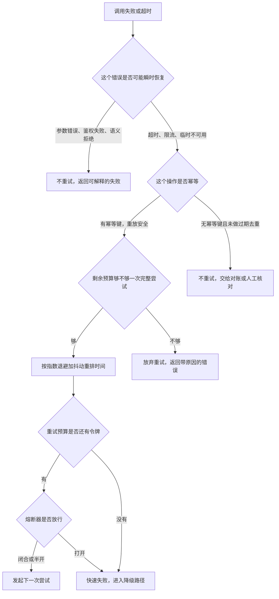
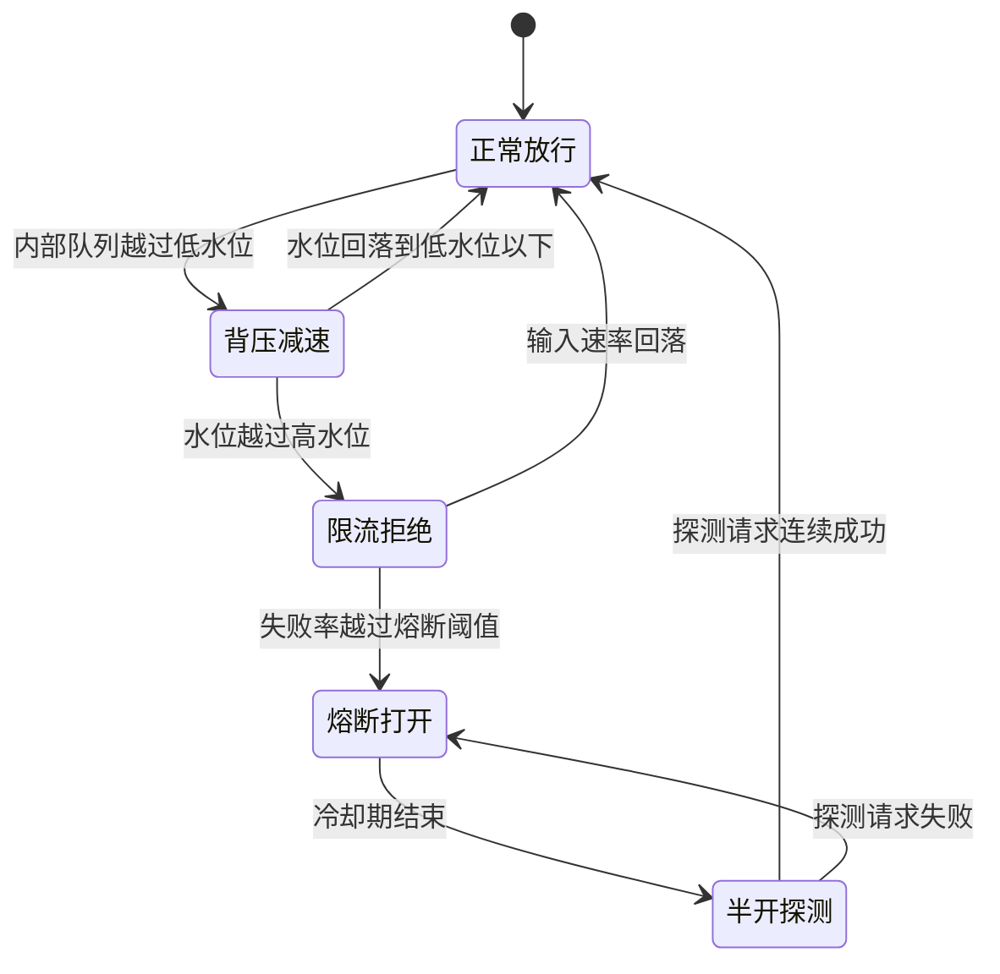
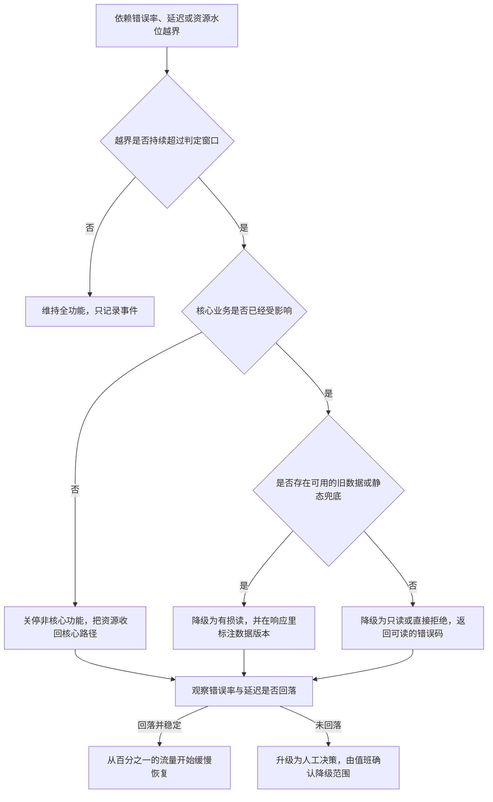

# 10 分布式系统设计的工程权衡

**摘要：**

一笔 199 元的订单被扣了两次库存，网关为了少超时把阈值从 800 毫秒调到 5 秒，重试把已经过载的下游推到了崩溃——这三件事看上去是三个错误，实际上是一条链上的三个环：为提高可用性而加的每一个手段，都会在别处开出一张账单。本文是《分布式系统原理与协议》的落地篇，把前九篇写下的理论约束换成一组能调参、能失效、也能互相打架的工程手段：幂等、超时、重试、限流、背压、熔断、隔离、降级、可观测性。论述沿五问推进，即它是什么、为什么会出现、抽掉它系统会怎么连环失败、落地时要动哪些参数、以及在什么条件下它会反过来伤到自己。参数部分尽量给出可算的依据，譬如超时预算如何逐层衰减、退避为什么必须是指数、抖动为什么能把同步尖峰摊平、利用率越过哪条线之后排队延迟开始失控。贯穿全篇的案例是一条电商下单链路，从网关进来，经订单、库存、支付、推荐四个依赖，最后落到一张带唯一索引的幂等表上。读完应当能回答两个问题：这条链路被几层保护网兜着，以及当这些网互相冲突时该先让哪一张让路。

---

## 第 1 章 幂等：把同一次意图认出来

### 1.1 一笔扣了两次的库存

不妨设想这样一次事故：客户端在 800 毫秒的阈值上放弃等待，判定失败并重发；服务端第一次请求其实已经扣了库存、写了订单，只是回执卡在机房之间一次几十毫秒的抖动里；第二次请求到达时库存还够，于是又扣了一件。最后靠财务对账加人工退款收场，排查花了两天，因为整条链路一处异常都没抛出来——每一次调用在它自己的视角里都是成功的。

从发出请求到决定重试，双方各自只能看到自己这一侧的状态。

| 时刻 | 客户端视角 | 服务端视角 | 双方能否确认对方状态 |
| :--- | :--- | :--- | :--- |
| T+0ms | 发出请求 R | 尚未收到 | 不能 |
| T+40ms | 仍在等待 | 收到 R，开始扣库存 | 不能 |
| T+90ms | 仍在等待 | 扣减完成，回执已发出 | 不能 |
| T+120ms | 回执在链路上被丢弃 | 认为 R 已成功 | 不能 |
| T+180ms | 超时，判定失败，发出 R′ | 收到第二份 R，再扣一次 | 不能 |

这张表就是两将军问题的日常形态：「请求到了没有」在客户端这一侧永远只有概率、没有答案，于是重试从「要不要」变成「怎么重试而不做两遍」。若干脆不重试，一次网络抖动就成了用户面前的失败。剩下两条路，接受失败率，或者重试并承担重复风险，**幂等是第二条路的入场券**，没有它，重试就是把网络抖动翻译成数据事故的装置。

### 1.2 幂等说的是最终状态，不是返回值

幂等性（Idempotency）来自数学：f(f(x)) = f(x)，多次应用与一次应用结果相同。搬到分布式系统，一个操作幂等的含义是执行一次与执行多次之后最终状态完全相同，这不包括返回值相同——第二次完全可以返回「已处理过」，只要没产生新副作用。GET、PUT、DELETE 都天然幂等，因为查询不改状态、替换多少次留下的还是那个值、删一条已删的记录与删一条存在的记录最终都是「不存在」；不幂等的是另一类：POST 每调一次可能新建一条资源，`UPDATE counter SET val = val + 1` 每执行一次就多一，`UPDATE account SET balance = balance - 100` 每执行一次就少一笔钱。它们的共同点是每次执行都产生累加效果，而累加正是幂等的反面，所以改造的核心只有一个动作：给操作配一个能标识「这是同一次意图」的凭据。

先切开一个常被混用的概念。严格的「恰好一次（Exactly-Once）」在跨越不可靠网络的场景里做不到，声称做到的系统实际上都是「至少一次交付」加「接收端去重」，业界称之为**有效一次（Effectively-Once）**。这个区分决定了责任的位置：投递语义由传输层决定，去重必须由业务层或存储层承担。Kafka 从 0.11 起提供的幂等生产者与事务只解决「生产者重发到 broker」这一段，跨 topic、跨消费组、跨下游数据库的重复它管不了。

### 1.3 三条实现路径与各自的失效点

第一条路径是幂等键（Idempotency Key）：客户端为每次业务意图生成一个全局唯一键，通常是 UUID 或雪花 ID，重试时复用同一个键。

```python
def transfer_money(from_account, to_account, amount, idempotency_key):
    """
    转账操作的幂等实现
    idempotency_key: 由客户端生成的全局唯一标识，代表"这一次转账操作"
    """
    # 查询幂等键是否已处理
    existing_result = db.get_idempotency_record(idempotency_key)
    if existing_result is not None:
        # 已经处理过，直接返回之前的结果（无论成功或失败）
        return existing_result

    # 在事务中：执行转账 + 写入幂等记录（原子操作）
    with db.transaction():
        db.debit(from_account, amount)
        db.credit(to_account, amount)
        db.save_idempotency_record(
            key=idempotency_key,
            result={"status": "success", "amount": amount},
            expires_at=now() + timedelta(days=7)  # 幂等记录有 TTL
        )

    return {"status": "success", "amount": amount}
```

这段写法有一个不容易看出的漏洞：查询与事务是两段独立操作，两个并发的重试请求可以同时读到「没有这条记录」，然后各自进入事务、各扣一次款；事务的原子性只保证「扣款」与「写记录」同生共死，管不住检查与执行之间那道缝。可靠的写法要把检查改成写入：先 `INSERT` 一行状态为 pending 的记录，靠唯一索引让第二个请求在插入时就撞上冲突、拿不到执行权；拿到执行权的请求去扣款，成功改为 success，失败改为 failed 并允许同键重试。**一条唯一索引比一次查询可靠得多**，它把竞态交给了存储引擎的行锁。

第二条路径是乐观锁，即带版本号的条件更新。

```sql
-- 非幂等的更新（每次执行减少余额）
UPDATE account SET balance = balance - 100 WHERE id = 1;

-- 幂等的更新（通过版本号条件更新，只有版本匹配时才更新）
UPDATE account
SET balance = balance - 100, version = version + 1
WHERE id = 1 AND version = 5;
-- 如果重试时版本已经是 6（说明上次已经执行成功），这次更新影响 0 行，安全忽略
```

这里有一个容易被误读的地方：更新影响 0 行只说明「版本不是 5 了」，它可能是自己上次执行成功了，也可能是别人刚改过。把冲突当成「我已执行过」处理，会在别人先改的场景下静默丢掉一次本该生效的更新；把冲突一律当成「别人改过」重试，又会把自己的重复执行变成真的二次扣减。这就是版本号与幂等键的分野：幂等键回答「这个请求是不是重复的」，版本号回答「这行数据在我读它之后有没有变过」，前者能去重，后者不能。

第三条路径是消费端去重。消息队列通常只承诺至少一次交付，消费者要么维护已消费消息 ID 的集合，要么用业务状态机判断——订单已是「已支付」，再收到支付成功消息就跳过。前一种在消息量大时会把存储撑爆，实践中往往退化成「按分区记录位点加近期窗口去重」；后一种更省存储，但要求状态机完备，漏掉一个中间状态就会把本该处理的消息当重复丢掉。所以设计幂等的第一个问题不是「用哪种模式」，而是「这个操作天然带着什么唯一标识」——支付回调带着流水号，订单创建带着请求 ID，库存扣减带着订单号加 SKU，能复用已有的就不要另造。

### 1.4 幂等键的 TTL 必须覆盖重试窗口

幂等记录要过期，否则表会无限增长、唯一索引越来越深、清理任务越来越重。过期时间必须覆盖「同一个键可能再次出现」的全部跨度，而这个跨度由整条重试链决定：客户端最多重试 n 次、每次超时 t、退避总量 b，一次业务动作在客户端侧的最长存活时间是 n×t+b；若消息队列在中间插一脚，还要加消息的滞留时间；若再算上人工补单与定时对账重放，窗口还要往后延。TTL 短于这个总和，一个迟到的重放就会被当成新请求再执行一遍。

反过来，TTL 也不是越长越好，幂等表的行数与之成正比，几十亿行的表在写入时会出现索引页争用。可行的做法是按业务分级：支付、退款给到以天计的 TTL，且幂等记录与业务数据同库同事务；订单创建给到小时级；库存预占可以被业务状态兜底，TTL 短到分钟级也安全。同库同事务的一致性由数据库保证，代价是幂等表与业务表共享同一个库的写入能力，热点业务会把幂等表也带成热点；把记录挪到 Redis 或独立的幂等服务能分摊压力，但一致性退化成两段式，中间失败会留下一条「标记已处理、业务没执行」的幽灵记录，需要额外的补偿核对。

### 1.5 幂等管不了的四件事

幂等常被当成万能药，它的边界其实很清楚。它管不了顺序：同一订单的「创建」与「取消」两条消息乱序到达，幂等只保证每条各处理一次，最终状态仍可能错，先取消后创建，订单就活了过来；顺序要靠分区键或版本号比较解决。它管不了并发：两个不同的幂等键代表两次不同的业务意图，它们在库存上竞争同一行数据，需要乐观锁或行锁来串行化。它管不了跨服务原子性：订单扣了库存、支付扣了款，中间超时导致一侧回滚一侧没回，幂等只能保证每一步各执行一次。它也管不了「用户真的点了两次」：手抖双击会生成两个不同的幂等键，系统会老实创建两笔订单，这要靠业务键或前端防抖。还有一个常被忽略的代价：幂等不减少流量，重复请求仍要占用连接、线程与一次唯一索引查找，量级很大时需要的是限流而不是幂等。

---

## 第 2 章 超时：把无限等待换成有界失败

### 2.1 无界等待如何吃掉一个进程

没有超时的调用只在依赖出问题那一刻显出区别：对端崩溃、网络断开、长时间 GC、DNS 解析卡在不可达的服务器上、TCP 的 SYN 不断重传，调用方都会安静地挂着，占用的线程、连接、连接池槽位一个都不会还回来。多数服务一个请求占一个线程直到结束，线程池大小固定（Java 生态常见 200），200 个挂住的请求就足以让服务停止接受新请求。此时监控很有欺骗性：CPU 不高、内存平稳、GC 正常、日志无异常，只有活跃线程数顶在最大值、入口排队时间在上涨；等上游超时也触发、重试涌进来，故障就从「一个下游慢」变成「整条链路都不响应」。

真实的坑常常不在业务调用上，而在没人设过超时的地方：DNS 解析、TLS 握手、连接建立、连接池取连接的等待、socket 读取。很多 HTTP 客户端只提供「整个请求的超时」而不区分连接与读取，很多连接池默认无限等待，很多标准库的 DNS 解析器没有超时参数；这些地方在故障之前从不出现在任何架构图上，事后却是最难补的一课。

### 2.2 阈值从哪里来

直觉算法是「取 P99 的 2 到 3 倍」，它只回答了「多大才不算误判」，没回答「多大才不算太晚」。完整的判据有四条，彼此互相牵制。

| 判据 | 看的数据 | 违反之后的症状 |
| :--- | :--- | :--- |
| 不误判正常的慢请求 | 依赖的 P99、P999 与 GC 停顿 | 超时率虚高，触发大量无谓重试 |
| 小于上游的剩余预算 | 上游传入的截止时间 | 上游早已放弃，下游还在为死请求工作 |
| 让重试在总预算内成立 | 截止时间、尝试次数、退避总量 | 重试必然超时，只放大负载 |
| 不超过故障判定窗口 | 熔断器的统计窗口 | 熔断迟迟不触发，故障扩散 |

第一条的要害在分布形状。P50 与 P99 可能差十倍，P99 与 P999 再差十倍，而这十倍往往不是「更慢的正常请求」，而是 GC、页缓存未命中、跨机架重传这类系统性抖动；取 P99 的两三倍通常刚好覆盖抖动又不至于把真故障也等下来，取 P999 的两倍看着安全，实际是在故障时让每个请求都等满长尾时间，几百个并发乘起来就是连接池被耗尽的时间。第二条把超时从静态常量变成随上下文变化的量——同一接口在「点开详情」的路径上可以等 800 毫秒，在「后台导出」的路径上可以等 30 秒，写死一个常数等于假设所有调用方都有同样的耐心。

还有一句常被说反的话：**超时只解决「不要无限等」，不解决「为什么慢」**。慢的根因要靠容量、缓存、索引与依赖治理解决。

### 2.3 截止时间的逐层衰减

链路上各层各设一个常量超时，总等待时间就是各层之和而非最大值：网关 2 秒、订单 2 秒、库存 2 秒，最坏情况下一个用户请求要等 6 秒才彻底失败，而这 6 秒里三层的线程、连接、内存全被一个注定失败的请求占着。

截止时间（Deadline）模式把这个加法换成减法：调用方不传「最多等多久」，而传一个绝对时刻；接收方用「截止时刻减当前时刻」作为自己所有下游调用的预算上限，且每次转发都要扣掉本地处理、序列化与一段留白，留白覆盖回程网络与最后一跳抖动。

```python
def handle_request(request, deadline):
    remaining_time = deadline - time.now()
    if remaining_time <= 0:
        raise DeadlineExceededException("请求已超过 deadline")

    # 调用下游时传递剩余时间作为超时
    response = downstream_service.call(
        request.sub_request,
        # 留一段余量给回程与本地处理，避免把预算用尽后
        # 下游刚好卡在边界返回，调用方却已经超时
        timeout=min(remaining_time - budget_slack, default_timeout)
    )
    return process(response)
```

gRPC 把这个模式做进了协议：客户端按 `grpc-timeout` 头写入超时（一个带单位的相对值），服务端收到后换算成本地时钟上的绝对截止时刻存进上下文，此后每次转发都从上下文取剩余时间，链路追踪再把每个 Span 的截止时间一并记下，于是「超时发生在哪一跳」可以直接从 trace 上看出。一层 1000 毫秒的入口预算落到链路上大致这样切。

| 层 | 剩余预算 | 留给下游 | 本层预留 | 预留覆盖什么 |
| :--- | :--- | :--- | :--- | :--- |
| 网关 | 1000ms | 950ms | 50ms | 鉴权、限流判定与回程 |
| 订单服务 | 950ms | 800ms | 150ms | 本地校验与一次缓存查询 |
| 库存服务 | 800ms | 500ms | 300ms | 重试退避与两次尝试的间隔 |
| 数据库 | 500ms | 300ms | 200ms | 连接池取连接与结果集序列化 |

每一行的预留都不是拍出来的，而是各环节实测 P99 加一段余量；某层延迟变长、把预留吃穿，从 trace 上立刻能看出哪一层的预算先见底。截止时间还有个副作用：取消。客户端超时放弃后，若信息能传到下游，下游可以立刻停掉已经没人要的操作，gRPC 的上下文取消与 HTTP/2 的 RST_STREAM 都支持；若链路中间有一段是 HTTP/1.1 或不支持取消的老服务，取消就在那一跳断掉，形成「幽灵请求」——上游已返回 504，下游还在跑一个十秒的查询，数量约等于超时率乘以上游 QPS。

### 2.4 超时的两种放大

纵向放大来自「每层一个独立常量」：k 层各设 T，最坏就是 k×T。改成共享预算就消除了它，代价是每层都要能拿到上游截止时间，而很多遗留系统没有这个能力，只能从最短那头倒推一组静态值，保证各层之和小于用户的忍耐上限。

横向放大来自重试。设总预算 D、最多尝试 n 次、退避总量 B，单次尝试能分到的时间是 (D − B)/n，这是一个硬上限：比它长，后面的尝试没有预算；比它短，本可成功的请求会被误杀。这个算式给出一个很有用的判据——若 (D − B)/n 已小于依赖的 P99，重试在设计上就是无效的，只会把负载放大 n 倍。譬如 D 为 1000 毫秒、n 为 3、B 为 150 毫秒，单次最多 283 毫秒，而依赖的 P99 是 300 毫秒，意味着正常情况下就有 1% 的请求比预算上限慢，故障时这个比例会到几十个百分点；此时正确的动作是把 n 降到 2、把 D 提到 2 秒，或者不加超时重试而靠熔断加快失败。

### 2.5 超时判定本身也会错

超时是一个本地判断，本地时钟到点就认为远端没做完，这个判断有三种系统性错误。一是把慢但正确的调用判成失败，跨机房调用、大结果集查询、冷启动首次请求本就可能超阈值，超时一触发，重试立刻把这份慢复制一份。二是「已执行但回执丢失」，超时既不代表失败也不代表成功，后续动作必须依赖幂等加一次显式查询确定真实状态，而不是假设失败然后回滚。三是静态阈值与负载漂移的错配，三个月前测的 P99 早已不代表今天的分布，配置里那个数字也没人记得改。

自适应超时看着是解药，实际有陷阱：基于历史样本的算法在故障初期看到样本变慢，就把阈值往大调，越调越大，等它停止调整，链路已经被拖垮。可行的做法是给自适应值加硬上限，并在失败率上升时冻结调整、只允许下调。

---

## 第 3 章 重试：一个放大器的用法

### 3.1 收益与账单

重试值得存在，是因为分布式系统里的失败不对称：一部分是瞬时的，另一部分是持续的，而两类失败外观完全一样。主节点切换的一两秒、几百毫秒的 GC、滚动发布时新旧实例并存导致的连接失效，都属于前者，隔几十毫秒再来一次就能成功；进程已 OOM、数据库被锁死，属于后者，重试多少次都一样。多数线上失败属于第一类，所以重试收益看起来很高——成功率从 99% 提到 99.9% 往往只靠一次重试。但账单是集中支付的：正常时期几乎不花钱，故障时期把负载整体乘以 (n+1)，而故障时期恰恰是最付不起这笔钱的时候。

一个典型的死亡循环是这样长出来的：某服务滚动发布，30 秒内所有长连接断开；客户端同时感知失败、同时重试；新实例刚启动，缓存是冷的、连接池在预热，一上来就吃到几倍请求；它撑不住开始超时；客户端再次重试；新实例被压垮、健康检查失败、被踢出负载均衡，剩下的实例承受更大压力；最后整个集群在重启与重试之间循环。这个循环里没有任何组件出现真正的 bug，每一层都在做合理的事，问题出在它们同时做。

### 3.2 指数退避：为什么非得是 2 的幂

让重试之间隔一段时间，是打断循环的第一步；让间隔随尝试次数指数增长，是第二步。若失败概率与「此刻有多少客户端在重试」正相关，线性增长的间隔无法保证收敛：每一轮仍是同步尖峰，幅度没有降低，只是频率降低，而这一点收益随轮次线性衰减，抵不过客户端数量带来的压力。

**指数退避**把间隔取成 base × 2^n，第 n 次等待翻倍，于是每一轮把时间轴摊开一倍，同一时刻在重试的客户端被切成越来越细的层。这个做法在 1980 年代的以太网里就有了：CSMA/CD 的二进制指数退避让冲突后的等待槽位随冲突次数翻倍直到上限；四十年前为共享同轴电缆设计的东西，今天原封不动适用于共享一个数据库的所有微服务。代价也很明确：它把长尾拉长，第 5 次重试的等待可能是 3.2 秒，而用户早就走了。所以退避必须与预算联动，等待时间一旦超过剩余截止时间就不要睡了——一个注定无法在预算内完成的重试，最好的处理是立刻放弃，让熔断与降级接手。

```python
import random
import time

def retry_with_backoff(operation, max_retries=5, base_delay=0.1):
    """
    带指数退避的重试
    base_delay: 初始等待时间（秒）
    最大等待时间上限：通常设为 30 秒或 60 秒
    """
    for attempt in range(max_retries):
        try:
            return operation()
        except TransientError as e:
            if attempt == max_retries - 1:
                raise  # 最后一次重试失败，抛出异常

            # 指数退避 + 随机抖动（Jitter）
            # 纯指数退避：所有客户端在同一时刻重试（同步效应）
            # 加入随机抖动：错开重试时间，避免"惊群"
            delay = base_delay * (2 ** attempt)
            jitter = random.uniform(0, delay * 0.1)  # ±10% 的随机抖动
            wait_time = min(delay + jitter, 60)       # 最大等待 60 秒

            time.sleep(wait_time)
```

### 3.3 抖动：把同步尖峰摊成斜坡

指数退避解决「轮与轮之间」的同步，解决不了「同一轮之内」的同步：同一时刻失败的客户端在同一个 base 上算出同一个等待时间，然后在同一毫秒一起醒来。抖动（Jitter）就是往这个同步性上撒沙子，撒法有三种，效果差别不小。

| 策略 | 等待时间的算法 | 同一轮内的分布 | 总工作量 | 备注 |
| :--- | :--- | :--- | :--- | :--- |
| 无抖动 | base × 2^n | 全部落在同一点 | 最高 | 只有单客户端时可用 |
| 等额抖动 | half + random(0, half) | 后半区间内均匀 | 中等 | 保住一个下限等待时间 |
| 全抖动 | random(0, base × 2^n) | 整个区间内均匀 | 最低 | 通用首选 |
| 去相关抖动 | random(base, 上次等待 × 3) | 连续分布、无固定上限 | 接近全抖动 | 适合长重试链 |

全抖动（Full Jitter）能把总工作量压到最低：N 个客户端同时失败，无抖动时它们在同一个时间点重试，峰值负载正比于 N；摊到长度为 base×2^n 的区间上，任一时刻的负载正比于 N 除以区间长度，峰值被削掉一个量级。AWS 的架构博客里那篇讲指数退避与抖动的文章做过实测对比，全抖动的完成时间与总请求数都优于等额抖动与无抖动，结论后来被反复复现。代价是平均值变长，延迟敏感的场景不能接受，折中的做法是分阶段：前两次用等额抖动保住及时性，后面的用全抖动压峰值。

### 3.4 重试预算：把重试当成有限资源

即使有了退避与抖动，只要「失败就重试」对每个客户端都成立，故障期间的负载放大仍是确定性的：失败率 50% 时，重试带来的额外负载是成功请求量的一半，而故障期间系统最缺的正是这一半。真正压住这个放大的办法，是给重试本身设配额。

gRPC 的服务配置里有个机制叫重试节流（Retry Throttling）：维护一个令牌桶，每次成功往桶里加 tokenRatio 个令牌，每次重试消耗一个，桶空了之后重试不再被允许，请求直接失败返回。tokenRatio 取 0.1 的含义是每十个成功请求才攒够一次重试机会，于是长期看重试占成功请求的比例不会超过 10%。Finagle 的**重试预算（Retry Budget）**是同一思路的另一套实现，Twitter 一侧的经验是设在 20% 左右。它有一个很好的性质：不需要知道下游容量，只约束自己这一侧的放大倍数。失败率越高，可用令牌越少，重试自动收敛；失败率回落，令牌重新积累。预算约束「我这一侧的重试放大倍数」，熔断约束「我要不要继续调用这个依赖」：只做预算，持续故障时每个客户端都用自己那 10% 的配额敲打一个已经死掉的依赖；只做熔断，闭合期间一次抖动仍会引发成倍瞬时压力。

### 3.5 哪些错误可以重试

把「失败」当成整体来决定重不重试，是很多重试风暴的起点，因为失败原因差别极大：参数错了重试一万次还是错，服务不可用重试一次就可能好，而一个「可能已执行」的超时重试之后可能重复执行。按 gRPC 状态码划分大致是这样。

| 状态码 | 能否重试 | 理由 |
| :--- | :--- | :--- |
| `UNAVAILABLE` | 可以 | 连接层失败、服务端正在关闭，通常瞬时 |
| `RESOURCE_EXHAUSTED` | 可以，但必须退避 | 对端限流，立刻重试只会加重限流 |
| `ABORTED` | 可以 | 典型乐观锁冲突，重试是正常路径 |
| `DEADLINE_EXCEEDED` | 谨慎 | 可能已执行，重试前必须确认幂等 |
| `INVALID_ARGUMENT` | 不可以 | 请求本身有问题，重试不改变结果 |
| `UNAUTHENTICATED` / `PERMISSION_DENIED` | 不可以 | 凭据或权限问题，重试只会放大审计日志 |
| `NOT_FOUND` | 不可以 | 语义上的确定结果 |
| `INTERNAL` | 视情况 | 可能瞬时，也可能确定性 bug |
| `ALREADY_EXISTS` | 不重试，但可作判据 | 它恰好是幂等判定最有用的返回 |



### 3.6 Kafka 的重试队列

消息消费的重试有一个流式系统特有的麻烦：消费者不能阻塞。Kafka 的消费组靠心跳与拉取间隔判定成员存活，消费者线程若为重试而 sleep 几十秒，就会被认为卡住——`max.poll.interval.ms` 默认 5 分钟，一旦超过，消费者被踢出组、触发重平衡、分区被重新分配，那些已处理但未提交位点的消息会被重放，于是「重试一条消息」变成「整个分区重放一遍」。更彻底的做法是非阻塞重试队列：失败消息带重试次数被投递到专门的 retry topic，主 topic 继续往前走，retry topic 的消费者按退避时间重新投递，次数用尽转入死信队列；Spring for Apache Kafka 在 2.7 版本把这套模式做成了注解，底层是基于多个带不同延迟级别的 retry topic 加时间轮。它解决了线程阻塞，却引入两个新问题：一是顺序，消息挪到 retry topic 后它在主 topic 里的位置就没了，后续消息会先于它处理，「支付成功」可能早于「支付发起」被消费，解法是按业务键选分区并对同键串行；二是放大，重试消息越多，集群要处理的总量越大，分区与消费者都要相应扩容。

生产者一侧也有类似陷阱。Kafka 的 `retries` 从 2.1 起默认是极大值，光看这个参数会以为消息永不丢，真正约束重试的是 `delivery.timeout.ms`（默认 120 秒），它上限了「发送加重试」的总时长，而 `request.timeout.ms`（默认 30 秒）约束单次请求；可重试次数由总时长除以单次时长决定。只调 `retries` 而不动另外两个，等于把刹车装在一个不接线的位置。

### 3.7 边界：重试会掩盖故障

重试最大的副作用不是放大负载，而是让故障变得不可见。成功率在重试之后仍是 99.99%，大盘一片绿色，而底下重试率可能是 20%，意味着每五个请求就有一个走了弯路；等到预算耗尽、或某个依赖彻底死掉导致重试再也救不回来，故障会以「突然」的方式出现，而它在数据上已经积累几天。所以**重试率必须是一等指标**，与成功率、延迟、错误率并列并设告警：一个重试率从 1% 涨到 5% 的系统，比一个成功率从 99.99% 掉到 99.9% 的系统更危险，因为前者是早期信号，后者只是结果。

另一种常被误当成重试的手段是请求对冲（Hedged Requests）：对同一份只读请求，在 P95 延迟到达时向另一个副本再发一份，取先返回者。Google 在 2013 年那篇讲尾部延迟的研究里给出的数据是，对冲只增加约 5% 的额外负载，却能把 P99 延迟压掉一大截；它与重试的区别在触发时机，重试在失败之后，对冲在成功之前，而它要求的条件比幂等更窄——只读且有多个副本。

---

## 第 4 章 限流与背压：过载信号往哪里传

### 4.1 队列不是背压

过载时最自然的反应是加队列：请求来了先排队。这个反应在轻度突发时对，在持续过载时错，错的地方可以用排队论算出来。按最简单的 M/M/1 模型，系统内平均驻留请求数 L = ρ/(1−ρ)，ρ 是到达率与服务率之比。

| 利用率 ρ | 系统内平均请求数 | 相对延迟 |
| :--- | :--- | :--- |
| 0.5 | 1 | 2 倍 |
| 0.8 | 4 | 5 倍 |
| 0.9 | 9 | 10 倍 |
| 0.95 | 19 | 20 倍 |
| 0.99 | 99 | 100 倍 |

利用率超过 80% 之后延迟不再线性，而 ρ>1 时更没有任何稳态可言——队列必然被填满，填满之后只有两种结局，拒绝或崩溃。所谓「队列吸收了突发」，前提是突发之后有一段输入低于处理能力把积压消化掉；若过载是持续的，队列只是把崩溃延后，并让每个请求都变慢。

背压（Backpressure）是一套反馈：下游处理不过来时，把「我处理不过来」这个信号传回上游，让上游主动降速，而不是由下游无限积压。队列只能吸收瞬时突发，背压才能让系统在持续过载下存活，而**背压的必然结局是拒绝一部分请求**。

| 阶段 | 上游发送 | 下游处理 | 队列状态 | 结局 |
| :--- | :--- | :--- | :--- | :--- |
| 平衡 | 1000/s | 1000/s | 稳定在低位 | 延迟可控 |
| 突发 | 5000/s | 1000/s | 每秒积压 4000 条 | 延迟上升，尚可恢复 |
| 持续过载且无背压 | 5000/s | 1000/s | 无限积压 | 内存耗尽、崩溃，重试再放大 |
| 持续过载且有背压 | 被压回 1000/s | 1000/s | 稳定在高水位 | 一部分请求被拒，系统存活 |

### 4.2 限流的三种口径

按请求速率（QPS）限流最符合直觉，配置也简单：每租户每秒 1000 次，超出返回 429。它在延迟稳定时准确，在延迟上升时会出现隐蔽的失效——同样 QPS 占用更多资源，因为每个请求在系统里待的时间变长了，而 QPS 限流对「请求变慢」完全无感，这正是过载初期最常见的形态。

按并发数限流更贴近资源本身。由李特尔法则（Little's Law），并发数 L = QPS × 延迟，而系统能承受的并发由线程数、连接数、内存决定；同样 1000 QPS，延迟 10 毫秒时只占 10 个并发，延迟 100 毫秒时要占 100 个。**并发限流比 QPS 限流更贴近资源**，因为它直接锁住这个乘积的上限，无论延迟怎么变占用都是常数，这也是自适应并发控制在网关层越来越常见的原因——它不需要预先知道容量，只观察延迟的导数。

令牌桶与漏桶是两种经典实现，区别在突发容忍度。

```python
class TokenBucket:
    def __init__(self, rate, capacity):
        self.rate = rate          # 每秒生成的令牌数
        self.capacity = capacity  # 桶的最大容量（允许的最大突发量）
        self.tokens = capacity    # 当前令牌数
        self.last_refill = time.now()

    def allow_request(self):
        now = time.now()
        elapsed = now - self.last_refill

        # 根据经过时间补充令牌
        self.tokens = min(
            self.capacity,
            self.tokens + elapsed * self.rate
        )
        self.last_refill = now

        if self.tokens >= 1:
            self.tokens -= 1
            return True   # 允许请求
        return False      # 拒绝请求（触发背压）
```

令牌桶允许突发，因为桶里攒着令牌；漏桶不允许，因为出口被固定成一个速率。这个差异决定适用面：有大促、定时任务、冷启动预热这类天然突发的场景用令牌桶，必须严格平滑的场景用漏桶。两个参数的含义也很明确，rate 决定长期平均速率，capacity 决定能容忍多大瞬时突发，后者通常取 rate 乘以允许突发的秒数。

### 4.3 不知道容量时的自适应限流

精确限流需要知道下游能承受多少，而这个数字在微服务里往往没人说得清，它随实例数、机型、数据量、依赖延迟而变。Google 的 SRE 实践给了一个不需要知道容量的办法：客户端自己统计最近一段时间发出多少请求、成功多少，再按公式决定本地拒绝概率，拒绝概率 = max(0, (requests − K × accepts) / (requests + 1))，K 取 2。

它的含义是：最近成功率高于 1/K 即 50% 就不拒绝，低于 50% 时按比例本地拦截，成功率越低拦得越多；K 是容忍的放大倍数，允许客户端最多发出两倍于服务端能接受的请求量。代价是它会拒绝一些本可成功的请求，因为它依据统计而非实时容量，判断必然滞后。

### 4.4 背压落在哪一层

背压可以实现在三个位置。下游拒绝最直接：队列满返回 503，并发超了返回 429，配额用尽返回 429 加 Retry-After，优点是实时，缺点是信号到达时下游已在承压。上游限速是预防性的：客户端按令牌桶控制发送速率，或按并发上限控制在途请求数，缺点是需要知道下游容量而这个数字会漂移。中间层缓冲是解耦的：网关、消息队列、sidecar 在中间排队整形，位置灵活可统一治理，代价是额外延迟与一个要运维的组件。

协议层早就内置背压，这一点常被忽略。TCP 的接收窗口是背压，接收方缓冲区快满时把窗口关小，发送方自动降速；HTTP/2 的流量控制窗口分连接级与流级两层，gRPC 调用不会把一个慢消费者淹掉，靠的就是这一层；Reactive Streams 把背压写进接口，消费者用 `request(n)` 告诉生产者「我还能处理 n 个」。

```java
// 消费者通过 request(n) 告知生产者"我准备好处理 n 个元素了"
// 生产者不能主动推送超过 n 个元素
subscriber.onSubscribe(new Subscription() {
    @Override
    public void request(long n) {
        // 消费者请求 n 个元素，生产者才发送
        producer.produce(n);
    }

    @Override
    public void cancel() {
        producer.stop();
    }
});
```

这种「拉」而非「推」的模式是背压最彻底的形态：速率决定权从生产者转到消费者手里，生产者无论什么情况都不能单方面决定发送节奏。代价是管道化程度下降，生产者不能预取，吞吐比自由推送低一截，所以它适合「消费者处理慢且不能丢数据」的场景。

### 4.5 etcd 的请求限流：在入口拒绝

etcd 是把拒绝放在入口的典型。它在请求进入共识层之前就把明显吃不下的请求挡回去：`--max-request-bytes` 默认 1.5MiB，超尺寸的请求直接拒；`--max-txn-ops` 默认 128，一次事务超过这个操作数也直接拒；后端存储超过 `--quota-backend-bytes`（默认 2GB）时集群进入空间告警并整体转只读，写入返回明确错误，直到压缩与碎片整理释放空间。

为什么用拒绝而不是排队，理由在它的架构里很清楚。etcd 的写入要经过一次 Raft 提案与一次 apply，任何一个大请求都会在提案体积、WAL 记录、`MsgApp` 分片、bbolt 页分配、watch 推送缓冲这几处同时放大内存；若让大请求排队，排在前面的那个会拖慢后面所有请求的提交进度，apply 落后让读请求等不到追平，心跳与选举的时序也被挤压。排队在这里不是「延后处理」，而是「把整个集群的一致性进度拖慢」。由此得到一条一般原则：**限流要放在资源被消耗之前**，在 gRPC 拦截器里拒绝的代价是一次请求解析，等请求进了共识层再失败的代价是日志、网络往返与一次状态机回滚。

### 4.6 限流的边界

限流最容易出的问题是粒度不对。按全局总量限，一个大租户可以吃光额度；按租户限，租户内某个热点接口仍能打满共享下游；按接口限，同一接口不同参数的成本又差着几个数量级，翻十页的查询与按主键取一行完全不是一回事。没有一种粒度万能，通常叠三层：入口按租户粗限，网关按接口细分，服务内部再按资源设并发上限。

第二个问题是 429 引发的二次放大。客户端收到 429 后若立刻重试，限流就变成放大器：服务端越拒、客户端越试、有效吞吐越低，所以限流必须与客户端退避约定配套——服务端返回 429 带 Retry-After，客户端遵守它。第三个问题是公平性：同样 1000 QPS 的额度均分给十个租户是公平的，但它会让一个大客户的关键业务与一个测试账号拿到同样的资源，多数系统按优先级分配额度，这已经不是技术问题，而是资源分配的产品决策。

---

## 第 5 章 熔断与隔离：切断传染链

### 5.1 级联故障是怎么长出来的

级联故障（Cascading Failure）的传导路径几乎每次都一样：下游变慢，上游调用线程被占住，线程池被占满，上游开始拒绝新请求，再上游开始超时，重试涌进来，整条链路一起倒。这里有一个反直觉的判断：**慢依赖比挂掉的依赖更难处理**。挂掉意味着连接立刻被拒（RST），调用方在几毫秒内拿到明确失败，可以快速降级、快速熔断；变慢意味着每次调用都要等满超时，资源被缓慢而彻底地耗尽，而系统看起来还在工作。

| 失效形态 | 调用方的表现 | 资源占用 | 故障可见性 | 处理难度 |
| :--- | :--- | :--- | :--- | :--- |
| 立即失败 | 毫秒级拿到错误 | 极低 | 高，错误率立刻上升 | 低，熔断即可 |
| 持续变慢 | 每个请求等满超时 | 极高，线程与连接被占满 | 低，延迟指标缓慢上升 | 高，需隔离与熔断配合 |
| 间歇抖动 | 时快时慢 | 中等 | 极低，容易被平均值掩盖 | 高，需要尾延迟指标 |

熔断器的价值就在于把第二、第三种形态转化成第一种：与其每个请求都等满超时，不如在检测到异常之后直接快速失败。

### 5.2 三个状态与判定窗口


打开状态既给下游恢复窗口，也把上游资源释放出来；工程量集中在窗口与阈值两个参数上。基于连续失败次数的窗口（连续 5 次就打开）最好实现，但受流量影响极大：同样是 5 次失败，在每秒 1000 个请求的服务上是 0.5%，在每分钟 5 个请求的服务上是 100%。滑动窗口把这一点修正过来，只统计过去 N 秒或过去 N 个请求内的失败率，且只有样本足够时才允许判定。

| 参数 | Hystrix 的常见取值 | Resilience4j 的常见取值 | 它决定了什么 |
| :--- | :--- | :--- | :--- |
| 统计窗口 | 10 秒滚动窗口 | 计数窗口 100 次或时间窗口 60 秒 | 多长历史参与判定 |
| 最小样本量 | 20 次请求 | 窗口即为样本量 | 低于它不判定，避免小样本误判 |
| 失败率阈值 | 50% | 50% | 越过即打开 |
| 冷却时间 | 5 秒 | 60 秒 | 打开后等多久开始探测 |
| 半开放行量 | 1 次 | 10 次 | 用多少请求验证恢复 |

选择依据可以归成一句话：窗口要大到让一次正常抖动不足以触发，小到让持续故障能被快速识别。流量越小窗口必须越长（否则样本不足），而窗口越长识别越慢，这个矛盾在低流量服务上无法消除，只能折中。半开放行量也有同样的两难：放行 1 个，一次偶发失败就把熔断器重新打开，造成反复振荡；放行几十个，恢复瞬间的压力可能再次压垮下游。多数实现取 5 到 10 个，既能给出统计判断，又不至于形成压力。

### 5.3 误触发与漏触发

熔断器是一个判定器，判定必然出错。误触发有三个常见成因：低流量下的样本不足，5 个请求失败 3 个就是 60%，而统计意义接近于零；周期性任务，每天凌晨的批量对账把延迟推高，熔断器读成故障，于是每天凌晨断一次。

漏触发也有三个成因：部分失败长期存在，失败率稳定在 40%，低于阈值，熔断永不打开，但 40% 已经在吞噬体验；只统计特定异常类型，网络层的连接重置被包装成另一种异常，没被计入失败，熔断器对某一类故障完全失明。

| 反例 | 症状 | 对策 |
| :--- | :--- | :--- |
| 低流量下按连续失败计数 | 凌晨偶发两三个失败就断 | 设最小样本量，样本不足不判定 |
| 熔断统计放在重试之后 | 失败率被重试抹平，永不熔断 | 统计首次尝试失败率，或分两层统计 |
| 超时阈值收紧后未同步评估熔断 | 熔断频繁打开又很快恢复 | 熔断阈值与超时阈值联合评审 |
| 冷却时间过短 | 熔断在开与关之间高频振荡 | 冷却时间随失败持续次数递增 |

### 5.4 隔离：舱壁、线程池与探针

熔断解决「还要不要调用」，隔离解决「即使要调用，也别让它吃掉全部资源」。这个思路来自船舶的**舱壁（Bulkhead）**：船体被隔成互不连通的舱，一个舱进水不会让整条船沉掉。

最重的隔离是线程池隔离：给每个下游依赖分配独立线程池，池满即拒绝，某个依赖变慢只耗尽自己的池。Hystrix 早期就这么做，代价是线程数等于依赖数乘池大小，每个线程一份栈，切换也要成本——依赖十个下游、每池 10 个线程就是 100 个线程常年存在，大部分时间在等待。轻量的是信号量隔离：不换线程，只用计数器限制同时访问某依赖的请求数，省掉线程开销，但拦不住阻塞，只适合非阻塞调用或有独立超时保证的调用。更常见也更划算的隔离在连接池与 HTTP 客户端这一层：给每个下游独立的连接池与每主机连接上限（Go 的 `MaxConnsPerHost`、Envoy 的 `max_connections`）；Envoy 的异常点检测做得更细，按主机粒度统计连续 5xx 次数，超过阈值就把这台主机摘出负载均衡池一段时间（默认 30 秒），摘除比例超过 10% 就停止摘除以免整池被清空。这实际上是熔断下移到了 sidecar，粒度从「服务」变成「实例」。

Kubernetes 的探针是另一类隔离装置，它把「这台实例还能不能接流量」的判断从调用方搬到了编排层。就绪探针（readinessProbe）失败时，实例被从 Service 的端点列表里摘掉，不再接新流量，但进程不会被杀死，这是隔离而非重启；存活探针（livenessProbe）失败则触发重启；启动探针（startupProbe）在 1.16 引入、1.20 转正，给启动慢的应用留出宽限期。三个探针的参数就是本章讨论的三个量：`timeoutSeconds` 是超时，`periodSeconds` 与 `failureThreshold` 的乘积是判定窗口，`initialDelaySeconds` 是宽限期。最常见的误用是让存活探针去调下游——下游一慢，整批实例被判死并重启，重启后的实例缓存是冷的，一次下游故障就此放大成全站雪崩；正确的分工是存活探针只检查进程自身是否还能工作，依赖健康交给就绪探针去摘流量。

| 隔离手段 | 隔离的是什么 | 代价 | 典型误用 |
| :--- | :--- | :--- | :--- |
| 线程池隔离 | 执行资源 | 线程数与切换开销 | 池子过大，隔离形同虚设 |
| 信号量隔离 | 并发数 | 拦不住阻塞 | 用在会阻塞的调用上 |
| 连接池隔离 | 连接资源 | 连接利用率下降 | 下游之间共享一个客户端 |
| 探针隔离 | 流量入口 | 摘除与恢复有延迟 | 存活探针依赖下游 |

还有一类误做是隔离了一半：连接池隔离了，但共享同一个请求队列，队列一旦被某个依赖的积压填满，其他依赖照样拿不到执行机会；线程池隔离了，但共享同一个限流器，一个依赖的流量把全局配额吃光。隔离的边界必须与资源的边界完全重合，任何一处共享都是漏洞。

### 5.5 过载响应的多档状态机

把背压、限流、熔断拼在一起，一条链路对过载的响应其实是个多档状态机，而不是一对开关。



分成多档而不是二值，是因为二值系统会在两个极端之间振荡：全通时被压垮，全断时完全不可用。

### 5.6 边界：熔断不是根因修复

熔断器有一个容易生成幻觉的地方：它让指标变好看了。打开之后超时率下降、线程池空闲、CPU 回落，一切像是修复了，实际上依赖还是坏的，只是没人调用它了；用户请求全部走到降级路径，业务指标持续下跌，而技术指标一片正常。所以熔断必须配一条明确的降级路径，否则等于把「一个依赖不可用」放大成「一个功能不可用」；熔断状态也要可观测：什么时候打开、打开几次、探测失败几次、当前在哪个状态。

---

## 第 6 章 降级：把有损服务编排起来

### 6.1 降级是业务判断，不是技术开关

服务降级指的是系统在资源不足时主动放弃部分功能或精度，以保证核心功能可用。它的前提是一个业务命题：哪些功能可以牺牲、牺牲到什么程度、牺牲多久，三个答案只能由业务方给出，技术方最多提供一张「牺牲的代价表」。一个团队把推荐服务降级到返回热门商品，技术上是几行 fallback，业务上的含义是首页个性化为零、转化率掉几个百分点；这个决定需要有人签字、需要在大促前演练、需要知道阈值在哪与何时恢复。**降级不是一段 try/except，而是一次有代价的业务取舍被提前写进了代码。**

降级分两条路径。自动降级由系统在检测到故障时触发，响应快（毫秒级），但只按预设规则走，规则没覆盖的情况就失效；手动降级由人决策，能做出业务判断，但响应慢，而且依赖有人守着。两者不是替代而是分工：自动降级应对突发，手动降级应对可预见的压力，譬如大促前把评论、推荐、排行榜提前关掉，把资源集中到下单与支付。

### 6.2 降级的四个级别

| 级别 | 手段 | 对用户的影响 | 恢复难度 | 典型触发 |
| :--- | :--- | :--- | :--- | :--- |
| L1 关停非核心 | 关闭推荐、评论、排行榜、个性化 | 功能缺失，主流程正常 | 低，重新打开即可 | 大促前、资源预留不足 |
| L2 有损读 | 返回缓存或旧数据，标注新鲜度 | 数据可能过期几分钟 | 中，需确认缓存与库一致 | 数据库延迟上升 |
| L3 只读 | 关写入，保留查询 | 无法下单、无法修改 | 高，需处理积压的写请求 | 存储故障、主从切换 |
| L4 静态兜底 | 返回预置静态页或默认值 | 完全失去实时性 | 高，需人工确认恢复 | 整条链路不可用 |

排序依据是「用户还能做成什么」：级别越高，对业务的伤害越大，恢复所需的人工介入也越多。

### 6.3 什么时候降、降多少

判定需要多个信号一起看，因为单一信号很容易被骗。



图里有一个容易被跳过的判断：「越界是否持续超过判定窗口」。单次抖动与持续故障在监控上的区别只有时间，而时间最容易在慌乱中被忽略；跳过了它，降级就会在每次抖动时触发。非核心功能变慢不需要降级整条链路，把资源从非核心挪回核心就够；只有核心路径的错误率或延迟开始越界，才该进入 L2 及以下——降一级的代价是确定的业务损失，而挪资源没有损失。

### 6.4 落地：开关、灰度与回切

降级的代码形态通常是「配置中心读开关加异常兜底」，两者要同时存在。

```python
def get_recommendations(user_id):
    # 从配置中心读取降级开关
    if feature_flags.get("recommendations_degraded", False):
        # 降级：返回热门商品
        return get_hot_products()

    try:
        # 正常路径：调用推荐服务
        return recommendation_service.get(user_id, timeout=200)
    except (TimeoutError, ServiceUnavailableError):
        # 自动降级：推荐服务超时或不可用
        logger.warn("Recommendation service unavailable, falling back")
        return get_hot_products()
```

开关还有几个治理细节：默认值是关还是开、谁能改、改了有没有审计、改完有没有通知业务方；这几个问题没答清楚，开关就会变成事故来源——某次紧急降级后没人记得恢复，功能缺失持续三个月，直到用户投诉才发现。

回切比降级更需要小心。故障恢复的瞬间，积压的请求、缓存失效后的击穿、客户端重连的尖峰会在同一秒涌进来，此时若把流量一次性放回全量，系统很可能二次雪崩。正确做法是灰度放量：从 1% 开始观察错误率与延迟，每隔几分钟翻一倍，指标抬头就退回上一档。降级还要有自动退出机制，手动开关应配一个最长时间，到期自动恢复并报警，否则一次短暂故障会永久把功能关掉。

### 6.5 降级的四类坑

第一类是降级路径打穿下游。推荐服务超时之后 fallback 到「查数据库取热门商品」，这次查询本身又是一次数据库访问，而数据库此时可能已经因为推荐服务的慢查询而过载。**降级路径必须比正常路径更便宜**，最理想是纯内存的静态数据，其次是一次缓存读，最差的才是查库。

第二类是兜底数据不完整导致页面崩。降级返回的热门商品少了几个必需字段，前端渲染时抛异常，用户看到白屏，比原来只少一个推荐模块糟糕得多；降级路径的返回值必须与正常路径同构，字段齐全、只是内容退化，这要在设计时就把返回结构定好。

第三类是降级破坏读己之写。用户刚下完单跳到订单列表，而读路径已降级为返回缓存，用户看不到自己刚下的订单，会立刻重复下单；这类问题在 L2 级别最容易出现，解法是按用户维度精准降级，对刚写过数据的用户放行实时读。

第四类是开关没人敢开。开关加了一堆，但没人知道打开会影响什么，于是永远停在关闭状态；降级必须演练，低峰期打开一次，看页面长什么样、日志有什么异常、指标怎么变，演练过的降级路径才是可用的降级路径。

### 6.6 边界：降级与一致性的冲突

降级与一致性的冲突点在读。L2 的有损读返回旧数据，在一致性模型上等于主动放弃线性一致——用户读到的可能不是最新写入的值，甚至会看到时间倒流：刚看到订单已支付，刷新又变回待支付。

这类冲突不能用技术手段消除，只能判断业务能否接受。展示商品价格时，几分钟延迟通常可接受，因为下单会二次确认；展示账户余额时不可接受，因为用户可能据此转账；展示库存数量时会导致超卖，因为下单链路会真的扣减而列表页只是展示。同一个「返回旧数据」的动作，在三种场景里风险差着量级，所以降级必须按接口而不是按服务设计。还有一条边界：降级不能替代容量规划，它是故障时的减震器；如果降级变成常态，说明容量本身不够，或者架构上有一个无法扩展的瓶颈。

---

## 第 7 章 可观测性：让权衡可测量

### 7.1 从预设的问题到没想到的问题

分布式系统把排障拆散了：一个用户请求经过十几个服务，产生上百条日志分散在不同机器上，耗时分布在十几段里，任何一段出错都不会在本地留下完整证据。

可观测性（Observability）指的是通过系统对外输出的数据推断内部状态的能力，它与传统监控的分水岭是一句话：能不能在不重新部署的前提下回答一个事先没想到的问题。监控回答「我预设要看的指标现在是多少」，可观测性回答「为什么这个用户的这次请求在第三跳慢了 400 毫秒」。分布式系统的故障大多出在组合上：某个依赖的慢查询、某个可用区的网络抖动、某次发布引入的锁竞争、某个参数在特定数据分布下的退化，这些组合不在任何人的预设清单里，只能靠现场拼出来的数据去推断。

### 7.2 三个支柱

| 支柱 | 数据形态 | 主要回答 | 成本特征 | 主要限制 |
| :--- | :--- | :--- | :--- | :--- |
| 日志（Logs） | 离散事件，带上下文 | 具体发生了什么 | 与请求量成正比，存储贵 | 聚合查询慢，靠采样降本 |
| 指标（Metrics） | 时间序列，聚合值 | 整体是否健康、趋势如何 | 与标签基数成正比，查询快 | 丢失单请求细节 |
| 追踪（Traces） | 调用树，带跨度耗时 | 请求经过哪里、慢在哪一段 | 与采样率成正比 | 采样丢样本，长尾易缺 |

日志的关键不在有没有记录，而在能不能关联。结构化日志（Structured Logging）把日志写成 JSON，字段固定、机器可解析；关联 ID（Correlation ID）让每个请求在入口生成唯一标识，所有相关日志都带上它。

```python
import structlog

logger = structlog.get_logger()

def handle_request(request, correlation_id):
    # 结构化字段让日志可以被按字段检索与聚合，
    # 而不是靠正则去啃一行自由文本
    logger.info("request_received",
                correlation_id=correlation_id,
                user_id=request.user_id,
                endpoint=request.path,
                latency_ms=elapsed_ms)
```

指标的价值在便宜与快。Prometheus 加 Grafana 成为事实标准，是因为它把采集、存储、查询、告警用一套标签模型串了起来，代价是标签基数不能失控——给指标加一个 user_id 标签，时间序列数量立刻从几百条涨到几百万条。

链路追踪解决分布式系统特有的问题。OpenTelemetry 在 2019 年由 OpenTracing 与 OpenCensus 合并而来，如今是这一层的行业标准；W3C 的 Trace Context 在 2021 年成为正式推荐标准，把 `traceparent` 头的格式固定下来，跨厂商的追踪因此可以互相衔接。请求在入口生成 Trace ID，跨服务时通过请求头传播，每个处理阶段记一个 Span，所有 Span 按 Trace ID 串成一棵树。

```
Trace（总耗时 250ms）：
└── Span: API Gateway（250ms）
    ├── Span: Auth Service（10ms）
    ├── Span: Product Service（100ms）
    │   └── Span: Database Query（90ms）
    └── Span: Recommendation Service（80ms，超时降级）
```

这棵树把 250 毫秒拆成了「谁花了多少」，真正的瓶颈是商品服务里那一次 90 毫秒的数据库查询。这种拆解能力指标做不到：指标告诉你 P99 是 250 毫秒，追踪告诉你这 250 毫秒长在谁身上。

### 7.3 尾延迟与扇出放大

平均延迟几乎无用，它会被大量快请求稀释。用户感知到的不是平均值，而是最慢的那几次，所以真正的观测对象是**尾延迟**：P99、P999，以及超过某个阈值的请求占比。

尾延迟在扇出场景会被急剧放大。设想一个页面请求并行调用 100 个后端，每个后端的 P99 是 1%，即 1% 的调用超过阈值，那么「这个页面至少遇到一个慢后端」的概率是 1 − 0.99^100，约 63%。这意味着单看每个后端都「99% 达标」，用户体验却是「63% 的页面会慢」。Google 在 2013 年那篇讲尾部延迟的论文里把这个问题讲得很透，并提出对冲请求与分级超时两种对策。这个数学给工程上的提示是：**降低扇出比优化单个服务更有效**。把 100 个并行调用合并成 10 个批量调用，尾延迟概率立刻从 63% 降到 9.6%；而把每个后端的 P99 从 1% 降到 0.5%，只能把 63% 降到 39%。

### 7.4 SLO 与错误预算

服务等级目标（SLO）把一个模糊的「要稳定」变成有分母的数字：99.9% 的月度可用性意味着每月允许 43 分钟不可用。这个分母同时约束两件事——它规定了可以接受多少故障，也就规定了可以承担多少风险。

**错误预算（Error Budget）**是 SLO 的另一种读法：允许的失败额度。它的用处不在报告可用性，而在把技术决策变成可以协商的交易。预算充足时团队可以加快发布、尝试新架构；预算消耗过快时发布应当冻结，精力转到稳定性上。这套机制把「要不要上线」从主观判断变成余额查询，Google 的 SRE 实践把它作为发布门禁的一部分，正是因为它把风险量化了。

错误预算还有第二个用处：当降级与限流的触发阈值。比起到 50% 失败率才熔断，按预算消耗速率触发要早得多——若一小时的消耗速度是月预算的十分之一，按这个速度跑十小时预算就光了，此时就该降级。这类速率型阈值比水位型阈值更适合提前干预，因为它含了时间维度。

### 7.5 追踪与超时链路的耦合

把截止时间的剩余量记进 Span 属性，故障时就能回答一个很具体的问题——哪个服务把预算吃掉了。gRPC 与 OpenTelemetry 的集成已把这层信息默认带上：Span 上标注状态码、是否被取消、是否因截止时间终止。

采样是追踪绕不开的取舍。头部采样在入口就决定采不采，实现简单、成本可控，但故障时被丢弃的样本里可能恰好含关键那几个；尾部采样先把所有 Span 收齐，再按「有错误」「特别慢」这类条件决定保留哪些，命中率高得多，代价是需要一个能缓冲整条链路的收集层。折中的做法是常态低采样率、错误与慢请求全采样，再用指标上的示例（Exemplar）把两者连起来——从一条 P99 的指标点直接跳到对应的那条 trace。

### 7.6 边界：观测的成本与盲区

可观测性本身也是要花资源的系统，成本曲线很不友好：日志量随请求量线性增长，指标量随标签基数组合爆炸，追踪量随采样率增长，三者叠加之后观测系统的存储与计算开销在某些公司能占到基础设施总成本的两成。更麻烦的是观测写入通常发生在请求关键路径上，一旦观测后端抖动，业务请求跟着抖，所以采集必须异步、有缓冲、可丢弃，观测系统不能成为业务系统的新依赖。

另一类盲区是「观测不到的地方」。CPU 里的时间、内核里的排队、DNS 解析、TLS 握手、连接池等待，这些环节在很多语言的标准库与框架里没有天然埋点，它们不出现在任何 Span 里，却经常是那 400 毫秒的来源，这也是 eBPF 一类技术在近几年流行的原因。还有一类盲区来自指标设计本身：一个「接口成功率 99.99%」的指标可能掩盖另一件事，这个接口对 0.01% 的请求返回了错误的业务结果而 HTTP 状态码是 200；技术指标只反映调用是否成功，不反映结果是否正确，后者要靠业务指标补。

---

## 第 8 章 结语：每个参数都是一次表态

把前面七章的手段放回理论的坐标系，它们一一对应着某条不可绕过的约束。

| 理论约束 | 它导致的失败 | 工程手段 | 手段自身的代价 |
| :--- | :--- | :--- | :--- |
| 消息可能重复 | 同一操作被执行多次 | 幂等键、乐观锁、消费去重 | 每次写多一条记录、多一次索引 |
| 消息可能丢失或延迟 | 调用无限等待或误判失败 | 超时加截止时间传播 | 少量正常请求被误杀 |
| 瞬时故障是常态 | 一次抖动变成一次用户失败 | 指数退避重试加抖动 | 故障期负载被放大数倍 |
| 容量有上限 | 过载时队列堆积直至崩溃 | 限流、背压、有界队列 | 一部分请求被主动拒绝 |
| 慢依赖会占满资源 | 局部故障扩散为全局故障 | 熔断、舱壁隔离 | 资源利用率下降、局部不可用 |
| 资源不足时无法全功能 | 全站不可用 | 分级降级与静态兜底 | 功能缺失、数据可能过期 |
| 局部视角看不清全局 | 故障无法定位 | 日志、指标、链路追踪 | 观测成本与采集抖动 |

这张表给出的第一个判断是，这些手段没有一项免费，也没有一项能单独成立。改一个参数就会改到另一处的语义：把超时从 1 秒收到 200 毫秒，熔断的误触发变多；把退避上限从 30 秒调到 5 秒，重试的放大倍数变大；把降级的判定窗口从 1 分钟调到 10 秒，系统会在每次抖动时横跳。所谓调参，调的是一组约束的可行域。

第二个判断是，这些参数的默认值都长在别人的负载形状上。熔断器默认的「窗口内 20 个请求、失败率 50%」来自每秒数万请求的流量，抄到一个每分钟几十个请求的后台服务上，它要么永远不触发，要么一次抖动就触发。Kafka 的 `max.poll.interval.ms` 默认 5 分钟，是给单条消息处理在秒级的场景留的余量，抄到一个单批要十分钟的消费者上，它会导致无休止的重平衡。参数必须按自己的延迟分布、流量量级、依赖数量重算，而重算的前提是先有可观测性。

第三个判断是，所有手段都在「故障是暂时的」这个前提下成立。它们的目标是撑过一段坏时间，等系统自己恢复或等人来修。如果故障是永久的——容量长期不足、架构上有一个无法扩展的瓶颈、某个依赖不会再恢复——那么所有容错手段只会延长痛苦：熔断反复打开、降级永不恢复、重试把有限的资源烧在一个回不来的目标上。容错不是容量，降级不是架构，重试不是修复。

由此得到落地顺序：先可观测性，否则所有参数都是猜的；再幂等，否则重试就是数据事故的制造机；然后超时与重试，它们是幂等之上的第一层保护；最后熔断与降级，它们是前四者都失效时的兜底。这个顺序颠倒过来，后面每一层都建在流沙上。**没有一项容错是免费的，也没有一个参数是孤立的。**

---

## 参考资料

1. Nygard, M. (2007). *Release It!: Design and Deploy Production-Ready Software*. Pragmatic Bookshelf.（熔断器模式的原始提出）
2. Fowler, M. (2014). Circuit Breaker. https://martinfowler.com/bliki/CircuitBreaker.html
3. Kleppmann, M. (2017). *Designing Data-Intensive Applications*. O'Reilly Media. Chapter 8–9.
4. Hohpe, G., & Woolf, B. (2003). *Enterprise Integration Patterns*. Addison-Wesley.（幂等性模式的系统整理）
5. Burns, B. (2018). *Designing Distributed Systems*. O'Reilly Media.
6. Google SRE Book (2016). Chapter 22: Addressing Cascading Failures. https://sre.google/sre-book/
7. Brooker, M. (2022). Exponential Backoff And Jitter. https://aws.amazon.com/blogs/architecture/exponential-backoff-and-jitter/
8. OpenTelemetry 官方文档. https://opentelemetry.io/docs/
9. Prometheus 官方文档. https://prometheus.io/docs/introduction/overview/

---

> [!note] 思考题
> 1. 幂等性的三条实现路径（幂等键、乐观锁、消息去重）分别适合哪类操作？请针对「创建订单、扣减余额、消费消息」三个场景各选一条，并说明为什么另外两条不合适。
> 2. 熔断器的半开状态先用少量探测请求验证下游是否恢复。放行 1 个与放行 50 个分别会导致什么问题，你会按什么依据选这个数量？
> 3. 文中给出超时与重试的联合算式：单次尝试可用预算 = (总预算 − 退避总量) / 尝试次数。若依赖的 P99 已经超过这个值，有哪几条路可走，各自的代价是什么？
> 4. 尾延迟在 100 路扇出下会把 1% 的慢放大成 63% 的页面变慢。除了降低扇出与请求对冲，还有哪些手段能压低这个概率，它们各自新增了什么成本？
> 5. 一条链路上同时存在重试预算、熔断器、限流器与降级开关。当故障持续十分钟，这四个机制的生效顺序会怎样影响最终可用性？如果顺序颠倒，会出现什么反直觉的结果？