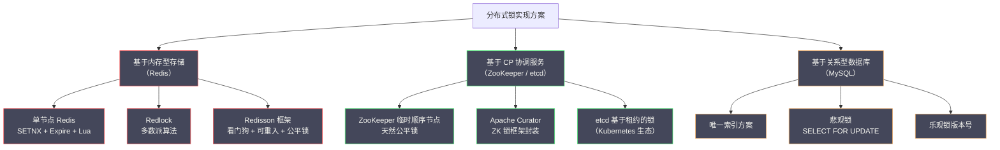

# 01 分布式锁的本质与设计要求

**摘要：**

分布式锁是分布式系统中最常见的并发控制原语之一，但它的正确使用远比表面看起来复杂。本文从单机锁的工作原理出发，分析为什么 JVM 锁在多进程、多节点场景下彻底失效；进而提炼出分布式锁必须满足的三大正确性要求——互斥性、无死锁、容错性——并深入剖析每个要求背后的系统性挑战；随后讨论常被忽视的活性与公平性要求，以及 GC 停顿、时钟漂移这两个更深层的挑战；最后梳理主流实现方案的技术路线图，为后续各篇的深度解析建立统一的分析框架。读完本文，你应当能回答两个问题：分布式锁到底在"锁"什么，以及一个"能用"的分布式锁必须跨过哪几道正确性的门槛。

---

## 第 1 章 从单机锁到分布式锁：一个不可避免的演进

### 1.1 单机时代的并发控制：一切都很简单

在单进程、单 JVM 的世界里，并发控制是一个被操作系统和语言运行时很好解决的问题。

Java 的 `synchronized` 关键字基于 JVM 对象头中的监视器（Monitor，管程）机制。每个 Java 对象在堆内存中都有一个对象头，对象头中包含一个指向 Monitor 的指针。当线程尝试进入 `synchronized` 代码块时，JVM 会检查这个 Monitor 是否被其他线程占用：如果未被占用，当前线程获取 Monitor 所有权，进入代码块；如果已被占用，当前线程进入阻塞状态，等待 Monitor 被释放。

```java
// 单机锁：简单且可靠
private final Object lock = new Object();
private int stock = 100;

public boolean deductStock() {
    synchronized (lock) {  // JVM Monitor 保证互斥
        if (stock > 0) {
            stock--;
            return true;
        }
        return false;
    }
}
```

这里有一个关键的前提条件被隐藏了：**`lock` 对象在 JVM 堆内存中是唯一的，所有线程共享同一个 `lock` 对象引用**。正是这个"共享内存"的假设，使得 JVM Monitor 可以作为所有线程竞争的仲裁者。

JVM 还提供了更高层的抽象——`java.util.concurrent.locks.ReentrantLock`，它基于 AQS（AbstractQueuedSynchronizer，抽象队列同步器）实现，底层使用 CAS（Compare-And-Swap）操作原子地修改锁状态变量，配合一个 CLH 队列管理等待线程的排队。无论是 `synchronized` 还是 `ReentrantLock`，它们的工作前提都是一样的：**所有竞争者共享同一块内存**。

这里可以打一个比方：单机锁像一间只有一个门锁的房间，所有想进去的人都看得见这把锁、也都摸得着这把锁，谁先拧开谁进去。**锁之所以有效，前提是所有人面对的是"同一把锁"**。这个前提一旦被打破，锁的魔力就消失了。

### 1.2 分布式场景：共享内存的假设彻底崩塌

当系统从单机部署演进为分布式架构，这个隐含的"共享内存"假设就彻底崩塌了。

考虑以下场景：一个电商平台的秒杀系统，为了应对流量压力，订单服务部署了 3 个实例（instance-A、instance-B、instance-C），每个实例运行在独立的服务器上。当秒杀开始，3 个实例同时接收到大量请求，都需要竞争"修改库存"这个操作的执行权。

```
instance-A 的内存：lock 对象（地址 0x7f001234）
instance-B 的内存：lock 对象（地址 0x7f001234）  ← 地址相同只是巧合，它们是独立的不同对象
instance-C 的内存：lock 对象（地址 0x7f001234）

每个 JVM 的 synchronized(lock) 只在本 JVM 内部有效。
instance-A 获取了 lock，instance-B 和 instance-C 完全不知道。
```

这就是"分布式"和"单机"在并发控制上的根本差异：**分布式系统中的多个节点之间没有共享内存，JVM 锁的互斥范围只限于单个 JVM 进程内部**。每个实例面对的，其实是"自己那一把锁"，而不是"大家共同的那一把锁"。

用具体的故障场景来说明这会造成什么后果：

```
时间线：
T1: 库存 = 1（最后一件）
T2: instance-A 的线程 1 执行 deductStock()，synchronized(lock) 获取 JVM 锁，检查 stock = 1，准备扣减
T3: instance-B 的线程 2 执行 deductStock()，synchronized(lock) 获取 JVM 锁（instance-B 自己的），检查 stock = 1，准备扣减
T4: instance-A 写入 DB：UPDATE stock = stock - 1 WHERE id = P001  → stock = 0，提交
T5: instance-B 写入 DB：UPDATE stock = stock - 1 WHERE id = P001  → stock = -1，提交（超卖）
```

两个实例各自获取了自己 JVM 内的锁，互不干扰，都顺利执行到了数据库写入，于是 1 件商品被卖出了 2 次——典型的**超卖（Overselling）**问题。

### 1.3 "加数据库锁不就解决了吗？"

面对上面的超卖问题，最直接的反应是：在数据库层面加锁，比如：

```sql
BEGIN;
SELECT stock FROM inventory WHERE id = 'P001' FOR UPDATE;  -- 行锁
UPDATE inventory SET stock = stock - 1 WHERE id = 'P001' AND stock > 0;
COMMIT;
```

`SELECT ... FOR UPDATE` 会在数据库层面给对应行加排他锁（X 锁），其他事务的 `SELECT ... FOR UPDATE` 会被阻塞，直到当前事务提交或回滚。这确实解决了超卖问题——因为数据库是所有服务实例共享的存储，数据库锁在所有实例之间有效。**它恰好满足"所有人面对同一把锁"这个前提**，所以它有效。

但这个方案有明显的局限性：

**其一，数据库连接是宝贵资源**。数据库行锁会持有数据库连接，在高并发场景下，大量等待加锁的请求会耗尽连接池，导致其他正常请求也无法获取连接，整个系统雪崩。

**其二，业务操作不一定都有对应的数据库行**。如果需要保护的临界资源不是数据库中的某一行（比如调用第三方 API 的频率限制），就无法借用数据库行锁。

**其三，跨库操作无法统一保护**。如果业务逻辑需要跨多个数据库实例操作，单个数据库的行锁无法覆盖整个临界区。

**其四，锁的粒度控制不灵活**。数据库锁的粒度取决于 SQL 操作的范围（行锁或表锁），难以实现自定义粒度的业务锁。

这些局限性促使工程师寻找一种更通用的解决方案：**分布式锁（Distributed Lock）**。

### 1.4 分布式锁的本质定位

分布式锁的本质是：**在多个独立进程或节点之间，借助一个所有参与者都能访问的共享存储（Redis、ZooKeeper、数据库等），来模拟单机环境下的"共享内存加互斥量"机制**。

```
单机锁的结构：
  竞争者（多个线程）→ 共享内存中的 lock 对象 → JVM Monitor

分布式锁的结构：
  竞争者（多个进程/节点）→ 共享存储中的锁记录 → 存储提供的原子操作
```

换句话说，分布式锁把"互斥仲裁者"从 JVM 内存换成了一个独立的、所有节点都能访问的共享存储服务。这个共享存储必须能够提供足够强的原子性保证，使得"检查锁是否存在加写入锁记录"这两个操作能够被原子地执行，不被并发请求打断。

这里的关键洞察是：**分布式锁并没有发明新的互斥原理，它只是把"仲裁者"从一个进程内的内存对象，搬到了一个跨进程共享的外部服务上**。理解了这一点，就能理解后面所有的挑战——这些挑战本质上都是"把仲裁者搬到外部"所引入的新问题：网络不可靠、外部服务会故障、进程会停顿、时钟会漂移。

> [!info] 分布式锁的使用场景
> 分布式锁适用于以下场景：
> 1. **防止重复执行**：定时任务在多节点部署时，防止同一个任务被多个节点同时执行
> 2. **资源竞争控制**：多个服务实例竞争有限资源（库存、名额），防止超卖或超发
> 3. **幂等性保证的辅助**：在某些难以实现纯幂等操作的场景下，通过锁串行化请求
> 4. **外部 API 频率限制**：控制多节点对外部 API 的并发调用次数，避免触发限流

### 1.5 一个前置问题：你真的需要分布式锁吗

在展开三大正确性要求之前，有必要先提出一个更根本的问题：**这个场景真的需要分布式锁吗？**

分布式锁的代价并不低——它引入了一个新的外部依赖、一套失效场景、以及运维与监控的负担。在很多场景下，有比分布式锁更简单、更可靠的做法：

**其一，用数据库的原子操作代替锁**。库存扣减可以用 `UPDATE stock = stock - 1 WHERE id = ? AND stock > 0`，由数据库的行锁与条件更新天然保证原子性，无需应用层加锁。**能用一条 SQL 解决并发问题的，就不要引入分布式锁**。

**其二，用幂等性代替锁**。如果业务操作本身是幂等的（如"设置状态为已支付"），那么重复执行不会产生副作用，也就无需互斥。

**其三，用乐观锁代替悲观锁**。如果冲突概率低，用版本号检测冲突（提交时校验版本）比"先加锁再操作"更高效。

**其四，用消息队列串行化**。把需要串行的请求投入同一个分区，由消费者串行处理，天然避免了并发冲突。

把这四种替代方案放在前面，是因为**选型的第一步不是"选哪种分布式锁"，而是"要不要分布式锁"**。很多生产事故的根源，不是锁选错了，而是本不该用锁的场景用了锁。带着这个前置判断去读后续内容，会更有价值。

### 1.6 分布式锁与单机锁：一张对照表

把单机锁与分布式锁逐维度对照，能更清楚地看出"把仲裁者搬到外部"到底改变了什么。

| 维度 | 单机锁（JVM 锁） | 分布式锁 |
| :--- | :--- | :--- |
| **仲裁者位置** | 进程内的内存对象 | 独立的外部服务 |
| **共享假设** | 所有线程共享同一块内存 | 所有节点共享同一个外部存储 |
| **互斥实现** | CPU 原子指令（CAS）加线程调度 | 存储的原子操作（SETNX、创建节点） |
| **崩溃释放** | JVM 感知线程死亡，自动释放 | 靠 TTL 或临时节点，需处理"慢与死"的区分 |
| **通信成本** | 纳秒级（内存访问） | 毫秒级（网络往返） |
| **失效来源** | 几乎没有（除非进程整体异常） | 网络、外部服务故障、GC 停顿、时钟漂移 |
| **可观测性** | 线程栈可查 | 需要额外监控锁服务与持锁状态 |

这张表最值得玩味的一行是"失效来源"。单机锁几乎没有失效场景，而分布式锁的失效来源一大串。**这不是因为分布式锁的实现者不够聪明，而是因为它把锁放在了四个不可靠因素（网络、外部服务、进程停顿、时钟）的交叉点上**。理解了这一点，就不会指望存在一个"绝对正确"的分布式锁——所有的方案，都是在这些不可靠因素之间做取舍。

---

## 第 2 章 分布式锁的三大正确性要求

任何一个"能用"的分布式锁实现，都必须满足以下三个核心正确性要求。这三个要求是分布式锁的设计公理，缺少任何一个都会导致锁的失效或系统陷入不可恢复的状态。

### 2.1 要求一：互斥性

**定义**：在任意时刻，只有一个客户端（进程或线程）可以持有锁。持锁期间，其他所有尝试加锁的客户端必须失败或等待。

这是分布式锁最核心的要求，也是"锁"这个概念的本质含义。如果互斥性不能保证，分布式锁就完全失去了意义——多个节点同时认为自己持有锁，对临界资源并发操作，和完全没有锁没有区别。

**互斥性在分布式场景下面临的挑战**：在单机锁中，互斥性由 CPU 的原子指令（CAS）和操作系统的线程调度保证，实现简单可靠。在分布式场景中，互斥性面临的最大挑战是：**加锁操作需要在网络上完成，而网络是不可靠的**。

考虑以下场景：

```
T1: 客户端 A 发送加锁请求到 Redis
T2: Redis 执行 SETNX lock_key "client_A"，成功，准备回复
T3: 网络抖动，Redis 的回复包在网络中丢失
T4: 客户端 A 超时，认为加锁失败（实际上已经加锁成功）
T5: 客户端 A 重试，再次发送加锁请求
T6: Redis：lock_key 已存在，加锁失败（客户端 A 已是锁拥有者，但它认为加锁失败）
```

这种"幻象失败（Phantom Failure）"场景会导致客户端 A 错误地认为锁不在自己手中，进而放弃临界操作——虽然此时锁实际上属于它。这不会破坏互斥性，但会造成可用性损失（合法的请求被错误拒绝）。

更危险的是反向场景——**幽灵重复（Ghost Duplication）**：

```
T1: 客户端 A 加锁成功，value = "client_A:token_001"
T2: 客户端 A 执行临界区操作（耗时较长）
T3: 锁的 TTL 到期，Redis 自动删除 lock_key（客户端 A 没有续期）
T4: 客户端 B 加锁成功，value = "client_B:token_002"
T5: 客户端 A 的临界区操作完成，尝试解锁，调用 DEL lock_key
T6: 客户端 A 删除了客户端 B 的锁，互斥性被破坏。
```

这个场景说明了互斥性不只依赖加锁的正确性，还依赖**解锁的正确性**：客户端只能删除自己持有的锁，不能删除他人的锁。解决方案是在锁的 value 中存储客户端的唯一标识，解锁时先校验 value 再删除，且这两步必须是原子操作（通过 Lua 脚本实现）——这正是 02 篇的核心内容。

### 2.2 要求二：无死锁

**定义**：即使持锁的客户端崩溃（进程 OOM、服务宕机、网络断开），锁也必须能在一段时间后自动释放，不能永久阻塞其他客户端的加锁请求。

在单机锁中，如果持锁线程崩溃，JVM 会自动感知（线程死亡），并释放该线程持有的所有 Monitor。这是 JVM 能够做到的，因为它完全管理了该进程的所有线程生命周期。

但在分布式场景中，锁服务（Redis、ZooKeeper）无法直接感知客户端进程是否存活——它只知道网络连接，而网络连接断开可能意味着：客户端崩溃了、网络暂时断开了、客户端 GC 停顿导致暂时无响应等多种情况。**"连接断了"这个事实，无法区分"对方死了"还是"对方只是慢"**——这正是 01 篇在分布式事务里讨论过的失败检测难题在锁场景的再现。

**死锁场景的还原**：

```
T1: 客户端 A 加锁成功
T2: 客户端 A 所在服务器断电，进程终止
T3: 锁服务中 lock_key 仍然存在（没有人去删除它）
T4: 客户端 B、C、D 尝试加锁，全部失败，永远等待...
T5: [锁资源永久泄漏，系统陷入死锁]
```

**解决方案的核心思路**：为锁设置过期时间（TTL，Time-To-Live）。当客户端崩溃后，锁的 TTL 到期，存储服务自动删除锁记录，其他客户端就可以重新加锁。

不同存储系统的 TTL 实现方式：

- **Redis**：`SET key value NX PX 30000`，30 秒后自动过期
- **ZooKeeper**：使用临时节点（Ephemeral Node），客户端与 ZK 的 Session 断开后，临时节点自动删除——这是 ZK 的天然无死锁保证，不依赖 TTL 超时
- **数据库**：需要额外的定时清理任务或在记录中存储过期时间，业务代码在加锁时检查是否超期

**无死锁要求引出的新问题：TTL 应该设置多长？**

这是一个经典的两难困境：

- **TTL 设置太短**：业务逻辑还未执行完，锁就自动过期了，导致互斥性被破坏（另一个客户端误以为锁已释放，重新加锁，两个客户端同时持有锁）
- **TTL 设置太长**：客户端崩溃后，其他客户端需要等待很长时间才能获取锁，系统可用性降低

解决这个困境的方案是**看门狗（Watchdog）机制**——持锁客户端定期向锁服务续期（延长 TTL），只要业务逻辑还在执行，锁就持续有效；一旦客户端崩溃，续期停止，TTL 自然到期，锁被自动释放。这是 Redisson 框架的核心设计之一，将在 02 篇详细分析。

### 2.3 要求三：容错性

**定义**：锁服务的部分节点故障不应导致整个分布式锁系统失效——客户端应该仍然能够加锁和解锁。

这个要求关注的是锁服务本身的可用性。如果锁服务是单点（Single Point of Failure），那么它一旦故障，所有依赖分布式锁的业务操作都会失败。

**单点 Redis 的容错问题**：单实例 Redis 最简单，但存在单点故障风险。通常的解决方案是使用 Redis 主从（Master-Slave）架构：

```
Client A → Redis Master → (异步复制) → Redis Slave
```

但主从架构在以下场景下仍然存在问题：

```
T1: 客户端 A 向 Redis Master 加锁成功
T2: Master 将 lock_key 同步到 Slave 之前，Master 宕机
T3: Sentinel 将 Slave 提升为新的 Master
T4: 新 Master 上没有 lock_key（复制未完成）
T5: 客户端 B 向新 Master 加锁，成功（冲突）
T6: 客户端 A 和客户端 B 同时持有锁，互斥性被破坏。
```

这个问题的根源是 Redis 主从复制是**异步的**——Master 接受写入后立即返回给客户端，然后异步地把数据复制给 Slave。如果 Master 在复制完成前宕机，Slave 就会丢失这部分数据，导致上面描述的问题。

为了解决这个问题，Redis 的作者 Salvatore Sanfilippo（Antirez）提出了 **Redlock 算法**，通过向多个（通常是 5 个）独立的 Redis 实例同时加锁，要求多数（3 个）成功，来避免单节点故障导致的互斥性破坏。但 Redlock 本身也存在争议——这是 03 篇的核心内容。

**ZooKeeper 的容错方案**：ZooKeeper 通过 ZAB 协议（ZooKeeper Atomic Broadcast，ZooKeeper 原子广播）实现了分布式一致性：所有写操作必须经过 Leader，Leader 把操作提案广播给所有 Follower，超过半数 Follower 确认后才向客户端返回成功。这意味着写操作是强一致的——只要超过半数的 ZK 节点存活，写操作就能成功，且不会有数据丢失的问题。

ZooKeeper 的容错性内置在其共识协议中，无需像 Redis 那样在应用层实现 Redlock。这是 ZK 在"正确性"维度上优于 Redis 的核心原因之一。

### 2.4 三个要求的相互关系

值得注意的是，这三个要求并非彼此独立，而是相互制约的。**互斥性要求锁"尽可能久地保持"（否则会提前过期导致双持），无死锁要求锁"尽可能快地释放"（否则崩溃后长期占用），容错性要求锁服务"分散部署"（但这又引入了副本一致性成本）**。

这个三角张力，正是分布式锁所有设计难题的根源。TTL 的取值、看门狗的续期间隔、锁服务的部署形态，本质上都是在这三者之间找平衡点。理解了这条张力线，后续每一篇讨论的具体机制，就都能各归其位。

### 2.5 要求失效的后果矩阵

三个要求如果失效，后果各不相同。把这些后果列成一张矩阵，有助于判断"哪个要求最不能妥协"。

| 失效的要求 | 直接后果 | 数据影响 | 可观测性 | 严重程度 |
| :--- | :--- | :--- | :--- | :--- |
| **互斥性失效** | 两个客户端同时在临界区 | 数据错乱（超卖、重复支付）| 隐蔽，往往事后对账才发现 | 最高 |
| **无死锁失效** | 锁永久泄漏，其他客户端全部阻塞 | 无数据错乱，但业务停摆 | 明显，锁服务上可见长期存在的锁 | 高 |
| **容错性失效** | 锁服务故障时业务不可用 | 无数据错乱 | 明显，直接报错 | 中 |

这张矩阵揭示了一个反直觉的结论：**互斥性失效是三者中最严重的，却也是最隐蔽的**。无死锁失效会让系统"卡住"，运维立刻就能发现；容错性失效会让系统"报错"，监控立刻就能告警；而互斥性失效只是让数据悄悄地错了——它不卡、不报错，直到某天有人发现库存变成了负数。

这个特性决定了分布式锁的一个重要工程原则：**宁可"明确地不可用"，也不要"安静地破坏数据"**。一个在故障时拒绝服务、但绝不双持的锁，比一个"永远可用、偶尔双持"的锁更值得信任。这也解释了为什么 03 篇会讨论 Kleppmann 对 Redlock 的批评——批评的核心不是"Redlock 会不可用"，而是"Redlock 在某些场景下会安静地双持"。**判断一个锁方案是否可靠，关键要看它失效时是"停摆"还是"错乱"**。

### 2.6 锁的粒度：从全局锁到细粒度锁

三大正确性要求之外，还有一个"设计维度"的要求常被忽视，却直接决定了锁的可用性：**锁的粒度**。

**全局锁**用一把锁保护所有同类操作。例如"支付处理锁"，任何一笔支付都要先拿这把锁。它的优点是简单、绝无遗漏；缺点是并发度极低——所有支付串行执行，吞吐量被单把锁卡死。

**细粒度锁**按资源维度拆分锁。例如"用户-123-支付锁""用户-456-支付锁"，不同用户互不干扰。它的优点是并发度高；缺点是锁的数量随资源规模增长，管理复杂度上升，且一旦粒度设计不当（该分开的没分开，或该合并的分开了），会出现"漏保护"或"过度拆分"。

粒度选择的核心原则是：**锁的边界应当与临界资源的边界一致**。要保护的是"某一个用户的余额"，就用用户维度的锁；要保护的是"全站库存总数"，才需要用全局锁。粒度太粗，会让不相干的请求互相阻塞，白白损失并发；粒度太细，则容易出现"两个操作本该互斥，却用了不同的锁"这种保护缺口——而这类缺口造成的错误，比性能问题严重得多。

一个实用的折中是**锁分片**：当某个维度（如用户）的锁数量过多时，可以把它们哈希到固定数量的锁桶上（如 1024 个桶），用"桶锁"代替"每资源一把锁"。这样既控制了锁的数量，又保留了大部分并发度，代价是极小概率的"不同资源恰好落在同一桶"造成的额外等待。**这是"并发度"与"管理复杂度"之间一个务实的平衡点**。

---

## 第 3 章 隐藏的第四个要求：活性

前面提到的三个正确性要求是学术和工程界的共识，但在实际工程中还有一个经常被忽视的要求：**活性（Liveness）**，即系统必须能够持续推进，不能无限期地停滞。

### 3.1 活性与公平性

**活性**要求：如果锁已被释放，且有客户端正在等待，则等待的客户端最终一定能获取到锁（不会永远饿死）。

在非公平锁实现中，多个等待者同时尝试加锁，可能存在某个等待者始终竞争失败（"饿死"）的情况——运气不好的客户端每次都抢输，无限期等待。虽然这不违反互斥性和无死锁要求，但会严重影响系统的公平性和可预测性。

**公平锁（Fair Lock）**：等待者按照请求到达的顺序依次获取锁，先来先得，保证不饿死。

ZooKeeper 的临时顺序节点机制天然实现了公平锁（04 篇详述）；Redis 基于简单的 SETNX 是非公平锁，可以通过额外的排队队列实现公平锁，但复杂度大幅增加。

### 3.2 活性与性能的权衡

追求活性（特别是公平锁）往往与性能存在权衡：

- 公平锁需要维护等待队列，每次加锁或解锁都需要额外的操作
- 非公平锁实现更简单，在竞争不激烈时性能更好（直接 SETNX 一步完成）

在大多数业务场景中，公平性不是强制要求，性能优先的非公平锁（Redis SETNX）是更常见的选择；但对于公平性有严格要求的场景（如分布式任务调度），ZooKeeper 的公平锁是更合适的方案。

这里可以打一个比方：非公平锁像一群人挤公交车，谁快谁上；公平锁像排队上车，先来先上。前者在人不挤时效率更高，但在人多时可能出现"总是挤不上"的倒霉蛋；后者更有序，但要维护一条队伍。**选择哪种，取决于业务是更在意"平均效率"还是"确定性"**。

### 3.3 活性问题的两种表现：饿死与惊群

活性不足在工程上有两种典型表现，它们常被混为一谈，但成因与解法都不同。

**第一种是饿死（Starvation）**。某个等待者长期竞争失败，永远拿不到锁。在非公平锁里，如果总是有"插队"的新请求抢先拿到锁，那么排在后面、又不擅长竞争的等待者可能无限期等下去。饿死的危害是"个别请求永远得不到服务"，在任务调度这类要求"每个任务最终都被执行"的场景里是不可接受的。

**第二种是惊群效应（Thundering Herd / Herd Effect）**。锁被释放的瞬间，所有等待者同时被唤醒、同时发起加锁请求，结果只有一个成功，其余全部失败并重新等待。这带来两个问题：其一，**无效请求冲击锁服务**，在等待者众多时会形成瞬时压力尖峰；其二，**竞争失败者的重试本身又在制造新的竞争**，形成恶性循环。

有意思的是，ZooKeeper 的临时顺序节点机制恰好同时缓解了这两个问题：每个等待者只需监听"自己前面那一个节点"的变化，因此锁释放时**只有排在第二位的那个等待者会被唤醒**，既避免了惊群，也通过"按序排队"避免了饿死。**这是一次设计上的双重收益——公平性与效率在这里并不冲突，反而相互成全**。

相比之下，基于轮询的 Redis 锁在等待者众多时更容易出现惊群与无效请求；Redisson 用 Pub/Sub 替代轮询来缓解惊群，但它仍是非公平的，饿死问题并未解决。这个对比说明：**公平性与效率未必是对立的，好的数据结构设计可以同时改善两者**——这是 04 篇讨论 ZooKeeper 时值得留意的一点。

### 3.4 活性与公平性的度量

活性与公平性听起来抽象，但在工程上可以落到几个具体指标上。把它们纳入监控，才能真正发现"锁服务是否在变坏"。

**平均等待时间与 P99 等待时间**。等待时间反映竞争激烈程度。如果 P99 等待时间持续上升，说明要么锁的持有时长在变长，要么等待者在变多，两者都预示问题。

**加锁成功率**。成功率骤降通常意味着热点锁竞争恶化，或锁的持有时长异常。

**唤醒放大倍数**。一次锁释放平均唤醒了多少个等待者。这个数字接近 1 说明等待机制高效（如 ZK 的顺序节点）；数字很大说明存在惊群，需要优化等待策略（如从轮询改为事件通知）。

**饿死计数**。统计"等待超过某阈值仍未获得锁"的请求数。这个指标在公平性敏感的场景（任务调度）里尤其重要。

这几个指标的共同作用是：**把"锁是否健康"从一种主观判断，变成可观测的数字**。分布式锁的很多问题（双持、死锁、饿死）在发生前，往往都会先在这些指标上留下痕迹——等待时间变长、成功率下降、唤醒放大。提前看到这些痕迹，就有机会在问题爆发前介入。

---

## 第 4 章 时钟、GC 停顿与分布式锁的深层挑战

在前面的分析中，我们已经可以感受到分布式锁的实现比表面复杂得多。但还有两个更深层的挑战需要理解，它们关系到分布式锁在极端情况下的安全性边界。

### 4.1 GC 停顿：持锁进程的时间冻结

Java 应用的 GC（Garbage Collection）停顿是分布式锁场景中一个容易被忽视但非常危险的问题。

全量 GC（Full GC 或 Stop-The-World GC）会导致 JVM 进程的所有线程暂停，包括负责续期的看门狗线程。如果 GC 停顿时间超过了锁的 TTL，锁会在 GC 停顿期间自动过期被释放，而此时持锁线程的临界区代码实际上还在"冻结"中（被 GC 暂停），等 GC 结束后它会"醒来"继续执行，但此时它的锁已经被别人取走了：

```
时间线：
T1: 客户端 A（JVM 进程）加锁成功，TTL = 5 秒
T2: 客户端 A 进入临界区，执行耗时操作
T3: 客户端 A 发生 Full GC，所有线程暂停（包括看门狗线程）
T4: [5 秒过去] 锁 TTL 到期，Redis 自动删除锁
T5: 客户端 B 加锁成功
T6: 客户端 B 开始执行临界区操作
T7: 客户端 A 的 GC 结束，线程恢复，继续执行临界区操作
    ← 此时客户端 A 和 B 同时在临界区，互斥性被破坏。
```

这个问题没有银弹式的完美解决方案。实践中的缓解措施有三条：

其一，**使用低延迟 GC 算法**（如 G1、ZGC、Shenandoah），减少 Stop-The-World 停顿时间，降低触发这个问题的概率。

其二，**合理设置 TTL**。TTL 应该远大于预期的最大 GC 停顿时间（通常 GC 停顿控制在 200ms 以内，TTL 设置 30 秒有很大的安全余量）。

其三，**使用栅栏令牌（Fencing Token）**。在锁的每次获取时生成一个单调递增的版本号，临界区操作（如写数据库）时携带这个版本号，服务端拒绝版本号过期的写操作——即使锁已过期被别人获取，旧版本号的操作也会被拒绝。这是 Martin Kleppmann 在批判 Redlock 时提出的方案，详见 03 篇。

> [!warning] GC 停顿揭示了锁的一个根本局限
> GC 停顿之所以危险，是因为它打破了"持锁者会持续续期"这个假设。它提醒我们：**任何依赖"客户端定期做某事"的机制，都会在客户端停顿或失联时失效**。这不是 Redis 锁独有的问题，而是所有"客户端主动维持"的机制的共性缺陷。理解这一点，就能理解为什么 Kleppmann 主张用"服务端校验的栅栏令牌"来替代"客户端维持的锁"——把控制权从可能停顿的客户端，转移到不会停顿的服务端。

### 4.2 时钟漂移：分布式系统的隐形杀手

分布式系统中的各个节点运行在不同的物理服务器上，每台服务器都有自己的硬件时钟。这些时钟不是完全精确的，会发生**时钟漂移（Clock Drift）**——不同节点的时间可能存在几毫秒到几百毫秒的偏差。

在 Redlock 算法中，时钟漂移会导致严重的正确性问题（详见 03 篇）。但即使是单节点的 Redis 锁，时钟漂移也可能造成 TTL 计算不准确：

```
例：Redis Server 的系统时钟比客户端快 500ms

客户端 A：SET lock value PX 5000  （期望锁持续 5 秒）
Redis Server：接收到请求时，记录过期时间 = now() + 5000ms
              但 Redis Server 的 now() 比客户端快 500ms
              实际过期时间比预期早 500ms

结果：客户端 A 认为锁还有 500ms，但 Redis 已经将锁删除了
```

在实际生产中，机器之间通过 NTP（Network Time Protocol）进行时钟同步，通常将偏差控制在 10 到 50ms 以内，对于 TTL 为数十秒的锁影响可忽略不计。但如果 NTP 同步出现问题（如跨机房网络延迟高），时钟漂移问题就会变得不可忽视。

> [!note] 时钟问题为何反复出现
> 时钟漂移在分布式系统里是一个反复出现的老问题。分布式事务里它导致全局时序难以定义（催生了 TrueTime 与逻辑时钟），分布式锁里它导致 TTL 计算不准（催生了栅栏令牌），共识协议里它影响租约的正确性。**只要系统依赖"时间"做判断，就必须面对"不同节点的时钟不一致"这个事实**。这也是本专栏反复强调的：分布式系统的很多难题，根子上都是同一批物理现实。

### 4.3 网络分区：锁服务的分裂

除了 GC 停顿与时钟漂移，网络分区是另一个影响分布式锁正确性的深层挑战，它在 03 篇（Redlock 争议）与 04 篇（ZooKeeper）里会被详细讨论，这里先点出它的核心矛盾。

当锁服务发生网络分区时，可能出现两个"自认为还能提供服务"的子集群。如果锁服务不能保证"只有多数派才能提供服务"，那么两个子集群可能各自认为锁可用，导致同一个锁被两个客户端同时持有。**要防止这种情况，锁服务必须引入"多数派"这一约束**——这正是 Redlock 用多个独立 Redis 实例、ZooKeeper 用 ZAB 多数派确认的动机。

由此可见，分布式锁的三个正确性要求里，"容错性"其实暗含着一个更强的条件：**容错不能以牺牲互斥性为代价**。一个"部分节点故障时仍然可用，但可能导致双持"的锁服务，实际上比"故障时不可用"的锁服务更危险——因为它会安静地破坏数据，而不是明确地拒绝服务。

### 4.4 一次双持故障的完整复盘

把前面提到的几个深层挑战串起来，看一个真实发生过的双持故障，能更直观地理解它们的危害。

某支付系统的对账任务，用 Redis 分布式锁保证"同一笔订单不会被两个任务实例同时处理"。上线初期一切正常，直到某次大促期间，出现了一批"同一订单被扣款两次"的资损工单。

排查时，任务日志显示两个实例几乎同时处理了同一笔订单。顺着时间线还原，问题出在三个因素叠加：

**其一，JVM 发生了一次较长的 Full GC**。其中一个实例在处理订单时触发了 Full GC，停顿约 8 秒。

**其二，锁的 TTL 恰好设置为 5 秒**。团队当时认为"处理一笔订单最多几百毫秒"，把 TTL 设成了 5 秒，并且**没有启用看门狗**（因为用了带 `leaseTime` 的 `tryLock`）。

**其三，GC 停顿超过了 TTL**。实例 A 在 GC 期间无法续期（其实根本没启用续期），5 秒后锁自动过期；实例 B 随即拿到锁，开始处理同一笔订单；实例 A 的 GC 结束后"醒来"，继续执行临界区——于是两个实例同时在处理同一笔订单。

修复方案有三层：其一，去掉 `leaseTime`，改用不指定持有时间的 `lock()`，让看门狗自动续期；其二，把 TTL 与续期间隔调整为更保守的值；其三，也是最关键的一层，**给扣款接口加上基于订单号的幂等约束**（同一订单号只能扣一次），即使双持发生，也不会造成重复扣款。

这个复盘的教训有两点。第一，**看门狗不是"锦上添花"，而是应对"业务时间不可预知"的必要机制**；用 `leaseTime` 图省事的代价，可能是数据错乱。第二，**任何锁都不应被当作"最后一道防线"**，真正的最后一道防线是业务层的幂等——因为锁的失效场景无法穷尽，而幂等能兜住所有"重复执行"的后果。这两点会在 02 篇（看门狗）与 08 篇（边界与替代方案）里反复出现。

### 4.5 网络分区下锁服务的两种选择

网络分区发生时，锁服务必须在两种姿态之间做出选择，这个选择直接决定了它是"停摆"还是"错乱"。

**第一种姿态：少数派拒绝服务**。当分区把锁服务切成两个子集群时，只有包含多数派的那个子集群继续提供加锁服务，少数派一侧拒绝服务。这样做的结果是：**少数派一侧的客户端无法加锁，业务暂时不可用，但绝不会出现双持**。这是 CP（一致性优先）的姿态。

**第二种姿态：两侧都继续服务**。两个子集群各自认为锁服务可用，各自接受加锁请求。这样做的结果是：**业务保持可用，但同一个逻辑锁可能被两个子集群的客户端同时持有**，出现双持。这是 AP（可用性优先）的姿态。

单节点的 Redis 锁在主从切换期间，实际上接近第二种姿态——因为异步复制可能丢失锁数据，新主上"没有锁"，于是新客户端可以加锁，而旧客户端仍以为自己持有锁。这正是 Redlock 试图通过"多数派加锁"来纠正的问题：它要求加锁必须在多数派实例上成功，从而把姿态拉回第一种。

这个选择没有标准答案，它取决于业务能否容忍双持：**如果业务有幂等兜底、能容忍极低概率的重复，那么"保可用"的 AP 姿态可以接受；如果业务绝不能容忍双持（如资金账务），那么必须选"宁可停摆"的 CP 姿态**。这与分布式事务里 CAP 的取舍是同一个问题——**在分区发生时，你只能在一致性与可用性之间选一个**。理解了这一点，就能理解为什么 ZooKeeper 与 Redlock 的设计者都执着于"多数派"：它们都是想把锁服务拉向 CP 一侧。

### 4.6 三个深层挑战的共同结构

把 GC 停顿、时钟漂移、网络分区这三个挑战放在一起看，会发现它们共享一个结构：**都是"某一方对状态的认识"与"真实状态"发生了偏差**。

GC 停顿让客户端以为"我还持有锁"，而实际上锁可能已过期；时钟漂移让客户端以为"锁还有 500ms"，而实际可能已经到期；网络分区让两侧客户端各自以为"我是唯一持有者"，而实际上可能双持。**三者的共同点是：判断的依据（客户端的记忆、时钟、连通性）不可靠，而结论（是否持有锁）却依赖这个依据**。

这个共同结构指向一个统一的应对方向：**不要把"是否持有锁"的判断，建立在客户端的不可靠状态之上，而要建立在服务端可验证的事实之上**。栅栏令牌是这个方向的产物——服务端（数据存储）保存一个单调递增的版本号，任何写操作都要携带令牌，服务端拒绝过期令牌。此时，"我是否还持有锁"不再重要，重要的是"我的令牌是否还新鲜"，而后者由服务端说了算。

理解了这条统一的方向，就能理解本专栏后半部分（Redlock、ZooKeeper、栅栏令牌）的所有讨论——它们都是在回答同一个问题：**如何把"锁的所有权"从一个易失的、客户端主观的状态，变成一个可靠的、服务端客观的事实**。

---

## 第 5 章 主流实现方案的技术路线图

理解了分布式锁的三大正确性要求和深层挑战，我们来快速梳理主流实现方案，建立整个专栏的技术全景图。

### 5.1 三大实现路径



### 5.2 三种方案的核心权衡

| 维度 | Redis 方案 | ZooKeeper 方案 | 数据库方案 |
| :--- | :--- | :--- | :--- |
| **性能** | 极高（内存操作，微秒级）| 中（网络往返加 ZAB 协议，毫秒级）| 低（磁盘 I/O，毫秒到十毫秒级）|
| **正确性（单点）** | 中（主从切换有数据丢失窗口）| 高（ZAB 强一致，Leader 确认才返回）| 高（ACID 事务保证）|
| **正确性（集群）** | 中（Redlock 有争议）| 高（Quorum 机制，天然多数派）| 高（单一数据库，无分布式问题）|
| **无死锁** | TTL 过期（需合理设置加看门狗）| 临时节点（Session 断开即删除，更可靠）| TTL 字段加清理任务 |
| **公平性** | 否（需额外实现）| 是（临时顺序节点天然公平）| 否（需额外实现）|
| **可重入** | 需手动实现（value 中存线程 ID）| 需手动实现 | 需手动实现 |
| **运维复杂度** | 低 | 中（ZK 集群运维有一定复杂度）| 低（已有 DB 直接用）|
| **适用场景** | 高并发、允许极低概率失误的场景 | 强一致性要求、公平锁、长持锁时间 | 低并发、已有 DB 不想引入新组件 |

### 5.3 选型的第一原则

在给出选型建议之前，有一个更重要的问题需要先回答：**你真的需要分布式锁吗？**（这个问题在 1.5 节已经展开，这里从"方案选择"的角度再收敛一次）

分布式锁是解决并发控制问题的一种手段，但它有自己的局限性（08 篇详述）。在很多场景下，以下替代方案可能更简单、更可靠：

- **数据库乐观锁（版本号）**：适合写冲突概率低、不需要独占锁的场景
- **幂等性设计**：通过业务操作本身的幂等性来容忍重复执行，从根本上避免对锁的需求
- **消息队列串行化**：把并发请求放入单分区 Topic，通过消费者的串行处理来避免并发

如果评估后确实需要分布式锁，再根据上面的权衡表选择合适的实现方案。

> [!note] 选型简则
> - **默认选 Redis**：大多数互联网业务场景，Redis 分布式锁的性能满足需求，偶发的极端边界情况可以通过业务层的幂等性来兜底
> - **选 ZooKeeper 的场景**：需要强一致性保证（金融级）、需要公平锁、或业务已经依赖 ZooKeeper 时
> - **不要在高并发场景用 DB 锁**：数据库不是为分布式锁设计的，高并发下 DB 锁会成为瓶颈

### 5.4 专栏的阅读地图

本专栏后续各篇，正是沿着这张路线图展开的：02 篇深入 Redis 锁的演进与看门狗；03 篇辨析 Redlock 的正确性争议；04 篇剖析 ZooKeeper 的临时顺序节点；05 篇讨论数据库锁的三种方案与局限；06 篇横向对比性能、公平性与可重入；07 篇给出生产实践的避坑清单；08 篇回到"边界与替代方案"，回答"什么时候不该用锁"。

这七篇的组织逻辑是：**先按实现方案逐个讲透（02 至 05），再做横向对比（06），然后落到生产实践（07），最后回到选型的元问题（08）**。理解了本文提出的三大正确性要求与两个深层挑战，后续每一篇的分析都会变得顺理成章——因为它们讨论的每一个机制，本质上都是在回应这些要求与挑战中的某一个。

### 5.5 从需求出发的选型问题清单

在真正动手选型之前，建议依次回答以下问题。它们的作用是把模糊的"我要一把分布式锁"，转化为清晰的选型约束。

**第一问：需要保护的是"资源独占"还是"操作去重"？** 如果是"同一时刻只能有一个执行"（如定时任务），用锁；如果是"同一操作不要重复执行"（如支付回调），优先用幂等，不必用锁。

**第二问：冲突概率有多高？** 冲突极低时，乐观锁（版本号）足够；冲突较高时，才需要悲观锁（分布式锁）。

**第三问：对正确性的要求到什么级别？** 如果能接受"极低概率的失误加业务幂等兜底"，Redis 锁即可；如果要求"绝不双持"，则必须用 ZooKeeper 或带栅栏令牌的方案。

**第四问：临界区执行时间可预知吗？** 可预知则设固定 TTL 即可；不可预知则必须用看门狗续期。

**第五问：需要公平性吗？** 需要（如任务调度按顺序执行）则选 ZooKeeper；不需要则 Redis 的非公平锁更简单高效。

**第六问：是否需要可重入？** 需要则要选择支持可重入的实现（Redisson 或自行实现计数），否则简单的 SETNX 即可。

把这六个问题回答完，方案的选择往往就自然浮现了。这个清单的价值在于：**它把选型从"比较方案的优劣"转化为"检验需求的约束"**——这与分布式事务专栏里"按子问题选方案"的立场完全一致。没有最好的锁，只有最匹配约束的锁。

### 5.6 一个常见的误解：锁能保证业务正确吗

在结束本文之前，有必要破除一个流传很广的误解：**分布式锁能保证业务正确**。它不能。

锁能做的，只是"保证同一时刻只有一个执行者"。但业务的正确性还依赖许多锁管不到的东西：

**其一，业务逻辑本身的正确性**。拿到锁之后，扣减逻辑写错了、条件判断写反了，数据照样会错。锁只保证"只有一个人在做"，不保证"这个人做得对"。

**其二，锁粒度的正确性**。如果两个本该互斥的操作用了不同的锁，或者某个操作压根忘了加锁，那么"互斥"就出现了缺口，锁的存在反而会给人虚假的安全感。

**其三，失效场景下的后果**。如第 7.1 节的表格所示，锁总有失效的可能。如果业务没有幂等或对账兜底，一次锁失效就可能导致无法修复的数据错乱。

因此，正确的定位是：**分布式锁是"减少并发冲突概率"的工具，不是"保证业务正确"的银弹**。业务正确性的保障，需要"锁加幂等加校验加对账"共同完成——锁负责在正常路径上避免冲突，幂等负责在异常路径上容忍重复，校验与对账负责在事后发现并修复问题。把这几者混为一谈，或者指望锁单独扛下所有正确性，是分布式锁使用中最根本的认知偏差。

### 5.7 一个易被忽略的要求：可观测性

在三大正确性要求与活性之外，还有一个"非功能性"要求值得单列：**可观测性**。它的重要性常被低估，却直接决定了锁在出问题时可不可查。

分布式锁的失效大多是"沉默"的——双持不会报错，死锁只会表现为"请求卡住"，饿死只是"某个请求永远得不到服务"。如果没有足够的观测手段，运维面对这些现象时几乎无从下手：不知道是锁服务故障、是业务持锁过久、还是某个客户端发生了 GC 停顿。

因此，一个"生产可用"的分布式锁，除了实现互斥、无死锁、容错、活性之外，还必须具备：**能查询当前锁的持有者与持有时长**、**能统计加锁等待与失败**、**能记录续期与释放的异常**。这些能力并不改变锁的正确性，却决定了它在故障时是"可诊断"还是"黑箱"。

这里可以打一个比方：可观测性之于分布式锁，就像仪表盘之于汽车——它不能让车跑得更快，但能让你在车出问题时知道该看哪里。**一个没有可观测性的分布式锁，不是"更简单的锁"，而是"不知道什么时候会坏的锁"**。这也是本专栏在 01、02 两篇都强调监控指标的原因。

---

## 参考资料

1. Dijkstra, E.W. (1965). Solution of a Problem in Concurrent Programming Control. *Communications of the ACM, 8*(9), 569.
2. Lamport, L. (1978). Time, Clocks, and the Ordering of Events in a Distributed System. *Communications of the ACM, 21*(7), 558–565.
3. Kleppmann, M. (2016). How to do distributed locking. *Martin Kleppmann's Blog*. https://martin.kleppmann.com/2016/02/08/how-to-do-distributed-locking.html
4. Antirez (Salvatore Sanfilippo). (2016). Is Redlock safe? *Antirez Blog*. http://antirez.com/news/101
5. Redisson 官方文档：分布式锁与同步器. https://redisson.org/docs/data-and-services/locks-and-synchronizers/
6. ZooKeeper Recipes and Solutions. https://zookeeper.apache.org/doc/current/recipes.html
7. Kleppmann, M. (2017). *Designing Data-Intensive Applications*. O'Reilly Media. Chapter 8: The Trouble with Distributed Systems.

---

> [!note] 思考题
> 1. 分布式锁的三个正确性要求（互斥性、无死锁、容错性）之间存在张力。请分别说明：如果只追求互斥性会牺牲什么，如果只追求无死锁又会牺牲什么。
> 2. GC 停顿会打破"持锁者持续续期"这一假设。请解释栅栏令牌（Fencing Token）如何绕过这个假设，以及它为什么需要"服务端配合校验"才能生效。
> 3. 文中提出"能不用分布式锁就不用"。请针对"防止定时任务重复执行"这一场景，给出两种不使用分布式锁的替代方案，并比较它们的可靠性。
