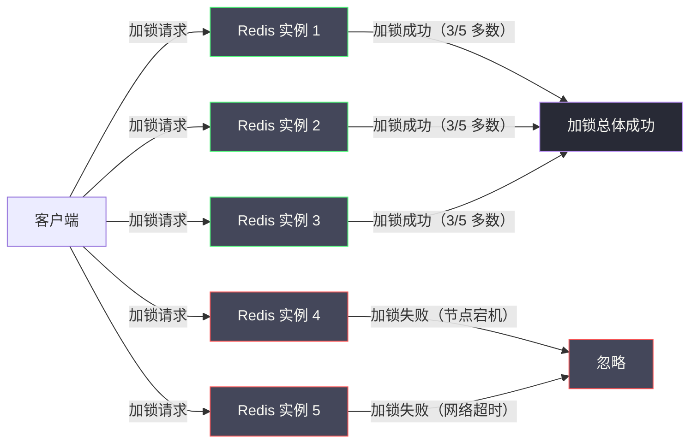
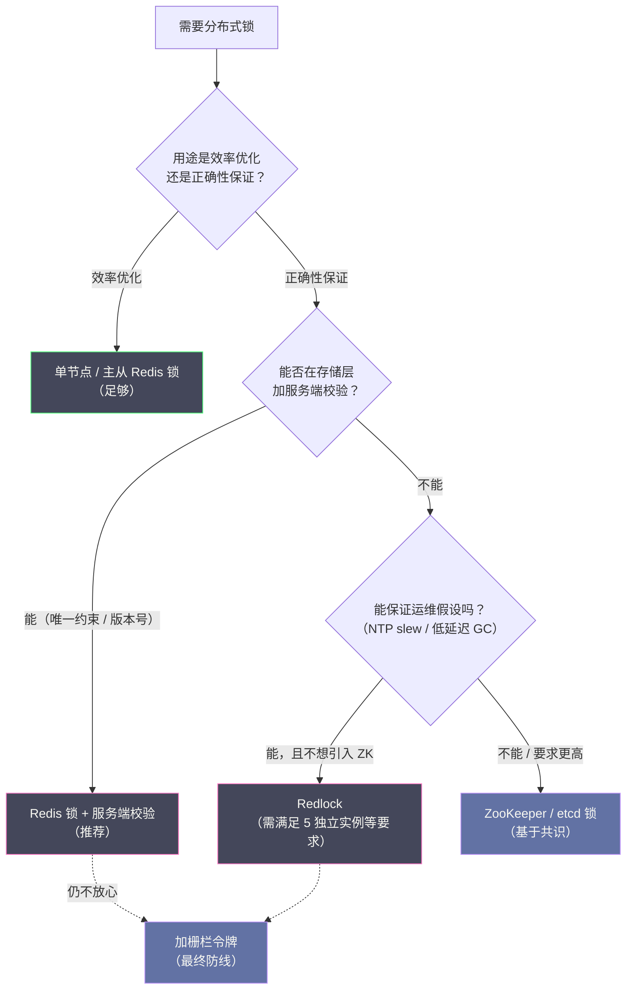

# 03 Redlock 算法正确性争议

**摘要：**

Redlock 是 Redis 作者 Antirez 于 2016 年提出的多实例分布式锁算法，旨在解决单节点 Redis 锁在主从切换时可能丢失锁数据的问题。Redlock 的思路看似优雅：向 N 个独立的 Redis 实例加锁，只要超过半数成功，就认为加锁成功。然而，就在 Redlock 发布后不久，分布式系统领域的著名学者 Martin Kleppmann 发表了一篇深度批评文章，从时钟漂移、GC 停顿等角度指出 Redlock 在面对某些故障场景时仍无法保证互斥性；随后 Antirez 进行了有力反驳，这场公开辩论成为分布式系统社区的经典事件。本文完整还原这场辩论的核心论点，深入分析双方各自的合理之处，辨析"故障假设模型"这一根本分歧，并给出工程实践中的选型建议。读完本文，你应当能回答两个问题：Redlock 究竟解决了什么、没解决什么，以及"该不该用 Redlock"这个问题的答案为什么取决于你的运维假设而非算法本身。

---

## 第 1 章 Redlock 的动机：单节点 Redis 锁的致命弱点

### 1.1 主从复制的异步性：无法回避的数据丢失窗口

在 02 篇中，我们已经分析了单节点 Redis 锁经过 `SET NX PX + Lua 解锁 + 看门狗`的优化后，正确性已经相当可靠。但有一个致命弱点是这些优化完全无法解决的：**Redis 主从复制的异步性**。

为了保证 Redis 服务的高可用，生产环境通常将 Redis 部署为"一主多从加 Sentinel 哨兵"的架构：

```
客户端 → Redis Master（主）
                ↓ 异步复制
         Redis Slave 1（从）
         Redis Slave 2（从）
```

Redis Sentinel 负责监控 Master 的健康状态。当 Master 宕机时，Sentinel 会在 Slave 中选出一个新的 Master，这个过程称为故障转移（Failover）。

问题的关键在于"异步复制"这四个字。Redis Master 在接受写操作后，会立即向客户端返回"成功"，然后**异步地**把这次写操作复制到 Slave。这个异步复制过程有一个时间窗口，在这个窗口内：Master 已经写入了 `lock_key` 并告知客户端加锁成功，而 Slave 尚未收到这次复制、还没有 `lock_key`。

如果 Master 恰好在这个窗口内宕机：

```
时间线：
T1: 客户端 A 向 Master 加锁：SET lock_key "client_A" NX PX 30000
T2: Master 返回 OK（加锁成功），客户端 A 开始执行临界区
T3: [在复制到 Slave 之前，Master 宕机]
T4: Sentinel 检测到 Master 宕机，将 Slave 1 提升为新 Master
T5: 新 Master（原 Slave 1）上没有 lock_key（复制丢失）
T6: 客户端 B 向新 Master 加锁：SET lock_key "client_B" NX PX 30000，成功。
T7: 客户端 A 和客户端 B 同时持有锁，互斥性被破坏。
```

这个问题不是代码 Bug，而是 Redis 主从复制的架构性设计决定的。如果使用同步复制（`WAIT` 命令可以等待 Slave 确认），虽然可以消除这个窗口，但 Redis 的高性能优势会大打折扣，而且 `WAIT` 命令的可靠性本身也有讨论空间。

这里可以打一个比方：异步复制像"快递已经发出但还没送到分拣中心"——寄件人（客户端）已经拿到了"已发出"的回执（Master 返回 OK），但包裹（锁数据）还在路上；如果此时快递总部（Master）失火，这份包裹就永远到不了分拣中心（Slave）。**Redlock 要解决的，正是这个"回执已发、数据未达"的窗口**。

### 1.2 Redlock 的设计目标

Redlock 的设计目标简洁清晰：**在不依赖单一 Redis 节点或主从复制的前提下，通过多个独立的 Redis 实例实现分布式锁，使得任意单个节点的故障都不影响锁的正确性。**

这个目标的关键词是"独立"——它试图用"多个互不相关的节点"来替代"一主多从的复制关系"。这样一来，单个节点故障不再意味着"数据可能丢失"，而只是"少数派少了一票"，多数派依然可以做出正确判断。**这是把"复制一致性"问题，转化为"多数派投票"问题**，思路与 Paxos/Raft 的多数派机制一脉相承。

### 1.3 Redlock 思路的一个类比

Redlock 的思路，可以用一个生活化的场景来理解：它像"找 5 个互不通气的公证人签字，集齐 3 个就算数"。

单节点锁像"只找一个公证人签字"——快，但这个公证人一旦失忆（宕机丢数据），他签过的字就不作数了。主从复制像"让主公证人把签过的字抄一份给助手"——但如果主公证人在抄之前就失忆了，助手手里就没有这份签字。Redlock 的做法是"请 5 个互不通气的公证人各自签字，只要集齐 3 个，就认为这份文件生效"——单个公证人失忆，不影响整体的有效性。

这个类比里最关键的是"互不通气"（独立）与"集齐多数"（Quorum）两点。**如果公证人之间会通气（存在复制关系），那么"5 个"就退化成了"1 个加 4 个副本"，独立性的价值就消失了**；而"集齐多数"则是为了确保"任意两次签字中，至少有一个公证人是重复的"，从而不会出现两份互相矛盾的有效文件。理解这两点，就理解了 Redlock 为什么要求"5 个独立实例加多数派"。

---

## 第 2 章 Redlock 算法：多数派加锁的核心逻辑

### 2.1 算法的基本设定

Redlock 算法要求部署**奇数个（通常是 5 个）完全独立的 Redis 实例**——这里的"完全独立"意味着它们之间没有任何主从关系，运行在不同的服务器上，故障互不影响。

为什么是 5 个？这是一个来自分布式共识理论的经典取舍：

- 使用 3 个节点：可以容忍 1 个节点故障（3 个中获得 2 个多数即可）
- 使用 5 个节点：可以容忍 2 个节点故障（5 个中获得 3 个多数即可）
- 使用 1 个节点：就是普通的单节点 Redis，0 容错

5 个节点在可靠性与运维成本之间取得了合理的平衡。这个"多数派"思想与分布式事务里的 Quorum、共识协议的多数派确认完全同源——**只要超过半数的节点确认，就认为决策成立，因为任意两个多数派必然相交，不会出现"两个互相矛盾的多数派"**。



### 2.2 Redlock 加锁的完整步骤

**步骤一：记录开始时间**

```python
start_time = time.time_ns()  # 纳秒级时间戳，用于后续计算
```

**步骤二：向所有 N 个 Redis 实例顺序加锁**

向每个 Redis 实例执行与单节点锁相同的命令：

```redis
SET lock_key <random_value> NX PX <lock_ttl>
```

`random_value` 是一个全局唯一的随机值（UUID），所有 N 个实例使用**同一个** `random_value`——这很重要，因为解锁时需要用这个值来验证锁的归属。

**关键细节**：向每个实例发送加锁请求时，设置一个较短的**超时时间**（通常是 `lock_ttl / (N * 10)`，如锁 TTL 为 10 秒，则单实例请求超时约为 200ms）。如果某个实例在超时时间内未响应，直接跳过，向下一个实例发送请求。这样可以避免因某个 Redis 实例宕机或网络极慢而阻塞整个加锁流程。

**步骤三：计算有效锁时间，判断是否多数成功**

```python
elapsed_time = time.time_ns() - start_time  # 加锁总耗时（纳秒）
elapsed_ms = elapsed_time // 1_000_000       # 转为毫秒

# 有效锁时间 = 原始 TTL - 加锁耗时 - 时钟漂移安全余量
CLOCK_DRIFT_FACTOR = 0.01  # 时钟漂移因子，通常取 0.01（1%）
drift = int(lock_ttl * CLOCK_DRIFT_FACTOR) + 2  # 毫秒

validity_time = lock_ttl - elapsed_ms - drift

success_count = sum(1 for r in results if r == "OK")

if success_count >= (N // 2 + 1) and validity_time > 0:
    # 加锁成功，有效锁时间为 validity_time 毫秒
    return (True, validity_time, random_value)
else:
    # 加锁失败，向所有实例发送解锁请求（清理可能成功的部分锁）
    release_all(redis_instances, lock_key, random_value)
    return (False, 0, None)
```

**步骤三为什么要扣除"加锁耗时"？** 这是 Redlock 的一个精妙设计。在向 5 个实例顺序加锁的过程中，会消耗一段时间（假设 50ms）。在这 50ms 内，第 1 个实例上的锁已经在倒计时；当第 5 个实例加锁成功时，第 1 个实例的锁已经用掉了 50ms 的 TTL。因此，"实际有效的锁时间"要从原始 TTL 中减去这段消耗。如果 `validity_time ≤ 0`，说明加锁过程花费的时间超过了 TTL，即使多数实例加锁成功，锁可能已经在部分实例上过期了，此时认为加锁失败。

这个"扣除耗时"的设计，体现了一种诚实的态度：**它承认"加锁动作本身也要花时间"，并把这段时间如实计入锁的可用期**。很多不严谨的实现会忽略这一点，导致"以为锁还有 10 秒，实际上只剩 9.5 秒"。

**步骤四：在有效锁时间内执行临界区业务**

```python
# 必须在 validity_time 毫秒内完成业务，否则锁可能已过期
execute_critical_section()
```

**步骤五：解锁**

向**所有** N 个 Redis 实例发送解锁请求（包括加锁失败的实例），使用与单节点锁相同的 Lua 脚本：

```python
for redis_instance in redis_instances:
    redis_instance.eval(UNLOCK_SCRIPT, [lock_key], [random_value])
```

向所有实例发送解锁，而不是只向加锁成功的实例发送，是因为"加锁失败"可能是网络超时导致的——实际上 Redis 实例可能已经成功写入了锁，但响应包在网络中丢失了。如果不向这些"疑似失败"的实例解锁，可能会留下一个残存的锁记录，影响后续的加锁请求。**这与 02 篇"幻象失败"的处理思路一致：宁可多清理，不可留残余**。

### 2.3 Redlock 的容错分析

**场景一：一个 Redis 实例宕机（5 个中的 1 个）**。客户端只能向 4 个实例加锁，需要获得 3/4 的多数（实际上 Redlock 仍然要求 3/5 的多数，宕机节点算失败）。3/5 成功，加锁总体成功。宕机实例恢复后，锁的 TTL 已到期或将到期，不影响后续操作。

**场景二：加锁后一个持有锁信息的实例宕机**。假设客户端 A 在实例 1、2、3 上加锁成功。随后实例 2 宕机，Sentinel 自动重启实例 2（或实例 2 重启后内存清空）。此时：

- 客户端 A 仍持有实例 1、3 上的锁（共 2 个），不满足多数（2 < 3），但客户端 A 已经加锁成功了（加锁时 3/5 成功）
- 客户端 B 尝试加锁：实例 2 已无锁（宕机重启后），所以能在实例 2、4、5 上加锁成功（共 3 个），总体加锁成功

**结果：客户端 A 和客户端 B 同时持有锁。**

这是 Redlock 最被批评的失效场景之一。Antirez 对此的回应是：实例宕机后必须等待至少 TTL 时间才能重启，以保证实例上的锁已过期。但如果实例宕机后立即重启（如机器进行了 OS 重启，内存被清空），就会触发这个问题。

Antirez 提出的解决方案是：给重启的实例设置一个"延迟可用"时间（`delayed_availability = max_lock_ttl`），在这段时间内，重启的实例不响应加锁请求。这样即使实例重启了，其他客户端也无法利用这个"空白"实例来凑足多数，因为延迟期内它不计入可用节点。

> [!note] "延迟可用"是一个典型的分布式技巧
> 让重启的节点"先冷静一会儿再加入集群"，这个思路在分布式系统里反复出现：Raft 新加入的节点需要先同步日志才能参与投票；Kafka 的 Broker 重启后需要重新加入 ISR；RocketMQ 的 Broker 重启后需要重新注册。它们的共同逻辑是：**一个刚重启的节点，其内存状态是"空白"的，直接参与决策会带来风险，因此需要一段"热身期"**。理解这个模式，就能理解为什么 Redlock 要求重启实例延迟可用——它不是特例，而是通用做法。

### 2.4 一个实现细节：为什么所有实例用同一个 random_value

Redlock 要求向所有实例加锁时使用**同一个** `random_value`，这个细节看似不起眼，却关系到解锁的正确性，值得单独说明。

这个 `random_value` 扮演的角色，与单节点锁里的 value 完全一致：它是"这一次加锁尝试的唯一身份标识"。之所以所有实例共用同一个值，原因有三。

其一，**解锁时要逐实例校验归属**。解锁脚本执行的是"value 匹配才删除"，如果每个实例用了不同的 value，客户端就必须记住"哪个实例用了哪个值"，才能正确解锁——这平白增加了一层状态管理。

其二，**同一个值让"清理残余"变得简单**。如 2.2 节所述，加锁失败的实例上可能残留了锁记录（响应丢失导致），解锁时需要向所有实例发送解锁请求。如果所有实例用的是同一个值，一条解锁脚本就能统一处理；如果值不同，就要为每个实例准备不同的参数。

其三，**同一个值天然支持"幂等解锁"**。如果解锁请求因为网络问题被重发，用同一个值的解锁脚本是幂等的——第二次执行时 value 已不匹配（或 key 已不存在），返回 0，不会误删他人的锁。

这个细节再次印证了一条规律：**凡是涉及"身份标识"的地方，都要让它唯一且易于校验**。`random_value` 之于 Redlock，与 UUID 之于单节点锁、事务 ID 之于分布式事务，是同一个设计思路——**用一个唯一的凭证，把"这次操作"与"那次操作"区分开**。

### 2.5 Redlock 的性能与延迟代价

Redlock 用多数派换来了对单点故障的抵抗力，但这份可靠性是有价格的，价格就体现在延迟上。

一次 Redlock 加锁，需要向 5 个实例各发一次请求。即便这些请求可以并行发出，加锁的总耗时也受"最慢的那个实例"制约——通常是 1 到 5ms 量级。再加上解锁时的 5 次请求，一次完整的"加锁加解锁"操作，开销大致是单节点锁的 5 到 10 倍。

这个代价的根源有两层：其一，**多数派要求必然带来多副本开销**——要确认 3 个实例，就要访问至少 3 个实例，这比"访问 1 个实例"多；其二，**独立实例通常跨机架甚至跨机房部署**——为保证"独立"，5 个实例不能挤在同一台机器上，跨网络访问的延迟自然更高。

把这两层合起来看，可以得出一个判断：**Redlock 的延迟，是"独立实例"与"多数派确认"这两项设计的直接成本**。它无法通过优化代码消除，因为这两项正是它区别于单节点锁的价值所在。这也解释了为什么 6.1 节说"如果只是效率优化用途，单节点 Redis 锁已经足够"——为不需要的可靠性支付延迟成本，是不划算的。**可靠性与延迟之间，Redlock 明确地选择了前者，而这个选择是否值得，取决于你的业务是否需要那份可靠性**。

---

## 第 3 章 Martin Kleppmann 的批判

2016 年 2 月，分布式系统领域的知名学者、《Designing Data-Intensive Applications》作者 Martin Kleppmann 发表了一篇题为《How to do distributed locking》的博文，对 Redlock 提出了系统性批判。

### 3.1 批判的核心前提：分布式锁的两种用途

Kleppmann 首先区分了分布式锁的两种不同用途，这是理解他批判的关键前提。

**用途一：效率优化（Efficiency）**。使用分布式锁只是为了避免重复执行开销较大的操作——即使锁失效，最坏的结果是某个操作被执行了两次，没有数据损坏的风险。例如：避免重复发送邮件、避免重复触发某个计算任务。

**用途二：正确性保证（Correctness）**。使用分布式锁是为了确保并发操作的正确性——如果锁失效，会导致数据损坏、不一致、丢失等严重问题。例如：防止库存超卖、防止资金重复扣减。

Kleppmann 的观点是：**对于"效率优化"用途，单节点 Redis 锁已经足够，Redlock 大材小用；对于"正确性保证"用途，Redlock 在面对某些故障场景时仍然不够安全**——它解决了主从复制的问题，却对时钟漂移和进程停顿束手无策。

这个"两种用途"的划分，是整场辩论最有价值的贡献之一。它把一个笼统的"锁够不够可靠"问题，拆成了"你用它来做什么"——**如果锁只是用来省点资源，那么偶尔失效无所谓；如果锁是用来防止数据错乱，那么任何失效都不可接受**。判断该用多强的锁，第一步永远是判断"它服务于哪一种用途"。

### 3.2 第一个批判：时钟依赖导致的正确性问题

Redlock 算法严重依赖时钟的准确性——TTL 是基于时间的，锁的有效期计算也是基于时间差的。Kleppmann 指出，在真实的分布式系统中，时钟是不可靠的：

```
时间线：
T1: 客户端 A 在 5 个 Redis 实例上加锁成功，锁 TTL = 10 秒
T2: Redis 实例 3 的 NTP 服务执行时钟同步，系统时钟向前跳变了 15 秒
    （NTP 向前校时会导致 Redis 的过期时间立即到达）
T3: 实例 3 上的锁立即过期（因为时钟向前跳了 15 秒）
T4: 此时客户端 A 持有实例 1、2 上的锁（2 个），不满足多数（2 < 3）
    但客户端 A 并不知道这件事，它继续执行临界区
T5: 客户端 B 加锁：在实例 3、4、5 上加锁成功（3 个），总体加锁成功
T6: 客户端 A 和客户端 B 同时持有锁，互斥性被破坏。
```

NTP 时钟跳变在实际运维中不是不可能的事件——特别是在系统时钟严重落后时，NTP 会执行"步进（step）"调整，直接把时间跳变到正确值，而不是缓慢地通过"频率调整（slew）"逐渐矫正。

Kleppmann 的结论是：**一个依赖时钟的分布式锁算法，在时钟不可靠的环境中无法提供正确性保证**。而"时钟不可靠"在分布式系统中是一个正常的故障假设，不应被算法忽视。

### 3.3 第二个批判：GC 停顿破坏了锁的有效性假设

Kleppmann 在 01 篇提到的 GC 停顿问题上进行了更深入的分析：

```
时间线（GC 停顿破坏 Redlock 的场景）：
T1: 客户端 A 在 5 个实例上加锁成功，锁 TTL = 10 秒，有效时间 = 9.9 秒
T2: 客户端 A 开始执行临界区
T3: 客户端 A 发生 Full GC，所有线程暂停 15 秒
T4: [10 秒过去] 所有 5 个实例上的锁全部 TTL 到期，自动删除
T5: 客户端 B 加锁，5 个实例全部成功，获得锁
T6: 客户端 A 的 GC 结束（此时离加锁成功已过 15 秒），
    但客户端 A 不知道锁已过期，继续执行临界区
T7: 客户端 A 和客户端 B 同时在临界区。
```

这个问题的本质是：**Redlock 假设锁的"有效时间"是可信的，但 GC 停顿会让客户端的主观感知时间与客观流逝时间脱节**。客户端在 GC 期间"失去了 15 秒"，醒来后仍以为自己的锁还有效，但实际上锁早已过期。

### 3.4 Kleppmann 提出的替代方案：Fencing Token

Kleppmann 承认，上述两个问题（时钟跳变与 GC 停顿）的共同根源是：**分布式锁在客户端持有锁期间，锁的有效性可能悄然改变，而客户端无法及时感知**。

他提出了一个根本性的解决思路：**栅栏令牌（Fencing Token）**。

栅栏令牌的核心思想是：每次加锁时，锁服务返回一个**单调递增的令牌**，客户端在执行临界区操作时必须携带这个令牌；存储服务（如数据库）检查令牌的单调性，拒绝任何令牌过期（即令牌值小于当前已见到的最大令牌）的写请求。

```
Fencing Token 的工作流程：

T1: 客户端 A 加锁，获得 Token = 33
T2: 客户端 A 执行 DB 写入，携带 Token = 33
    DB：当前最大见到 Token = 32 < 33，允许写入，更新最大 Token = 33

T3: 客户端 A 的锁过期，客户端 B 加锁，获得 Token = 34
T4: 客户端 B 执行 DB 写入，携带 Token = 34
    DB：当前最大见到 Token = 33 < 34，允许写入

T5: 客户端 A 从 GC 恢复，也执行 DB 写入（此时它的锁已过期），携带 Token = 33
    DB：当前最大见到 Token = 34 > 33，拒绝写入，（老 Token 被正确拒绝）
```

栅栏令牌的优点是：即使分布式锁失效，存储服务也能通过令牌单调性检查来拒绝过期客户端的写入，保证数据正确性。这**把"正确性保证"从锁服务下移到了存储服务**，更加可靠。

Kleppmann 的结论是：如果你需要真正意义上的"正确性保证"，栅栏令牌是必不可少的，而实现了栅栏令牌的系统（如基于 ZooKeeper 的方案天然提供单调递增的 `zxid`）比 Redlock 更安全。

> [!info] 栅栏令牌的深刻之处：把控制权交给不会停顿的一方
> 栅栏令牌的思想，比它表面看起来更深刻。它的关键不在于"令牌"这个数据结构，而在于**它把"防止过期写入"的职责，从一个会停顿的客户端，转移到了一个不会停顿的服务端**。客户端可能 GC、可能网络分区、可能时钟错乱，但数据库不会——它只是忠实地执行"拒绝旧令牌"这条规则。**这与 02 篇"把所有权从客户端主观状态变成服务端客观事实"的方向完全一致**，也是理解这场辩论深层价值的关键。

### 3.5 一个延伸：锁不是正确性的充分条件

Kleppmann 的批判还隐含着一层更深的意思，值得单独展开：**即使分布式锁完全可靠，它也不足以保证业务的正确性**。

原因在于，"互斥"只是正确性的一个必要环节，而非全部。举几个例子：拿锁之后，业务读取了一份"过时的缓存数据"并基于它做决策，那么即使锁保证了"同一时刻只有一个执行者"，这个执行者也可能基于错误的信息做出错误的操作；又或者，锁保护的临界区跨越了一次外部调用，而外部调用的结果不确定，那么互斥也无法保证结果的正确。

Kleppmann 的真实主张，其实不是"Redlock 不行"，而是**"把正确性寄托在锁上，是把责任放错了层"**。正确性应当由"不会停顿、可校验的服务端"来保证——数据库的唯一约束、版本号、栅栏令牌。锁的作用是"减少冲突、提升效率"，而不是"承载正确性"。

这个观点与 01 篇的结论完全呼应：**锁是减少冲突概率的工具，不是保证业务正确的银丹**。Redlock 争议之所以成为经典，正是因为它用一个具体的算法争论，把这个抽象的道理讲透了——**当你需要"绝对正确"时，正确的做法往往不是"找一个更可靠的锁"，而是"让正确性不再依赖锁"**。

### 3.6 一个技术细节：栅栏令牌如何落地

栅栏令牌的思路清晰，但落地时需要回答一个问题：**令牌的单调递增由谁保证？**

如果锁服务是 Redis，那么可以用 `INCR` 生成一个递增序列——但这里有一个陷阱：**Redis 的 `INCR` 在主从切换后可能回退**（新主上的计数器可能小于旧主），因此它并不是全局单调的。这意味着，直接用 Redis 的 `INCR` 做栅栏令牌，会重新引入 1.1 节讨论的"主从切换丢数据"问题——令牌的单调性本身也需要强一致来保证。

真正可靠的令牌来源，是那些本身就提供单调序列的组件：**ZooKeeper 的 `zxid` 天然单调递增**，且由 ZAB 协议保证跨主从切换的连续性；**数据库的自增主键或序列**也是单调的，且由数据库的事务保证。这也是 Kleppmann 说"基于 ZooKeeper 的方案天然提供栅栏令牌"的原因。

存储侧的校验逻辑很简单，以数据库为例：

```sql
-- 记录每个资源的"已见最大令牌"
CREATE TABLE lock_fence (
    resource_id   VARCHAR(64) NOT NULL,
    max_token     BIGINT      NOT NULL DEFAULT 0,
    PRIMARY KEY (resource_id)
);

-- 写入时校验令牌单调性
UPDATE lock_fence
SET max_token = :new_token
WHERE resource_id = :rid
  AND max_token < :new_token;   -- 只有新令牌更大才更新

-- affected_rows = 0 说明令牌已过期，拒绝本次业务写入
```

这段 SQL 的关键是 `AND max_token < :new_token` 这个条件——它把"拒绝旧令牌"的逻辑，变成了一次原子更新。**它与"库存扣减加 stock > 0 条件"是同一个套路：用一个带条件的原子写，让"过期操作"自然失败**。这也说明栅栏令牌并不神秘，它只是把并发控制的职责，从"锁服务"下移到了"数据存储"，并用一个单调序列来标识操作的先后。

---

## 第 4 章 Antirez 的反驳

Antirez 随后发表了回应文章，承认了部分问题，但对 Kleppmann 的核心结论进行了反驳。

### 4.1 对时钟跳变批判的回应

Antirez 承认，如果 NTP 发生大幅"步进"校时（将时间向前跳几十秒），Redlock 确实会失效。但他认为，这是一个**系统管理问题**，而不是 Redlock 算法本身的问题：

其一，**NTP 应该被配置为只执行频率调整，而不执行步进跳变**。主流 NTP 实现（如 chrony、ntpd）都支持这种配置，系统管理员应该正确配置 NTP 以避免大幅时钟跳变。

其二，对于时钟**缓慢漂移**（几毫秒到几十毫秒），Redlock 已经在算法中引入了"时钟漂移安全余量"来补偿，这个余量通常能覆盖正常的时钟偏差。

其三，如果一个系统的时钟被允许随意跳变，那么几乎所有依赖时间的分布式算法（包括 ZooKeeper 的 Session 超时、Kafka 的日志压缩）都会失效，Redlock 只是"众多受害者之一"，不应被单独指责。

> [!note] 这个反驳的合理性
> Antirez 的这个回应是合理的——在运维规范的环境中，NTP 步进跳变是可以被控制的。但问题是：在真实的生产环境中，运维规范未必被严格遵守，云环境中的虚拟机时钟漂移更难控制。Kleppmann 的批判揭示了一个假设（时钟可靠）；Antirez 的回应说明了如何保证这个假设成立。两者都有道理，关键是你的运维环境能否保证这个假设。**这也提示我们，评估一个算法时，"它在什么假设下正确"与"它的实现是否正确"同样重要**。

### 4.2 对 GC 停顿批判的回应

Antirez 对 GC 停顿问题的回应更为直接：**这个问题不是 Redlock 独有的，而是所有分布式锁方案（包括 ZooKeeper）的共同问题**。

```
时间线（ZooKeeper 锁的 GC 停顿场景）：
T1: 客户端 A 在 ZooKeeper 上创建临时节点，加锁成功
T2: 客户端 A 发生 Full GC，所有线程暂停 15 秒
T3: ZooKeeper 的 Session 超时默认 30 秒，GC 停顿期间 A 的心跳停止
    [如果 GC 超过 30 秒，ZK 会认为 A 的 Session 过期，删除临时节点]
    [即使 GC 不超过 30 秒，A 醒来后继续执行，而锁仍然有效——但临界区操作可能已经不安全]
T4: 如果 A 的 GC 只持续 15 秒，ZK 不会删除节点，A 醒来继续执行
    同时，如果存储服务（如 MySQL）在 A 的 GC 期间对数据做了修改，
    A 基于 GC 前读取的"过时数据"执行写入，同样会有数据竞争问题
```

Antirez 的核心论点是：**GC 停顿是一个进程级别的问题，它会让任何基于时间的分布式协议产生不确定性**。解决这个问题需要在应用层面处理（如 Kleppmann 提出的栅栏令牌），这与使用 Redlock 还是 ZooKeeper 无关。

这个反驳在逻辑上是成立的——GC 停顿确实不是 Redlock 的专属问题。但它也隐含了一个让步：**如果连 ZooKeeper 都需要栅栏令牌来兜底，那么"用 Redlock 还是 ZooKeeper"这个选择本身，就不足以解决正确性问题**——真正决定正确性的，是有没有栅栏令牌这样的服务端校验。

### 4.3 Antirez 的核心立场

Antirez 最终的立场可以概括为：**Redlock 的设计目标是"比单节点 Redis 锁更安全"，而不是"在所有可能的故障模型下保证绝对安全"**。Redlock 明确假设：

- 时钟是大致可靠的（NTP 正确配置，无大幅跳变）
- GC 停顿时间远小于锁的 TTL
- 网络分区是短暂的，不是永久的

在这些假设成立的情况下，Redlock 提供了比单节点 Redis 锁更强的安全保证，可以抵御单个 Redis 节点故障。如果你的系统无法保证这些假设，那么你也无法安全地使用任何基于时间的分布式协议，不只是 Redlock。

### 4.4 辩论中双方达成共识的部分

这场辩论被记住的往往是分歧，但更有价值的是双方**达成共识**的部分。把这些共识列出来，会发现它们比分歧更能指导实践。

**共识一：GC 停顿是真实存在的问题**。双方都承认，客户端停顿会导致"自以为还持有锁"的错觉，这是任何基于时间的锁都无法回避的。分歧只在于"这算不算 Redlock 的锅"。

**共识二：正确性最终需要服务端兜底**。Kleppmann 明确提出栅栏令牌；Antirez 也承认"解决这个问题需要在应用层面处理"。也就是说，**双方都同意"锁本身不足以承载正确性"**。

**共识三：Redlock 比单节点锁更安全**。Antirez 的设计目标是"抵御单节点故障"，Kleppmann 也没有否认这一点——他否认的是"Redlock 足以保证正确性"。

**共识四：效率优化场景下，单节点锁足够**。Kleppmann 明确说"用于效率优化时，单节点 Redis 锁已经足够"，Antirez 也没有反对。

把这四条共识串起来，实际得到的结论非常清晰：**Redlock 是一个"比单节点锁更强、但不足以承载正确性"的中间选项；真正的正确性要靠服务端校验**。分歧只在于"这个中间选项值不值得用"——而这恰恰是一个取决于具体环境（运维条件、性能要求、是否有 Redis 集群）的问题，没有统一答案。

这个观察带来一个通用的方法论：**读技术争论时，先找"双方都同意的部分"，因为它们往往是真正稳固的结论；分歧部分则要结合自己的环境判断**。共识是地基，分歧是选择——把两者分清，就不会被争论的激烈程度误导。

---

## 第 5 章 辩论的深层启示：分布式系统的故障假设

这场辩论的最大价值，不在于最终谁对谁错，而在于它揭示了一个分布式系统设计的核心方法论：**任何分布式算法的正确性都建立在一组故障假设（Failure Model）之上，算法的适用范围等价于这组假设成立的范围**。

### 5.1 分布式系统的故障假设模型

**同步模型（Synchronous Model）**：假设网络延迟有上界，进程速度有上界，时钟偏差有上界。在这个模型下，很多分布式算法可以被证明是正确的，但现实网络很少能满足严格的同步假设。

**部分同步模型（Partially Synchronous Model）**：假设系统大部分时间是同步的，只在偶尔的时段违反同步假设。Redlock 隐式地假设了这个模型——大多数时间时钟是准确的，GC 停顿时间是短暂的。

**异步模型（Asynchronous Model）**：不对网络延迟、进程速度、时钟做任何假设。在纯异步模型下，FLP 不可能定理证明不存在确定性的分布式共识算法。ZooKeeper 基于 Paxos/ZAB，在理论上也只能在部分同步模型下工作，但其设计比 Redlock 对时钟的依赖更少——ZAB 的核心不依赖锁 TTL，而是依赖 Session 超时，后者可以被设计成对时钟偏差更鲁棒。

Kleppmann 批判 Redlock 时使用的是更严格的部分异步假设（允许时钟大幅跳变）；Antirez 防御 Redlock 时使用的是更宽松的部分同步假设（时钟有界偏差）。**两人的分歧本质上是在争论"正确的故障假设模型应该是什么"**。理解了这一点，就能明白这场辩论为什么"谁也说服不了谁"——他们不是在争论同一个命题的真假，而是在用不同的前提讨论问题。

### 5.2 实用主义与理论完备性

这场争论也反映了工程实用主义与理论完备性之间的永恒张力。

**Kleppmann 的立场**偏向理论完备性：分布式锁是关键基础设施，应该在尽可能宽松的故障假设下仍然正确，不能依赖"时钟通常是准的"这种脆弱假设。

**Antirez 的立场**偏向工程实用主义：在合理的运维条件下，Redlock 提供了足够的安全保证，追求"在所有可能的故障下都正确"的代价是不可接受的复杂度。

在工程实践中，没有绝对的对错，只有在给定约束条件下的权衡选择。**这场辩论教会我们的，不是"谁错了"，而是"如何识别一个方案背后的假设，并判断这些假设在自己的环境里是否成立"**——这是一种比记住结论更重要的能力。

### 5.3 一个可迁移的评估框架

把这场辩论抽象一下，可以得到一个评估任何分布式方案（不只是锁）的通用框架，由三个追问组成。

**第一问：这个方案的故障假设是什么？** 它假设时钟可靠吗？假设 GC 停顿有界吗？假设网络分区短暂吗？只有找出这些假设，才能判断方案在自己环境里的适用性。

**第二问：假设被打破时，方案是"停摆"还是"错乱"？** 如 01 篇所述，"错乱"远比"停摆"危险。评估方案时要特别关注它在假设失效时会不会安静地破坏数据。

**第三问：有没有"服务端校验"可以兜底？** 栅栏令牌之所以被推荐，是因为它把正确性的最终防线放在了不会停顿的服务端。任何依赖"客户端自觉"的机制，都可以问一句"能不能加一层服务端校验"。

这三个追问——找假设、辨后果、加校验——不仅适用于分布式锁，也适用于分布式事务、共识协议等所有分布式方案。带着它们去读后续内容，会发现每一个方案的取舍都能被这套框架解释。

### 5.4 从这场辩论看"权威观点"的正确用法

这场辩论还有一个"元层面"的启示：**当两位权威得出相反结论时，正确的做法不是选边站，而是提取各自的假设与适用条件**。

网络上流传着不少对这场辩论的简化版本，最常见的误读是"Kleppmann 说 Redlock 不安全，所以别用"。但回到原文会发现：Kleppmann 说的是"Redlock 在用于**正确性保证**时不够安全"，他并不否定 Redlock 在"效率优化"场景下的价值；他推荐的替代方案也不是"换成 ZooKeeper"，而是"加一层栅栏令牌"。把"在某个用途下不够安全"简化为"不安全"，就丢掉了最关键的前提。

类似的误读在技术传播中非常普遍：**一个带有明确前提的结论，被剥离前提后变成了一句口号**。避免这种误读的方法只有一条——读原文，而不是读结论摘要；关注"在什么条件下成立"，而不是"谁说的"。这也解释了为什么本文花大量篇幅还原双方的完整论证，而不是直接给出"该用还是不该用"的结论——**因为脱离了假设的结论，几乎没有使用价值**。

### 5.5 这场辩论对分布式事务的启示

把这场辩论的结构与分布式事务专栏对照，会发现它们惊人地相似，这说明它们背后是同一套分布式系统的思维方式。

**相似点一：都在争论"假设的边界"**。Redlock 争议的核心是"时钟与 GC 的假设是否成立"；分布式事务里 2PC 与柔性事务之争，核心也是"强一致是否必须、阻塞是否可接受"的假设差异。

**相似点二：都指向"服务端兜底"**。栅栏令牌之于锁，与幂等、唯一约束、对账之于分布式事务，是同一个思路——**把正确性的最终防线，放在不依赖"客户端自觉"的地方**。

**相似点三：都反对"银弹思维"**。这场辩论反复强调"取决于环境"，分布式事务也反复强调"没有银弹，只有权衡"。两者都在抵制"找到一个万能方案"的冲动。

这些相似点说明，**分布式系统领域看似分散的各种技术（锁、事务、共识、复制），共享着一套底层的思维方式：找假设、辨后果、把关键判断放到最可靠的那一层**。掌握了这套思维，学具体的方案就会快得多——因为你看到的不是一堆孤立的知识点，而是同一套逻辑在不同场景下的应用。这也是本专栏把"方法论"放在具体方案之前反复强调的原因。

---

## 第 6 章 工程实践中的选型建议

经历了这场辩论的洗礼，回到最实际的问题：**在生产系统中，我应该使用 Redlock 吗？**

### 6.1 Redlock 的适用场景

**适合使用 Redlock 的场景**：

1. **已经在使用 Redis，且需要比单节点锁更高的可靠性**：单节点 Redis 锁在主从切换时有数据丢失风险，Redlock 通过多数派加锁消除了这个风险
2. **能够保证合理的运维条件**：NTP 正确配置（禁用大幅步进），GC 停顿控制在合理范围内（使用 G1/ZGC），网络分区持续时间远小于锁 TTL
3. **对正确性要求是"尽力而为"而非"绝对保证"**：即使 Redlock 偶尔失效，通过业务层幂等性可以兜底

**不适合使用 Redlock 的场景**：

1. **运维条件无法保证**：在时钟不可靠、GC 停顿无法控制的环境中（如资源受限的容器、虚拟机迁移等场景）
2. **需要绝对的互斥保证**：对于金融结算、核心数据修改等场景，应该使用栅栏令牌机制或 ZooKeeper 锁，而非依赖 Redlock 的时间假设
3. **性能要求极高但正确性要求一般**：Redlock 需要串行向 5 个实例加锁，比单节点锁延迟高约 5 倍，如果只是"效率优化"用途，单节点 Redis 锁已经足够

### 6.2 Redlock 的运维要求

如果决定使用 Redlock，以下运维要求不可忽视：

1. **5 个 Redis 实例必须完全独立**：不能有任何主从关系，运行在不同物理机上，甚至不同机架、不同电源回路
2. **NTP 必须配置为 slew 模式**，禁止大幅步进跳变：

   ```
   # /etc/chrony.conf（推荐的 NTP 配置）
   makestep 0.1 3  # 仅在启动的前 3 次校时才允许步进，之后只允许频率调整
   ```

3. **锁的 TTL 应远大于预期的最大故障时间**：包括网络延迟加 GC 停顿加系统负载抖动的总和
4. **节点重启必须有延迟**：等待至少 `max_lock_ttl` 时间后才重新加入 Redlock 集群

### 6.3 一个更务实的建议

对于大多数互联网业务场景，以下策略往往比 Redlock 更实用。

**方案 A（最常用）：单节点或主从 Redis 锁加业务幂等**。使用标准的 `SET NX PX + Lua 解锁 + Redisson 看门狗`，接受极低概率的锁失效可能，通过业务层的幂等性设计（数据库唯一约束、版本号检查）来兜底。这对于库存扣减、订单创建等场景是安全的：即使锁偶尔失效（概率极低），数据库的唯一约束或乐观锁也能阻止错误数据写入。

**方案 B（强一致性要求）：ZooKeeper 分布式锁**。对于金融级的强一致性要求，使用 ZooKeeper 分布式锁（详见 04 篇）。ZK 基于 ZAB 协议，主从切换强一致（Leader 确认才返回），Session 超时机制比 TTL 更对时钟偏差鲁棒，是更可靠的选择。

**方案 C（Redlock 适用的夹层）**。如果已经有 Redis 集群（或多地部署），且无法引入 ZooKeeper，同时对单节点 Redis 锁的主从切换风险有顾虑，则 Redlock 是一个合理的中间方案——前提是能满足上述运维要求。

> [!note] 业界的实际选择
> 在工业界，真正使用 Redlock 算法的团队并不多。更常见的做法是：
> 1. **使用单节点或主从 Redis 加 Redisson**（绝大多数场景）
> 2. **使用 ZooKeeper 加 Curator**（金融、电信等对一致性要求极高的场景）
> 3. **使用 etcd**（云原生、Kubernetes 生态中，etcd 本身基于 Raft，提供比 Redis 更强的一致性）
>
> Redlock 的理论价值在于它提出了"多数派加锁"的思想，但在工程实践中，5 个独立 Redis 实例的运维成本与延迟开销，往往不如直接使用 ZooKeeper 或 etcd。**这本身也是一个工程取舍：当"更安全"的代价是"更复杂"时，很多时候"换一个天生更安全的组件"比"把原组件改造成更安全"更划算**。

### 6.4 这场辩论留下的三条判断

抛开具体结论，这场辩论给工程实践留下了三条可以长期复用的判断。

**其一，先分清用途，再谈强弱**。Kleppmann 的"效率优化与正确性保证"二分法，是所有锁选型的第一步。用错用途，讨论强弱就没有意义。

**其二，正确性的最终防线应在服务端**。无论选哪种锁，只要业务不能容忍错乱，就应当有一层服务端校验（唯一约束、版本号、栅栏令牌）来兜底。锁只是"减少冲突概率"，不是"保证正确"。

**其三，关注"假设"而非"结论"**。Redlock 是否可用，不取决于"Kleppmann 赢了还是 Antirez 赢了"，而取决于你的环境是否满足 Redlock 的假设。**评估任何分布式方案，都要先问一句"它假设了什么，我的环境满足吗"**。

### 6.5 一个决策树

把第 6 章的建议整理成一张决策树，便于在具体场景中快速定位方案：



这张树的主干是"用途 → 校验 → 假设"三步。它传达的核心信息是：**在"正确性保证"这条分支上，最优先的选项不是"更强的锁"，而是"服务端校验"**——只有在校验不可行、且假设能满足时，才轮到 Redlock 或 ZooKeeper。这与 Kleppmann 的结论一致，也是本专栏从 01 篇到 03 篇一以贯之的立场。

### 6.6 落地清单

无论最终选择哪条路线，以下检查项都值得在落地前逐条确认。

**若选择"Redis 锁加服务端校验"**：确认目标资源有唯一约束或版本号字段；确认校验发生在写操作的同一事务内（避免校验与写入之间有窗口）；确认校验失败时的处理（报错、重试还是降级）。

**若选择 Redlock**：确认 5 个实例完全独立（无主从、不同物理机）；确认 NTP 配置为 slew 模式；确认 GC 停顿远小于 TTL；确认实例重启有延迟可用；确认已接受其延迟代价。

**若选择 ZooKeeper 或 etcd**：确认集群规模（通常 3 或 5 节点）与多数派容错能力；确认 Session 超时与业务耗时的匹配；确认客户端库（Curator 等）的版本与用法；确认对性能延迟的接受度。

**无论哪种选择**：都要问一句"如果这把锁偶发失效，我的业务会怎样"。如果答案是"数据错乱且无法修复"，那么无论用了多强的锁，都应补一层服务端校验或对账——**因为锁永远只是"减少冲突"，而不是"保证正确"**。

这份清单的最后一条，其实才是整场辩论最实用的结论。**它把"用不用 Redlock"这个具体问题，升华为"如何为正确性安排最后一道防线"这个通用问题**——而后者，才是每一位架构师真正需要回答的。

### 6.7 Redlock 与 ZooKeeper 锁的一个直接对照

既然 04 篇会详细讨论 ZooKeeper 锁，这里先给出一个直接的对照，帮助理解 Kleppmann 为什么更偏好 ZooKeeper。

两者最关键的区别在于**依赖的假设不同**：

- **Redlock 依赖"时钟可靠"与"GC 停顿有界"**。这两个假设都与"时间"有关，而时间在分布式系统里恰恰是最不可靠的东西——NTP 可能跳变，GC 可能停顿，容器可能被节流。
- **ZooKeeper 依赖"多数派节点可达"**。这个假设与"时间"无关，只与"节点存活与连通"有关。多数派可达是一个更"物理"、更可控的假设——它不要求时钟准确，只要求网络能把多数节点连起来。

因此，从"假设的鲁棒性"角度看，**ZooKeeper 的假设比 Redlock 的假设更不容易被打破**。这正是 Kleppmann 更偏好基于共识的方案的原因——不是因为它"更快"或"更简单"（它其实更慢、更复杂），而是因为它的正确性不依赖于"时间这个不可靠变量"。

这个对照也印证了第 5 章的方法论：**评估方案，本质上是评估它依赖的假设**。两个方案谁更可靠，取决于"谁的假设更难被打破"，而不是"谁的实现更精巧"。理解了这一点，就能理解为什么在"正确性保证"这条路上，基于共识的方案（ZooKeeper、etcd）通常优于基于时间的方案（Redlock）——**它们把正确性建立在了更稳固的地基上**。

### 6.8 一个术语澄清：什么是"多数派"

本文反复提到"多数派（Quorum）"，这里做一个简明的澄清，因为它贯穿了整个专栏。

多数派指的是**超过半数的节点**。在 N 个节点的集群里，多数派是 `N/2 + 1` 个。多数派最重要的性质是**任意两个多数派必然相交**——这个相交性保证了"任何已被多数派确认的决策，都会被后续的多数派看到，从而无法被推翻"。

Redlock 要求"5 个实例中 3 个成功"，ZooKeeper 要求"多数 Follower 确认"，都是这一性质的应用。理解了多数派，就理解了为什么"奇数个节点"是常见配置（3、5、7）：奇数个节点的多数派容错能力与"少一个节点"的偶数相同，但省了一个节点的成本。**"多数派"是分布式一致性最基础也最强大的一个工具，后续讨论共识协议时还会反复用到它**。

### 8.4 一个延伸：栅栏令牌的"落地"问题

栅栏令牌（Fencing Token）被认为是"解决锁失效"的终极方案——但它的落地并不容易，值得说明。

**困难一，"服务端必须支持'令牌比较'"**。**栅栏令牌要求"存储层能拒绝'令牌更小'的写入"**——**这需要存储层"记住'见过的最大令牌'"**。**普通数据库并不天然支持这个语义**，需要"额外的机制"（如"用令牌做条件更新"）。

**困难二，"令牌必须"单调递增且全局唯一"**。**这需要一个"单调递增的令牌生成器"**——**而"全局单调"本身就需要"协调"**（如 ZooKeeper 的 zxid、etcd 的 revision）。**因此，栅栏令牌"把复杂度转移到了令牌生成"**。

**困难三，"它改变了'业务写入的语义'"**。**普通写入是"覆盖"，而"带令牌的写入"是"条件覆盖"**——**这需要"业务代码的配合"**。

**这三个困难说明**：**"栅栏令牌"是一个"正确但昂贵"的方案**——**它把"锁失效的风险"转移成了"令牌生成与条件写入的成本"**。**因此，实践中它常与"幂等"配合使用**：**幂等兜底"重复"，令牌兜底"过期"**。

**这条延伸的启示是**：**"正确性"往往"有成本"，而"成本是否值得"取决于"业务对正确性的要求"**。**对"绝对不能双写"的场景（如金融），令牌的成本值得；对"业务级正确性"的场景，幂等加唯一约束可能更划算**——**这与本专栏"按场景选方案"的一贯立场一致**。

---

## 参考资料

1. Antirez. (2016). Distributed locks with Redis. https://redis.io/docs/manual/patterns/distributed-locks/
2. Kleppmann, M. (2016). How to do distributed locking. https://martin.kleppmann.com/2016/02/08/how-to-do-distributed-locking.html
3. Antirez. (2016). Is Redlock safe? http://antirez.com/news/101
4. Kleppmann, M. (2015). Please stop calling databases CP or AP. https://martin.kleppmann.com/2015/05/11/please-stop-calling-databases-cp-or-ap.html
5. Kleppmann, M. (2017). *Designing Data-Intensive Applications*. O'Reilly Media. Chapter 8 & 9.
6. Gray, J., & Lamport, L. (2006). Consensus on Transaction Commit. *ACM TODS, 31*(1), 133–160.
7. Fischer, M.J., Lynch, N.A., & Paterson, M.S. (1985). Impossibility of Distributed Consensus with One Faulty Process. *Journal of the ACM, 32*(2), 374–382.

---

> [!note] 思考题
> 1. 栅栏令牌把"防止过期写入"的职责从客户端转移到了服务端。请说明这个转移为什么能绕开 GC 停顿与时钟漂移，以及它为什么要求存储服务"配合校验"才能生效。
> 2. 这场辩论的分歧可归结为"故障假设模型不同"。请分别写出 Kleppmann 与 Antirez 各自隐含的假设，并说明为什么在这些假设下双方都是正确的。
> 3. 文中提出"正确性的最终防线应在服务端"。请针对"库存扣减"场景，设计一层服务端校验（不依赖锁），并说明它如何在锁失效时仍然保证不超卖。
