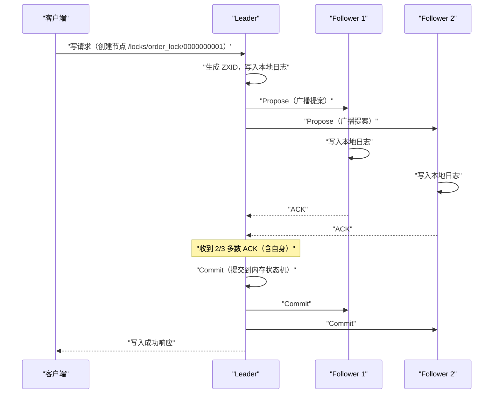
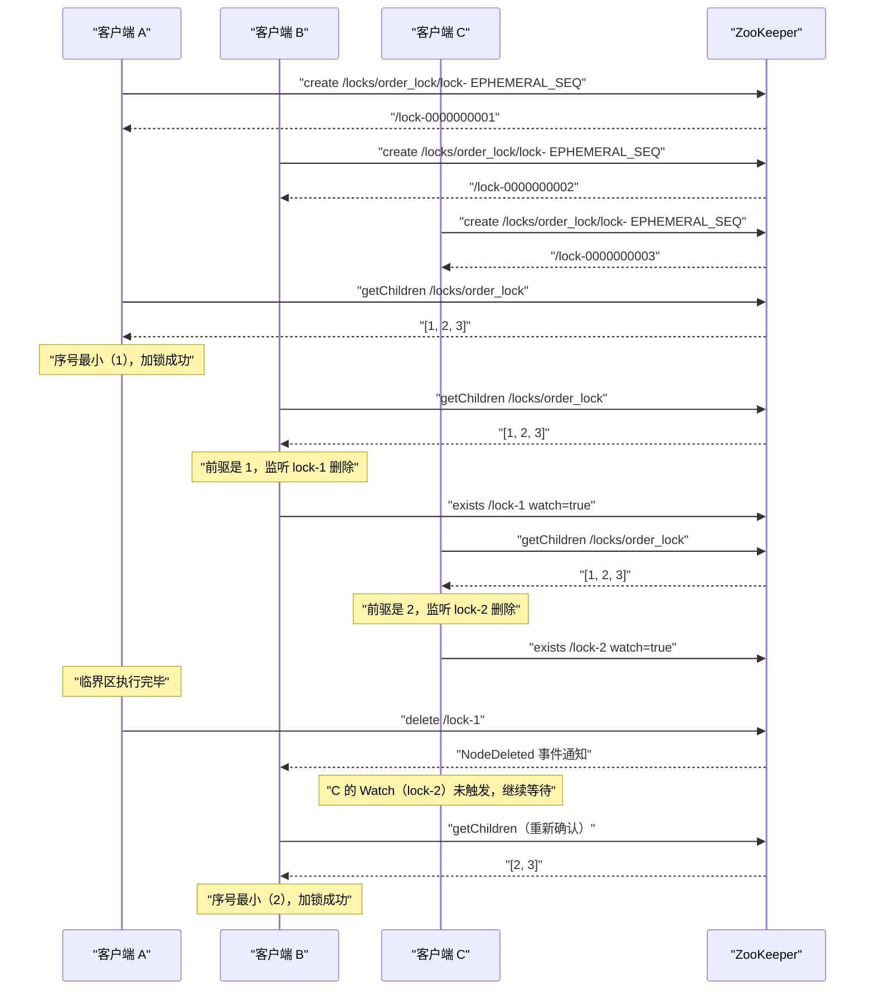
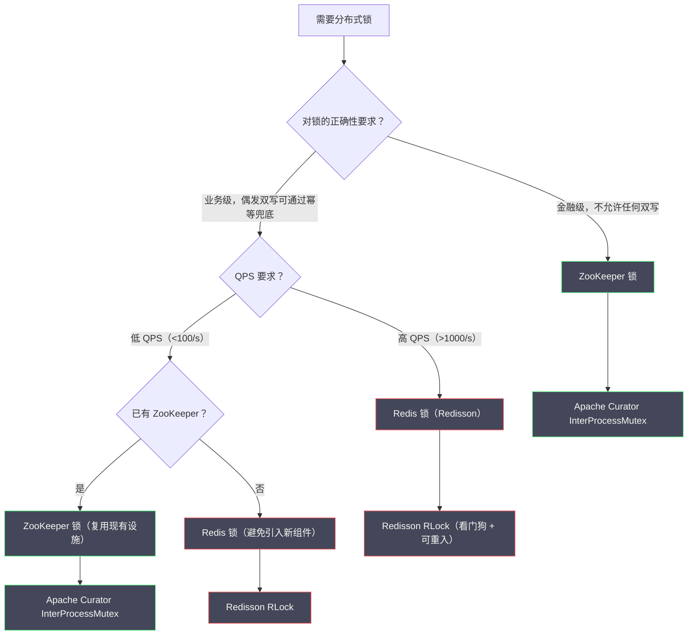

# 04 基于 ZooKeeper 的分布式锁原理深度解析

**摘要：**

ZooKeeper 分布式锁是分布式系统中可靠性最高的锁实现之一。它不依赖"时钟准确性"假设，而是把锁的生命周期与客户端的 Session 绑定——客户端崩溃时，ZooKeeper 通过 Session 超时机制自动删除临时节点，天然实现无死锁。更精妙的是，临时顺序节点配合 Watcher 事件，构建出一种"只监听前一个节点"的公平锁实现，彻底消除了 Redis 轮询方案中的羊群效应。本文从 ZooKeeper 的数据模型与节点类型出发，深入剖析 ZAB 协议如何保证写操作的强一致、ZXID 如何天然充当栅栏令牌；完整解析临时顺序节点实现公平锁的核心机制；辨析 Session 超时与 Redis TTL 的本质差异；介绍 Apache Curator 的工程封装；最后与 Redis 锁做系统对比并给出选型框架。读完本文，你应当能回答两个问题：ZooKeeper 锁为什么天生比 Redis 锁可靠，以及"只监听前驱节点"这一设计为什么能同时解决羊群效应与公平性。

---

## 第 1 章 ZooKeeper 的数据模型：一切的基础

### 1.1 ZNode 树形结构：类文件系统的命名空间

ZooKeeper 把所有数据组织在一个类似文件系统的树形结构中，每个节点被称为 **ZNode**。ZNode 既可以存储数据（最大 1MB），也可以有子节点，路径用 `/` 分隔：

```
ZooKeeper 数据树示例：

/                              (根节点)
├── zookeeper/                 (ZK 内部使用)
│   └── quota/
├── services/
│   ├── order-service/
│   │   └── instances/
│   │       ├── 192.168.1.1:8080
│   │       └── 192.168.1.2:8080
│   └── inventory-service/
└── locks/                     (分布式锁使用的目录)
    └── order_lock/
        ├── 0000000001         (客户端 A 创建的锁节点)
        └── 0000000002         (客户端 B 创建的锁节点)
```

ZNode 的路径是绝对路径，从根节点 `/` 开始。每个 ZNode 存储的元数据包括：

```
ZNode 元数据结构：
- data：节点存储的数据（字节数组）
- stat：节点状态信息，包含：
  - czxid：创建该节点的事务 ID（ZXID）
  - mzxid：最后修改该节点的事务 ID
  - ctime：创建时间（毫秒时间戳）
  - mtime：最后修改时间
  - version：数据版本号（每次修改 +1）
  - cversion：子节点版本号
  - aversion：ACL 版本号
  - ephemeralOwner：若为临时节点，存储创建者的 Session ID；否则为 0
  - dataLength：数据长度
  - numChildren：子节点数量
  - pzxid：最后修改子节点列表的事务 ID
```

这份元数据里，有两个字段对分布式锁特别重要：`ephemeralOwner` 标记了临时节点的归属（谁创建的就归谁的 Session），`czxid` 则是一个全局单调递增的事务 ID——后者在后文会揭示它为什么天然就是栅栏令牌。

### 1.2 四种 ZNode 类型：临时顺序节点是关键

ZooKeeper 提供四种 ZNode 类型，它们的组合是实现分布式锁的核心。

**其一，持久节点（Persistent）**：创建后永久存在，只有客户端显式调用 `delete` 才会删除。这是最普通的节点类型，类似文件系统中的普通目录或文件。

**其二，持久顺序节点（Persistent Sequential）**：在持久节点的基础上，ZooKeeper 在节点名称后自动追加一个单调递增的 10 位数字序号（如 `/locks/order_lock/0000000001`）。序号由父节点维护，同一父节点下的顺序节点共享一个计数器，每创建一个顺序子节点，计数器加一。

**其三，临时节点（Ephemeral）**：与客户端的 Session 生命周期绑定。当客户端的 Session 失效（主动关闭连接，或因网络断开超过 Session 超时时间）时，ZooKeeper 自动删除该客户端创建的所有临时节点。临时节点不能有子节点。

**其四，临时顺序节点（Ephemeral Sequential）**：同时具备"临时"与"顺序"两种特性。这是实现分布式锁最重要的节点类型——它既能在客户端崩溃时自动删除（无死锁），又通过序号提供了全局排序（公平锁）。

> [!info] 为什么临时节点是"无死锁"的天然保证
> Redis 锁通过 TTL 来实现无死锁：如果客户端崩溃，TTL 到期后锁自动释放。这有一个脆弱的假设：TTL 必须比业务执行时间长，但比客户端崩溃后的"可接受等待时间"短。
>
> ZooKeeper 临时节点的机制本质不同：它通过 **TCP 长连接加心跳** 来判断客户端是否存活。只要 TCP 连接在，临时节点就一直存在；TCP 连接断开（超过 Session 超时时间 `sessionTimeout`，默认 30 秒），临时节点立即被删除。这不依赖任何 TTL 计算，而是直接绑定到连接生命周期。**"锁的生命周期等于连接的生命周期"，比"锁的生命周期等于一个预设的时间"要自然得多**——这是 ZK 锁在无死锁这一点上优于 Redis 的根本原因。

### 1.3 Watch 机制：事件驱动的节点监听

**Watch（监听器）** 是 ZooKeeper 客户端订阅节点变化事件的机制。客户端可以对某个 ZNode 注册 Watch，当该节点发生特定变化时，ZooKeeper 服务端会向客户端推送一次性通知（Watch 是一次性的，触发后自动失效，需要重新注册）。

Watch 可以监听的事件类型：

| 事件类型 | 触发条件 |
| :--- | :--- |
| `NodeCreated` | 指定路径的节点被创建 |
| `NodeDeleted` | 指定路径的节点被删除 |
| `NodeDataChanged` | 指定路径的节点数据被修改 |
| `NodeChildrenChanged` | 指定路径的节点的子节点列表发生变化 |

**Watch 的实现原理**：ZooKeeper 客户端在执行 `exists()`、`getData()`、`getChildren()` 等读操作时，可以传入 `watch=true` 参数。服务端在内存中维护一个"Watch 列表"，记录哪些客户端监听了哪些节点的哪种事件。当相应事件发生时，服务端向客户端发送通知（异步推送，不阻塞事件的触发者）。

**Watch 的一次性（One-time）特性**：每次 Watch 触发后自动失效。如果客户端需要持续监听，必须在收到通知后立即重新注册 Watch。这个设计避免了"持续推送"对服务端的持续压力，但要注意：在取消注册到重新注册之间存在一个短暂的窗口期，可能错过事件——这在客户端实现中需要考虑（通常通过"先注册 Watch，再读取当前状态"的顺序来消除窗口）。**这个"一次性加重新注册"的模式，是 ZK 用"减少服务端状态"换取"客户端复杂度"的典型取舍**，也是后文 Curator 要重点封装的边界情况之一。

### 1.4 一个常见误解：ZooKeeper 的读是强一致的吗

很多人把"ZooKeeper 是 CP 系统"理解为"它的所有操作都是强一致的"，这是一个需要澄清的误解，它对理解 ZK 锁的正确性边界很关键。

**ZooKeeper 的写是强一致的，但读不一定是**。写操作必须经过 Leader 并获多数派确认，这是强一致；而读操作可以在任意 Follower 上执行，Follower 的数据可能落后于 Leader。因此，**一个客户端可能读到稍旧的数据**。

这个特性对锁有直接影响：锁的判定依赖 `getChildren`（读操作）。如果某个客户端读到的子节点列表是"旧的"（少了某个更小序号的节点），它就可能误判"自己是序号最小的"，从而错误地认为自己获得了锁。

ZooKeeper 对此的保证是**顺序一致性（对单个客户端而言）**：客户端不会看到"回退"的数据，且"客户端自己的写"之后一定能读到自己的写。Curator 等实现还会在关键的 `getChildren` 之前调用 `sync()`，强制让该客户端读到的数据追上 Leader，从而避免"读到旧排名"的问题。

> [!warning] "CP 系统"不等于"每个读都是强一致"
> 这个澄清很重要，因为它揭示了一个普遍的认知偏差：**人们容易把"系统是 CP 的"简化为"系统的所有操作都强一致"**。事实上，CP 描述的是"分区发生时优先保一致性"，而系统内部仍可能有各种"为性能而放松读"的设计。ZK 锁的正确性，既依赖 ZAB 的强一致写，也依赖实现层对"读可能旧"这一事实的处理（如 sync 或依赖客户端的顺序保证）。**评估任何"强一致"系统时，都要问一句"它的读是什么级别的"**——这一点在分布式事务专栏讨论 Spanner 的"外部一致性"时同样适用。

---

## 第 2 章 ZAB 协议：写操作强一致性的根基

### 2.1 为什么 ZK 锁比 Redis 锁更可靠

在 03 篇中，我们分析了 Redis 主从切换时锁数据可能丢失的问题。ZooKeeper 为什么没有这个问题？答案在于 ZooKeeper 底层使用的 **ZAB 协议（ZooKeeper Atomic Broadcast，ZooKeeper 原子广播协议）**。

### 2.2 ZAB 协议的核心：Leader 广播加多数派确认

ZAB 是一个专为 ZooKeeper 设计的分布式一致性协议，思想上与 Paxos 相似，但针对 ZooKeeper 的"主从复制日志"场景做了优化。

ZooKeeper 集群通常由奇数个节点组成（3 个或 5 个），其中一个节点是 **Leader**，其余是 **Follower**。所有写操作（创建节点、修改数据、删除节点）都必须经过 Leader，读操作可以在任意节点执行（可能读到稍旧的数据）。

**写操作的处理流程（两阶段提交）**：



关键点：**Leader 在收到多数 Follower 的 ACK 之后，才向客户端返回写成功**。这意味着：写入成功时，数据已经在多数节点（包括 Leader）上持久化，即使 Leader 随后宕机，已经收到 ACK 的多数 Follower 会选出新的 Leader，并保留这次写入的数据。

**这与 Redis 主从复制的本质差异**：Redis Master 写入成功后立即向客户端返回，然后异步复制到 Slave，在这个异步窗口内 Master 宕机会导致数据丢失；ZooKeeper Leader 写入成功代表已经在多数节点确认，不存在"写成功但数据未复制"的窗口——如果多数节点都宕机了（超过半数故障），ZooKeeper 会拒绝写操作（保护一致性），而不是返回一个虚假的成功。

这里可以打一个比方：Redis 的写像"口头答应你之后再去记笔记"——答应了就返回，笔记还没抄完；ZooKeeper 的写像"至少三个记账员同时记下之后才回复你"——回复时，账已经记在了多数人的本子上。**前者的风险是"答应了但没记全"，后者则用"多记几本"消除了这个风险，代价是"记完才能回复"带来的延迟**。

### 2.3 ZXID：全局单调递增的事务 ID

每次写操作都对应一个唯一的 **ZXID（ZooKeeper Transaction ID）**，它是一个 64 位整数，高 32 位是 `epoch`（Leader 任期号），低 32 位是该 epoch 内的事务计数器。

ZXID 的单调递增特性保证了三点：

其一，**全局事务顺序**：所有节点看到的事务顺序一致。

其二，**Leader 选举的正确性**：拥有最大 ZXID 的节点包含最新的数据，选举时优先选择 ZXID 最大的候选者。

其三，**栅栏令牌的天然实现**：ZNode 的 `czxid`（创建节点的 ZXID）单调递增，可以作为天然的栅栏令牌——这正是 03 篇中 Kleppmann 提出的需求，而 ZooKeeper 天然满足。

> [!note] "天然提供"是选型中的一个重要优势
> 栅栏令牌之于正确性锁，是一个"必须有"的东西；而 ZooKeeper 因为底层的 ZAB 协议本来就维护着单调的 ZXID，等于**免费附赠**了这个能力。相比之下，Redis 要做栅栏令牌，还得额外引入一个单调序列（而 Redis 自己的 `INCR` 在故障切换时并不单调）。**"某项能力是不是组件天然提供的"，往往比"能不能实现"更影响选型**——因为"天然提供"意味着它经过了组件的完整测试与验证，而"自己实现"意味着你要独自承担它的所有边界情况。这也是 ZooKeeper 在"正确性保证"场景下优于 Redis 的一个深层原因。

### 2.4 ZAB 与 Paxos 的关系

ZAB 常被描述为"类 Paxos 协议"，理解它与 Paxos 的异同，有助于把握它的定位。

**相同之处**在于核心思想：都基于多数派（Quorum）做出决策，都保证"已提交的决策不会被推翻"，都要求超过半数的节点参与才能推进。这些是多数派共识协议的共同基因。

**不同之处**在于设计目标与形态。Paxos 解决的是"多个节点对某个值达成一致"这个抽象问题；而 ZAB 是为 ZooKeeper 的"主备日志复制"这个具体场景定制的——它要保证的是一组有序的操作（日志）在所有节点上以相同的顺序执行。为此，ZAB 明确分为两个阶段：**发现（Discovery）阶段**负责选出 Leader 并让新 Leader 与多数 Follower 同步状态；**广播（Broadcast）阶段**负责把客户端的写操作以全序广播给所有节点。这种"先同步状态、再广播新操作"的两段式设计，是 ZAB 针对日志复制场景的优化，也是它与泛化的 Paxos 在工程实现上的主要区别。

理解了这一点，就能理解 ZK 锁为什么可靠：**它的每一次加锁（创建节点）都是一次经过全序广播的写操作，天然获得了"全局有序"与"多数派持久"两个保证**。锁的正确性不需要额外机制来维护，它是底层共识协议的直接结果。

### 2.5 ZAB 的两个阶段：发现与广播

ZAB 的运行可以分为两个阶段，理解它们有助于理解"Leader 崩溃后 ZK 如何保持正确"。

**发现阶段（Discovery）**：当集群启动或 Leader 崩溃后，进入这个阶段。它的任务是选出一个新 Leader，并让新 Leader 与多数 Follower 完成状态同步——**确保新 Leader 拥有所有已被提交的事务**。这一步是 ZAB 正确性的关键：如果新 Leader 缺少某些已提交的事务，那么这些事务就会"丢失"，破坏一致性。ZAB 通过"选 ZXID 最大的节点当 Leader"加"多数派同步"来保证新 Leader 一定包含所有已提交事务。

**广播阶段（Broadcast）**：Leader 选出且状态同步完成后，进入这个阶段，正常处理客户端的写请求——即 2.2 节描述的"Propose、ACK、Commit"流程。

当 Leader 崩溃时，协议从广播阶段回到发现阶段，重新选主与同步，然后再进入广播阶段。**这个"发现、广播、再发现"的循环，保证了无论 Leader 如何更替，已提交的事务都不会丢失**——这正是 ZK 锁比 Redis 主从锁可靠的根本机制。

把这个机制与 02 篇的 Redis 主从对比，差异一目了然：**Redis 的主从切换只是"把 Slave 提上来"，不检查新主是否拥有全部已提交数据；ZAB 的选主则强制"新主必须先同步到最新"**。前者快但可能丢数据，后者慢但不会丢。**这正是"性能"与"一致性"取舍在锁服务上的具体体现**。

---

## 第 3 章 临时顺序节点实现公平锁：核心机制深度解析

### 3.1 朴素实现的问题：羊群效应

最朴素的 ZooKeeper 锁实现是：所有客户端竞争同一个节点，谁创建成功谁获得锁：

```python
# 朴素 ZK 锁（存在羊群效应）
def acquire_lock(zk, lock_path):
    while True:
        try:
            zk.create(lock_path, ephemeral=True)  # 尝试创建临时节点
            return True  # 创建成功，加锁成功
        except NodeExistsError:
            # 节点已存在，监听节点删除事件
            event = threading.Event()
            zk.exists(lock_path, watch=lambda e: event.set())
            event.wait()  # 等待节点被删除
            # 被唤醒后重新尝试创建
```

这个方案有一个严重问题：**羊群效应（Herd Effect）**。

当持锁客户端释放锁（删除节点）时，所有正在等待的客户端都会同时收到"节点被删除"的 Watch 通知，全部被唤醒，然后全部去竞争创建同一个节点——只有一个能成功，其余全部失败，再次注册 Watch 继续等待。

如果有 1000 个客户端在等待，锁每次释放就会引发一次 1000 个并发请求涌向 ZooKeeper 的"惊群"事件，对 ZooKeeper 服务端造成巨大冲击，且绝大多数请求都是无效的（只有一个能成功）。**这与 01 篇讨论的"惊群效应"是同一个问题**，只是换到了 ZooKeeper 的场景。

### 3.2 临时顺序节点加 Watch 前驱节点：消除羊群效应的精妙设计

ZooKeeper 官方文档和 Apache Curator 采用了一种更精妙的设计，完全消除了羊群效应。

**核心思想**：每个客户端都在锁目录下创建一个**临时顺序节点**，序号最小的节点持有锁；其他客户端不是等待"锁节点被删除"，而是各自监听**自己的前一个节点**（序号比自己小一位的节点）。当前驱节点被删除时，只有对应的客户端被唤醒，而不是所有等待者。

**完整的加锁流程**：

```
步骤一：在锁目录下创建临时顺序节点

  客户端 A：create /locks/order_lock/lock- EPHEMERAL_SEQUENTIAL
            → 创建成功，节点为 /locks/order_lock/lock-0000000001

  客户端 B：create /locks/order_lock/lock- EPHEMERAL_SEQUENTIAL
            → 创建成功，节点为 /locks/order_lock/lock-0000000002

  客户端 C：create /locks/order_lock/lock- EPHEMERAL_SEQUENTIAL
            → 创建成功，节点为 /locks/order_lock/lock-0000000003

步骤二：获取锁目录下的所有子节点，判断自己的排名

  客户端 A：getChildren /locks/order_lock
            → [lock-0000000001, lock-0000000002, lock-0000000003]
            → 排序后，lock-0000000001 是最小值，且等于自己的节点名
            → 我是第一名，加锁成功，开始执行临界区

  客户端 B：getChildren /locks/order_lock
            → [lock-0000000001, lock-0000000002, lock-0000000003]
            → lock-0000000002 不是最小值
            → 找到前驱节点：lock-0000000001（序号比自己小 1）
            → 监听 /locks/order_lock/lock-0000000001 的删除事件
            → 阻塞等待

  客户端 C：getChildren /locks/order_lock
            → [lock-0000000001, lock-0000000002, lock-0000000003]
            → lock-0000000003 不是最小值
            → 找到前驱节点：lock-0000000002（序号比自己小 1）
            → 监听 /locks/order_lock/lock-0000000002 的删除事件
            → 阻塞等待

步骤三：客户端 A 执行完临界区，解锁（删除自己的节点）

  客户端 A：delete /locks/order_lock/lock-0000000001
            → 节点删除成功

步骤四：Watch 触发，精确唤醒

  → 只有客户端 B 监听了 lock-0000000001，只有客户端 B 被唤醒
  → 客户端 C 监听的是 lock-0000000002，此时 lock-0000000002 未被删除，客户端 C 继续等待

步骤五：客户端 B 被唤醒，重新检查

  客户端 B：getChildren /locks/order_lock
            → [lock-0000000002, lock-0000000003]（lock-0000000001 已删除）
            → 排序后，lock-0000000002 是最小值，且等于自己的节点名
            → 我是第一名，加锁成功，开始执行临界区
```

**为什么要在步骤五重新 getChildren 检查，而不是直接认为自己获得了锁？** 这是一个极其重要的细节。Watch 触发说明"前驱节点被删除了"，但这不等于"我现在是序号最小的节点"。因为在客户端 B 的前驱节点被删除之前，可能有其他更小序号的节点存在（比如客户端 A 在创建 lock-0000000001 之前创建了 lock-0000000000，但由于网络延迟，客户端 B 在步骤二的 getChildren 时没看到它）。

**实际工程中的边界情况更微妙**：客户端 B 在步骤二执行 getChildren 和注册 Watch 之间，前驱节点可能已经被删除了，此时 Watch 永远不会触发（因为节点已经不存在了）。正确的处理是：先注册 Watch，如果发现节点已经不存在，立即重新走步骤二。**这个"注册与检查的竞态"，是 ZK 锁实现中最容易出错的细节**——也是 Curator 这样的框架存在的核心价值。

### 3.3 加锁流程的可视化



### 3.4 为什么这个设计消除了羊群效应

对比朴素实现与临时顺序节点实现：

| 维度 | 朴素实现（抢单一节点）| 临时顺序节点实现（监听前驱）|
| :--- | :--- | :--- |
| **锁释放时被唤醒的客户端数** | 所有等待者（N 个）| 只有 1 个（前驱的后继）|
| **ZooKeeper 收到的请求压力** | O(N) 并发请求 | O(1) 精确通知 |
| **公平性** | 非公平（随机竞争）| 公平（FIFO，先来先得）|
| **活性（无饿死）** | 不保证（可能一直竞争失败）| 保证（按序号依次获得锁）|
| **实现复杂度** | 低 | 中 |

每个等待中的客户端只监听自己的前驱节点，因此锁释放时只有一个客户端被唤醒，形成"接力棒"式的传递。**这既是公平锁，也完全没有羊群效应**——它印证了 01 篇提出的一条判断：公平性与效率未必对立，好的数据结构设计可以同时改善两者。

> [!info] "只监听前驱"是一种通用的排队模式
> "每个等待者只关注自己前一个"这个模式，价值远超分布式锁。它在任何"需要按序推进、又要避免惊群"的场景都适用：消息队列的顺序消费、工作流的顺序执行、流水线的阶段推进。它的核心思想是**把"全局事件"转化为"局部事件"**——不需要每个人都知道"队首走了"，只需要每个人知道"我的前一个人走了"。**用局部依赖替代全局广播，是分布式系统里降低协调成本的一条通用手段**。

### 3.5 一个反例：被唤醒后不重新 getChildren 的后果

3.2 节强调的"唤醒后必须重新 getChildren 校验"，听起来像是一个可有可无的谨慎，但它其实是一个会导致双持的关键正确性要求。看一个具体反例。

设想客户端 B 创建了 `lock-0000000002`，它读到的前驱是 `lock-0000000001`（客户端 A），于是监听 A 的节点。此时，客户端 D 因为在更早的一次操作中创建了 `lock-0000000000`，但由于网络延迟，B 在 getChildren 时没有看到它（读到了旧数据）。

若 B 在收到"前驱 A 被删除"的通知后**直接认为自己是第一名**，而不重新 getChildren，那么 B 就会开始执行临界区。但实际上，`lock-0000000000`（D 的节点）序号更小，理应排在 B 前面——**此时 D 也可能认为自己是第一名**（如果 D 的 getChildren 是正确的），于是 B 与 D 同时进入临界区，互斥性被破坏。

正确的做法是：每次被唤醒后，重新执行 getChildren，确认"当前最小的序号节点确实是自己"。这个校验把一个"可能已经过时的判断"（B 之前读到的排名）更新为"当前的真实状态"，从而消除了双持的可能。

这个反例的教训是：**Watch 通知的含义是"某处发生了变化，请重新检查"，而不是"你现在拥有锁了"**。把"事件通知"当成"状态断言"，是异步事件驱动编程里最经典的错误之一——它同样出现在消息队列的消费、缓存失效的通知等场景中。**事件告诉你"去看一眼"，而不是"告诉你结论"**。

### 3.6 顺序节点的序号会溢出吗

临时顺序节点的序号由一个递增计数器生成，这个计数器有一个容易被忽视的边界：**它是一个 32 位有符号整数**，理论上存在溢出的可能。

这个计数器的维护方式是：每个父节点维护自己子节点的序号计数器，每创建一个顺序子节点，计数器加一，序号以 10 位数字形式追加在节点名后（不足补零）。当计数器增长到 32 位有符号整数的上限后，继续递增会发生回绕，序号可能变成一个负数值——而节点名是字符串，负号会让它的排序位置发生错乱，进而破坏"序号越小越先获得锁"这个公平性基础。

需要说明的是，这个边界在绝大多数生产环境中不会触及——要创建二十多亿个节点才会溢出，而锁目录通常会随节点删除而回落。但它提示了一个实践建议：**对于长期存在的锁目录，应当有定期清理机制**（在无人持锁时删除锁的父节点，让计数器重置），既避免序号持续增长，也避免锁目录下堆积大量历史节点。

这个细节的价值在于它揭示了一条普遍规律：**任何"递增"的机制，都要考虑它的边界**。序号、版本号、时间戳、事务 ID，这些"单调递增"的东西在理论上都有上限。工程上通常的做法是"设置一个足够大的空间"（如 64 位），或者"提供重置机制"（如定期清理）。**"递增到溢出了怎么办"这个问题，值得在设计任何依赖序号/版本的系统时先问一遍**。

### 3.7 一个变体：读写锁的顺序节点设计

Curator 的读写锁（`InterProcessReadWriteLock`）是临时顺序节点机制的一个巧妙变体，它展示了这套机制的可扩展性。

读写锁允许"多个读操作并发、写操作独占"。它的实现方式是：**给节点加两种前缀**——读锁节点叫 `read-0000000001`，写锁节点叫 `write-0000000002`。判定规则是：

- **获取写锁时**，需要等待所有序号比自己小的节点（无论读节点还是写节点）都消失；
- **获取读锁时**，只需等待序号比自己小的**写节点**消失（读节点可以并存）。

这样一来，多个读节点可以同时持有读锁（因为读节点之间互不等待），而写节点必须等到所有更早的节点都消失。**"前缀编码类型、序号编码顺序"，两者组合就表达出了完整的读写语义**。

这个变体的价值在于，它证明了"临时顺序节点加监听"这套机制不是"只能做互斥锁"，而是一个**通用的排序协调原语**。理解了它，就能理解为什么 Curator 能基于同一套底层机制提供互斥锁、读写锁、信号量、Multi 锁等多种原语——**它们都是"在顺序节点上定义不同的判定规则"**。这也是分布式协调服务的一个典型优势：底层机制简单统一，上层语义灵活组合。

---

## 第 4 章 Session 机制与无死锁保证的深层原理

### 4.1 Session 是什么

当客户端与 ZooKeeper 建立连接时，ZooKeeper 会创建一个 **Session（会话）**，并分配一个唯一的 Session ID。Session 有以下属性：

- **sessionTimeout**：Session 超时时间，由客户端指定（通常 30 秒），但 ZooKeeper 服务端可以调整实际值（在服务端配置的 `minSessionTimeout` 与 `maxSessionTimeout` 范围内）
- **心跳机制**：客户端每隔 `sessionTimeout / 3` 向服务端发送心跳（PING），证明自己仍然存活

### 4.2 Session 超时与临时节点删除的时序

当客户端与 ZooKeeper 的 TCP 连接断开后，发生以下时序：

```
T0: 客户端 A 的 TCP 连接断开（进程崩溃 / 网络断开）

T0 ~ T0+sessionTimeout:
   ZooKeeper 服务端在此期间等待客户端重连
   在此期间，临时节点 lock-0000000001 仍然存在
   监听该节点的客户端 B 不会收到任何通知

T0+sessionTimeout:
   ZooKeeper 服务端认为 Session 已失效
   自动删除客户端 A 的所有临时节点
   Watch 通知被发送给所有监听 lock-0000000001 的客户端（即客户端 B）
   客户端 B 被唤醒，尝试获取锁
```

**这个等待机制的必要性**：ZooKeeper 不能在 TCP 断开的瞬间立即删除临时节点，因为 TCP 断开可能只是短暂的网络抖动（如机房网络路由器重启，通常在几秒内恢复）。在 `sessionTimeout` 内重连成功的客户端，其临时节点仍然有效，业务不受影响。只有超过 `sessionTimeout` 仍未重连，才认为客户端真正"离开"，此时删除临时节点是安全的。**这与失败检测器无法区分"慢"与"死"的老问题同源——Session 超时就是一种失败检测器，它选择一个超时阈值来平衡"误判慢节点"与"延迟发现死节点"**。

**`sessionTimeout` 的设置建议**：

- 太短（如 5 秒）：短暂的网络抖动就会导致 Session 失效，临时节点被删除，锁被释放，而持锁的业务逻辑实际上还在运行，造成互斥性破坏
- 太长（如 300 秒）：客户端真正崩溃后，其他客户端需要等待 300 秒才能获取锁，系统可用性严重受损
- **推荐值**：30 到 60 秒，与业务的正常执行时间、网络超时时间综合考量

> [!warning] ZK Session 超时与 Redis TTL 的类比陷阱
> ZK Session 超时和 Redis TTL 解决的是同一个问题（无死锁），但机制有本质差异：
> - Redis TTL 是纯粹的"时间过期"——无论客户端是否存活，时间到了锁就消失
> - ZK Session 超时是"连接感知的时间过期"——只有当 TCP 连接真正断开超过 sessionTimeout 后才会触发，活跃的客户端不受影响
>
> 因此，对于一个正常运行的、持有锁的 ZK 客户端，其锁不会因为"时间到了"而被删除——只要心跳正常，锁就持续有效。这解决了 Redis TTL 方案中"业务没跑完锁就过期"的问题，也意味着 ZK 锁不需要看门狗续期机制。**这正是 ZK 锁在"无死锁"这一点上比 Redis 更优雅的原因：它把"锁是否有效"绑定到"客户端是否活着"，而不是"时间是否到了"**。

### 4.3 ZK 集群的 Session 一致性

在 ZooKeeper 集群中，Session 状态由整个集群共同维护。当 Leader 宕机，Follower 选出新 Leader 后，所有客户端的 Session 信息（包括 sessionTimeout、临时节点等）都会被正确迁移，不会丢失。这也是 ZK 锁比 Redis 主从锁更可靠的重要原因。**Session 的一致性由 ZAB 协议保证——它和普通数据走的是同一套多数派复制机制**，因此不会出现"主挂了、Session 信息丢了"的情况。

### 4.4 Session 过期后的状态重建

Session 过期是 ZK 客户端必须显式处理的一种状态，理解它的后果有助于设计正确的重连逻辑。

**Session 过期的直接后果是"临时状态全部丢失"**：客户端之前创建的所有临时节点（包括它持有的锁节点）都被 ZK 删除。这意味着，如果这个客户端之前正持有锁，那么它的锁已经没了——**即使它的业务线程还在运行，锁也已经不属于它了**。

**客户端必须重建状态**：Session 过期后，客户端不能简单地"继续用旧状态"，因为旧状态在 ZK 侧已经不存在。它需要重新创建临时节点、重新走加锁流程。Curator 通过抛出 `SessionExpiredException` 来通知应用层，并提供了 `ConnectionStateListener` 让应用在 Session 过期或重建时执行相应逻辑。

**应用层必须感知这个事件**：这是最容易出错的地方。如果应用把"持有锁"当成一个可以长期依赖的状态，而忽略了 Session 过期，就可能在"锁已经没了"的情况下继续操作。**正确的做法是把"锁的持有"视为一个短生命周期的、随时可能失效的状态，而不是一个可以长期信任的凭证**——这与 03 篇栅栏令牌的结论一致：锁是"减少冲突"的，正确性要靠服务端校验。

> [!warning] Session 过期与 GC 停顿的相似之处
> 仔细想想，Session 过期与 01 篇讨论的 GC 停顿，在"后果"上是同构的：**两者都让客户端在不知情的情况下失去了锁，而业务线程可能仍在运行**。区别在于触发原因——一个是连接断开，一个是进程停顿。这也说明，无论用哪种锁，都逃不开"客户端可能在不知情时失去锁"这个根本问题。**因此，"锁失效时业务怎么办"这个问题，必须在设计阶段就想清楚**，而不能指望某种锁"永不失效"。

### 4.5 一个边界：重连与"假过期"

Session 的重连机制里，有一个容易被误解的边界：**客户端可能"以为自己还连着"，而服务端已经判定它过期**。

这个不一致的根源是"谁来判断超时"。客户端与服务端各自维护着对连接的认知：客户端持续发心跳，服务端持续等待心跳。当网络抖动导致心跳长时间未到达时，服务端可能在 `sessionTimeout` 后判定 Session 失效、删除临时节点；而此时客户端可能还没意识到问题，仍以为连接正常。等客户端尝试下一次操作时，才发现 Session 已过期。

这个边界带来的实践要求是：**客户端必须把"Session 可能已过期"当作一个随时可能发生的情况来处理**，而不能假设"只要我没主动断开，Session 就一直有效"。Curator 通过抛出 `SessionExpiredException` 与触发 `ConnectionStateListener` 来暴露这一情况，应用必须显式处理——**把"锁已失效"这一事实，传递给业务逻辑**。

这也再次说明，**分布式系统里"谁先发现异常"往往是不确定的**——服务端和客户端可能在不同时刻察觉到同一个故障。这与 01 篇讨论的失败检测器是同一个主题：**在缺乏完美时钟与完美连接的世界里，"状态"总是带有一定的"认知延迟"**，工程上能做的是让每一方都对"自己可能不知道"保持警惕。

---

## 第 5 章 Apache Curator：工业级 ZK 分布式锁封装

### 5.1 为什么需要 Curator

直接使用 ZooKeeper 的原生客户端实现分布式锁，需要处理大量的边界情况：

1. **Watch 的一次性问题**：Watch 触发后失效，必须在处理事件后重新注册，且要考虑"注册与事件发生之间的窗口期"
2. **Session 过期后的重连**：Session 过期后，所有临时节点已被删除，客户端必须重新创建节点
3. **getChildren 与注册 Watch 的竞态**：如第 3.2 节分析的，前驱节点可能在 getChildren 之后、注册 Watch 之前就已被删除
4. **可重入计数**：同一客户端线程多次加锁的计数管理
5. **公平等待队列的维护**：确保客户端按序号顺序依次获取锁

这五项里，前三项都是"时序竞态"——它们只在极窄的时间窗口内发生，但一旦发生就会导致锁的异常。**手工实现要覆盖这些竞态，需要极高的细致度；这正是框架存在的意义**。Apache Curator 是 Netflix 开源的 ZooKeeper 客户端框架，现为 Apache 顶级项目，提供了"Recipes"（菜谱）层，封装了各种分布式协议的标准实现，包括分布式锁。

### 5.2 Curator InterProcessMutex：标准用法

```java
// Maven 依赖
// <dependency>
//   <groupId>org.apache.curator</groupId>
//   <artifactId>curator-recipes</artifactId>
//   <version>5.5.0</version>
// </dependency>

@Service
public class OrderService {

    private final CuratorFramework curatorClient;

    public OrderService() {
        // 初始化 Curator 客户端（应用启动时初始化一次）
        this.curatorClient = CuratorFrameworkFactory.builder()
            .connectString("zk1:2181,zk2:2181,zk3:2181")
            .sessionTimeoutMs(30000)   // Session 超时 30 秒
            .connectionTimeoutMs(5000) // 连接超时 5 秒
            .retryPolicy(new ExponentialBackoffRetry(1000, 3)) // 重试策略：指数退避，最多 3 次
            .build();
        this.curatorClient.start();
    }

    public void processOrder(String orderId) throws Exception {
        // 创建锁对象（可复用，线程安全）
        InterProcessMutex lock = new InterProcessMutex(
            curatorClient,
            "/locks/order_lock/" + orderId  // 锁路径
        );

        // 方式 1：直接加锁（无超时，一直等到获取锁为止）
        lock.acquire();
        try {
            doProcessOrder(orderId);
        } finally {
            lock.release();  // 必须在 finally 中释放
        }

        // 方式 2：带超时的加锁（推荐）
        boolean acquired = lock.acquire(10, TimeUnit.SECONDS);
        if (!acquired) {
            throw new BusinessException("获取分布式锁超时，请稍后重试");
        }
        try {
            doProcessOrder(orderId);
        } finally {
            lock.release();
        }
    }
}
```

### 5.3 Curator InterProcessMutex 的内部实现原理

Curator 的 `InterProcessMutex` 完整实现了第 3 章描述的临时顺序节点加 Watch 前驱节点的公平锁机制，并处理了所有边界情况。

**可重入支持**：`InterProcessMutex` 支持可重入。Curator 在内存中维护一个线程级别的 `ConcurrentMap<Thread, LockData>` 映射，记录每个线程的加锁次数和对应的 ZNode 路径：

```java
// Curator 内部数据结构（简化）
private final ConcurrentMap<Thread, LockData> threadData = Maps.newConcurrentMap();

private static class LockData {
    final Thread owningThread;
    final String lockPath;          // 该线程对应的 ZNode 路径
    final AtomicInteger lockCount;  // 重入计数
}
```

**加锁时**：检查 `threadData` 中是否有当前线程的记录，有则说明是重入，`lockCount + 1` 直接返回成功；没有则在 ZooKeeper 创建临时顺序节点，执行完整的获取锁流程；获取成功后，把 `(currentThread, lockPath)` 写入 `threadData`。

**解锁时**：检查 `threadData` 中当前线程的 `lockCount`，减一后如果还大于 0，说明仍有重入层级，直接返回；如果 `lockCount` 减到 0，才真正删除 ZooKeeper 节点，并从 `threadData` 中移除记录。

**Watch 事件处理的竞态消除**：Curator 在注册 Watch 时会检查被监听节点是否已经不存在——如果不存在，立即重新执行 getChildren 判断，而不是等待一个永远不会来的 Watch 通知。这正是 3.2 节提到的那个"微妙边界"的解法。

> [!note] 可重入在 ZK 锁里是"客户端内存状态"
> 与 Redisson 把可重入计数存在 Redis 里不同，Curator 的可重入计数存在**客户端内存**（`threadData` 映射）中，ZooKeeper 侧只保留"每个线程一个节点"。这意味着：**如果客户端进程崩溃，这个内存计数就丢了，但临时节点也会随 Session 失效而删除，两者是同步消失的**。这个设计是自洽的——它避免了把重入计数持久化到 ZK 带来的额外开销。不过它也带来一个副作用：可重入只在"同一个进程内的同一个线程"之间有效，跨进程、跨线程的重入无法共享计数——这与 02 篇讨论的"可重入只解决进程内嵌套"结论一致。

### 5.4 Curator 提供的其他锁类型

| 锁类型 | 类名 | 适用场景 |
| :--- | :--- | :--- |
| **互斥锁（默认）** | `InterProcessMutex` | 最常用，任意时刻只有一个持锁者 |
| **读写锁** | `InterProcessReadWriteLock` | 读操作并发，写操作独占（适合读多写少场景）|
| **信号量** | `InterProcessSemaphoreV2` | 控制最大并发数（如最多允许 10 个并发）|
| **Multi 锁** | `InterProcessMultiLock` | 对多个路径同时加锁（原子操作，要么全成功要么全失败）|

这几种锁类型说明，ZK 提供的不仅是一把"互斥锁"，而是一整套基于临时顺序节点的协调原语。**它们的共同基础都是"顺序节点加监听"这套机制**——读写锁是"读节点与写节点分组排序"，信号量是"允许前 N 个同时持有"，Multi 锁是"多个锁路径一起获取"。理解了这套底层机制，这些高级原语就不难理解了。

### 5.5 连接状态监听与重试策略

使用 Curator 时，有一类配置常被忽视却直接影响锁的可靠性：**连接状态监听与重试策略**。

ZooKeeper 客户端的连接有几种状态：`CONNECTED`、`SUSPENDED`（连接暂时断开）、`LOST`（Session 丢失）、`RECONNECTED`。应用应当注册 `ConnectionStateListener`，在这些状态变化时执行相应逻辑。尤其是 `LOST` 状态——它意味着 Session 已过期，之前创建的临时节点（包括持有的锁）都已被删除，**应用必须把"我可能已经失去锁"这个事实纳入考虑**。

重试策略同样重要。`CuratorFrameworkFactory` 需要指定一个 `RetryPolicy`（如 `ExponentialBackoffRetry`），它决定了"连接失败后如何重试"。策略设置不当会导致两类问题：重试过于频繁会放大对 ZK 的压力；重试过于保守则会在网络抖动时长时间无法恢复。**推荐使用指数退避（Exponential Backoff），并在重试次数与业务超时之间做匹配**。

这两个配置的共同点是：**它们不是"锦上添花"，而是"锁的可靠性的一部分"**。一个没有正确处理 Session 过期、没有合理重试策略的 ZK 客户端，即使底层协议再可靠，也会在应用层引入故障。**框架封装了协议细节，但连接生命周期与业务语义的对接，仍然需要开发者自己完成**——这与 02 篇"框架解决协议问题、业务解决语义问题"的结论一致。

### 5.6 一个使用建议：锁路径的设计

ZK 锁的路径设计，是一个看似琐碎却影响可维护性的细节。

推荐的形式是 `/locks/{业务域}/{资源标识}`，例如 `/locks/order/12345`、`/locks/inventory/P001`。这个形式的好处与 02 篇讨论的 Redis 锁 key 命名一致：**从路径就能看出锁保护的是什么资源，不同业务域天然隔离，便于按前缀统计与清理**。

有两点需要注意。其一，**ZK 不会自动创建父路径**——与文件系统的 `mkdir -p` 不同，ZK 的 `create` 要求父节点已存在。因此，使用 ZK 锁前需要确保 `/locks/order` 这类父路径已创建（Curator 的 `InterProcessMutex` 会自动创建缺失的父路径，这是一个便利之处）。其二，**避免过深的路径层级**——每一层父节点都是一次额外的查询，而锁路径通常不需要超过两层。

这个细节提醒我们：**即使是"用框架"的场景，路径设计这类基础约定仍然需要团队自己规范**。框架能保证"锁的逻辑正确"，但保证不了"锁的命名一致"。**一个系统的锁是否可维护，往往就取决于这些不起眼的约定是否被统一遵守**。

---

## 第 6 章 ZooKeeper 锁与 Redis 锁：系统性对比

### 6.1 一致性模型的本质差异

这是两种方案最根本的差异，其他所有差异都可以从这里推导：

**Redis（AP 倾向）**：Redis 主从复制是异步的，优先保证可用性——Master 接受写入后立即返回，即使 Slave 未同步。在 CAP 三角中，Redis 在一致性与可用性之间倾向于选择可用性。

**ZooKeeper（CP 倾向）**：ZAB 协议要求写操作在多数节点确认后才返回，优先保证一致性——如果超过半数节点故障，ZooKeeper 会拒绝写操作，保护数据一致性而非继续提供服务。

| 维度 | Redis 分布式锁 | ZooKeeper 分布式锁 |
| :--- | :--- | :--- |
| **一致性保证** | 最终一致（异步复制，主从切换有丢失窗口）| 强一致（ZAB 多数派确认，无丢失窗口）|
| **性能** | 极高（内存操作，约 0.1ms 延迟）| 中（网络往返加 ZAB 确认，约 2-5ms 延迟）|
| **无死锁机制** | TTL 过期（需精心设置，看门狗辅助）| Session 超时（基于连接感知，更鲁棒）|
| **公平锁** | 否（需额外实现，复杂度高）| 是（临时顺序节点天然实现）|
| **可重入** | 需手动实现（Redisson 已封装）| 需手动实现（Curator 已封装）|
| **读写锁** | 需手动实现 | Curator 原生支持 |
| **锁等待通知** | Pub/Sub（Redisson 实现）| Watch 机制（ZK 原生）|
| **单点故障** | 主从切换有短暂不可用（秒级）| 半数以下故障透明（Leader 选举通常毫秒到秒级）|
| **时钟依赖** | 强依赖（TTL 基于时间）| 弱依赖（Session 超时也是时间，但更鲁棒）|
| **栅栏令牌** | 无原生支持 | 天然提供（ZNode 的 ZXID 单调递增）|
| **运维复杂度** | 低（Redis 团队普遍熟悉）| 中（ZK 集群运维有一定复杂度）|
| **生态依赖** | 需引入 Redisson 框架 | 需引入 Curator 框架 |

### 6.2 性能差异的量化分析

ZooKeeper 锁比 Redis 锁慢，根本原因在于 ZAB 的同步写：每次加锁（创建 ZNode）都需要 Leader 向多数 Follower 同步，涉及多次网络往返。

粗略的延迟对比（同机房部署，3 节点 ZK）：

```
Redis SET NX PX（单节点）：
  网络延迟 0.1ms + 内存操作 0.01ms ≈ 0.1~0.5ms

Redis SET NX PX（主从，等待 Slave ACK）：
  网络往返 × 2 ≈ 0.5~2ms

ZooKeeper 创建临时顺序节点（3 节点）：
  客户端 → Leader：0.5ms
  Leader → 2 个 Follower：0.5ms（并行）
  Follower ACK：0.5ms
  Leader → 客户端返回：0.5ms
  ≈ 2~5ms

ZooKeeper 加锁总流程（创建节点 + getChildren + 可能的 Watch 等待）：
  ≈ 5~20ms（不含等待时间）
```

对于 QPS 为 1000 的锁操作：Redis 锁约 1000 × 0.5ms 等于 500ms 总延迟，可接受；ZK 锁约 1000 × 10ms 等于 10s 总延迟，在高并发下会成为明显瓶颈。

这解释了为什么 ZooKeeper 锁更适合"低频、长时间持锁"的场景，而 Redis 锁更适合"高频、短时间持锁"的场景。**性能差距不是"实现优劣"，而是"一致性代价"**——ZAB 的多数派同步是 ZK 强一致的来源，也是它慢的来源，两者无法分开。

### 6.3 选型决策框架



### 6.4 一个补充视角：etcd 锁

除 Redis 与 ZooKeeper 之外，还有第三条常被提及的路线：**etcd 锁**。它在云原生生态中尤为常见，因为 etcd 本身是 Kubernetes 的核心组件，基于 Raft 协议提供强一致。

etcd 锁的核心机制是"**租约（Lease）加事务**"：客户端先申请一个带 TTL 的租约，然后在一个事务里执行"若 key 不存在则写入 key 并绑定该租约"；租约需要定期续租（KeepAlive），过期后绑定该租约的 key 自动删除，锁随之释放。公平性则通过 etcd 的全局递增版本号（Revision）来实现——类似 ZooKeeper 的顺序节点。

从本专栏的分析框架看，etcd 锁与 ZooKeeper 锁属于同一类：**都基于共识协议提供强一致，都天然提供单调递增的版本号（可作栅栏令牌），都用"租约或会话"实现无死锁**。它们与 Redis 锁的分野，仍然是"CP 还是 AP"。因此，**在"需要强一致锁"这个判断上，ZooKeeper 与 etcd 是可以互换的两个选项**，选择哪个往往取决于现有技术栈——已经用 Kubernetes 的团队，etcd 就在手边。

> [!note] 三条路线的定位总结
> 把 Redis、ZooKeeper、etcd 三条路线放在一起，定位就很清晰了：**Redis 锁是"性能优先、正确性靠业务兜底"的方案，适合高频短持锁的效率场景；ZooKeeper 与 etcd 是"正确性优先、性能有代价"的方案，适合低频长持锁的正确性场景**。三者之间没有绝对优劣，只有是否匹配当前场景的约束——这也正是本专栏从 01 篇贯穿到 04 篇的核心立场。

### 6.5 一个混合思路：各取所长

真实的系统里，往往不是"选一种锁用到底"，而是"不同场景用不同的锁"。一个典型的组合是：

**高频短持锁用 Redis**。例如防重复提交、接口幂等去重这类"一毫秒级"的锁，用 Redis 的性能优势明显，且这类场景通常有业务兜底，偶发失效无妨。

**低频长持锁用 ZooKeeper 或 etcd**。例如分布式任务调度、Leader 选举这类"持有数秒甚至数分钟"的锁，用 ZK 的公平性与 Session 机制更合适，且这类场景通常对正确性要求高。

**正确性关键路径用服务端校验兜底**。无论用哪种锁，资金、库存这类关键写入都应有一层数据库唯一约束或版本号校验，作为最后的防线。

这个组合的逻辑，与分布式事务专栏"按子问题选方案"的立场完全一致：**锁不是"一个系统只用一种"，而是"每个子问题用最合适的那种"**。把它理解成一个工具箱而非一个单选题，是使用分布式锁的成熟心态。**这也解释了为什么成熟的大型系统里，往往同时存在多种锁机制——它们不是冗余，而是各司其职**。

### 6.6 一个性能优化思路：减少 ZK 交互

ZK 锁的性能优化，与 Redis 锁一样，主要杠杆在业务设计而非参数调优。以下几条按收益从高到低排列。

**其一，缩短临界区时长**。ZK 锁的等待是"接力棒"式的——前一个释放，后一个才拿到。因此，任何一个人在临界区里磨蹭，后面所有人都得等。把耗时操作（外部调用、批量计算）移出锁的范围，是最有效的优化。

**其二，能用读写锁就不用互斥锁**。如果锁保护的操作里读多写少，用 `InterProcessReadWriteLock` 可以让多个读操作并发，只在写操作时独占，显著提升吞吐。

**其三，合理设置 `sessionTimeout`**。它太长会延迟故障恢复（崩溃后要等这么久才释放锁），太短会导致网络抖动误判 Session 过期。30 到 60 秒是常用区间，需结合业务时长与网络质量调整。

**其四，锁粒度要匹配资源**。全局锁会串行化一切；按资源 ID 拆锁（如 `order_lock/{orderId}`）能大幅提升并发。这与 01 篇讨论的粒度原则一致。

**其五，能不加锁就不加锁**。这是收益最高的一条——如果某个场景可以用幂等、乐观锁或数据库原子操作解决，就根本不需要引入 ZK 锁的延迟。

这五条的共同指向是：**ZK 锁的性能，取决于"有多少操作必须串行"以及"每次串行要多久"**。参数调优能改善的空间有限，真正的杠杆在"减少需要加锁的场景"与"缩短锁内的时间"。**这与分布式事务专栏反复强调的"性能优化主要靠业务设计"是同一个结论**——在分布式世界里，架构设计对性能的影响，永远大于参数配置。

---

## 参考资料

1. ZooKeeper 官方文档：Recipes and Solutions. https://zookeeper.apache.org/doc/current/recipes.html
2. ZooKeeper 官方文档：ZAB Protocol. https://zookeeper.apache.org/doc/current/zookeeperInternals.html
3. Apache Curator 官方文档. https://curator.apache.org/docs/getting-started
4. Junqueira, F.P., Reed, B.C., & Serafini, M. (2011). Zab: High-performance broadcast for primary-backup systems. *IEEE/IFIP DSN 2011*.
5. Hunt, P., Konar, M., Junqueira, F.P., & Reed, B. (2010). ZooKeeper: Wait-free coordination for Internet-scale systems. *USENIX ATC 2010*.
6. Chandra, T.D., Griesemer, R., & Redstone, J. (2007). Paxos Made Live. *PODC 2007*.
7. Kleppmann, M. (2017). *Designing Data-Intensive Applications*. O'Reilly Media. Chapter 9: Consistency and Consensus.

---

> [!note] 思考题
> 1. "只监听前驱节点"这一设计同时消除了羊群效应并保证了公平性。请说明它为什么能同时做到这两点，以及它与"所有等待者监听同一个锁节点"在服务端请求量上的差异。
> 2. ZK 的 Session 超时与 Redis 的 TTL 都用于实现无死锁，但机制不同。请说明"连接感知的过期"比"纯粹的定时过期"更适合锁场景的原因，以及 Session 超时设置过短会带来什么风险。
> 3. ZNode 的 `czxid` 天然单调递增，可直接用作栅栏令牌。请说明 ZXID 的单调性由哪一层保证，以及为什么 Redis 的 `INCR` 不能提供同样的保证。
