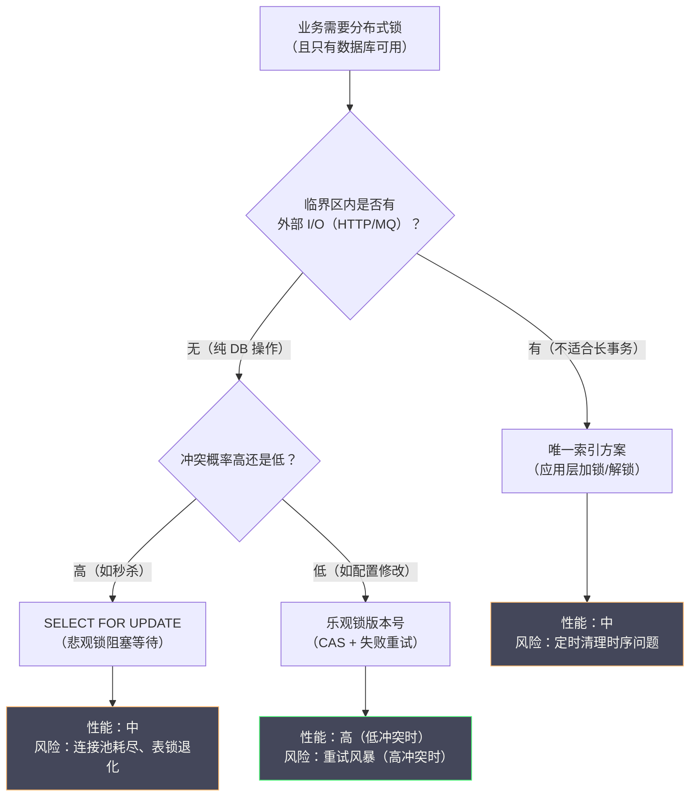

# 05 基于数据库的分布式锁原理与局限

**摘要：**

在 Redis 和 ZooKeeper 成为主流之前，关系型数据库是很多团队实现分布式锁的第一选择——毕竟几乎每个系统都已经有了数据库，无需引入新的基础组件。本文系统梳理三种主流的数据库分布式锁方案：基于唯一索引的插入式锁、基于悲观锁的 `SELECT FOR UPDATE`、以及基于乐观锁的版本号机制；并补充一个常被低估的内置方案——MySQL 命名锁。对每种方案，文章不仅讲清"怎么实现"，更深入剖析其工作原理、隐藏的性能瓶颈、以及在极端情况下的失效模式。读完本文，你应当能回答两个问题：数据库锁为什么"够用但不推荐"，以及三种方案分别在什么边界条件下会失效。

---

## 第 1 章 为什么要了解数据库分布式锁

### 1.1 数据库锁的历史地位

在 Redis 成为互联网标配、ZooKeeper 普及开来之前，关系型数据库（MySQL、PostgreSQL、Oracle）是分布式系统中协调并发的主要工具。数据库分布式锁不是一个"过时"的方案——它至今仍然在大量遗留系统中运行，也是很多小团队在不想引入额外组件时的自然选择。

从技术角度看，了解数据库分布式锁有两个重要价值。

**价值一，理解"为什么不推荐"**。很多技术选型文章直接给出"不要用 DB 做分布式锁"的结论，却没有解释原因。深入理解 DB 锁的工作原理与局限性，能让你在面对具体问题时作出有根据的判断，而不是盲目遵循规则。

**价值二，某些场景数据库锁确实够用**。如果你的业务锁操作频率很低（每秒几次到几十次），且系统已经重度依赖 MySQL，引入 Redis 或 ZooKeeper 的运维成本可能不值得。在这种情况下，正确使用数据库锁是合理的工程决策。

这个"够用但不推荐"的判断，正是本专栏一贯立场的体现：**没有绝对好的方案，只有匹配约束的方案**。数据库锁的局限是真实存在的，但这些局限是否构成"不可用"，取决于你的并发量与一致性要求。

### 1.2 数据库锁的核心优势

**其一，零额外组件**。系统本身就有数据库，无需引入 Redis 或 ZooKeeper，部署复杂度低。**对于小团队而言，"少一个组件要运维"本身就是一项不可忽视的收益**。

**其二，ACID 事务保证**。数据库的锁操作可以与业务操作放在同一个事务中，天然具有原子性——"加锁加业务操作加解锁"可以在一个事务中完成，或通过数据库的锁机制自动协调。这是 Redis 与 ZooKeeper 都不具备的优势：**它们只能提供"锁"，而数据库能提供"锁与数据修改的原子组合"**。

**其三，完善的超时与死锁检测**。InnoDB 有内置的死锁检测机制（`innodb_deadlock_detect`），能自动检测并回滚死锁事务；`innodb_lock_wait_timeout` 控制锁等待超时，避免无限期阻塞。

这三点优势里，第二点最值得留意。**它揭示了一个本质区别：数据库锁"自带数据"，而独立的锁服务"不带数据"**。这意味着，用数据库锁时，"加锁"与"改数据"可以在一个原子操作里完成，不存在"加了锁但改数据失败"的中间态；而用外部锁服务时，"加锁"与"改数据"是两次独立操作，需要额外的机制（如校验、幂等）来保证一致性。**这是数据库锁在"正确性"维度上被低估的一个优势**。

### 1.3 数据库锁在选型坐标系中的位置

把三种锁方案放在"依赖成本"与"性能"两个维度上，数据库锁的位置就很清晰了。

**依赖成本维度**：数据库锁需要零额外组件（复用现有 DB），Redis 锁需要引入 Redis，ZooKeeper 锁需要引入 ZK 集群。从"引入新组件的代价"看，数据库锁最低。

**性能维度**：数据库锁最低（千级 TPS），ZooKeeper 中等（万级 TPS），Redis 最高（十万级 TPS）。从"能扛多少并发"看，数据库锁最弱。

这两个维度构成了一个权衡：**数据库锁用"性能"换取了"零依赖"**。因此，它的适用区间是明确的——**当并发量不高、且团队不愿引入新组件时，数据库锁是最优选择；一旦并发量上来，就应当转向 Redis 或 ZK**。

这里还藏着一个容易被忽视的判断：**"引入新组件的代价"不只是技术成本，更是运维成本与认知成本**。一个团队引入 Redis 作为锁服务，意味着要额外运维一个 Redis 集群、要处理它的高可用、要培训成员理解它的锁语义。对于小团队而言，这些成本可能远超"数据库锁慢一点"带来的损失。**因此，"用数据库锁"有时不是因为技术上最优，而是因为组织上最合理**——这正是架构决策中"技术之外的约束"的典型体现。

---

## 第 2 章 方案一：基于唯一索引的插入式锁

### 2.1 设计思路

这是最直观的数据库分布式锁方案，利用数据库**唯一索引的互斥特性**——同一个唯一键只能插入一次，第二次插入会因唯一约束冲突而失败。

**建表**：

```sql
CREATE TABLE distributed_lock (
    id          BIGINT      NOT NULL AUTO_INCREMENT COMMENT '主键',
    lock_key    VARCHAR(128) NOT NULL               COMMENT '锁的唯一标识（业务 key）',
    lock_value  VARCHAR(64)  NOT NULL               COMMENT '持锁者标识（UUID）',
    owner       VARCHAR(64)  NOT NULL               COMMENT '持锁者描述（机器名+进程ID）',
    expire_time DATETIME     NOT NULL               COMMENT '锁过期时间（用于死锁清理）',
    create_time DATETIME     NOT NULL DEFAULT NOW() COMMENT '创建时间',
    PRIMARY KEY (id),
    UNIQUE KEY uk_lock_key (lock_key)               -- 唯一索引：核心约束
) ENGINE=InnoDB DEFAULT CHARSET=utf8mb4;
```

**加锁（INSERT）**：

```sql
-- 尝试插入一行，如果 lock_key 已存在，会因唯一约束失败
INSERT INTO distributed_lock (lock_key, lock_value, owner, expire_time)
VALUES (
    'order_process_lock',        -- 锁的 key
    'a1b2c3d4-xxxx',             -- 唯一 token（UUID）
    'server01:12345',            -- 持锁者描述
    DATE_ADD(NOW(), INTERVAL 30 SECOND)  -- 30 秒后过期
);
-- 插入成功（影响 1 行）：加锁成功
-- 插入失败（Duplicate entry）：锁已被占用，加锁失败
```

**解锁（DELETE）**：

```sql
-- 只删除 lock_key 和 lock_value 都匹配的行，防止误删他人的锁
DELETE FROM distributed_lock
WHERE lock_key = 'order_process_lock'
  AND lock_value = 'a1b2c3d4-xxxx';
-- 影响 1 行：解锁成功
-- 影响 0 行：锁不存在或不属于当前持锁者（已被超时清理或被抢走）
```

这个方案与 Redis 的 `SET NX PX` 在思想上完全一致：**都是用"唯一性约束"来实现互斥，都用"value 匹配"来保证解锁安全**。区别只在于"唯一性"由谁提供——Redis 由 key 的存在性提供，MySQL 由唯一索引提供。**理解了这一点，就能把 02 篇学到的经验直接迁移过来**：value 必须唯一、解锁必须校验归属。

### 2.2 无死锁：定时清理过期锁

与 Redis TTL 和 ZooKeeper 临时节点不同，MySQL 没有原生的"记录过期自动删除"机制（MariaDB 的 Aria 引擎有，但 InnoDB 没有）。因此，死锁预防需要应用层实现：在锁记录中存储 `expire_time`，由一个后台定时任务定期清理过期锁。

```java
// 定时清理任务（每 5 秒执行一次）
@Scheduled(fixedDelay = 5000)
public void cleanExpiredLocks() {
    int deleted = jdbcTemplate.update(
        "DELETE FROM distributed_lock WHERE expire_time < NOW()"
    );
    if (deleted > 0) {
        log.warn("清理了 {} 个过期的分布式锁记录", deleted);
    }
}
```

> [!warning] 定时清理的时序陷阱
> 定时清理任务引入了一个微妙的时序问题：假设锁的 `expire_time` 是 30 秒后，但持锁业务在 20 秒内就执行完毕并正常解锁了。此时锁记录已被 DELETE 删除，`expire_time` 不再有意义。但如果持锁业务执行了 35 秒还没完成，锁已过期，定时任务删除了锁记录，其他客户端可能加锁成功，造成并发执行。这与 Redis TTL 方案面临的问题完全相同：TTL 必须比业务执行时间长，但这很难精确保证。
>
> 更麻烦的是，**定时清理的"精度"取决于清理任务的执行间隔**。如果清理任务每 5 秒跑一次，那么一把过期的锁最多会多存活 5 秒才被清掉——这个额外延迟同样影响"崩溃后多久能重新加锁"的可用性。**这把 Redis 的"精确 TTL"退化成了"粗粒度 TTL"**，是数据库方案相对 Redis 的一处明确劣势。

### 2.3 加锁重试：轮询而非通知

锁被占用时，客户端如何等待？MySQL 唯一索引方案没有原生的"等待加通知"机制，只能轮询：

```java
public boolean acquireLock(String lockKey, String lockValue, int timeoutMs) {
    long deadline = System.currentTimeMillis() + timeoutMs;

    while (System.currentTimeMillis() < deadline) {
        try {
            jdbcTemplate.update(
                "INSERT INTO distributed_lock (lock_key, lock_value, owner, expire_time) " +
                "VALUES (?, ?, ?, DATE_ADD(NOW(), INTERVAL 30 SECOND))",
                lockKey, lockValue, getOwnerInfo()
            );
            return true;  // 插入成功，加锁成功
        } catch (DuplicateKeyException e) {
            // 锁已被占用，等待后重试
            try {
                Thread.sleep(100);  // 轮询间隔 100ms
            } catch (InterruptedException ie) {
                Thread.currentThread().interrupt();
                return false;
            }
        }
    }
    return false;  // 超时
}
```

轮询意味着：N 个等待者乘以每 100ms 一次乘以锁持有时长，等于大量无效数据库请求。这是唯一索引方案在高并发下的核心性能问题，与 04 篇 ZK 锁用"监听前驱"消除惊群形成鲜明对比——**数据库方案缺少事件通知能力，只能退化为轮询**。

### 2.4 唯一索引方案的优缺点总结

**优点**：

- 实现直观，代码量少
- 解锁操作天然幂等（DELETE 一行）
- 可记录持锁历史（谁在何时持了哪把锁），便于审计

**缺点**：

- **无原生 TTL**：需要额外的定时清理任务，有时序漏洞
- **轮询等待**：等待锁时只能轮询，对数据库形成持续压力
- **无公平性保证**：所有等待者同时轮询，获取顺序随机
- **性能瓶颈**：每次加锁或解锁都是一次磁盘 I/O 操作（InnoDB redo log 写入），比 Redis 内存操作慢一到两个数量级
- **数据库单点**：如果数据库本身是单点，锁服务也是单点；即使主从部署，主从切换同样存在与 Redis 类似的数据丢失风险

### 2.5 一个反例：唯一索引方案的锁泄漏

唯一索引方案最典型的故障，是"锁泄漏"——锁记录本该被删除，却因为某个异常路径留在了表里。

设想一个场景：业务在 `INSERT` 加锁成功之后、执行临界区之前，进程被 OOM Killer 杀掉。此时锁记录已经写入，但"解锁"的 `DELETE` 永远不会执行。这条锁记录会一直存在，直到 `expire_time` 到期、被定时清理任务删除。在此期间，其他所有尝试加锁的客户端都会因唯一约束冲突而失败——**一把"僵尸锁"阻塞了整个业务流程**。

更糟的是，如果定时清理任务本身出了问题（如任务进程挂了、清理 SQL 报错），这条锁记录会永久留存，形成真正的死锁。**这与 02 篇"忘记在 finally 中解锁"的后果是同一类问题**：锁的释放依赖一个"应当发生"的动作，而一旦这个动作没发生，锁就泄漏了。

缓解措施有三条：其一，**确保解锁在 `finally` 中执行**，覆盖正常与异常路径；其二，**把定时清理任务纳入监控**，任务失败要告警；其三，**缩短 `expire_time` 与清理间隔**，让泄漏的锁尽快被回收——但这条要与"业务执行时间"权衡，太短会导致正常业务被误判为过期。

这个反例说明，**唯一索引方案的"无死锁"是"应用层构造出来的"，而不是"存储层天然提供的"**。Redis 有原生 TTL、ZooKeeper 有临时节点，都是"存储层自动兜底"；而 MySQL 唯一索引方案需要"应用层定时清理"，多了一层可能失效的依赖。**"兜底机制的可靠性"，本身就是方案可靠性的一部分**——这也是它相对 Redis、ZK 的一处结构性劣势。

### 2.6 一个变体：让"插入即加锁"同时承担幂等

唯一索引方案有一个容易被忽略的巧妙用法：**同一张锁表，可以同时承担"互斥"与"幂等"两个职责**。

设想"防止订单被重复处理"的场景。除了加锁，业务还需要"幂等"——即使同一订单被处理两次，也不能产生两次副作用。用唯一索引方案时，可以把锁记录的 `lock_key` 设计成业务唯一键（如 `order_process:{orderId}`），于是：

- 第一次处理订单时，插入成功，说明"这个订单没被处理过"，同时获得了锁；
- 第二次处理同一订单时，插入因唯一约束失败，说明"这个订单已经被处理过"，直接跳过。

**一次插入，同时完成了"加锁"与"去重"**。这与单纯用锁的思路不同：单纯用锁时，锁只保证"同一时刻只有一个执行者"，但不记录"这件事做过没有"；而这里，锁记录本身就成了"做过的凭证"。

这个用法的价值在于它把两个机制合并成了一个。**它与 03 篇"栅栏令牌"的思路异曲同工——都是让"锁"这件事携带更多的信息**。只不过栅栏令牌携带的是"版本号"，这里携带的是"业务唯一键"。**在能用一条唯一约束同时解决互斥与幂等的场景里，数据库方案的简洁性甚至超过了 Redis 与 ZK**——因为后两者都需要额外的幂等表来记录"做过的凭证"。

---

## 第 3 章 方案二：悲观锁 SELECT FOR UPDATE

### 3.1 什么是 SELECT FOR UPDATE

`SELECT ... FOR UPDATE` 是 SQL 标准中的悲观锁语句，执行后会对查询结果集中的行加**排他锁（X 锁）**：

- 其他事务无法对这些行执行 `SELECT ... FOR UPDATE`（会被阻塞，等待锁释放）
- 其他事务无法对这些行执行 `UPDATE` 或 `DELETE`（会被阻塞）
- 其他事务的普通 `SELECT`（不加 `FOR UPDATE`）在 MySQL 默认的 MVCC 隔离机制下不会被阻塞（读的是快照，不需要加锁）

**为什么叫"悲观锁"？** 悲观锁（Pessimistic Lock）的名称来源于它对并发冲突的悲观假设：**假设每次读写操作都可能与其他事务冲突**，所以在读取数据时就立刻加锁，阻止其他事务修改，直到本事务提交或回滚后才释放锁。对应的是"乐观锁"——乐观地假设冲突不常发生，读取时不加锁，提交时才检测是否有冲突。

### 3.2 用 SELECT FOR UPDATE 实现分布式锁

与唯一索引方案不同，`SELECT FOR UPDATE` 方案利用数据库**行锁**来实现互斥，无需额外的锁表，而是直接在业务表（或专门的锁控制表）上操作：

```sql
-- 锁控制表：每行代表一个锁资源，提前初始化
CREATE TABLE lock_control (
    lock_key    VARCHAR(128) NOT NULL COMMENT '锁资源标识',
    description VARCHAR(256)          COMMENT '锁用途描述',
    PRIMARY KEY (lock_key)
) ENGINE=InnoDB;

-- 预先插入锁资源行（必须提前存在，否则 SELECT FOR UPDATE 无行可锁）
INSERT INTO lock_control (lock_key, description) VALUES
('order_process_lock', '订单处理分布式锁'),
('inventory_lock',     '库存扣减分布式锁');
```

**加锁与业务操作（必须在同一个事务中）**：

```java
@Transactional
public void processOrder(String orderId) {
    // 步骤 1：SELECT FOR UPDATE 加行锁
    // 如果锁已被其他事务持有，此处会阻塞，直到超时或其他事务提交/回滚
    LockControl lock = lockControlMapper.selectForUpdate("order_process_lock");
    // SQL：SELECT * FROM lock_control WHERE lock_key = 'order_process_lock' FOR UPDATE

    // 步骤 2：在锁保护下执行业务逻辑
    Order order = orderMapper.selectById(orderId);
    // ... 处理订单逻辑 ...
    orderMapper.updateStatus(orderId, "PROCESSED");

    // 步骤 3：事务提交时自动释放行锁（InnoDB 在事务提交/回滚时释放所有锁）
    // 无需显式解锁
}
```

**关键点是锁的释放时机**。InnoDB 的行锁在**事务提交或回滚时自动释放**，不需要显式执行 `UNLOCK` 语句。这意味着：锁的持有时间等于事务的持续时间，事务一结束，锁自动释放。这天然实现了"无死锁"——只要事务最终会提交或回滚（即使应用崩溃，数据库会自动回滚未提交事务），锁就会被释放。**这一点与 ZooKeeper 的临时节点异曲同工：都是把"锁的生命周期"绑定到一个"会自动结束的东西"上**——ZK 绑的是 Session，这里绑的是事务。

### 3.3 SELECT FOR UPDATE 的行锁与表锁

MySQL InnoDB 中，`SELECT ... FOR UPDATE` 加的是**行锁**还是**表锁**，取决于查询是否走索引。

**走索引（加行锁）**：

```sql
-- lock_key 是主键，走主键索引，只锁定一行
SELECT * FROM lock_control WHERE lock_key = 'order_process_lock' FOR UPDATE;
-- InnoDB 只锁定 lock_key = 'order_process_lock' 这一行（行锁）
-- 其他持有不同 lock_key 的事务不受影响（并发度高）
```

**不走索引（升级为表锁）**：

```sql
-- 如果 description 没有索引
SELECT * FROM lock_control WHERE description = '订单处理分布式锁' FOR UPDATE;
-- InnoDB 无法确定要锁哪些行，会退化为全表扫描加锁所有行（实际效果类似表锁）
-- 严重影响并发度。
```

> [!warning] 生产必查：确保 FOR UPDATE 走索引
> 在生产代码中，凡是使用 `SELECT ... FOR UPDATE` 的地方，**必须用 `EXPLAIN` 确认查询走了索引**（`type` 列不应为 `ALL`）。否则，看似只锁一行的代码实际上锁了整张表，会造成大量无关事务阻塞，严重影响系统性能。这个坑之所以危险，是因为**它在功能测试中完全看不出来**——功能是对的，只是并发度悄悄塌了。这类"正确但缓慢"的缺陷，往往要等到流量上来才暴露。

### 3.4 innodb_lock_wait_timeout：锁等待超时

当事务 A 持有行锁，事务 B 尝试 `SELECT FOR UPDATE` 同一行时，事务 B 会阻塞等待。等待的超时时间由 `innodb_lock_wait_timeout` 控制（默认 50 秒）：

```sql
-- 查看当前超时设置
SHOW VARIABLES LIKE 'innodb_lock_wait_timeout';  -- 默认 50 秒

-- 调整超时（会话级别）
SET innodb_lock_wait_timeout = 10;  -- 等待超过 10 秒抛出错误
```

超时后，等待的事务会抛出 `Lock wait timeout exceeded; try restarting transaction` 错误并自动回滚，应用层需要捕获此异常并决定是否重试。

### 3.5 InnoDB 的死锁检测与自动回滚

`SELECT FOR UPDATE` 在多个锁资源的场景下容易产生死锁：

```
事务 A：锁住行 order_lock，然后尝试锁 inventory_lock
事务 B：锁住行 inventory_lock，然后尝试锁 order_lock
→ 循环等待，死锁。
```

InnoDB 的死锁检测器（`innodb_deadlock_detect = ON`，默认开启）会定期检测等待图中的循环，一旦发现死锁，会选择其中一个事务（通常是"代价最小"的——回滚 undo log 量少的那个）作为"死锁牺牲品"强制回滚，让另一个事务继续执行。被回滚的事务会收到 `Deadlock found when trying to get lock` 错误，应用层需要捕获此错误并进行重试。

> [!note] 死锁检测的性能开销
> `innodb_deadlock_detect = ON` 在高并发锁竞争场景下有一定的 CPU 开销——每次锁等待都需要遍历等待图来检测是否有死锁。在极高并发的锁等待场景下（如数千个并发事务竞争同一行），死锁检测本身可能成为瓶颈。这种情况下可以关闭死锁检测，转而依赖 `innodb_lock_wait_timeout` 超时机制来解锁——但这增加了应用的复杂性。**这个取舍是分布式锁里"主动检测死锁"与"依赖超时兜底"两种策略的又一实例**，与 02 篇"锁服务自己检测"还是"靠 TTL 过期"是同一类选择。

### 3.6 SELECT FOR UPDATE 的核心局限

`SELECT FOR UPDATE` 方案相比唯一索引方案有一个显著优势：等待由数据库内部处理，不需要应用层轮询。但它同样有不可忽视的局限。

**局限一，锁与事务绑定，持锁时间等于事务时长**。这是最根本的限制。如果业务逻辑需要"加锁、调用外部 API（可能耗时 1 到 5 秒）、更新数据库、解锁"，那么整个流程都必须在一个事务中完成，事务在调用外部 API 的过程中持续占用数据库连接和行锁。数据库连接是宝贵资源（通常连接池大小 50 到 200），长时间持有连接会导致连接池耗尽。

**局限二，必须在同一个数据库事务中使用**。`SELECT FOR UPDATE` 的锁是事务级别的。如果业务逻辑跨越多个服务调用，无法在一个数据库事务中完成所有操作，`SELECT FOR UPDATE` 就无法使用。

**局限三，行锁退化为表锁的风险**。如上所述，查询必须走索引才能保证是行锁，否则退化为表锁。

**局限四，跨库无法使用**。`SELECT FOR UPDATE` 只在单一数据库实例内有效。如果锁资源分布在不同的数据库实例（分库分表场景），此方案无法使用。

这四条局限的共同根源是：**`SELECT FOR UPDATE` 是"数据库事务的一部分"，而不是一个独立的锁服务**。它继承了事务的所有优点（原子性、自动释放），也继承了事务的所有约束（不能跨库、不能长持、与连接绑定）。**理解了这一点，就能理解它适合什么、不适合什么**——它适合"纯数据库操作、短事务、单库"的场景，不适合"长事务、跨服务、跨库"的场景。

### 3.7 一个反例：FOR UPDATE 未走索引导致的雪崩

"行锁退化为表锁"这个风险，在纸面上只是一个注意事项，但在生产中它可以引发一场雪崩。看一个典型的失效链条。

某系统用 `SELECT ... FOR UPDATE` 保护订单处理，锁控制表的查询条件是 `WHERE biz_no = ?`。这个字段一开始有索引，运行正常。后来一次表结构变更中，索引被误删（或数据类型从 `VARCHAR` 改成了 `INT`，导致隐式类型转换、索引失效），而这次变更没有经过充分的压测。

结果，这条本应"只锁一行"的语句变成了"全表扫描加锁所有行"。于是一次订单处理会锁住整张锁控制表，其他所有订单处理全部阻塞。在高并发下，阻塞的请求迅速耗尽数据库连接池，进而拖垮整个应用——**一个索引问题，演变成了全站不可用**。

这个反例的教训有三层。第一，**"正确但缓慢"的缺陷比"错误"更危险**，因为它在功能测试中完全隐形。第二，**索引的有效性应当有持续的校验**（如定期的慢查询巡检、压测门禁），而不是"配置一次就永远正确"。第三，**`SELECT FOR UPDATE` 这种"性能依赖于索引"的机制，天然是脆弱的**——它的行为会随数据量、统计信息、索引状态而变。

把这个反例与 04 篇的 ZK 锁对比，会更清楚地看到取舍：**ZK 锁的性能是"稳定可预期"的（固定几次网络往返），而数据库锁的性能"依赖于执行计划"，可能因一个索引变化而剧变**。这种"性能的不确定性"，是数据库锁在生产中一个容易被忽视的风险——它不只是"慢一点"，而是"可能突然慢很多"。

---

## 第 4 章 方案三：乐观锁与版本号机制

### 4.1 乐观锁的哲学：先做后检查

乐观锁（Optimistic Lock）基于一种乐观假设：**并发冲突不常发生**，所以不在读取时加锁，而是在提交时检查数据是否被修改过。如果未被修改，提交成功；如果已被修改（存在冲突），放弃本次操作并重试。

乐观锁通常通过在数据行中增加一个**版本号（version）**字段来实现：

```sql
ALTER TABLE orders ADD COLUMN version INT NOT NULL DEFAULT 0 COMMENT '乐观锁版本号';
```

**乐观锁的操作流程**：

```
步骤 1：读取数据，同时记录版本号
  SELECT id, stock, version FROM inventory WHERE product_id = 'P001';
  → 得到 stock = 10, version = 5

步骤 2：在本地计算新值
  new_stock = stock - 1 = 9

步骤 3：带版本号检查的更新（CAS 操作）
  UPDATE inventory
  SET stock = 9, version = version + 1
  WHERE product_id = 'P001' AND version = 5;  -- 检查版本号是否仍是读时的值
  → 影响 1 行：更新成功，提交
  → 影响 0 行：版本号已变（有其他事务先修改了），更新失败，需要重试
```

### 4.2 乐观锁的本质：不是"锁"而是"CAS"

从实现机制看，乐观锁并不是真正的"锁"——它没有阻塞其他事务读写数据，只是在提交时做一次版本号比较（本质上是一个 CAS 操作，Compare-And-Swap，比较并交换）。

这与 Redis 的 `SET NX PX` 命令非常相似：都是"原子的条件写入"——只有在满足特定条件（版本号匹配或 key 不存在）时才执行写入。

**乐观锁解决的核心问题是"读后修改"场景中的丢失更新（Lost Update）问题**：

```
没有乐观锁的场景（丢失更新）：
T1: 客户端 A 读取 stock = 10
T2: 客户端 B 读取 stock = 10
T3: 客户端 A 写入 stock = 9（扣了 1 个）
T4: 客户端 B 写入 stock = 9（也扣了 1 个，但基于旧值 10）
    → 实际上扣了 2 次，但 stock 只减了 1，数据错误。

有乐观锁的场景：
T1: 客户端 A 读取 stock = 10, version = 5
T2: 客户端 B 读取 stock = 10, version = 5
T3: 客户端 A：UPDATE SET stock=9, version=6 WHERE version=5 → 成功
T4: 客户端 B：UPDATE SET stock=9, version=6 WHERE version=5 → 失败（version 已是 6）
    → 客户端 B 重新读取，得到 stock=9, version=6
    → 客户端 B 再次提交：UPDATE SET stock=8, version=7 WHERE version=6 → 成功
    → 两次扣减，stock = 8，正确。
```

> [!info] 乐观锁是"最纯粹的正确性方案"
> 值得注意的是，乐观锁是本文三种方案里唯一"不提供互斥、却保证正确性"的方案。它不阻止并发，而是让冲突的一方失败重试——**它保证的是"结果正确"，而不是"同一时刻只有一个执行者"**。这个区别很重要：它意味着乐观锁不需要"锁"这个抽象，只需要一个"带条件的原子写"。**在能用乐观锁的场景里，它比任何分布式锁都更简单、更可靠**——因为没有锁，就没有锁的那些失效问题。这也是本专栏反复强调"能不用锁就不用锁"的具体体现。

### 4.3 乐观锁与悲观锁的本质差异

| 维度 | 悲观锁（SELECT FOR UPDATE）| 乐观锁（Version 版本号）|
| :--- | :--- | :--- |
| **加锁时机** | 读取时立刻加锁 | 不加锁，提交时检查 |
| **并发冲突处理** | 阻塞等待（其他事务等锁）| 失败重试（冲突方重新读取重试）|
| **适用冲突概率** | 高冲突（悲观认为会冲突）| 低冲突（乐观认为不会冲突）|
| **数据库连接占用** | 持续占用（锁期间持有连接）| 短暂占用（只在 UPDATE 时占用）|
| **吞吐量（低冲突）** | 低（不必要的阻塞）| 高（无阻塞，大部分直接成功）|
| **吞吐量（高冲突）** | 中（等待有序）| 低（大量重试，可能形成重试风暴）|
| **实现复杂度** | 低（数据库处理等待逻辑）| 中（应用层需要处理重试逻辑）|
| **是否真正的"锁"** | 是（阻塞其他事务）| 否（本质是 CAS）|

### 4.4 乐观锁的适用场景与 ABA 问题

**适用场景**：读多写少、冲突概率低的场景。典型例子包括用户信息更新（用户很少同时更新同一个账号的信息）、文章内容修改（同时修改同一篇文章的概率较低）、配置项修改（配置变更频率低，冲突极少）。

**不适用场景**：高冲突场景。典型例子是秒杀库存扣减（大量并发请求竞争同一商品的库存）——在秒杀场景下，乐观锁会导致大量事务失败重试，形成"重试风暴"，反而比悲观锁更糟。

**ABA 问题**：乐观锁的版本号机制还有一个潜在的 ABA 问题（虽然在数据库场景中不如 CAS 无锁编程中严重）：

```
T1: 客户端 A 读取 stock=10, version=5
T2: 客户端 B 将 stock 从 10 改为 5，version=6
T3: 客户端 C 将 stock 从 5 改为 10，version=7
T4: 某次错误操作将 version 重置为 5（例如数据库备份恢复）
T5: 客户端 A 提交：WHERE version=5 → 匹配，但此时数据已经被 B、C 修改过了
```

在常规业务场景中，数据库的 version 字段只会单调递增，不会重置，因此 ABA 问题很少发生。但如果数据库有复杂的恢复或迁移操作，需要特别注意。**这个问题的根源与 03 篇的时钟漂移同源：都是某个"单调递增的东西"被意外打断，从而破坏了依赖它的假设**。

### 4.5 乐观锁的重试风暴与缓解

乐观锁在高冲突场景下的"重试风暴"，是一个值得单独展开的性能陷阱。

在秒杀这类场景里，假设有 1000 个请求同时竞争同一件商品，库存只剩 1 件。用乐观锁时，1000 个请求都读到 `version = 5`，然后同时提交 `WHERE version = 5`。数据库只会让其中 1 个成功，另外 999 个全部失败并重试——**而重试时它们又会读到同一个新版本号，再次同时提交，再次失败 998 个**。这就是重试风暴：每一次"一轮重试"，都会产生大量注定失败的请求，把数据库的负载放大成原来的很多倍。

缓解重试风暴有几条思路。**其一，限制重试次数与退避**：失败后不要立即重试，而是随机退避一段时间，减少同一时刻的碰撞概率。**其二，在应用层前置拦截**：在进入数据库之前，用 Redis 或本地计数做一层"是否有库存"的快速判断，把绝大多数注定失败的请求挡在数据库之外。**其三，对高冲突场景改用悲观锁或分布式锁**：让请求排队而不是同时重试，避免"无效请求"的浪费。**其四，用队列串行化**：把请求投入队列，由消费者串行处理，从根上消除并发冲突。

这个陷阱揭示了一个重要的判断：**乐观锁的"乐观"是有前提的——冲突必须真的"不常发生"**。一旦冲突概率高，乐观锁的成本会急剧上升，甚至超过悲观锁。**"低冲突用乐观、高冲突用悲观"这条经验法则，背后是两种策略在冲突率变化时的成本曲线差异**。理解这条曲线，就不会在秒杀场景里误用乐观锁。

---

## 第 5 章 三种方案的横向对比与选型建议

### 5.1 三种方案性能对比

**基准测试参考**（同机房，MySQL 8.0，并发度 100，锁持有时间约 5ms）：

| 方案 | 加锁 TPS（理论上限）| 等待机制 | 对 DB 的压力 |
| :--- | :--- | :--- | :--- |
| 唯一索引插入 | 约 1000 到 3000 TPS | 应用层轮询（每 100ms 一次 SELECT 加 INSERT）| 轮询带来大量无效请求 |
| SELECT FOR UPDATE | 约 2000 到 5000 TPS（无竞争时）| DB 内部阻塞等待 | 持有连接期间占用连接池资源 |
| 乐观锁（低冲突）| 约 5000 到 20000 TPS | 失败重试 | 低（冲突少时绝大多数一次成功）|
| 乐观锁（高冲突）| 约 500 到 1000 TPS（重试风暴）| 失败重试 | 极高（大量重试请求）|

对比 Redis（约 5 万到 20 万 TPS）与 ZooKeeper（约 1 万到 3 万 TPS），数据库方案的性能差距显著，核心原因是磁盘 I/O（InnoDB 写操作必须写 redo log 到磁盘）比内存操作慢两到三个数量级。

> [!note] 为什么数据库锁的性能天花板这么低
> 数据库锁慢的根源不在于"锁的算法"，而在于"锁的载体"。每一次加锁或解锁，最终都要落到一次 InnoDB 的写入——而 InnoDB 的写入为了持久性必须 fsync 到磁盘。这个代价与 02 篇讨论的 2PC Prepare 阶段的 fsync 是同一个：**为了"崩溃不丢"，就必须"写入磁盘"，而磁盘比内存慢几个数量级**。Redis 锁之所以快，正是因为它用内存换掉了这个 fsync。**理解了"性能差距来自持久化代价"，就不会指望通过优化 SQL 把数据库锁调到 Redis 的水平**。

### 5.2 数据库分布式锁的使用边界

**可以使用数据库分布式锁的场景**：

1. **锁操作频率极低**（每秒小于 100 次）：此时 DB 性能不是瓶颈
2. **业务操作必须与数据库操作在同一事务中**（`SELECT FOR UPDATE` 最适合）
3. **团队没有 Redis 或 ZooKeeper 经验**，且系统规模不要求高并发锁
4. **临时方案**：快速迭代阶段先用 DB 锁解决问题，后续性能有需求时再迁移

**不应该使用数据库分布式锁的场景**：

1. **高并发锁竞争**（每秒大于 1000 次锁操作）
2. **临界区操作涉及外部调用**（HTTP 请求、MQ 发送），不适合在 DB 事务内持锁
3. **需要公平锁**：三种方案都不原生支持公平性
4. **跨库或跨服务的分布式事务**：DB 锁无法跨多个数据库实例

### 5.3 一张图总结三种方案



### 5.4 一个前置判断：能不能用"数据库原子操作"代替锁

在选数据库锁之前，还有一个更前置的判断值得做：**这个场景能不能用一条带条件的 SQL 直接解决，根本不需要锁？**

库存扣减就是典型例子。用"读加判断加写"需要锁，但用一条 `UPDATE stock = stock - 1 WHERE id = ? AND stock > 0` 就根本不需要锁——数据库的行锁在单条语句内自动完成，条件判断与更新是原子的，并发请求会自然串行。类似的还有"状态机流转"（`UPDATE ... WHERE status = 'PENDING'`）、"唯一约束去重"（`INSERT` 加唯一索引）。

这个判断的价值在于：**它把"要不要引入分布式锁"这个重问题，降级成了"能不能用一条 SQL 解决"这个轻问题**。在绝大多数"扣减类""状态流转类"场景里，答案是肯定的——而这正是 01 篇"能不用锁就不用锁"原则在数据库场景的具体应用。**数据库自带的原子性，往往比外部的分布式锁更简单、更可靠**。

### 5.5 一个容量视角：数据库锁的成本构成

把数据库锁的成本逐项列出，能帮助判断它在什么规模下会触顶。

**第一项是每次锁操作的磁盘 I/O**。InnoDB 的写入为了持久性必须落盘，一次加锁（INSERT）或解锁（DELETE）都至少触发一次日志写入。这项成本是数据库锁性能天花板的根源。

**第二项是连接占用**。用 `SELECT FOR UPDATE` 时，锁的持有时间等于事务时长，期间占用一个数据库连接。若连接池大小为 100，而锁持有时间为 1 秒，那么同一时刻最多只能支撑 100 个"正在持锁"的请求。

**第三项是轮询开销**。用唯一索引方案时，等待者每 100ms 轮询一次。若有 100 个等待者，锁持有 5 秒，则这 5 秒内会产生 100 × 50 等于 5000 次无效查询。

**第四项是清理任务开销**。定时清理过期锁需要定期全表扫描 `expire_time < NOW()`，若锁表很大且无合适索引，这项扫描本身也是负担。

把这四项加总，可以看出：**数据库锁的成本与"锁操作频率""并发等待者数量""锁持有时长"三者都成正比**。因此，它适合"低频、少等待者、短持锁"的场景，而不适合"高频、多等待者、长持锁"的场景。**这个判断与 01 篇"分布式锁的适用性取决于使用场景"的立场一致**——不是数据库锁"不好"，而是它有一个明确的容量区间，超出区间就会成为瓶颈。

### 5.6 一个细节：SELECT FOR UPDATE 与间隙锁

`SELECT FOR UPDATE` 锁的范围，不仅取决于"查询条件匹配到哪些行"，还取决于**隔离级别与查询方式**，这一点常被忽视。

在 MySQL 默认的可重复读（RR）隔离级别下，InnoDB 为了防止幻读，会对查询范围加**间隙锁（Gap Lock）**——不仅锁住存在的行，还锁住行与行之间的"间隙"，阻止其他事务在这个范围内插入新行。

对于锁控制表这种"按主键精确查询单行"的场景，间隙锁的影响很小——通常只锁住那一行及其相邻间隙。但如果查询条件是**范围条件**（如 `WHERE lock_key > 'a' AND lock_key < 'z' FOR UPDATE`），或者**查询走了非唯一索引**，InnoDB 可能锁住一个较大的范围，阻塞大量无关的插入与更新。

这个细节提醒我们：**`SELECT FOR UPDATE` 的"锁范围"是一个需要主动确认的东西，而不是想当然的"锁住我查到的行"**。在生产中使用它时，应当结合隔离级别与执行计划，确认它实际锁住的范围。**这与 3.3 节"必须走索引"是同一类要求——都是"确认锁的实际范围与预期一致"**。而这类确认，恰恰是数据库锁在生产中最容易被忽略、也最容易出问题的地方。

---

## 第 6 章 MySQL 特有的增强方案：GET_LOCK 与 RELEASE_LOCK

### 6.1 MySQL 命名锁：一个被低估的内置方案

MySQL 提供了一组内置的应用级命名锁函数，不需要建表，可以在不同连接之间实现互斥：

```sql
-- 加锁：尝试获取名为 'order_process_lock' 的锁，最多等待 10 秒
-- 返回 1：加锁成功
-- 返回 0：等待超时，加锁失败
-- 返回 NULL：发生错误
SELECT GET_LOCK('order_process_lock', 10);

-- 解锁：释放指定名称的锁
-- 返回 1：解锁成功
-- 返回 0：锁不存在（或不属于当前连接）
-- 返回 NULL：发生错误
SELECT RELEASE_LOCK('order_process_lock');

-- 检查锁是否被占用
-- 返回 NULL：锁可用（未被占用）
-- 返回连接 ID：锁被哪个连接持有
SELECT IS_USED_LOCK('order_process_lock');
```

**关键特性**：

- 命名锁与**数据库连接（Connection）**绑定，连接断开时锁自动释放（类似 ZooKeeper 临时节点与 Session 绑定）
- 同一连接可以多次获取同一把锁（可重入）
- 等待机制由 MySQL 服务端处理，不需要应用层轮询
- 不涉及磁盘 I/O（命名锁是内存中的元数据），性能比 InnoDB 行锁更高

```java
// Java 使用 MySQL 命名锁示例
@Transactional
public void processOrderWithNamedLock(String orderId) {
    // 获取命名锁（等待最多 10 秒）
    Integer result = jdbcTemplate.queryForObject(
        "SELECT GET_LOCK(?, 10)",
        Integer.class,
        "order_process_lock:" + orderId
    );

    if (!Integer.valueOf(1).equals(result)) {
        throw new BusinessException("获取分布式锁失败，请稍后重试");
    }

    try {
        doProcessOrder(orderId);
    } finally {
        // 显式释放锁（事务提交时也会释放，但显式释放更规范）
        jdbcTemplate.execute("SELECT RELEASE_LOCK('order_process_lock:" + orderId + "')");
    }
}
```

> [!info] 命名锁为何"被低估"
> MySQL 命名锁的几个特性组合起来，其实相当接近 ZooKeeper 锁：**与连接绑定（自动释放）、服务端处理等待（无轮询）、内存操作（较快）、可重入**。它缺少的只是"公平性"与"跨实例"，但对于"单 MySQL 实例、中等并发、连接生命周期与业务匹配"的场景，它比建表方案更简洁、比行锁方案更轻量。它之所以被低估，可能是因为它"藏在函数里"而不是"一张表里"——**很多团队不知道它的存在，或者因为它不是"标准做法"而不敢用**。

### 6.2 命名锁的局限性

1. **只在单 MySQL 实例内有效**：不能跨数据库实例，与 Redis 或 ZK 的分布式特性不同
2. **依赖长连接**：如果使用连接池，连接被回收后锁也会被释放（通常这是期望的行为，但要注意连接池的最大空闲时间配置）
3. **MySQL 5.7 之前**：同一会话只能持有一个命名锁，`GET_LOCK` 会释放之前的锁；MySQL 5.7+ 修复了这个问题，支持一个会话持有多个命名锁

MySQL 命名锁在以下场景中是合适的选择：已经用 MySQL 且不想引入 Redis 或 ZK；并发度中等（每秒小于 1000 次加锁）；锁的生命周期与数据库连接相关联（如 Web 请求处理期间）。

### 6.3 命名锁与连接池的配合

命名锁与连接绑定，这个特性在使用连接池时需要特别留意，否则会出现"锁莫名其妙被释放"的问题。

考虑一个场景：业务从连接池借出一条连接，调用 `GET_LOCK` 加锁，然后在同一个连接上执行业务 SQL。如果这个业务逻辑跨了多个方法，而中间某处**把连接还回了连接池**（例如事务提前结束、或代码里显式关闭了连接），那么连接池可能会把这条连接分配给别人，甚至触发连接回收。一旦连接被关闭或复用，**绑定在它上面的命名锁就会被释放**——而此时业务可能还在"以为持有锁"的状态下运行。

这个陷阱的根源是：**命名锁的生命周期绑定到"连接"这个物理资源，而不是绑定到"业务逻辑"这个逻辑单元**。因此，使用命名锁时必须保证：**加锁与解锁之间，连接不被归还、不被关闭**。实践中的做法是确保加锁与业务操作在同一个事务或同一个连接的作用域内完成，并显式在 `finally` 中释放锁。

这与 02 篇"解锁必须在 finally 中"是同一类要求，但更隐蔽——因为它涉及"连接池"这个中间层。**连接池在多数时候是透明的，但在"资源与连接绑定"的机制里，它的回收行为会变成一个可见的语义**。理解这一点，才能正确使用命名锁这类"与连接绑定"的机制。

### 6.4 一个横向补充：PostgreSQL 的咨询锁

MySQL 有命名锁，PostgreSQL 则提供了一组被称为**咨询锁（Advisory Lock）**的内置锁，思路相近但语义更丰富，值得一并了解。

PostgreSQL 的咨询锁有两种粒度：

**会话级咨询锁（Session-level）**：`pg_advisory_lock(key)` 获取锁，锁一直持有到显式释放（`pg_advisory_unlock`）或会话结束。它的行为与 MySQL 命名锁类似——**与连接绑定，连接断开自动释放**。

**事务级咨询锁（Transaction-level）**：`pg_advisory_xact_lock(key)` 获取锁，锁在事务结束时（提交或回滚）自动释放。它的行为与 `SELECT FOR UPDATE` 类似——**与事务绑定，无需显式释放**。

这个"两级语义"的设计很有参考价值：**它把"锁绑定到连接"与"锁绑定到事务"这两种常见需求，都做成了原语**。用户在需要"长生命周期锁"时用会话级，需要"随事务自动释放"时用事务级，不必自己用表来模拟。

从本专栏的分析框架看，PostgreSQL 咨询锁与 MySQL 命名锁属于同一类：**数据库内置的、不依赖建表的轻量锁**。它们的共同优势是"零建表、随连接或事务自动释放"，共同局限是"只在单实例内有效、性能受数据库制约"。**了解这些内置能力，能避免"为了一个简单锁需求就引入 Redis"的过度设计**——这再次印证了本专栏的立场：选型要回到需求，而不是回到"哪个组件更流行"。

---

## 第 7 章 小结：数据库锁的位置

把本章的分析收敛，可以得到关于数据库锁的三条判断。

**其一，数据库锁的核心优势是"自带数据"**。它能把"加锁"与"改数据"放在一个事务里，这是外部锁服务做不到的。因此，对于"纯数据库操作、短事务、单库"的场景，它往往是最简单可靠的方案。

**其二，数据库锁的核心劣势是"性能天花板低"**。这个天花板来自持久化代价，无法通过优化 SQL 突破。因此，高并发场景应当避开它。

**其三，数据库锁最容易被忽视的用法是"用原子 SQL 代替锁"**。很多"需要锁"的场景，其实一条带条件的 UPDATE 就能解决。**在做"用哪种锁"的决定之前，先做"要不要锁"的判断**——这往往能省掉整个锁方案的引入成本。

这三条判断，与 01 篇提出的"三大正确性要求加可观测性"、03 篇的"服务端校验"、04 篇的"按场景选锁"共同构成了本专栏的完整视角。数据库锁在其中的位置是：**它是"最小依赖、最低性能"的那一个选项，适合作为兜底与过渡，而不适合作为高并发的主力**。

### 7.1 三种方案与外部锁服务的一张对照

把数据库锁与 Redis、ZooKeeper 放在同一张表里对照，能更清楚地看出它"缺什么、多什么"。

| 维度 | 数据库锁 | Redis 锁 | ZooKeeper 锁 |
| :--- | :--- | :--- | :--- |
| **额外组件** | 无（复用现有 DB）| 需 Redis | 需 ZK 集群 |
| **性能量级** | 千级 TPS | 十万级 TPS | 万级 TPS |
| **锁与数据修改的原子性** | 有（同事务）| 无 | 无 |
| **无死锁机制** | 应用层定时清理 | 原生 TTL | 临时节点（连接绑定）|
| **公平性** | 无 | 无 | 有 |
| **跨实例** | 单实例（命名锁）| 需 Redlock 等 | 原生支持 |
| **运维复杂度** | 最低 | 低 | 中 |

这张表最值得玩味的两行是"额外组件"与"锁与数据修改的原子性"。**数据库锁在这两点上占优**：它不需要引入新组件，且能保证"加锁与改数据"的原子组合。**而它在性能与无死锁机制上处于劣势**。因此，数据库锁的定位可以精确地表述为：**"用性能与可靠性换取最小依赖与原子组合"的方案**——当你的场景恰好需要"原子组合"、且对性能要求不高时，它是最优选择；否则，Redis 或 ZK 更合适。

### 7.2 三条判断的展开

**第一条，"自带数据"是数据库锁的独特优势**。这一条值得再强调一次，因为它在选型中常被忽视。当业务需要"加锁并同时修改数据"时，数据库锁能用一个事务保证两者的原子性；而用外部锁服务时，"加锁成功"与"数据修改成功"之间可能出现不一致（如加锁成功但数据修改失败）。**如果你的场景是"锁与数据强绑定"的，数据库锁反而可能是最正确的选择**——不是因为它快，而是因为它能把两件事变成一个原子操作。

**第二条，"性能天花板来自持久化"这一条不可突破**。数据库锁的慢，根源是每次锁操作都要落盘。这个代价无法通过优化 SQL 或调参消除，只能通过"减少锁操作频率"或"换用内存型存储"来规避。**认清这一点，就不会在数据库锁上做无谓的性能优化**。

**第三条，"用原子 SQL 代替锁"是最值得优先考虑的方向**。这一条的价值在于它常常能"消除问题"而不是"解决问题"。很多"需要分布式锁"的场景，本质上是"需要一次原子的条件更新"——而数据库的 `UPDATE ... WHERE 条件` 天然提供了这个能力。**先问"能不能用一条 SQL 解决"，再问"该用哪种锁"，这个顺序能帮团队省掉大量的复杂度**。

### 7.3 与分布式事务的一个呼应

把本文的结论与分布式事务专栏对照，会发现它们共享同一条思路：**优先"消除问题"，而不是"解决问题"**。

分布式事务专栏反复强调"能用架构手段避免的分布式事务，就不要引入"——通过数据本地化、事件驱动、聚合根设计，把跨服务事务转化为单机事务或异步流程。本文则强调"能用原子 SQL 解决的，就不要引入锁"——通过唯一约束、条件更新、状态机流转，把"需要互斥"的场景转化为"一次原子写"。

两者背后的逻辑完全一致：**当一个问题可以"不被制造出来"时，这比"用一个机制去解决它"更根本**。因为任何机制都带来复杂度与失效场景，而"不需要这个机制"则没有这些代价。**这也是本专栏与分布式事务专栏共同的价值观：架构者的第一职责是做决策权衡，而"避免引入不必要的复杂度"本身就是最重要的一种权衡**。

这个呼应说明，分布式锁与分布式事务虽然解决的是不同问题，但它们的方法论是相通的。**掌握了这套"先问要不要、再问用哪个"的思维，面对任何分布式难题时都能多一层判断**——这比记住某个具体的锁方案或事务方案，价值大得多。

### 9.4 一个延伸：数据库锁的"选型清单"

数据库锁有四种方案，如何选？一张清单可以帮助判断。

**如果只是"防重复插入"** → **唯一索引**（最简单、最可靠）。

**如果需要"读-改-写"且冲突高** → **`SELECT FOR UPDATE`**（悲观锁，实时感知冲突）。

**如果需要"读-改-写"且冲突低** → **乐观锁**（无锁读，提交时检查）。

**如果需要"命名互斥"且在同一实例内** → **MySQL 命名锁**（`GET_LOCK`，轻量）。

**如果数据库压力已经很大** → **不要用数据库锁**，改用 Redis 或 ZooKeeper。

**这份清单的判断顺序是"先看需求（防重复还是读改写），再看冲突概率，最后看数据库压力"**。**它把"选哪种数据库锁"变成了"三个问题的回答"**。

**这条延伸的启示是**：**"选型"可以被"转化为一系列问题"**——**回答完问题，答案自然浮现**。**这与 02 篇"用异常清单替代 CP/AP 标签"、09 篇"从异常反推一致性模型"是同一个方法论**：**把"选什么"转化为"回答什么"，让决策变得可操作**。

---

## 参考资料

1. MySQL 官方文档：InnoDB Locking. https://dev.mysql.com/doc/refman/8.0/en/innodb-locking.html
2. MySQL 官方文档：Locking Functions (GET_LOCK). https://dev.mysql.com/doc/refman/8.0/en/locking-functions.html
3. MySQL 官方文档：InnoDB Deadlock Detection. https://dev.mysql.com/doc/refman/8.0/en/innodb-deadlock-detection.html
4. Kleppmann, M. (2017). *Designing Data-Intensive Applications*. O'Reilly Media. Chapter 7: Transactions.
5. Helland, P. (2007). Life beyond Distributed Transactions: an Apostate's Opinion. *CIDR 2007*.
6. Gray, J., & Reuter, A. (1992). *Transaction Processing: Concepts and Techniques*. Morgan Kaufmann.

---

> [!note] 思考题
> 1. 唯一索引方案与 Redis 的 `SET NX PX` 在思想上一致，但唯一索引方案没有原生 TTL。请说明这个差异给"无死锁"带来了哪些额外复杂度，以及为什么它使数据库锁的"过期精度"低于 Redis。
> 2. `SELECT FOR UPDATE` 的锁在事务提交时自动释放。请说明这个"与事务绑定"的特性在"短事务"场景是优点，在"含外部调用的长事务"场景却是缺点。
> 3. 文中提出"很多需要锁的场景，一条带条件的 UPDATE 就能解决"。请针对"防止优惠券被重复领取"这一场景，设计一条不依赖分布式锁的原子 SQL，并说明它为什么是并发安全的。
