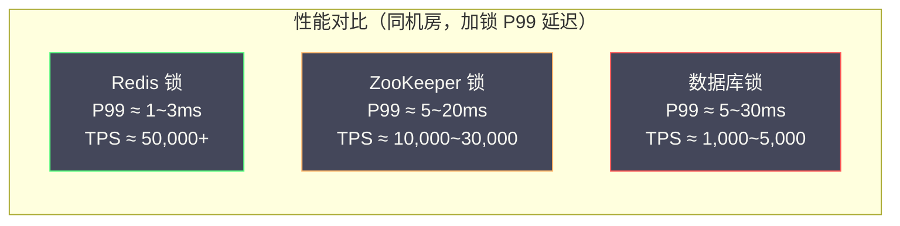

# 06 分布式锁的性能公平性与可重入设计

**摘要：**

前四篇文章分别深入讲解了 Redis、ZooKeeper 和数据库三种分布式锁的实现原理。本篇是一次系统性的横向整合：从工程设计的角度，深入分析分布式锁的三个核心特性维度——**性能**（各方案的吞吐量与延迟根因）、**公平性**（非公平锁为何是默认选择、公平锁在哪些场景不可或缺）、以及**可重入性**（可重入锁的设计动机、实现机制与潜在陷阱）。在此基础上，进一步探讨读写锁与锁超时的精细化设计。读完本文，你应当能回答两个问题：一次锁操作的开销究竟由哪几部分构成，以及为什么"公平"与"性能"往往不能兼得。

---

## 第 1 章 性能的根本来源：一次锁操作到底做了什么

在比较三种方案的性能之前，需要先建立一个分析框架：**一次分布式锁的加锁或解锁操作，本质上是一次分布式协调操作，其性能由三个因素决定——网络往返次数、存储操作类型（内存还是磁盘）、一致性协议的参与节点数。** 掌握了这三个因素，就能解释任何锁方案的性能表现，而不必死记硬背数字。

### 1.1 Redis 锁的性能根因

**加锁**：一条 `SET NX PX` 命令，一次网络往返（客户端到 Redis 再到客户端），Redis 执行内存写操作。

**解锁**：一次 Lua 脚本执行（GET 加 DEL），也是一次网络往返，Redis 执行内存读加内存写操作。

**总延迟**：2 次网络往返乘以单程网络延迟（同机房约 0.1 到 0.5ms），约 0.2 到 1ms。

**吞吐量上限**：单个 Redis 实例命令处理约 10 万 TPS（内存操作极快），加上网络因素，实际分布式锁吞吐量约 **5 万到 20 万 TPS**（受并发连接数和网络带宽影响）。

> [!note] Redis 单线程是性能瓶颈吗
> Redis 命令执行是单线程的，但这不是性能瓶颈。Redis 的单次命令执行时间在微秒级（`SET` 命令约 0.5 到 2 微秒），一秒内可以处理数十万条命令。真正的瓶颈通常是**网络**（每次命令都需要一次网络往返）和**连接数**（连接池大小限制了并发请求数）。Redis 6.0 引入的网络 I/O 多线程进一步提升了高并发下的网络处理能力，但命令执行仍是单线程。**"单线程等于慢"是一个常见的误解**——单线程只是意味着"命令串行执行"，而每条命令本身极快，真正的成本在网络往返上。

### 1.2 ZooKeeper 锁的性能根因

ZK 加锁涉及多步操作：

1. **创建临时顺序节点**：客户端到 Leader，再到多数 Follower ACK，再回到 Leader，再回客户端（3 到 4 次网络往返，ZAB 同步写）
2. **getChildren 获取子节点列表**：1 次网络往返（可读 Follower）
3. **注册 Watch（exists 前驱节点）**：1 次网络往返

总计约 5 到 6 次网络往返。同机房 ZK 集群（3 节点），单次加锁延迟约 **3 到 10ms**。

**吞吐量上限**：ZK 的写操作需要经过 ZAB 多数派确认，单 Leader 处理能力约 **1 万到 3 万 TPS**（相比 Redis 低一个数量级）。在高并发锁竞争下，ZK 的 Leader 会成为瓶颈。

**ZK 读操作的特殊性**：ZK 的读操作（`getChildren`、`exists`）可以在任意节点（包括 Follower）执行，不需要经过 Leader，延迟更低。但要注意，Follower 的数据可能比 Leader 略有滞后（ZAB 同步有延迟），在极端情况下可能读到稍旧的子节点列表。这在分布式锁场景中通常是安全的（最终会通过 Watch 纠正），但需要了解这个特性——**这正是 04 篇"读可能旧"那一节讨论的问题**。

### 1.3 数据库锁的性能根因

**唯一索引 INSERT**：1 次网络往返加 InnoDB 写操作（redo log 刷盘，约 1 到 5ms）。

**SELECT FOR UPDATE**：1 次网络往返加 InnoDB 行锁加锁（内存操作），但锁持有期间持续占用数据库连接。

**InnoDB 写操作为何比 Redis 慢**：InnoDB 的每次写操作（INSERT/UPDATE/DELETE）都需要写 redo log（预写日志），redo log 需要定期刷盘（`innodb_flush_log_at_trx_commit = 1` 时每次提交都刷盘）。磁盘顺序写的延迟约 1 到 5ms（HDD）或 0.1 到 1ms（SSD），远高于 Redis 内存写操作的微秒级延迟。

**数据库锁吞吐量上限**：约 **1000 到 5000 TPS**（受磁盘 I/O 和连接池大小限制）。

### 1.4 三种方案的性能对比



| 维度 | Redis 锁 | ZooKeeper 锁 | 数据库锁 |
| :--- | :--- | :--- | :--- |
| **加锁延迟（P50）** | 0.2 到 0.5ms | 2 到 5ms | 2 到 10ms |
| **加锁延迟（P99）** | 1 到 3ms | 5 到 20ms | 5 到 30ms |
| **理论 TPS 上限** | 50,000+ | 10,000 到 30,000 | 1,000 到 5,000 |
| **性能瓶颈** | 网络往返、连接数 | ZAB 同步写、Leader 单点 | 磁盘 I/O、连接池 |
| **高并发下的退化** | 轻微（Redis 单线程稳定）| 中等（Leader 压力上升）| 严重（连接池耗尽、锁等待积压）|

**结论**：对于吞吐量敏感的场景（每秒数千次以上的锁操作），Redis 是唯一可选项；对于吞吐量中等但需要强一致保证的场景，ZooKeeper 是合理选择；对于低频锁操作且已有数据库的场景，数据库锁足够。

### 1.5 用三个因素解释一切

回到本章开头提出的分析框架，用三个因素重看三种方案，会发现性能差异全部可以被解释。

**网络往返次数**：Redis 是 2 次（加锁加解锁），ZK 是 5 到 6 次，数据库是 2 次（加锁加解锁，但每次涉及磁盘）。往返次数越多，延迟越高。

**存储操作类型**：Redis 是纯内存，ZK 是内存加多数派复制，数据库是磁盘加 fsync。从内存到磁盘，性能差两到三个数量级。

**一致性协议的参与节点数**：Redis 单节点是 1，ZK 是多数派（3 或 5），数据库是单实例。参与节点越多，单次操作的协调成本越高。

把这三点与 02、04、05 三篇的结论对照，会发现完全吻合：**Redis 快是因为"一次往返加内存加单节点"，ZK 慢是因为"多次往返加多数派"，数据库慢是因为"磁盘 fsync"**。**理解了这三个因素，就能在遇到任何新的锁方案时，先估计它的性能量级**——这也是本专栏强调"理解原理而非记住结论"的一个具体体现。

### 1.6 一个常被忽略的成本：锁竞争的排队代价

在比较"哪种锁更快"时，有一个更根本的因素常被忽略：**锁保护的临界区有多长**。

设想一个场景：无论用哪种锁，临界区的执行时间都是 100ms。那么，无论锁服务本身多快（0.5ms 还是 10ms），同一把锁的吞吐上限都只有约 10 TPS——因为同一时刻只能有一个执行者，而每个执行者要占用 100ms。**锁服务的延迟在这个场景里几乎无关紧要，真正决定吞吐的是临界区的长度**。

这个观察揭示了一条重要的工程原则：**在优化分布式锁的性能时，"缩短临界区"的收益远大于"换更快的锁"**。把外部调用、批量计算、日志落盘等耗时操作移出锁的范围，往往能把吞吐提升几倍甚至几十倍；而把 Redis 换成"更快的 Redis"几乎没有意义。**锁服务的选择，更多是决定"延迟的下限"，而不是"吞吐的上限"**。

因此，第 1.1 到 1.4 节的性能对比，应当这样理解：**它们决定的是"每次锁操作本身要花多久"，而不直接决定"业务的吞吐量"**。真正的吞吐瓶颈，通常在临界区里，而不在锁服务里。**先看临界区，再看锁服务**——这个顺序能让性能优化事半功倍。

### 1.7 一个反例：把锁当"性能银弹"

"锁能解决性能问题"是一个常见的错觉，它源于对锁的本质的误解。看一个反例。

某团队发现"订单重复处理"的问题，于是给订单处理方法加了一把分布式锁。加锁之后，重复处理的问题解决了，但接口响应时间从 50ms 涨到了 200ms。团队的直觉是"锁太慢了，换个更快的锁"——于是把 Redis 锁换成了"更优化的实现"，又调了连接池，收效甚微。

真正的根因不在锁，而在"加锁的位置"。他们加的是一把**全局锁**（所有订单共用一把），于是所有订单处理被串行化——在并发场景下，每个请求都要排队等前面的完成。响应时间的增长，来自"排队"，而不是"锁服务慢"。

正确的修法不是"换更快的锁"，而是**把全局锁改成按订单 ID 的细粒度锁**，让不同订单互不阻塞；进一步地，还可以用 05 篇提到的"唯一约束"直接把"重复处理"变成"插入失败"，根本不需要锁。

这个反例的教训是：**锁的本质是"用串行换取正确"，而不是"用锁换取性能"**。加锁必然引入串行，而串行必然降低并发——**如果加锁后性能变差，首先要问的不是"锁够不够快"，而是"这个锁的范围是不是太粗"、"这个场景是不是根本不需要锁"**。把"锁"当成"性能工具"，方向从一开始就错了。

---

## 第 2 章 公平锁与非公平锁：不是技术问题，是业务问题

### 2.1 公平与非公平的定义

**非公平锁（Non-fair Lock）**：当锁被释放时，所有等待者平等地参与竞争，锁被任意一个等待者获取，不保证获取顺序与等待时间相关。

**公平锁（Fair Lock）**：锁按照等待者的请求到达顺序依次分配，等待时间最长的请求者优先获取，保证"先来先得"，无饥饿现象。

在单机 Java 中，`ReentrantLock` 的构造函数接受一个 `fair` 参数：

```java
// 非公平锁（默认）
ReentrantLock unfairLock = new ReentrantLock();
// 公平锁
ReentrantLock fairLock = new ReentrantLock(true);
```

### 2.2 为什么非公平锁是默认选择

**Java 公平 ReentrantLock 的性能测试结论**（JDK 文档中有记录）是：公平锁的吞吐量通常比非公平锁低 5 到 10 倍。这个性能差异来自两个原因。

**原因一，挂起与唤醒开销**。公平锁必须维护一个有序的等待队列，每次锁释放都要唤醒队列头部的线程。线程的挂起（park）和唤醒（unpark）涉及操作系统上下文切换，每次约 1 到 10 微秒。在高并发场景下，这个开销非常显著。

**原因二，无法利用锁的"闯入"机会**。非公平锁允许"插队"：当锁刚被释放的瞬间，如果有一个新来的线程（还未加入等待队列）尝试加锁，它可以直接获取锁，而不需要唤醒等待队列中的线程。这在高并发场景下能显著提升吞吐量，因为避免了一次线程唤醒的开销。公平锁必须等待队列中等待最久的线程被唤醒，无法利用这个"闯入"机会。

在分布式锁场景中，非公平锁还有一个额外的好处：**简单**。Redis 的 `SET NX PX` 本质上就是非公平竞争，不需要维护任何等待队列，实现极简。**"简单"本身就是一种可靠性——越少的机制，越少的失效点**。

### 2.3 哪些场景必须用公平锁

非公平锁虽然性能好，但在某些场景下会产生严重的**饥饿（Starvation）**问题：

```
系统中有 10 个并发请求在竞争同一把锁：
请求 A（第 1 个来的）：等待
请求 B（第 2 个来的）：等待
...
请求 J（第 10 个来的）：等待

锁释放后，非公平竞争：
- 请求 B 运气好，抢到了锁
- 请求 A 继续等待

锁再次释放：
- 请求 C 抢到了锁
- 请求 A 继续等待

... 如此反复，请求 A 可能始终竞争失败，被"饿死"
```

在以下场景中，饥饿是不可接受的。

**其一，限流控制**。通过分布式锁控制某个资源的最大并发访问数。非公平锁可能导致某些请求长期无法获取锁，违反了"公平限流"的语义。

**其二，任务调度**。多个 Worker 竞争执行某个任务，非公平锁可能导致某些 Worker 始终抢不到任务，负载不均衡。

**其三，SLA 保证**。对于有 SLA（服务级别协议）要求的请求，需要保证每个请求在一定时间内获得响应，非公平锁无法提供这个保证。

这些场景的共同特征是：**它们要求"每个请求最终都能被服务"，而不只是"总吞吐量高"**。这正是公平性的价值所在——**它不是关于"效率"，而是关于"确定性"**。

### 2.4 公平锁的实现方案

**Redis 公平锁**：Redisson 提供了 `RFairLock`，通过 Redis 的 List 结构维护一个有序的等待队列：

```java
// Redisson 公平锁
RFairLock fairLock = redissonClient.getFairLock("order_fair_lock");
fairLock.lock();
try {
    // 临界区
} finally {
    fairLock.unlock();
}
```

Redisson 公平锁的内部 Redis 数据结构：

```
Redis 数据结构：
1. Hash（锁本身，与普通 Redisson 锁相同）：
   key: "order_fair_lock"
   field: "uuid:threadId" → value: 重入次数

2. List（等待队列，按入队顺序排列）：
   key: "redisson_lock_queue:{order_fair_lock}"
   elements: ["uuid1:threadId1", "uuid2:threadId2", ...]（按等待顺序）

3. ZSet（超时管理，按超时时间排序）：
   key: "redisson_lock_timeout:{order_fair_lock}"
   members: "uuid:threadId" → score: 超时时间戳
```

加锁时先加入等待队列，只有队列头部的元素才能获取锁；解锁时通知队列下一个等待者（Pub/Sub）。这确保了 FIFO 顺序，但代价是：每次加锁或解锁涉及 3 到 5 个 Redis 操作（而普通锁只需 1 个），性能约为普通 Redisson 锁的 1/3 到 1/2。

**ZooKeeper 公平锁（天然实现）**：如 04 篇所述，ZooKeeper 的临时顺序节点机制天然是公平锁：序号最小的节点持有锁，等待者按序号顺序依次获取——这就是严格的 FIFO 公平锁，无需任何额外实现。

这是 ZooKeeper 锁在设计上优于 Redis 锁的一个显著点：**ZK 的公平性是架构层面的内置特性，不会带来额外的性能开销；而 Redis 的公平锁需要额外的数据结构（List 加 ZSet）来模拟等待队列，有明显的性能代价**。这印证了 01 篇的一条判断：**好的数据结构设计可以同时改善公平性与效率**——ZK 的顺序节点就是这样一个设计。

### 2.5 非公平锁的"公平化"实践

在大多数业务场景中，我们不需要严格的 FIFO 公平锁，但需要避免极端的饥饿情况。一种轻量级的实践是：**加锁失败后随机等待（Jitter）**，而不是固定间隔轮询。

```java
// 随机退避，降低"头部碰撞"概率
private static final Random RANDOM = new Random();

public boolean tryAcquireWithJitter(String lockKey, String lockValue, int maxWaitMs) {
    long deadline = System.currentTimeMillis() + maxWaitMs;
    while (System.currentTimeMillis() < deadline) {
        boolean acquired = redisTemplate.opsForValue()
            .setIfAbsent(lockKey, lockValue, 30, TimeUnit.SECONDS);
        if (acquired) return true;

        // 随机等待 10~150ms，避免多个等待者同时重试（惊群效应）
        try {
            Thread.sleep(10 + RANDOM.nextInt(140));
        } catch (InterruptedException e) {
            Thread.currentThread().interrupt();
            return false;
        }
    }
    return false;
}
```

随机退避（Jitter）是分布式系统中广泛使用的技巧，能有效避免"惊群"（所有等待者同时重试造成瞬时压力峰值），降低平均等待时间，一定程度上改善公平性（每个等待者有相近的概率被选中）。

> [!note] 随机退避的普遍性
> 随机退避不只用于分布式锁。它在以太网的 CSMA/CD 冲突退避、Raft 的选举超时随机化、重试策略的退避算法里都出现。它们的共同逻辑是：**当多个参与者"同时争抢"时，用随机化打散它们的动作，避免"同步化的冲突"**。这是一种用"随机"换取"确定性改善"的技巧——看似引入了不确定性，实际却降低了最坏情况的发生概率。

### 2.6 一个替代思路：用准入控制代替公平锁

在"限流"这类需要公平性的场景里，还有一个值得考虑的方向：**与其追求一把公平锁，不如换一个更贴切的协调原语**。

"限制某资源最多 10 个并发"这个需求，用互斥锁来实现其实是"错配"的——互斥锁的语义是"最多 1 个"，要用它表达"最多 10 个"，就得拆成 10 把锁或引入计数器，既别扭又低效。更贴切的原语是**信号量（Semaphore）**：它天然表达"最多 N 个并发"，且 ZooKeeper 与 Redisson 都提供了对应实现（如 Curator 的 `InterProcessSemaphoreV2`）。

同样，"按顺序处理请求"这个需求，用公平锁也不如用**队列**：把请求投入一个有序列（如 Redis List 或消息队列），由消费者串行取出处理，天然就是 FIFO，且不需要处理锁的等待与唤醒。**"顺序"这个语义，队列比锁表达得更自然**。

这个思路的价值在于：**它把"如何把锁调得更公平"这个问题，转化为"是不是该换个原语"这个问题**。很多时候，公平锁的复杂度是"用错原语"带来的——换个天生适配的原语，复杂度和性能问题都会消失。**这与 05 篇"用原子 SQL 代替锁"是同一个思路：先问"该不该用锁"，再问"用哪种锁"**。

### 2.7 公平性的业务判据

"要不要公平"这个问题，可以用三个判据来回答，避免凭感觉决定。

**判据一，是否存在"请求可能无限期等待"的业务后果**。如果某个请求等不到锁会导致用户看到超时、任务永远不被执行、或 SLA 被打破，那么就需要公平性；如果"这次没抢到就下次再抢"是可以接受的（如后台异步任务），那么非公平即可。

**判据二，等待者数量是否远大于持锁者**。竞争越激烈，非公平锁的饥饿概率越高。如果同一把锁的并发等待者常年只有两三个，非公平锁的饥饿风险很低；如果动辄几十上百个等待者，就应当考虑公平性。

**判据三，业务能否接受"用吞吐换确定性"**。公平锁的代价是吞吐下降（可能达数倍）。如果业务对吞吐极其敏感，就要权衡"公平带来的确定性"是否值得这份性能损失。

这三个判据合起来，构成了一个简单的决策：**有无限等待的后果、且竞争激烈、且能接受吞吐代价时，用公平锁；否则，用非公平锁加随机退避**。**把"要不要公平"这个模糊问题，转化为三个具体的业务判断**——这是本专栏一贯的方法：让工程决策有据可依。

---

## 第 3 章 可重入锁：设计动机、实现与陷阱

### 3.1 可重入锁是什么，为什么需要它

**可重入锁（Reentrant Lock）**，又称递归锁，是指同一个线程（或客户端）可以多次获取同一把锁而不会死锁。内部维护一个"持锁计数器"，每次加锁计数加一，每次解锁计数减一，只有计数归零时才真正释放锁。

Java 的 `synchronized` 和 `ReentrantLock` 都是可重入的，这是 Java 锁设计的基本准则之一。可重入性的必要性来自一个常见的代码模式：**方法 A 持锁，调用了方法 B，而方法 B 也需要同一把锁**：

```java
public class InventoryService {

    // 方法 A：持有 synchronized 锁
    public synchronized void processOrder(String orderId) {
        Order order = getOrder(orderId);
        // ... 某些逻辑 ...
        deductInventory(order.getProductId(), order.getQuantity());  // 调用方法 B
    }

    // 方法 B：也需要 synchronized 锁
    public synchronized void deductInventory(String productId, int quantity) {
        // ... 扣减库存 ...
    }
}
```

如果 `synchronized` 不可重入，线程在执行 `processOrder` 时已经持有了 `this` 的 Monitor，调用 `deductInventory` 时再次尝试获取同一个 Monitor，就会死锁（等待自己释放）。Java 的 `synchronized` 之所以可重入，正是为了支持这种"递归调用"模式。

**在分布式锁场景中，可重入的需求同样存在**：

```java
@Service
public class OrderService {

    @DistributedLock(key = "order:{orderId}")  // 方法级分布式锁 AOP
    public void processOrder(String orderId) {
        validateInventory(orderId);  // 内部调用另一个需要同一把锁的方法
        // ...
    }

    @DistributedLock(key = "order:{orderId}")  // 同一把锁
    public void validateInventory(String orderId) {
        // 如果分布式锁不可重入，这里会死锁
    }
}
```

AOP 方式的分布式锁在嵌套调用时，如果底层实现不支持可重入，就会造成死锁。

### 3.2 Redis 可重入锁的实现：Hash 计数器

如 02 篇 Redisson 部分所述，Redis 可重入锁通过 Hash 数据结构实现：

```
Hash 结构（锁 key）：
  field: "uuid:threadId"  →  value: 重入次数（整数）
  TTL: 30000ms

例：线程 thread-1（UUID = abc123）加锁 3 次后的状态：
  HSET order_lock "abc123:1" 3
  PEXPIRE order_lock 30000
```

**加锁 Lua 脚本逻辑**（简化描述）：

```
如果锁不存在：
    HSET lock_key "uuid:threadId" 1
    PEXPIRE lock_key ttl
    返回成功

如果锁存在，且 field = "uuid:threadId"（当前线程的锁）：
    HINCRBY lock_key "uuid:threadId" 1   ← 重入计数 +1
    PEXPIRE lock_key ttl                  ← 刷新过期时间
    返回成功（可重入）

如果锁存在，且 field ≠ "uuid:threadId"（其他线程的锁）：
    返回剩余 TTL                          ← 加锁失败，告知等待时间
```

**解锁 Lua 脚本逻辑**（简化描述）：

```
如果锁不存在，或 field ≠ "uuid:threadId"：
    返回错误（不是当前线程的锁）

HINCRBY lock_key "uuid:threadId" -1      ← 重入计数 -1

如果计数 > 0：
    PEXPIRE lock_key ttl                  ← 还有重入层级，续期
    返回 0（尚未完全释放）

如果计数 = 0：
    DEL lock_key                          ← 完全释放锁
    PUBLISH channel "unlock"              ← 通知等待者
    返回 1（完全释放）
```

### 3.3 可重入锁的标识符设计：UUID 加 ThreadId

锁的 field 格式 `uuid:threadId` 中，两个部分各有作用。

**UUID（客户端实例标识符）**：区分不同的 JVM 进程（或服务实例）。在同一台机器上运行多个服务实例时，仅靠 `threadId`（Java 的 `Thread.currentThread().getId()` 返回 long 型）无法区分不同进程中的同名线程，因为两个进程中 `threadId` 可能相同（线程 ID 在单个 JVM 内唯一，但不同 JVM 之间不保证唯一）。

**ThreadId（线程标识符）**：区分同一 JVM 内的不同线程，支持线程级别的可重入。

两者组合 `uuid:threadId` 才能唯一标识"哪台机器的哪个进程的哪个线程"。**这个"两级标识"的设计，与 02 篇 Redlock 用 `random_value` 标识"这一次加锁尝试"是同一个思路：把身份标识做到足够细，才能准确地判断归属**。

> [!warning] 线程池场景的陷阱
> 在使用线程池的场景中，可重入锁的线程 ID 可能引发微妙的问题：
>
> ```java
> // 危险模式：在异步任务中使用可重入锁
> public void processAsync() {
>     distributedLock.lock();  // 线程 T1 加锁，threadId = T1
>     try {
>         CompletableFuture.runAsync(() -> {
>             // 这里运行在线程 T2（线程池分配），threadId ≠ T1
>             distributedLock.lock();  // T2 尝试加锁，lock 的 field 是 T1 的，T2 加锁失败。
>         }).join();
>     } finally {
>         distributedLock.unlock();  // T1 解锁
>     }
> }
> ```
>
> 在线程池中，加锁和解锁可能在不同线程执行，导致可重入计数混乱。解决方案：**不要跨线程传递分布式锁的持有状态**，每个线程独立管理自己的锁生命周期。

### 3.4 ZooKeeper 可重入锁：Curator 的线程本地计数

Curator 的 `InterProcessMutex` 实现可重入锁的方式更直接：在 JVM 本地维护一个 `ThreadLocal` 风格的计数器（实际是 `ConcurrentMap<Thread, LockData>`），加锁时先检查当前线程是否已持有锁，有则直接递增计数，不与 ZooKeeper 交互：

```java
// Curator 内部逻辑（简化）
private final ConcurrentMap<Thread, LockData> threadData = new ConcurrentHashMap<>();

public void acquire() throws Exception {
    Thread currentThread = Thread.currentThread();
    LockData lockData = threadData.get(currentThread);

    if (lockData != null) {
        // 当前线程已持有锁，直接递增计数（不与 ZK 交互）
        lockData.lockCount.incrementAndGet();
        return;
    }

    // 当前线程未持有锁，走完整的 ZK 加锁流程
    String lockPath = attemptLock(/* ... */);
    threadData.put(currentThread, new LockData(currentThread, lockPath, new AtomicInteger(1)));
}
```

**Curator 可重入锁的性能优势**：重入时不需要与 ZooKeeper 交互，只是内存中的计数递增，开销极低。相比之下，Redisson 的每次重入都需要执行 Lua 脚本（尽管 Lua 脚本很快），略有额外的网络开销。**这体现了两种实现哲学：Redisson 把状态放在服务端（Redis），Curator 把状态放在客户端内存**——前者跨进程共享，后者更轻量但只在本进程有效。

### 3.5 可重入锁的边界：不能无限重入

可重入锁的计数器有上限（通常是 `Integer.MAX_VALUE`），但更重要的是：**开发者必须保证每次 `lock()` 都有对应的 `unlock()`，否则锁不会被释放**。

一个常见的错误：

```java
// 错误：异常路径没有解锁
public void processOrder(String orderId) {
    distributedLock.lock();
    // 如果这里抛出异常，unlock 不会执行，锁泄漏
    processOrderInternal(orderId);
    distributedLock.unlock();  // 只有正常路径才执行解锁
}

// 正确：使用 try-finally 保证解锁
public void processOrder(String orderId) {
    distributedLock.lock();
    try {
        processOrderInternal(orderId);
    } finally {
        distributedLock.unlock();  // 无论是否异常，都会执行
    }
}
```

在可重入场景下，如果某层 `lock()` 对应的 `unlock()` 因异常被跳过，计数器就永远无法归零，锁永远不会真正释放，其他等待者将持续阻塞（直到 TTL 超时）。**可重入让这个问题更隐蔽——因为外层解锁了，锁看起来"释放了"，但内层的计数还留着，锁其实还在**。这也是可重入锁比不可重入锁更需要注意配对的原因。

### 3.6 可重入锁在 AOP 框架中的实现要点

许多团队会用注解加 AOP 的方式，把分布式锁"隐形"地织入业务方法（如 `@DistributedLock(key = "order:{orderId}")`）。这种方式方便，但有几个实现要点决定了它是否可靠。

**要点一，锁的 key 如何生成**。注解里的 `key` 通常包含动态部分（如 `orderId`），需要用表达式（如 SpEL）从方法参数中取值。这里要确保：**生成的 key 是稳定的**（同一业务对象每次得到相同的 key），且**不与其他业务冲突**（有命名空间前缀）。key 生成错误，会导致"该互斥的没互斥"或"不该互斥的互相阻塞"。

**要点二，解锁必须在 finally 中**。AOP 的环绕通知天然可以做到"先加锁、再执行、finally 解锁"，这正是用 AOP 的好处之一——**它把"finally 解锁"这个容易遗忘的约定，固化到了框架里**。但前提是 AOP 的切面实现正确，且异常没有被切面吞掉。

**要点三，可重入的语义要明确**。如果用 AOP 加锁，那么"方法 A 调用方法 B、两者都有同一注解"时，就必须依赖可重入。因此，AOP 锁框架通常要内置可重入支持（如用 ThreadLocal 记录本线程已持有的 key），否则嵌套调用会自锁。

**要点四，异常的处理要清晰**。加锁失败时（如等待超时），切面应当抛出一个明确的业务异常，而不是静默返回或返回 null——否则调用方可能误以为方法执行了。

这四个要点的共同点是：**AOP 让锁"隐形"，但也让"锁的行为"更难被看见**。开发者写业务代码时看不到加锁逻辑，出问题时也不容易定位。因此，**用 AOP 封装锁的团队，必须同时提供清晰的日志与监控**——把"加锁成功、加锁失败、解锁、重入"这些事件记录下来，才能在出问题时还原现场。**封装带来便利，也带来"不透明"，而可观测性是弥补不透明的唯一手段**。

### 3.7 可重入计数错乱的一个反例

可重入计数一旦错乱，后果往往是"锁悄悄地被永久持有"，且极难排查。看一个典型场景。

某团队用注解加 AOP 的方式加锁，方法 A（持锁）内部通过 `CompletableFuture` 异步调用了方法 B（也需要同一把锁）。表面上看，方法 A 加锁、方法 B 加锁，逻辑上是"嵌套"，应当靠可重入解决。

问题在于：**异步调用换了线程**。AOP 的可重入计数是"按线程"记的（无论 Redisson 的 `uuid:threadId` 还是 Curator 的 `Thread→LockData` 映射），而 `CompletableFuture` 把方法 B 调度到了线程池里的另一个线程。于是方法 B 在新的线程上尝试加锁，发现"这把锁被另一个线程（其实是同一个业务请求的 A 线程）持有"，加锁失败或长时间等待。

更糟的情况是：如果框架对"同 UUID 不同线程"做了宽松处理，可能导致解锁时减错了计数，最终锁的计数永远不为零，**锁被永久持有，直到 TTL 到期**——而如果又启用了看门狗，看门狗会一直续期，锁就真的永久不释放了。

这个反例的教训是：**可重入的语义严格绑定在"线程"上，任何跨线程、跨异步边界的"嵌套"，都不能指望可重入来兜底**。这与 02 篇"可重入只解决进程内嵌套"、04 篇"可重入计数存在客户端内存"的结论一致。**在引入异步、线程池、响应式编程的代码里，使用可重入锁要格外小心**——因为"同一个逻辑请求"可能横跨多个线程，而可重入只认线程，不认逻辑请求。

---

## 第 4 章 读写锁：并发读取的优化利器

### 4.1 读写锁的设计动机

在很多业务场景中，读操作远比写操作频繁：配置读取、商品详情查询、用户信息获取。如果对读操作也用互斥锁，则所有读操作都是串行的，显然浪费了并发读取的机会。

**读写锁（ReadWriteLock）** 的核心语义是：**读锁（共享锁）**允许多个读操作同时持有；**写锁（排他锁）**在写操作持有时，其他读操作和写操作都必须等待；**读写互斥**，读锁和写锁不能同时持有。

```
并发模型对比：
互斥锁：读 | 读 | 读 | 写（串行，读操作也互斥）
读写锁：读 读 读 | 写 | 读 读（读操作并发，写操作独占）
```

在读多写少的场景下，读写锁可以把并发吞吐量提升数倍。

### 4.2 Redis 读写锁：Redisson RReadWriteLock

Redisson 提供了 `RReadWriteLock`，内部用两把锁（读锁和写锁）协作实现读写互斥：

```java
RReadWriteLock rwLock = redissonClient.getReadWriteLock("config_rw_lock");

// 读操作：获取读锁（允许并发）
RLock readLock = rwLock.readLock();
readLock.lock();
try {
    Config config = loadConfig();  // 并发安全的读操作
} finally {
    readLock.unlock();
}

// 写操作：获取写锁（独占）
RLock writeLock = rwLock.writeLock();
writeLock.lock();
try {
    updateConfig(newConfig);  // 独占写操作
} finally {
    writeLock.unlock();
}
```

**Redisson 读写锁的 Redis 数据结构**：

```
Hash 结构（锁 key）：
  field: "mode"         → value: "read" 或 "write"（当前锁模式）
  field: "uuid1:tid1"   → value: 1（读锁持有者 1，引用计数 1）
  field: "uuid2:tid2"   → value: 2（读锁持有者 2，可重入计数 2）

写锁时：
  field: "mode"         → value: "write"
  field: "uuid:tid"     → value: 1（写锁持有者）
```

加写锁时，Lua 脚本检查是否存在任何读锁持有者（Hash 中有非 `mode` 的 field）；加读锁时，检查是否存在写锁（`mode` 等于 `write`）。

### 4.3 ZooKeeper 读写锁：Curator InterProcessReadWriteLock

Curator 的 `InterProcessReadWriteLock` 同样基于临时顺序节点，但节点名称带有读或写标记：

```
节点命名规则：
写锁节点：/locks/config_lock/__WRIT__E-0000000001
读锁节点：/locks/config_lock/__READ__-0000000002
```

**写锁加锁逻辑**：查看序号比自己小的所有节点，只要存在任何读锁节点或写锁节点，就需要等待（监听最大的比自己小的节点）。

**读锁加锁逻辑**：查看序号比自己小的所有节点，只要有写锁节点就需要等待（监听最大的比自己小的写锁节点）；如果比自己小的只有读锁节点，则直接加锁成功（并发读）。

这正是 04 篇 3.7 节讨论过的机制：**前缀编码类型、序号编码顺序，两者组合表达出完整的读写语义**。

### 4.4 读写锁的适用边界

读写锁并非"总是更好"，它有明确的适用边界。

**适合的场景**：读远多于写，且读操作的临界区有一定耗时（否则提升有限）。典型如配置读取、缓存元数据、只读查询的并发控制。

**不适合的场景**：读写比例接近，或写操作频繁。此时读写锁的额外复杂度换不来收益，不如直接用互斥锁。

**需要留意的风险**：读写锁可能出现"写饥饿"——如果读操作持续不断，写操作可能长时间拿不到写锁。因此，一些实现提供了"公平模式"来避免写饥饿，代价是性能下降。**这与公平锁和非公平锁的取舍是同一类问题**：公平性总有代价，是否值得取决于业务是否需要"确定性"。

### 4.5 读写锁的实现难点：写饥饿

"写饥饿"是读写锁里一个需要认真对待的问题，它比"读并发"这个卖点更值得关注。

问题是这样产生的：读锁之间不互斥，因此只要有读请求不断到来，写请求就可能一直等不到"所有读锁都释放"的时机。在极端情况下，写操作会被无限期推迟——**数据一直读得到，却永远改不了**。对于一个"配置中心"这类场景，写饥饿意味着"配置永远更新不上去"，后果严重。

应对写饥饿有三条思路。**其一，使用公平模式的读写锁**：让等待时间长的请求优先，代价是吞吐下降。**其二，写优先**：当有写请求在等待时，新的读请求排队（不再插队），给写操作留出窗口。**其三，限制读并发上限**：即使读锁不互斥，也限制同时持读锁的数量，避免"读流量无限"。

这个难点揭示了一个容易被忽视的事实：**读写锁的"读并发"是一个性能卖点，而"写饥饿"是一个正确性隐患**。采用读写锁时，如果只看到"读可以并发"就贸然使用，而不考虑"写会不会被饿死"，就可能在某个高读流量时刻遭遇"写操作卡住"的故障。**评估任何并发原语，都要同时看它的性能收益与它的极端情况风险**——这与 01 篇"要求失效的后果矩阵"的思路一致。

### 4.6 并发原语的选择顺序

把本专栏讨论过的各种并发控制手段放在一起，可以排出一个"由简到繁"的选择顺序，作为面对并发问题时的检查清单。

**第一层，数据库原子操作**。`UPDATE ... WHERE 条件`、唯一约束、状态机流转。这是最简单、最可靠的一层，因为它不需要引入任何额外组件，且"判断与写入"天然原子。

**第二层，乐观锁**。版本号加条件更新。适合冲突概率低的场景，不需要阻塞。

**第三层，单机锁**。`synchronized`、`ReentrantLock`。如果并发只发生在单个 JVM 内（如单实例部署、或已按资源分片），单机锁就足够了，不必上升到分布式锁。

**第四层，分布式锁**。Redis、ZooKeeper、数据库锁。只在"跨进程或跨节点互斥"确实必要时才使用。

**第五层，专门的协调原语**。信号量（限并发数）、队列（保证顺序）、Leader 选举（保证单主）。当需求是"限流""顺序""选主"而非"互斥"时，用这些原语比用锁更贴切。

这个顺序的核心原则是：**能用低层的，就不要用高层的；能用"更贴切的语义"，就不要用"通用的锁"**。每向上一层，就多引入一层复杂度与失效场景。因此，面对一个并发问题，正确的做法是"从第一层开始问，能用哪层就用哪层"，而不是"直接跳到分布式锁"。**这与 01 篇"能不用锁就不用锁"、05 篇"能用原子 SQL 就用原子 SQL"是一脉相承的**——它把那些零散的建议，整理成了一个完整的决策阶梯。

---

## 第 5 章 锁超时策略：TTL 设置的工程艺术

### 5.1 为什么 TTL 没有标准答案

TTL（Time-To-Live）是分布式锁中最难设置的参数，原因是它需要平衡两个相互矛盾的目标：**TTL 足够长**，保证业务逻辑执行完毕前锁不会自动过期（避免互斥性被破坏）；**TTL 足够短**，持锁客户端崩溃后其他客户端等待时间尽量短（保证可用性）。

由于业务逻辑的执行时间往往不固定（受数据库查询速度、外部 API 响应时间、GC 停顿等多种因素影响），不存在一个"完美的 TTL 值"。**这正是 01 篇"无死锁要求引出的两难困境"的工程版本**。

### 5.2 TTL 的分类设置策略

**策略一：固定 TTL（不启用看门狗）**。适合执行时间可预测且稳定的业务场景，例如：

```java
// 场景：读取本地缓存，执行时间 < 10ms，TTL 设置 1 秒绰绰有余
lock.tryLock(1, 1, TimeUnit.SECONDS);
```

TTL 设置建议为 `最大预期执行时间 × 3 + 最大 GC 停顿`。例如期望最大执行时间 200ms、GC 停顿上限 100ms，则 TTL 为 200×3 + 100 等于 700ms，取整为 1 秒。

**策略二：看门狗自动续期（不指定 leaseTime）**。适合执行时间不确定的业务场景（含外部 API 调用、复杂数据库查询等）：

```java
// 不指定 leaseTime，Redisson 启用看门狗（默认 TTL 30 秒，每 10 秒续期）
lock.lock();
try {
    externalApiCall();  // 执行时间不确定
} finally {
    lock.unlock();
}
```

看门狗的默认 TTL（`lockWatchdogTimeout`）是 30 秒，每 10 秒（TTL/3）续期一次。可以通过 Redisson 配置调整：

```java
Config config = new Config();
config.setLockWatchdogTimeout(60000);  // 将看门狗 TTL 改为 60 秒
```

**策略三：加锁等待超时加看门狗（推荐的生产方案）**：

```java
// 最多等待 5 秒获取锁，获取后看门狗自动续期（不指定 leaseTime）
boolean acquired = lock.tryLock(5, TimeUnit.SECONDS);
if (!acquired) {
    // 5 秒内未获取到锁，系统繁忙，返回降级响应
    throw new BusinessException("系统繁忙，请稍后重试");
}
try {
    doBusinessLogic();
} finally {
    lock.unlock();
}
```

这是生产环境最常用的模式：加锁等待有明确的超时（避免请求无限期等待），持锁有看门狗保护（避免锁提前过期），两者独立控制。

### 5.3 加锁等待时间的设置

加锁等待时间（`waitTime`）是指客户端在放弃加锁之前愿意等待的最长时间，它影响的是系统的**可用性**而非**正确性**。

**设置建议是 `waitTime` 应与接口的超时预算对齐**：

```java
// 接口超时预算 500ms，其中 DB 查询 200ms，加锁等待 100ms，业务逻辑 100ms，网络 100ms
boolean acquired = lock.tryLock(100, TimeUnit.MILLISECONDS);
if (!acquired) {
    // 系统繁忙，快速失败，不占用接口超时预算
    return Response.error("SYSTEM_BUSY");
}
```

如果 `waitTime` 设置过长（如 30 秒），在锁竞争激烈时，请求会长时间阻塞，导致接口响应时间飙升，连接池耗尽，引发雪崩效应。

> [!warning] 生产中最常见的超时设置错误
> ```java
> // 错误 1：waitTime 过长，导致接口雪崩
> lock.tryLock(30, 30, TimeUnit.SECONDS);  // 等待 30 秒？接口早超时了
>
> // 错误 2：指定了 leaseTime 但太短，业务没跑完锁就过期
> lock.tryLock(1, 2, TimeUnit.SECONDS);  // leaseTime=2s，但 DB 查询可能 3s
>
> // 错误 3：用 lock() 但没有看门狗保护（指定了 leaseTime）
> lock.lock(5, TimeUnit.SECONDS);  // 5s 后锁自动释放，无论业务是否执行完
> // → 应该用 lock.lock()（不指定 leaseTime）来启用看门狗
> ```
> 这三个错误的共同点是：**它们把"两个独立的超时"混为一谈**——`waitTime` 管的是"等锁等多久"（影响可用性），`leaseTime` 管的是"持锁持多久"（影响正确性）。把两者设成同一个值，或误用其中一个，都会出问题。**分清楚这两个超时的语义，是正确使用分布式锁的关键一步**。

### 5.4 两个超时的一个心智模型

把 `waitTime` 与 `leaseTime` 的区别提炼成一个心智模型，有助于不再混淆它们。

**`waitTime` 是"排队时间"**：它决定"如果前面有人，我愿意排多久的队"。排太久会导致接口超时（可用性问题），所以它应当与接口的超时预算对齐。它与锁的正确性无关——等不到锁就快速失败，不会造成数据错误。

**`leaseTime` 是"占座时间"**：它决定"我拿到锁之后，最多占住多久"。占太久会导致崩溃后别人等太久（可用性问题），占太短会导致业务没做完锁就没了（正确性问题）。它应当由业务的执行时间决定，或用看门狗动态延长。

用一个生活化的类比：`waitTime` 像"在餐厅门口愿意等位多久"，`leaseTime` 像"入座后最多坐多久"。前者决定你能不能吃上饭（可用性），后者决定你会不会吃到一半被赶走（正确性）。**两个"多久"完全独立，不能用一个参数同时表达**——这正是很多超时配置错误的根源。

### 5.5 一个完整的超时配置清单

把超时相关的配置项汇总成一张清单，便于在接入分布式锁时逐项确认。

**第一项，`waitTime`（加锁等待超时）**。设为接口超时预算内的一小部分（如 100ms）。设太大导致接口雪崩，设太小导致高峰期大量快速失败。

**第二项，`leaseTime` 或看门狗**。业务执行时间确定时用固定 `leaseTime`（按"最大执行时间 × 3 加 GC 停顿"估算）；不确定时用看门狗（不指定 `leaseTime`）。**切勿在业务时间不确定时指定一个偏小的 `leaseTime`**。

**第三项，看门狗的续期间隔与阈值**。默认 TTL 30 秒、续期间隔 10 秒（TTL/3）。若业务单次执行可能超过数分钟，可适当调大 TTL。

**第四项，锁服务自身的超时**。如 Redis 的连接超时与命令超时、ZK 的 `sessionTimeout` 与 `connectionTimeout`、数据库的 `innodb_lock_wait_timeout`。这些超时要与业务超时预算协调，避免"业务还在等，连接先断了"。

**第五项，业务侧的兜底超时**。即使锁服务配置正确，业务也应当有独立的超时（如对临界区内的外部调用设超时），避免"持锁线程无限挂起"。

这五项配置的共同原则是：**所有超时都应当有明确的依据，而不是照抄默认值**。默认值往往是为了"通用"而设的，未必适合你的业务。**把每一项超时都问一句"为什么是这个值"，是避免超时配置事故的最简单方法**。

### 5.6 一个超时事故复盘

超时配置错误导致的事故，往往表现为"数据错乱"而非"报错"，因此特别值得复盘。看一个典型案例。

某系统用 Redisson 锁保护"账户余额扣减"，代码写的是 `lock.tryLock(1, 3, TimeUnit.SECONDS)`——等待 1 秒、持有 3 秒。开发者的想法是"扣减逻辑很快，3 秒足够"。上线后运行正常，直到某次数据库抖动，一次扣减的 SQL 执行了 5 秒。

此时，锁在 3 秒后自动过期（因为指定了 `leaseTime`，看门狗未启用），另一个请求拿到了锁，也开始扣减同一账户。等第一个请求的 SQL 执行完（第 5 秒），它继续执行后续逻辑——**两个请求同时对同一账户扣减，余额被多扣了一次**。

这个事故的根因有三个叠加：其一，`leaseTime` 指定得过短（3 秒），且业务时间不确定（依赖数据库响应）；其二，指定了 `leaseTime` 导致看门狗未启用，锁无法自动续期；其三，也是最关键的，**扣减逻辑本身没有幂等保护**——如果有一层"同一流水号只能扣一次"的约束，即使双持也不会造成重复扣减。

修复方案有三层：其一，改用 `lock.tryLock(1, TimeUnit.SECONDS)`（不指定 `leaseTime`），启用看门狗；其二，为扣减接口加上基于流水号的幂等约束；其三，把 `waitTime` 与接口超时预算对齐。

这个复盘的教训有两点。**第一，`leaseTime` 指定过短是分布式锁最典型的事故模式**——它看起来"设置了超时更安全"，实际上等于主动关掉了看门狗，把"锁可能提前过期"的风险引了进来。**第二，任何锁都不应作为正确性的最后防线**——如果这次事故的业务有幂等兜底，后果就只是"重复执行被拦住"，而不是"余额被多扣"。**锁的配置可以优化，但"业务对锁失效有免疫力"这个设计原则，比任何配置都更根本**——这也是本专栏从 03 篇到 06 篇反复强调的立场。

---

## 第 6 章 小结：三个维度的取舍

把本篇的三个维度收敛，可以得到一组判断。

**性能维度**：一次锁操作的开销由"网络往返次数、存储类型、参与节点数"决定。Redis 是"少往返加内存加单节点"，最快；ZK 是"多往返加多数派"，中等；数据库是"磁盘 fsync"，最慢。**性能差异来自架构，不来自实现，无法通过优化代码抹平**。

**公平性维度**：非公平锁是默认选择，因为它的"闯入"机制带来了更高吞吐；公平锁在"要求每个请求最终都被服务"的场景不可或缺。**公平与否不是技术优劣，而是业务对"确定性"的需求**。

**可重入维度**：可重入解决"进程内嵌套加锁"的问题，代价是必须严格配对加锁与解锁，且它无法跨越线程或进程边界。**它是一把"按需启用"的钥匙，不是默认功能**。

**超时维度**：`waitTime` 与 `leaseTime` 是两个独立的超时，前者影响可用性、后者影响正确性，不能混淆。**分清楚它们，是正确配置分布式锁的第一步**。

这四个维度共同指向本专栏的一个核心立场：**分布式锁没有"最佳配置"，只有"匹配业务的配置"**。理解了每个维度背后的取舍，就能在面对具体场景时做出有依据的设计，而不是照搬某个"最佳实践"。

### 6.1 四个维度的一张决策表

把本篇的四个维度整理成一张表，作为接入分布式锁时的速查：

| 维度 | 关键问题 | 决策依据 |
| :--- | :--- | :--- |
| **性能** | 临界区有多长？锁操作频率多高？| 临界区长度决定吞吐上限；锁服务只决定延迟下限 |
| **公平性** | 是否需要"每个请求最终都被服务"？| 需要则用公平锁或换用队列、信号量 |
| **可重入** | 是否存在进程内嵌套加锁？| 存在则启用可重入，否则用最简单的锁 |
| **超时** | 业务执行时间可预知吗？接口超时预算是多少？| 可预知用固定 TTL，否则用看门狗；`waitTime` 对齐接口预算 |

这张表的价值在于：**它把"怎么配一把好锁"这个笼统的问题，拆成了四个可以分别回答的小问题**。每个小问题都有明确的判断依据，不需要凭感觉或照搬。**当每个维度都基于业务事实做出选择时，最终的配置自然就是"匹配业务"的**——这也正是本专栏从 01 篇到 06 篇一贯的方法论：把模糊的工程直觉，转化为清晰的判断依据。

### 6.2 从本专栏看"锁"这件事

走过前六篇，可以回头把"分布式锁"这件事收敛成一个整体判断。

**锁解决的是"互斥"，而互斥只是正确性的一个环节**。01 篇提出的三大正确性要求（互斥、无死锁、容错）里，互斥只是其中之一；而即便三者都满足，业务仍可能因为"逻辑错误""粒度错误""失效场景"而出错。**因此，锁从来不是正确性的充分条件**。

**锁的可靠性受制于"不可靠的物理现实"**。GC 停顿、时钟漂移、网络分区、进程崩溃——这些都会让"我持有锁"这个客户端的主观状态与服务端的客观事实脱节。**这不是某个锁方案的缺陷，而是所有分布式锁的共同宿命**。

**因此，正确性的最终防线应当在服务端**。唯一约束、版本号、栅栏令牌、对账——这些"不依赖客户端自觉"的校验，才是兜住一切的地方。**锁的价值在于"减少冲突、提升效率"，而不是"承载正确性"**。

**因此，最好的锁是"不需要的锁"**。能用数据库原子操作解决的，不用乐观锁；能用乐观锁的，不用单机锁；能用单机锁的，不用分布式锁。**每向上一层，都多引入一层复杂度与失效场景**——而"不引入"永远比"引入后管好"更可靠。

这四条判断，是本专栏从 01 篇到 06 篇反复论证的核心。**它们不是关于"哪种锁更好"，而是关于"如何看待锁这件事"**——而这个视角的转变，往往比掌握任何具体方案都更有价值。

### 6.3 一个接入检查清单

在把一个分布式锁接入业务之前，逐项确认以下问题，能避开绝大多数坑。

**关于必要性**：这个场景真的需要分布式锁吗？能否用数据库原子操作、乐观锁、或队列替代？

**关于粒度**：锁的 key 覆盖了正确的竞争维度吗？会不会过粗（压并发）或过细（漏保护）？

**关于可重入**：存在进程内嵌套加锁吗？如果存在，选用的实现支持可重入吗？

**关于超时**：`waitTime` 与接口超时预算对齐了吗？`leaseTime` 是按业务时间设的，还是"图省事"设的？业务时间不确定时启用看门狗了吗？

**关于兜底**：如果这把锁偶发失效，业务会怎样？有没有服务端校验（唯一约束、版本号）来兜住重复执行？

**关于可观测**：等待时间、成功率、持有时长、失败原因、TTL 异常，这些指标都采集了吗？

**关于释放**：解锁在 `finally` 中吗？有没有绕过锁框架直接操作锁 key 的代码？

这份清单的价值在于：**它把前六篇的结论，压缩成了七个"动手前必须回答的问题"**。回答完这七个问题，接入的锁大概率是可靠且可维护的；跳过其中任何一个，都可能埋下一个生产隐患。**把这七问变成团队的接入规范，是让"锁的正确使用"从"依赖个人经验"变成"依赖流程"的关键一步**。

---

## 参考资料

1. Doug Lea. (1999). *Concurrent Programming in Java*. Addison-Wesley. Chapter 2: Threads and Locks.
2. Redisson 官方文档：Fair Lock. https://redisson.org/docs/data-and-services/locks-and-synchronizers/#fair-lock
3. Redisson 官方文档：ReadWriteLock. https://redisson.org/docs/data-and-services/locks-and-synchronizers/#readwritelock
4. Apache Curator 官方文档：Shared Reentrant Read Write Lock. https://curator.apache.org/docs/recipes-shared-reentrant-read-write-lock
5. Herlihy, M., & Shavit, N. (2008). *The Art of Multiprocessor Programming*. Morgan Kaufmann. Chapter 7.
6. Kleppmann, M. (2017). *Designing Data-Intensive Applications*. O'Reilly Media. Chapter 8: The Trouble with Distributed Systems.
7. Java Platform SE 8：ReentrantLock 文档. https://docs.oracle.com/javase/8/docs/api/java/util/concurrent/locks/ReentrantLock.html

---

> [!note] 思考题
> 1. 一次锁操作的开销由"网络往返次数、存储类型、参与节点数"决定。请用这三个因素解释：为什么 ZooKeeper 锁的延迟大约是 Redis 锁的 5 到 10 倍。
> 2. 公平锁与非公平锁的取舍，本质上是"确定性"与"吞吐量"的取舍。请举一个业务场景，说明在这个场景里公平性比吞吐量更重要，并说明原因。
> 3. `waitTime` 与 `leaseTime` 是两个独立的超时。请分别说明它们设置过大会导致什么问题，以及它们各自与"可用性"还是"正确性"相关。
