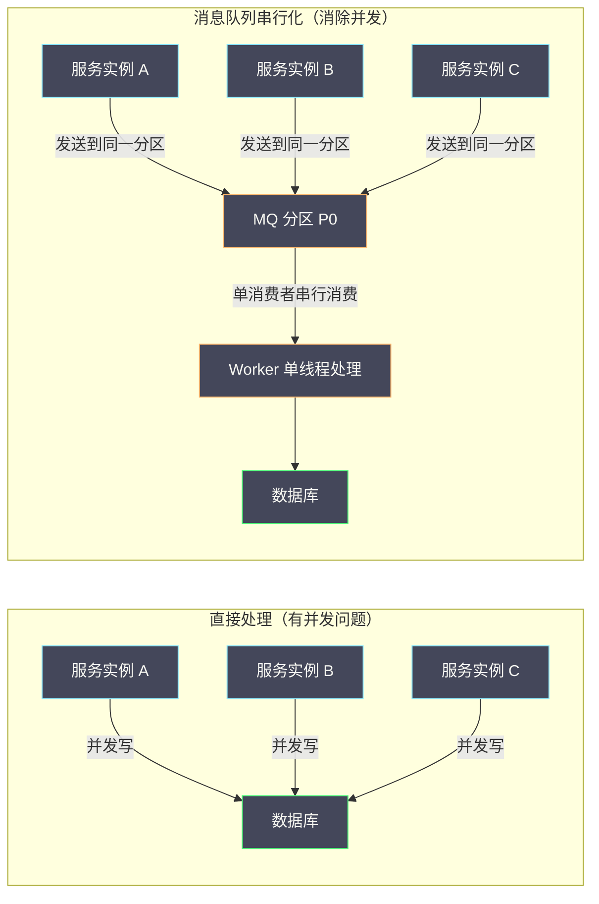
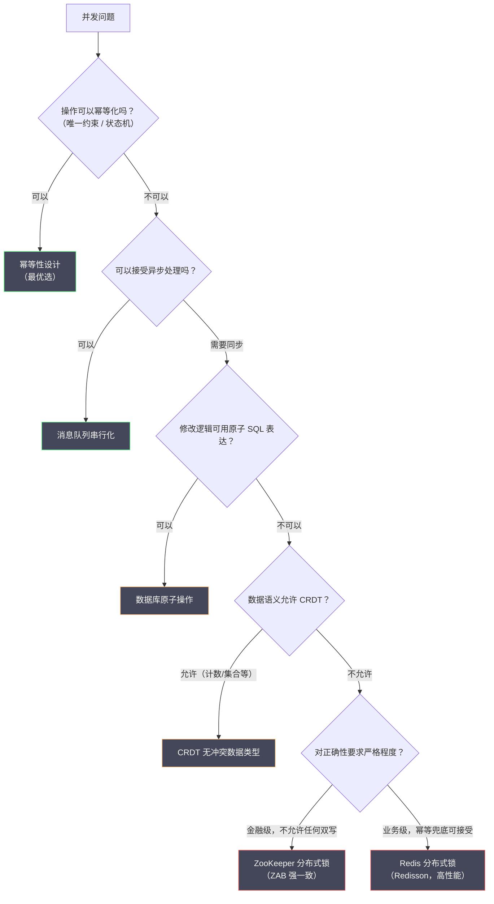

# 08 分布式锁的边界与替代方案

**摘要：**

历经七篇文章的深度剖析，我们已经全面掌握了分布式锁的原理与工程实践。本篇是专栏的收官之作，也是最需要"第一性原理"思考的一篇：**分布式锁并非解决并发问题的万能药**，它有明确的适用边界，越过这条边界使用锁不仅无效，甚至会带来新的问题。本文首先厘清分布式锁能解决和不能解决的问题，随后深入分析四类主流的替代方案——数据库原子操作、幂等性设计、消息队列串行化、以及 CRDT 无冲突数据类型——从原理到工程实践，帮助读者在面对并发问题时能够选择"最合适的工具"，而不是把锁当成"唯一的锤子"。最后给出一张贯穿整个专栏的认知地图。读完本文，你应当能回答两个问题：什么时候不该用锁，以及不用锁时该怎么办。

---

## 第 1 章 分布式锁能解决什么，不能解决什么

### 1.1 重新审视分布式锁的本质

在深入讨论替代方案之前，需要先明确一个核心命题：**分布式锁的本质是"将并发操作串行化"**。它通过让多个并发请求排队执行来避免竞争条件，代价是牺牲了并发度（吞吐量下降）和可用性（锁服务故障时业务中断）。

这意味着，**每次使用分布式锁都是在做一个权衡：以并发度换取安全性**。在这个权衡值得的场景下，锁是正确的工具；在这个权衡不值得的场景下（串行化代价过大，或者根本不需要串行化），应该寻找更合适的替代方案。

这里可以打一个比方：分布式锁像一条"单车道"——它保证不会有两辆车同时通过，代价是车辆必须排队。**如果这条路本来就不堵（冲突少），修一条单车道是浪费；如果这条路车流量巨大（高并发），单车道会变成瓶颈**。因此，用锁之前先问一句："这条路上真的有会撞车的车吗？"

### 1.2 分布式锁能解决的问题

**场景一，防止同一逻辑执行多次（幂等保护）**。定时任务、消息消费、事件处理等场景，需要保证同一任务在同一时刻只被一个节点执行：

```
多节点部署的定时任务：凌晨 2 点触发全量数据同步
→ 所有节点都会收到触发信号
→ 用分布式锁保证只有一个节点真正执行同步
```

**场景二，保护临界资源的原子读改写**。当业务逻辑必须是"先读，再根据读取结果修改"，且这两步之间不能有其他操作插入时：

```
库存扣减的正确流程：
1. 读取当前库存 stock = 10
2. 判断 stock > quantity（10 > 1，可以扣减）
3. 写入新库存 stock = 9

问题：步骤 1 和步骤 3 之间，其他请求可能已经修改了 stock
→ 用分布式锁保护整个"读-判断-写"的原子性
```

**场景三，控制并发度（限流）**。通过信号量类型的原语，控制某个操作的最大并发数：

```
对外部 API 的调用限制：最多同时 10 个并发请求
→ 使用分布式信号量限制并发
```

这三个场景的共性，是"需要一段跨越多次操作的排他性"——而锁恰好提供了这个能力。

### 1.3 分布式锁不能解决的问题

**问题一，分布式锁无法解决"锁范围外"的并发问题**。分布式锁只保护持锁期间的操作。如果临界区外有并发操作与临界区内的操作存在数据依赖，锁无法解决：

```
错误地以为锁能解决的场景：
步骤 1（锁外）：查询用户余额 = 1000
步骤 2（锁外）：判断余额 >= 消费金额 500
步骤 3（加锁）：扣减余额：UPDATE balance SET amount = amount - 500 WHERE user_id = 'U001'

问题：步骤 1 和步骤 2 在锁外执行，两个请求可能都通过了余额检查，都进入步骤 3
→ 锁只防止了步骤 3 的并发执行，但无法防止基于"过时余额判断"的错误决策
```

正确做法是把步骤 1 到 3 全部放在锁的保护范围内（或使用数据库原子操作替代）。**这个反例揭示了一个关键认知：锁只保护"锁内的操作"，它无法为"锁外的判断"负责**。

**问题二，分布式锁无法弥补"不支持原子操作的存储系统"**。如果锁保护的临界区操作本身不是原子的（例如更新了 A 系统后、还没更新 B 系统时崩溃），锁结束后系统可能处于不一致状态，而锁对此无能为力：

```
场景：转账操作
1. 加锁
2. 扣减 A 账户：-500
3. [此处崩溃]
4. 增加 B 账户：+500（永远不会执行）
5. 解锁

→ A 账户已扣减，B 账户未增加，钱"消失"了
→ 分布式锁无法防止这种情况，需要分布式事务
```

**问题三，分布式锁不能代替业务层的数据一致性约束**。如 07 篇故障案例所述，Redis 锁可能因主从切换而短暂失效。在极端情况下，锁保护可能失效，此时业务数据的正确性只能依靠存储层面的约束（唯一索引、乐观锁）来保障。**分布式锁是"上层防护"，不是"最后防线"**。

这三个"不能"，恰好呼应了 01 篇提出的三大正确性要求：锁能提供"互斥"，但提供不了"跨系统原子性"，也提供不了"绝对可靠性"。**认清这些边界，是用好锁的前提**。

### 1.4 一个"锁误用"的典型清单

把常见的"锁误用"列成清单，便于自查。

**误用一，用锁实现分布式事务**。把"扣 A、加 B"用一把锁包起来，以为能保证原子性——但锁无法解决"扣了 A 之后崩溃"的问题，这需要分布式事务（见分布式事务专栏）。

**误用二，用锁保证消息顺序**。以为"谁先拿到锁谁先执行"就能保证处理顺序——但锁的获取顺序是随机的，不保证 FIFO（除非用公平锁），且不保证"后发的消息不会被先处理"。

**误用三，用锁实现限流**。用互斥锁模拟"最多 N 个并发"，需要拆成 N 把锁或引入计数器，既别扭又低效——应当用信号量。

**误用四，用锁保护"锁外的判断"**。如 1.3 节所述，把"读余额、判断、扣减"中的"判断"放在锁外，锁就保护不了它。

**误用五，用锁代替幂等**。以为"加了锁就不会重复执行"——但锁可能失效，重复执行依然可能发生，幂等才是最终防线。

**误用六，用锁做"跨系统协调"**。用一把 Redis 锁协调"数据库加外部 API"的原子性——但锁无法让外部 API 的回调变得原子，这超出了锁的能力。

这份清单的共同指向是：**锁只能做"互斥"这一件事**。凡是超出"互斥"的需求——原子性、顺序、限流、幂等、跨系统协调——都应当用对应的专门机制。**把锁当成"万能协调器"，是分布式系统里最常见的一类设计错误**。

---

## 第 2 章 替代方案一：数据库原子操作

### 2.1 为什么数据库原子操作往往比分布式锁更简单可靠

很多使用分布式锁的场景，其根本需求是"原子地修改数据库中的某个值"，而 SQL 本身就能表达这种原子性，无需额外的分布式锁：

```sql
-- 场景：库存扣减，防止超卖
-- 错误方案（需要分布式锁）：
-- 1. SELECT stock WHERE product_id = 'P001'
-- 2. 判断 stock >= quantity
-- 3. UPDATE stock = stock - quantity WHERE product_id = 'P001'

-- 正确方案（数据库原子操作，无需分布式锁）：
UPDATE inventory
SET stock = stock - 1
WHERE product_id = 'P001' AND stock >= 1;

-- 检查影响行数：
-- rows_affected = 1：扣减成功
-- rows_affected = 0：库存不足，无需分布式锁来防止超卖
```

这条 SQL 在数据库层面是原子的：`stock >= 1` 的检查和 `stock - 1` 的更新在同一个原子操作中完成，任何并发的请求要么看到修改前的值（检查失败），要么看到修改后的值，不存在"读到 1，写入 0，另一个也读到 1"的竞争窗口。

**这个方案的美妙之处在于：它把"检查"与"更新"合并成了一条语句，从而消除了它们之间的窗口**——这与 02 篇"从 SETNX 加 EXPIRE 到 SET NX PX"是同一个思路：**把多步操作合并为一个原子原语**。

### 2.2 数据库原子操作的适用范围

**适用**：修改同一数据库实例中的数据，且修改逻辑可以用单条 SQL 表达。

**不适用**：跨多个数据库实例的操作（分库场景）；需要"先读取、在应用层计算、再写入"的复杂逻辑；临界区操作不仅包含数据库写入，还包含其他操作（发消息、调 API 等）。

这三条"不适用"的共性是：**它们都超出了"单条 SQL 能表达的范围"**。一旦逻辑需要跨库、跨系统、或需要应用层计算，单条 SQL 的原子性就不够用了——此时才需要考虑锁或其他协调机制。

### 2.3 SELECT FOR UPDATE 与乐观锁的取舍

在复杂的"读-计算-写"场景下（无法用单条 SQL 完成），可以选择：

**悲观锁（SELECT FOR UPDATE）**：读取时立即加数据库行锁，阻止并发修改。适合写冲突概率高、需要及时感知冲突的场景。代价是持锁期间占用数据库连接，不适合长时间的操作。

**乐观锁（版本号 CAS）**：读取时不加锁，提交时用版本号检查是否有并发修改。适合读多写少、冲突概率低的场景。高冲突时大量重试会降低性能。

两者的本质差异在 05 篇已详细分析。关键决策点是：**如果业务操作耗时短（小于 100ms）且冲突概率高（如秒杀），用悲观锁；如果操作耗时可能较长，或冲突概率低（如普通配置修改），用乐观锁。**

### 2.4 数据库原子操作的一个延伸：唯一约束即"分布式锁"

数据库的原子性还有一个更巧妙的用法：**用唯一约束来充当"分布式锁"**。这一用法在 05 篇讨论过，这里从"替代方案"的角度再强调一次。

当"加锁"的目的仅仅是"防止重复执行"时，插入一条带唯一键的记录就能达到同样的效果——插入成功即"抢到了"，插入失败即"已被执行"。**唯一约束天然提供了"全局互斥"，且不需要引入任何额外的锁服务**。它比分布式锁更简单、更可靠，因为它把互斥建立在了"数据库的强一致"之上，而不是"锁服务的可靠"之上。

这个延伸再次说明：**很多"需要分布式锁"的场景，本质上需要的是"一次原子的、带唯一性的写入"**——而数据库天生就能提供这个能力。

### 2.5 一个"原子操作"的边界反例

原子操作很强，但它也有边界。一个常见的误用是：**把"跨多行、多表"的逻辑，硬塞进"看起来原子"的单条 SQL 里**。

例如，"转账"场景需要"扣 A 账户、加 B 账户"两步。有人会想用一条 SQL 完成：

```sql
-- 试图用一条 SQL 完成转账（错误）
UPDATE account
SET balance = CASE
    WHEN user_id = 'A' THEN balance - 500
    WHEN user_id = 'B' THEN balance + 500
END
WHERE user_id IN ('A', 'B') AND (user_id != 'A' OR balance >= 500);
```

这条 SQL 看起来是"原子的"，但它有一个致命问题：**`CASE` 的分支更新，无法保证"扣款成功"与"入账成功"是绑定的**。如果 WHERE 条件因为余额不足而只匹配到 B（不匹配 A），那么就会出现"只加了 B、没扣 A"的情况——钱凭空多出来。**数据库的"原子性"只保证"这条 SQL 要么全执行、要么全不执行"，不保证"业务逻辑的原子性"**。

正确的做法要么是用事务包住两条 SQL（本地事务的原子性），要么是用分布式事务处理跨库场景。**这个反例说明：数据库原子操作能替代的锁，仅限于"单条 SQL 能完整表达的业务语义"**；一旦业务语义需要"多个操作协同"，就需要事务或分布式事务，而不是"把逻辑硬塞进一条 SQL"。

**判断的方法很简单：这条 SQL 的"成功"是否等价于"业务逻辑的完成"？** 如果是，它就能替代锁；如果"SQL 成功"只是业务逻辑的一部分，那么它替代不了。**把"技术上的原子"与"业务上的原子"区分开，是使用原子操作的前提**。

### 2.6 一个延伸：数据库原子操作的"三个前提"

用"数据库原子操作"替代锁，有三个前提需要同时满足——把它们列清楚，能避免"误用"。

**前提一，"单库单表"**。**条件更新只能作用于"同一个数据库实例"**——**跨库、跨表的多步操作，无法用单条 SQL 表达**。

**前提二，"能表达完整业务语义"**。**这条 SQL 的"成功"必须等价于"业务逻辑的完成"**——**如果"SQL 成功"只是业务的一部分（如还需发消息），则它替代不了锁**。

**前提三，"数据库是唯一写入方"**。**如果有"其他写入路径"绕过这条 SQL（如另一个服务直接改这个字段），原子性就会被破坏**——**因此，必须保证"所有写入都走这条 SQL"**。

**这三个前提的共性是"它们都要求'逻辑被收敛到一处'"**——**收敛到一条 SQL、一个库、一条写入路径**。**不满足时，原子操作就会"失效"**。

**这条延伸的启示是**：**"用更轻的手段替代锁"是有条件的**——**条件不满足时，"替代"就会"埋下隐患"**。**因此，采用任何"替代方案"前，都要"验证它的前提是否满足"**——**这与本专栏"先看假设"的一贯方法论一致**。

---

## 第 3 章 替代方案二：幂等性设计

### 3.1 幂等性是什么，为什么它比锁更根本

**幂等性（Idempotency）**：一个操作执行一次和执行多次的效果相同。

```
幂等操作示例：
- HTTP GET 请求（读操作，不改变状态）
- DELETE 已经不存在的资源（第一次删除成功，第二次也"成功"，结果相同）
- SET 操作（无论执行多少次，最终状态相同）

非幂等操作示例：
- 银行转账 POST（每次执行都会转一次钱）
- 库存扣减（每次执行都会减一次库存）
- 发送邮件（每次执行都会发一封邮件）
```

**为什么幂等性比锁更根本？** 分布式锁解决并发问题的方式是"防止操作被并发执行"（串行化）；幂等性解决并发问题的方式是"让操作被多次执行也没有副作用"（容忍重复）。

幂等性更根本，因为它不依赖任何外部协调机制（Redis 或 ZooKeeper），不存在锁服务故障的风险，也没有锁竞争的性能损耗。**如果一个操作是幂等的，就完全不需要锁**。

这里可以打一个比方：锁的思路是"只让一个人来干这件事"，幂等的思路是"这件事干几次结果都一样，谁干都行"。**后者的适用范围更广，因为它不关心"谁在干、几个人在干"，只关心"结果对不对"**。

### 3.2 实现幂等性的核心技术：唯一约束加幂等 Token

**技术一，数据库唯一约束（最简单可靠的幂等手段）**：

```sql
-- 订单表增加幂等 key
CREATE TABLE orders (
    id             BIGINT NOT NULL AUTO_INCREMENT,
    idempotent_key VARCHAR(64) NOT NULL COMMENT '幂等 key（业务方生成，如 requestId）',
    user_id        BIGINT NOT NULL,
    product_id     VARCHAR(64) NOT NULL,
    amount         DECIMAL(10,2) NOT NULL,
    status         VARCHAR(32) NOT NULL DEFAULT 'PENDING',
    PRIMARY KEY (id),
    UNIQUE KEY uk_idempotent_key (idempotent_key)  -- 唯一约束
);
```

客户端在发起请求时生成一个全局唯一的 `idempotent_key`（通常是 UUID），服务端把它写入数据库。如果因网络重试导致重复请求，第二次插入会因唯一约束失败，直接查询第一次的结果返回给客户端——整个操作幂等，无需分布式锁。

```java
@Transactional
public OrderResult createOrder(CreateOrderRequest request) {
    // idempotent_key 由客户端在请求头中提供（通常是 UUID）
    String idempotentKey = request.getIdempotentKey();

    try {
        // 尝试插入订单（如果 idempotent_key 已存在，抛出唯一约束异常）
        Order order = buildOrder(request, idempotentKey);
        orderMapper.insert(order);
        // 执行后续业务逻辑（库存扣减、积分增加等）
        inventoryService.deduct(order);
        return OrderResult.success(order);

    } catch (DuplicateKeyException e) {
        // idempotent_key 已存在，说明是重复请求，查询已有结果返回
        Order existingOrder = orderMapper.selectByIdempotentKey(idempotentKey);
        return OrderResult.success(existingOrder);
    }
}
```

**这个方案的优雅之处**在于：完全不需要分布式锁。数据库的唯一约束本身就是一个"天然的分布式锁"——任何数量的并发请求，只有一个能成功插入，其余全部失败（在 `DuplicateKeyException` 中走查询已有结果的路径）。

**技术二，状态机幂等**：通过状态机约束操作的执行条件，使操作天然幂等：

```sql
-- 只有状态为 PENDING 的订单才能被支付，且支付成功后状态变为 PAID
UPDATE orders
SET status = 'PAID', paid_at = NOW()
WHERE order_id = 'O001'
  AND status = 'PENDING';  -- 状态机约束：只有 PENDING 的订单可以支付
-- rows_affected = 1：支付成功
-- rows_affected = 0：订单不是 PENDING 状态（已支付或已取消），幂等地"无操作"
```

无论这条 SQL 被执行多少次，结果都是相同的——第一次执行把订单从 PENDING 变为 PAID，后续所有执行都因 `status != 'PENDING'` 而影响 0 行，是幂等的。

### 3.3 幂等性的适用范围与限制

**适用**：单次业务操作（创建资源、修改状态）；可以为每次操作分配唯一 ID 的场景；数据库是唯一存储的场景（无跨系统操作）。

**不适用**：累积型操作（"每次调用增加积分 10 分"，无法简单幂等化，需要恰好一次语义）；跨系统的原子操作（需要分布式事务）；操作的幂等性依赖外部系统的状态（如第三方支付回调）。

这三条"不适用"的共同点是：**它们要么"每次执行都应当产生累加效果"，要么"依赖外部系统配合"**。前者与幂等性天然冲突（幂等要求"多次执行等于一次"，而累加要求"每次执行都生效"）；后者则超出了本系统的控制范围。**认清这两条边界，就知道幂等性能覆盖到哪、不能覆盖到哪**。

### 3.4 一个判断：能不能把操作"改造"成幂等的

幂等性的价值，不仅在于"用已有的幂等操作"，更在于"把非幂等操作改造为幂等"。

举几个改造的例子。**"增加积分"改造为"设置积分到某个目标值"**——前者是累加的、非幂等的，后者是设定的、幂等的（重复执行结果相同）。**"扣减库存"改造为"按订单号扣减"**——加上订单号作为唯一键，同一订单的重复扣减会被唯一约束拦下。**"发送通知"改造为"按消息 ID 去重后发送"**——用消息 ID 记录已发送，重复的跳过。

这些改造的共同思路是：**给操作加上一个"唯一标识"，让"重复执行"可以被识别并跳过**。这个唯一标识可以是订单号、请求 ID、消息 ID、事件 ID——关键在于它能唯一标识"这一次业务动作"。**把"改造幂等"作为一种常规的设计手段，能消除大量本来需要锁的场景**——这是本专栏最希望传递的一个实践习惯。

### 3.5 幂等与锁：不是替代而是互补

"用幂等代替锁"这个说法，容易让人误以为两者是二选一。更准确的理解是：**它们解决的是不同层面的问题，且常常需要并存**。

**锁解决的是"并发执行的互斥"**：它保证同一时刻只有一个执行者，从而避免并发冲突。**幂等解决的是"重复执行的后果"**：它保证即使同一个操作被执行多次，结果也一致。

两者的关系可以这样理解：**锁在"正常路径"上减少冲突，幂等在"异常路径"上容忍重复**。即使有了锁，也应当有幂等——因为锁会失效（主从切换、GC 停顿、误解锁），而失效的结果就是"重复执行"，此时只有幂等能兜住后果。

反过来，即使有了幂等，有时也仍需要锁——例如"防止并发创建"这类场景，幂等只能保证"重复创建不产生多余记录"，但如果业务要求"同一时刻只有一个创建者"（如生成全局唯一的序号），就还需要互斥。

因此，**正确的表述不是"用幂等代替锁"，而是"优先用幂等消除对锁的需求；当锁不可避免时，用幂等作为锁失效的兜底"**。这与本专栏的立场一致：**幂等是柔性协调的"入场券"与"最后防线"，无论用不用锁，它都值得有**。

---

## 第 4 章 替代方案三：消息队列串行化

### 4.1 核心思想：用单分区消费者天然串行化

当并发问题的根源是"多个节点同时处理同一资源的请求"时，可以通过**把请求发送到消息队列的同一分区（Partition），由单个消费者串行处理**来消除并发：



**关键设计是按竞争维度路由到同一分区**。并发问题的本质是"同一个竞争维度"（如同一用户、同一商品）的请求同时执行。把相同竞争维度的请求路由到同一 MQ 分区，就能保证这些请求被同一个消费者线程串行处理，天然消除竞争。

```java
// Kafka 生产者：按 userId 分区路由，确保同一用户的所有请求在同一分区
producer.send(new ProducerRecord<>(
    "order-events",      // topic
    userId,              // key（按 key 路由到固定分区）
    orderEventJson       // value
));

// Kafka 消费者：单线程消费，串行处理
@KafkaListener(topics = "order-events", groupId = "order-processor",
               concurrency = "1")  // 单线程消费，不并发
public void processOrderEvent(OrderEvent event) {
    // 这里的处理是串行的，同一个 userId 的事件按顺序到达
    orderService.process(event);
}
```

**这个方案与锁的关系很有意思：它用"分区"代替了"锁"**。锁是"谁先抢到谁执行"，队列是"按顺序依次执行"。两者都实现了串行化，但队列的串行化是"结构性的"（由分区与消费者数量决定），而不是"竞争性的"（由抢占决定）。**因此，队列方案不会有"饥饿"问题——每个请求都会被处理，只是有先后**。

### 4.2 消息队列串行化的优势

**优势一，天然的背压（Backpressure）**。当处理速度跟不上生产速度时，消息在队列中积压，请求方感知到延迟而自动降速。相比之下，分布式锁下大量请求堆积在锁等待队列中，可能导致线程或连接资源耗尽。

**优势二，操作可重放（Replayability）**。MQ 中的消息可以被重放。如果消费者处理失败，可以从 offset 重新消费，实现故障恢复。分布式锁的保护范围只在"锁内"，没有持久化的操作日志。

**优势三，削峰填谷**。生产端可以以任意速率发送请求，消费端以固定速率处理，MQ 起到缓冲作用，避免了高峰时的资源耗尽。

### 4.3 消息队列串行化的代价

**代价一，延迟增加**。请求不再被同步处理，而是异步放入队列，增加了处理延迟（通常从毫秒级增加到秒级甚至分钟级）。对于需要实时响应的场景（用户等待下单结果），这种延迟可能不可接受。

**代价二，架构复杂度增加**。引入 MQ 意味着需要处理消息持久化、消费者失败重试、消息顺序保证、消费幂等（防止重复消费）等一系列新问题。在原来用一把锁就能解决的场景，换成 MQ 可能需要多倍的代码量。

**代价三，最终一致性而非强一致性**。生产者发送消息后，消费者异步处理，两者之间存在时间差。在这段时间内，系统处于"中间状态"。对于需要强一致性的场景（如金融转账），纯 MQ 方案需要额外的状态机和补偿逻辑来保证最终一致性。

这三条代价的共同点是：**MQ 把"同步的、即时的互斥"换成了"异步的、延迟的串行"**。因此，它适合"可以异步化"的场景，不适合"必须即时得到结果"的场景。

### 4.4 适用场景判断

MQ 串行化适合以下场景：**操作可以异步化**（用户发起操作后，可以接受"稍后通知处理结果"，如异步下单、异步支付）；**处理速率需要控制**（如对第三方 API 的调用频率限制，通过 MQ 的消费速率来控制）；**需要操作可重放**（如事件溯源架构，所有操作都以事件形式持久化）；**流量削峰**（大促活动中，把秒杀请求放入 MQ，后端稳定地处理，避免数据库被瞬时压垮）。

### 4.5 MQ 串行化的一个实现细节：分区数

用 MQ 做串行化时，有一个参数直接决定了"串行化的粒度"：**分区数**。

消息队列保证的是"分区内有序、单消费者串行"，而不是"全局有序"。因此，分区数决定了"有多少个并行的串行通道"：分区数为 1 时，全局串行；分区数为 N 时，最多 N 路并行（每路内部串行）。

这个特性与锁的分片锁是同一个思想：**分区数就是"分片数"**。分区太少，串行化程度过高，吞吐上不去；分区太多，虽然并行度提高，但"同一竞争维度"的请求如果被分到了不同分区，就失去了串行保证。

因此，**分区数应当与"竞争维度"对齐**：如果按 userId 路由，那么分区数决定了"最多多少个用户能并行处理"。这里的关键是：**同一个竞争维度（同一 userId）必须落在同一个分区**——而这一般由"按 key 哈希路由"自动保证。

这个细节提醒我们：**MQ 串行化不是"把消息扔进队列就完事"，它同样需要"设计竞争维度与并行度"**——这与锁的粒度设计是同一类问题，只是换了实现手段。**理解这一点，就能看出"锁"与"队列"在"串行化"这个本质上的相通之处**。

---

## 第 5 章 替代方案四：CRDT 无冲突数据类型

### 5.1 CRDT 是什么

**CRDT（Conflict-free Replicated Data Type，无冲突复制数据类型）** 是一类特殊设计的数据结构，它们允许多个节点并发地修改数据的副本，而无需协调（无需分布式锁），最终所有副本通过合并（Merge）操作自动收敛到相同的状态。

CRDT 的核心思想是：**通过精心设计数据结构和合并规则，让并发修改本质上不冲突**——不是"防止并发修改"（锁的思路），而是"让并发修改可以被正确合并"。

**一个最简单的 CRDT 例子：G-Counter（仅增计数器）**。假设三个节点各自维护一个计数器，并发地对计数器执行 `increment` 操作：

```
节点 A：本地计数 = 3（A 执行了 3 次 increment）
节点 B：本地计数 = 2（B 执行了 2 次 increment）
节点 C：本地计数 = 5（C 执行了 5 次 increment）

合并规则：全局计数 = 所有节点本地计数之和 = 3 + 2 + 5 = 10
```

每个节点只能增加自己的本地计数，合并时取各节点的最大值（因为本地计数单调递增，取最大值等于取最新值）。这样，无论多少节点并发地执行 `increment`，最终合并结果都是正确的——无需任何协调，无需任何锁。

**G-Counter 的思路，与"分片"有异曲同工之妙**：它把"一个全局计数器"拆成了"每个节点各自的计数器"，从而消除了对"全局计数器"的争抢。**这与 07 篇的分片锁是同一个思想的两种应用**——都是"用拆解消除热点"。

### 5.2 常见 CRDT 类型及其应用

**G-Counter（仅增计数器）**：每个节点维护自己的计数，合并时求和。应用场景是页面访问量统计、点赞计数（允许最终一致）。

**PN-Counter（可增可减计数器）**：维护两个 G-Counter（P 计数器用于增，N 计数器用于减），最终值等于 P 减 N。应用场景是库存计数（最终一致性），注意 PN-Counter 无法防止库存变负（需要业务层约束）。

**LWW-Register（最后写入者胜寄存器，Last-Write-Wins）**：每个写入带有时间戳，合并时取时间戳最大的值。应用场景是用户 Profile 更新（最后一次修改生效，允许覆盖）。

**OR-Set（可添加可删除集合，Observed-Remove Set）**：支持并发添加和删除元素，使用 Tag 标识每次添加，删除时只删除已观察到的 Tag。应用场景是购物车（允许并发添加或删除商品，最终合并）。

**MV-Register（多版本寄存器）**：保留所有并发写入的版本，由应用层解决冲突（如询问用户选择哪个版本）。应用场景是文档协作、云盘的冲突处理。

### 5.3 CRDT 的局限性

CRDT 并非万能——它只适用于数据语义上"允许并发修改、且可以被合并"的场景。

**无法解决"需要协调"的操作**。某些操作本质上需要全局协调，无法用 CRDT 表达。例如：**唯一 ID 分配**（两个节点并发地想分配"最小可用 ID"，不能各自计算，必须协调）；**转账操作**（需要"A 账户减少加 B 账户增加"的原子性，CRDT 无法保证跨账户的一致性）；**库存精确控制**（PN-Counter 可以统计库存，但无法保证库存不变负）。

**实现复杂度高**。正确实现 CRDT 需要深入理解分布式系统理论，错误的实现会导致数据不一致。生产环境通常依赖经过验证的 CRDT 库。

> [!warning] CRDT 的边界与"锁"的边界是互补的
> 有意思的是，CRDT 无法解决的问题，恰好是锁擅长的问题：**CRDT 处理不了"需要协调"的操作（如唯一 ID 分配、转账），而这些恰恰需要锁或原子操作**。反过来，锁处理不好"高频并发修改同一数据"的场景（竞争激烈），而这恰恰是 CRDT 的强项。
>
> 因此，**CRDT 与锁不是"替代"关系，而是"互补"关系**：数据语义允许合并的，用 CRDT；数据语义需要协调的，用锁或原子操作。**判断的依据，仍然是"数据的语义"**——这与本专栏一贯的立场一致：**技术方案的选择，最终取决于业务对数据的语义要求**。

### 5.4 一个 CRDT 的落地考虑

CRDT 从理论到落地，有几处工程细节值得留意。

**其一，语义匹配是第一步，也是最难的一步**。CRDT 有多种类型（G-Counter、PN-Counter、LWW-Register、OR-Set 等），每种对应一种"并发语义"。选错了类型，就会得到错误的合并结果。例如，用 LWW-Register 表达"购物车"（最后写入者胜）会导致"并发添加的商品被覆盖丢失"；正确的选择是 OR-Set（可并发添加删除）。**因此，落地 CRDT 的第一件事，是搞清楚"业务需要哪种并发语义"**。

**其二，合并操作必须满足数学性质**。CRDT 之所以能"无冲突合并"，前提是合并操作满足交换律、结合律、幂等律。这些性质保证了"无论副本以什么顺序、合并多少次，最终结果一致"。**实现 CRDT 时，必须验证合并函数确实满足这三条性质**——否则"无冲突"的前提就不成立。

**其三，删除会留下墓碑（Tombstone）**。为了正确处理"并发添加与删除"，CRDT 通常需要保留已删除元素的标记（墓碑）。这会导致存储持续增长，需要配套的"墓碑回收"机制——而墓碑回收又必须谨慎，避免"已删除的元素因墓碑被清理而复活"。**"删除"在 CRDT 里不是简单地把元素抹掉，而是一个需要精心设计的操作**。

**其四，与现有存储的集成**。多数团队不会从零实现 CRDT，而是使用支持 CRDT 的存储（如某些分布式数据库）。因此，落地 CRDT 往往意味着"更换或引入一个存储系统"，这个成本需要纳入评估。

这四点合起来说明：**CRDT 的"无协调"是有代价的——代价在于"数据模型的设计难度"与"存储的运维复杂度"**。它适合"数据语义天然可合并"且"团队有能力驾驭"的场景，不适合"为了追求高性能而勉强套用"的场景。**技术选型的判断依据，始终是"业务语义是否匹配"，而非"技术是否先进"**——这也是本专栏贯穿始终的立场。

---

## 第 6 章 如何选择：分布式锁与替代方案的决策框架

### 6.1 先问问题，再选工具

在选择技术方案之前，应该先回答以下问题。

**问题一，操作能否被设计为幂等的？** 如果可以（通过唯一约束加幂等 Token），优先考虑幂等性方案——这是最简单、最可靠的解决方案，完全不依赖外部协调。

**问题二，是否可以接受异步处理？** 如果业务允许异步（用户不需要实时等待结果），消息队列串行化通常比分布式锁更优雅——避免了锁竞争、提供了天然削峰、且操作可重放。

**问题三，数据修改逻辑是否可以用原子 SQL 表达？** 如果可以（简单的"条件更新"操作），直接用数据库原子操作，不需要任何外部锁——SQL 本身就是原子的，数据库是所有服务共享的协调者。

**问题四，数据的语义是否允许并发修改后合并？** 如果可以（计数器、集合、最后写胜等场景），考虑 CRDT 方案——完全去中心化，无需协调，最高并发度。

**问题五，以上方案均不适用？** 只有在以上所有方案都无法满足需求时，才真正需要分布式锁。

这五问的顺序很重要：**它把"用哪种锁"这个容易纠结的问题，转化为"能不能不用锁"这个更有价值的问题**。**在绝大多数场景里，前四问中的某一问会给出肯定答案**——而只要有一个肯定，就说明不需要锁。

### 6.2 决策树



### 6.3 综合对比

| 方案 | 并发度 | 实现复杂度 | 依赖组件 | 正确性保证 | 适用场景 |
| :--- | :--- | :--- | :--- | :--- | :--- |
| **幂等性设计** | 最高（无竞争）| 低 | 仅数据库 | 强（DB 唯一约束）| 创建类操作、状态机流转 |
| **数据库原子操作** | 高 | 低 | 仅数据库 | 强（单 DB 原子）| 简单的条件更新操作 |
| **MQ 串行化** | 中（单消费者）| 中 | 消息队列 | 最终一致 | 异步处理、削峰填谷 |
| **CRDT** | 最高（无协调）| 高 | 取决于实现 | 强（CRDT 语义内）| 计数、集合、最终一致场景 |
| **Redis 分布式锁** | 中 | 低（Redisson）| Redis | 中（主从切换有窗口）| 高并发、业务级正确性 |
| **ZooKeeper 分布式锁** | 低 | 中（Curator）| ZooKeeper | 强（ZAB 一致）| 低并发、金融级正确性 |

这张表最值得注意的一行是"依赖组件"。**前四行方案都"不需要额外的锁服务"**——幂等与原子 SQL 只需要数据库，CRDT 甚至不需要协调服务。**它们之所以能替代锁，是因为它们把"协调"这件事，从"运行时"转移到了"设计时"**：幂等性靠"唯一标识"在设计中消除重复，原子 SQL 靠"条件语句"在数据库层消除竞争。**把问题在设计阶段解决，永远比在运行时用锁协调更可靠**。

### 6.4 一个"审查已有锁"的实践

除了"决定要不要用锁"，还有一个很实用的实践：**定期审查系统里已有的锁**。

系统演进后，很多当初引入的锁可能已经不再需要。例如：某个服务从多实例部署改成了单实例（此时单机锁就够）；某个接口加了幂等约束（此时锁可能冗余）；某个操作被拆到了不同的服务（此时锁的范围可能已经失效）。

审查的方法是：对每一把锁，问三个问题——**它保护的临界区里，真正需要互斥的操作是什么？这个互斥能否用更轻的手段实现？如果去掉这把锁，最坏会发生什么？** 如果第三个问题的答案是"有唯一约束兜底，不会出错"，那么这把锁很可能可以去掉。

**这个审查的价值，往往超过"引入新锁"的收益**——因为每一把锁都是一份持续的成本（竞争、延迟、运维、失效风险），而减少一把锁，就减少一份成本。**"减法"在分布式系统里，常常比"加法"更值得做**。

### 6.5 一个"从锁迁移到幂等"的案例

看一个真实的迁移案例，能更直观地体会"减法"的价值。

某系统的"支付回调处理"最初用 Redis 锁保护——收到回调后先加锁，处理完再解锁，防止同一笔支付被重复处理。上线后运行良好，但随着支付量增长，问题逐渐显现：高峰期 Redis 锁的等待时间上升，回调处理出现延迟；偶尔还会因为锁的 TTL 与处理时间不匹配，出现"重复处理"的工单。

团队重新审视后，发现这个场景其实**根本不需要锁**：支付回调天然携带"支付流水号"，而"同一流水号只处理一次"正是幂等的定义。于是他们把方案改为：用"支付流水号"作为唯一键，处理前先 `INSERT` 一条"处理记录"（唯一约束），插入成功则处理，插入失败则说明已处理过、直接返回。

改造后，Redis 锁被彻底移除。效果是：**不再有锁等待，回调处理延迟下降；不再有"锁失效导致重复"的风险，因为唯一约束比锁更可靠；系统还少了一个对 Redis 的依赖**。

这个案例的价值在于，它完整演示了本专栏的核心主张：**很多"需要锁"的场景，本质上需要的是一次"原子的、带唯一性的写入"**。把这类场景识别出来、迁移到幂等方案，能同时获得"更高性能"与"更高可靠性"——**这不是"用一个方案换另一个方案"，而是"用一个更根本的方案消除了问题"**。

**识别这类场景的方法很简单：问一句"这个操作有没有一个天然的唯一标识（订单号、流水号、请求 ID）？"** 如果有，那么它大概率可以用幂等替代锁。**把这个问题作为引入锁之前的必经一问，能省掉大量的锁**——这也是本专栏留给读者的最后一个实践建议。

---

## 第 7 章 专栏总结：分布式锁的认知地图

### 7.1 核心知识体系回顾

历经八篇文章，我们构建了一个完整的分布式锁知识体系。

**理论基础（第 01 篇）**：分布式锁的三大正确性要求（互斥性、无死锁、容错性）；单机锁无法在分布式场景工作的根本原因（共享内存假设失效）；GC 停顿和时钟漂移是分布式锁的深层挑战。

**Redis 锁的工程演进（第 02 篇）**：从 `SETNX + EXPIRE` 到 `SET NX PX`（原子化加锁）；Lua 脚本解锁（原子化"校验加删除"）；看门狗自动续期（解决 TTL 与业务时间的矛盾）；Redisson 可重入锁（Hash 结构加重入计数）。

**Redlock 争议（第 03 篇）**：Redlock 解决了主从切换的数据丢失问题；Kleppmann 指出时钟跳变和 GC 停顿让 Redlock 不安全；Antirez 认为在合理运维条件下 Redlock 足够安全；实践建议是大多数场景用单节点 Redis 加幂等兜底。

**ZooKeeper 锁（第 04 篇）**：ZAB 协议保证写操作强一致，主从切换无数据丢失；临时顺序节点加 Watch 前驱节点，实现天然公平锁且无羊群效应；Session 超时机制比 Redis TTL 更鲁棒；Apache Curator 是生产级 ZK 锁封装。

**数据库锁（第 05 篇）**：唯一索引简单但需应用层定时清理；`SELECT FOR UPDATE` 与事务绑定，必须走索引；乐观锁在低冲突场景高性能，高冲突时重试风暴；MySQL 命名锁是被低估的内置方案。

**设计维度（第 06 篇）**：性能上 Redis 优于 ZK 优于 DB（根本原因是内存、网络同步、磁盘 I/O 的差异）；公平性上 ZK 天然公平，Redis 需额外实现；可重入上 Redis 用 Hash 计数、Curator 用本地计数；超时上 `waitTime` 与 `leaseTime` 是两个独立的参数。

**生产实践（第 07 篇）**：锁粒度以竞争维度为准，采用层次化 key 命名；加锁失败要区分"竞争失败"与"系统故障"；监控等待时间 P99、持有时间 P99、加锁成功率；典型故障包括 Redis 主从切换超卖、GC 停顿锁过期、锁泄漏、ZK 羊群效应、误解锁、锁风暴。

**边界与替代（本篇）**：幂等性设计是最优先考虑的替代方案；数据库原子操作是简单场景的最简方案；MQ 串行化适合异步场景；CRDT 适合特定数据语义。

### 7.2 一个工程师的心智模型

在真实的工程环境中，面对每一个"需要分布式锁"的需求，应该用以下心智模型来思考：

```
第一步：这真的需要"锁"吗？
  → 能用幂等性解决吗？（最优先）
  → 能用数据库原子操作解决吗？
  → 能异步化，用 MQ 串行化吗？
  → 数据语义允许 CRDT 吗？
  → 如果以上都不行，才考虑分布式锁

第二步：如果确实需要锁，选哪种？
  → 高并发 + 业务级正确性 + 已有 Redis → Redisson Redis 锁
  → 低并发 + 强一致要求 + 金融场景 → Curator ZooKeeper 锁
  → 低频操作 + 无额外组件 → 数据库锁（唯一索引或 SELECT FOR UPDATE）

第三步：加上幂等性保护作为最后防线
  → 无论用哪种锁，数据库层面都应该有约束（唯一索引或乐观锁）
  → 锁是"上层防护"，不是"唯一保障"

第四步：监控 + 告警 + 定期审查
  → 锁的等待时间和持有时间是重要的性能指标
  → 定期审查锁的必要性：系统演进后，某些锁可能已经不再需要
```

> [!note] 最后的设计哲学
> 分布式锁是分布式系统中的一个协调原语，它把分布式系统"无共享内存"的世界变成了"有共享状态"的世界。这个转变是有代价的——性能损耗、可用性降低、实现复杂度上升。
>
> 最好的分布式锁，是你**不需要使用的那把锁**。当业务设计足够合理（幂等性、原子操作），系统架构足够清晰（职责单一、避免跨服务共享状态），很多"需要锁"的场景会自然消失。
>
> 当锁真的不可避免时，选择你完全理解的、最简单的方案，并为它的失效场景做好兜底准备。

### 7.3 三条贯穿全专栏的判断

把八篇的内容最终收敛，可以留下三条判断。

**判断一，锁是"减少冲突"的工具，不是"保证正确"的银弹**。正确性的最终防线应当在服务端（唯一约束、版本号、栅栏令牌）。这一条从 01 篇提出，到 03 篇被辩论印证，到 07 篇被故障复盘强化，贯穿始终。

**判断二，能用更轻的手段解决的，就不要用锁**。数据库原子操作、幂等性、队列串行化、CRDT——它们都比锁更轻、更可靠。**用锁之前，先把这些"更轻的手段"过一遍**。

**判断三，锁的可靠性取决于"围绕锁的整套工程设计"**。粒度、兜底、监控、降级——缺一不可。**一把配置正确的锁，如果粒度错了、没有兜底、没有监控，依然会在生产中出事**。

这三条判断，不是关于"某种锁怎么用"，而是关于"如何看待并发控制这件事"。**掌握了这个视角，面对任何新的并发难题，都能先问对问题、再选对工具**——这比记住任何具体方案，价值都更持久。至此，本专栏的全部内容告一段落。

### 7.4 一个延伸：从本专栏到分布式系统原理

读到这里，如果还意犹未尽，可以顺着两条线索继续深入。

**第一条线索，向"原理"延伸**。本专栏讨论的很多问题，根子上都是分布式系统的基本问题：为什么"锁可能失效"？因为失败检测器无法区分"慢"与"死"；为什么"栅栏令牌有效"？因为多数派保证单调序列；为什么"Redlock 有争议"？因为它的故障假设比共识协议更脆弱。这些问题在"分布式系统原理与协议"专栏里有更系统的回答——**理解了原理，再看锁的各种方案，就能看出它们各自在"借用"哪一个原理**。

**第二条线索，向"工程"延伸**。本专栏的很多结论，与"分布式事务"专栏高度呼应：都强调"优先消除问题而非解决问题"、都强调"正确性靠服务端兜底"、都强调"复杂性只会转移不会消失"。**把两个专栏对照着读，会发现它们共享同一套方法论**——而这套方法论，正是应对一切分布式难题的通用工具。

**最后，把本专栏的立场再重申一次**：分布式锁是分布式系统中一个有用的原语，但它不是万能的。**理解它的边界，比掌握它的用法更重要；知道什么时候不用它，比知道怎么用它更难得**。希望读者读完之后，在面对"要不要加把锁"这个问题时，能先停下来问一句"真的需要吗"，而不是条件反射地加上一把。**这一个停顿，往往就能省掉后面一连串的麻烦**。

### 9.4 一个延伸：从"锁"到"无锁"的演进路径

如果把本专栏的八篇看作一条"认知演进线"，可以看到一条"从用锁到不用锁"的路径——把它梳理出来，作为全专栏的收束。

**第一步，"用锁"**（01 到 06 篇）。**先学会"怎么正确地用锁"**——理解三大要求、掌握三种实现、处理性能与公平性。

**第二步，"用好锁"**（07 篇）。**再学会"在生产中把锁用对"**——粒度、降级、监控、复盘。

**第三步，"少用锁"**（08 篇）。**最后学会"用更轻的手段替代锁"**——数据库原子操作、幂等、队列、CRDT。

**这三步的演进方向是"从'依赖锁'到'减少锁'"**。**它的底层逻辑是"锁是一份持续的成本，能不用就不用"**——**这与本专栏"最好的锁是不需要使用的锁"完全一致**。

**这条演进线的价值在于**：**它把"学习分布式锁"变成了"一条有方向的路径"**——**不是"学完所有锁的实现"，而是"从'会用'走到'不用'"**。**这也呼应了本专栏的期望：教的不只是"怎么用锁"，更是"怎么少用锁"**。

**这条延伸的启示是**：**"掌握一个工具"的最高境界，是"知道什么时候不用它"**。**这与 02 篇"CAP 是思维工具不是分类标签"、10 篇"理解原理比记住结论更有价值"是同一种取向**——**技术学习的终点，不是"会用"，而是"会判断"**。

---

## 参考资料

1. Helland, P. (2007). Life beyond Distributed Transactions: an Apostate's Opinion. *CIDR 2007*.
2. Shapiro, M., Preguiça, N., Baquero, C., & Zawirski, M. (2011). Conflict-Free Replicated Data Types. *SSS 2011*.
3. Bailis, P., & Ghodsi, A. (2013). Eventual Consistency Today: Limitations, Extensions, and Beyond. *ACM Queue, 11*(3).
4. Kleppmann, M. (2017). *Designing Data-Intensive Applications*. O'Reilly Media. Chapter 12: The Future of Data Systems.
5. Vogels, W. (2009). Eventually Consistent. *Communications of the ACM, 52*(1), 40–44.
6. Richardson, C. (2018). *Microservices Patterns*. Manning Publications. Chapter 4: Managing transactions with sagas.
7. Vernon, V. (2013). *Implementing Domain-Driven Design*. Addison-Wesley. Chapter 7: Event-Driven Architecture.

---

> [!note] 思考题
> 1. 数据库原子操作把"检查与更新"合并成一条 SQL，从而消除了窗口。请说明它与"用分布式锁保护读-判断-写"在正确性与性能上的差异，以及它为什么"不需要锁"。
> 2. 幂等性设计让"重复执行不产生副作用"。请针对"防止用户重复领取优惠券"这一场景，分别给出"用锁"与"用幂等"两种方案，并比较它们的复杂度与可靠性。
> 3. 文中提出"最好的分布式锁是不需要使用的锁"。请回顾你熟悉的一个系统，找出其中一把"可能可以去掉的锁"，并说明去掉它之后需要补上什么兜底。
