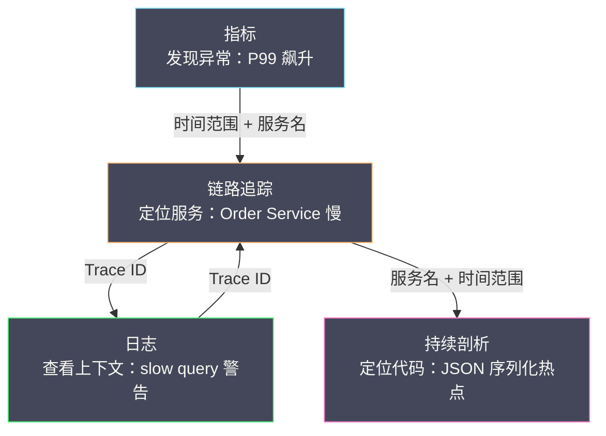

# 00 可观测性全景导览

**摘要：**

可观测性（Observability）是分布式系统工程中**从"被动救火"转向"主动洞察"**的关键能力。它不是某个单一工具，而是由四种互补的观测信号——**指标（Metrics）**、**日志（Logs）**、**链路追踪（Traces）**、**持续剖析（Continuous Profiling）**——共同构建的体系，再加上一层把数据变成决策的 **AIOps 与平台工程**。本文作为整个可观测性系列的总纲，系统梳理四种信号各自回答什么问题、彼此如何协作，给出本系列**五个子专栏**的完整结构与阅读路径，并说明现网技术栈的主线（VictoriaMetrics 存指标、Grafana Loki 存日志、SkyWalking 做追踪、夜莺做告警聚合）。读完之后，你应当能回答两个问题：**四种信号各自的分工是什么，以及这个系列该按什么顺序读**。

---

## 第 1 章 什么是可观测性

### 1.1 从"监控"到"可观测性"的认知升级

**监控（Monitoring）** 是一个已有数十年历史的概念：预先定义好"关注什么"（CPU 使用率、内存占用、错误率），然后采集数据、设置阈值、触发告警。监控的核心假设是：**你能提前预知所有可能的故障模式**。

在单体应用时代，这个假设基本成立——系统结构简单、故障模式有限，运维团队可以枚举大多数故障场景并设置对应的告警规则。但在微服务与云原生时代，这个假设被彻底打破：**调用链路指数级增长**（一个请求可能经过 20 多个服务）、**故障模式不可预知**（网络抖动、GC 停顿、线程池耗尽、慢查询、第三方超时，组合方式近乎无穷）、**环境高度动态**（容器编排随时在创建、销毁、迁移 Pod）。

**可观测性（Observability）** 的核心理念与监控不同：**它不要求你提前知道会出什么问题，而是让你在问题发生后，能够通过系统的外部输出快速推断出系统内部发生了什么**。

用一个类比：**监控是"在门口装了摄像头，盯着已知的可疑位置"；可观测性是"给整栋楼装满了传感器，任何异常都能被追溯到源头"**。

### 1.2 可观测性的形式化定义

可观测性这个词源自控制论（Control Theory）：一个系统是"可观测的"，当且仅当你能**仅通过系统的外部输出**推断出系统的**任意内部状态**。

映射到软件工程：一个分布式系统具有良好的可观测性，意味着——当线上出现任何异常（延迟升高、错误率增加、用户投诉），工程师能够**不登录服务器、不添加新日志、不重新部署代码**，仅通过已有的观测数据快速定位到根因。

**"不改代码就能回答新问题"，是判断一个系统是否"真正可观测"的唯一标准**——这也是它与"监控"的分界线。

---

## 第 2 章 四种信号：各自解决什么问题

### 2.1 指标：回答"系统现在怎么样"

**指标**是**聚合的、数值型的时间序列数据**——某个度量值随时间的变化曲线。它解决的核心问题是：系统当前的健康状态如何、趋势是好转还是恶化、是否需要扩容。

它的特点是**存储开销极小**（一个指标每 15 秒采一个点，一天 5760 个点，占几十 KB）、**查询极快**（时序数据库对时间范围查询做了极致优化）、**天然支持聚合**（P99、错误率、QPS 都是指标的典型表达），但**不携带上下文**——指标告诉你"错误率升高了"，却不告诉你"是哪个请求出了错"。

典型场景是**实时大盘、告警规则、容量规划、SLO 度量**。代表产品有 Prometheus、VictoriaMetrics、Thanos、Grafana Mimir。

### 2.2 日志：回答"发生了什么事"

**日志**是**离散的、文本型的事件记录**——系统在某个时刻发生了什么。它解决的核心问题是：在某个具体时间点，系统内部发生了什么事件、错误的具体信息是什么。

它的特点是**信息最丰富**（可包含任意上下文：请求参数、用户 ID、异常堆栈、SQL 语句）、**存储开销最大**（中等规模集群每天可能产生 TB 级日志）、**查询相对慢**（全文搜索比时间序列查询慢几个数量级），并经历了从非结构化文本到结构化 JSON 的演进。

典型场景是**错误排查、审计合规、安全分析、业务分析**。代表产品有 Elasticsearch（ELK）、Grafana Loki、Splunk、Fluentd、Vector。

### 2.3 链路追踪：回答"请求在哪里慢了"

**链路追踪**是**跨服务的、请求级别的调用链路记录**——一个请求从进入系统到返回，经过了哪些服务、每个服务花了多久。它解决的核心问题是：一个具体请求的延迟瓶颈在哪个服务、调用链中哪个环节出了错。

它的特点是**请求粒度**（每条 Trace 对应一个完整请求）、**跨服务关联**（通过 Trace ID 把分散的 Span 串成调用树）、**因果清晰**（父子 Span 天然表达"谁调用了谁"），而**采样是必须的**（全量链路数据量巨大，生产环境通常只采 1% 到 10%）。

典型场景是**延迟分析、错误定位、依赖拓扑发现、容量规划**。代表产品有 Apache SkyWalking、Jaeger、Zipkin、Grafana Tempo，以及作为标准的 OpenTelemetry。

### 2.4 持续剖析：回答"代码哪里慢了"

**持续剖析**是**代码级别的、资源消耗的采样分析**——在生产环境中持续采样，定位到具体的函数与代码行。它解决的核心问题是：已经知道某个服务慢（通过指标与追踪定位到），但具体是哪段代码消耗了最多的 CPU、内存或锁等待。

它的特点是**代码级精度**（可精确到函数）、**低开销采样**（现代剖析器开销通常小于 1%）、**直观的可视化**（火焰图），并**弥补了链路追踪的"最后一公里"**——追踪定位到"哪个服务慢"，剖析定位到"哪行代码慢"。

典型场景是**CPU 热点、内存泄漏、锁竞争、GC 压力**分析。代表产品有 Pyroscope、Parca、async-profiler、JFR、SkyWalking 内置剖析。

### 2.5 为什么是"四种"而不是"三种"

业界常说"可观测性三大支柱"——指标、日志、追踪。本系列把**持续剖析**单列为第四种，原因在于它的两个"不同"：**其一是粒度不同**（前三者的观测粒度是"服务与请求"，剖析的粒度是"代码行"）；**其二是触发方式不同**（前三者是"持续采集、事后查询"，剖析常常是"按需触发"或"低开销持续采样"）。这两个不同，使它无法被简单归入前三者。

不过，**把信号分成几种并不重要，重要的是它们能否联动**。一个"四种信号俱全、但彼此不通"的体系，实际价值远低于一个"只有三种信号、但能互相跳转"的体系。

---

## 第 3 章 信号之间的协作：从"发现"到"根因"

### 3.1 故障排查的典型路径

四种信号不是孤立使用的，它们在实际排查中构成一条**逐层下钻**的分析链：

```text
指标（发现异常）
  → "API 网关的 P99 延迟从 100ms 飙升到 2s"

链路追踪（定位服务）
  → "采样到的慢请求链路显示，瓶颈在 Order Service 的数据库查询 Span（1.8s）"

日志（查看上下文）
  → "Order Service 在该时间段的日志显示大量 slow query 警告，SQL 是全表扫描"

持续剖析（定位代码）
  → "Order Service 的 CPU 火焰图显示 70% 的 CPU 消耗在 JSON 序列化函数上"
```

**指标是入口**（它告诉你"出事了"，是最快的异常发现手段）；**追踪是第一层下钻**（从"哪个系统出问题"到"哪个服务出问题"）；**日志是第二层下钻**（从"哪个服务有问题"到"具体发生了什么事件"）；**剖析是最后一层下钻**（从"服务有问题"到"代码哪一行有问题"）。

### 3.2 关联机制：让四种信号"串起来"

要让四种信号无缝协作，关键是**数据关联**。核心关联键有三个：**时间**（所有信号都带时间戳）、**服务与实例**（统一的 `service.name`、`host.name`）、以及 **Trace ID**（跨信号的请求标识）。

具体的跳转路径是：**指标到追踪**（携带时间范围与服务名，从异常点跳到对应的慢请求，靠 Exemplar 机制）；**追踪到日志**（用 Trace ID 精确检索该请求的全部日志）；**追踪到剖析**（用服务名与时间范围，从慢 Span 触发该服务的代码级火焰图）；**日志到追踪**（在日志里把 Trace ID 渲染成可点击的链接）。



**"能不能一键跳转"，是可观测性成熟度的直观标志**——**每一次"手动复制 Trace ID、手动选时间范围"，都是排查时间里被浪费掉的一段**。

### 3.3 统一标准：为什么 OpenTelemetry 是地基

四种信号能"串起来"的前提，是它们**共享同一套语义约定**（`service.name`、`trace_id` 等字段的命名与含义一致）。**这正是 OpenTelemetry（OTel）的核心价值**：它由 OpenTracing 与 OpenCensus 合并而来，定义了统一的 API、SDK 与传输协议（OTLP），把"采集"与"存储分析"彻底解耦。

需要强调：**OTel 是"管道"，不是"仓库"**——它不存储数据、不提供 UI，只负责"数据怎么采、怎么传"。**它解决的是"数据怎么采"，不解决"数据怎么存、怎么查、怎么用"**。

---

## 第 4 章 现网技术栈与选型主线

本系列不是"产品罗列"，而是带着明确的**选型主线**——即"在真实工程约束下，这几条技术路线为什么被选中"。

**指标主线是 VictoriaMetrics**。Prometheus 是指标生态的事实标准，本系列并不回避这一点；但落到"成本与规模"这条轴上，VictoriaMetrics 通过整数 ID 索引、列式压缩与扁平合并，把单机可承载的序列数与保留时长显著拉高，并提供了单机到集群的平滑演进路径。**"先单机、不够再上集群"，是它对多数团队最实际的吸引力**。

**日志主线是 Grafana Loki**。Elasticsearch 用十年证明了"索引一切"能带来毫秒级全文检索，也暴露了代价。Loki 用"**只索引标签、不索引正文**"重新回答了同一个问题，把成本降下一个数量级——代价是正文搜索从毫秒级降到秒级。**这是一次典型的"用查询时间换存储成本"的取舍**。

**追踪主线是 Apache SkyWalking**。它把 Agent、OAP、UI、告警、Profiler 收进一个项目，是"开箱即用的一体化 APM"；其 Java Agent 的字节码增强实现了成熟的无侵入埋点。**它的价值不在"标准"，而在"把采集、存储、分析、展示整合成一个好用的产品"**。

**告警聚合主线是夜莺（Nightingale）**。当指标、日志、追踪各自成形之后，"如何把海量告警收敛成可信的信号"成了新的瓶颈。夜莺作为可观测性的**聚合层**，承担告警的分发、聚合、抑制与值班路由——**它不采集数据，而是让"数据变成行动"这一段更可靠**。

**这四条主线合起来，构成一个"各司其职"的现网栈**：VictoriaMetrics 存指标、Loki 存日志、SkyWalking 做追踪、夜莺做告警聚合。**它们之间靠 OTel 的标准与 Trace ID 的关联缝合起来**。

---

## 第 5 章 本系列专栏结构

本可观测性系列共包含 **5 个子专栏**（共 46 个文件），放置在 `可观测/` 目录下。

### 子专栏一：指标（`可观测/指标/`）— 以 VictoriaMetrics 为主线

| 序号 | 文章 | 核心内容 |
|---|---|---|
| 00 | [[00 专栏导览]] | 指标全景、VM 主线、四条贯穿判断 |
| 01 | [[01 为什么需要指标]] | 指标的定位与边界、时间序列模型、四种类型、RED/USE |
| 02 | [[02 指标数据模型与采集——vmagent 与 Prometheus 协议]] | 暴露格式、Pull/Push、服务发现、relabel、vmagent |
| 03 | [[03 MetricsQL 深度解析]] | 即时与范围向量、rate 与 irate、聚合、histogram_quantile |
| 04 | [[04 VictoriaMetrics 存储引擎深度解析]] | 序列标识与倒排索引、压缩编码、列式布局、合并与保留 |
| 05 | [[05 VictoriaMetrics 集群版与长期存储]] | vminsert/vmselect/vmstorage、分片、副本、长期存储路线 |
| 06 | [[06 从 Prometheus 迁移到 VictoriaMetrics]] | 迁移动机、语义差异、四阶段路径、并行验证、回滚 |
| 07 | [[07 Grafana 仪表盘与告警工程化]] | 仪表盘设计、变量与模板化、告警规则、Alertmanager |
| 08 | [[08 告警聚合与夜莺工程化]] | 告警风暴、夜莺的定位、聚合与抑制、通知路由、质量度量 |
| 09 | [[09 指标工程落地与 SLO 体系]] | SLI/SLO/错误预算、燃尽率告警、指标治理、落地路径 |

### 子专栏二：日志（`可观测/日志/`）— 以 Grafana Loki 为主线

| 序号 | 文章 | 核心内容 |
|---|---|---|
| 00 | [[00 专栏导览]] | 日志全景、Loki 主线、四条贯穿判断 |
| 01 | [[01 日志的本质与演进]] | 日志的定义与边界、从 syslog 到结构化日志 |
| 02 | [[02 日志采集架构——Grafana Alloy、Promtail 与 Vector]] | Alloy、Promtail、Vector、Filebeat 的设计取舍与选型 |
| 03 | [[03 Loki 架构与设计哲学——只索引标签]] | 只索引标签的成本决策、六个核心组件、三种部署形态 |
| 04 | [[04 Loki 存储引擎——Chunk、索引、压缩与保留]] | Chunk 生命周期、索引组织、压缩比、保留与生命周期 |
| 05 | [[05 LogQL 深度解析]] | 日志流选择器、管道与解析器、指标查询与 unwrap |
| 06 | [[06 Loki 运维与性能调优]] | 标签治理、容量规划、查询调优、写入限流、排查手册 |
| 07 | [[07 Elasticsearch 对照——Loki 的边界与选型]] | 倒排索引、ILM、ES 的成本结构、选型决策 |
| 08 | [[08 日志与链路追踪的联动]] | Trace ID 注入与传播、Exemplar、Grafana 跨数据源跳转 |

### 子专栏三：链路追踪（`可观测/链路追踪/`）— 以 Apache SkyWalking 为主线

| 序号 | 文章 | 核心内容 |
|---|---|---|
| 00 | [[00 专栏导览]] | 追踪全景、SkyWalking 主线、四条贯穿判断 |
| 01 | [[01 为什么需要链路追踪]] | 从单体到微服务的调试困境、Dapper 论文与演进 |
| 02 | [[02 链路追踪核心概念]] | Trace/Span/SpanContext/Baggage 的精确语义、采样 |
| 03 | [[03 OpenTelemetry 统一标准]] | OTel 三层架构、OTLP 协议、Auto-Instrumentation |
| 04 | [[04 SkyWalking 整体架构深度解析]] | Agent/OAP/UI/存储四层、数据流、可扩展性 |
| 05 | [[05 SkyWalking Java Agent 字节码增强原理]] | Instrumentation API、Byte Buddy、插件体系、Context 管理 |
| 06 | [[06 SkyWalking OAP 流处理与存储模型]] | 流式聚合、多级指标推导、拓扑发现、ES 与 BanyanDB |
| 07 | [[07 SkyWalking 采样策略与性能影响]] | 头部与尾部采样、开销量化、Trace 采样但 Metrics 全量 |
| 08 | [[08 链路追踪工程实践落地经验]] | 链路断裂、操作名爆炸、兼容性、联动、部署清单与 SOP |

### 子专栏四：持续性能剖析（`可观测/Profiler/`）

| 序号 | 文章 | 核心内容 |
|---|---|---|
| 00 | [[00 专栏导览]] | 剖析全景、"采样 + 火焰图"主线、四条贯穿判断 |
| 01 | [[01 持续性能剖析]] | 采样与插桩、四种剖析类型、传统与持续、pprof 格式、平台 |
| 02 | [[02 火焰图阅读与性能问题识别]] | 数据结构与生成、两种读法、五种性能模式、常见误区 |
| 03 | [[03 eBPF Profiling 内核级性能观测]] | eBPF 原理与安全模型、符号解析、工具、边界与争议 |
| 04 | [[04 SkyWalking 集成 Profiler]] | 按需触发、与 Trace 关联、线程栈采样、与持续剖析的组合 |

### 子专栏五：AIOps 与可观测性实战（`可观测/AIOps与可观测性实战/`）

这个专栏回答的是"**有了信号之后怎么办**"——从"用什么观测"上升到"如何把数据变成决策"。它与前四个子专栏的分工是：**信号本身的深度归前四个专栏，信号的协同、方法论、AI 赋能与平台化归本专栏**。

| 序号 | 文章 | 核心内容 |
|---|---|---|
| 00 | [[00 专栏导览]] | 专栏定位、与四个子专栏的分工声明、五部分结构 |
| 01 | [[01 可观测性的本质：从监控到认知跃迁]] | 监控的失效、可观测性的工程定义、四个层次、成熟度模型 |
| 02 | [[02 可观测性三大支柱深度解析：Metrics、Logs 与 Traces]] | 高基数、结构化日志、采样、Exemplar、LGTM 栈 |
| 03 | [[03 OpenTelemetry：可观测性标准化的终局]] | OTel 架构、Collector、自动插桩、Context 传播、落地路径 |
| 04 | [[04 分布式追踪的深层原理：从 Span 到跨服务故障定位]] | 上下文传播、异步与消息队列、Trace 驱动的根因分析 |
| 05 | [[05 基础设施可观测性：eBPF 的崛起与内核级洞察]] | eBPF、Cilium 与 Hubble、无代理观测的边界 |
| 06 | [[06 根因分析的系统方法论：从告警到根因的五步法]] | 告警分层、五步法、Runbook、认知偏误、AI 辅助边界 |
| 07 | [[07 异常检测工程实践：从统计基线到机器学习]] | 静态阈值的失败、统计基线、ML 检测、误报率与模型漂移 |
| 08 | [[08 AIOps 核心原理：SLO 驱动的智能运维体系]] | SLA 到 SLO、错误预算、多窗口燃尽率、AIOps 闭环 |
| 09 | [[09 LLM 与 Agentic AI：大模型在 AIOps 中的边界与实践]] | 大模型的能力与边界、ReAct、MCP、Human-in-the-Loop |
| 10 | [[10 自驱架构：预测性伸缩与成本弹性的工程实现]] | 预测性伸缩、KEDA、GitOps、弹性测试、FinOps |
| 11 | [[11 可观测性平台工程：Golden Path 与开发者体验]] | Golden Path、Observability as Code、IDP 集成、平台度量 |
| 12 | [[12 遗留系统可观测性改造：从黑盒到透明]] | 三阶段渐进改造、Strangler Fig、ROI 量化、行业案例 |

---

## 第 6 章 阅读路径与学习建议

### 6.1 三条阅读路径

**路径一：按"信号"纵向深入**（适合想系统掌握某一种信号的人）。先读本总纲，再按兴趣选一个子专栏通读——例如"指标"从 01 读到 09，把采集、存储、查询、告警、SLO 一条线走完。

**路径二：按"排查链"横向串联**（适合想提升故障排查能力的人）。按"发现 → 定位 → 取证 → 下钻"的顺序，选读四个专栏中的对应篇目：[[01 为什么需要指标]]、[[07 Grafana 仪表盘与告警工程化]]、[[05 LogQL 深度解析]]、[[01 为什么需要链路追踪]]、[[02 链路追踪核心概念]]、[[08 链路追踪工程实践落地经验]]、[[01 持续性能剖析]]、[[02 火焰图阅读与性能问题识别]]。

**路径三：按"落地阶段"渐进**（适合正在建设可观测性的团队）。先补指标（成本最低、覆盖最广）→ 再补日志 → 然后上追踪 → 最后做剖析与 AIOps。**这条路径的顺序，对应着"成熟度从低到高"的演进**。

### 6.2 四条贯穿全系列的判断

整个系列反复出现四条判断，先在这里点出，便于阅读时留意：

1. **监控与可观测性的分界线是"能不能问新问题"。** 判断一个系统是否"可观测"，标准是"能否在不改代码的前提下回答一个新问题"。
2. **成本是设计出来的，不是优化出来的。** Loki 比 ES 便宜一个数量级、VictoriaMetrics 单机能扛更多序列，靠的都是根本的架构选择，而不是参数调优。
3. **标签与基数是一切聚合信号的生命线。** 无论指标、日志还是追踪，"任何用于聚合的维度都必须是低基数"这条规律都成立——**基数失控是绝大多数可观测性平台事故的根因**。
4. **数据不是能力，从数据到决策的链路才是。** 采集只是起点；告警降噪、根因关联、异常检测、平台化——这些"把数据变成行动"的环节，才真正产生价值。

### 6.3 一个务实的学习建议

**不要试图"读完所有内容再动手"**。更有效的方式是：**挑一个你当前最痛的问题**（比如"某个接口偶尔很慢"），然后带着它去读对应的篇目，读完立刻在环境里试一次。

**可观测性的知识，只有在"用它解决过一个真实问题"之后，才会真正变成你的能力**——**这也是本系列每一篇都强调"动手验证"的原因**。

---

## 参考资料

1. Sridharan, C. (2018). *Distributed Systems Observability*. O'Reilly Media.
2. Sigelman, B., et al. (2010). *Dapper, a Large-Scale Distributed Systems Tracing Infrastructure*. Google Technical Report.
3. Beyer, B., et al. (2016). *Site Reliability Engineering*. O'Reilly Media.
4. Majors, C., et al. (2022). *Observability Engineering: Achieving Production Excellence*. O'Reilly Media.
5. Gregg, B. (2020). *Systems Performance: Enterprise and the Cloud* (2nd ed.). Addison-Wesley.
6. OpenTelemetry Documentation：https://opentelemetry.io/docs/
7. CNCF Observability Landscape：https://landscape.cncf.io/
8. VictoriaMetrics Documentation：https://docs.victoriametrics.com/
9. Grafana Loki Documentation：https://grafana.com/docs/loki/latest/
10. Apache SkyWalking Documentation：https://skywalking.apache.org/docs/

---

> [!note] 思考题
> 1. 用一句话向同事解释"监控与可观测性的分界线"。为什么"能不能不改代码就回答新问题"是这个分界线的判据？
> 2. 四种信号里，哪一种"信息密度最高、成本也最高"？为什么它必须做采样，而指标可以全量采集？
> 3. 信号联动的核心关联键是哪三个？为什么"没有关联键"的可观测体系，价值会大打折扣？
> 4. 本系列的四条选型主线（VictoriaMetrics、Loki、SkyWalking、夜莺）分别解决什么问题？它们之间靠什么"缝合"起来？
> 5. 如果你所在的团队现在只能上一件事，你会先上哪个子专栏对应的能力？为什么"先补指标"通常是更稳妥的顺序？
