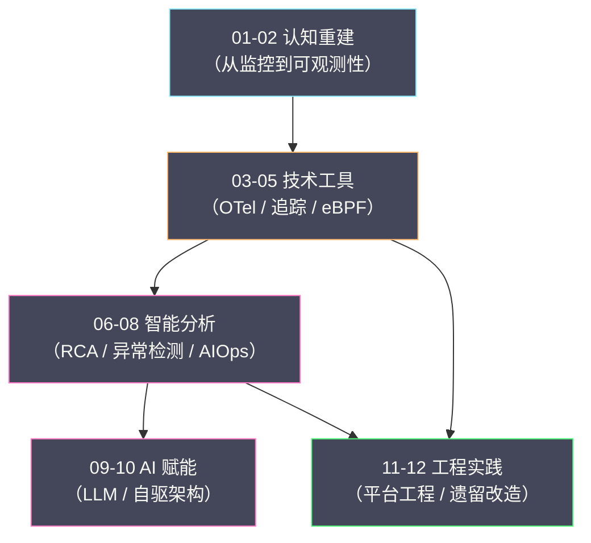

# AIOps 与可观测性实战专栏导览

**摘要：**

如果说指标、日志、链路追踪、持续剖析四个子专栏讲的是"**用什么观测**"，那么这个专栏讲的是"**观测之后怎么办**"——数据采上来了，如何从海量告警里找出真正的根因？如何用异常检测替代失灵的静态阈值？如何让 AI 参与到"降噪、归因、甚至自动处置"里来？如何把可观测性做成一套开发者愿意用的平台能力？本专栏沿着"认知重建 → 技术工具 → 智能分析 → AI 赋能 → 工程实践"五条线展开，覆盖从监控到可观测性的范式跃迁、OpenTelemetry 与分布式追踪的工程细节、根因分析与异常检测的方法论、AIOps 与 Agentic AI 的边界、以及平台工程与遗留系统改造的落地路径。读完之后，你应当能回答两个问题：**可观测性与 AIOps 的分界线在哪里，以及一个团队该按什么顺序把"数据"变成"决策"**。

---

## 专栏定位

本专栏处在整个可观测性系列的"**上层**"——它不重复讲某一种信号怎么采、怎么存、怎么查，而是讲"**有了信号之后，如何用它来解决问题**"。

这个定位可以用一条链路来说明：**采集（四个子专栏）→ 汇聚 → 分析（本专栏）→ 决策 → 处置（本专栏）**。四个子专栏把数据"做出来"，本专栏把数据"用起来"。**前者是基础设施，后者是能力建设**。

因此本专栏的核心不是"某个工具怎么配"，而是三件事：**如何从告警走到根因（RCA 方法论）**、**如何让检测更聪明（异常检测与 AIOps）**、**如何让能力可复制（平台工程与成熟度演进）**。

## 与四个子专栏的分工声明

本专栏与 `指标`、`日志`、`链路追踪`、`Profiler` 四个子专栏有内容上的交集，先把分工讲清楚，避免读者重复阅读。

**其一，信号本身的深度归子专栏，信号的"协同与运用"归本专栏。** 想知道"PromQL 怎么写""LogQL 怎么查""SkyWalking 的 OAP 怎么算指标"——去看对应子专栏；想知道"如何把四种信号串起来定位一次复杂故障"——看本专栏（第 06 篇）。

**其二，单点工具归子专栏，方法论与体系归本专栏。** 子专栏讲"某个工具/某种信号"的实现与工程；本专栏讲"跨信号的通用方法论"——如根因分析的五步法、异常检测的基线方法、AIOps 的降噪逻辑。**工具会过时，方法论更持久**。

**其三，技术细节归子专栏，组织与落地归本专栏。** 本专栏花相当篇幅讲"平台工程""成熟度模型""行业案例与渐进路径"——这些是"技术之外、却决定成败"的部分。**一个团队的可观测性水平，往往不取决于"用了什么工具"，而取决于"有没有把它变成流程与习惯"**。

**其四，重叠部分以子专栏为准。** 涉及 OpenTelemetry、eBPF、分布式追踪原理的内容，本专栏只做"服务于方法论"的概述，深度实现请参考 `链路追踪` 与 `Profiler` 子专栏。

## 目录

| 序号 | 文章 | 核心内容 |
|---|---|---|
| 01 | [[01 可观测性的本质：从监控到认知跃迁]] | 监控与可观测性的本质区别、三大支柱的由来、云原生为何让监控失灵、可观测性的四个层次 |
| 02 | [[02 可观测性三大支柱深度解析：Metrics、Logs 与 Traces]] | 高基数问题、结构化日志、采样策略、事件与剖析的补充角色、四信号的协作 |
| 03 | [[03 OpenTelemetry：可观测性标准化的终局]] | OTel 架构、Collector 工作原理、自动与手动插桩、遗留系统的无侵入接入 |
| 04 | [[04 分布式追踪的深层原理：从 Span 到跨服务故障定位]] | 上下文传播机制、托管服务与消息队列的传播、黑盒系统、Trace 驱动的根因分析 |
| 05 | [[05 基础设施可观测性：eBPF 的崛起与内核级洞察]] | eBPF 原理与安全模型、网络可观测性、无代理观测的边界 |
| 06 | [[06 根因分析的系统方法论：从告警到根因的五步法]] | RCA 数据模型、信号关联分析、关联视图实践、典型误判模式 |
| 07 | [[07 异常检测工程实践：从统计基线到机器学习]] | 静态阈值的失败、动态基线、ML 异常检测原理、假阳性控制 |
| 08 | [[08 AIOps 核心原理：SLO 驱动的智能运维体系]] | AIOps 1.0 与 2.0、告警风暴根治、黄金信号、SLO 与业务目标对齐 |
| 09 | [[09 LLM 与 Agentic AI：大模型在 AIOps 中的边界与实践]] | 大模型接入可观测性、Agent 的设计与边界、从响应式到主动式运维 |
| 10 | [[10 自驱架构：预测性伸缩与成本弹性的工程实现]] | 事件驱动架构与 AI 决策、预测性伸缩、信任体系建设、AI 的隐性成本 |
| 11 | [[11 可观测性平台工程：Golden Path 与开发者体验]] | 内部开发者平台与可观测性的融合、模板化与生命周期管理、成熟度模型 |
| 12 | [[12 遗留系统可观测性改造：从黑盒到透明]] | 行业实践差异、从零侵入到深度插桩的演进路径、改造旅程的完整回顾 |

## 知识图谱

本专栏各篇之间的关系，可以用一张图概括——从"认知"到"能力"，逐层上升：

## 主线与阅读路径

本专栏的主线可以概括为一条"**从数据到决策**"的链路：**先理解为什么需要可观测性（01-02）→ 再看支撑它的技术工具（03-05）→ 然后是分析方法论（06-08）→ 接着是 AI 赋能的可能与边界（09-10）→ 最后是工程落地与组织演进（11-12）**。

按需求选择路径：

- **快速建立认知**：01 → 02 → 06。
- **工程与工具**：03 → 04 → 05。
- **方法论与智能分析**：06 → 07 → 08。
- **AI 与前沿**：08 → 09 → 10。
- **平台与落地**：11 → 12。
- **完整通读**：01 → 02 → 03 → 04 → 05 → 06 → 07 → 08 → 09 → 10 → 11 → 12。

## 贯穿全篇的四条判断

本专栏不追求罗列工具与概念，而是围绕四条判断展开，先在这里点出，便于阅读时留意：

1. **监控与可观测性的分界线是"能不能问新问题"。** 监控回答的是"预先定义好的问题"（这个指标超阈值了吗）；可观测性回答的是"没有预先定义的问题"（这个从没见过的现象，到底为什么）。**判断一个系统是否"可观测"，标准是"能否在不改代码的前提下回答新问题"**。
2. **数据不是能力，从数据到决策的链路才是。** 采集只是起点。告警降噪、根因关联、异常检测、自动处置——这些"把数据变成行动"的环节，才是可观测性真正产生价值的地方。**"采了很多数据"与"能用数据解决问题"之间，隔着一条很长的工程链**。
3. **AI 能加速分析，但不能替代判断。** 大模型擅长"从海量信息里找线索""生成可能的假设"，但"哪些假设成立、该如何处置"仍然需要人。**把 AI 定位成"副驾驶"而非"自动驾驶"，是当前阶段最务实的姿态**。
4. **没有银弹，只有因地制宜。** 静态阈值与动态基线、自建平台与商业方案、零侵入与深度插桩——每一对选择都没有绝对优劣，取决于你的规模、阶段与约束。**可观测性的建设，本质是一连串"与自身条件匹配"的取舍**。

## 关联专栏

- [[可观测/指标/00 专栏导览|指标与 VictoriaMetrics]]：指标的采集、存储、查询与 SLO 体系（本专栏第 08 篇的底座）。
- [[可观测/日志/00 专栏导览|日志与 Grafana Loki]]：日志的采集、存储与检索（本专栏第 02、06 篇的底座）。
- [[可观测/链路追踪/00 专栏导览|链路追踪]]：Trace/Span 模型、上下文传播与 SkyWalking 实现（本专栏第 03、04 篇的底座）。
- [[可观测/Profiler/00 专栏导览|持续性能剖析]]：火焰图与 eBPF 剖析（本专栏第 05 篇的底座）。
- [[可观测/00 可观测性全景导览|可观测性全景导览]]：四种信号的整体视角与本专栏在其中的位置。
- [[SRE/CVM集群可靠性工程/00 专栏导览|CVM 集群可靠性工程]]：本专栏的方法论在虚拟化场景的应用。
