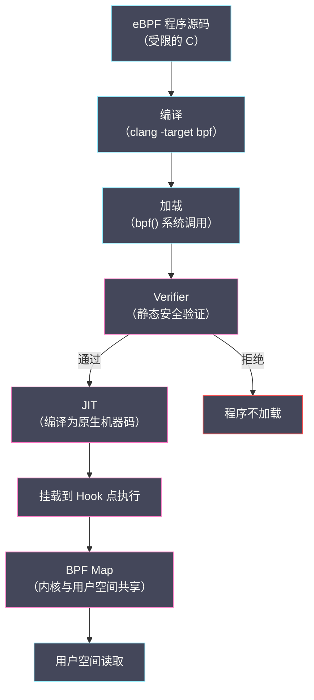

# 05 基础设施可观测性：eBPF 的崛起与内核级洞察

**摘要：**

应用层的可观测性工具（OTel SDK、Prometheus 客户端库）能告诉你业务代码发生了什么，但它们有一个根本的盲区：**内核**。TCP 重传、磁盘 I/O 调度延迟、进程调度停顿、文件系统锁竞争——这些发生在内核层的事件，往往是应用层性能问题的真正根因，却对应用层工具完全不可见。eBPF（extended Berkeley Packet Filter）的出现，为内核级可观测性提供了安全、高效、无需修改内核源码的技术路径。本文从"一次神秘的延迟尖刺"讲起，剖析传统内核观测工具的局限，拆解 eBPF 的技术本质（从包过滤器到通用内核虚拟机、执行触发机制、BPF Map），介绍 Cilium 与 Hubble 在 Kubernetes 网络可观测性中的角色、bpftrace 与 Pixie 的工程用法、以及 eBPF 与持续剖析的关系，随后讨论它的安全边界与生产注意事项，最后给出"什么时候用 eBPF、什么时候用 OTel"的定位矩阵。读完之后，你应当能回答两个问题：**应用层观测不到的那一层长什么样，以及 eBPF 凭什么能补上它**。

---

## 第 1 章 应用层观测的盲区

### 1.1 一次神秘的延迟尖刺

某服务的 P99 延迟每天凌晨 3 点左右会出现 500ms 的尖刺，持续约 2 分钟后自动恢复。从 Jaeger 的追踪数据来看，所有 Span 都正常——每个 HTTP 处理 Span、数据库查询 Span 的耗时都和平时一样，但请求的端到端时间就是比平时多了 500ms。

工程师查遍了应用日志，没有发现任何错误。数据库慢查询日志也是清白的。GC 日志显示那段时间有一次 Full GC，但只有 80ms，不足以解释 500ms 的差距。

最终定位这个问题的不是应用层工具，而是 eBPF 工具 `bpftrace`。通过追踪 `sys_read` 和 `sys_write` 系统调用的延迟分布，工程师发现每天凌晨 3 点前后，磁盘写入延迟的 P99 从正常的 1ms 飙升到 400ms。进一步分析发现，这是 Linux 内核的脏页回写（dirty page writeback）机制在凌晨触发的——一个不受应用代码控制的内核行为，完全在应用层可观测性工具的视野之外。

> [!warning] 应用层工具的结构性盲区
> 应用层工具（JVM Profiler、OTel SDK）只能观测"业务代码执行时间"。当一段代码因为等待内核完成 I/O、等待 CPU 调度、等待内存页调入而阻塞时，应用层看到的只是"时间消失了"——代码在某个系统调用处停了下来，没有任何标记说明是什么原因。eBPF 是目前唯一能在不侵入内核源码的前提下，安全地观测这些"时间黑洞"的技术。

### 1.2 传统内核观测工具的局限性

在 eBPF 之前，内核层可观测性主要依赖以下工具：

- `strace`：追踪进程的系统调用序列，但开销极高（会将被追踪进程的速度降低 10-100 倍），完全不适合生产环境
- `perf`：Linux 内核自带的性能分析工具，功能强大但输出格式复杂，分析门槛高；采样模式有一定开销，持续运行在生产环境有风险
- 内核模块（Kernel Module）：可以实现任意的内核级追踪，但需要修改和编译内核模块，一旦代码有 Bug 可能直接导致系统崩溃
- `SystemTap`：通过脚本语言编写内核探针，比内核模块安全，但运行时仍有较高开销

eBPF 的出现解决了这些工具的核心矛盾：**安全性（不会崩溃系统）+ 低开销（生产环境可用）+ 灵活性（不需要修改内核）**。

---

## 第 2 章 eBPF 的技术本质

先看一次 eBPF 程序的完整生命周期，本章的细节都围绕它展开：



**"先验证、再执行"这个顺序，是 eBPF 能"既开放又安全"的根本机制**——它保证了"任何进入内核执行的代码，都已经过安全审查"。

### 2.1 从包过滤器到通用内核虚拟机

eBPF 的名字来源于"Extended Berkeley Packet Filter"，但现代 eBPF 的能力已经远超最初的网络包过滤器用途。理解 eBPF，必须先理解它的本质：**一个运行在 Linux 内核中的沙箱化虚拟机（Sandboxed VM）**。

这个虚拟机可以执行用户编写的程序，但有严格的安全限制：eBPF 程序必须通过内核的验证器（Verifier）才能被加载，验证器会静态分析程序的控制流，确保程序没有无限循环、不会访问无效内存、不会危害内核稳定性。通过验证的 eBPF 程序由 JIT 编译器编译为本地机器码，以接近原生代码的速度运行。

这个设计解决了传统内核观测工具的根本矛盾：eBPF 程序在内核内部运行（可以访问内核数据结构），但通过验证器保证了安全性（无法破坏内核），同时 JIT 编译保证了性能（开销通常 < 5%）。

### 2.2 eBPF 的执行触发机制

eBPF 程序不是主动运行的，而是**事件驱动**的。每个 eBPF 程序都附着（attach）在一个特定的内核事件上，当这个事件发生时，eBPF 程序自动被调用执行。常见的事件类型：

**kprobe/kretprobe**（内核函数探针）：可以附着在任何内核函数的入口或返回点。入口处可以读取函数的参数，返回点可以读取函数的返回值和执行时间。例如，附着在 `do_sys_open` 函数可以追踪所有文件打开操作；附着在 `tcp_v4_connect` 可以追踪所有 TCP 连接建立。

> [!info] kprobe 的稳定性风险
> kprobe 附着在内核函数的符号（Symbol）上，而内核函数的签名可能随内核版本变化。依赖特定内核符号的 eBPF 程序在内核升级后可能失效，需要重新验证和更新。Tracepoint 是更稳定的替代选项。

**tracepoint**（内核追踪点）：内核源码中预先埋设的静态追踪点，在内核版本稳定后接口不会改变。tracepoint 的稳定性优于 kprobe，适合依赖稳定接口的长期生产部署。典型的 tracepoint 包括 `syscalls:sys_enter_read`（系统调用 read 进入时）、`sched:sched_switch`（进程调度切换时）、`block:block_rq_complete`（块设备 I/O 完成时）。

**uprobe/uretprobe**（用户空间函数探针）：类似于 kprobe，但作用于用户空间程序的函数（如 `/usr/bin/python3` 中的特定函数，或 JVM 的 `java.lang.Object.hashCode`）。uprobe 是实现"无需修改代码"的应用层追踪的关键机制——OTel Java Agent 使用 ByteBuddy，而 eBPF uprobe 是完全不修改目标二进制文件的替代方案。

**XDP**（eXpress Data Path）：网络数据包在进入内核网络栈之前就被 eBPF 处理，是目前性能最高的网络包处理机制（可以达到单核 10Mpps 以上的处理速度）。Cilium 的网络策略执行和负载均衡就基于 XDP 实现。

### 2.3 BPF Map：数据共享的桥梁

eBPF 程序在内核中运行，但观测结果需要传递到用户空间（如 Prometheus 或可视化工具）。这个数据桥梁由 **BPF Map** 提供。

BPF Map 是一种共享内存数据结构，eBPF 程序可以在内核中读写 Map，用户空间程序也可以通过系统调用读写同一个 Map。这使得数据采集（内核侧写入）和数据消费（用户侧读取）可以高效地异步进行，避免了每次事件都需要上下文切换到用户空间的开销。

BPF Map 的类型决定了适用场景：
- `BPF_MAP_TYPE_HASH`：哈希表，适合计数器（如"每个 TCP 目标 IP 的连接数"）
- `BPF_MAP_TYPE_ARRAY`：数组，适合统计直方图（如"系统调用延迟分布"）
- `BPF_MAP_TYPE_PERF_EVENT_ARRAY`：环形缓冲区，适合流式事件传递（如"每次文件打开事件"）
- `BPF_MAP_TYPE_RINGBUF`（较新）：改进版环形缓冲区，比 PERF_EVENT_ARRAY 更高效，是现代 eBPF 程序的首选数据传递方式

---

## 第 3 章 Cilium 与 Hubble：Kubernetes 的 eBPF 可观测性平台

### 3.1 为什么 Kubernetes 需要 eBPF 网络可观测性

在 Kubernetes 集群中，Pod 之间的网络通信走的是 CNI（容器网络接口）插件管理的虚拟网络。传统的网络监控工具（如 netstat、tcpdump）对 Pod 级别的流量识别能力很弱——它们能看到物理机上的网络接口流量，但无法将流量精确关联到具体的 Pod 名称、Namespace 和 Service。

Cilium 作为基于 eBPF 的 CNI 插件，从根本上改变了这一局面。因为 Cilium 本身在内核 eBPF 层处理所有 Pod 间流量，它能在数据包转发的同时，以极低的开销收集 L3/L4/L7 层的流量信息，并将这些信息与 Kubernetes 的 Pod 和 Service 元数据精确关联。

### 3.2 Hubble：Cilium 的可观测性界面

Hubble 是 Cilium 的可观测性平台，基于 Cilium 在 eBPF 层采集的网络事件数据，提供以下能力：

**网络流量可视化**：以服务视角展示所有 Pod 间的流量关系（Service Map），支持按 Namespace、Service、Pod 维度聚合，直观展示哪些服务之间有通信、流量大小和协议分布。

**L7 协议解析**：Hubble 能解析流经 Envoy Sidecar 的 HTTP/1、HTTP/2、gRPC 请求，提取请求方法、URL、状态码等信息，并聚合为 RED 指标（Request Rate、Error Rate、Duration）。这意味着在 Cilium + Hubble 的环境中，即使服务没有安装任何 APM SDK，也能获得基础的服务级 Metrics——这对于那些"改不了代码"的遗留服务尤其有价值。

**网络策略审计**：Hubble 能展示被 NetworkPolicy 拒绝的流量，这是调试 Kubernetes 网络策略的利器。当一个微服务突然无法访问另一个服务时，Hubble 的流量日志能立即显示是否有 Policy 在拦截这个连接，省去了大量的猜测和排查时间。

> [!note] Hubble 与 Jaeger 的互补性
> Hubble 提供的是**网络层**的可观测性（谁在和谁通信、网络是否畅通），Jaeger 提供的是**应用层**的可观测性（一次请求在每个服务中执行了什么操作）。两者在功能上互补而非替代。对于诊断"服务 A 为什么无法访问服务 B"这类网络问题，Hubble 是更直接的工具；对于诊断"服务 A 处理请求时哪个操作最慢"，Jaeger 是更好的选择。

### 3.3 Cilium Service Map 的部署实践

Hubble 的 Service Map 功能需要在 Cilium 安装时启用 `hubble.enabled=true` 和 `hubble.ui.enabled=true`。在较大的集群中（100+ 节点），Hubble 的数据采集和聚合会对 CPU 产生一定开销，需要在部署前评估资源预算。

生产环境最佳实践：
- 启用 Hubble 的流量采样（默认采样率 100%，大集群建议降低到 50% 或更低）
- 为 Hubble Relay 配置 HPA，在流量高峰期自动扩容
- 将 Hubble 数据与 Prometheus 集成（Cilium 自带 Metrics 导出），在 Grafana 中统一展示

---

## 第 4 章 eBPF 可观测性的生产实践

### 4.1 bpftrace：一行命令的内核洞察

bpftrace 是 eBPF 的高级脚本语言，将复杂的 eBPF 程序编写简化为类 AWK 语法的单行或多行脚本。它是 Linux 性能分析大师 Brendan Gregg 主导开发的工具，被誉为"Linux 可观测性领域的 AWK"。

bpftrace 的典型应用场景：

**分析系统调用延迟分布**（`syscalls:sys_enter_read` 和 `sys_exit_read` 追踪）：
通过在系统调用入口记录时间戳，在出口计算耗时，生成延迟直方图，可以直接看到 read 系统调用的 P50/P95/P99 延迟——这是判断磁盘 I/O 是否是性能瓶颈的最直接方法。

**追踪进程调度延迟**（`sched:sched_wakeup` 和 `sched:sched_switch`）：
当一个进程被唤醒（如收到 I/O 完成通知）到真正获得 CPU 开始运行的时间间隔，称为"调度延迟"（Runqueue Latency）。如果 CPU 过载，调度延迟可达数百毫秒，这在应用层完全不可见（应用代码认为自己在正常运行，只是"时间莫名其妙消失了"）。

**追踪 TCP 连接建立失败**（`kprobe:tcp_v4_connect`）：
实时监控 TCP 连接建立的成功率和失败原因（连接被拒绝、超时、端口不可达等），这对于诊断微服务间的连接问题非常有效，比 `netstat -s` 提供的聚合统计信息更有针对性。

### 4.2 Pixie：Kubernetes 原生的 eBPF 可观测平台

Pixie 是由 New Relic 开源的 Kubernetes 可观测性平台，其核心价值主张是：**零配置，自动可观测**。Pixie 通过 eBPF 自动采集集群中所有 Pod 的 HTTP/gRPC 请求、数据库查询、DNS 查询等应用层流量，无需安装任何 Sidecar 或修改应用代码。

Pixie 的 eBPF 实现利用了 uprobe 技术在内核层解析 HTTP/2 帧和 TLS 握手数据（通过附着在 OpenSSL 等加密库的函数上，在数据加密前读取明文）。这是 eBPF 在应用层可观测性方面最令人惊叹的能力——即使流量是加密的，eBPF 也可以在用户空间（应用进程内）的加密函数执行前，读取到明文数据。

> [!warning] eBPF SSL 解密的合规考虑
> eBPF 对 TLS 流量的"解密"是在本地进程内读取明文（在加密之前），不是破解密码学。但在合规敏感的环境中（如处理 PCI DSS 数据），应该评估这种能力是否符合合规要求，以及是否需要对 eBPF 的使用进行额外的访问控制。

### 4.3 Continuous Profiling：从点到面的性能分析

持续分析（Continuous Profiling）是 eBPF 在性能可观测性领域的重要应用方向。传统的性能分析（Profiling）通常是一次性的：工程师发现性能问题时，手动运行 Profiler 复现问题。这种方式的问题是：生产环境的性能问题往往难以复现，很多问题只在特定的流量模式或数据组合下才会出现。

Continuous Profiling 将性能采样变为持续进行的后台任务：eBPF 程序持续以固定频率（通常 19Hz 或 99Hz）对系统中所有进程进行 CPU 采样，记录每次采样时的调用栈。通过聚合大量采样数据，可以生成代表"哪些函数消耗了最多 CPU 时间"的火焰图（Flame Graph）。

Pyroscope（原 Phlare 项目，2023 年合并为 Pyroscope）是目前最成熟的开源 Continuous Profiling 平台。Pyroscope 的 eBPF Agent 使用 perf_event 类型的 eBPF 程序进行 CPU 采样，支持 Go、Java（通过 async-profiler）、Python、Ruby 等多种语言的调用栈解析，并与 Grafana 无缝集成，支持 Trace-Profile 关联分析（点击一个慢 Trace，直接跳转到对应时间段的 CPU Profile）。

---

## 第 5 章 eBPF 的安全边界与生产注意事项

### 5.1 内核版本的要求与限制

eBPF 的功能随 Linux 内核版本持续增强，不同内核版本对 eBPF 特性的支持程度差异显著：

| 内核版本 | 关键 eBPF 特性 |
|---|---|
| 4.1 | socket filter, kprobe, perf_event |
| 4.7 | tracepoint 支持 |
| 4.9 | cgroup-bpf（容器级流量控制）|
| 4.18 | BTF（BPF Type Format，支持内核类型信息）|
| 5.2 | BPF Tail Call，大幅提升程序复杂度上限 |
| 5.8 | BPF Ring Buffer（高性能事件传递）|
| 5.13 | unprivileged eBPF 进一步限制（安全加固）|

对于在生产环境部署 eBPF 工具，内核 4.14+ 是最低可接受版本，5.4+ 才能充分利用现代 eBPF 的能力。如果你的生产系统运行的是 CentOS 7（内核 3.10），则无法使用大多数现代 eBPF 工具，需要先评估内核升级的可行性。

### 5.2 权限与安全模型

在 Linux 5.8 之前，加载 eBPF 程序需要 `CAP_SYS_ADMIN` 权限（几乎等同于 root 权限）。这在安全敏感的环境中是一个显著的障碍——给一个监控工具 root 权限的风险显然过高。

Linux 5.8 引入了 `CAP_BPF` 和 `CAP_PERFMON` 权限，将 eBPF 的权限需求拆分为更细粒度的 Capability：`CAP_BPF` 只允许加载经过验证的 eBPF 程序，不赋予其他 root 级权限。这使得在容器环境中安全地运行 eBPF 工具成为可能。

### 5.3 Verifier 的限制与程序复杂度

eBPF Verifier 在保证安全的同时，也限制了程序的复杂度。历史上 eBPF 程序有严格的指令数量上限（内核 5.2 之前为 4096 条指令），这使得编写复杂的 eBPF 程序需要拆分为多个通过 Tail Call 连接的子程序。

现代内核（5.2+）已经将指令数量上限提升到 100 万条，大多数可观测性场景不会再触及这个限制。但 Verifier 的循环展开（Loop Unrolling）要求仍然存在：eBPF 程序不能包含可能无限执行的循环，所有循环必须有明确的上界。这对于处理不定长数据（如解析 HTTP 请求体）带来了一些限制，需要使用 BPF 的 Bounded Loop 语法来处理。

---

## 第 6 章 eBPF 与传统工具的定位矩阵

### 6.1 什么时候用 eBPF，什么时候用 OTel

选择 eBPF 还是 OTel 插桩，取决于你想观测的问题层次：

| 观测目标 | 推荐工具 | 原因 |
|---|---|---|
| HTTP 请求耗时（业务接口性能）| OTel SDK | 提供业务语义，结合 Attribute 分析 |
| 数据库查询耗时（SQL 级别）| OTel SDK + DB 插桩 | Span 记录 SQL 语句和结果行数 |
| TCP 连接失败率 | eBPF（cilium/Hubble 或 bpftrace）| 内核层网络事件，OTel 看不到 |
| 进程调度延迟 | eBPF（tracepoint sched_switch）| 纯内核事件 |
| 磁盘 I/O 延迟分布 | eBPF（block tracepoint）| 块设备层事件 |
| 无代码改动的 HTTP 追踪 | eBPF（Pixie 或 Hubble L7）| 应用层无法插桩时的替代方案 |
| CPU 热点函数分析 | eBPF + Continuous Profiling | 周期性采样，代码级别的性能洞察 |
| 容器间网络策略调试 | Hubble | 与 K8s NetworkPolicy 集成 |

### 6.2 分层可观测性的架构原则

理想的生产可观测性体系是**分层的**：

- **应用层**（OTel SDK）：业务逻辑、服务间调用、数据库操作的追踪和指标
- **容器/网络层**（Cilium Hubble）：Pod 间网络流量、NetworkPolicy、L7 HTTP 指标
- **内核层**（eBPF 工具/Pixie）：系统调用延迟、磁盘 I/O、进程调度、TCP 行为
- **硬件层**（PMU Profiling）：CPU 缓存命中率、内存带宽、NUMA 效应

在排查性能问题时，应该从应用层开始（成本最低、信息最丰富），当应用层的数据无法解释观察到的现象时，再逐步向内核层和硬件层深入。eBPF 是这个分层架构中的关键中间层，它填补了应用层和传统系统工具之间的信息鸿沟。

---

## 小结

eBPF 代表了 Linux 可观测性技术的范式跃迁。在 eBPF 出现之前，内核层的观测要么风险极高（内核模块），要么开销巨大（strace），要么信息不精确（聚合统计）。eBPF 通过沙箱化的内核虚拟机、JIT 编译和 BPF Map 机制，实现了安全、低开销、高灵活性的三角平衡。

对于工程师而言，掌握 eBPF 的核心价值不在于能写出 eBPF 程序（大多数情况下，现有工具如 bpftrace、Pixie、Cilium 已经足够），而在于建立"当应用层工具无法解释问题时，向内核层寻找答案"的思维模型。这种思维模型，加上下一篇[[06 根因分析的系统方法论：从告警到根因的五步法]]中的分析框架，将使你在面对疑难生产问题时具备更完整的工具和视角。

---

## 深度专题：eBPF 工具生态全景图

### 工具分类与选型指南

eBPF 工具生态按使用门槛和适用场景可以分为四个层次：

**第一层：开箱即用的性能分析工具集**

这一层的工具不需要用户了解 eBPF 内部机制，提供了开箱即用的分析能力：

- `execsnoop`：追踪所有新进程的创建（exec 系统调用），显示命令名、参数、PID 和父 PID。常用于排查"为什么 CPU 使用率突然升高"——有时是某个守护进程反复崩溃重启导致的。
- `opensnoop`：追踪所有文件打开操作，显示进程名、PID、文件路径和打开结果。对于排查"哪个进程在频繁读写某个配置文件"非常有效。
- `biolatency`：统计块设备 I/O 延迟的直方图分布，是诊断磁盘性能问题的首选工具。
- `tcpretrans`：追踪 TCP 重传事件，显示源地址、目标地址、重传次数。网络抖动和连接不稳定的场景下，这是第一个应该运行的工具。
- `runqlat`：统计进程在运行队列（Run Queue）中等待 CPU 的时间分布，直接测量调度延迟。如果 P99 超过 10ms，说明 CPU 存在明显的竞争压力。
- `profile`：CPU 采样 Profiler，以 99Hz 的频率采样所有线程的调用栈，输出火焰图所需的折叠格式数据。

以上工具来自 BCC（BPF Compiler Collection） 和 Brendan Gregg 的《BPF Performance Tools》 两个项目，几乎所有 Linux 发行版都可以通过包管理器安装。

**第二层：可编程的探针脚本**

`bpftrace` 提供了高级脚本语言，允许用户编写自定义的内核探针，无需 C 语言知识。语法类似 AWK，包含类型注解和内置函数，学习曲线相对平缓。

典型的 bpftrace 使用模式：

- 分析特定进程的系统调用延迟分布（附着 `tracepoint:syscalls:*`）
- 追踪特定函数的调用频率和参数（附着 `kprobe:function_name`）
- 监控内存分配模式（附着 `kprobe:kmalloc`）

bpftrace 适合于即席分析（Ad-hoc Analysis）场景：当遇到无法用现有工具解释的问题时，临时编写一个探针脚本来获取特定数据。

**第三层：框架级集成工具**

这一层的工具将 eBPF 能力集成为完整的可观测性平台：

- Pixie：Kubernetes 集群的零配置可观测平台，自动采集 HTTP/gRPC/SQL 流量
- Cilium Hubble：K8s 网络层的可观测性，深度集成 NetworkPolicy 和服务发现
- Grafana Beyla：基于 eBPF 的应用层 RED 指标自动采集，无需 SDK 插桩
- Parca：持续性能分析平台，使用 eBPF 进行 CPU 采样

**第四层：直接开发 eBPF 程序**

适合需要完全定制化探针的高级场景，使用 C 语言编写 eBPF 程序，通过 libbpf（CO-RE，一次编译，多内核版本运行）进行编译和加载。这一层的使用者通常是可观测性平台的开发者，而不是最终用户。

---

### 生产环境的 eBPF 性能影响评估

在生产环境部署 eBPF 工具之前，评估性能影响是必要步骤。以下是各类 eBPF 探针的典型开销参考数据：

| 探针类型 | 典型开销 | 说明 |
|---|---|---|
| kprobe（低频系统调用）| < 0.1% CPU | 每秒触发次数 < 10K |
| kprobe（高频系统调用，如 read/write）| 1-5% CPU | 取决于调用频率和探针复杂度 |
| tracepoint（网络相关）| 0.5-2% CPU | 在高流量场景下开销较明显 |
| XDP（网络包过滤）| < 1% CPU per 1Mpps | XDP 的效率远高于 iptables |
| CPU Profiling（99Hz）| 1-3% CPU | 几乎可以忽略不计 |
| SSL 解密（uprobe on OpenSSL）| 5-15% CPU | 取决于 TLS 连接频率 |

关键原则：**kprobe 附着在高频函数（如每秒调用百万次的 `sys_read`）时，开销会显著放大**。在这类情况下，使用 tracepoint（有稳定的 overhead 保证）或降低采样频率（如每 100 次调用只触发一次 eBPF 程序）是更安全的选择。

在 Kubernetes 环境中，可以先在一个节点上部署 eBPF 工具，通过 `top` 或 Prometheus 的 CPU Metrics 对比部署前后的变化，确认开销在可接受范围内再推广到整个集群。

---

### eBPF 的调试与故障排查

eBPF 工具本身也可能出现问题，常见的故障场景和排查方法：

**问题 1：eBPF 程序加载失败**

症状：工具启动时报错 `Permission denied` 或 `Operation not permitted`

排查方向：
- 检查内核版本是否满足要求（`uname -r`）
- 检查当前用户是否有 `CAP_SYS_ADMIN` 或 `CAP_BPF` 权限
- 检查系统的 `/proc/sys/kernel/unprivileged_bpf_disabled` 值是否为 0

**问题 2：kprobe 探针附着后无数据输出**

症状：工具运行但没有任何事件输出

排查方向：
- 确认目标函数名拼写正确（通过 `cat /proc/kallsyms | grep function_name` 验证函数存在）
- 确认内核没有进行内联优化（某些简单函数可能被内联，导致 kprobe 找不到目标符号）
- 对于内联函数，改用 tracepoint 或 uprobe

**问题 3：eBPF Map 数据丢失或不准确**

症状：统计数据明显不合理（如计数器不增长，或数值异常大）

排查方向：
- 检查 BPF Map 的大小配置（Map 满后新数据会被丢弃）
- 对于环形缓冲区（Ring Buffer），检查消费速度是否跟得上生产速度
- 检查 eBPF 程序中的 Map 操作是否有正确的错误处理（BPF 助手函数的返回值需要检查）

---

### 延伸阅读

**Brendan Gregg 的工作**是 eBPF 可观测性领域最重要的学习资源：

- 《BPF Performance Tools》（2019，Addison-Wesley）：系统介绍 BCC、bpftrace 和所有 BPF 性能工具的权威教材
- https://www.brendangregg.com/blog/：持续更新的技术博客，包含大量真实案例
- Linux Performance 网页（https://www.brendangregg.com/linuxperf.html）：Linux 性能观测工具的全景图，每个工具的定位一目了然

**Cilium 官方文档**（https://docs.cilium.io）：Hubble 的配置和使用指南，以及基于 eBPF 的网络策略工程实践

**bpftrace 官方教程**（https://github.com/iovisor/bpftrace/blob/master/docs/tutorial_one_liners.md）：从零开始的 bpftrace 一行式脚本入门，20 个实例覆盖最常见的使用场景

---

## 案例研究：某互联网公司的 eBPF 可观测性实施历程

### 背景与挑战

某拥有 300+ 微服务、20,000+ Kubernetes Pod 的互联网平台，在经历了两年的 OTel + Prometheus 建设后，发现仍有一类故障频繁"逃脱"应用层可观测性的覆盖：

- **每月 1-2 次的网络抖动事件**：表现为服务间的 P99 延迟突增 200-500ms，持续 3-10 分钟后自动恢复，但 Prometheus 的服务级 Metrics 和 Jaeger 的 Trace 都无法给出根因
- **数据库写入偶发超时**：数据库查询 Span 显示正常，但 MySQL 的慢查询日志中偶尔会出现 200ms 的写入操作（正常应该 < 10ms）
- **特定节点的 CPU 使用率异常**：某些节点的 CPU 使用率比同规格节点高出 15-20%，但所有运行在这些节点上的 Pod 单独来看都是正常的

### 解决方案：三层 eBPF 覆盖

**第一层：Cilium + Hubble 的部署**

将 K8s 集群的 CNI 插件从 Flannel 迁移到 Cilium（历时 2 周的灰度迁移），同时部署 Hubble。

迁移后立即解决了第一类问题（网络抖动）：Hubble 的流量日志显示，抖动期间有大量 TCP 重传发生在宿主机网络层（而非 Pod 网络层），且重传集中在特定的 Pod 到 Node IP 的连接上。进一步分析发现，是 Kubernetes 节点的网卡 Driver 在特定流量模式下触发了 IRQ 中断聚合（Interrupt Coalescing），导致网络包处理延迟增加。

没有 Hubble 提供的精确 TCP 重传数据，工程师可能需要花数天时间排查这个问题；有了 Hubble，1 小时内完成了定位。

**第二层：bpftrace 的按需分析**

为数据库写入偶发超时问题，工程师编写了一个 bpftrace 脚本，追踪 MySQL 数据目录所在磁盘的 I/O 延迟分布（附着 `block:block_rq_complete` tracepoint）。

脚本运行后，发现磁盘 I/O 的 P99.9 延迟在某些时间段高达 150ms（正常时 P99.9 < 5ms），且高延迟的 I/O 全部是写操作。进一步关联发现，高延迟时间段与 MySQL 节点上的另一个进程（日志收集 Agent）进行大批量文件 I/O 的时间高度重合——两者共享磁盘，日志收集 Agent 的 I/O 密集操作影响了 MySQL 的写入延迟。

解决方案：为 MySQL 数据目录配置独立磁盘（SSD），与日志文件目录隔离。

**第三层：Continuous Profiling 的部署**

部署 Grafana Pyroscope（DaemonSet 模式，使用 eBPF 进行 CPU 采样）后，CPU 使用率异常的节点问题在 2 天内得到解释：

火焰图显示，这些节点上的某几个 Pod 有大量 CPU 时间消耗在 JSON 序列化操作上（`encoding/json` 包的 `Marshal` 函数在火焰图中占比高达 35%）。正常节点上相同类型的 Pod，`Marshal` 的占比只有 8%。

对比代码发现，问题 Pod 是一个数据处理服务，它在处理特定类型的数据时（某些较大的嵌套 JSON 对象）会触发反射型 JSON 序列化，而正常情况下使用的是预编译的 JSON Codec。当这类数据的比例超过 20% 时，CPU 使用率会异常升高。

这个问题在没有 Continuous Profiling 的情况下极难发现：Prometheus 的 CPU Metric 告诉你"CPU 高"，但不告诉你"CPU 时间花在哪里"；OTel Trace 记录了请求耗时，但不分析代码级别的 CPU 分配。

### 经验提炼

这个案例说明了分层可观测性的价值：三个问题分别需要不同层次的工具才能解决。

任何单一层次的工具，都只能解决属于它视野范围内的问题。eBPF 工具的价值不是替代应用层可观测性，而是在应用层工具"黔驴技穷"时，提供深入内核的观测能力。

---

## 实验指南：在本地环境体验 eBPF 工具

### 环境要求

- Linux 内核 5.4+（可以用 Ubuntu 20.04 LTS 或更高版本的 VM）
- 安装 BCC 工具集：`sudo apt install bpfcc-tools linux-headers-$(uname -r)`
- 安装 bpftrace：`sudo apt install bpftrace`

### 实验 1：观察系统调用延迟

运行 `sudo biolatency-bpfcc -m 5` 5 秒钟，观察磁盘 I/O 延迟的直方图分布。

在运行 biolatency 的同时，在另一个终端运行 `dd if=/dev/zero of=/tmp/test bs=1M count=1000`，观察 biolatency 的输出如何变化（I/O 延迟直方图向右移动）。

这个简单的实验直观展示了 eBPF 工具如何在不影响被观测程序的前提下，实时采集内核层的 I/O 性能数据。

### 实验 2：追踪文件打开操作

运行 `sudo opensnoop-bpfcc`，同时在另一个终端运行你的应用程序或一些 Linux 命令（如 `cat /etc/hosts`、`python3 -c "import json"`）。观察 opensnoop 输出中每个进程打开的文件列表。

这个实验展示了 eBPF 如何提供系统级别的"全局视野"：不仅能观测你关注的进程，还能同时观测所有进程的文件操作，发现意料之外的文件访问模式。

### 实验 3：CPU 热点分析（需要 Go 或 Python 程序）

编写一个有明显 CPU 密集型操作的程序（如计算 Fibonacci 数列），用 `sudo profile-bpfcc -F 99 10` 采样 10 秒（99Hz 采样频率），将输出的调用栈折叠数据导入 Brendan Gregg 的 FlameGraph 工具，生成火焰图（SVG 格式）。

对比程序优化前后的火焰图，直观看到热点函数的变化——这正是持续性能分析（Continuous Profiling）的工作原理和价值所在。

---

## 核心知识点速查

### eBPF 五大核心概念的一句话总结

**BPF Program（BPF 程序）**：运行在内核沙箱中的小型程序，由用户编写、内核 Verifier 验证、JIT 编译为机器码执行。

**BPF Map**：内核与用户空间之间共享数据的机制，eBPF 程序将采集的数据写入 Map，用户空间程序从 Map 读取数据进行分析和展示。

**BPF Verifier（验证器）**：内核中的静态分析器，在 eBPF 程序加载时验证其安全性（无无限循环、无越界访问、无有害内核操作），是 eBPF 安全性的核心保障。

**Probe（探针）**：eBPF 程序的触发器，分为 kprobe（内核函数探针）、tracepoint（内核静态追踪点）、uprobe（用户空间函数探针）等类型，决定了 eBPF 程序在什么事件发生时被调用。

**BTF（BPF Type Format）**：内核数据类型的元数据格式，使得 eBPF 程序能够跨内核版本运行（CO-RE：Compile Once, Run Everywhere），解决了 eBPF 程序与特定内核版本强绑定的历史问题。

---

### eBPF 与可观测性三支柱的关系图

```
┌─────────────────────────────────────────────────────────┐
│                    可观测性分层架构                        │
├─────────────────────────────────────────────────────────┤
│  应用层（OTel SDK）                                       │
│  → HTTP 接口 Trace，数据库查询 Span，业务 Metrics          │
│  → 提供：业务语义，服务间调用链，Attribute 丰富            │
│  → 盲区：内核行为，进程调度，底层 I/O                     │
├─────────────────────────────────────────────────────────┤
│  容器/网络层（Cilium Hubble）                             │
│  → Pod 间网络流量，L7 HTTP 指标，NetworkPolicy 审计        │
│  → 提供：服务依赖可视化，网络故障定位，零插桩 RED 指标      │
│  → 盲区：应用内部逻辑，业务 Attribute                     │
├─────────────────────────────────────────────────────────┤
│  内核/系统层（eBPF 工具：bpftrace、BCC、Pixie）           │
│  → 系统调用延迟，磁盘 I/O，进程调度，TCP 行为              │
│  → 提供：应用层不可见的内核事件，性能问题的根本原因         │
│  → 盲区：业务语义，服务身份（无 K8s 元数据集成时）          │
├─────────────────────────────────────────────────────────┤
│  硬件层（PMU Profiling、硬件计数器）                       │
│  → CPU 缓存命中率，内存带宽，NUMA 效应                    │
│  → 提供：极限性能优化所需的硬件级洞察                      │
│  → 适用：极少数对延迟极度敏感的核心服务                    │
└─────────────────────────────────────────────────────────┘
```

排查策略：**从上往下**。先看应用层（成本最低），再看容器/网络层（Cilium 已部署时零成本），再看内核层（eBPF 工具的复杂度较高），最后看硬件层（极少需要）。

---

### eBPF 在 SRE 日常工作中的使用频率参考

**高频使用（每周或每次重大故障时）**：
- Hubble 的网络流量视图和错误率监控
- `biolatency` 分析磁盘 I/O 性能
- `tcpretrans` 检查网络重传情况
- Grafana Pyroscope 的 CPU Profile 趋势分析

**中频使用（每月或特定性能问题时）**：
- `runqlat` 分析 CPU 调度延迟
- `opensnoop` 排查意外的文件访问
- `profile` 生成火焰图进行 CPU 热点分析
- bpftrace 脚本进行特定函数的临时追踪

**低频使用（季度级别的深度性能优化）**：
- SSL 解密追踪（排查加密流量的性能问题）
- NUMA 感知的内存访问分析
- 内核网络栈的深度追踪（排查极端网络问题）

---

本文为"AIOps 与可观测性实战"专栏第 5 篇，完整介绍了 eBPF 在基础设施可观测性中的应用原理和实践路径。下一篇[[06 根因分析的系统方法论：从告警到根因的五步法]]将把 eBPF 提供的内核层洞察，与应用层 Trace 和 Metrics 数据整合进一个完整的故障根因分析框架中。

---

## 写在最后：为什么 SRE 必须了解 eBPF

可观测性技术的演进有一个规律：每一层的工具成熟后，工程师的注意力就会转向更深的一层。当 Prometheus + Grafana 解决了应用层 Metrics 的问题，工程师开始追求追踪数据（Jaeger/OTel）；当追踪数据解决了服务间调用的可见性问题，工程师开始追求内核层的洞察（eBPF）；当 eBPF 解决了内核层的可见性问题，下一个前沿可能是硬件层（PMU Profiling）和 AI 辅助的根因分析。

eBPF 目前正处于从"极客工具"向"生产标准"的过渡阶段。Cilium 已经成为 CNCF 最受欢迎的 CNI 插件之一，Grafana Pyroscope 被越来越多的团队纳入可观测性基础设施，Pixie 在 Kubernetes 社区获得了广泛关注。掌握 eBPF 的工作原理和主要工具，不只是技术前沿的兴趣爱好，而是 SRE 应对下一代系统复杂性的必要能力储备。

**不需要成为 eBPF 专家，但需要知道什么时候它比其他工具更有效。** 这个判断力，就是本文希望带给你的核心价值。

---

## 快速参考卡：eBPF 工具选择速查

当你遇到不同类型的问题时，快速选择正确的 eBPF 工具：

**磁盘问题**
- 磁盘 I/O 延迟高 → `biolatency`
- 频繁写入的文件是哪些 → `fileslower` + `opensnoop`
- 磁盘读写 I/O 大小分布 → `bitesize`

**网络问题**
- TCP 连接建立慢 → `tcpconnect` + `tcpconnlat`
- 网络重传频繁 → `tcpretrans`
- K8s 服务间网络流量 → Cilium Hubble
- 网络包被丢弃 → `dropwatch`

**CPU 问题**
- CPU 热点函数 → `profile` (BCC) 或 Pyroscope
- 调度延迟高 → `runqlat`
- 系统调用频率异常 → `syscount`

**内存问题**
- 内存分配来源 → `memleak` (追踪未释放的内存分配)
- Page Fault 频繁 → `trace` + kernel fault tracepoint

**进程问题**
- 哪些进程被频繁创建 → `execsnoop`
- 某进程打开了哪些文件 → `opensnoop -p <PID>`
- 某进程发出了哪些系统调用 → `syscount -p <PID>`

---

## 第 7 章 eBPF 与 OpenTelemetry 的融合

eBPF 与 OTel 不是竞争关系，而是"覆盖不同层次"的互补关系，这一点值得单独讲透。

**OTel 覆盖"应用层"**：它通过 SDK 与 Agent 在应用代码里插桩，能拿到**业务语义**——"这是下单请求""这个调用对应哪个用户"。**它的边界是"进程之内、语言之上"**。

**eBPF 覆盖"内核层"**：它从内核观测系统调用、网络包、调度事件，能拿到**内核视角**——"这次调用对应哪个 TCP 连接""这个进程为什么被调度出去"。**它的边界是"业务语义"**。

**两者的融合点有两个**。**其一是"零侵入自动埋点"**：Grafana Beyla 这类工具用 eBPF 在内核层观测 HTTP/gRPC 调用，自动生成 Span，不需要改应用代码。**它补上了"无法改代码的服务"这一块**。**其二是"上下文关联"**：把 eBPF 采到的"网络事件"与 OTel 采到的"业务 Span"用同一个标识关联起来，从而回答"这个慢 Span 对应的网络重传情况如何"。

**融合的现实障碍在于"语义对齐"**：eBPF 看到的是"端口与 IP"，OTel 看到的是"服务与接口"，两者之间需要一层映射。**这层映射的准确性，决定了融合能走多远**——**这与追踪里"把 peer 解析成服务名"是同一类问题**（第 04 篇讲过）。

**这条融合路径的意义在于：它让"零侵入"与"业务语义"第一次有了共存的可能**。**eBPF 提供覆盖，OTel 提供语义，两者拼起来，才接近"既能全覆盖、又能讲业务"的理想**——**而当前的现实是"接近"，还远未"达到"**。

---

## 第 8 章 eBPF 的边界与争议

**边界一：看不到业务语义。** eBPF 在内核层观测，能看到"哪个系统调用、哪个网络包"，看不到"这次调用对应哪个用户、哪个订单"。**业务上下文只有应用自己知道**。

**边界二：精度依赖符号。** 对 CPU 剖析而言，没有符号信息时栈还原不全，火焰图上会出现大片 `[unknown]`。**"采到栈"不等于"看懂栈"**。

**边界三：对解释型语言支持有限。** Python、Ruby 的语言层调用栈，eBPF 难以直接还原。

**边界四：需要特权。** 在安全敏感的环境里，"装一个特权容器"本身就是一个需要审批的动作。

**争议：eBPF 会不会成为可观测性的核心**？一派认为它的"零侵入全覆盖"能解决接入成本这个最大障碍，未来会越来越重要；另一派认为"业务语义只有应用知道"，eBPF 的深度受限于"内核能看到什么"，应用埋点不可替代。**务实的共识是：两者互补，而非替代**——**eBPF 覆盖"改不了代码的服务"与"内核行为"，应用埋点覆盖"业务语义"与"精细控制"**。

**这又一次回到了本系列的核心判断：没有银弹，只有权衡**。**任何宣称"一种技术解决所有问题"的说法，都值得警惕**——无论是当年的"网格包办一切"，还是今天的"eBPF 包办一切"。

---

## 第 9 章 一个 eBPF 可观测性的落地路径

技术讲完，回到"怎么落地"。

**第一步，从"一次性诊断"开始。** 用 `bpftrace` 或 `bcc` 的现成脚本，在排查具体问题时"临时看一眼内核"。**这一步的目标不是"覆盖"，而是"让团队先看到内核视角的价值"**。

**第二步，上"持续的内核观测"。** 部署 Cilium 或 Hubble，获得"持续的网络可观测性"——它能回答"哪些服务之间在通信、延迟如何、有没有丢包"，而这些是应用层看不到的。

**第三步，补"零侵入的性能剖析"。** 部署 Parca 或 Pyroscope 的 eBPF 模式，覆盖"无法改代码的第三方组件"（MySQL、Redis、Nginx）。

**第四步，把三层拼起来。** 让"网络观测""内核剖析""应用埋点"能用同一个坐标系（时间、服务、实例）关联——**这才是"分层可观测性"的完整形态**（第 06 篇会展开）。

**这四步的顺序遵循"从诊断到持续、从单点到体系"的规律**，与前面几篇讲追踪、剖析的落地路径完全一致。**"先用起来、再建体系"是一条普适的工程原则**——**因为只有"用起来"，才会积累"为什么需要体系"的真实体感**。

---

## 深度专题二：内核观测的常见误区

**误区一：以为 eBPF 是"零成本"的。** 它开销很低，但不是零——kprobe 在高频系统调用上可达 1% 到 5% CPU，SSL 解密探针可达 5% 到 15%。**"低开销"是相对的，需要针对具体探针评估**。

**误区二：把"能观测"当成"该观测"。** 内核事件的数量极其庞大，**如果什么都采，数据量会失控**。**该问的是"我关心什么"，而不是"我能采什么"**。

**误区三：忽略内核版本差异。** eBPF 的能力随内核版本扩张，"某个特性在旧内核上不可用"是常态。**在异构集群里，要以"最老的那批内核"为基线做设计**。

**误区四：以为 eBPF 能替代应用埋点。** 如第 8 章所述，它拿不到业务语义。**把它当"补充"，而不是"替代"**。

**这四条误区的共同点，是"高估了 eBPF 的万能性"**。**eBPF 是"补上内核这一层盲区"的利器，但它不是"可观测性的全部"**——**把它放在正确的位置上，它才能发挥最大的价值**。

---

## 第 10 章 eBPF 在 AIOps 中的位置

把 eBPF 放到更大的 AIOps 图景里，它在三个方向上都有位置。

**其一是"更细的输入"**。AIOps 的异常检测与根因分析，本质上依赖"输入数据的质量"。eBPF 提供的"内核级、全覆盖"数据（系统调用、网络流量、调用栈），是传统埋点难以覆盖的一类输入。**更细的输入，往往能带来更准的检测**。

**其二是"更低的采集门槛"**。AIOps 要"全量数据"，而传统埋点的接入成本让"全量"很难达成。eBPF 的零侵入，让"全量覆盖"变得可行——**没有数据，任何智能分析都是空谈**。

**其三是"更早的信号"**。内核层的信号往往比应用层更早（如"网络重传开始增多"早于"应用超时"）。**更早的信号，意味着更早的预警**。

不过也要清醒：**eBPF 给的是"底层数据"，不是"智能结论"**。它能提供更丰富的输入，但"从数据到结论"仍然需要异常检测、根因分析这些上层能力。**eBPF 是 AIOps 的"燃料"，不是"引擎"**——**这与 OTel"是管道不是能力"是同一个判断**。

---

## 第 11 章 eBPF 的学习路径

对想深入 eBPF 的读者，一条务实的路径是：**先用现成工具 → 再用 bpftrace 写脚本 → 最后用 libbpf 写程序**。

**第一步，用现成工具。** `perf`、`bpftrace` 的一行命令、Cilium/Hubble、Parca/Pyroscope 的现成 Agent——**先用起来，建立"内核观测能做什么"的直觉**。

**第二步，用 bpftrace 写脚本。** bpftrace 的语法接近 awk，几行就能写一个"统计某系统调用次数"的脚本。**这一步建立"写观测逻辑"的感觉**。

**第三步，用 libbpf 写程序。** 当需求超出 bpftrace 的表达力时，才进入 C 加 libbpf 的世界。**这一步才需要理解 Verifier、Helper、Map、CO-RE 这些细节**。

**这条路径的价值，是"按需深入"**——**大多数人只需要走到第一步或第二步**（用现成工具与脚本），只有"要造轮子"的人才需要走到第三步。**不要被 eBPF 的"内核"二字吓住**——它的绝大部分价值，是通过现成工具就能享受到的。

---

## 深度专题三：一次 eBPF 排查复盘

**现象**：某 Java 服务的"延迟高、CPU 低"，用户态工具查不出原因。

**第一步，应用层先看**：OTel 追踪显示，慢请求的时间花在"等待下游调用返回"上——**看起来像"下游慢"**。

**第二步，下游也看**：下游服务的 P99 正常。**"下游慢"的假设被排除**。

**第三步，上 eBPF 看内核**：用 eBPF 抓"网络层事件"，发现大量 TCP 重传，且重传集中在"某几个节点之间"。

**第四步，定位到具体环节**：进一步用 eBPF 看"进程调度"，发现这些节点上有"资源竞争导致的调度延迟"。

**第五步，根因确认与修复**：是"某台宿主机上的 noisy neighbor 抢占了网络与 CPU 资源"。把服务调度到其他节点后，延迟恢复正常。

**这个复盘展示了 eBPF 的不可替代性**：**问题出在内核层（网络重传、调度延迟），而应用层与下游服务"各自看起来都正常"**。**如果没有内核观测，这个问题会一直停留在"玄学"层面**——**这正是第 01 章讲的"应用层观测的盲区"的一次真实兑现**。

---

## 深度专题四：eBPF 与网络可观测性

eBPF 在网络观测上的价值，值得单独展开。

**传统网络观测的困境**：抓包（tcpdump）能看到"包的内容"，但在高流量下开销巨大且难以分析；流日志（NetFlow）能看到"谁和谁通信了多少字节"，但粒度粗、看不到"这次请求的延迟"。

**eBPF 的解法**：它能在内核的网络路径上"零侵入"地观测每一次连接、每一次请求，**同时拿到"五元组、延迟、状态码"这些信息**——这是抓包与流日志都给不了的组合。

**Cilium 与 Hubble 正是这个思路的产物**：Cilium 用 eBPF 实现网络策略，顺带获得"全量的网络可观测性"；Hubble 把这个能力做成"服务级视图"——**"哪些服务之间在通信、延迟如何、有没有丢包"**。**对 Kubernetes 环境而言，这几乎是"零配置获得网络可观测性"的最优解**。

**这条路径的意义在于：它把"网络观测"从"专项工具"变成了"数据面的副产品"**。**Cilium 本来就是数据面，观测只是它"顺便"提供的**——**这与"网格顺带提供观测"是同一个模式：把观测做进数据路径，成本最低**。

---

## 第 12 章 eBPF 的演进方向

**方向一：内核能力持续扩张。** 新的 Hook、Helper、Map 类型不断加入，eBPF 能观测的深度会持续逼近应用层。**这意味着"今天做不到的，明年可能就做到了"**。

**方向二：跨语言观测的深化。** 社区在探索更好地还原解释型语言的语言层调用栈。**一旦突破，"全覆盖"的短板就补上了**。

**方向三：与标准栈的融合。** OTel 社区在探索把 eBPF 纳入自动埋点；eBPF 相关项目也在融入 CNCF 生态。**标准化的融合，会进一步降低它的接入门槛**。

**方向四：安全模型的演进。** 社区在推动"非特权 eBPF"——让部分场景不需要特权容器即可使用。**这会解决它"落地门槛高"这一现实痛点**。

**这四个方向的共同指向是"能力更强、门槛更低"**。**从这个趋势看，eBPF 在可观测性里的地位大概率会继续上升**——但**它的定位不会变：它是"底层覆盖"，不是"业务语义"**。**上升的是"它能覆盖的范围"，不变的是"它够不着的地方"**。

---

## 深度专题五：eBPF 在生产中的运维要点

**要点一：把 eBPF Agent 当成基础设施来管理。** 它有权限要求（特权容器）、有版本要求（内核版本）、有资源开销（每节点一个）、有标签设计（按服务切分数据）。**"零侵入"是对应用的，不是对运维的**。

**要点二：监控 Agent 自身的健康。** eBPF Agent 的"采集中断"往往是静默的——数据不来了，但没人报警。**把"Agent 是否在正常工作"做成一个指标**。

**要点三：控制探针数量与频率。** 探针越多、频率越高，开销越大。**按"实际需要"开探针，而不是"全部打开"**。

**要点四：为内核版本差异做准备。** 异构集群里可能有多种内核版本，**以最老的为基线做设计**，避免"部分节点上某些特性不可用"。

**要点五：保留"快速关闭"的能力。** 一旦怀疑 eBPF Agent 引起问题，要能快速停掉它。**给任何"隐式生效"的组件留一条"快速关掉"的路，是运维的基本功**。

**这五条的共同点，是"把 eBPF 当成一项集群基础设施来对待"**——**它有准入要求、有资源成本、有故障模式、有治理需求**。**"零侵入"降低了应用侧的接入成本，但没有降低运维侧的治理成本**。

---

## 深度专题六：eBPF 的社区与学习资源

如果想系统学习 eBPF，有几处资源值得优先看。**入门首选 eBPF.io**——它是社区官方门户，有概念介绍与教程。**深入性能分析看 Brendan Gregg 的《BPF Performance Tools》**——它是内核观测领域的权威，配套大量可直接运行的脚本。**工程实践看 Cilium 与 Pixar 的文档**——它们展示了 eBPF 在 Kubernetes 生产环境里的真实用法。**写脚本看 bpftrace 的官方文档**——它的 one-liner 教程能让你在半小时内写出第一个可用的观测脚本。

**这几处资源的共同特点，是"从用到懂、从简到繁"**——**先跑通一个脚本、看到内核数据，再回头理解 Verifier 与 Map**。**这条路比"从原理开始啃"更适合工程背景的读者**：**因为内核观测的价值，只有在"真的看到一次数据"之后才会变得具体**。

**这也与本篇的整体建议一致：先用现成工具建立直觉，再按需深入原理**。**毕竟，学习一项技术的最大动力，来自"它解决了我一个真实的问题"，而不是"它的原理很优雅"**。

---

## 参考资料

1. Gregg, B. (2019). *BPF Performance Tools: Linux System and Application Observability*. Addison-Wesley.
2. eBPF.io：https://ebpf.io/
3. Cilium Documentation：https://docs.cilium.io/
4. Pixie Documentation：https://docs.px.dev/
5. Parca Documentation：https://www.parca.dev/docs/overview
6. Alexei Starovoitov, Daniel Borkmann. *BPF: the universal in-kernel virtual machine*. LWN.net.
7. Grafana Beyla：https://grafana.com/oss/beyla-ebpf/

---

> [!note] 思考题
> 1. 应用层可观测性工具的"根本盲区"是什么？请用"TCP 重传、磁盘 I/O 调度延迟、进程调度停顿"三个例子说明，为什么这些问题在应用层看不到。
> 2. eBPF 为什么能"既开放又安全"？请用"Verifier 先验证、JIT 后执行"的顺序，说明这个机制如何保证"用户代码跑在内核里也不出事"。
> 3. eBPF 与 OTel 是互补的。请说明"零侵入自动埋点"与"上下文关联"这两个融合点各自解决了什么问题，以及"语义对齐"为什么是融合的障碍。
> 4. eBPF 的"低开销"是相对的吗？请举出两个开销较高的探针场景，并说明在什么情况下需要重新评估。
> 5. 如果你要在一个 Kubernetes 集群里引入 eBPF 可观测性，会按什么顺序推进？为什么"从一次性诊断开始"比"直接上平台"更稳妥？

